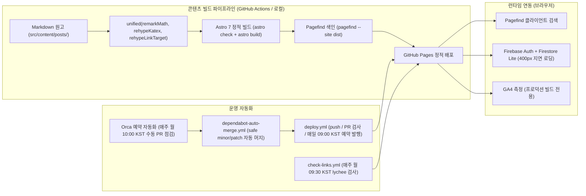

# 블로그 아키텍처와 개발 여정

Tistory에서 직접 구축한 Astro 정적 블로그로 이전하고, 레이아웃·댓글·자동화·검색엔진 대응까지 다듬어 온 과정과 설계 결정을 정리한 문서입니다.

관련 문서:
- [README](../README.md)
- [오르카 인수인계](orca-handoff.md)
- [논의 백로그](discussion-backlog.md)

---

## 1. 블로그 방향과 설계 원칙

### Tistory에서 직접 만든 Astro 블로그로 이전한 이유

기존 Tistory 블로그는 글을 쓰고 관리하기는 편했지만, 레이아웃과 읽기 경험을 원하는 수준까지 다듬는 데 한계가 있었습니다. 원고와 이미지가 플랫폼에 묶여 버전 관리나 일괄 교정이 어렵고, 모바일·PC 사이트맵 중복이나 불필요한 스크립트도 제어하기 힘들었습니다.

처음에는 Jekyll 기반 `al-folio`를 검토했으나, 구조가 무겁고 원하는 미니멀한 톤과 맞지 않아 폐기했습니다. 대신 콘텐츠 중심의 정적 사이트 생성기인 Astro로 처음부터 새로 구축해, 글 원고(`src/content/posts/`)와 이미지까지 모두 Git 저장소 안에서 직접 소유하고 관리하는 방식으로 전환했습니다. 기존 Tistory에는 새 글을 올리지 않고 그대로 두며, 앞으로의 모든 기록은 새 블로그에만 작성합니다.

### 정체성: 공부·성장 기록장 + 빌더 포트폴리오

이 블로그의 가장 큰 독자는 기록자 본인입니다. 따라서 About 페이지를 단순 이력서나 스펙 나열 대신 "평생의 나침반 -> 가꿔 갈 꿈(5~10년) -> 요즘의 나(지금~1년) -> 지나온 발걸음" 순서의 성장 기록장으로 구성했고, 학력이나 숫자 과시 카드는 의도적으로 뺐습니다.

동시에 직접 만든 도구와 프로젝트를 소개하는 `What I Made` 레일과 `/projects/` 페이지를 두어, 공부 기록과 실제 구현 결과물이 한 공간에서 자연스럽게 이어지는 빌더 포트폴리오 성격을 함께 갖췄습니다.

### 핵심 설계 원칙

- 무서버·무료 운영: GitHub Pages(정적 호스팅), Firebase Spark 무료 플랜(댓글 인증·저장), Google Analytics 4(방문자 통계)를 조합해 별도 서버 유지비 없이 운영합니다.
- 빌드 타임 처리 우선과 최소 클라이언트 JS: 수식 렌더링(KaTeX), 코드 구문 강조(Shiki), 본문 링크 새 창 속성 부여(`rehype-link-target.mjs`), 정적 검색 색인(Pagefind)을 모두 빌드 단계에서 끝냅니다. 브라우저 JS는 사진 뷰어, 코드 복사, 소제목 링크 복사, 지연 로딩 댓글처럼 상호작용이 꼭 필요한 영역에만 최소한으로 둡니다.
- 군더더기 없는 읽기 경험: 본문 읽기 폭(`--width: 840px`), Pretendard Variable 폰트, 라이트/다크 모드(시스템 설정 연동 + 수동 전환), 애플 블루 포인트 컬러(`#0071e3`, 다크 모드 `#2997ff`)를 기준으로 읽기 흐름을 방해하는 요소를 덜어냈습니다.

---

## 2. 현재 아키텍처

### 전체 구성도

### 파이프라인과 런타임 역할 분담

- 콘텐츠 빌드 파이프라인 (`package.json`, `astro.config.mjs`): `npm run build` 실행 시 `astro check`로 타입과 Frontmatter 스키마를 검증한 뒤 `astro build`로 정적 HTML을 생성하고, `pagefind --site dist`로 검색 색인을 만듭니다. Markdown 처리는 `@astrojs/markdown-remark`의 `unified` 파이프라인에 `remark-math`, `rehype-katex`, `src/plugins/rehype-link-target.mjs`를 연결해 수행합니다.
- 런타임 연동 (`src/components/Comments.astro`, `src/lib/firebase-comments.ts`, `src/layouts/Base.astro`):
  - 댓글은 `IntersectionObserver`로 댓글 섹션이 뷰포트 400px 안으로 들어올 때만 Firebase 모듈을 지연 로딩합니다. Firestore Lite SDK를 사용해 실시간 구독 오버헤드 없이 읽기·쓰기를 처리하고, 사용자 입력은 `innerHTML` 없이 `createElement`와 `textContent`로만 렌더링합니다.
  - GA4 스크립트는 `Base.astro`에서 `import.meta.env.PROD`와 측정 ID가 모두 있을 때만 삽입해 로컬 개발 트래픽이 섞이지 않게 합니다.
- 운영 자동화 (`.github/workflows/`):
  - `deploy.yml`: `master` push 시 빌드 후 GitHub Pages로 배포하고, PR에서는 빌드 검사만 수행합니다. 매일 09:00 KST(UTC 00:00) `cron` 스케줄로 재빌드해 미래 날짜 글의 예약 발행을 지원합니다.
  - `check-links.yml`: 매주 월요일 09:30 KST(UTC 00:30)에 빌드 결과물(`dist/**/*.html`)을 대상으로 `lychee-action`을 실행해 깨진 링크를 검사합니다.
  - `dependabot-auto-merge.yml`: `Deploy` PR 빌드가 성공한 `dependabot[bot]` PR 중 `1.x` 이상 minor/patch 업데이트만 자동 squash 머지한 뒤 `workflow_dispatch`로 `deploy.yml`을 다시 실행합니다. major 및 `0.x` minor PR은 매주 월요일 10:00 KST Orca 예약 자동화가 열린 PR 존재 여부를 확인한 뒤 수동 점검으로 다룹니다.

### 화면 레이아웃 구조

데스크톱 넓은 화면에서는 `src/styles/global.css`에 정의된 토큰을 기준으로 3열 고정 레이아웃을 사용합니다.

| 영역 | 폭 / 간격 토큰 | 배치 및 스크롤 동작 | 주요 구성 |
|---|---|---|---|
| 좌측 사이드바 | `--sidebar: 240px`, `--edge: 32px` | `position: fixed`, `overscroll-behavior: contain` | `104px` 원형 프로필 사진, 이름, 한 줄 소개, 글 수 내림차순 카테고리 트리(`countTree`) |
| 중앙 본문 | `--width: 840px` | 기본 문서 흐름 스크롤 | 홈 소개 문구(`28px`, 굵기 700) 및 최근 글 카드, 글 목록, 글 상세 본문, `/projects/` |
| 홈 우측 레일 | `--rail: 320px`, `--edge: 32px` | `position: fixed`, `overscroll-behavior: contain` | `What I Made` 프로젝트 요약 카드 |

홈, 글 목록, 글 상세, `/projects/` 페이지가 동일한 좌측 프로필·카테고리 사이드바를 공유해 어느 페이지에서든 카테고리 탐색 맥락이 끊기지 않습니다. 상단 네비게이션(`Nav.astro`)은 `Posts`, `Projects`, `About` 3개 탭을 중앙 알약형 독에 배치하고 블루 포인트로 현재 위치를 표시합니다.

---

## 3. 주요 결정 기록

### Astro 7 정적 사이트와 영문 URL 규칙

- 배경: Tistory 글 105편과 향후 새 글을 타입 안전하게 관리하고, 한글 제목 기반 URL이 깨지거나 길어지는 문제를 피해야 했습니다.
- 선택지/대안: Jekyll(`al-folio`) 유지 vs Next.js/Gatsby 등 React 기반 SSG vs Astro 콘텐츠 컬렉션.
- 최종 결정: Astro 7 정적 사이트 + 콘텐츠 컬렉션(`src/content.config.ts`) + 영문 URL 규칙(`/<카테고리>/<세부 카테고리>/<글 폴더>/`) 채택.
- 이유: 글 중심 블로그에 불필요한 런타임 번들을 싣지 않으면서도 컴포넌트 재사용과 Frontmatter 스키마 검증(`CATEGORIES` 오타 시 빌드 에러)을 모두 얻을 수 있었습니다. 카테고리는 `cs`, `stdlib`, `life` 3개 대분류와 세부 slug를 `src/site.config.ts`에서 중앙 관리해 주소 일관성을 보장합니다.

### 레이아웃 진화: 랜딩형 홈에서 풀 와이드 3단 독립 스크롤로

- 배경: 초기 랜딩형 홈(`The Heuristic Learner` 히어로와 하단 카테고리 섹션)은 스크롤 동선이 길고, 좌우 여백이 넓어지면서 본문과 사이드바가 함께 움직여 시선이 분산되는 문제가 있었습니다.
- 선택지/대안: 중앙 고정폭(`1100px`대) 유지 vs 풀 와이드 3열 독립 스크롤 + 상단 중앙 네비게이션 통일.
- 최종 결정: 좌우 `--edge: 32px` 기준 풀 와이드 3단(`240px` 좌측 사이드바, `840px` 본문, `320px` 홈 우측 `What I Made` 레일)과 `position: fixed` + `overscroll-behavior: contain` 독립 스크롤을 적용했습니다. 상단 메뉴는 `Posts` · `Projects` · `About` 블루 탭으로 통일하고, `/projects/` 페이지에도 동일한 좌측 사이드바를 배치했습니다.
- 이유: 마우스 위치에 따라 좌·중·우 영역이 독립적으로 스크롤되면서 긴 카테고리 목록과 본문을 동시에 쾌적하게 탐색할 수 있고, 기록과 프로젝트를 같은 위계로 보여줄 수 있었습니다.

### 읽기 UX 기능과 빌드 타임 처리

- 배경: 기술 글과 대회 후기에 사진·수식·코드 블록·긴 목차가 많아지면서, 본문 가독성을 해치지 않는 범위의 읽기 도구가 필요했습니다.
- 선택지/대안: 외부 무거운 라이트박스/클립보드 라이브러리 도입 vs 브라우저 네이티브 API와 빌드 타임 플러그인 조합.
- 최종 결정:
  - 사진 뷰어(`PostImageViewer.astro`): 네이티브 `<dialog>` 기반 확대 보기, 화면 맞춤, 인접 사진 필름 미리보기, 이전·다음 방향키 및 `Esc` 조작, 인접 이미지 프리로딩을 직접 구현했습니다.
  - 코드·목차·소제목(`PostCodeBlocks.astro`, `PostHeadingLinks.astro`): 언어 표시 헤더와 복사 버튼, `1280px` 미만 모바일·태블릿 접이식 목차(`
`), `h2[id]`·`h3[id]` 옆 소제목 링크 복사 버튼을 추가했습니다.
  - 본문 링크 새 창(`src/plugins/rehype-link-target.mjs`): 빌드 타임에 본문 링크에 `target="_blank"`와 `rel="noopener noreferrer"`를 부여하고, `#소제목`·각주·`mailto:`/`tel:`은 제외했습니다.
- 이유: 방문자 쪽 JS 의존성을 최소화하면서도 점진적 향상(JS 비활성 시 기본 마크업 유지)을 지킬 수 있었습니다.

### 댓글 시스템: giscus에서 Firebase Spark 자체 UI로 전환

- 배경: 초기에 `giscus`(GitHub Discussions 연동)를 커스텀 테마(`public/giscus/`)까지 입혀 적용했으나, GitHub 계정이 없는 방문자는 댓글을 달 수 없고 작성 취소·수정 흐름이나 iframe 테마 동기화에 제약이 있었습니다.
- 선택지/대안: `giscus` 유지 vs Utterances/Disqus 도입 vs Firebase Spark 무료 플랜 자체 구현(Google + GitHub 로그인) vs 카카오·네이버 로그인 추가.
- 최종 결정: Firebase Auth(Google·GitHub) + Cloud Firestore Lite 기반 자체 댓글 UI(`Comments.astro`, `src/lib/firebase-comments.ts`, `firestore.rules`)로 전환했습니다. 카카오·네이버 로그인은 추가하지 않고 Google·GitHub 2개만 유지했습니다.
- 이유: Google과 GitHub 로그인만으로 일반 방문자와 개발자 방문자를 모두 포괄하면서 미니멀한 UI와 Firebase Spark 무료·무서버 제약을 지킬 수 있었습니다. 자체 UI 덕분에 입력 취소 확인(40자 이상), 본인 수정·삭제, 1단계 답글(부모 삭제 시 소프트 삭제 유지), 관리자 배지 및 삭제 기능을 블로그 디자인과 완전히 일치시켜 구현했습니다.

### 방문자 분석과 SEO

- 배경: 유입 추이와 검색 노출 상태를 파악하되, 블로그 화면에 숫자를 과시하는 요소는 두고 싶지 않았습니다.
- 선택지/대안: 화면 공개 방문자 카운터 위젯 부착 vs 운영자 대시보드 전용 분석 도구.
- 최종 결정: GA4(`analytics.gaId`)를 프로덕션 빌드 전용으로 연결하되 화면에는 공개 카운터를 두지 않았습니다. 검색엔진은 Google Search Console과 네이버 서치어드바이저에 소유 확인 메타 태그, 사이트맵(`/sitemap-index.xml`), RSS(`/rss.xml`)를 등록했습니다.
- 이유: 읽기 화면의 미니멀함을 유지하면서도 운영자는 유입과 색인 상태를 정확히 추적할 수 있습니다.

### 의존성·운영 자동화 분리

- 배경: 분기별 Dependabot PR이 올라올 때 안전한 패치까지 일일이 수동 머지하면 번거롭고, 반대로 major 업데이트까지 자동 머지하면 빌드 깨짐 위험이 있습니다.
- 선택지/대안: 모든 PR 수동 머지 vs 모든 PR 자동 머지 vs 버전 유형별 분리.
- 최종 결정: `.github/workflows/dependabot-auto-merge.yml`로 `Deploy` 빌드를 통과한 `1.x` 이상 minor/patch PR만 자동 squash 머지 후 `deploy.yml`을 재실행하고, `semver-major`, `0.x` minor, `0.0.x` PR은 Orca 주간 자동화(매주 월요일 10:00 KST)와 연계해 수동 검토하도록 분리했습니다.
- 이유: `GITHUB_TOKEN` 머지가 `push` 이벤트를 트리거하지 않는 특성까지 `workflow_dispatch`로 보완해 안전성과 자동화 효율을 함께 확보했습니다.

---

## 4. 겪었던 시행착오와 해결 기록

### 1) Tistory 105편 이전과 데이터 정제

- 원인: Tistory 사이트맵을 추출했을 때 PC(`/123`)와 모바일(`/m/123`) 주소가 중복되어 210편으로 보였고, 원본 이미지 용량이 151MB에 달했습니다. 또한 글 간 내부 링크 220개가 옛 Tistory 숫자를 가리키고 있었으며, 하위 카테고리 `AI`가 `Al`(소문자 L)로 잘못 입력된 글과 수식 깨짐 글(18·19·20번)이 섞여 있었습니다.
- 해결: 중복을 제거해 실제 105편을 확정하고, 이미지 70개를 가로 1600px 기준으로 최적화해 151MB에서 29MB로 줄였습니다. 내부 링크 220개는 `scripts/post-slugs.json` 기준으로 새 영문 주소로 일괄 재매핑하고, `Al` 오타를 `AI`로 교정했으며, 수식 글은 KaTeX로 렌더링되도록 정리했습니다. Tistory의 색 박스·링크 카드는 파란 인용 박스와 인용+링크 형태로 통일했습니다.
- 배운 점: 정적 블로그 이전에서 가장 품이 많이 드는 부분은 템플릿이 아니라 기존 원고의 링크·이미지·메타데이터 정규화이며, 초기 이관 시점에 일관된 URL 테이블(`post-slugs.json`)을 먼저 확정해 두어야 이후 수정 비용이 줄어듭니다.

### 2) Astro 7 기본 Markdown 처리기(`Sätteri`) 변경과 수식 플러그인 충돌

- 원인: Astro 7로 올라가면서 기본 Markdown 처리기가 `Sätteri`로 바뀌었고, 기존 방식의 최상위 `remarkPlugins`/`rehypePlugins` 설정에서 deprecated 경고와 수식 플러그인 호환 문제가 발생했습니다.
- 해결: `astro.config.mjs`에서 `@astrojs/markdown-remark`의 `unified({ remarkPlugins: [remarkMath], rehypePlugins: [rehypeKatex, rehypeLinkTarget] })` 구성으로 이전해 경고 없이 KaTeX와 커스텀 rehype 플러그인이 함께 동작하도록 맞췄습니다.
- 배운 점: 메이저 프레임워크 업그레이드 시 기본 파서 변경 여부를 먼저 확인해야 하며, `unified` 파이프라인을 명시하면 플러그인 조합 제어와 디버깅이 훨씬 명확해집니다.

### 3) `giscus` 댓글 UX 제약과 Firebase Spark 전환

- 원인: `giscus`는 GitHub 계정이 없는 독자의 진입 장벽이 높고, iframe 기반이라 작성 취소 확인이나 댓글 수정 UX, 다크 모드 전환 동기화에 한계가 있었습니다.
- 해결: `home-server-c5ca5` Firebase 프로젝트에 Firestore `(default)` DB와 `firestore.rules`를 배포하고, `posts/{postKey}/comments/{commentId}` 하위 컬렉션 구조로 전환했습니다. 글별 하위 컬렉션 구조 덕분에 `orderBy('createdAt', 'asc')` 단일 필드 정렬만으로 동작해 별도 복합 색인이 필요 없었고, `textContent` 전용 DOM 생성으로 XSS를 차단했습니다.
- 배운 점: 외부 위젯을 억지로 스타일링하는 것보다, 데이터 모델과 보안 규칙(`firestore.rules`)을 단순하게 설계해 직접 UI를 소유하는 편이 장기 유지보수와 UX 일관성 면에서 유리했습니다.

### 4) 초기 레이아웃 여백 낭비·스크롤 산만함·문구 중복

- 원인: 초기 개편 후에도 화면 양옆 여백이 과도하게 남고, 본문을 내릴 때 좌측 사이드바가 함께 움직이거나 흔들렸습니다. 또한 좌측 프로필과 홈 중앙 문구가 겹치고, 카운트·더보기 문구(`전체 보기 ›`, `N편의 기록`)가 제각각이었습니다.
- 해결: 좌우 끝 여백(`--edge: 32px`) 기준 풀 와이드 3단 고정 레이아웃으로 전환하고 `overscroll-behavior: contain`으로 영역별 독립 스크롤을 구현했습니다. 좌측 프로필에는 사진·이름·한 줄 소개만 남기고(소셜 링크는 About으로 일원화), 홈 중앙 소개 문구를 `28px` 굵은 제목으로 키우며 문구 체계를 통일했습니다.
- 배운 점: 데스크톱 와이드 화면에서는 단순히 본문 폭만 늘리는 것보다, 각 레일의 역할을 분리하고 스크롤 경계를 독립시키는 것이 가독성에 훨씬 효과적입니다.

### 5) Dependabot PR #2(`typescript` `6.0.3` -> `7.0.2`) peer 의존성 충돌

- 원인: 첫 Dependabot PR #2에서 `typescript`를 `7.0.2`로 올리려 했으나 `@astrojs/check@0.9.12`와의 peer 의존성 충돌(`ERESOLVE`)로 빌드가 실패했습니다.
- 해결: 해당 PR은 `@dependabot ignore this major version`으로 보류·종료하고, `.github/workflows/dependabot-auto-merge.yml`의 검증 로직에서 `semver-major`, `0.x` minor, `0.0.x` 업데이트를 자동 머지 대상에서 제외해 수동 검토로 분리했습니다.
- 배운 점: 의존성 자동화는 "빌드 통과 확인"과 "버전 범위 화이트리스트"가 함께 있어야 안전합니다.

### 6) 본문 링크 새 창 플러그인(`rehype-link-target.mjs`)의 `raw` HTML 누락과 캐시

- 원인: Markdown 링크(`element` 타입 `a` 노드)만 처리하도록 플러그인을 작성했더니, 원고 본문에 직접 작성한 HTML `<a href="...">` 3건이 `raw` 노드로 남아 `target="_blank"`가 붙지 않았습니다. 또한 플러그인 수정 후 빌드 시 Astro 콘텐츠 캐시(`.astro/data-store.json`)로 인해 기존 글이 즉시 갱신되지 않는 현상이 있었습니다.
- 해결: `rehype-link-target.mjs`에 `node.type === 'raw'` 정규식 처리를 추가해 이미 `target=`이 있거나 `#`/`mailto:`/`tel:`/`javascript:`인 경우를 제외하고 `target="_blank" rel="noopener noreferrer"`를 붙이도록 보완했습니다. 빌드 캐시 영향도 파악해 변경이 전체 글에 반영되는지 확인했습니다.
- 배운 점: rehype 플러그인은 Markdown AST 요소(`element`)뿐만 아니라 원고 속 인라인 HTML(`raw` 노드)까지 고려해야 누락이 없으며, 빌드 파이프라인 변경 시 콘텐츠 캐시 초기화 필요성을 함께 점검해야 합니다.

### 7) Google Search Console `/sitemap-index.xml` `"가져올 수 없음"` 초기 대기 현상

- 원인: 사이트맵 제출 후 Google Search Console에서 `/sitemap-index.xml` 상태가 계속 `"가져올 수 없음"`(발견된 URL 0개)으로 표시되었습니다.
- 해결: `2026-11-26` 재확인 시 라이브 `sitemap-index.xml`과 `sitemap-0.xml`이 모두 HTTP 200, `Content-Type: application/xml`, 133개 URL을 정상 반환함을 검증했습니다. 네이버 서치어드바이저는 이미 4페이지 수집을 시작했고 사이트맵·RSS 오류가 없었으므로, Google 측의 신규 `github.io` 속성 초기 대기 상태로 판단하고 사전 대응안대로 `sitemap-0.xml`을 추가 제출한 뒤 1주 후(`2026-12-03~06`) 재확인 일정으로 이관했습니다.
- 배운 점: 콘솔 UI의 오류 문구만 보고 설정을 성급히 바꾸기 전에, 실제 응답 헤더·XML 본문·타 검색엔진(네이버) 수집 현황을 교차 검증해 원인을 분리하는 것이 중요합니다.

---

## 5. 앞으로의 방향과 로드맵

현재 기본 구축과 Tistory 105편 이관·교정, 댓글·레이아웃·자동화 정비는 마무리되었고 운영 및 고도화 단계에 있습니다.

- `What I Made` 인터랙티브 웹 데모 확장: 홈 우측 레일과 `/projects/` 페이지에 마련된 "데모 준비 중" 자리에 첫 체험 데모(예: `Drive2Model Cross-Labeler` 웹 체험 데모)를 구현해 빌더 블로그의 실체감을 높이는 것이 다음 고도화 1순위 후보입니다.
- 검색 색인 및 이력 업데이트:
  - `2026-12-03~06`: Google Search Console `/sitemap-index.xml`·`/sitemap-0.xml` 처리 결과 및 구글·네이버 색인 집계 추이 재확인
  - `2026-12-18 이후`: 정보처리기사 합격 발표 결과 확인 후 `src/data/about.ts`의 `"응시"` 표기 및 백로그 갱신
- 지속적인 기록과 글 보강: 새 공부·프로젝트·회고 글을 꾸준히 발행하면서, 기존 글의 내용 보강과 시각적 완성도를 점진적으로 다듬어 나갈 계획입니다.
