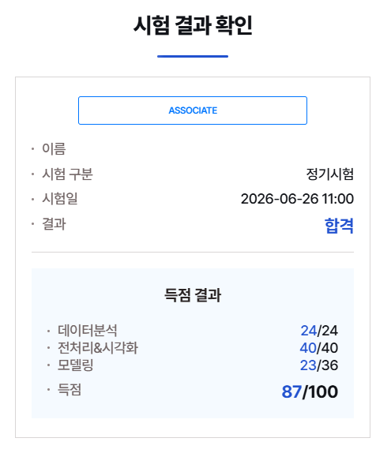
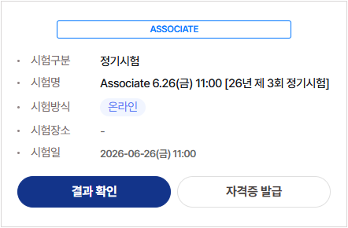
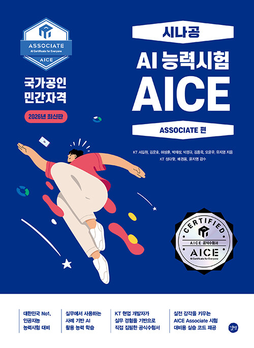

**AICE Associate 합격** 소식으로 돌아왔습니다.

*시험 결과*

## 시험 당일

저는 **6월 26일 금요일 오전 11시**, 집에서 온라인으로 시험에 응시했습니다.

시험 시작 30분 전에 미리 입실해서 카메라 상태와 자리 세팅을 여유롭게 마쳤습니다. 마침 금요일이라 가족들이 모두 출근한 덕분에, 아주 조용하고 차분한 분위기 속에서 시험에 집중할 수 있었습니다.

*시험 정보*

## 공부 방법

직접 경험해 보니 AICE Associate는 시간 대비 효율 좋게 취득하기 정말 좋은 자격증이라는 생각이 듭니다. 저는 **총 5시간 정도** 가볍게 투자해서 합격했습니다.

공부는 「[시나공 AICE Associate](https://www.aladin.co.kr/shop/wproduct.aspx?ItemId=319599996)」로 했습니다. 책으로 이론과 기본 개념을 전체적으로 한 번 쓱 정리했습니다.

그러고 나서 [AICE 샘플문항1](https://aice.study/board/notice/detail/8161)과 [샘플문항2](https://aice.study/certi/practice)를 연달아 풀어보면서 시험 문제 유형에 대한 감을 확실히 잡았습니다.

*시나공 AICE Associate*

## 마무리

AICE Associate는 큰 부담 없이 **가볍게 도전해서 취득하기 좋은 자격증**입니다. 무엇보다 **국가공인 민간자격**이라 공신력까지 든든하게 챙길 수 있다는 게 가장 큰 장점인 것 같습니다.

AICE 시험을 준비하시는 분들께 제 후기가 조금이나마 도움이 되었으면 좋겠습니다. 궁금한 점이 있으시다면 언제든 댓글 남겨주세요. 모두 좋은 결과 있으시길 응원합니다.
