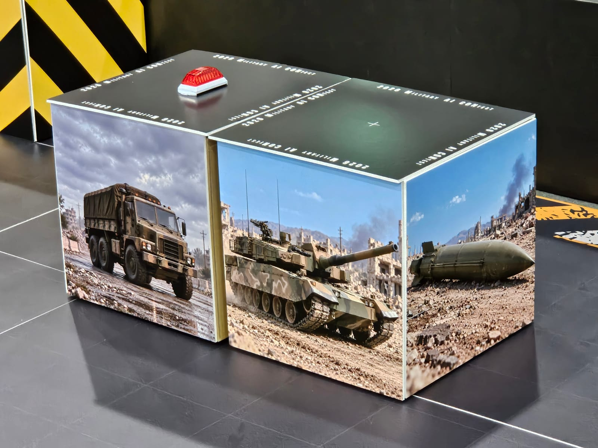
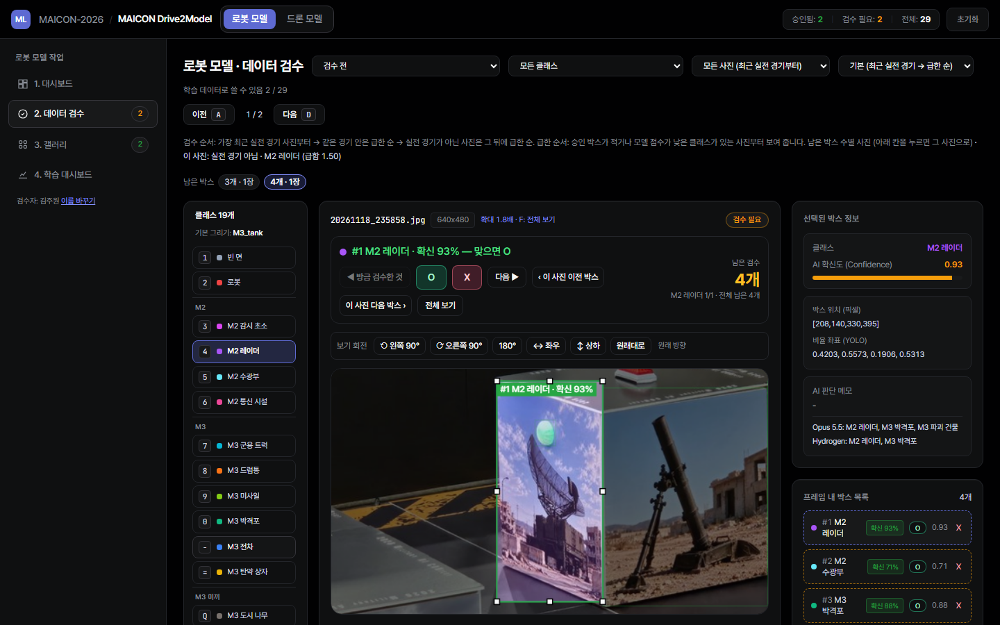

2026 국방 AI 경진대회(MAICON) 본선에서 나는 객체인식을 맡았다. 로봇 카메라용 모델과 정찰 드론 영상용 모델, 두 개를 만들었는데 실제로 시간이 가장 많이 든 건 모델이 아니라 데이터였다. 그 데이터를 만들려고 처음부터 끝까지 직접 만든 도구가 **Drive2Model**이다. 주행 테스트에서 모은 영상을 자동으로 가져와 사진을 뽑고, AI 초안과 사람 검수를 거쳐 모델을 학습한다. 새 모델이 더 나을 때만 배포 모델을 바꾼다.

대회 전체 이야기는 [본선 후기](/cs/ai/maicon-2026-finals-review/)에 적었고, 여기서는 도구가 어떻게 생겼고 왜 그렇게 만들었는지를 개발자 입장에서 정리한다.

## 풀어야 했던 문제

배점이 가장 큰 임무는 M3 전장객체 인식(30점)이었다. 경기장 곳곳에 40cm 정육면체 상자가 놓여 있고, 옆면마다 탄약상자, 드럼통, 박격포, 군용트럭, 전차, 미사일 중 하나의 그림이 붙어 있다. 로봇은 구역별로 어떤 객체가 몇 개 있는지 보고해야 하고, 한 구역의 종류와 수량이 완전히 맞아야 점수가 나온다. 여기에 나무, 차단벽, 야전진지, 파괴건물 같은 "세면 안 되는" 디코이 그림도 섞여 있다.



*본경기장의 M3 상자. 라벨은 보이는 옆면마다 바운딩 박스를 하나씩 그린다. 모서리에서 보면 한 상자에서 두 면이 함께 보인다.*

어려운 점은 세 가지였다.

- **카메라**: 로봇의 카메라는 160도 광각이고 해상도는 640×480이다. 상자 면이 가장자리로 갈수록 휘고, 멀리 있는 면은 몇십 픽셀밖에 되지 않는다.
- **연산**: 로봇은 Jetson Orin Nano 8GB 한 대로 인식, 주행, 사격을 모두 돌린다.
- **데이터**: 팀이 처음 쓰던 인식기는 대회 사전교육 자료의 공식 그림으로 만든 합성 이미지로 학습한 분류기였다. 그런데 이 인식기는 실제 사진에서 60% 정도밖에 맞히지 못했다. 실제 주행 영상으로 학습해야 했고, 그러려면 수만 장에 박스를 그려야 했다.

결국 문제는 "실제 영상에서 뽑은 사진 수만 장에, 사흘 안에, 믿을 수 있는 라벨을 붙이는 것"이었다.

## 파이프라인 한눈에 보기

첫 커밋은 11월 15일 밤이었다. 본선 직전인 11월 16일과 17일 팀이 육군 AX 거점에 모였을 때 본격적으로 만들었고, 본선(18~20일) 내내 현장에서 계속 고쳤다. 저장소의 커밋은 모두 368개다. 최종 구조는 웹 화면(FastAPI)과 상시 실행되는 처리 프로그램(`autopipe`), 학습 담당(`autotrain`, `remote_train`)으로 나뉜다.

| 단계 | 하는 일 |
|---|---|
| 1. 수집 | 주행 테스트 수집 폴더를 주기적으로 확인해 저장이 끝난 파일을 `inbox/`로 가져온다. 처리를 마친 원본 영상은 보관한다 |
| 2. 중복 제거 | 영상에서 0.25초 간격으로 프레임을 뽑고, 광각 영상에 맞춘 규칙으로 비슷한 장면을 버린다 |
| 3. AI 초안 | 서로 다른 계열의 AI 라벨러와, 앞서 학습된 YOLO 모델이 박스 초안을 그린다 |
| 4. 교차 확인 | 두 모델의 박스가 맞는지 비교한다. 의견이 갈리면 다른 모델이 한 번 더 보고, 그래도 다르면 사람에게 보낸다 |
| 5. 사람 검수 | 검수 화면에서 박스를 승인, 삭제, 클래스 변경, 위치 조정한다 |
| 6. 스냅샷 | 사람이 확인한 사진만 데이터셋 스냅샷으로 고정하고 학습 70 / 검증 20 / 시험 10으로 나눈다 |
| 7. 학습 | GPU PC가 스냅샷을 받아 YOLO26s를 학습하고 결과를 올린다 |
| 8. 평가와 교체 | 같은 시험 사진에서 F1을 재고, 기존 모델보다 나을 때만 배포 모델을 바꾼다 |

처음 설계에서는 사람이 주행 영상을 폴더에 넣고, AI가 끝까지 확신하지 못한 라벨을 검수하는 흐름을 그렸다. 실제 테스트 주행에서는 영상 수집도 자동으로 이어지게 했다. 테스트 중 파일이 수집 폴더에 쌓이면, 자동 처리 프로그램이 그 폴더를 주기적으로 확인하고 저장이 끝난 파일을 가져왔다. 주행을 마치고 영상을 하나씩 옮기는 수고가 줄었다. 프로그램이 꺼졌다 켜져도 끊긴 단계부터 이어서 하도록 처리 상태를 파일에 남겼다.

## 광각 영상에 맞춘 중복 제거

주행 영상에서 0.25초마다 프레임을 뽑으면 거의 같은 사진이 끝없이 나온다. 로봇이 멈춰 있거나 천천히 돌 때가 특히 그렇다. 이런 사진에 라벨을 다는 건 낭비이고, 더 나쁜 건 쌍둥이 사진이 학습과 시험에 갈라져 들어가 점수를 부풀리는 것이다. 첫날 만든 중복 제거는 세 단계였다.

1. **움직임 바닥값**: 직전 프레임과의 평균 밝기 차이(MAD)가 1.8보다 작으면 멈춰 있는 장면으로 보고 버린다.
2. **256비트 dHash와 격자 색 히스토그램**: 160도 광각 영상은 위쪽 천장과 아래쪽 바닥 여백이 넓어서, 64비트 해시 하나로는 멀리서 나타나는 표적을 놓친다. 그래서 상자가 주로 보이는 가운데 70% 띠에서 256비트 dHash와 칸별 색 히스토그램을 뽑는다. 최근 20장 안에 해시가 비슷하고 칸별 색 차이도 0.18보다 작은 프레임이 있으면 버린다. 해시가 비슷해도 어느 한 칸에 새 색의 상자가 나타나면 살린다.
3. **세션 전체 비교**: 같은 영상을 두 번 올린 경우를 잡으려고, 세션의 모든 프레임과 4비트 이내로 같은 해시는 버린다.

본선 중에는 한 단계를 더 붙였다. 사진을 32×24 흑백으로 줄여 세션의 모든 프레임과 상관을 비교하고, 0.95 이상이면서 4×4 칸 중 크게 바뀐 칸이 없으면 버린다. 다른 영상에서 같은 구도로 찍힌 사진까지 걸러 내기 위해서다. 발표 자료 기준으로 주행 영상 330개에서 뽑은 4만 2천 장 중 2만 3천 장이 중복과 불량으로 빠졌다.

## 서로 다른 AI 두 개가 동의해야 정답

라벨링의 핵심 아이디어는 **교차 라벨링**이다. AI 하나에게 박스를 맡기면 틀린 라벨이 사람 모르게 쌓인다. 그런데 계열이 다른 두 모델이 같은 사진에서 같은 실수를 할 가능성은 훨씬 낮다. 그래서 서로 다른 AI 두 개가 같은 답을 낸 박스만 믿고, 의견이 갈린 사진만 사람이 보면 된다고 생각했다.

라벨러를 고르기 전에, 정답 박스를 아는 합성 이미지 12장으로 후보들을 측정했다.

| 라벨러 | 박스와 클래스 모두 맞힘 | IoU | 장당 시간 |
|---|---:|---:|---:|
| Antigravity Gemini 4 Hydrogen | 88% | 0.95 | 20초 |
| Antigravity Gemini 3.8 Flash | 89% | 0.93 | 117초 |
| Claude Opus CLI | 80% | 0.93 | 13초 |
| Claude Sonnet CLI | 80% | 0.86 | 9초 |
| Codex | 25% | 0.81 | 8초 |

*합성 이미지 12장, 그림이 붙은 면만 계산한 결과 (2026-11-17). 초기 실험 기록에는 Codex의 세부 모델명이 남아 있지 않다.*

이 실험에서 가장 높은 점수도 89%였고, 모델이 스스로 매긴 확신값만으로는 오답을 걸러내기 어려웠다. 처음에는 Codex를 박스 그리기에서 빼고, Claude Opus와 Antigravity의 Gemini 계열(Argon, Hydrogen)을 주력으로 정했다. 이후 별도 실험에서 Codex CLI의 GPT-6.1-Sol(High)도 시험했다. 처음에는 Gemini API로 라벨링했지만 장당 60초가 넘고 시간 초과가 잦아서, 구독형 CLI 여러 개가 대기열 하나를 함께 처리하는 방식으로 바꿨다.

합의 규칙은 이렇다.

- 모든 사진을 서로 다른 두 라벨러가 따로 라벨링한다. 같은 Opus라면 Claude CLI의 Opus와 Antigravity의 Opus도 같은 모델로 보고 합의로 치지 않는다.
- 두 결과의 박스를 짝지어 본다. 같은 클래스이고 IoU가 0.70 이상이면 짝이다.
- 모든 박스가 짝을 이루고 남는 박스가 없으면 합의다. 박스 좌표는 두 결과의 평균을 쓴다.
- 짝이 안 맞거나 박스 수가 다르면 아직 그 사진을 보지 않은 라벨러가 한 번 더 본다. 앞의 두 결과 중 하나와 완전히 일치하면 그쪽으로 정한다.
- 세 단계를 넘겨도 합의가 안 되면 후보 라벨들을 붙여 사람 검수 대기열로 보낸다.

라벨링을 CLI 에이전트에게 맡기면서 신경 쓴 부분은 "라벨 말고 다른 일을 못 하게" 막는 것이었다. 사진 한 장만 든 임시 폴더에서 CLI를 실행하고, 도구 권한은 읽기만 준다.

```bash
claude -p "<프롬프트 + 이미지 경로>" --model opus --output-format json --allowedTools Read --add-dir <격리폴더>
```

Antigravity는 `--sandbox`로 실행했다. 실행이 끝난 뒤 격리 폴더에 원래 사진 말고 다른 파일이 생겼으면 그 답은 버리고 기록을 남긴다.

### 결국 사람이 모든 박스를 본 이유

처음 설계에서는 두 모델이 합의한 사진을 바로 학습 데이터로 승인했다. 하지만 설계 문서에 "기술적으로 돌아가더라도 실패"라고 적어 둔 첫 번째 경우가 바로 틀린 라벨이 사람 모르게 자동 승인으로 쌓이는 것이었다. 합의는 그 확률을 낮출 뿐 없애지는 못한다.

그래서 11월 19일 저녁부터는 정책을 바꿨다. AI 초안은 합의 여부와 상관없이 모두 검수 대기로 보내고, 사람이 박스를 하나씩 확인해야 학습 데이터가 된다. 대신 합의와 확신값은 검수 속도를 올리는 데 썼다. 확신이 높은 박스는 초록색으로 보여 주고 O 키 한 번으로 확인하게 했고, 의견이 갈린 박스는 두 모델의 답을 나란히 보여 줬다. 사람이 지운 박스는 기억해 두고 다음 모델이 같은 박스를 다시 제안하지 않게 했다.

자동 확인은 마지막 날 측정한 근거가 있는 범위에서만 다시 열었다. 배포 중인 모델로 학습에 쓰지 않은 사람 검수 사진을 다시 예측해 클래스별 기준값(0.60~0.95)을 구하고, 그 기준 이상에서 99% 넘게 맞는 박스만 자동 확인한다. 기준은 근거가 쌓이면 한 번에 한 칸씩만 내리고, 틀리기 시작하면 바로 올린다. 최종적으로 이 예외를 적용한 것은 드론 모델이다.

## 검수 화면



*검수 화면. 이 캡처는 글을 쓰며 저장소를 로컬에서 다시 띄우고, 본경기장에서 찍은 상자 사진 몇 장과 예시 박스를 넣어 만든 것이다. 오른쪽 아래에서 두 모델이 파괴건물 면을 두고 의견이 갈린 것을 볼 수 있다.*

검수 화면은 한 박스씩 확대해 보여 주고, O(맞음), X(삭제), 숫자 키(클래스 변경)로 처리한다. 오른쪽 "AI 판단 메모"에는 라벨러별 의견이 나온다. 클래스별 검수 모드에서는 같은 클래스의 박스를 신뢰도 낮은 순으로 모아 보고, 원하는 기준 이상의 남은 박스를 미리 확인한 뒤 한꺼번에 승인할 수 있다. 팀원 여럿이 같은 사진을 동시에 고치지 않도록, 사진을 연 사람이 그 사진을 잠그는 기능도 넣었다.

## 구독 한도와 예산 다루기

병렬 라벨링 워커를 30개까지 돌리면 구독 한도가 금방 찬다. 사흘 내내 이 한도와 씨름했다.

- **한도 감지**: CLI 출력에 `RESOURCE_EXHAUSTED`, `quota`, `usage limit` 같은 문구가 나오면 그 라벨러를 "한도 대기"로 돌리고, 맡았던 사진은 다른 라벨러에게 넘긴다. 한도는 그 사진의 실패로 치지 않는다.
- **자동 복귀**: 15분마다 실제 사진 한 장으로 다시 시험한다. 풀리는 시각은 CLI 메시지에서 읽는다. Antigravity 계정 하나가 한도에 걸리면 다른 계정으로 다시 로그인하는데, 이 재시험 덕분에 계정을 바꾸면 프로그램이 알아서 다시 쓴다.
- **유료 API 대체**: Claude Opus 구독이 한도 대기일 때만, 같은 Opus를 유료 API로 부른다. 상한은 280달러로 두고 대시보드에 쓴 돈과 남은 예산을 보여 줬다.
- **전체 정지**: 모든 라벨러가 한도에 걸리면 사진을 검수로 넘기지 않고 일시정지했다가, 하나라도 풀리면 이어서 한다.
- **시간 초과**: 같은 라벨러가 세 번 연속 시간 초과면 10분 쉬게 하고, 한 사진에서 여섯 번 실패하면 사람에게 보낸다.

## 학습과 교체 판단

사람이 확인한 사진은 시각별 스냅샷으로 고정한다. 예전 스냅샷은 지우지 않는다. 학습 70 / 검증 20 / 시험 10으로 나눌 때는 사진 단위가 아니라 영상의 시간 구간 단위로 나눠, 몇 초 차이로 찍힌 비슷한 사진이 학습과 시험에 갈라져 들어가지 않게 했다. 합성 사진은 항상 학습에만 넣는다.

학습은 YOLO26s로 했다. 로봇 모델은 입력 640px, 드론 모델은 1280px이다. 학습 대시보드에서 GPU PC를 고르면 그 PC의 작업자가 데이터를 받아 학습하고 결과를 올린다. 연구실 GPU PC와 대회 제공 워크스테이션(RTX 5070)이 작업자였다. 예를 들어 11월 20일 로봇 학습은 스냅샷 17,216장 중 학습 분할 12,819장으로 RTX 5080에서 30에포크를 돌렸고 1시간 7분 54초가 걸렸다. 사흘 동안 이렇게 22번 학습했다.

모델 교체의 기준은 F1로 정했다. 배포할 때 쓰는 신뢰도(로봇 0.35, 드론 0.30)에서 예측을 자르고, 정답과 같은 클래스이면서 IoU 0.5 이상인 것만 1:1로 맞힌 것으로 센다. mAP50-95는 참고로만 봤다. 실제 경기에서는 한 신뢰도에서 잘라 쓴 결과만 의미가 있기 때문이다. 교체 규칙은 단순하다. 같은 시험 사진에서 F1이 오르면 교체한다. 1.0%p 안에서 떨어졌으면 학습 데이터가 더 많을 때만 교체한다.

11월 20일 로봇 실험이 이 규칙이 작동한 예다. 시험 사진 1,196장에서 새 후보의 F1은 90.77%, 기존 모델은 94.37%였다. 데이터를 더 넣고 학습했는데도 점수가 떨어졌고, 규칙대로 기존 모델을 유지했다.

평가에서 하나 더 배운 것이 있다. 모델이 그린 초안을 사람이 고쳐 시험 정답을 만들면, 그 모델에게 유리한 시험이 된다. 사람이 고친 뒤에도 박스 위치나 빠뜨린 박스에 초안의 흔적이 남기 때문이다. 실제로 한때 로봇 시험 사진의 95%가 당시 1위 모델의 초안이었다. 그래서 평가 보고서에 "이 모델이 초안을 그린 사진 비율"과 그 사진을 뺀 F1을 함께 적게 했고, 어떤 학습에도 쓰이지 않았고 아직 사람이 손대지 않은 사진에서 골라 공정 시험셋을 따로 만들었다.

## 사고 두 건

### 정전과 NUL 바이트

11월 19일 0시 10분, 작업하던 공간에 정전이 났다. 전기가 돌아온 뒤 열어 보니 라벨이 담긴 `manifest.jsonl`이 NUL 바이트로 가득 차 있었다. Windows에서 임시 파일에 쓰고 이름을 바꾸는 원자적 쓰기를 했지만, 데이터가 디스크에 닿기 전에 이름 변경만 남은 것이다.

더 위험한 건 그다음이었다. 읽기 함수는 해석할 수 없는 줄을 건너뛰고 빈 목록을 돌려줬고, 다음 저장이 일어나면 그 빈 목록이 라벨 파일과 백업까지 덮어쓸 뻔했다. 고친 내용은 세 가지다.

```python
    # fsync before the rename: after a power cut (2026-11-19 00:10) Windows kept renamed files whose
    # data never reached the disk, i.e. files full of NUL bytes.
    with open(tmp, "w", encoding="utf-8", newline="") as fh:
        fh.write(text)
        fh.flush()
        os.fsync(fh.fileno())
    if backup and path.exists() and not _looks_zeroed(path):
```

이름을 바꾸기 전에 `fsync`로 디스크에 확실히 쓰고, 0으로 채워진 파일은 백업 위에 복사하지 않는다. 읽을 때 NUL이 보이면 깨진 파일을 옆으로 치우고 마지막 정상 백업으로 되돌리며, 쓸 만한 백업이 없으면 조용히 빈 목록을 돌려주는 대신 큰 소리로 실패한다. 정전을 재현하는 테스트도 함께 넣었다.

### 잘못 자동 완료된 사진 1,474장

11월 20일 아침 8시쯤에는 로봇 사진 1,474장이 잘못 자동 완료됐다. 자동 확인 기준을 갱신한 뒤 사람이 볼 박스가 남지 않은 사진을 자동으로 완료 처리하는 기능을 넣었는데, 로봇 쪽 기준표가 너무 느슨했다. 다행히 이 기능은 처음부터 무엇을 바꿨는지 기록하고 `--revert`로 되돌릴 수 있게 만들어 두었다. 1,474장을 바로 되돌렸고, 그 사이 만들어진 스냅샷(5,422장)은 지우지 않고 두되 깨끗한 스냅샷(3,948장)을 새로 만들어 최신으로 지정했다.

두 사고 모두 "파일을 지우지 않는다", "되돌릴 수 있게 만든다"는 원칙 덕분에 데이터를 잃지 않았다. 초기화와 리셋도 파일을 지우지 않고 세션 폴더를 새로 만드는 방식으로 했다.

## 로봇에 올리기

학습한 모델이 처음 경기 코드에 들어간 건 11월 18일 밤 11시쯤이다. 팀의 경기 모델이 쓰던 기존 면 인식기에 YOLO26s 검출 결과를 면마다 합치는 방식으로 넣었다. 두 결과를 가중 기하 평균으로 섞고, 서로 다른 객체라고 하면 "모름"으로 두고, 짝이 없으면 기존 결과를 그대로 쓴다. 이때 붙인 모델은 실물 카메라 사진으로 학습해 시험 mAP50 0.936이 나온 회차였다.

로봇에 올리는 과정에서 걸린 것들이 있었다.

- 로봇 컨테이너의 OpenCV 4.5.4가 새로 내보낸 ONNX를 읽지 못했다. ONNX opset 12로 다시 내보내고, NMS가 모델 안에 들어간 형태 대신 one-to-many 출력(`end2end=False`)을 썼다.
- 로봇에는 onnxruntime이 없었다. 시스템에 설치하는 대신 aarch64용 휠을 모델 폴더에 넣고 실행할 때 `/tmp`에 풀어 쓰게 했다.
- 처음에는 GPU 없이 CPU 두 스레드로 돌려 장당 0.4~0.56초가 걸렸다. 그래서 매 프레임이 아니라 0.5초에 한 번 추론하고, YOLO를 켜지 못하면 기존 인식기만 쓰도록 했다.
- 다음 날에는 모델을 TensorRT FP16 엔진으로 빌드해 Jetson의 GPU로 추론하게 바꿨다. 11월 19일 로봇에서 200번 추론한 평균이 장당 14.57ms(상위 5%도 15.65ms)로, CPU보다 30배 넘게 빨라졌다. 같은 사진 3장에서 원본 모델과 박스가 모두 짝을 이뤘고 최소 IoU는 0.987이었다.

## 결과

마지막 날 기준 F1은 로봇 탐지 모델 91.8%, 드론 탐지 모델 99.5%였다. 다만 로봇 91.8%를 낸 회차는 시험 사진의 대부분을 그 모델이 직접 초안으로 그린 상태였다. 같은 시험에서 초안 영향이 거의 없는 가장 큰 데이터 회차(학습 사진 2,624장)가 91.3%였으니, 실제 실력은 91% 언저리로 보는 게 맞다. 첫 회차(학습 사진 125장)의 F1이 35.5%였던 것과 비교하면 사흘 동안 크게 올라갔다.

F1과 함께 mAP도 좋게 나왔다. mAP50은 예측 박스와 정답 박스의 IoU 기준을 0.5로 두고 클래스별 AP를 평균 낸 값이다. mAP50-95는 IoU 기준을 0.50부터 0.95까지 0.05씩 높여 가며 얻은 mAP를 평균 내므로 박스 위치와 크기를 더 엄격하게 본다.

| 모델 | 학습 사진 | F1 | mAP50 | mAP50-95 |
|---|---|---|---|---|
| 로봇, 최고 회차 | 1,608장 | 91.8% | 0.959 | 0.929 |
| 로봇, 공정 비교 기준 회차 | 2,624장 | 91.3% | 0.957 | 0.829 |
| 드론, 최고 회차 | 541장 | 99.5% | 0.995 | 0.985 |
| 드론, 공정 비교 기준 회차 | 336장 | 97.1% | 0.964 | 0.937 |

*11월 20일 재평가 결과. 로봇과 드론은 각자 같은 시험 사진으로 회차를 비교했다. 최고 회차에서 해당 모델이 시험 사진의 라벨 초안을 그린 비중은 로봇 91.8%, 드론 86.1%였다. mAP에도 그 영향이 남았을 수 있다.*

발표 자료 기준으로 합성 이미지로만 학습했을 때 60%였던 인식률은 실제 주행 영상으로 학습한 뒤 92%가 됐다.

데이터 규모는 드론 사진 약 5천 장, 로봇 카메라 사진 약 2만 장이다. 로봇 쪽은 4만 2천 장을 뽑아 중복을 걸러 내고 AI가 1만 9천 장에 초안을 그렸으며, 발표 시점까지 사람이 3,796장을 확인했다.

경기장에서는 두 모델을 묶어 썼다. 드론 모델로 먼저 전장을 훑어 이미 확실히 본 면은 건너뛰고, 로봇은 드론이 보지 못한 면으로만 경로를 짰다. 이 전략은 실제 경기장에서 아주 효율적으로 작동했다. 19일 연습 경기를 마친 뒤 새벽에 이어 간 테스트 주행에서 우리 팀은 M2 사격은 항상 만점, M3 객체인식은 항상 30점 만점을 받았다.

## 배운 것

- **합의는 필터이면서 우선순위다.** 초기 실험에서 가장 높은 점수는 89%였기에, 서로 다른 AI 두 개의 합의는 초안의 질을 끌어올리는 장치였다. 그리고 사람이 모든 박스를 보기로 한 뒤에는, 어디부터 볼지와 어떤 박스를 O 한 번으로 넘길지를 정하는 기준이 됐다.
- **평가 데이터의 출처를 기록해야 한다.** 누가 초안을 그렸는지 모르면 F1 숫자를 믿을 수 없다. 공정 시험셋을 따로 만든 뒤에야 모델끼리 제대로 비교할 수 있었다.
- **교체 규칙은 미리 숫자로 정해 둔다.** 데이터를 더 넣었으니 더 좋겠지 하는 직관은 11월 20일에 틀렸다. 규칙이 있어서 고민 없이 기존 모델을 지켰다.
- **데이터 도구는 지우지 않고 되돌릴 수 있어야 한다.** 정전과 잘못된 자동 완료 모두 이 원칙 덕분에 복구했다.
- **여러 에이전트를 조율하는 법.** 이 도구의 코드 대부분은 Claude, Codex, Antigravity의 여러 모델과 함께 썼다. 상황에 따라 어떤 모델에게 무엇을 맡길지 정하고 여러 에이전트를 병렬로 돌리는 방식은 팀장 임관훈 님(육군인공지능센터)에게 Orca와 함께 배웠다. 라벨링 자체도 같은 생각의 연장이었다. 모델 하나를 믿기보다, 성격이 다른 여러 모델을 서로 견제하게 두는 것이다.

다시 한다면 인식보다 주행을 고치고 싶다. 지금 모델은 로봇이 움직이면서 찍은 흐린 사진에서도 객체를 잘 알아본다. 그러니 사진을 찍으려고 멈추는 구간을 없애고, 경로 알고리즘을 다듬어 멈추지 않고 부드럽게 달리면서 M2와 M3 점수를 더 빨리 얻는 주행을 만들어 보고 싶다.
