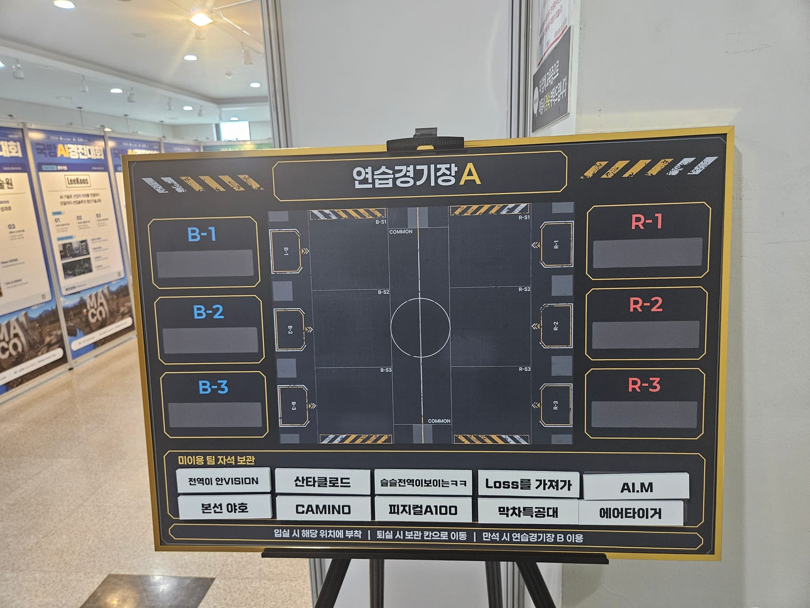
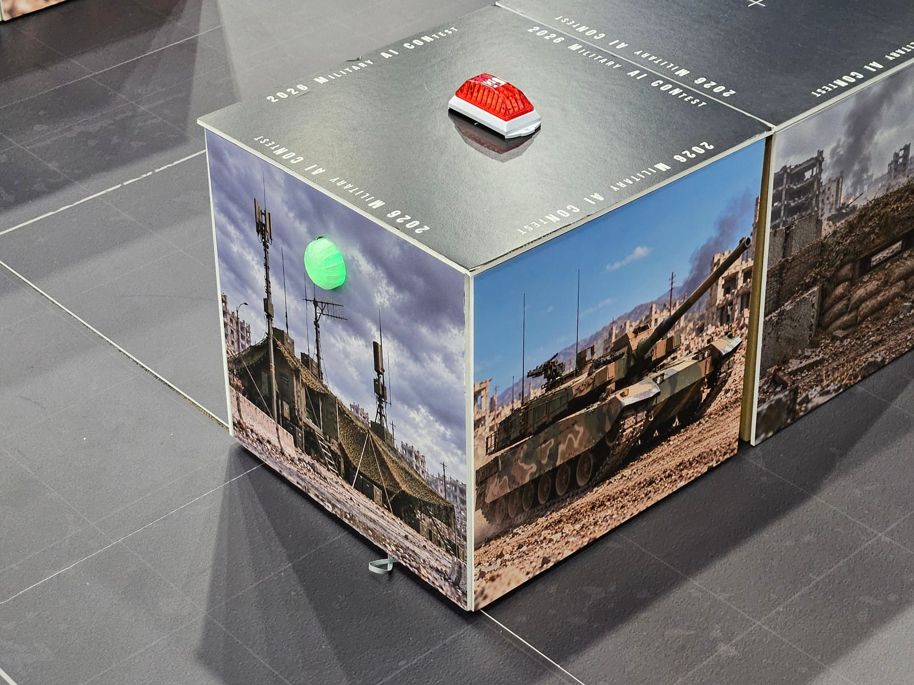

*본선 첫날 연습경기장 앞 안내판. 아래 줄 가운데에 우리 팀 피지컬A100의 이름표가 있다.*

11월 18일부터 20일까지 경기 화성의 YBM연수원에서 열린 2026 제5회 국방 AI 경진대회(MAICON) 본선에 다녀왔다. 군 복무 중인 육군 병사로서, 다섯 명이 한 팀을 이루는 피지컬A100의 팀원으로 참가했다. 결과부터 적으면 최종 10팀 중 10등, 그리고 후원기업 스페이스뱅크의 대표상이다. 둘 다 사실이고, 그 사이에 있었던 일을 적어 두려고 한다.

## 대회 소개

국방 AI 경진대회는 국방부가 주최하고 정보통신기획평가원(IITP)과 한국오픈소스협회가 주관하는 대회다. 군 장병과 일반인이 함께 참가할 수 있고, 예선 성적순으로 군 장병 40명과 일반인 10명, 모두 50명이 본선에 오른다. 본선은 군 장병 4명과 일반인 1명이 한 팀을 이뤄 10팀이 겨룬다.

올해 본선 과제는 AI로 무인지상차량(UGV)을 움직여 도심형 전장에서 작전을 수행하는 것이었다. 경기장은 가로세로 5~6m쯤 되는 바닥에 그림이 붙은 상자들이 놓인 모의 전장이고, 한 경기는 BLUE 3팀과 RED 3팀이 맞붙는 3:3 연합전으로 5분 동안 진행된다. 모두 10경기를 치르고, 팀마다 BLUE로 3번, RED로 3번 출전해 점수를 쌓는다. 로봇은 경기가 시작되면 사람이 손댈 수 없고, 팀이 짠 코드 하나로 끝까지 움직여야 한다.

*연습경기장. 상자 옆면의 그림이 인식 대상이다.*

한 경기 안에서 수행하는 임무는 여섯 가지다.

| 임무 | 내용 | 배점 |
|---|---|---|
| M1 전술명령 해석 | 자연어로 내려온 작전 명령을 LLM으로 해석해 보고 | 10 |
| M2 지정표적 타격 | 감시초소, 레이더, 통신시설 중 지정된 표적을 찾아 레이저를 2초 이상 연속 조사 | 15 |
| M3 전장객체 인식 | 상자 옆면에 붙은 객체 6종(탄약상자, 드럼통, 박격포, 군용트럭, 전차, 미사일)의 종류와 수량을 구역별로 보고 | 30 |
| M4 상대 UGV 타격 | 레이저로 상대 로봇을 맞히고 피하기 | 15 |
| M5 목표거점 진입 | 종료 1분 전에 통보되는 상대 진영 거점에 자율 진입 | 10 |
| M6 전장 위험도 분석 | 경기 후 30초 안에 상대 로봇 3대의 위협 순위를 LLM으로 판단해 보고 | 15 |

여기에 연합 승리 5점이 붙는다. 최종 점수는 발표평가 20점과 임무평가 80점을 더해 정한다. 배점이 가장 큰 M3는 한 구역의 종류와 수량이 완전히 맞아야만 점수가 나와서, 객체인식이 곧 승부처였다.

*대회에서 지급한 로봇 WINGBOT-UGV. 팬틸트 카메라와 레이저 발광부, 피아를 구분하는 안테나, 레이저를 받는 수광 센서가 달려 있다.*

로봇은 Jetson Orin Nano를 얹은 6륜 차량으로, 2D LiDAR와 깊이 카메라, 160도 광각 카메라를 단 팬틸트, 레이저 발광부를 갖췄다. GPU가 넉넉하지 않은 작은 보드에서 인식과 주행, 사격을 0.1초 주기로 모두 돌려야 한다는 점이 이 대회의 또 다른 조건이었다.

## 팀이 꾸려지기까지

예선은 10월 10일 온라인으로 치렀다. 결과가 나온 10월 16일 이후 사흘 뒤부터 팀 빌딩이 시작됐다. 첫날 팀 빌딩 게시판에 팀장 임관훈 님의 모집 글이 올라왔고, 나도 CV와 YOLO 경험, SCPC 본선 경력 등을 적은 자기소개 글을 올렸다. 그렇게 지금의 팀이 만들어졌다.

- **임관훈(팀장)**: 육군인공지능센터에서 근무한다. 전체 통합과 M1, M6를 맡았다.
- **최지웅**: 전략과 경기 모델을 맡았다.
- **김도훈**: 로봇 쪽 소프트웨어 스택과 센서 보정을 맡았다.
- **조정인**: 팀의 일반인 참가자. 아주대학교 소프트웨어학과 학생으로, 주행과 인식 데이터를 맡았다.
- **김주원(나)**: 사격과 YOLO 객체인식을 맡았다.

팀원들이 각자 다른 부대와 학교에 있었기 때문에 준비는 주로 온라인으로 했다. 10월 30일 첫 화상회의를 시작으로 주기적으로 구글 미팅에서 만나 진행 상황을 나눴다. 11월 2일, 4일, 6일에는 대회 측의 온라인 멘토링이 있었고, 사전 학습 자료로 본선 경기 규정과 로봇, ROS2 개발 환경을 미리 익혔다.

본선 직전인 11월 16일과 17일에는 육군 AX 거점에 모여 함께 작업했다. 이때 경기장을 흉내 낸 시뮬레이터와, 객체인식 모델에 쓸 데이터를 만드는 라벨링 도구를 개발했다. 팀이 만든 시뮬레이터로는 본선 전까지 약 20만 판의 경기를 돌려 전략을 골랐다.

## 내가 맡은 일: 객체인식

내 몫은 객체인식이었다. 로봇 카메라로 상자 옆면의 그림을 알아보는 모델, 그리고 경기장 위에 고정된 정찰 드론 영상에서 상자와 표적을 찾는 모델, 이렇게 두 개를 만들었다. 두 모델 모두 YOLO26s를 기반으로 학습했고, GPU 없이 로봇 CPU에서 돌 수 있도록 ONNX로 바꿔 올렸다.

모델보다 더 많은 시간이 든 건 데이터였다. 주행 영상에서 뽑은 사진에 일일이 상자를 그려 넣어야 했는데, 그 양을 사람 손으로 다 감당할 수는 없었다. 그래서 AI에게 라벨 초안을 맡기되, **서로 다른 AI 두 개가 같은 답을 내야 정답으로 인정하는** 교차 라벨링을 제안했다. 한 모델이 틀려도 다른 계열의 모델이 같은 실수를 할 가능성은 낮으니, 둘이 동의한 박스만 믿고 의견이 갈린 사진만 사람이 확인하면 된다. 이 아이디어로 만든 라벨링 도구 Drive2Model은 처음부터 끝까지 내가 작업했다. 11월 18일 오후부터는 팀장이 열어 준 Orca 원격 서버에서 이어서 작업했다. 라벨링 도구 이야기는 [따로 정리했다](/cs/ai/drive2model-cross-labeling/).

그렇게 드론 사진 약 5천 장, 로봇 카메라 사진 약 2만 장을 라벨링해 학습했다. 마지막 날 기준으로 F1 점수는 로봇 탐지 모델이 91.8%, 드론 탐지 모델이 99.5%였다.

*본경기장의 상자. 통신시설 같은 표적은 M2, 전차 같은 객체는 M3의 대상이다.*

두 모델을 묶어 경기 전략도 짰다. 먼저 드론 영상으로 전장 전체를 파악한다. 드론에서 이미 보인 면은 충분히 믿을 만하게 확인한 것으로 치고, 로봇은 드론이 보지 못한 면만 찾아가도록 경로를 구성한다. 5분이라는 짧은 시간 안에 모든 상자를 다 돌 수 없으니, 볼 필요가 없는 면을 건너뛰는 것이 곧 시간을 버는 일이었다.

## 본선 사흘

본선은 사흘이었지만 실제로는 하나로 이어진 긴 하루에 가까웠다. 첫날 밤에는 새벽 4시에 잠들어 7시 30분에 일어났다. 둘째 날은 다음 날이 본선 경기라 한숨도 자지 않고 새벽 내내 작업했다. 그사이 핫식스와 몬스터를 10캔 정도 마셨다.

### 첫 실물 주행

시뮬레이터에서 잘 돌던 코드도 실물 로봇 앞에서는 처음부터 다시 시작해야 했다. 첫날 오후 실물 로봇으로 시험 주행을 해 보니, 제자리 회전 명령을 주면 명령한 각도의 절반도 돌지 않았고, 바퀴로 잰 방향 값은 아무리 돌아도 늘 0이었다. LiDAR의 정면은 로봇의 정면과 90도 어긋나 있었다. 그날 밤 11시 49분의 첫 연습 주행에서 우리 로봇은 출발 자리에서 45초 동안 제자리를 돌다가 그대로 멈춰 섰다. 그 직후 자정 무렵에는 정전이 나서 라벨 파일이 깨질 뻔한 일도 있었다.

둘째 날에도 시행착오는 이어졌다. 손으로 띄워 시험할 때는 6판 모두 사격에 성공했는데, 공식 경기 방식으로 실행한 4판에서는 한 발도 쏘지 못했다. 기록을 열어 보니 공식 실행 경로의 LiDAR 설정이 뒤집혀 로봇 정면을 지우고 있었고, 이걸 고치자 바로 명중하기 시작했다.

*자정 무렵의 본경기장. 이곳에서 마지막 날 경기가 열렸다.*

이렇게 하나씩 고쳐 나간 끝에, 테스트 주행에서 우리 팀은 M2 사격은 항상 만점, M3 객체인식은 항상 30점을 받았다. 드론으로 먼저 전장을 보고 안 본 면만 찾아가는 전략도 실제 경기장에서 매우 효율적으로 작동했다. 내가 만든 드론 객체인식, 로봇 객체인식 모델이 잘 나왔다는 것, 이번 대회에서 가장 기뻤던 순간이다.

### 경기 날

마지막 날 오전에는 발표평가가 있었다. 우리 팀은 발표평가에서 19점을 받았다. 다른 팀들이 15~18점이었으니 발표평가 1등이었다.

오후에는 임무평가가 이어졌다. 10경기 중간에 15분의 코드 수정 시간이 있고, 우리 팀은 그 앞에 4경기, 뒤에 2경기를 치르는 일정이었다. 앞 타임에서 3경기를 마쳤을 때 우리 팀은 3위였다.

그런데 3경기가 끝난 뒤, 운영진이 우리 팀 UGV를 옮기다가 바닥에 떨어뜨렸다. 그 충격으로 캘리브레이션과 여러 세팅이 망가졌다. 이어진 4경기에서는 바퀴가 빠져 로봇이 아예 움직이지 않았고, 그 뒤에도 카메라 조준이 되지 않는 문제가 남았다. 우리는 UGV 교체와 재세팅 후 재경기를 요청했지만 받아들여지지 않았고, 사과나 보상 없이 그 불이익을 그대로 안고 가야 했다.

3일 밤낮을 새며 만든 결과를 그런 상태로 이어 가기보다는 기권하는 것이 아름답다고 판단했다. 그렇게 우리 팀은 기권했고, 최종 10팀 중 10등으로 대회를 마쳤다.

정말 억울했다. 3경기까지 3등이었고 발표평가는 1등이었으니, 그대로 갔다면 육군참모총장상이나 해군참모총장상도 받을 수 있었다. 객체인식이 잘 나왔고 전략도 실제 경기장에서 잘 통하는 걸 확인했기에 더 아쉬웠다.

## 시상

시상식에서 우리 팀은 후원기업 스페이스뱅크의 대표상을 받았다. 상장에는 "2026 제5회 국방 AI 경진대회에서 우수한 성적을 거두었으므로"라고 적혀 있다.

*스페이스뱅크 대표상 상장. 다른 팀원의 이름은 가렸다.*

*2026 국방 AI 경진대회 시상식. 사진: 국방부 제공, 뉴스1*

## 얻은 것

이번 대회에서 가장 크게 얻은 건 AI 에이전트를 활용해 일하는 법이다. 예전에는 에이전트 하나와 일했다면, 이번에는 임관훈 팀장에게서 Orca 사용법과 여러 에이전트가 협업하게 하는 방법을 배웠다. 상황에 따라 Claude, Codex, Antigravity의 여러 모델을 조율하는 방법을 얻은 것이 값지다. 사흘 동안 작업하는 능력과 스킬이 크게 늘었다.

하지만 무엇보다 값진 건 사람이다. 전국에서 AI를 잘 쓰고 열심히 하려는 국군 장병들, 그리고 민간에서 온 분들과 한 팀이 되어 하나의 열정을 공유하고 불태웠다. 같은 경험을 했고, 다른 일이 생기면 함께 해 보자고 제안할 수 있는 네트워크를 만든 것이 이번 대회의 가장 큰 성과다.

## 다시 한다면

객체인식은 잘 해냈다. 다음에는 주행 경로를 짜는 핵심 알고리즘을 더 고도화해 부드러운 주행을 만들고 싶다. 지금의 객체인식 모델은 멈추지 않고 스쳐 지나가며 찍은 흐린 이미지에서도 잘 인식한다. 그러니 주행 중 멈추는 부분을 없애고, M2와 M3 점수를 더 빨리 얻는 효율적인 주행을 해 보고 싶다.
