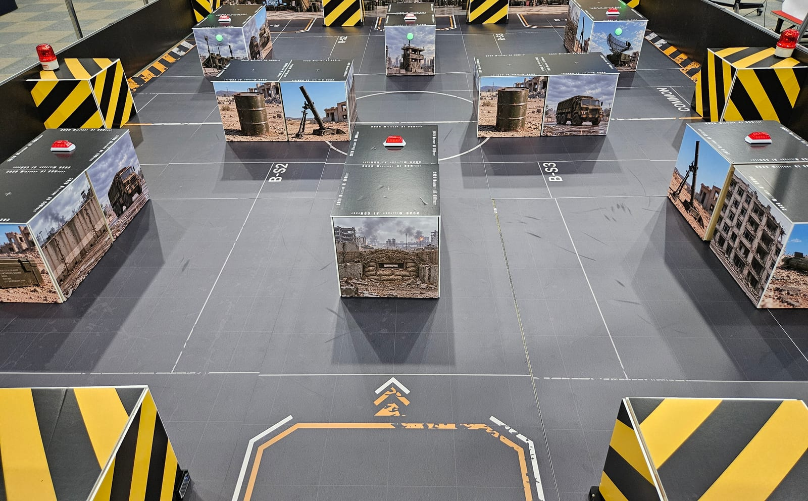

본선 첫날 연습경기장 앞 안내판. 아래 줄 가운데에 우리 팀 피지컬A100의 이름표가 있다.

11월 18일부터 20일까지 경기 화성의 YBM연수원에서 열린 2026 제5회 국방 AI 경진대회(MAICON) 본선에 다녀왔다. 군 복무 중인 육군 병사 신분으로, 다섯 명이 모인 피지컬A100 팀의 일원으로 참가했다. 결과부터 적으면 최종 10팀 중 10등, 그리고 후원기업 스페이스뱅크의 대표상이다. 둘 다 사실이고, 그 사이에 있었던 일을 적어 두려고 한다.

## 대회 소개

국방 AI 경진대회는 국방부가 주최하고 정보통신기획평가원(IITP)과 한국오픈소스협회가 주관하는 대회다. 군 장병과 일반인이 함께 참가할 수 있으며, 예선 성적순으로 군 장병 40명과 일반인 10명까지 모두 50명이 본선에 오른다. 본선에서는 군 장병 4명과 일반인 1명이 한 팀을 이뤄 총 10팀이 겨룬다.

올해 본선 과제는 AI로 무인지상차량(UGV)을 제어해 도심형 전장에서 작전을 수행하는 것이었다. 경기장은 가로세로 5~6m쯤 되는 바닥에 그림이 붙은 상자들을 배치한 모의 전장이고, 한 경기는 BLUE 3팀과 RED 3팀이 맞붙는 3:3 연합전으로 5분 동안 진행된다. 전체 10경기를 치르며, 각 팀은 BLUE로 3번, RED로 3번 출전해 점수를 쌓는다. 경기가 시작되면 사람이 로봇에 손댈 수 없고, 팀이 짠 코드 하나로 끝까지 움직여야 한다.

연습경기장. 상자 옆면의 그림이 인식 대상이다.

한 경기 안에서 수행하는 임무는 여섯 가지다.

| 임무 | 내용 | 배점 |
|---|---|---|
| M1 전술명령 해석 | 자연어로 내려온 작전 명령을 LLM으로 해석해 보고 | 10 |
| M2 지정표적 타격 | 감시초소, 레이더, 통신시설 중 지정된 표적을 찾아 레이저를 2초 이상 연속 조사 | 15 |
| M3 전장객체 인식 | 상자 옆면에 붙은 객체 6종(탄약상자, 드럼통, 박격포, 군용트럭, 전차, 미사일)의 종류와 수량을 구역별로 보고 | 30 |
| M4 상대 UGV 타격 | 레이저로 상대 로봇을 맞히고 피하기 | 15 |
| M5 목표거점 진입 | 종료 1분 전에 통보되는 상대 진영 거점에 자율 진입 | 10 |
| M6 전장 위험도 분석 | 경기 후 30초 안에 상대 로봇 3대의 위협 순위를 LLM으로 판단해 보고 | 15 |

여기에 연합 승리 5점이 붙는다. 최종 점수는 발표평가 20점과 임무평가 80점을 더해 정한다. 배점이 가장 큰 M3는 한 구역의 객체 종류와 수량이 완전히 맞아야만 점수가 인정되기 때문에, 객체인식이 곧 승부처였다.

대회에서 지급한 로봇 WINGBOT-UGV. 팬틸트 카메라와 레이저 발광부, 피아를 구분하는 안테나, 레이저를 받는 수광 센서가 달려 있다.

로봇은 Jetson Orin Nano를 얹은 6륜 차량으로, 2D LiDAR와 깊이 카메라, 160도 광각 카메라를 단 팬틸트, 레이저 발광부를 갖췄다. GPU 자원이 넉넉하지 않은 작은 보드 위에서 인식과 주행, 사격을 모두 0.1초 주기로 돌려야 한다는 점도 까다로운 조건이었다.

## 팀이 꾸려지기까지

예선은 10월 10일 온라인으로 치렀다. 10월 16일에 결과가 나오고 사흘 뒤부터 팀 빌딩이 시작됐다. 첫날 팀 빌딩 게시판에 팀장 임관훈 님의 모집 글이 올라왔고, 나도 CV와 YOLO 경험, SCPC 본선 경력 등을 적은 자기소개 글을 올렸다. 그렇게 지금의 팀이 만들어졌다.

- 임관훈(팀장): 육군인공지능센터에서 근무한다. 전체 통합과 발표, M1 명령 해석과 M6 위험도 분석을 맡았다.
- 최지웅: 전략과 경기 모델을 설계하고, 이를 2D와 Gazebo에서 시험하는 통합 시뮬레이터를 만들었다.
- 김도훈: 로봇 쪽 소프트웨어 스택을 담당해 위치 추정과 어안 카메라를 보정하고 드론 영상으로 지도를 만드는 작업을 했다.
- 조정인: 팀의 일반인 참가자로 아주대학교 소프트웨어학과 학생이다. 경기장 실측과 Gazebo 시뮬레이션, 주행과 인식 데이터를 맡았다.
- 김주원(나): 대회용 레이저 영점 조절, YOLO 객체인식, Jetson 추론 부하 측정을 맡았다.

팀원들이 서로 다른 부대와 학교에 있었기 때문에 준비는 주로 온라인으로 진행했다. 10월 30일 첫 화상회의를 시작으로 구글 미팅에서 주기적으로 만나 진행 상황을 공유했다. 11월 2일, 4일, 6일에는 대회 측의 온라인 멘토링이 열렸고, 사전 학습 자료를 바탕으로 본선 경기 규정과 로봇, ROS2 개발 환경을 미리 익혔다.

본선 직전인 11월 16일과 17일에는 육군 AX 거점에 모였다. 온라인에서 각자 개발하던 경기 코드와 시뮬레이터, 라벨링 도구를 한자리에서 함께 손보며 맞춰 나갔다.

그때 팀원들이 만든 시뮬레이터는 마지막 날 발표에서도 직접 보여 줬다. 발표 영상 두 편과 첫 실물 주행을 되짚은 이야기는 <a href="/cs/ai/maicon-simulation-to-field/">20만 판을 돌리고도, 첫 주행은 제자리였다</a>에 담았다.

## 내가 맡은 일: 객체인식

내가 맡은 파트는 객체인식이었다. 로봇 카메라로 상자 옆면의 그림을 알아보는 모델과, 경기장 상공에 고정된 정찰 드론 영상에서 상자와 표적을 찾는 모델 두 가지를 만들었다. 두 모델 모두 YOLO26s를 기반으로 학습했고, 로봇에서는 TensorRT 엔진으로 빌드해 Jetson GPU에서 장당 15ms 안팎으로 추론이 돌아가게 했다.

처음에는 합성 그림으로 학습한 모델을 썼는데 실제 로봇이 찍은 사진에서는 약 60%만 맞혔다. 팀 발표 자료에서 비교한 같은 사진에 실제 주행 영상으로 학습한 YOLO를 적용하자 정확도가 약 92%로 올라갔다. 조명이 더 어두운 본경기장 사진 225장을 따로 모아 검증했고, 대회 도중 상자 그림이 교체될 가능성에 대비해 Codex로 만든 새 그림을 실제 장면의 상자 면에 합성한 별도 시험셋도 준비했다.

모델보다 더 많은 시간이 들어간 곳은 데이터였다. 주행 영상에서 뽑은 사진에 일일이 박스를 그려 넣어야 했는데, 그 물량을 사람 손으로만 감당할 수는 없었다. 그래서 서로 다른 AI 두 개의 답을 대조하는 교차 라벨링을 제안했다. 두 모델이 같은 박스를 그리면 초안에 대한 확신을 높이고, 의견이 갈리면 사람이 집중해서 확인하는 방식이다. 본선 현장에서는 초안에 동의한 박스까지 모두 사람 검수를 거치도록 기준을 높였다. 이 아이디어를 구현한 라벨링 도구 Drive2Model은 처음부터 끝까지 내가 직접 만들었고, 11월 18일 오후부터는 팀장이 열어 준 Orca 원격 서버에 올려 운영했다. 발표 시점까지 주행 영상 330개에서 뽑은 약 4만 2천 장 가운데 중복과 불량 약 2만 3천 장을 걸러냈고, 사람이 3,796장을 직접 확인했다. 사흘 동안 모델 학습은 22회 돌렸다. 라벨링 도구 이야기는 [따로 정리했다](/cs/ai/drive2model-cross-labeling/).

그렇게 확보한 드론 사진 약 5천 장, 로봇 카메라 사진 약 2만 장을 라벨링해 학습했다. 마지막 날 재평가에서 기록한 F1 최고 점수는 로봇 91.8%, 드론 99.5%였다. 같은 회차의 mAP50은 각각 0.959와 0.995, 박스 위치를 더 엄격하게 따지는 mAP50-95는 0.929와 0.985였다. 다만 두 최고 회차는 평가 사진의 라벨 초안을 해당 모델이 직접 그린 비중이 높았는데, 초안 영향이 적었던 회차의 수치도 [기술 글](/cs/ai/drive2model-cross-labeling/#결과)에 함께 정리했다.

본경기장의 상자. 통신시설 같은 표적은 M2, 전차 같은 객체는 M3의 대상이다.

완성한 두 모델을 묶어 경기 운영 전략도 짰다. 경기가 시작되면 먼저 드론 영상으로 전장 전체를 파악한다. 드론에서 이미 보인 면은 충분히 믿을 만하게 확인한 것으로 넘기고, 로봇은 드론이 보지 못한 면만 찾아가도록 경로를 구성한다. 5분이라는 짧은 시간 안에 모든 상자를 다 돌 수는 없으니, 굳이 다시 볼 필요가 없는 면을 건너뛰는 것이 곧 시간을 버는 일이었다.

## 본선 사흘

본선 일정은 사흘이었지만 실제로는 하나로 이어진 긴 하루에 가까웠다. 첫날 밤에는 새벽 4시에 잠들어 7시 30분에 일어났고, 둘째 날에는 다음 날이 본선 경기라 한숨도 자지 못한 채 새벽 내내 작업했다. 그사이 마신 핫식스와 몬스터만 10캔 정도 된다.

### 연습 경기가 끝난 뒤

첫날 밤 연습 주행을 마치고 자정이 다 됐을 때, 작업하던 곳에 정전이 났다. 사흘 안에 박스를 하나라도 더 확인해야 하는데 그동안 손으로 검수한 라벨 파일까지 잃을 뻔했다. 다음 날에도 연습은 마음대로 풀리지 않았다. 우리가 직접 실행할 때는 여섯 판 모두 성공했던 레이저 사격이 공식 경기 방식으로 돌리자 네 판 내내 한 발도 나가지 않았다. 그렇게 하나씩 고쳐 가며 19일 연습 경기를 마쳤다.

자정 무렵의 본경기장. 이곳에서 마지막 날 경기가 열렸다.

그날 밤에도 우리는 경기장에 남았다. 새벽에 이어 간 테스트 주행에서는 M2 사격과 M3 객체인식 점수가 매번 만점으로 찍혔다. 내가 맡은 M3 칸에는 30점이 떴다. 드론으로 먼저 전장을 살피고 아직 보지 못한 면만 찾아가는 전략도 실제 경기장에서 매우 효율적으로 작동했다. 내가 만든 드론 객체인식과 로봇 객체인식 모델이 실전에서 제대로 돌아간다는 것을 확인한 그때가 이번 대회에서 가장 기뻤던 순간이다.

### 경기 날

마지막 날 오전에는 발표평가가 진행됐다. 다른 팀들이 15~18점을 받은 가운데 우리 팀은 19점을 받아 발표평가 1등을 차지했다.

오후에는 임무평가가 이어졌다. 전체 10경기 중간에 15분의 코드 수정 시간이 주어졌고, 우리 팀은 그 앞에 4경기, 뒤에 2경기를 치르는 일정이었다. 앞선 일정에서 세 번째 경기를 마쳤을 때까지만 해도 우리 팀은 3위였다.

그런데 세 번째 경기가 끝난 뒤, 운영진이 우리 팀 UGV를 옮기다가 바닥에 떨어뜨렸다. 그 충격으로 캘리브레이션과 여러 세팅이 망가졌다. 이어진 네 번째 경기에서는 바퀴가 빠져 로봇이 아예 움직이지 못했고, 그 뒤에도 카메라 조준이 되지 않는 문제가 남았다. 운영진이 옮기는 과정에서 생긴 고장이었기에 UGV를 교체하고 세팅을 다시 한 뒤 재경기를 치르게 해 달라고 요청했다.

경기가 끝난 뒤에도 운영진은 VIP가 곧 온다며, 아무 세팅도 되지 않은 새 UGV를 10분 안에 준비하라고 했다. 장비를 세팅할 충분한 시간은 주어지지 않았고 재경기 요청도 받아들여지지 않았다. 문제를 이야기할 때마다 오히려 우리가 무리한 요구를 하는 사람처럼 취급받는 기분이었다. 운영을 맡은 쪽에서는 이 일이 커져 향후 국방부 등과 함께 하는 일에 영향을 줄까 걱정하는 것처럼 보였다.

사흘 밤낮을 새우며 만든 결과를 그런 상태로 이어 가기보다는 기권하는 것이 아름답다고 판단했다. 그렇게 우리 팀은 기권했고, 최종 10팀 중 10등으로 대회를 마쳤다.

정말 억울했다. 세 번째 경기까지 3등이었고 발표평가는 1등이었으니, 그대로 갔다면 육군참모총장상이나 해군참모총장상도 받을 수 있었다. 객체인식이 잘 나왔고 전략도 실제 경기장에서 잘 통하는 걸 확인했기에 더 아쉬웠다.

그래도 가장 슬펐던 건 순위가 아니었다. 실수는 누구나 할 수 있다. 다만 그 실수에 대한 인정과 사과, 보상, 책임이 없었다는 점이 슬펐다. 군대에서 사회와 인생을 배우고 있다. 무엇보다 불합리한 상황을 받아들이는 법을, 뼈에 사무치도록 배우고 있다.

## 시상

시상식에서 우리 팀은 후원기업 스페이스뱅크의 대표상을 받았다. 상장에는 "2026 제5회 국방 AI 경진대회에서 우수한 성적을 거두었으므로"라고 적혀 있다.

스페이스뱅크 대표상 상장. 다른 팀원의 이름은 가렸다.

2026 국방 AI 경진대회 시상식. 사진: 국방부 제공, 뉴스1

## 얻은 것

이번 대회에서 가장 크게 얻은 건 AI 에이전트를 활용해 일하는 법이다. 예전에는 에이전트 하나와 일했다면, 이번에는 임관훈 팀장에게서 Orca 사용법과 여러 에이전트가 협업하게 하는 방법을 배웠다. 발표 자료에는 현장 34시간 동안 개발 세션 64개, 병렬 라벨링 워커 최대 30개, 실물에 올린 경기 모델 변형 15개가 기록돼 있다. 전략, 경기 코드, 라벨링, 대시보드 작업을 나눠 진행했고, 사람은 목표를 정하고 비교 실험과 실물 기록을 본 뒤 채택과 배포를 결정했다. Claude, Codex, Antigravity를 어떤 일에 쓰면 좋을지 직접 부딪혀 보며 배울 수 있었다.

하지만 무엇보다 값진 건 사람이다. 전국에서 AI를 잘 쓰고 열심히 하려는 국군 장병들, 그리고 민간에서 온 분들과 한 팀이 되어 하나의 열정을 공유하고 불태웠다. 같은 경험을 나눴고, 앞으로 다른 일이 생기면 함께 해 보자고 제안할 수 있는 인연을 만든 것이 이번 대회의 가장 큰 성과다.

## 다시 한다면

객체인식은 후회 없이 해냈다. 다음에는 주행 경로를 짜는 핵심 알고리즘을 더 고도화해 부드러운 주행을 만들고 싶다. 지금의 객체인식 모델은 멈추지 않고 스쳐 지나가며 찍은 흐린 이미지에서도 잘 인식한다. 그러니 주행 중 멈추는 구간을 없애고, M2와 M3 점수를 더 빨리 얻는 효율적인 주행을 해 보고 싶다.

준비 과정의 실험 수치와 도구 설명은 피지컬A100 본선 발표자료와 팀 GitHub의 개발 기록을 참고했다.
