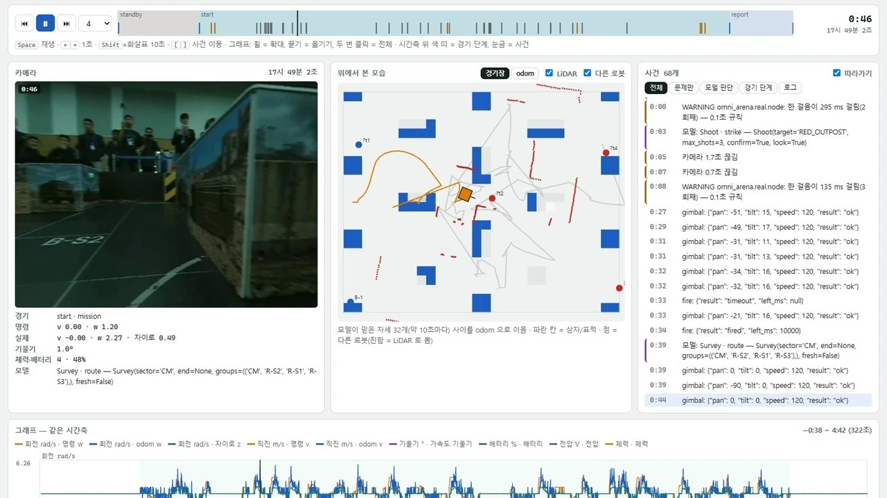

11월 18일 밤 11시 49분, 우리 로봇은 출발 자리에서 45초 동안 제자리만 돌았다. 그러고는 길이 막혔다고 판단하고 3분을 더 서 있었다. 2026 국방 AI 경진대회 본선에서 피지컬A100 팀이 치른 첫 실물 연습 주행이었다. 그때까지 우리가 시뮬레이터에서 돌린 경기는 약 20만 판이었다.

그날 기록에는 이상한 숫자가 하나 남아 있다. 로봇은 다섯 바퀴나 돌았는데 바퀴 쪽에서 보내온 방향 값은 처음부터 끝까지 그대로였다. 옆에서 본 사람이야 로봇이 돌았다는 걸 알지만, 그 값을 보고 있던 프로그램 입장에서는 아직 한 번도 제대로 돌지 않은 셈이다. 시뮬레이터에서는 좀처럼 마주치기 어려운 상황이었다.

## 로봇을 받기 전에 해 볼 수 있던 일

우리 팀 다섯 명은 서로 다른 부대와 학교에 있었다. 내가 맡은 건 카메라 사진에서 상자 옆면의 그림을 읽는 객체인식이었다. 내 모델이 그림을 잘 읽어도 주행 코드가 그 면을 카메라에 담아 줘야 했고, 같은 상자를 두 번 봤다면 경기 코드가 한 번만 세어 줘야 했다. 각자 맡은 부분을 따로 시험하는 것만으로는 한 경기가 어떻게 흘러갈지 알기 어려웠다.

그래서 팀은 같은 경기 코드를 2D, 3D, 실물에서 돌릴 수 있게 했다. 경기 코드 쪽에서는 로봇의 관측값을 받아 다음 행동을 정한다. 어떤 환경에 연결했느냐에 따라 그 관측값을 시뮬레이터가 만들어 주기도 하고, 실물 센서가 보내 주기도 한다. 최지웅 님은 경기 모델과 통합 시뮬레이터를 맡았고, 조정인 님은 Gazebo에서의 주행과 경기장 실측을, 김도훈 님은 실물 센서와 카메라 보정을 맡았다. 각자 측정한 값이 같은 경기 코드에서 만났다.

<figure>
  <video controls playsinline preload="none" width="1280" height="720" aria-label="Omniscient-Arena 2D 경기 다시보기" poster="/files/maicon-2026/simulation/omniscient-arena-replay.webp" src="/files/maicon-2026/simulation/omniscient-arena-replay.mp4"><a href="/files/maicon-2026/simulation/omniscient-arena-replay.mp4">2D 경기 영상 열기</a></video>
  <figcaption>본선 발표에서 보여 준 2D 경기 다시보기. 여섯 대가 움직이는 동안 오른쪽에 팀별 점수와 사건이 쌓인다.</figcaption>
</figure>

2D에서 특히 좋았던 건 같은 경기를 두 번 치를 수 있다는 점이다. 설정을 하나 바꿨을 때 마침 쉬운 판을 만나 점수가 오른 건지 구별하려고, 기존 설정과 새 설정에 같은 난수 시드를 줬다. 시드는 경기의 무작위 조건을 재현하는 데 쓰는 값이다. 그렇게 두 판씩 짝지어 차이를 보고, 유망한 후보는 처음 보는 시드 512개로 다시 돌렸다. 첫 비교에서는 경기당 0.8점이 올랐던 가설이 재검증에서는 0.2점 차이로 줄기도 했다.

내가 가장 흥미롭게 본 실험은 인식기를 완벽하게 만들면 점수가 얼마나 오를지 본 것이었다. 시뮬레이션에서 경기 시작 4분까지 로봇이 본 상대 구역의 상자 면은 79%였다. 보이는 그림을 전부 맞히게 해도 경기당 점수는 2.65점 더 오르는 데 그쳤다. 라벨을 붙이고 모델을 학습하다 보면 틀리게 읽은 사진에만 눈이 가는데, 애초에 사진에 한 번도 담기지 않은 면은 내 데이터셋에 오답으로조차 나타나지 않는다. 주행과 인식을 한 경기 안에서 함께 시험해야 볼 수 있는 숫자였다.

<figure>
  <video controls playsinline preload="none" width="1280" height="720" aria-label="MAICON Arena 3D 로봇 1인칭 시연" poster="/files/maicon-2026/simulation/maicon-arena-3d.webp" src="/files/maicon-2026/simulation/maicon-arena-3d.mp4"><a href="/files/maicon-2026/simulation/maicon-arena-3d.mp4">3D 시연 영상 열기</a></video>
  <figcaption>본선 발표에 쓴 MAICON Arena 3D 시연. 위에서 본 지도에서는 네모 하나였던 상자가 로봇의 어안 카메라에서는 화면 대부분을 차지한다.</figcaption>
</figure>

3D에서는 이렇게 로봇 시점으로 내려와 볼 수 있었다. 2D 지도에서 상자 옆을 지나는 것과 그 순간의 카메라 사진으로 그림을 읽는 건 별개의 문제다. 팀은 3D와 실물에서 확인한 카메라 지연이나 회전 오차를 다시 2D에 반영했다. 그래야 다음번에 하룻밤을 들여 돌린 수만 판에도 현장에서 겪은 문제가 남는다.

## 다섯 명의 코드를 한 번에 켜는 일

현장에 와서는 ‘각자 만든 게 잘 도는가’만큼 ‘경기 서버가 우리 프로그램을 켰을 때도 다 같이 도는가’가 중요해졌다. 공식 경기에서는 사람이 미리 손으로 띄운 보조 프로그램이 종료될 수 있었다. 팀장 임관훈 님이 전체 통합을 맡았고, 센서 읽기부터 내 인식 모델, 주행과 서버 보고까지 제출 파일 하나를 시작점으로 실행되게 묶었다.

배포할 때는 로봇에 올릴 버전을 Git 커밋으로 고정했다. 내 쪽에서 보면 모델 파일이 복사됐다는 것과 로봇에서 사진 한 장을 실제로 추론할 수 있다는 것 사이에도 차이가 있었다. 그래서 배포 과정에 추론 확인을 넣었다. 문제가 생기면 직전 스냅샷으로 돌아갈 수 있었다. 11월 19일 하루에만 스냅샷 배포와 롤백을 합쳐 20여 회였다.

공식 경기 중간에 코드를 수정할 수 있는 시간은 15분이었다. 우리 팀은 그 시간에 새 코드를 쓰는 대신 미리 시험해 둔 설정 중에서 고를 수 있게 준비했다. 이 방식이 성립하려면 어젯밤에 잘됐던 버전이 어느 것인지, 무엇을 보고 잘됐다고 했는지까지 찾아낼 수 있어야 했다. 그래서 배포 도구와 함께 많이 쓴 게 경기 기록 재생 화면이었다.

## 같은 45초를 다시 보는 법

본선 발표에 쓴 실물 경기 기록 재생 화면. 타임라인을 되감으면 그 순간 카메라에 무엇이 보였고 프로그램은 무슨 판단을 했는지 함께 볼 수 있다.

첫 주행도 이렇게 다시 보면 다르게 읽힌다. 로봇이 제자리에서 돌 때 바퀴가 보내온 위치는 앞뒤로 조금씩 흔들렸다. 그 작은 변화량을 매번 양수로 더하면 1.14m를 움직인 셈인데, 시작점과 끝점의 거리는 고작 1.5cm였다. 주행 거리를 요약한 숫자 하나만 봤다면 1m쯤 전진하고 나서 막힌 것으로 읽었을지도 모른다. 같은 45초의 영상과 방향 값, 위치를 겹쳐 보니 출발 자리에서 벌어진 일을 설명할 수 있었다.

다른 판에서는 드론 사진이 241장이나 들어왔는데 프로그램이 전부 버렸다. 로봇은 영상을 기다리며 멈춰 있었고, 경기 서버에는 빈 인식 결과가 올라갔다. 마지막 보고서만 보면 상자를 하나도 못 알아본 판이다. 그런데 사진이 어느 단계에서 빠졌는지 따라가면 손볼 곳이 달라진다. 팀이 본경기장 카메라에 맞는 보정을 추가한 뒤에는 상자가 지도에 올라왔고 경기 도중에도 인식 결과를 갱신할 수 있었다.

팀이 남긴 실물 경기 기록은 모두 33판이다. 2D에서는 조건을 맞춰 같은 판을 새로 돌릴 수 있었다. 실물에서는 11월 18일 밤의 경기장을 그대로 다시 만들 수 없었지만, 그날 11시 49분에 로봇이 보고 있던 값은 다시 꺼내 볼 수 있었다. 대회가 끝나고도 첫 45초를 이렇게 자세히 이야기할 수 있는 건 그때 팀원들이 경기 결과와 함께 그 과정까지 남겨 둔 덕분이다.

본선에서 있었던 일은 [대회 후기](/cs/ai/maicon-2026-finals-review/)에, 내가 맡은 라벨링과 학습 과정은 [Drive2Model 개발 기록](/cs/ai/drive2model-cross-labeling/)에 적었다. 실험 수치와 영상은 피지컬A100 최종 발표자료와 팀의 현장 주행 기록을 참고했다.
