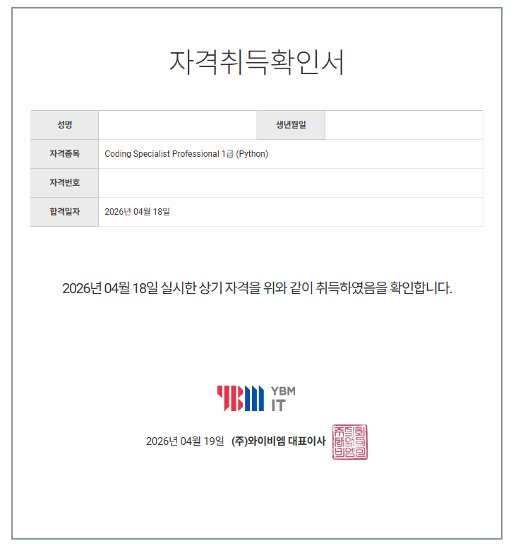
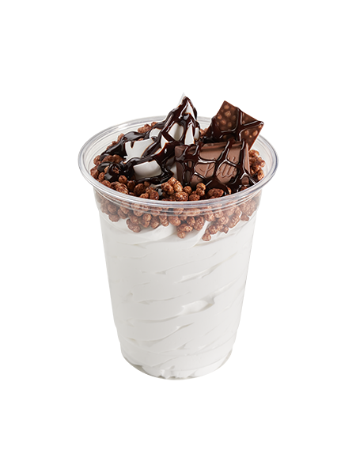

안녕하세요. **juwkim**입니다.

이번에는 **COS PRO 1급(Python)** 합격 후기를 남겨보려고 합니다.

시험은 **2026년 4월 18일 토요일 오후 2시**,  
**YBM 종로 CBT 센터**에서 봤습니다.

평소에 저는 PS에 관심이 많아서  
백준 문제를 꾸준히 풀어왔고,  
이번 시험도 따로 오래 준비했다기보다는  
**자격증 취득 목적에서 자연스럽게 응시한 시험**에 가까웠습니다.

결과적으로는 **880점으로 합격**했습니다.

---

## 시험 정보

-   **시험명:** Coding Specialist Professional 1급 (Python)
-   **응시일:** 2026. 04. 18. (토) 14:00
-   **시험장:** 서울 - YBM종로CBT센터 지하 1층 / 종로3가역 15번 출구 인근
-   **시험 시간:** 90분
-   **결과:** 합격
-   **점수:** 880점
-   **공식 안내:** [COS Pro 시험 소개](https://www.ybmit.com/cos_pro/cos_pro_info.jsp) / [접수 및 수험 안내](https://www.ybmit.com/test_rec/test_cospro.jsp)

---

## 시험 당일

이날은 오전 **8시 30분쯤 부대에서 출발**했습니다.

먼저 **백범김구기념관**에 들렀습니다.  
군에서 방문 시 **특별외출 1일**이 나오기 때문에,  
이번 시험 일정에 맞춰 같이 다녀왔습니다.

오전 **10시쯤 도착해서 2시간 정도 관람**했고,  
이후 종로로 이동해 **13시 10분쯤 시험장 근처 빽다방**에 들렀습니다.

거기서 **깨먹는 크런키 초코 요거트 아이스크림**을 가볍게 먹고 들어갔고,  
**시험 시작 15분 전쯤** 여유 있게 입실했습니다.

---

## 시험 후기

시험 시간은 **90분**이었는데,  
저는 실제로 **45분 정도** 걸렸습니다.

시간이 부족하다는 느낌은 없었고,  
검토까지 하고도 여유가 있었습니다.

이 시험은 단순히 문법만 보는 시험이라기보다,  
문제를 읽고 조건을 정리한 뒤 구현할 수 있는지를 보는 시험에 가깝다고 느꼈습니다.

평소에 문제 풀이를 꾸준히 해온 덕분에  
시험장에서도 평소 하던 방식대로 차분히 풀 수 있었습니다.

---

## 정리

이번 시험을 위해 따로 긴 시간을 들여 준비하지는 않았습니다.  
대신 평소에 쌓아온 문제 풀이 경험을 바탕으로 자연스럽게 응시했고,  
그 흐름이 그대로 결과로 이어졌다고 생각합니다.

시험이 끝난 뒤에는 **전쟁기념관**에도 들렀습니다.  
여기도 방문 시 **위로휴가 1일**이 주어지기 때문에,  
시험 본 날 함께 다녀왔습니다.

오전에는 백범김구기념관,  
오후에는 시험,  
그리고 전쟁기념관까지 들르면서  
하루를 꽤 알차게 보낸 느낌이었습니다.

---

## 마무리

이번 **COS PRO 1급(Python)** 시험은  
저에게 새롭게 큰 준비가 필요했던 시험이라기보다,  
평소에 해오던 문제 풀이 경험을 바탕으로  
자연스럽게 응시한 자격증 시험이었습니다.

앞으로도  
좋아하고 꾸준히 해온 것들이  
이렇게 하나씩 결과로 이어졌으면 좋겠습니다.
