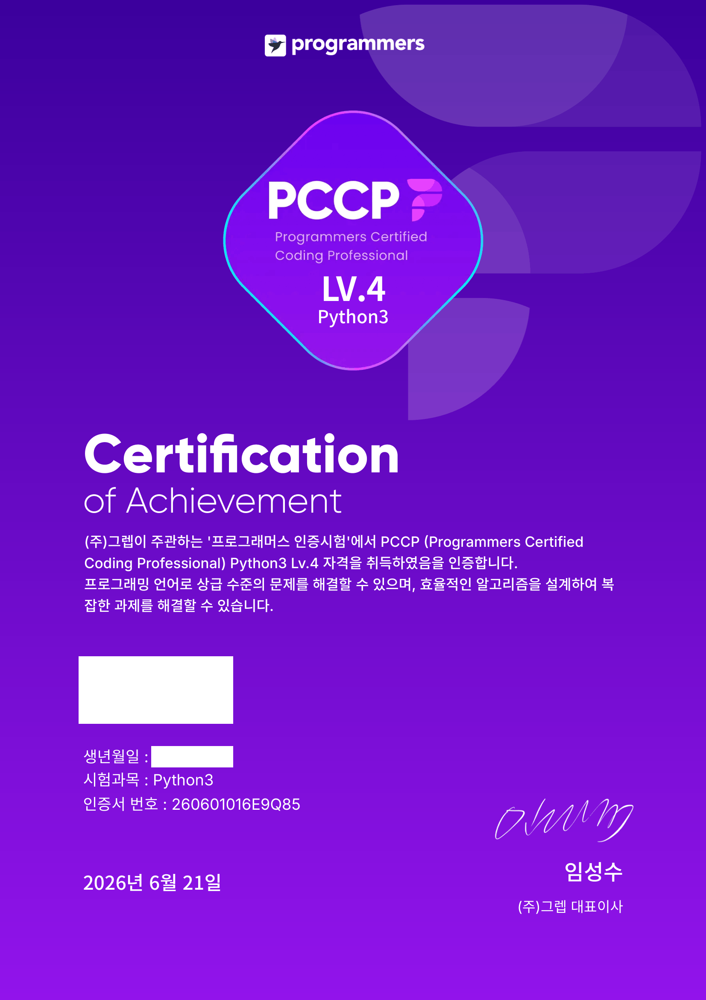
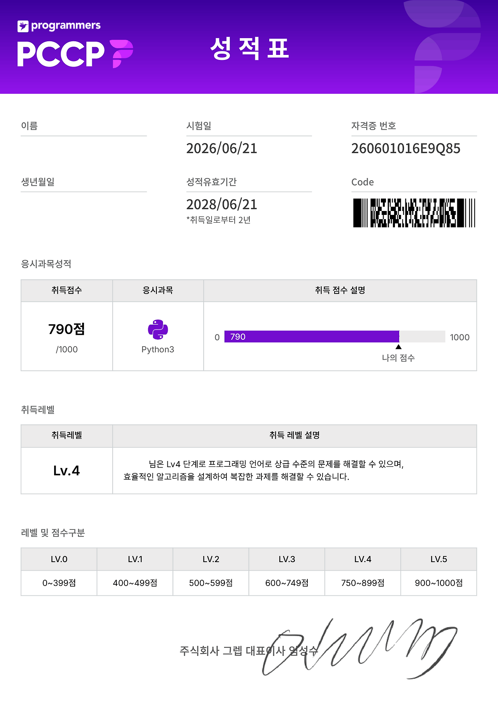

2026년 6월 21일 오전 11시에 **프로그래머스 PCCP Python 시험**에 응시했습니다.

결과는 아래 사진과 같이 **LV.4**였습니다. 사실 목표는 LV.5였기 때문에 조금 아쉬웠습니다. 그래도 한 번 더 응시해서 꼭 LV.5를 받아보려고 합니다.

*시험 결과*

## 시험 복기

시험을 보고 난 뒤 왜 LV.4가 나왔는지 곰곰이 생각해 봤습니다.

### 1번, 2번 문제

1번과 2번 문제는 비교적 쉽게 출제되었습니다. 특별히 어려운 부분이 없었기 때문에 두 문제는 만점을 받았을 것이라고 예상하고 있습니다.

### 3번 문제

아마 가장 아쉬운 문제는 3번이었던 것 같습니다.

제가 제출한 알고리즘은 O(n)이었고, 입력 크기가 최대 **10⁷** 수준이었습니다. 시험 당시에는 제한 시간이 10초였기 때문에 "이 정도면 충분히 통과하겠다."라고 판단해서 그대로 제출했습니다.

시험 시간에 **배열 길이인 2 × 10⁵ 기준으로 해결할 수 있는 알고리즘**도 생각했지만, 구현이 조금 복잡해 보였습니다. 처음 떠올린 O(n) 풀이도 제한 시간 안에는 충분히 통과할 것 같아서 굳이 최적화를 하지 않았습니다.

하지만 실제 채점은 하나의 테스트 케이스만 실행하는 것이 아니라 여러 테스트 케이스를 반복 실행하고, 전체 수행 시간을 기준으로 평가했을 수도 있다고 생각합니다. 결국 이 부분에서 감점이 있었던 것이 아닐까 추측하고 있습니다.

다음에 다시 응시한다면 "10초 안에만 돌아가면 된다."라는 기준으로 판단하기보다는, 구현이 조금 복잡하더라도 가능한 한 더 효율적인 알고리즘으로 구현할 생각입니다.

### 4번 문제

4번 문제는 O(n)으로 구현했고, 정답도 맞았다고 생각합니다.

제 최종 점수는 **790점**이었습니다. 만약 문제 배점이 아래와 같았다고 가정하면,

- 1번: 200점
- 2번: 200점
- 3번: 300점
- 4번: 300점

저는 아마 **200 / 200 / 90 / 300** 정도를 받은 것이 아닐까 생각하고 있습니다. 물론 실제 배점이나 감점 기준은 공개되지 않기 때문에 어디까지나 개인적인 추측입니다.

## 마무리

비록 목표였던 LV.5에는 조금 부족했지만, 이번 시험을 통해 어떤 부분을 더 신경 써야 하는지는 확실하게 알게 되었습니다. 특히 "제한 시간 안에만 통과하면 된다."라고 판단하기보다, 시험에서는 항상 **가장 효율적인 알고리즘을 구현하는 것**이 중요하다는 점을 다시 한번 느꼈습니다.

다음 시험에서는 이번 경험을 바탕으로 조금 더 꼼꼼하게 구현해서 LV.5를 목표로 다시 도전해 보겠습니다.
