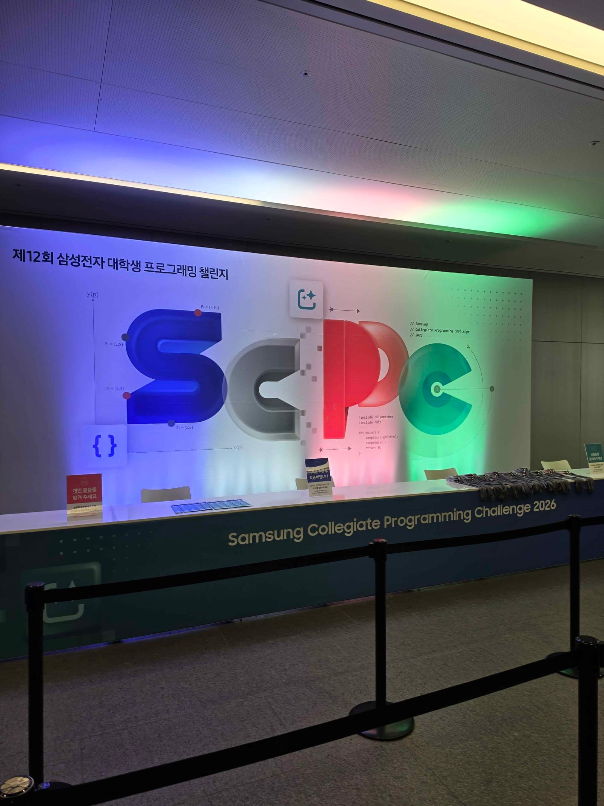
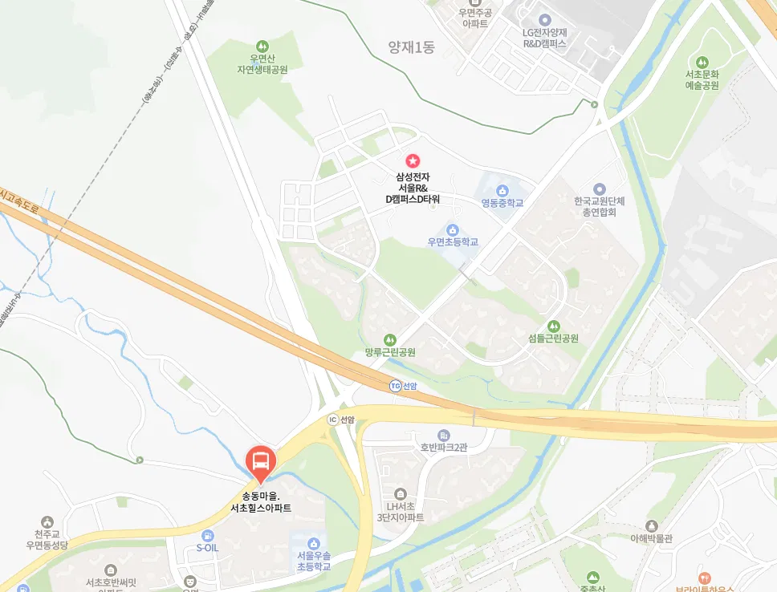
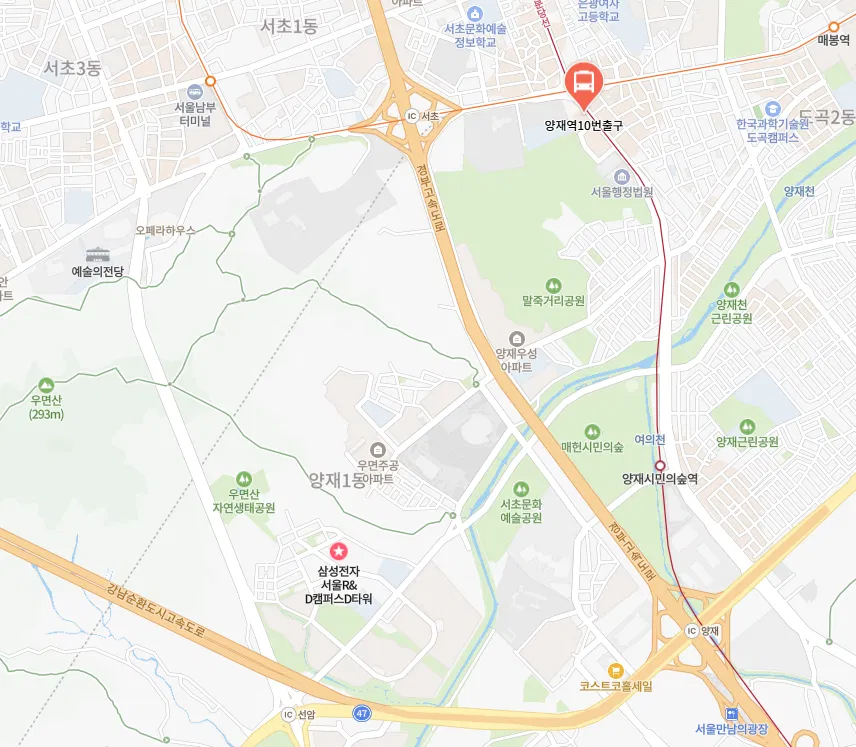
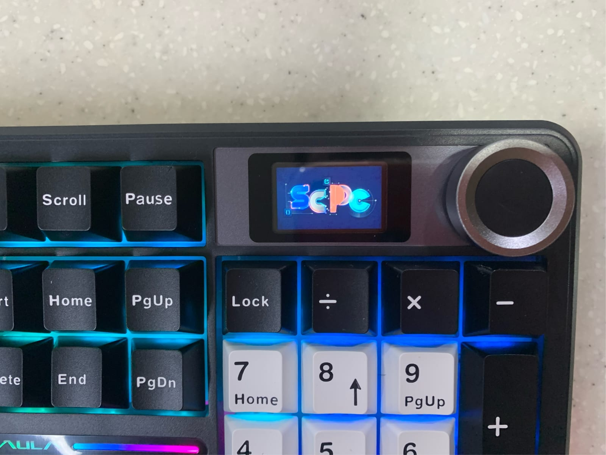
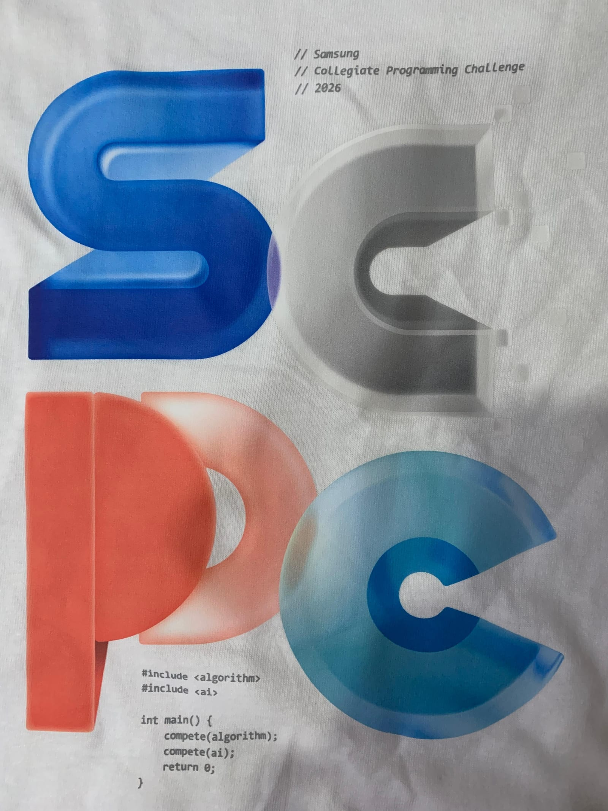

11시에 집을 나섰다. 대회가 열리는 삼성전자 서울R&D캠퍼스까지는 버스로 1시간 30분 거리라, 12시 30분쯤이면 도착할 예정이었다. 여유 있게 접수하고 다과도 천천히 즐기다가 오리엔테이션에 들어갈 생각이었다. 그런데 버스에 타자마자 긴장이 풀렸는지 잠이 들어버렸고, 깨어 보니 내려야 할 송동마을.서초힐스아파트 정류장을 30초 전에 지나친 뒤였다.

*원래 내렸어야 할 정류장 / 실제 내린 정류장*

대회장은 서울 서초구 성촌길 56, 삼성전자 서울R&D캠퍼스 D타워 2층 프론티어홀이다. 지도를 켜고 경로를 다시 짰다. 양재역 10번 출구에서 내려 서초18번 버스로 갈아타기로 했다. 등록 마감은 13시였는데, 버스에서 내려 접수처에 도착한 시간이 정확히 13시였다.

접수처 한편에는 참가자들이 자유롭게 먹을 수 있도록 마들렌, 쿠키, 브라우니, 에그타르트, 크루아상 샌드위치, 커피, 오렌지주스, 물이 준비되어 있었다. 작년과 같은 구성이라는 게 오히려 반가웠다. 다만 늦게 도착한 탓에 느긋하게 먹을 여유는 없어서, 몇 개만 집어 들고 바로 대회장으로 들어갔다.

13시부터 약 10분간 오리엔테이션이 진행됐고, 13시 25분까지 쉬는 시간이 주어졌다. 그리고 13시 30분, 본선이 시작됐다.

문제는 총 다섯 문항, 제한 시간은 네 시간이다. 대회를 준비하면서 삼성전자 Codeground에서 SCPC 기출문제를 풀며 연습했던 만큼, 이번에는 좋은 결과를 기대했다. 1, 2, 3번을 빠르게 풀고 4번과 5번에서 서브태스크 점수를 받으면 어쩌면 4등상은 노려볼 수 있지 않을까 하고 속으로 생각했다.

하지만 문제는 예상보다 어려웠다. 출제를 맡으신 건국대학교 소프트웨어학과 김성렬 교수님은 해설에서 1, 2, 3번까지를 "인간계"라고 표현하셨는데, 직접 풀어본 입장에서 정확한 표현이었다. 시간을 들여 손을 움직이면 어떻게든 실마리가 잡히는 문제들이었다.

진짜 벽은 4, 5번이었다. 네 시간 안에 다루기엔 벅찬 난이도였다. 아이디어를 떠올리는 단계부터 막혔고, 설령 방향을 잡았더라도 구현으로 옮기고 엣지 케이스까지 챙기려면 훨씬 더 많은 시간이 필요해 보였다. 17시 40분부터 진행된 미니 강의에서 교수님도 이 지점을 다시 짚으셨다. 4, 5번은 아이디어와 구현 사이의 간극이 유독 큰 문제였다고. 듣는 내내 고개가 끄덕여졌다.

SCPC의 재미있는 점은 대회가 끝나면 자기 자리에서 쓰던 키보드와 마우스를 그대로 기념품으로 준다는 것이다. 집에 와서 작년에 받은 키보드와 이번에 받은 키보드를 나란히 놓고 비교해 봤는데, 올해 키보드가 확실히 더 좋아졌다. 특히 상단에 작은 디스플레이가 달려 있어 SCPC 로고가 떠 있다. 이런 디테일까지 챙긴 걸 보면 준비하는 쪽에서도 매년 조금씩 더 신경 쓰고 있다는 게 느껴진다.

*2025 기념 키보드(위)와 2026 기념 키보드(아래)*

*2026 키보드 상단 디스플레이*

대회 기념 티셔츠 뒷면까지 코드로 채워 넣은 센스도 마음에 들었다. 문제 하나하나에 아이디어를 짜내는 것도 대회지만, 이런 기념품 하나에도 공을 들이는 게 SCPC답다는 생각이 들었다.

*2026 SCPC 랜야드 명찰과 기념 티셔츠*

돌아오는 길에, 이번이 아마 마지막 SCPC가 될 것 같다는 생각을 했다. 두 번의 본선, 두 번의 아쉬운 마무리였지만 돌아보면 매번 배운 게 있었다. 그동안 이런 대회를 꾸준히 열어준 삼성전자에 고마운 마음이 든다.
