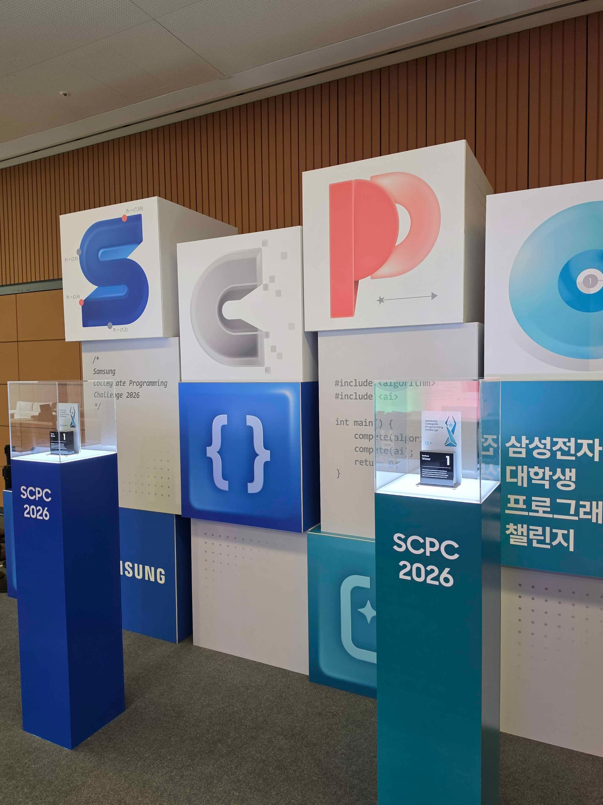
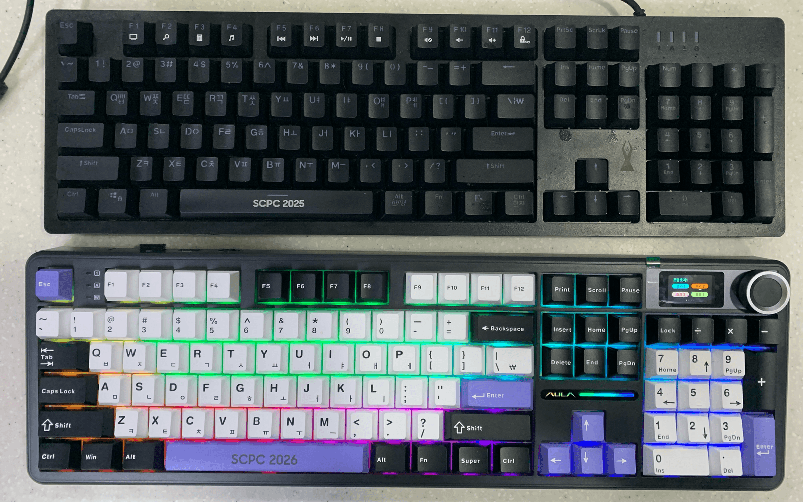
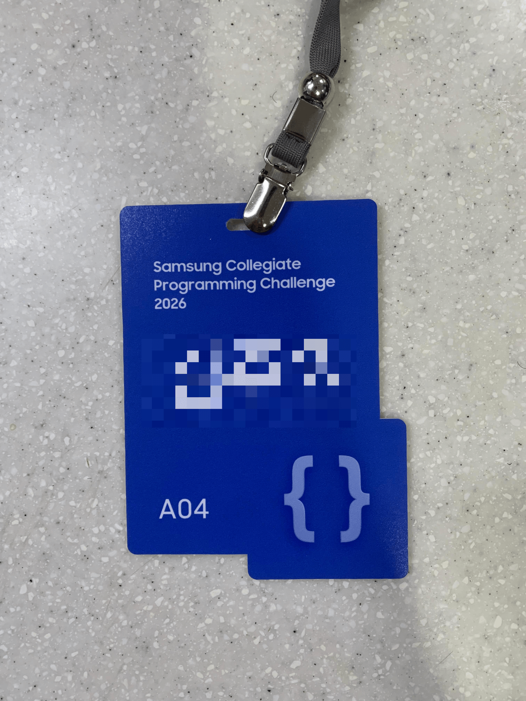

11시에 집에서 나섰다. 버스로 대회가 열리는 삼성전자 서울 R&D 캠퍼스까지 1시간 30분 거리니까 12시 30분쯤이면 도착할 예정이었다. 여유 있게 도착해서 접수하고, 다과도 천천히 즐기다가 오리엔테이션에 들어갈 생각이었다. 그런데 버스에 타자마자 긴장이 풀렸는지 잠이 들어버렸다. 내려야 할 송동마을.서초힐스아파트 정류장을 30초 전 지나친 뒤였다.

*원래 내렸어야 할 정류장 / 실제 내린 정류장*

대회장은 서울 서초구 성촌길 56, 삼성전자 서울R&D캠퍼스 D타워 2층 프론티어홀이다. 지도를 켜고 경로를 다시 짰다. 양재역 10번 출구에서 내려서 서초18번 버스로 갈아타는 쪽으로 방향을 틀었다. 등록 마감이 13시였는데, 버스에서 내려 대회 접수처에 도착한 시간이 정확히 13시였다.

접수처 한켠에는 대회 참가자들이 자유롭게 먹을 수 있도록 마들렌, 쿠키, 브라우니, 에그타르트, 크로와상 샌드위치, 커피, 오렌지주스, 물이 준비되어 있었다. 작년과 동일한 구성이라는 게 오히려 반가웠다. 다만 늦게 도착한 탓에 느긋하게 먹을 여유는 없었고, 몇 개 집어들고 대회장으로 바로 들어갔다.

13시부터 약 10분간 오리엔테이션을 진행하고, 13시 25분까지 참가자들이 쉴 시간을 주었다. 13시 30분, 본선이 시작됐다.

문제는 총 다섯 문항, 제한 시간은 네 시간이다. 이번에는 1, 2, 3번까지 빠르게 풀고 4번, 5번 서브테스크 점수를 받으면 어쩌면 4등상은 노려볼 수 있지 않을까라고 속으로 생각했다. 대회를 준비하는 동안 삼성전자 codeground에서 scpc 기출문제를 풀면서 연습한 만큼, 이번에는 좋은 결과를 기대했다.

그러나 문제는 예상보다 더 어려웠다. 출제를 맡으신 건국대학교 소프트웨어학과 김성렬 교수님이 해설을 하시면서 1, 2, 3번까지는 "인간계"라고 표현하셨는데, 풀어보니 정확한 표현이었다. 시간을 들이고 손을 움직이면 어떻게든 실마리가 잡히는 문제들이었다. 문제는 4, 5번이었다. 네 시간이라는 제한 시간 안에서 다루기엔 벅찬 난이도였다. 아이디어 자체를 떠올리는 단계부터 막혔고, 설령 방향을 잡았다 해도 구현으로 옮기고 엣지케이스까지 챙기는 데는 훨씬 더 많은 시간이 필요해 보였다. 17시 40분부터 진행된 미니강의에서 교수님도 이 지점을 다시 짚으셨다. 4, 5번은 아이디어와 구현 사이의 간극이 유독 큰 문제였다고. 듣는 내내 고개가 끄덕여졌다.

*2025 / 2026 기념 키보드*

*2026 scpc 랜야드 명찰과 기념 티셔츠*

SCPC의 재미있는 부분은 대회가 끝나면 자기 자리에서 쓰던 키보드와 마우스를 그대로 기념품으로 준다는 점이다. 집에 와서 작년에 받은 키보드와 이번에 받은 것을 나란히 놓고 비교해봤다. 올해 키보드가 확실히 더 좋아졌다. 특히 상단에 작은 디스플레이가 달려 있어서 SCPC 로고 이미지가 떠 있는데, 이런 디테일까지 챙긴 걸 보니 준비하는 쪽에서도 매년 조금씩 더 신경을 쓰고 있다는 게 느껴졌다. 또한 대회 기념 티셔츠 뒷면까지 코드로 채워 넣은 센스가 마음에 든다. 문제 하나하나에 아이디어를 짜내는 것도 대회지만, 이런 기념품 하나에도 공을 들이는 게 SCPC답다는 생각이 들었다

돌아오는 길에 이번이 아마 마지막 SCPC가 될 것 같다는 생각을 했다. 두 번의 본선, 두 번의 아쉬운 마무리였지만 돌아보면 매번 배운 게 있었다. 그동안 이런 대회를 꾸준히 열어준 삼성전자에 고마운 마음이 든다.
