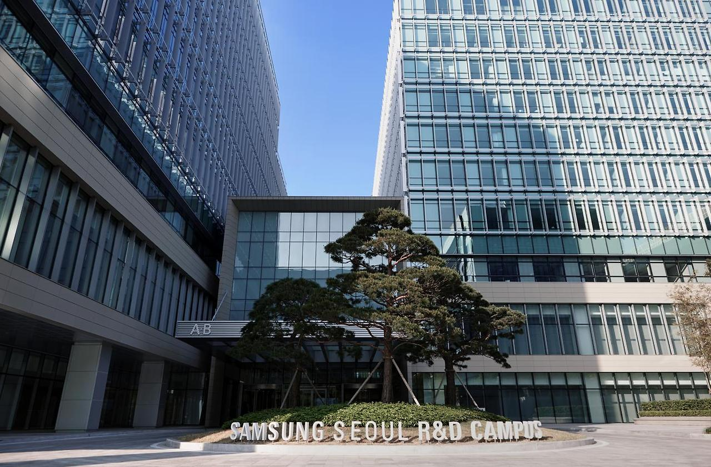

나는 알고리즘 문제 풀이를 좋아해서 오랫동안 알고리즘 문제를 풀어왔다. 특히 백준을 정말 오래 이용했다. 지금까지 푼 문제만 9,300문제가 넘을 정도로 꾸준히 풀었는데, 지금은 백준 서비스가 종료되어 더 이상 문제를 풀 수 없다는 점이 개인적으로 꽤 아쉽다. 오랫동안 많은 시간을 보냈던 서비스였기 때문에, 지금 생각해 보면 나에게는 단순히 문제를 푸는 사이트 이상의 의미가 있었던 것 같다.

그만큼 알고리즘 문제 풀이를 좋아하다 보니 대회가 열리면 가능한 한 참가하려고 한다. 그중에서도 **SCPC**(Samsung Collegiate Programming Challenge)는 개인적으로 꾸준히 도전하고 있는 대회다. 작년인 2025년에도 SCPC에 참가해서 본선까지 진출했지만, 아쉽게도 수상에는 실패했다.

돌이켜보면 작년에는 준비를 그렇게 열심히 하지 않았다. 기출문제도 제대로 풀어보지 않았고, 지금까지 알고리즘 문제를 많이 풀었으니 기본 실력만으로도 수상할 수 있지 않을까 하는 생각이 있었던 것 같다. 하지만 결과적으로 수상하지 못했고, 이번에는 조금 다르게 해 보고 싶었다.

**이번에는 본선 진출에서 끝내지 않고 수상까지 해보자.**

그런 생각으로 2026년 SCPC에 다시 도전했다.

## 1차 온라인 예선, 전 문제 만점

2026년 SCPC 1차 온라인 예선에서는 운 좋게도 전 문제를 모두 해결해서 **1,500점 만점**을 받았다. 생수 100점, 보급 200점, 최대최소 300점, 오지탐험 400점, Longest Chain 500점으로 총 1,500점이었다. 특히 마지막 문제인 Longest Chain은 500점짜리 문제였고 만점자가 57명뿐이었는데, 나도 이 문제까지 해결해서 전 문제 만점을 받을 수 있었다.

1차 결과가 좋았던 만큼 2차에 대한 자신감도 있었다. 작년에도 본선에 진출했으니 이번에도 작년 정도만 하면 본선 진출 자체는 어렵지 않을 것이라고 생각했다. 그래서 2차 시험을 시작할 때도 어느 정도 자신감을 가지고 있었다.

## 2차 온라인 예선, 풀리지 않은 3번

그런데 막상 2차 문제를 풀기 시작하니 생각보다 상황이 달랐다. 1번 **LCD**와 2번 **휘리릭**은 문제에서 요구하는 발상이 비교적 빠르게 떠올랐다. 바로 구현했고 각각 한 번에 만점을 받으면서 300점을 빠르게 확보했다. 처음에는 '이번에도 괜찮겠는데?'라는 생각이 들었다.

문제는 3번 **광케이블**이었다. 문제를 읽었는데 생각보다 잘 풀리지 않았다. 처음에는 '문제가 이렇게 어렵지는 않을 텐데?' 싶었고, 오히려 내가 핵심 아이디어를 놓치고 있는 것 아닐까 하는 생각이 들었다. 그래서 지문을 여러 번 읽으면서 문제를 해결하는 데 도움이 될 만한 힌트가 있는지 찾아봤다. 혹시 조건 하나를 놓쳤거나 문제의 의도를 잘못 이해한 것은 아닌지 계속 확인했지만, 아무리 읽어도 원하는 힌트를 찾을 수 없었다. 코드를 수정하면서 계속 도전했지만 문제는 쉽게 풀리지 않았다.

그래도 당시에는 아직 시간이 많이 남아 있었기 때문에 바로 3번을 포기하지는 않았다. 일단 4번과 5번을 먼저 도전해 보고, 거기서도 어렵다면 다시 3번으로 돌아오자고 생각했다.

4번 **미로 탈출**과 5번 **판자 자르기**도 처음 문제를 읽었을 때는 상당히 어렵게 느껴졌다. 모든 제약조건을 만족하는 완전한 솔루션을 만드는 것은 현실적으로 어렵다고 판단했다. 그래서 여기서는 전략을 조금 바꿨다. 모든 제약조건을 만족하는 풀이를 억지로 만들려고 하기보다는, **비교적 쉽게 만족시킬 수 있는 제약조건만 골라 그 조건을 목표로 하는 솔루션을 구현해 부분점수를 확보하자**고 생각했다. SCPC처럼 부분점수를 받을 수 있는 대회에서는 모든 문제를 완벽하게 해결하지 못하더라도, 주어진 상황에서 최대한 많은 점수를 가져가는 것이 중요하다고 생각했기 때문이다.

실제로 이 전략은 어느 정도 효과가 있었다. 4번 미로 탈출에서는 107점을, 5번 판자 자르기에서는 218점을 얻었다. 특히 5번은 600점짜리 문제였는데 만점자가 단 한 명도 없었고, 당시 최고 득점도 218점이었다. 나 역시 218점을 받아 최고 득점과 같은 점수를 기록했다. 4번도 평균 점수가 51점이었는데 나는 107점을 얻었으니, 완벽한 풀이를 만들어내지는 못했지만 어려운 문제에서 부분점수를 최대한 확보한다는 전략은 나름대로 잘 작동했다고 생각한다.

그런데 4번과 5번에서 점수를 확보하고 나서도 마음 한구석에는 계속 3번을 풀지 못했다는 사실이 남아 있었다. SCPC는 시험 중에 각 문제의 만점자 수를 실시간으로 확인할 수 있는데, 시험 종료가 오후 9시였고 오후 8시 정도가 되자 3번 문제의 만점자가 이미 100명을 넘어가고 있었다. 작년 기준으로 본선 진출자가 130명 내외였던 것으로 알고 있었기 때문에 점점 마음이 조급해졌다. '본선에 진출하려면 적어도 3번까지는 확실하게 풀어야 하는 것 아닐까?' 나는 아직 3번을 풀지 못했는데 이미 100명이 넘는 사람들이 만점을 받고 있었으니, 이대로는 본선 진출이 어려울 수도 있겠다는 생각이 들었다.

결국 다시 3번으로 돌아와 마지막까지 문제를 붙잡았다. 새로운 풀이를 만들어내기보다는 혹시 코드에 오타가 있는 것은 아닌지, 로직에 오류가 있는 것은 아닌지, 문제의 조건을 잘못 이해한 것은 아닌지 하나씩 점검했다. 지문도 다시 읽고 코드를 계속 확인했지만 결국 해결하지 못했다. 10번까지 제출했지만 3번 광케이블의 점수는 **0점**이었다.

시험이 끝났을 때 최종 점수는 **625점**이었다. 1번 100점, 2번 200점, 3번 0점, 4번 107점, 5번 218점으로 총 625점이었다. 4번과 5번에서 부분점수를 어느 정도 확보했기 때문에 마음이 조금 놓이기는 했다. 하지만 그렇다고 안심할 수는 없었다. 3번을 풀지 못했고, 시험 중에 만점자 수가 계속 늘어나는 것을 실시간으로 봤기 때문에 이 점수로 본선에 갈 수 있을지 확신할 수 없었다. 결과를 기다리는 수밖에 없었다.

그리고 8월 14일, 본선 진출 대상자로 선정되었다는 메일을 받았다. 일단 그때는 한숨을 돌릴 수 있었다. 이후 재학증명서를 제출했고, 서류 검토까지 끝난 뒤 8월 21일 본선 진출이 최종 확정되었다는 메일을 받았다. 작년에 이어 올해도 다시 본선에 진출하게 되니 기분이 좋았다. 특히 이번에는 1차에서 1,500점 만점을 받고 2차에서는 생각보다 크게 고전했지만, 결국 부분점수를 최대한 확보해서 본선까지 올라왔다는 점에서 나름 의미 있는 경험이었다고 생각한다.

## 작년과는 다르게 준비해보려고 한다

*Samsung Seoul R&D Campus*

이제 본선까지 약 일주일 정도 남았다. 2026년 SCPC 본선은 8월 28일 삼성전자 서울R&D캠퍼스에서 진행되고, 4시간 동안 총 5문제를 풀게 된다. 작년에도 같은 본선 무대에 서봤지만, 올해는 작년과 조금 다른 마음가짐으로 준비하려고 한다.

사실 작년에는 너무 설렁설렁 준비했다. 기출문제도 제대로 풀어보지 않았고, 지금까지 알고리즘 문제를 많이 풀어왔으니 기본 실력만으로도 수상할 수 있을 것이라고 생각했다. 하지만 결국 수상에는 실패했다. 지금 생각해 보면 **실력이 있다는 것과 대회를 제대로 준비하는 것은 완전히 다른 문제**였던 것 같다. 백준 문제를 9,300문제 이상 풀었고 알고리즘 문제 풀이에 익숙하더라도, 실제 대회에서는 어떤 문제에 시간을 투자할지 판단해야 하고, 문제의 의도를 빠르게 파악해야 하며, 완전한 풀이가 어렵다면 부분점수를 확보하는 전략도 필요하다. 이번 2차 예선을 직접 경험하면서 그런 부분을 다시 한번 느꼈다.

그래서 이번에는 조금 더 겸손한 마음으로 준비하려고 한다. 지금까지 쌓아온 알고리즘 문제 풀이 경험을 믿되, 그것만 믿고 대회에 들어가지는 않으려고 한다. 할 수 있는 만큼 최대한 준비하고, 내가 할 수 있는 투자를 최대한 해 본 뒤 결과를 기다려보려고 한다. 내가 알기로 작년 기준으로 본선 진출자는 약 130명 정도이고 수상자는 13명 정도였으니, 대략 상위 10% 정도가 수상을 하는 셈이다. 그중에서도 내가 현실적으로 잡은 목표는 **4등상**이다.

물론 목표를 정한다고 해서 그 결과가 보장되는 것은 아니다. 하지만 결과는 내가 통제할 수 없는 부분이고, 지금 내가 통제할 수 있는 것은 남은 일주일 동안 얼마나 열심히 준비하느냐라고 생각한다. 작년처럼 '기본 실력으로 어떻게든 되겠지'라는 생각으로 본선에 들어가기보다는, 이번에는 할 수 있는 만큼 최대한 준비해서 후회 없이 대회를 치러보고 싶다.

**1차에서는 1,500점 만점을 받았고, 2차에서는 625점으로 본선에 진출했다. 이제 남은 것은 본선이다.**

작년에는 본선까지 갔지만 수상하지 못했다. 올해는 조금 더 겸손하게, 조금 더 치열하게 준비해서 작년에 하지 못했던 것을 한번 해 보고 싶다. 과연 일주일 뒤 삼성전자 서울R&D캠퍼스에서 어떤 결과를 만들어낼 수 있을지는 본선이 끝난 뒤 다시 기록해 보려고 한다.
