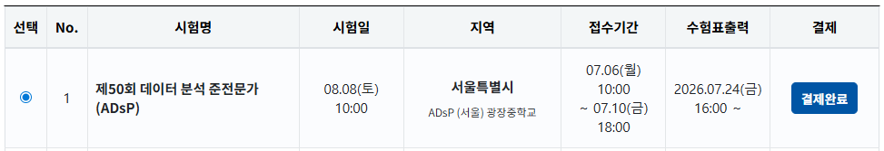
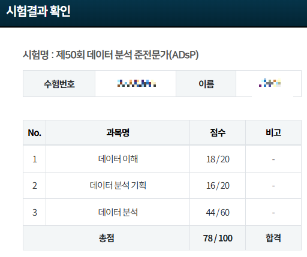
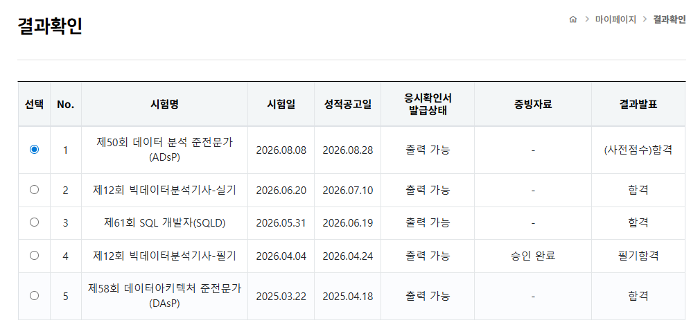
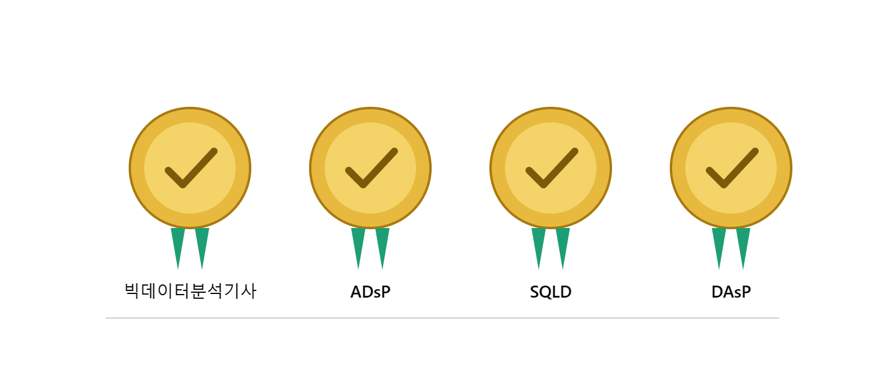

안녕하세요. **juwkim**입니다.

이번 글은 데이터분석준전문가(ADsP) 자격시험 합격 후기를 기록해보려고 합니다.

---

## 시험 정보

제가 응시한 시험은 **제50회 데이터분석준전문가(ADsP)** 입니다.

-   시험일: 2025. 08. 08. (토) 10:00
-   시험장: 광장중학교
-   지역: 서울특별시

*데이터분석준전문가 접수*

---

## 데이터분석준전문가란

ADsP(Advanced Data Analytics Semi-Professional)는 한국데이터산업진흥원에서 시행하는 자격시험으로, 데이터에 대한 기본적인 이해를 바탕으로 데이터 분석을 기획하고 실제로 데이터를 분석하는 데 필요한 지식을 갖췄는지를 검정합니다. 예전에 취득한 SQLD와 같은 기관에서 주관하는 시험이라 원서 접수나 시험 진행 방식이 크게 낯설지는 않았습니다.

시험은 데이터 이해, 데이터분석 기획, 데이터분석 세 과목으로 구성됩니다. 데이터 이해와 데이터분석 기획은 각각 10문항(20점)씩이고, 데이터분석은 30문항(60점)으로 배점이 가장 큽니다. 전체 50문항을 90분 동안 풀어야 하고, 합격 기준은 총점 60점 이상이면서 과목별로 40% 미만 득점이 없어야 합니다. 세 과목 중 어느 하나라도 과락이면 총점과 무관하게 불합격 처리되기 때문에, 한 과목에 몰아서 공부하기보다는 세 과목을 고르게 봐야 하는 시험입니다.

특히 배점이 가장 큰 데이터분석 과목은 통계 기초와 R, 데이터마이닝 개념을 다루는데, 이 부분이 제가 이미 갖고 있던 빅데이터분석기사와 상당히 겹쳤습니다. 이 이야기는 뒤에서 다시 하겠습니다.

응시 자격에는 제한이 없고, 연 4회 시행됩니다.

---

## 시험 준비

8월 1일에 SCPC 2026 Round 2를 치르고 나서, 그다음 날인 8월 2일부터 ADsP 공부를 시작했습니다. 8월 8일 오전에 ADsP 시험을 보고 같은 날 오후에 정보처리기사 필기 시험이 이어져 있었기 때문에, 남은 일주일을 어떻게 나눠 쓸지가 제일 큰 고민이었습니다.

책으로 처음부터 차근차근 정리하기에는 시간이 너무 촉박하다고 판단했습니다. 그래서 먼저 [아답터 ADsP 요약강의](https://youtube.com/playlist?list=PLWtr7MRpQi5CW-jFYgAsX4jZcSp77O3a5&si=Yjqa0YjLjjekGV1h)로 시험이 요구하는 개념을 한 번 훑었고, 이어서 [ADsP 핵심요약 5시간 벼락치기 특강](https://youtu.be/iwUYHUPwL30?si=F6bN01Vkg3JJR-qe)으로 개념을 한 번 더 다졌습니다.

기출문제는 직접 풀고 채점하고 해설을 찾아보는 방식 대신, 기출문제 풀이 강의를 듣는 쪽을 택했습니다. 문제가 나올 때마다 영상을 멈추고 먼저 풀어본 다음, 다시 재생해서 해설을 듣는 식이었습니다. 혼자 풀고 채점까지 하는 것보다 시간을 아낄 수 있어서, 일주일이라는 제한된 시간에는 이 방법이 더 맞다고 판단했습니다. [ADsP 기출문제 복원풀이 특강](https://www.youtube.com/playlist?list=PLB4A0k7jSYak)은 46회부터 49회까지 있었지만, 시간 여유가 없어서 가장 최근 회차인 49회 특강만 한 번 봤습니다. 하루에 시험을 두 개 몰아서 보다 보니, ADsP만 붙잡고 있을 수 없어서 오후에 볼 정보처리기사 쪽도 신경 써야 한다는 부담이 계속 있었습니다.

---

## 시험 결과

*제 50회 ADsP 시험 결과*

제 50회 데이터분석준전문가(ADsP) 시험 결과, 78점으로 **합격**했습니다.

시험을 마치고 나왔을 때, 처음 보는 개념이 담긴 선지가 꽤 많았습니다. 다만 문제를 100% 알아서 풀었다기보다는, 확실히 아닌 선지를 하나씩 지워가면서 답을 좁히는 방식으로 풀 수 있었습니다.

여러 번 자격증 시험을 보면서 느낀 점인데, 시험이 요구하는 내용을 전부 알지 못해도 그동안 쌓아온 공부 경험과 눈치로 정답을 추론할 수 있는 힌트가 문제 안에 은근히 숨어 있는 경우가 많습니다. 예를 들어 "\~만 된다", "\~가 유일하다"처럼 단정적으로 끊어 말하는 선지는 한 번 더 의심해볼 필요가 있습니다. 물론 이미 확실하게 맞거나 틀린 선지가 있다면 그걸 우선으로 삼아야 하고, 이 기준은 어디까지나 헷갈리는 선지 사이에서 고를 때 참고하는 정도입니다.

---

## 시험을 보면서 느낀 점

이번 시험은 빅데이터분석기사와 내용이 많이 겹쳐서, 그 경험이 상당히 도움이 되었습니다.

인터넷을 보면 "무슨 시험을 3일 만에 합격했다", "\~시험 3일 컷" 같은 글을 종종 봅니다. 실제로 그 사람이 운이 좋았거나 효율적으로 공부해서 그런 결과를 얻었을 수도 있습니다. 하지만 대개는, 저를 포함해서, 글에 드러나지 않는 배경이 더 많다고 생각합니다. 오랫동안 체계적으로 공부해온 경험이 있어서 새로운 내용을 빠르게 흡수했을 수도 있고, 이미 여러 배경지식이 있어서 새 지식을 기존에 알던 것과 엮어 이해했을 수도 있고, 혹은 시험이 요구하는 내용을 상당 부분 이미 알고 있었을 수도 있습니다.

제 경우가 딱 그랬습니다. ADsP보다 상위 자격으로 통하는 빅데이터분석기사를 먼저 공부해뒀기 때문에 ADsP는 상대적으로 수월했고, 중학교 때부터 대학원까지 오랜 시간 학계에 있었던 만큼 새로운 지식을 받아들이는 속도도 빠른 편입니다. 거기다 컴퓨터공학을 계속 전공하면서 IT 전반에 관심을 가져왔기 때문에, ADsP 범위 안의 내용들을 이미 조각조각 알고 있기도 했습니다.

그래서 요약강의 두 개와 기출 특강 한 번만으로 합격했다고 해서, 이걸 재능이나 운으로 돌리고 싶지는 않습니다. 짧게 준비한 것처럼 보여도 그 뒤에는 이 글에 다 적기 어려운 시간들이 쌓여 있었고, 그 덕분에 ADsP는 상대적으로 짧은 기간에 준비할 수 있었습니다.

---

## 마치며

이번 시험으로 한국데이터산업진흥원이 주관하는 기초 자격증인 빅데이터분석기사, ADsP, SQLD, DAsP를 모두 취득했습니다. 개인적으로는 상위 자격인 ADP, SQLP, DAP까지 모두 따고 싶은 마음이 있습니다. 다만 지금 제 상황과 우선순위를 생각했을 때, 그 욕심은 잠시 접어두고 더 중요한 것들에 시간을 쓰려고 합니다.

*데이터 기초자격증 모두 합격*
