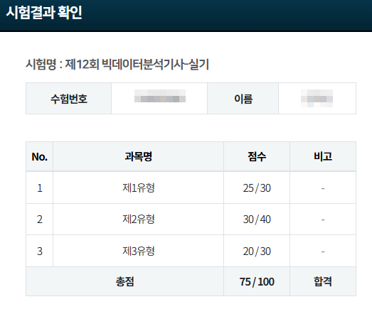
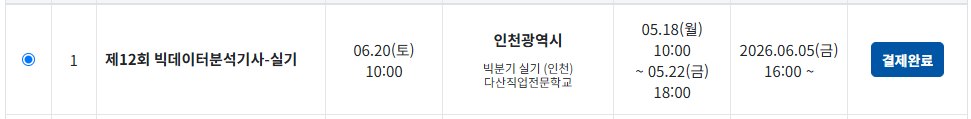

안녕하세요. **juwkim**입니다.

**빅데이터분석기사 실기 합격** 소식으로 돌아왔습니다.



*시험결과*

---

## 시험 당일

저는 **6월 20일 토요일 오전 10시**, 다산직업전문학교에서 시험을 봤습니다.

시험장에는 오전 9시 30분 정도에 도착했습니다. 집에서 자전거로 5분 거리였는데,

마침 비가 와서 우산을 쓰고 터벅터벅 걸어갔습니다. 오전 9시 10분쯤 집을 나와 도보로 20분 정도 걸려 도착했습니다.



*시험 일정*

---

## 공부 방법

제가 이번 시험 날짜인 6월 20일에 맞춰 연가를 4일 냈습니다. 6월 17일부터 20일까지 휴가를 내고 집에 왔습니다.

근데 오랜만에 집에 와서 그런지... 이것저것 하다 보니 공부를 사실 많이 안 했습니다.

번아웃이 온 건 아니었는데, 제가 좋아하는 테니스, 탁구 영상을 유튜브로 찾아보고 세계 정치나 경제 관련 영상도 보면서

휴가 첫 이틀은 그냥 놀았습니다. 뭐... 어쩔 수 없죠. 하하.

그래서 공부는 시험 전전날과 전날, 딱 2일 집중해서 했습니다.

### 1유형

6월 18일에는 1유형을 공부했습니다.

처음에는 책을 보면서 외우려고 했는데, 외울 게 너무 많아서 머리가 띵했습니다.

'이걸 언제 다 외우지?' 싶어서 다른 사람들 후기를 찾아보다가 apply() 하나면 대부분 해결된다는 글을 봤습니다.

가만히 생각해 보니 시험 이름은 <strong>'빅데이터'</strong>인데, 실제 시험에서는 빅데이터가 나오지 않습니다.

많아야 10만 건 정도의 데이터가 주어지기 때문에 1유형에서 작성하는 코드의 성능은 크게 중요하지 않습니다.

그래서 melt(), pivot\_table() 같은 함수는 과감하게 건너뛰고, 대부분 apply()를 활용해서 해결하는 방향으로 공부했습니다.

물론 기존에 프로그래밍을 해왔던 경험이 있었던 것도 도움이 많이 됐습니다.

### 2유형

다음 날인 6월 19일에는 2유형 템플릿을 만들고 거의 외우다시피 하면서 기출문제를 많이 풀었습니다.

한 5회차 정도는 풀었던 것 같습니다. 사실 2유형은 데이터 전처리도 결측치 처리와 인코딩 정도만 하면 충분하고,

이후에는 여러 모델을 돌려보면서 하이퍼파라미터를 조금씩 조정해 가장 성능이 좋은 모델을 찾으면 끝입니다.

학부 때 AI나 머신러닝을 공부했던 것처럼 이론을 깊게 이해할 필요는 없습니다.

즉, 내 코드가 얼마나 빠르게 수렴하는지 분석하는 것보다

그냥 여러 모델을 돌려보고 성능이 가장 좋은 모델을 선택하는 것이 훨씬 중요합니다.

분류 문제는 아래와 같이 템플렛을 만들고, metric, encoding, 하이퍼파라미터 등등 조금씩 수정하면서 가장 성능이 좋은 모델 찾는데 집중했습니다. 회귀 문제에서는 아래 코드에서 "Classifier" -> "Regressor"로 고치고 쓰면 됩니다.

```python
import pandas as pd
from sklearn.model_selection import train_test_split
from sklearn.metrics import f1_score

train = pd.read_csv("data/train.csv")
test = pd.read_csv("data/test.csv")

target = train.pop("target")
full = pd.get_dummies(pd.concat([train, test]))
train, test = full[:len(x)], full[len(x):]

# 회귀문제에서 stratify 없애기
x_tr, x_val, y_tr, y_val = train_test_split(train, target, test_size=0.2, random_state=0, stratify=target)

def solve(models):
    best_model, best_score = None, -1
    for model in models:
        model.random_state = 0
        model.n_estimators = 300
        model.class_weight = "balanced" # 회귀 문제에서 주석 처리
        model.fit(x_tr, y_tr)
        pred = model.predict(x_val)
        score = f1_score(y_val, pred, average='macro')
        print(model.__class__.__name__, score)
        if score > best_score:
            best_model, best_score = model, score
    return best_model

from sklearn.ensemble import RandomForestClassifier, ExtraTreesClassifier
from lightgbm import LGBMClassifier

models = RandomForestClassifier(), ExtraTreesClassifier(), LGBMClassifier()
model = solve(models)
res = pd.DataFrame({"pred": model.predict(test)})
res.to_csv("result.csv", index=False)
```

### 3유형

사실 제일 미뤘던 건 3유형이었습니다.

'1유형은 apply()만 잘 쓰면 30점은 받을 것 같고,

2유형도 열심히 했으니 40점 정도 받으면 70점으로 합격하겠지.' 하는 생각에 3유형은 계속 손을 놓고 있었습니다.

무엇보다 통계 이론을 공부하다 보면 머리가 너무 지끈지끈해서 솔직히 하기 싫었습니다.

그래서 시험 당일 새벽 4시까지 2유형을 공부하고 잠들었지만, 그래도 할 건 해야 한다는 생각에

3시간 정도 자고 오전 7시에 일어나 시험장에 가기 전까지 2시간 동안 3유형 기출문제를 집중해서 봤습니다.

막상 기출문제를 보니까 나오는 내용이 거의 비슷했습니다.

로지스틱 회귀, 선형 회귀, p-value, 오즈비(Odds Ratio), 회귀계수, 결정계수(R²) 정도를 계속 물어보더라고요.

처음에는 통계 범위가 너무 넓어서 막막했는데, 실제 시험에서 자주 나오는 내용만 집중해서 공부하는 게 훨씬 효율적이었습니다.

그리고 사실 크게 걱정은 안 했습니다.

1유형은 실수만 안 하면 30점 정도는 받을 것 같았고,

2유형은 나름 열심히 했으니 못해도 30점은 받을 거라고 생각했습니다.

3유형은 정말 모르겠는 문제가 나오면, 예전에 리눅스를 공부할 때 man 명령어를 썼던 것처럼 scipy.stats의 help()를 보면서 풀어야겠다고 생각했습니다.

## 사용한 교재

공부는 <strong>「[2026 시나공 빅데이터분석기사 실기(Python)](https://www.aladin.co.kr/shop/wproduct.aspx?ItemId=389892962)」</strong>로 했습니다.

교재 실습 자료와 기출문제도 <strong>[GitHub](https://github.com/lovedlim/bae-v3)</strong>에 올라와 있어서 같이 보면서 공부하기 좋았습니다.

이론 설명이 정말 자세해서 공부하다 보면 머리가 지끈지끈해지는 게 장점이자 단점이긴 했습니다.

그래도 덕분에 시험에서 필요한 내용들을 한 번 제대로 정리할 수 있었고, 좋은 결과로 이어진 것 같습니다.


*교재 사진*

## 마무리

통계학은 수학 전공 과정에서, AI와 머신러닝은 소프트웨어 전공 과정에서

공부해 본 경험이 있어서 비교적 재미있게 준비할 수 있었습니다.

무엇보다 **빅데이터분석기사는 제 첫 기사 자격증**이라는 점에서 더욱 의미가 컸습니다.

이 자격증을 시작으로 정보통신기사, 정보처리기사, 정보보안기사까지 차근차근 준비하면서 계속 성장해 나가려고 합니다.
