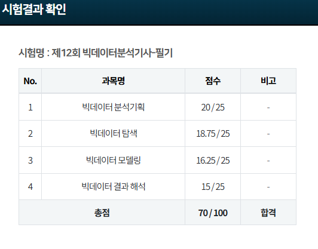
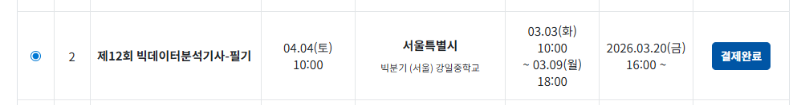
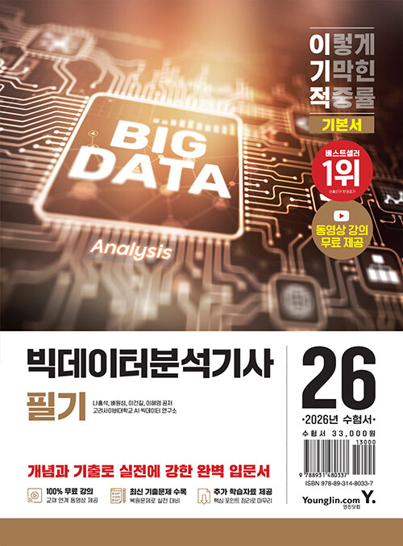

안녕하세요. **juwkim**입니다.

빅데이터분석기사 필기 합격 소식으로 돌아왔습니다.

이번 시험은 군 복무 중 준비하게 된 자격증이었고, 충분한 시간을 확보하기 어려운 상황에서 비교적 짧은 기간 집중해서 준비했습니다. 결과적으로 무난하게 합격하게 되어 기록을 남겨봅니다.

---

## 시험 당일

저는 **4월 4일 토요일 오전 10시**, 강일중학교에서 시험을 봤습니다.  
시험장에는 오전 9시 정도에 도착했고, 시험 시작 전까지 약 30분 정도 마지막 복습을 하면서 컨디션을 정리했습니다.

시험장은 전체적으로 조용했고, 시험 자체도 시간에 쫓기는 느낌은 아니었습니다.  
80문항에 2시간 시험이지만 실제로는 1시간 정도면 충분히 풀이가 가능한 난이도였습니다.

시간 부족에 대한 부담은 크게 없었습니다.

---

## 공부 시간

사실 이번 시험은 공부 시간이 많지 않았습니다.

군 생활과 일과를 병행하다 보니 따로 시간을 확보하기가 쉽지 않았고, 책은 미리 준비해두었지만 실제로 집중해서 공부한 시간은 시험 전날 밤이었습니다. 시험일이 4월 4일이었는데, **4월 3일 22:00 ~ 4월 4일 06:00**  
약 8시간 정도 개념을 빠르게 훑는 방식으로 준비했습니다.

사용한 교재는 아래에 첨부한 교재였고, 개념이 비교적 자세하게 정리되어 있어서 짧은 시간 안에 전체 흐름을 정리하기에 괜찮았습니다. 원래 연등 시간은 22:00 ~ 00:00까지만 가능했지만, 당직사령님께 양해를 구해 시험 당일 아침까지 연등을 할 수 있었습니다. 덕분에 제한된 시간 안에서도 최대한 집중해서 준비할 수 있었습니다.

---

## 과목별 준비 방법

### 1과목

1과목은 개념을 비교적 꼼꼼히 확인했습니다.  
생각보다 암기 요소가 많았기 때문에 빠르게 전체 구조를 훑는 데 집중했습니다.

---

### 2과목

2과목은 개인적으로 비교적 익숙한 영역이었습니다.

기존에 AI와 통계 관련 공부를 꾸준히 해왔고, 전공도 수학 및 소프트웨어 기반이 있었기 때문에 대부분 알고 있는 내용이었습니다. 전자전기공학 수업도 일부 청강했었기 때문에 전반적인 개념 구조가 낯설지는 않았습니다.

그래서 2과목은 약 30분 정도 핵심 개념만 빠르게 확인했습니다.

---

### 3과목 / 4과목

3과목과 4과목은 상대적으로 처음 보는 개념도 있었지만, 모든 내용을 깊게 보기보다는 중요해 보이는 부분 위주로 빠르게 체크했습니다. 전체 범위를 완벽하게 이해하려 하기보다는, 시험에서 나올 가능성이 높은 내용 위주로 정리하는 전략으로 접근했습니다.

---

## 시험에서 중요했던 점

돌이켜보면 이번 시험에서 가장 중요했던 것은 공부 시간 자체보다도 **시험을 대하는 태도**였던 것 같습니다.

시험 보기 전부터 스스로에게 <strong>'나는 절대 떨어지지 않는다'</strong>라고 생각했습니다.

물론 이런 생각이 누군가에게는 조금 과하게 느껴질 수도 있습니다.  
하지만 저는 스스로에 대한 확신이 있을 때 오히려 더 침착하게 시험을 보는 편입니다.

군 생활과 함께 **육군창업경진대회**도 같이 준비하고 있었기 때문에 현실적으로 자격증 공부에 많은 시간을 투자하기 어려운 상황이었습니다. 그럼에도 크게 불안하지 않았던 이유는 기본적인 배경지식이 있었고, 시험의 성격을 어느 정도 파악하고 있었기 때문입니다.

속으로는 계속 이렇게 생각했습니다.

> **컴퓨터 관련 자격증이라면, 충분히 합격할 수 있다.**

결과적으로 그 판단은 맞았습니다.

---

## 공부 방법 (이라고 하기엔 단순하지만)

정리해보면 이번 시험에서의 방식은 아래 정도였습니다.

1.  내가 절대로 떨어지지 않을 거라고 믿기
2.  그 믿음이 부족하다면 시간을 충분히 써서 준비하기

조금 단순하게 들릴 수도 있지만, 시험이라는 것이 결국 기본적인 준비와 함께 심리적인 안정감도 중요한 요소라고 생각합니다.

---

## 마무리

짧은 시간 준비했지만 결과적으로 좋은 결과를 얻었습니다.

이번 시험은 단순히 자격증 하나를 취득했다기보다는, 제한된 환경에서도 충분히 준비할 수 있다는 경험을 했다는 점에서 의미가 있었습니다. 비슷한 상황에서 시험을 준비하시는 분들에게도 참고가 되었으면 합니다.

필기 합격 이후 실기 준비 과정도 정리해볼 예정입니다.

읽어주셔서 감사합니다.
