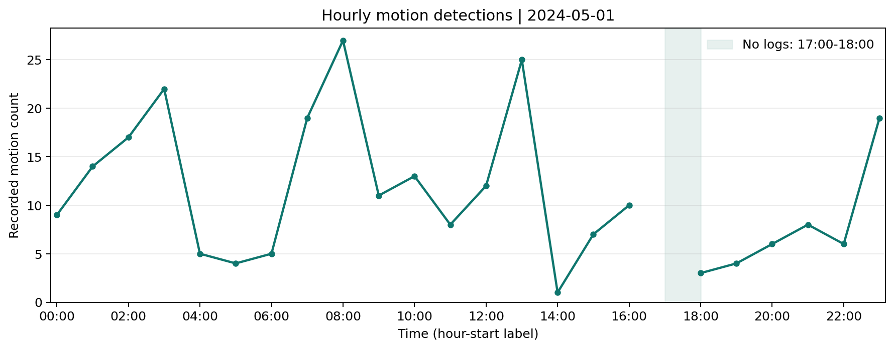

> **이번 글의 질문**
>
> 시간이 뒤섞인 센서 로그를 한 시간 단위로 묶으려면 어떻게 해야 할까요? 기록이 없는 시간의 합계를 0이라고 해도 될까요? 중첩된 JSON을 분석하기 쉬운 DataFrame으로 바꾸려면 어떻게 해야 할까요?

> **핵심 요약**
>
> 시간 문자열은 datetime으로 변환하고, 시간 순서와 집계 구간을 정합니다. `resample()`에는 데이터 의미에 맞는 집계 함수를 연결하며, 관측된 0과 기록이 없는 시간을 구분합니다. JSON의 중첩된 Dictionary는 `json_normalize()`로 펼친 뒤 날짜와 수량을 점검합니다.

## 1. 시간 순서를 맞추는 것과 시간 간격을 바꾸는 것은 다릅니다

센서 기록을 시간순으로 놓으면 언제 변화했는지 볼 수 있습니다. 기록 간격이 들쭉날쭉할 때는 한 시간처럼 일정한 구간으로 다시 묶어야 비교하기 편합니다. 시간 형식을 바꾸고, 순서를 정리하고, 구간의 합계와 관측 여부를 함께 남겨 봅니다.

| 실습 파일 | 데이터 구성 | 이번에 하는 작업 |
| --- | --- | --- |
| `sensor_log.csv` | 100행, 3열 | 시간을 정렬하고 움직임 감지 횟수를 한 시간 단위로 집계합니다. |
| `supply.json` | 50개 보급 기록 | 중첩된 `items`를 펼쳐 5열의 DataFrame과 CSV로 만듭니다. |

시계열 데이터는 시간 정보와 그때의 관측값을 함께 가진 데이터입니다. 기온, 주가, 센서 기록처럼 앞선 상태가 이후 상태와 연결될 수 있습니다. 전반적인 방향은 **Trend**, 일정한 주기로 반복되는 패턴은 **Seasonality**라고 합니다. 센서 파일은 하루치이므로 시간대별 변화는 살펴볼 수 있지만, 반복되는 계절성을 확인하려면 여러 주기의 기록이 필요합니다.

| 작업 | 바뀌는 것 | 센서 로그에서의 예 |
| --- | --- | --- |
| 정렬 | 행의 순서 | 00시 기록부터 23시 기록까지 시간 순서로 배치합니다. |
| 리샘플링 | 시간 구간과 값의 표현 | 서로 다른 시각의 로그를 00\~01시, 01\~02시 구간으로 묶어 합계를 계산합니다. |

> **정렬은 기록을 순서대로 놓는 작업이고, 리샘플링은 정해진 시간 구간으로 다시 묶는 작업입니다.** 리샘플링에서는 “얼마나 긴 구간으로 묶을지”와 “그 안의 값을 어떻게 계산할지”를 함께 정합니다.

## 2. 실습 1: 센서 로그의 시간을 읽고 정렬합니다

### 2-1. 파일과 열 이름을 확인합니다

```python
import pandas as pd

sensor_raw = pd.read_csv("sensor_log.csv")
print("데이터 크기:", sensor_raw.shape)
print("열 이름:", sensor_raw.columns.tolist())
print("결측치 수:", sensor_raw.isna().sum().to_dict())
print(sensor_raw.head(3).to_string(index=False))
```

```text
데이터 크기: (100, 3)
열 이름: ['timestamp', 'post_id', 'motion_detected']
결측치 수: {'timestamp': 0, 'post_id': 0, 'motion_detected': 0}
          timestamp post_id  motion_detected
2024-05-01 00:14:11     P03                1
2024-05-01 01:05:05     P03                3
2024-05-01 00:57:58     P01                3
```

열 이름은 `timestamp`, `post_id`, `motion_detected`입니다. `post_id`에는 P01·P02·P03 세 초소가 들어 있으며, `motion_detected`는 각 기록에 담긴 감지 횟수입니다. 로그의 행 수와 감지 횟수의 합계는 다른 값입니다. 한 행에 5회가 기록될 수 있으므로, 감지 횟수를 구할 때는 행을 세는 대신 이 열을 합산합니다.

### 2-2. timestamp를 datetime으로 변환합니다

```python
sensor = sensor_raw.copy()
sensor["timestamp"] = pd.to_datetime(
    sensor["timestamp"], format="%Y-%m-%d %H:%M:%S"
)
print("정렬 전 시간순:", sensor["timestamp"].is_monotonic_increasing)

sensor = sensor.sort_values("timestamp", kind="stable")
print("정렬 후 시간순:", sensor["timestamp"].is_monotonic_increasing)
print(sensor.head(3).to_string(index=False))
```

```text
정렬 전 시간순: False
정렬 후 시간순: True
          timestamp post_id  motion_detected
2024-05-01 00:14:11     P03                1
2024-05-01 00:54:38     P02                5
2024-05-01 00:57:58     P01                3
```

`format`은 파일에 들어 있는 날짜 형식을 지정합니다. `%Y`는 연도, `%m`은 월, `%d`는 일이며 `%H:%M:%S`는 시·분·초입니다. 기본 `errors="raise"`는 해석할 수 없는 값이 있으면 오류를 발생시켜 입력 문제를 바로 확인하게 합니다.

이 파일처럼 자릿수가 일정한 `YYYY-MM-DD HH:MM:SS` 문자열은 문자 정렬도 시간 순서와 맞을 수 있습니다. 다만 날짜 형식이 섞이면 결과가 달라지고, 문자열인 상태로는 시간 연산이나 리샘플링을 사용할 수 없습니다. 시간 데이터라는 의미를 명확하게 만들기 위해 먼저 datetime으로 변환합니다.

`sort_values("timestamp")`는 시간 열의 값으로 행을 정렬합니다. `kind="stable"`은 같은 시간이 여러 번 나올 때 기존 행 순서를 유지합니다. 정렬한 결과를 `sensor`에 다시 할당하는 방식은 변환 흐름을 읽기 쉽습니다. 이미 시간 인덱스를 만든 뒤에는 `sort_index()`로 인덱스를 정렬할 수 있습니다.

### 2-3. 잘못된 시간과 중복 기록을 확인합니다

```python
date_example = pd.Series(["2024-05-01 10:00:00", "잘못된 시간"])
parsed_example = pd.to_datetime(
    date_example, format="%Y-%m-%d %H:%M:%S", errors="coerce"
)
print("변환 실패:", parsed_example.isna().tolist())
print("같은 초소·같은 시간의 추가 기록 수:",
      int(sensor.duplicated(["post_id", "timestamp"]).sum()))
```

```text
변환 실패: [False, True]
같은 초소·같은 시간의 추가 기록 수: 0
```

`errors="coerce"`는 해석하지 못한 시간을 `NaT`로 바꿉니다. `NaT`는 날짜·시간의 결측값입니다. 여러 파일을 점검할 때 유용하지만, 변환 실패 행을 따로 확인하지 않고 진행하면 해당 기록이 시간 집계에서 빠질 수 있습니다. 실제 정제에서는 원본 시간 문자열을 남기고, 실패 행을 별도로 저장해 수정할지 제외할지 정합니다.

현재 센서 파일에는 같은 초소·같은 시간의 추가 기록이 없습니다. 다른 초소가 같은 시각에 기록한 행은 정상일 수 있으므로 시간 하나만 보고 중복을 제거하지 않습니다. 같은 초소·같은 시간이라도 서로 다른 이벤트일 수 있습니다. 이벤트 ID나 재전송 여부를 확인한 뒤 중복 처리 기준을 정합니다.

## 3. 한 시간 단위로 감지 횟수를 합산합니다

### 3-1. DatetimeIndex를 설정하고 resample()을 적용합니다

```python
sensor_ts = sensor.set_index("timestamp")
hourly_sum = sensor_ts["motion_detected"].resample("1h").sum()

print("인덱스 종류:", type(sensor_ts.index).__name__)
print(hourly_sum.head(4).to_string())
print("시간 구간 수:", len(hourly_sum))
print("원본 합계:", int(sensor_ts["motion_detected"].sum()))
print("시간별 합계의 총합:", int(hourly_sum.sum()))
```

```text
인덱스 종류: DatetimeIndex
timestamp
2024-05-01 00:00:00     9
2024-05-01 01:00:00    14
2024-05-01 02:00:00    17
2024-05-01 03:00:00    22
Freq: h
시간 구간 수: 24
원본 합계: 255
시간별 합계의 총합: 255
```

`set_index("timestamp")`는 `timestamp` 열을 인덱스로 옮깁니다. `resample("1h")`는 한 시간씩 묶을 기준을 만들고, 뒤에 연결한 `.sum()`이 각 구간의 감지 횟수를 더합니다. 결과는 시간 인덱스를 가진 Series입니다. 현재 데이터의 총 감지 횟수는 255회이며, 시간별 합계를 다시 더해도 255회가 됩니다.

00시 구간의 합계 9는 세 기록을 더한 값입니다. 00:14:11의 P03 기록 1회, 00:54:38의 P02 기록 5회, 00:57:58의 P01 기록 3회를 함께 계산합니다. 이 결과는 **전체 초소의 시간별 합계**이며, 초소별 합계는 뒤에서 별도로 만듭니다.

| 기록 시간 | 초소 | 감지 횟수 |
| --- | --- | --- |
| 2024-05-01 00:14:11 | P03 | 1 |
| 2024-05-01 00:54:38 | P02 | 5 |
| 2024-05-01 00:57:58 | P01 | 3 |

### 3-2. 인덱스를 바꾸지 않고 시간 열을 지정할 수도 있습니다

```python
hourly_on = sensor.resample("1h", on="timestamp")["motion_detected"].sum()
print("두 방식의 결과 일치:", hourly_on.equals(hourly_sum))
```

```text
두 방식의 결과 일치: True
```

`on="timestamp"`를 사용하면 현재 DataFrame의 인덱스를 유지하면서 해당 시간 열을 기준으로 집계합니다. 시간 범위 조회를 계속 이어 갈 때는 DatetimeIndex가 편하고, 원래 인덱스를 유지하며 집계할 때는 `on`이 편합니다. 두 방식 모두 시간 기준으로 쓰는 값이 datetime이어야 합니다.

### 3-3. CSV에는 시간 인덱스도 함께 저장합니다

```python
hourly_sum = hourly_sum.rename("motion_sum")
hourly_sum.to_csv("hourly_motion.csv", index_label="timestamp")

saved_hourly = pd.read_csv("hourly_motion.csv")
print(saved_hourly.head(3).to_string(index=False))
```

```text
          timestamp  motion_sum
2024-05-01 00:00:00           9
2024-05-01 01:00:00          14
2024-05-01 02:00:00          17
```

`.rename("motion_sum")`은 Series의 이름을 정하고, `index_label="timestamp"`는 CSV에 저장되는 인덱스 열의 이름을 정합니다. 시간별 결과에서는 시간이 핵심 정보이므로 인덱스를 함께 저장합니다. `index=False`를 쓰면 시간 열이 빠집니다.

시간을 일반 열로 바꿔 저장하려면 `hourly_sum.reset_index().to_csv(..., index=False)`도 사용할 수 있습니다. Series를 직접 저장할 때 출력 값의 열 이름을 지정하는 다른 방법은 `header=["motion_sum"]`처럼 List를 전달하는 것입니다. `header="motion_sum"`처럼 문자열 하나를 전달해 이름 변경을 기대하지 않습니다.

## 4. 리샘플링의 기준을 명확하게 정합니다

### 4-1. 주기는 1h, 1min, ME처럼 표기합니다

| 묶을 주기 | 현재 사용할 표기 | 의미 |
| --- | --- | --- |
| 1분 | `1min` | 1분 간격 |
| 1시간 | `1h` | 1시간 간격 |
| 1일 | `1D` | 하루 단위 |
| 1주 | `W-SUN` | 일요일을 기준으로 끝나는 주 |
| 월말·월초 | `ME` · `MS` | 월말·월초를 라벨로 하는 월 단위 |
| 분기말·분기초 | `QE-DEC` · `QS-JAN` | 달력 기준 분기 단위 |
| 연말·연초 | `YE-DEC` · `YS-JAN` | 달력 기준 연도 단위 |

예전 코드의 시간 `H`, 분 `T`, 월말 `M`, 분기말 `Q`, 연말 `Y` 대신 리샘플링에서는 `h`, `min`, `ME`, `QE`, `YE` 표기를 사용합니다. 예를 들어 `resample("1H")`는 `resample("1h")`로 작성합니다. `ME`는 30일 고정 간격이 아니라 달력의 월말 기준입니다. 이 표는 DatetimeIndex 리샘플링의 주기 표기이며, Period의 월 단위 `M`과는 구분합니다.

### 4-2. 합계, 평균, 건수는 서로 다른 질문에 답합니다

| 데이터 의미 | 집계 함수 | 계산하려는 값 |
| --- | --- | --- |
| 각 기록의 감지 횟수 | `sum()` | 구간에 기록된 감지 횟수의 합계 |
| 센서 측정값 | `mean()` | 구간에 기록된 측정값의 산술평균 |
| 로그 행 | `size()` | 결측값 포함 로그 건수 |
| 유효한 측정값 | `count()` | 결측값이 아닌 관측 건수 |
| 시간 구간의 최고값 | `max()` | 구간에 기록된 값 중 최대값 |
| 관측 시점의 재고량 | `last()` | 구간에서 마지막 유효 관측값 |

현재 파일에서 `motion_detected`는 감지 횟수이므로 합계가 적합합니다. 기온이라면 합계보다 평균·최소·최대가 유용하고, 특정 시각의 재고량이라면 구간의 마지막 관측값을 볼 수 있습니다. 누적 카운터를 매번 기록한 데이터라면 값을 모두 더하지 않고 증가분을 구하는 등 별도 기준이 필요합니다.

로그 간격도 살펴봅니다. 불규칙하게 수집한 기온에 `.mean()`을 적용하면 각 관측값에 같은 가중치를 줍니다. 특정 시간대에만 측정이 많으면 시간 길이를 반영한 평균과 달라질 수 있습니다. 감지 합계 역시 초소의 운영 시간과 수집 상태를 함께 확인해야 비교 의미가 분명해집니다.

### 4-3. closed는 포함 범위, label은 결과에 붙이는 시간입니다

한 시간 구간을 `[00:00, 01:00)`으로 정하면 00:00은 포함하고 01:00은 다음 구간에 넣습니다. `closed="left"`가 이 포함 규칙을 정합니다. `label="left"`는 구간 이름으로 시작 시간 00:00을 쓰고, `label="right"`는 끝 시간 01:00을 씁니다.

```python
boundary_example = pd.Series(
    [3, 5, 2],
    index=pd.to_datetime([
        "2024-05-01 00:00:00",
        "2024-05-01 00:59:59",
        "2024-05-01 01:00:00",
    ]),
)
left_label = boundary_example.resample(
    "1h", closed="left", label="left"
).sum()
right_label = boundary_example.resample(
    "1h", closed="left", label="right"
).sum()
print("시작 시간 라벨")
print(left_label.to_string())
print("끝 시간 라벨")
print(right_label.to_string())
```

```text
시작 시간 라벨
2024-05-01 00:00:00    8
2024-05-01 01:00:00    2
Freq: h
끝 시간 라벨
2024-05-01 01:00:00    8
2024-05-01 02:00:00    2
Freq: h
```

두 결과의 합계는 8과 2로 같습니다. `label`만 바꾸면 포함되는 기록은 그대로이고 결과에 붙는 시간이 달라집니다. 01:00 기록의 2를 이전 구간에 넣으려면 라벨이 아니라 `closed` 규칙을 바꿔야 합니다. 시간 단위와 월말·주 단위의 기본 설정도 다를 수 있어, 보고서 기준이 중요할 때는 둘을 명시합니다.

교대 시간이 00:30부터 시작한다면 `resample("1h", origin="start_day", offset="30min")`처럼 구간 경계를 옮길 수 있습니다. `origin`은 고정 간격 주기의 기준점이고, `offset`은 그 기준점을 옮기는 시간입니다. 달력 월 단위 집계를 고정 간격처럼 옮기는 옵션으로 사용하지 않습니다.

## 5. 기록이 없는 시간을 0으로 오해하지 않습니다

### 5-1. 현재 데이터의 17시에는 로그가 없습니다

```python
motion = sensor_ts["motion_detected"]
hourly_stats = pd.DataFrame({
    "motion_sum": motion.resample("1h").sum(min_count=1),
    "log_rows": motion.resample("1h").size(),
    "valid_values": motion.resample("1h").count(),
})
print(hourly_stats.loc["2024-05-01 16:00":"2024-05-01 18:00"].to_string())
print("기본 sum의 17시 값:", int(hourly_sum.loc["2024-05-01 17:00"]))
hourly_stats.to_csv("hourly_motion_stats.csv", index_label="timestamp")
```

```text
                     motion_sum  log_rows  valid_values
timestamp
2024-05-01 16:00:00        10.0         4             4
2024-05-01 17:00:00         NaN         0             0
2024-05-01 18:00:00         3.0         1             1
기본 sum의 17시 값: 0
```

16시는 로그 4건에 감지 합계 10회이고, 18시는 로그 1건에 3회입니다. 17시는 로그 0건입니다. 기본 `.sum()`은 빈 구간도 0으로 계산하지만, `.sum(min_count=1)`은 유효값이 한 개도 없는 구간을 `NaN`으로 남깁니다. 날짜가 빠졌으므로 `NaT`가 되는 것이 아니라, 해당 시간 구간의 집계값이 없으므로 `NaN`이 됩니다.

> **감지 횟수가 0으로 기록된 것과 로그가 한 건도 없는 것은 다릅니다.** 관측한 0은 “센서가 0을 기록했다”는 뜻이고, 빈 구간은 감지 여부를 알 수 없다는 뜻입니다. 센서 상태나 통신 기록을 확인하기 전에는 빈 시간을 안전한 시간으로 해석하지 않습니다.

`log_rows`는 구간에 몇 행이 있는지, `valid_values`는 값이 비어 있지 않은 행이 몇 개인지 알려 줍니다. 두 값이 다르면 로그는 들어왔지만 일부 측정값이 누락된 상황입니다. `min_count=1`은 최소 한 개의 유효값만 요구하므로, 그 시간의 데이터가 모두 수집되었다는 뜻은 아닙니다. 예상 수집 주기와 운영 시간을 기준으로 완전성도 따로 점검합니다.

### 5-2. 초소별로 집계하면 빠진 기록을 더 잘 볼 수 있습니다

```python
motion_by_post = (
    sensor_ts.groupby("post_id")["motion_detected"]
    .resample("1h")
    .sum(min_count=1)
    .unstack("post_id")
    .reindex(hourly_stats.index)
)
print(motion_by_post.head(3).to_string())
print("초소별 총합:", motion_by_post.sum().to_dict())
motion_by_post.to_csv("hourly_motion_by_post.csv", index_label="timestamp")
```

```text
post_id              P01  P02   P03
timestamp
2024-05-01 00:00:00  3.0  5.0   1.0
2024-05-01 01:00:00  1.0  NaN  13.0
2024-05-01 02:00:00  NaN  8.0   9.0
초소별 총합: {'P01': 87.0, 'P02': 71.0, 'P03': 97.0}
```

`groupby("post_id")`로 초소를 나눈 뒤 각 초소의 기록을 시간별로 집계합니다. `unstack("post_id")`는 초소를 열로 옮깁니다. 마지막 `reindex()`는 전체 집계와 같은 시간 축으로 맞춰, 각 초소의 첫 기록 이전이나 마지막 기록 이후도 표에 표시합니다.

01시에는 P01이 1회, P03이 13회이며 P02의 기록은 없습니다. 전체 합계 14만 보면 P02의 빈 기록을 놓칠 수 있습니다. 현재 관측값의 총합은 P01 87회, P02 71회, P03 97회입니다. 이 수치는 기록된 합계이며, 초소별 감시 위험도나 감지 성능의 순위를 바로 뜻하지는 않습니다.

전체 분석 기간이 미리 정해져 있다면 그 기간의 `pd.date_range(..., freq="1h")`를 만들어 `reindex`합니다. `resample`은 기본적으로 관측 범위에 맞춰 구간을 생성하므로, 파일 앞뒤에 기록되지 않은 분석 기간까지 자동으로 채워 주지는 않습니다.

## 6. Matplotlib으로 시간대별 합계를 시각화합니다

### 6-1. 빈 기록은 그래프에서도 빈 구간으로 남깁니다

```python
import matplotlib.pyplot as plt
import matplotlib.dates as mdates

fig, ax = plt.subplots(figsize=(10, 4))
ax.plot(
    hourly_stats.index,
    hourly_stats["motion_sum"],
    marker="o", markersize=4, linewidth=1.8, color="#0f766e",
)
ax.axvspan(
    pd.Timestamp("2024-05-01 17:00"),
    pd.Timestamp("2024-05-01 18:00"),
    color="#d7e7e4", alpha=0.6, label="No logs: 17:00-18:00",
)
ax.set_title("Hourly motion detections | 2024-05-01")
ax.set_xlabel("Time (hour-start label)")
ax.set_ylabel("Recorded motion count")
ax.set_xlim(
    hourly_stats.index.min() - pd.Timedelta(minutes=10),
    hourly_stats.index.max() + pd.Timedelta(minutes=10),
)
ax.set_ylim(bottom=0)
ax.xaxis.set_major_locator(mdates.HourLocator(byhour=range(0, 24, 2)))
ax.xaxis.set_major_formatter(mdates.DateFormatter("%H:%M"))
ax.grid(axis="y", alpha=0.25)
ax.legend(frameon=False)
fig.tight_layout()
fig.savefig("hourly_motion_plot.png", dpi=180, bbox_inches="tight")
plt.show()
plt.close(fig)
```



*시간별 합계는 08시에 27회로 가장 높습니다. 17시는 기록이 없어 선을 연결하지 않았으며, 배경색으로 해당 시간 구간을 표시했습니다.*

`plt.subplots()`는 Figure와 Axes를 함께 만듭니다. `fig`는 저장할 전체 그림이고 `ax`는 데이터를 그릴 영역입니다. `ax.plot()`으로 선을 그리고, `ax.set_title()`과 `ax.set_xlabel()`로 제목과 축 이름을 설정합니다. `fig.savefig()`는 그림을 PNG로 저장합니다. 위 그래프는 폰트 설치 없이 실행할 수 있도록 영문 라벨을 사용합니다.

그래프는 기록이 없는 17시를 0으로 내려 그리지 않습니다. `NaN` 위치에서 선이 끊겨 수집 공백을 보여 줍니다. 한 시간 안에 여러 관측값을 합친 값이므로 각 점의 x축 시간은 **구간 시작 라벨**입니다. 08시 점은 08:00에 한 번 관측한 27회가 아니라 08\~09시 구간에 기록된 합계입니다.

### 6-2. 한글 라벨에는 한글 Glyph가 있는 폰트를 사용합니다

```python
from matplotlib import font_manager

installed_fonts = {font.name for font in font_manager.fontManager.ttflist}
korean_font = next(
    (name for name in ["Malgun Gothic", "AppleGothic", "NanumGothic", "Noto Sans CJK KR"]
     if name in installed_fonts),
    None,
)
if korean_font is not None:
    plt.rcParams["font.family"] = korean_font
    plt.rcParams["axes.unicode_minus"] = False
```

Windows에서는 Malgun Gothic, macOS에서는 AppleGothic, Colab이나 Linux에서는 설치한 NanumGothic 등의 폰트를 사용할 수 있습니다. 위 코드는 설치된 후보를 찾아 설정합니다. 후보가 없으면 폰트를 먼저 설치하거나 `font_manager`의 `addfont()`로 폰트 파일을 등록합니다. 설치만 하고 기존 실행 환경이 폰트를 인식하지 못하면 실행 환경을 다시 시작한 뒤 확인합니다.

폰트를 설정한 다음 그림을 다시 만들면서 `ax.set_title("시간대별 감지된 움직임 합계")`, `ax.set_xlabel("시간")`, `ax.set_ylabel("감지 횟수")`처럼 바꿉니다. 이미 저장한 PNG의 글꼴은 설정만 바꾼다고 수정되지 않으므로 그림을 다시 저장합니다. `axes.unicode_minus=False`는 음수 기호 표시를 조정하는 옵션이며 한글 폰트를 설치하는 기능은 아닙니다.

## 7. 더 촘촘한 시간 간격으로 바꿀 때는 채우는 의미를 살펴봅니다

### 7-1. Downsampling과 Upsampling은 방향이 다릅니다

| 작업 | 예시 | 결정할 것 |
| --- | --- | --- |
| Downsampling | 여러 센서 기록을 시간별 합계로 변환 | 합계·평균·최대 등 집계 방식 |
| Upsampling | 한 시간 간격을 30분 간격으로 변환 | 새 시간 위치를 비워 둘지, 어떤 기준으로 채울지 |

`resample("1h").sum()`은 큰 시간 구간으로 묶어 계산합니다. `asfreq()`는 지정한 간격의 인덱스로 값을 맞추며 합계나 평균을 계산하지 않습니다. 원본 시간이 목표 간격과 맞지 않으면 값을 그대로 가져오지 못할 수 있으므로, 불규칙한 센서 로그를 시간별 합계로 만들 때 `asfreq`를 대신 쓰지 않습니다.

```python
state_example = pd.Series(
    [10.0, 20.0],
    index=pd.to_datetime(["2024-05-01 10:00", "2024-05-01 11:00"]),
)
state_30min = state_example.asfreq("30min")
upsampling_comparison = pd.DataFrame({
    "asfreq": state_30min,
    "ffill": state_30min.ffill(),
    "time_interpolation": state_30min.interpolate(method="time"),
})
print(upsampling_comparison.to_string())
```

```text
                     asfreq  ffill  time_interpolation
2024-05-01 10:00:00    10.0   10.0                10.0
2024-05-01 10:30:00     NaN   10.0                15.0
2024-05-01 11:00:00    20.0   20.0                20.0
```

이 예제는 순간의 상태값을 가정합니다. 10:30은 관측하지 않았으므로 `asfreq` 결과는 `NaN`입니다. `ffill()`은 직전 상태 10이 유지된다고 보고, `interpolate(method="time")`는 두 관측 시각 사이에서 값이 시간에 따라 선형으로 변한다고 보고 15를 계산합니다. 두 방식 모두 실제로 측정한 값이 아니라 추가 가정입니다.

> **한 시간의 감지 합계를 30분 간격으로 나눈다고 새로운 관측 정보가 생기지는 않습니다.** 시간별 합계 10을 `ffill`해 10과 10으로 만들면 다시 더했을 때 20이 됩니다. 이벤트 횟수는 원본 로그로 돌아가 30분 구간을 직접 집계합니다.

상태값을 `ffill`할 때도 최대 유지 시간을 정합니다. 오래된 상태를 계속 이어 붙이지 않도록 `ffill(limit=...)`을 사용할 수 있습니다. 일정한 간격으로 정리한 데이터에서 limit은 채울 위치의 개수이며, 실제 허용 시간으로 해석하려면 간격을 함께 고려합니다.

### 7-2. Timezone과 미래 정보도 함께 확인합니다

파일의 `timestamp`에는 Timezone 정보가 없습니다. 이 문자열만으로 한국 시각인지 `UTC`인지 알 수 없으므로 수집 시스템의 기준을 확인합니다. 아래는 10:00이 한국 현지 시각이라고 알고 있는 별도 예제입니다.

```python
local_time_example = pd.Series(pd.to_datetime(["2024-05-01 10:00:00"]))
korea_time_example = local_time_example.dt.tz_localize("Asia/Seoul")
utc_time_example = korea_time_example.dt.tz_convert("UTC")
print("한국 시각:", korea_time_example.iloc[0])
print("같은 순간의 UTC:", utc_time_example.iloc[0])
```

```text
한국 시각: 2024-05-01 10:00:00+09:00
같은 순간의 UTC: 2024-05-01 01:00:00+00:00
```

`tz_localize()`는 Timezone이 없는 시각에 기준 지역을 지정하고, `tz_convert()`는 같은 순간을 다른 Timezone의 시계로 표현합니다. 한국 현지 시각을 `pd.to_datetime(..., utc=True)`로 바로 읽으면 한국 시각을 `UTC`로 잘못 해석할 수 있습니다. 여러 지역의 로그는 같은 시간 기준으로 맞춘 뒤 분석 목적에 맞는 지역 시각으로 집계합니다.

예측에서는 값을 언제 알 수 있었는지도 중요합니다. `[08:00, 09:00)`의 합계를 08:00 라벨로 저장해도 실제 합계는 09:00에 구간이 끝난 뒤에야 알 수 있습니다. 이를 08:00 시점의 예측 입력으로 쓰면 미래 정보가 섞입니다. 과거 구간의 집계를 사용하거나, 종료 라벨과 데이터 도착 시각을 기준으로 입력을 구성합니다.

양쪽 시점으로 계산하는 보간, 미래 값으로 채우는 bfill, 중앙 정렬 이동평균은 현재 시점보다 뒤의 값을 사용할 수 있습니다. 과거 기록을 설명하는 그래프에서는 목적에 맞게 쓸 수 있지만, 예측 입력에서는 그 시점에 사용 가능했던 정보만 사용합니다. Train은 과거, Test는 이후 기간으로 나누고, Scaler나 Imputer도 Train에서 학습합니다.

시간 순서에 따른 교차 검증에는 TimeSeriesSplit을 사용할 수 있습니다. 같은 Fold의 Test가 Train보다 뒤에 오도록 나누며, 비교 가능한 시간 길이의 평가를 위해 관측 간격도 점검합니다. `gap`은 Train과 Test 사이에서 제외할 표본 수이므로, 필요한 시간 간격으로 바꾸려면 데이터 주기를 함께 확인합니다.

## 8. 실습 2: 보급 기록 JSON을 DataFrame으로 펼칩니다

### 8-1. JSON 파일을 Python 객체로 읽습니다

```python
import json

with open("supply.json", encoding="utf-8") as file:
    raw_supply = json.load(file)

print("전체 구조:", type(raw_supply).__name__)
print("기록 수:", len(raw_supply))
print(json.dumps(raw_supply[0], ensure_ascii=False, indent=2))
```

```text
전체 구조: list
기록 수: 50
{
  "unit": "1사단",
  "supply_date": "2024-04-13",
  "items": {
    "water": 133,
    "ration": 138,
    "medicine": 28
  }
}
```

파일의 최상위 구조는 List이고, 각 보급 기록은 Dictionary입니다. `unit`은 부대, `supply_date`는 보급 날짜이며 `items` 안에 `water`, `ration`, `medicine`이 들어 있습니다. 물과 식량이 하나의 water_ration 열에 합쳐진 구조가 아니라 별도 항목입니다.

`with open()`은 파일을 읽는 범위를 정하고 블록을 벗어나면 파일을 닫습니다. `json.load(file)`은 열린 파일에서 읽고, `json.loads(text)`는 이미 메모리에 있는 JSON 문자열을 해석합니다. 위 출력에서 사용한 `json.dumps()`는 Python 객체를 JSON 문자열로 바꾸며, `ensure_ascii=False`는 한글을 읽을 수 있게 출력합니다.

### 8-2. json_normalize()로 중첩된 Dictionary를 펼칩니다

```python
supply_flat = pd.json_normalize(raw_supply)
print("펼친 열:", supply_flat.columns.tolist())

supply = supply_flat.rename(columns={
    "items.water": "water",
    "items.ration": "ration",
    "items.medicine": "medicine",
}, errors="raise")
supply = supply[["unit", "supply_date", "water", "ration", "medicine"]]
print(supply.head(3).to_string(index=False))
```

```text
펼친 열: ['unit', 'supply_date', 'items.water', 'items.ration', 'items.medicine']
unit supply_date  water  ration  medicine
 1사단  2024-04-13    133     138        28
 7사단  2024-04-23    193     142        19
 2사단  2024-04-10    127      87        47
```

| JSON의 위치 | 펼친 열 이름 | 정리한 열 이름 |
| --- | --- | --- |
| `unit` | `unit` | `unit` |
| `supply_date` | `supply_date` | `supply_date` |
| `items` 안의 `water` | `items.water` | `water` |
| `items` 안의 `ration` | `items.ration` | `ration` |
| `items` 안의 `medicine` | `items.medicine` | `medicine` |

`json_normalize()`의 기본 구분자는 점입니다. `items` 안의 `water`는 `items.water` 열이 됩니다. `rename(columns={...})`에는 기존 열 이름과 새 이름을 연결한 Dictionary를 전달합니다. `errors="raise"`는 지정한 기존 열이 없을 때 오류를 발생시켜 구조 변화나 오타를 확인하게 합니다.

여기서 normalize는 중첩된 구조를 표로 펼친다는 의미입니다. Session02의 MinMax Scaling처럼 수량을 0\~1로 바꾸는 기능은 아닙니다. `sep="_"`로 구분자를 바꾸면 `items_water` 같은 열 이름도 만들 수 있습니다.

### 8-3. 날짜와 수량을 점검하고 CSV로 저장합니다

```python
supply["supply_date"] = pd.to_datetime(
    supply["supply_date"], format="%Y-%m-%d"
)
item_columns = ["water", "ration", "medicine"]
for column in item_columns:
    supply[column] = pd.to_numeric(supply[column], errors="raise")

print("결측치 수:", supply.isna().sum().to_dict())
print("음수 수량 수:", int((supply[item_columns] < 0).sum().sum()))
supply = supply.sort_values(["supply_date", "unit"], kind="stable")
supply.to_csv(
    "supply_log.csv", index=False, encoding="utf-8-sig", date_format="%Y-%m-%d"
)
totals = supply[item_columns].sum(min_count=1)
print("항목별 총합")
print(totals.to_string())
```

```text
결측치 수: {'unit': 0, 'supply_date': 0, 'water': 0, 'ration': 0, 'medicine': 0}
음수 수량 수: 0
항목별 총합
water       7587
ration      5746
medicine    1538
```

현재 50개 기록에는 결측값이나 음수 수량이 없습니다. 수량이 문자열로 들어오면 숫자로 변환한 뒤 합산합니다. 음수는 오류인지 반품·회수 기록인지 업무 기준으로 확인합니다. 단위도 중요합니다. 물의 단위가 리터인지 병 수인지 파일에는 별도 설명이 없으므로 단위를 추정해서 표시하지 않습니다.

| 항목 | 기록된 수량의 총합 |
| --- | --- |
| `water` | 7587 |
| `ration` | 5746 |
| `medicine` | 1538 |

CSV에는 일반 행 인덱스가 필요하지 않으므로 `index=False`를 사용합니다. 보급 날짜는 이미 열에 있으므로 빠지지 않습니다. `utf-8-sig`는 BOM이 있는 UTF-8 형식으로, Excel에서 한글을 읽는 데 도움이 됩니다. `date_format`은 날짜를 시각 없이 `YYYY-MM-DD`로 저장합니다.

### 8-4. 전체 합계에서 부대별·날짜별 합계로 확장합니다

```python
unit_totals = supply.groupby("unit")[item_columns].sum(min_count=1)
print(unit_totals.to_string())

daily_supply = (
    supply.set_index("supply_date")[item_columns]
    .resample("1D").sum(min_count=1)
)
print("날짜별 결과 크기:", daily_supply.shape)
print("전체 합계와 일별 합계의 총합 일치:",
      daily_supply.sum().equals(totals.astype(float)))
```

```text
      water  ration  medicine
unit
11사단   1449     936       185
1사단    1746    1411       433
2사단     914     603       190
3사단    1763    1574       375
7사단    1715    1222       355
날짜별 결과 크기: (31, 3)
전체 합계와 일별 합계의 총합 일치: True
```

`groupby("unit")`는 부대별로 묶고, `resample("1D")`는 날짜별로 묶습니다. 날짜별 결과의 빈 날짜도 센서 로그와 같은 원칙으로 해석합니다. 보급이 없었다는 기록인지, 아직 입력하지 않은 날짜인지 확인한 뒤 0으로 채울지 정합니다. 다른 단위의 `water`·`ration`·`medicine`을 한 숫자로 더하지 않고 항목별 합계를 유지합니다.

## 9. JSON 구조가 달라질 때의 처리도 알아 둡니다

### 9-1. 빠진 항목과 수량 0은 다릅니다

```python
missing_item_example = [
    {"unit": "A", "items": {"water": 10, "ration": 0}},
    {"unit": "B", "items": {"water": 20}},
]
missing_item_flat = pd.json_normalize(missing_item_example)
print(missing_item_flat.to_string(index=False))
```

```text
unit  items.water  items.ration
   A           10           0.0
   B           20           NaN
```

A의 `ration`은 0으로 기록되어 있고, B의 `ration`은 항목 자체가 없습니다. 펼친 결과에서는 B가 `NaN`입니다. “항목이 없으면 보급 수량 0”이라는 데이터 규칙이 있을 때만 `fillna(0)`를 적용합니다. 일부 기록이 빠진 상태에서도 합계는 계산될 수 있으므로 항목별 결측치 개수를 함께 확인합니다.

### 9-2. items가 List이면 물품별 행으로 펼칩니다

```python
list_item_example = [{
    "unit": "A",
    "supply_date": "2024-05-01",
    "items": [
        {"name": "water", "quantity": 10},
        {"name": "ration", "quantity": 5},
    ],
}]
item_rows = pd.json_normalize(
    list_item_example,
    record_path="items",
    meta=["unit", "supply_date"],
)
print(item_rows.to_string(index=False))
```

```text
  name  quantity unit supply_date
 water        10    A  2024-05-01
ration         5    A  2024-05-01
```

시간을 바꿔 묶을 때는 주기뿐 아니라 그룹, 구간 경계, 집계 함수, 관측 여부를 함께 봅니다. 이 네 가지를 알면 저장한 시계열 표가 무엇을 뜻하는지 다시 읽기 쉽습니다.

## 10. 더 살펴보기: 이동평균에 미래 값이 들어가지 않게 합니다

시간 순서로 정렬했다고 모든 계산이 과거 정보만 사용하는 것은 아닙니다. t시점의 값을 예측하는데 이동평균에 t시점의 실제값을 넣었다면 정답을 미리 본 셈입니다.

현재 값을 알기 전의 예측 Feature는 먼저 `shift(1)`로 한 칸 밀고 `rolling()`을 적용합니다. 다음 표의 세 번째 행은 앞의 10·20만 평균 냅니다.

```python
import pandas as pd

sensor = pd.Series([10.0, 20.0, 30.0, 40.0], name="value")
result = pd.DataFrame({
    "value": sensor,
    "includes_current": sensor.rolling(3, min_periods=2).mean(),
    "past_only": sensor.shift(1).rolling(3, min_periods=2).mean(),
})
print(result.to_string(index=False))
```

```text
 value  includes_current  past_only
  10.0               NaN        NaN
  20.0              15.0        NaN
  30.0              20.0       15.0
  40.0              30.0       20.0
```

현재 센서 값을 이미 관측한 뒤 다음 시점의 값을 예측한다면, 현재 값을 Feature에 쓰는 것이 맞을 수 있습니다. 기준은 `shift()`를 무조건 넣는 규칙이 아니라 **예측할 때 어디까지 관측했는지**입니다. 여러 센서는 먼저 센서별로 묶고 각각 이동 계산을 합니다.

## 11. 이번 글을 다시 볼 때 기억할 것

| 하려는 일 | 문법 | 기억할 점 |
| --- | --- | --- |
| 시간 문자열 해석 | `pd.to_datetime()` | format과 Timezone 기준을 확인합니다. |
| 시간 순서 정리 | `sort_values()` · `sort_index()` | 열의 값과 인덱스 중 무엇을 정렬할지 구분합니다. |
| 시간을 인덱스로 사용 | `set_index("timestamp")` | 결과 CSV에도 시간 정보를 남깁니다. |
| 시간별 합계 | `resample("1h").sum()` | 감지 횟수와 로그 건수는 다릅니다. |
| 빈 구간 구분 | `sum(min_count=1)` | 유효값이 없는 구간을 `NaN`으로 남깁니다. |
| 초소별 집계 | `groupby()` + `resample()` | 초소별 기록 누락을 함께 확인합니다. |
| 시간 간격만 맞추기 | `asfreq()` | 합계를 계산하지 않습니다. |
| JSON 파일 읽기 | `json.load()` | 최상위 List와 내부 Dictionary 구조를 확인합니다. |
| 중첩 구조 펼치기 | `pd.json_normalize()` | Dictionary와 List 구조에 맞춰 사용합니다. |
| 열 이름 정리 | `rename(columns={...})` | 기존 이름과 새 이름을 연결합니다. |

1. 00시 라벨의 값은 00:00 한 시점의 기록인가요, 00\~01시 구간의 합계인가요?
2. 현재 파일의 17시 값이 기본 `sum`에서 0이 되는 이유는 무엇인가요?
3. 전체 초소 합계와 초소별 합계는 어떤 차이를 보여 주나요?
4. 시간별 합계를 30분 간격으로 `ffill`하면 총합은 왜 달라질 수 있나요?
5. JSON에서 수량 0과 항목 누락은 표에서 어떻게 다르게 나타나나요?
6. 08\~09시 합계를 08시 예측 입력에 넣으면 왜 미래 정보가 섞이나요?

> **시간을 다룰 때는 순서·구간·관측 여부를 함께 확인합니다.** 데이터의 모양을 정리하는 데서 끝내지 않고, 그 시간에 무엇을 관측했고 언제 알 수 있었는지까지 남겨야 집계 결과를 제대로 해석할 수 있습니다.

## 참고자료

### 실습 데이터와 노트북

- **실습 자료**: [Session03 실습 폴더](https://github.com/juwkim/juwkim.github.io/tree/master/public/files/maicon-2026/code/session03) · [session03_시계열-데이터-정렬-및-리샘플링.pdf](/files/maicon-2026/lectures/session03_%EC%8B%9C%EA%B3%84%EC%97%B4-%EB%8D%B0%EC%9D%B4%ED%84%B0-%EC%A0%95%EB%A0%AC-%EB%B0%8F-%EB%A6%AC%EC%83%98%ED%94%8C%EB%A7%81.pdf) · [session03.ipynb](/files/maicon-2026/code/session03/session03.ipynb)
- **CSV 데이터**: [sensor_log.csv](/files/maicon-2026/code/session03/sensor_log.csv)
- **JSON 데이터**: [supply.json](/files/maicon-2026/code/session03/supply.json)
- **심화 예제**: [심화 예제 자료](/files/maicon-2026/practice/%EA%B3%B5%EB%B6%80%EB%85%B8%ED%8A%B8_%EC%8B%AC%ED%99%94_%EC%98%88%EC%A0%9C.zip "Google Drive에서 자료를 엽니다.") — 공부노트 01\~13의 Python 코드, 노트북, 예제 CSV와 실행 결과를 함께 받습니다.

### 연습문제

- **문제**
  - [유형 01 문제](/cs/data-analysis/practice-01-tabular-preprocessing/) — 중복 거래와 단위가 다른 수량을 정리한 뒤, 팀별·일별 보급량을 어떻게 믿을 수 있게 계산할까요?
  - [유형 03 문제](/cs/data-analysis/practice-03-sensor-time-series/) — 누락된 센서 구간을 남기면서 다음 시간의 온도와 기준 초과 여부를 어떻게 함께 예측할까요?
  - [유형 07 문제](/cs/data-analysis/practice-07-video-frame-sampling/) — 29.97 FPS 영상에서 1초마다 관측하려면 어떤 프레임을 골라야 하며, 빈 프레임은 그래프에 어떻게 남겨야 할까요?
- **풀이**
  - [유형 01 풀이](/cs/data-analysis/practice-01-tabular-preprocessing-solution/) — 최신 거래를 선택하고 수량 단위를 맞춘 뒤, 오류 기록을 분리해 팀별·일별로 집계합니다.
  - [유형 03 풀이](/cs/data-analysis/practice-03-sensor-time-series-solution/) — 센서별 시간 격자와 관측 수를 만들고 시간 순서대로 나눠 다음 시간 온도와 기준 초과를 예측합니다.
  - [유형 07 풀이](/cs/data-analysis/practice-07-video-frame-sampling-solution/) — 목표 시각마다 프레임을 계산하고 객체가 없는 프레임도 포함해 시간 구간별 개수를 요약합니다.

### 공식 문서

- **pandas**
  - [to_datetime](https://pandas.pydata.org/docs/reference/api/pandas.to_datetime.html) — 날짜 형식, NaT, 변환 오류와 UTC 처리
  - [sort_values](https://pandas.pydata.org/docs/reference/api/pandas.DataFrame.sort_values.html) — 시간 열 정렬과 안정 정렬
  - [duplicated](https://pandas.pydata.org/docs/reference/api/pandas.DataFrame.duplicated.html) — 열 조합으로 중복 기록 확인
  - [resample](https://pandas.pydata.org/docs/reference/api/pandas.DataFrame.resample.html) — 주기, on, closed, label, origin, offset
  - [시간 주기 표기](https://pandas.pydata.org/docs/user_guide/timeseries.html#offset-aliases) — h, min, ME, QE, YE와 달력 기준
  - [Resampler.sum](https://pandas.pydata.org/docs/reference/api/pandas.api.typing.Resampler.sum.html) — 빈 구간과 min_count
  - [reindex](https://pandas.pydata.org/docs/reference/api/pandas.DataFrame.reindex.html) — 공통 시간 축으로 정리
  - [asfreq](https://pandas.pydata.org/docs/reference/api/pandas.DataFrame.asfreq.html) — 집계 없이 시간 간격 맞추기
  - [interpolate](https://pandas.pydata.org/docs/reference/api/pandas.Series.interpolate.html) — 시간 간격을 반영하는 보간
  - [tz_localize](https://pandas.pydata.org/docs/reference/api/pandas.Series.dt.tz_localize.html) — Timezone이 없는 시간에 기준 지정
  - [tz_convert](https://pandas.pydata.org/docs/reference/api/pandas.Series.dt.tz_convert.html) — 같은 순간을 다른 Timezone으로 표현
  - [json_normalize](https://pandas.pydata.org/docs/reference/api/pandas.json_normalize.html) — 중첩 Dictionary와 List를 표로 펼치기
  - [rename](https://pandas.pydata.org/docs/reference/api/pandas.DataFrame.rename.html) — 열 이름 변경과 errors 옵션
  - [Series.to_csv](https://pandas.pydata.org/docs/reference/api/pandas.Series.to_csv.html) — 시간 인덱스와 Series 이름 저장
  - [DataFrame.to_csv](https://pandas.pydata.org/docs/reference/api/pandas.DataFrame.to_csv.html) — 인코딩과 날짜 출력 형식
- **Matplotlib**
  - [subplots](https://matplotlib.org/stable/api/_as_gen/matplotlib.pyplot.subplots.html) — Figure와 Axes 생성
  - [Figure.savefig](https://matplotlib.org/stable/api/_as_gen/matplotlib.figure.Figure.savefig.html) — PNG 저장과 해상도·여백
  - [font_manager](https://matplotlib.org/stable/api/font_manager_api.html) — 폰트 목록 확인과 폰트 파일 등록
- **Python**: [json](https://docs.python.org/3/library/json.html) — JSON 파일과 문자열 읽기·쓰기
- **scikit-learn**
  - [TimeSeriesSplit](https://scikit-learn.org/stable/modules/generated/sklearn.model_selection.TimeSeriesSplit.html) — 시간 순서 교차 검증과 gap
  - [데이터 누수와 전처리 주의점](https://scikit-learn.org/stable/common_pitfalls.html) — Train과 Test 분리 및 Pipeline 원칙
- **시점 이동**: [Series.shift](https://pandas.pydata.org/docs/reference/api/pandas.Series.shift.html) — 값을 옮기는 periods와 시간 인덱스를 옮기는 freq를 구분합니다.
- **이동 창**: [Series.rolling](https://pandas.pydata.org/docs/reference/api/pandas.Series.rolling.html) — window·min_periods·center의 의미를 확인합니다.
