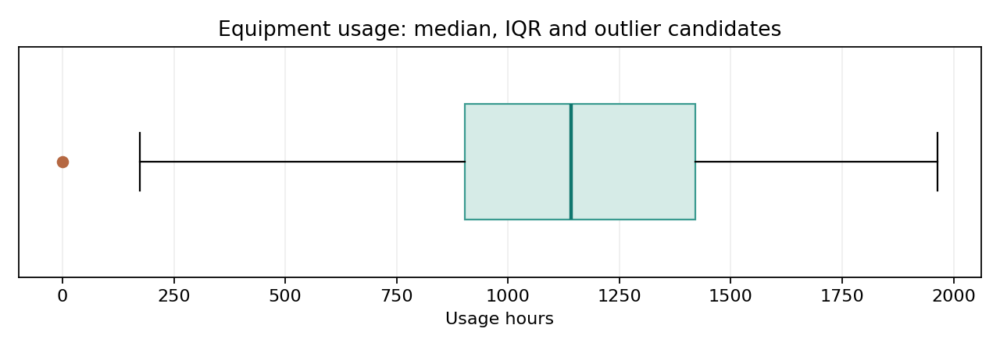
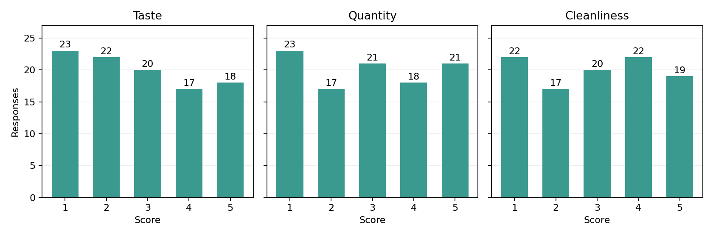

> **이번 글의 질문**
>
> 평균만 보면 데이터의 모습을 충분히 알 수 있을까요? 같은 평균을 가진 집단도 얼마나 다르게 퍼져 있을까요? 부대별 평균을 다시 평균 내면 전체 평균이 될까요?

> **핵심 요약**
>
> 기술 통계량은 데이터의 중심과 퍼짐을 요약합니다. 평균·중앙값·최빈값을 함께 보고, 표준편차·IQR·관측 개수로 해석을 보완합니다. `agg()`와 `groupby()`로 전체 및 집단별 통계를 계산하고, 여러 최빈값과 결측치, 집계 기준을 결과에 남깁니다.

## 1. 데이터의 모습을 숫자로 먼저 살펴봅니다

숫자가 많아지면 한 줄씩 읽는 것보다 중심과 퍼짐을 먼저 보는 편이 낫습니다. 평균만 같아도 분포는 전혀 다를 수 있습니다. 건강 기록, 장비 사용 시간, 만족도 설문을 요약하면서 통계량이 각각 무엇을 보여 주는지 비교합니다.

기술 통계량은 관측한 데이터의 특성을 요약하는 숫자입니다. 중심이 어디인지, 값이 얼마나 퍼져 있는지, 관측값이 몇 개인지를 함께 확인합니다. 건강 기록, 장비 사용 시간, 식단 만족도처럼 데이터의 의미가 달라지면 같은 평균도 다르게 읽어야 합니다.

| 실습 파일 | 데이터 구성 | 살펴볼 내용 |
| --- | --- | --- |
| `health_summary.csv` | 100행, 5열 | 체온·맥박·체중의 전체 통계와 부대별 차이를 확인합니다. |
| `equipment_usage.csv` | 100행, 3열 | 장비 사용 시간의 중심과 퍼짐을 유형별로 비교합니다. |
| `meal_survey.csv` | 100행, 5열 | 맛·양·위생 점수의 대표값과 응답 분포를 확인합니다. |

> **통계량을 읽을 때는 세 가지를 함께 봅니다. 중심은 어디인가요? 얼마나 퍼져 있나요? 몇 개의 관측값으로 계산했나요?** 평균 한 칸으로 끝내지 않고 이 세 가지를 묶어서 확인합니다.

## 2. 평균·중앙값·최빈값은 서로 다른 질문에 답합니다

| 통계량 | 계산 방법 | 읽을 때 기억할 점 |
| --- | --- | --- |
| Mean | 값의 합 ÷ 유효값 개수 | 모든 값의 크기를 반영하므로 극단적인 값의 영향을 받습니다. |
| Median | 정렬했을 때 가운데 값 | 값의 개수가 짝수이면 가운데 두 값의 평균을 사용합니다. |
| Mode | 가장 자주 등장한 값 | 공동 최빈값이 여러 개일 수 있으며 범주형 데이터에도 사용할 수 있습니다. |

### 2-1. 값 하나가 바뀌면 평균은 얼마나 움직일까요?

```python
import pandas as pd
import numpy as np

before = pd.Series([10, 11, 12, 13, 14])
after = pd.Series([10, 11, 12, 13, 100])

comparison = pd.DataFrame({
    "before": before.agg(["mean", "median", "std"]),
    "after": after.agg(["mean", "median", "std"]),
})
print(comparison.round(2).to_string())
```

```text
        before  after
mean     12.00  29.20
median   12.00  12.00
std       1.58  39.59
```

14가 100으로 바뀌면 평균은 12에서 29.2로 움직입니다. 중앙값은 두 경우 모두 12입니다. 가운데에 있는 값은 그대로인데 가장 큰 값이 평균과 표준편차를 끌어올렸습니다. 한쪽으로 긴 꼬리가 있는 사용 시간이나 비용 데이터에서는 평균과 중앙값을 나란히 놓으면 이런 차이를 발견하기 쉽습니다.

평균과 중앙값 중 하나를 무조건 고르기보다 목적을 먼저 생각합니다. 전체 사용량을 관측 개수로 나눈 수준이 필요하면 평균이 유용하고, 극단적인 값에 덜 흔들리는 가운데 수준을 보고 싶다면 중앙값이 유용합니다. 평균과 중앙값이 비슷하더라도 분포가 대칭이라고 확정할 수는 없습니다.

### 2-2. 최빈값은 숫자 하나가 아니라 Series로 반환됩니다

```python
mode_example = pd.Series([1, 1, 4, 4, 5])
print("모든 최빈값:", mode_example.mode().tolist())
print("첫 번째 최빈값만 선택:", mode_example.mode().iloc[0])
```

```text
모든 최빈값: [1, 4]
첫 번째 최빈값만 선택: 1
```

1과 4가 두 번씩 나왔으므로 둘 다 최빈값입니다. `mode()`는 최빈값이 하나여도 Series를 반환하며, 여러 개라면 정렬해서 반환합니다. `iloc[0]`은 그중 첫 번째 값만 선택합니다. 여러 대표값이 있다는 정보를 남기려면 `mode().tolist()`처럼 전체 결과를 보관합니다.

## 3. 퍼짐을 읽는 표준편차·범위·IQR

### 3-1. 분산과 표준편차는 같은 퍼짐을 다른 단위로 표현합니다

분산(Variance)은 각 값과 평균의 차이를 제곱한 뒤 더하고, 정해진 분모로 나눕니다. 차이를 그대로 더하면 양수와 음수가 상쇄되기 때문에 제곱을 사용합니다. 표준편차(Standard Deviation)는 그 분산의 제곱근입니다.

`variance = sum((x - mean) ** 2) / (N - ddof)`

`std = sqrt(variance)`

사용 시간의 단위가 시간이라면 분산의 단위는 시간의 제곱이고, 표준편차의 단위는 다시 시간입니다. 그래서 표준편차를 원본 값과 함께 읽기 쉽습니다. 다만 표준편차가 10이라고 해서 모든 값이 평균에서 정확히 10만큼 떨어져 있다는 뜻은 아닙니다.

### 3-2. pandas와 NumPy는 ddof 기본값이 다릅니다

```python
values = pd.Series([1.0, 2.0, 3.0])
array = values.to_numpy()

print(f"pandas std()       : {values.std():.6f}")
print(f"NumPy std()        : {np.std(array):.6f}")
print(f"pandas std(ddof=0) : {values.std(ddof=0):.6f}")
print(f"NumPy std(ddof=1)  : {np.std(array, ddof=1):.6f}")
print(f"pandas var()       : {values.var():.6f}")
```

```text
pandas std()       : 1.000000
NumPy std()        : 0.816497
pandas std(ddof=0) : 0.816497
NumPy std(ddof=1)  : 1.000000
pandas var()       : 1.000000
```

| 계산 | 기본 ddof | 분모 |
| --- | --- | --- |
| `Series.std()` · `Series.var()` | 1 | N − 1 |
| `np.std()` · `np.var()` | 0 | N |

`ddof=0`은 현재 관측값 전체의 퍼짐을 N으로 나눠 계산합니다. `ddof=1`은 더 큰 모집단에서 얻은 표본으로 분산을 추정할 때 사용하는 보정입니다. 표본 평균으로 계산한 분산이 작게 추정되는 경향을 보정하는 것이며, 제곱근을 취한 표준편차의 편향까지 완전히 없어지는 것은 아닙니다. 서로 다른 도구의 결과를 비교할 때는 `ddof`를 맞춥니다. 아래 CSV 통계에서는 pandas 기본값인 `ddof=1`을 사용합니다.

### 3-3. Range는 양 끝을, IQR은 가운데 구간을 봅니다

| 통계량 | 계산 | 특징 |
| --- | --- | --- |
| Range | `max() - min()` | 전체 폭을 나타내며 최소·최대값 하나에도 크게 달라질 수 있습니다. |
| IQR | `Q3 - Q1` | 25% 분위수부터 75% 분위수까지의 폭으로 가운데 구간의 퍼짐을 봅니다. |

사분위수(Quartile)는 분포를 나누는 지점이고, IQR(Interquartile Range)은 두 지점 사이의 폭입니다. Q1은 25% 분위수, Q2는 50% 분위수인 중앙값, Q3는 75% 분위수입니다. **`quantile()`에는 사분위 번호 1·2·3을 넣는 것이 아니라 0\~1 사이의 비율을 넣습니다.**

```python
quartile_example = pd.Series([10, 20, 30, 40, 50])
quartiles = quartile_example.quantile([0.25, 0.5, 0.75])
iqr_example = quartiles.loc[0.75] - quartiles.loc[0.25]

print(quartiles.to_string())
print("IQR:", iqr_example)
print("Range:", quartile_example.max() - quartile_example.min())
```

```text
0.25    20.0
0.50    30.0
0.75    40.0
IQR: 20.0
Range: 40
```

`quantile(1)`은 최대값에 해당하는 100% 분위수입니다. `quantile(2)`나 `quantile(3)`은 허용 범위를 벗어납니다. 분위수 위치가 관측값 사이에 있으면 기본 `interpolation="linear"`로 계산하므로, 결과가 원본에 없던 값일 수도 있습니다. NumPy의 `percentile()`은 0\~100을 받기 때문에 인자 범위도 구분합니다.

## 4. 실습 1: 건강 기록의 전체 통계와 부대별 통계

### 4-1. 열 이름과 관측 개수부터 확인합니다

```python
health = pd.read_csv("health_summary.csv")
health_cols = ["temperature", "pulse", "weight"]

print("데이터 크기:", health.shape)
print("열 이름:", health.columns.tolist())
print("결측치 수:", health.isna().sum().to_dict())
print(health[health_cols].describe().round(3).to_string())
```

```text
데이터 크기: (100, 5)
열 이름: ['soldier_id', 'unit', 'temperature', 'pulse', 'weight']
결측치 수: {'soldier_id': 0, 'unit': 0, 'temperature': 0, 'pulse': 0, 'weight': 0}
       temperature    pulse   weight
count      100.000  100.000  100.000
mean        36.782   81.980   77.220
std          0.474   11.464   12.563
min         35.500   60.000   55.000
25%         36.500   75.000   67.000
50%         36.800   84.000   77.500
75%         37.100   92.000   87.250
max         38.000   99.000   99.000
```

`soldier_id`는 식별자, `unit`은 부대 이름이며, 계산할 값은 `temperature`, `pulse`, `weight`입니다. 식별자가 숫자 형태로 저장되어 있더라도 평균을 구할 대상으로 자동 포함하지 않습니다. 통계에 사용할 열을 List로 명시하면 분석 목적을 코드에 남길 수 있습니다.

`info()`는 열별 `dtype`과 결측치가 아닌 값의 개수를 보여 주고, `describe()`는 숫자 열의 `count`·`mean`·`std`·`min`·분위수·`max`를 빠르게 보여 줍니다. 여기서 50%는 중앙값입니다. 문자열 열은 `describe(include=["object", "string"])`처럼 별도로 선택해 `count`·`unique`·`top`·`freq`를 볼 수 있습니다.

### 4-2. agg()로 필요한 통계만 모읍니다

```python
health_overall = health[health_cols].agg(["mean", "median", "std"])
health_overall.index.name = "stat"
print(health_overall.round(3).to_string())
```

```text
        temperature   pulse  weight
stat
mean         36.782  81.980  77.220
median       36.800  84.000  77.500
std           0.474  11.464  12.563
```

| 항목 | 평균 | 중앙값 | 표준편차 |
| --- | --- | --- | --- |
| `temperature` | 36.782 | 36.800 | 0.474 |
| `pulse` | 81.980 | 84.000 | 11.464 |
| `weight` | 77.220 | 77.500 | 12.563 |

체온 평균은 36.782이고 중앙값은 36.8입니다. 체중 평균은 77.22이고 표준편차는 약 12.563입니다. 체온과 체중은 단위가 다르므로 표준편차 숫자만 보고 체중이 “더 불안정하다”고 비교하지 않습니다. 각각의 측정 단위와 분포 안에서 읽습니다.

`agg()`는 `aggregate()`의 짧은 이름입니다. `agg(["mean", "median", "std"])`처럼 함수 이름을 List로 전달하면 여러 통계량을 한 번에 계산합니다. 모든 숫자 요약을 빠르게 훑을 때는 `describe()`, 보고서에 넣을 항목을 정해서 계산할 때는 `agg()`가 편합니다.

### 4-3. groupby()로 같은 부대의 값을 묶습니다

```python
health_grouped = health.groupby("unit")[health_cols].agg(["mean", "std"])
health_counts = health.groupby("unit")[health_cols].count()

print("부대별 체온 평균과 표준편차:")
print(health_grouped["temperature"].round(3).to_string())
print("부대별 유효 관측 개수:")
print(health_counts.to_string())
```

```text
부대별 체온 평균과 표준편차:
        mean    std
unit
1사단   36.855  0.365
2사단   36.800  0.618
3사단   36.812  0.461
5사단   36.693  0.409
부대별 유효 관측 개수:
      temperature  pulse  weight
unit
1사단            20     20      20
2사단            26     26      26
3사단            24     24      24
5사단            30     30      30
```

| 부대 | 관측 개수 | 체온 평균 | 체온 표준편차 |
| --- | --- | --- | --- |
| 1사단 | 20 | 36.855 | 0.365 |
| 2사단 | 26 | 36.800 | 0.618 |
| 3사단 | 24 | 36.812 | 0.461 |
| 5사단 | 30 | 36.693 | 0.409 |

전체 평균 하나로 볼 때는 드러나지 않던 집단별 차이를 확인할 수 있습니다. 예를 들어 2사단 체온의 표준편차는 약 0.618, 1사단은 약 0.365입니다. 이는 현재 기록에서 2사단의 체온 값이 평균 주변에 더 넓게 퍼져 있다는 뜻입니다. 이런 차이를 발견하면 원본 분포와 측정 시각·조건을 더 살펴보는 질문으로 이어갑니다.

### 4-4. MultiIndex 열을 펼치고 CSV로 저장합니다

여러 열에 여러 함수를 적용하면 열 이름에 두 단계가 생깁니다. `("temperature", "mean")`처럼 측정 항목과 통계량이 묶인 **MultiIndex**입니다. Python 안에서는 단계별로 선택하기 편하고, CSV로 내보낼 때는 `temperature_mean`처럼 한 단계 이름으로 펼치면 읽기 쉽습니다.

```python
health_by_unit = health_grouped.copy()
health_by_unit.columns = [
    "_".join(column).strip()
    for column in health_by_unit.columns
]
health_by_unit = health_by_unit.reset_index()

health_overall_export = health_overall.reset_index()
health_overall_export.to_csv(
    "health_overall_stats.csv", index=False, encoding="utf-8-sig"
)
health_by_unit.to_csv(
    "health_stats.csv", index=False, encoding="utf-8-sig"
)
print("전체 통계 크기:", health_overall_export.shape)
print("부대별 통계 크기:", health_by_unit.shape)
print("부대별 통계 열:", health_by_unit.columns.tolist())
```

```text
전체 통계 크기: (3, 4)
부대별 통계 크기: (4, 7)
부대별 통계 열: ['unit', 'temperature_mean', 'temperature_std', 'pulse_mean', 'pulse_std', 'weight_mean', 'weight_std']
```

`"_".join(column)`은 Tuple의 두 문자열을 `_`로 연결합니다. `strip()`은 만들어진 문자열의 양 끝 공백을 제거합니다. 여기서는 양 끝에 공백이 없으므로 없어도 같은 결과입니다. `_`를 제거하는 동작은 아닙니다. `strip("_")`는 양 끝의 `_` 문자를 제거하며, 특정 접미사를 제거하려면 `removesuffix()`를 사용합니다.

`reset_index()`는 행 인덱스에 있던 `stat`이나 `unit`을 일반 열로 옮깁니다. 그 뒤 `to_csv(index=False)`로 저장하면 별도의 행 번호가 CSV에 추가되지 않습니다. `utf-8-sig`는 BOM을 포함한 UTF-8로, Excel 등에서 한글 인코딩을 자동 판별할 때 도움이 됩니다.

### 4-5. 전체 통계와 부대별 통계를 옆으로 붙여도 될까요?

전체 통계의 세 행은 `mean`·`median`·`std`를 뜻하고, 부대별 통계의 네 행은 1사단·2사단·3사단·5사단을 뜻합니다. 둘 다 `reset_index()`를 했다는 이유로 같은 행이 되지는 않습니다.

```python
side_by_side = pd.concat(
    [health_overall_export, health_by_unit], axis=1
)
print(side_by_side[["stat", "unit"]].to_string(index=False))
```

```text
  stat unit
  mean  1사단
median  2사단
   std  3사단
   NaN  5사단
```

0번 인덱스라는 이유로 `mean`과 1사단이 나란히 놓이고, 마지막 부대 옆에는 `NaN`이 생깁니다. **전체 평균이 1사단에 속하는 통계라는 관계는 없습니다.** 이 예제에서는 서로 다른 표를 각각 저장했습니다. 한 파일이 필요하다면 `scope`·`unit`·항목·통계량·값처럼 공통 행 구조를 정한 뒤 세로로 합칩니다.

### 4-6. Named Aggregation으로 출력 열 이름을 처음부터 정합니다

```python
health_named = health.groupby("unit", as_index=False).agg(
    temperature_count=("temperature", "count"),
    temperature_mean=("temperature", "mean"),
    temperature_std=("temperature", "std"),
    pulse_mean=("pulse", "mean"),
    weight_mean=("weight", "mean"),
)
print(health_named.round(3).to_string(index=False))
```

```text
unit  temperature_count  temperature_mean  temperature_std  pulse_mean  weight_mean
 1사단                 20            36.855            0.365      81.250       78.900
 2사단                 26            36.800            0.618      85.423       77.462
 3사단                 24            36.812            0.461      79.083       74.792
 5사단                 30            36.693            0.409      81.800       77.833
```

`temperature_mean=("temperature", "mean")`에서 왼쪽은 결과 열 이름이고, 오른쪽 Tuple은 입력 열과 집계 함수입니다. `as_index=False`로 부대 이름도 일반 열에 둡니다. 모든 열에 같은 함수 묶음을 적용할 때는 List 집계가 짧고, 항목별 함수와 최종 이름을 직접 정할 때는 **Named Aggregation**이 편합니다.

## 5. 실습 2: 장비 사용 시간의 중심과 퍼짐

### 5-1. Series를 한 행짜리 통계표로 바꿉니다

```python
equipment = pd.read_csv("equipment_usage.csv")
equipment_functions = ["count", "mean", "std", "min", "max", "median"]

equipment_series = equipment["usage_hours"].agg(equipment_functions)
equipment_overall = equipment_series.to_frame().T
equipment_overall.index = ["전체"]
print(equipment_overall.round(2).to_string())
```

```text
    count     mean     std  min     max  median
전체  100.0  1150.03  398.34  0.0  1964.0  1141.0
```

하나의 열에 여러 집계 함수를 적용한 결과는 통계량 이름을 인덱스로 가진 Series입니다. `to_frame()`으로 한 열짜리 DataFrame을 만들고 `.T`로 행과 열을 바꾸면 `count`·`mean`·`std` 등이 열인 한 행짜리 표가 됩니다. **전치는 값의 통계적 의미를 바꾸지 않고 표의 방향을 바꾸는 작업입니다.**

전체 사용 시간 평균은 1150.03시간, 중앙값은 1141시간, 표준편차는 약 398.34시간입니다. 최소값은 0시간이고 최대값은 1964시간입니다. 평균과 중앙값이 가깝다는 사실과, 낮은 쪽에 0이 있다는 사실을 함께 확인합니다.

### 5-2. 유형별 통계는 같은 열 구조로 세로로 합칩니다

```python
equipment_by_type = equipment.groupby("type")["usage_hours"].agg(
    equipment_functions
)
equipment_stats = pd.concat([equipment_overall, equipment_by_type])
equipment_stats.index.name = "type"
equipment_stats = equipment_stats.reset_index()
equipment_stats["count"] = equipment_stats["count"].astype("int64")
equipment_stats.to_csv(
    "equipment_stats.csv", index=False, encoding="utf-8-sig"
)
print(equipment_stats.round(2).to_string(index=False))
```

```text
 type  count    mean    std   min    max  median
   전체    100 1150.03 398.34   0.0 1964.0  1141.0
   드론     19 1134.68 374.06 632.0 1742.0  1092.0
  레이다     23 1242.22 397.09 594.0 1964.0  1194.0
무인정찰기     21 1186.24 451.47 174.0 1836.0  1283.0
 지휘차량     22 1106.05 385.79   0.0 1835.0  1190.5
   탱크     15 1041.93 384.91 441.0 1657.0  1011.0
```

| 장비 유형 | 개수 | 평균 시간 | 표준편차 | 중앙값 |
| --- | --- | --- | --- | --- |
| 전체 | 100 | 1150.03 | 398.34 | 1141.00 |
| 드론 | 19 | 1134.68 | 374.06 | 1092.00 |
| 레이다 | 23 | 1242.22 | 397.09 | 1194.00 |
| 무인정찰기 | 21 | 1186.24 | 451.47 | 1283.00 |
| 지휘차량 | 22 | 1106.05 | 385.79 | 1190.50 |
| 탱크 | 15 | 1041.93 | 384.91 | 1011.00 |

레이다의 평균 사용 시간은 약 1242.22시간이고 탱크는 약 1041.93시간입니다. 현재 파일에서 어떤 유형의 사용 시간이 더 길었는지를 보여 줍니다. 장비 수명이나 정비 필요성을 판단하려면 도입 시점, 용도, 정비 이력처럼 사용 시간의 배경을 함께 연결합니다.

여기서는 전체와 유형별 통계 모두 같은 뜻의 행, 같은 통계 열을 가집니다. 따라서 `concat()`의 기본값 `axis=0`으로 세로로 합칩니다. 열이 달라도 `concat`은 실행되지만, 기본 `join="outer"`에서는 한쪽에 없는 열이 `NaN`으로 채워집니다. 같은 구조를 준비하는 이유는 합쳐진 표의 의미를 유지하기 위해서입니다.

### 5-3. IQR로 낮은 쪽의 이상치 후보를 확인합니다

```python
usage = equipment["usage_hours"]
q1, q3 = usage.quantile([0.25, 0.75])
usage_iqr = q3 - q1
lower = q1 - 1.5 * usage_iqr
upper = q3 + 1.5 * usage_iqr
outlier_candidates = equipment.loc[
    (usage < lower) | (usage > upper)
]

print(f"Q1={q1:.2f}, Q3={q3:.2f}, IQR={usage_iqr:.2f}")
print(f"검토 구간: {lower:.2f} ~ {upper:.2f}")
print(outlier_candidates.to_string(index=False))
```

```text
Q1=902.25, Q3=1420.25, IQR=518.00
검토 구간: 125.25 ~ 2197.25
equipment_id type  usage_hours
        E097 지휘차량            0
```

Q1은 902.25, Q3는 1420.25이고 IQR은 518시간입니다. `Q1 - 1.5 × IQR`부터 `Q3 + 1.5 × IQR`까지의 구간은 125.25\~2197.25시간입니다. 이 구간 밖에는 사용 시간이 0인 지휘차량 E097 한 대가 있습니다.

0시간은 아직 사용하지 않은 새 장비일 수도 있고 기록이 누락된 값을 0으로 저장한 것일 수도 있습니다. 원본의 의미를 확인할 항목으로 남깁니다. 또한 서로 다른 장비 유형을 한꺼번에 계산한 경계이므로, 유형별 운영 조건이 다르면 각 유형 안의 분포도 확인합니다.

### 5-4. Box Plot으로 숫자 요약을 확인합니다

```python
import matplotlib.pyplot as plt

fig, ax = plt.subplots(figsize=(8, 2.8))
ax.boxplot(
    usage.to_numpy(), orientation="horizontal", widths=0.5,
    patch_artist=True,
    boxprops={"facecolor": "#d6ebe7", "edgecolor": "#3a9a90"},
    medianprops={"color": "#0f766e", "linewidth": 2},
    flierprops={"marker": "o", "markerfacecolor": "#b56842",
                "markeredgecolor": "#b56842", "markersize": 6},
)
ax.set_title("Equipment usage: median, IQR and outlier candidates")
ax.set_xlabel("Usage hours")
ax.set_yticks([])
ax.grid(axis="x", alpha=0.2)
fig.tight_layout()
fig.savefig("equipment_usage_boxplot.png", dpi=160)
plt.show()
```



*상자는 Q1\~Q3, 상자 안의 선은 중앙값입니다. 낮은 쪽에 따로 표시된 점은 사용 시간이 0인 장비입니다.*

기본 Box Plot의 수염은 1.5 × IQR 경계 안에 있는 가장 바깥쪽 관측값까지 뻗습니다. 수염 끝이 계산된 경계값 자체는 아닙니다. 경계 밖의 점도 원본에서 지워진 것이 아니라 검토 대상으로 표시된 것입니다.

## 6. 실습 3: 식단 만족도는 평균과 응답 분포를 함께 봅니다

### 6-1. 평균·중앙값·모든 최빈값을 저장합니다

```python
meal = pd.read_csv("meal_survey.csv")
score_cols = ["taste_score", "quantity_score", "cleanliness_score"]

meal_overall = meal[score_cols].agg(["mean", "median", "std"]).T
meal_overall["count"] = meal[score_cols].count()
meal_overall["mode"] = [meal[col].mode().tolist() for col in score_cols]
meal_overall = meal_overall[["count", "mean", "median", "mode", "std"]]
meal_overall.index.name = "item"
meal_overall.to_csv(
    "survey_overall_stats.csv", encoding="utf-8-sig"
)
print(meal_overall.round(3).to_string())
```

```text
                   count  mean  median    mode    std
item
taste_score          100  2.85     3.0     [1]  1.424
quantity_score       100  2.97     3.0     [1]  1.460
cleanliness_score    100  2.99     3.0  [1, 4]  1.432
```

| 항목 | 평균 | 중앙값 | 최빈값 | 표준편차 |
| --- | --- | --- | --- | --- |
| `taste_score` | 2.85 | 3.0 | 1 | 1.424 |
| `quantity_score` | 2.97 | 3.0 | 1 | 1.460 |
| `cleanliness_score` | 2.99 | 3.0 | 1, 4 | 1.432 |

세 항목의 중앙값은 모두 3점입니다. 맛과 양의 최빈값은 1점이고, 위생의 최빈값은 **1점과 4점** 두 개입니다. 위생 점수는 평균만 보면 약 3점이지만, 가장 자주 등장한 응답이 양쪽에 있습니다. 평균·중앙값·최빈값을 함께 보는 이유가 드러납니다.

`mode` 열에는 모든 최빈값을 List로 보관했습니다. CSV에는 `[1, 4]` 같은 문자열 표현으로 저장되므로 사람이 읽는 요약표에 적합합니다. 다시 프로그램에서 분석할 최빈값 목록이 필요하면 항목·최빈값을 한 행씩 저장하거나 JSON처럼 List 구조를 보존하는 형식을 사용할 수 있습니다.

### 6-2. iloc\[0\]이 실제로 어떤 정보를 버리는지 확인합니다

```python
all_modes = meal[score_cols].mode()
print(all_modes.to_string(index=False))
print("위생의 전체 최빈값:", meal["cleanliness_score"].mode().tolist())
print("첫 행만 선택한 위생 최빈값:", all_modes.iloc[0]["cleanliness_score"])
```

```text
 taste_score  quantity_score  cleanliness_score
         1.0             1.0                  1
         NaN             NaN                  4
위생의 전체 최빈값: [1, 4]
첫 행만 선택한 위생 최빈값: 1.0
```

DataFrame의 `mode()`는 열마다 최빈값 개수가 달라도 한 표에 담습니다. 위생 열은 두 행이 필요하고, 맛·양 열의 두 번째 행은 `NaN`으로 채워집니다. `iloc[0]`으로 첫 행만 선택하면 위생의 4점이 사라집니다. 위 코드에서 1.0처럼 보이는 것은 `NaN`과 함께 표를 구성하면서 숫자의 `dtype`이 바뀐 결과이며, 1점이라는 의미는 같습니다.

### 6-3. value\_counts()로 점수별 응답 수를 봅니다

```python
score_distribution = pd.DataFrame({
    col: meal[col].value_counts().reindex(range(1, 6), fill_value=0)
    for col in score_cols
})
score_distribution.index.name = "score"
print(score_distribution.to_string())

high_score_share = meal[score_cols].ge(4).mean().mul(100)
print("4~5점 응답 비율(%):")
print(high_score_share.round(1).to_string())
```

```text
       taste_score  quantity_score  cleanliness_score
score
1               23              23                 22
2               22              17                 17
3               20              21                 20
4               17              18                 22
5               18              21                 19
4~5점 응답 비율(%):
taste_score          35.0
quantity_score       39.0
cleanliness_score    41.0
```

| 점수 | 맛 응답 수 | 양 응답 수 | 위생 응답 수 |
| --- | --- | --- | --- |
| 1 | 23 | 23 | 22 |
| 2 | 22 | 17 | 17 |
| 3 | 20 | 21 | 20 |
| 4 | 17 | 18 | 22 |
| 5 | 18 | 21 | 19 |

위생 점수의 1점과 4점은 각각 22명입니다. 두 값이 공동 최빈값인 이유를 응답 수로 확인할 수 있습니다. 4\~5점 비율은 맛 35%, 양 39%, 위생 41%입니다. 어느 항목에서 높은 점수가 많았는지 보여 주는 지표로 사용할 수 있습니다. 위 계산은 세 항목에 결측치가 없는 현재 데이터에 적용한 것입니다.

1\~5점 평가는 순서가 있는 **Ordinal** 데이터입니다. 평균은 점수 간 간격을 같은 간격으로 취급한 요약값이므로, “평균 3점”만으로 보통 수준에 응답이 몰려 있다고 읽지 않습니다. 응답 수, 중앙값, 최빈값을 함께 보고 4\~5점 비율처럼 기준이 분명한 지표를 덧붙입니다.

### 6-4. 같은 축으로 세 항목의 분포를 비교합니다

```python
fig, axes = plt.subplots(
    1, 3, figsize=(10.5, 3.5), sharey=True
)
labels = ["Taste", "Quantity", "Cleanliness"]
for ax, col, label in zip(axes, score_cols, labels):
    counts = score_distribution[col]
    ax.bar(counts.index, counts.values, color="#3a9a90", width=0.65)
    ax.set_title(label)
    ax.set_xlabel("Score")
    ax.set_xticks(range(1, 6))
    ax.set_ylim(0, 27)
    ax.grid(axis="y", alpha=0.2)
    ax.set_axisbelow(True)
    for score, count in counts.items():
        ax.text(score, count + 0.5, str(count), ha="center")
axes[0].set_ylabel("Responses")
fig.tight_layout()
fig.savefig("meal_score_distribution.png", dpi=160)
plt.show()
```



*세 그래프의 Y축 범위를 같게 맞췄습니다. 위생 점수에서는 1점과 4점 막대의 높이가 같아 공동 최빈값이 바로 보입니다.*

### 6-5. 부대별 평균·표준편차·응답 수를 저장합니다

```python
meal_by_unit = meal.groupby("unit")[score_cols].agg(
    ["count", "mean", "std"]
)
meal_by_unit.columns = [
    "_".join(column) for column in meal_by_unit.columns
]
meal_by_unit = meal_by_unit.reset_index()
meal_by_unit.to_csv(
    "survey_unit_mean.csv", index=False, encoding="utf-8-sig"
)
print(meal_by_unit[[
    "unit", "taste_score_count", "taste_score_mean", "taste_score_std"
]].round(3).to_string(index=False))
```

```text
unit  taste_score_count  taste_score_mean  taste_score_std
 1사단                 22             2.136            1.207
 2사단                 26             3.115            1.423
 3사단                 29             3.034            1.401
 5사단                 23             3.000            1.508
```

| 부대 | 응답 수 | 맛 평균 | 양 평균 | 위생 평균 |
| --- | --- | --- | --- | --- |
| 1사단 | 22 | 2.136 | 3.409 | 2.909 |
| 2사단 | 26 | 3.115 | 3.115 | 3.462 |
| 3사단 | 29 | 3.034 | 2.345 | 2.655 |
| 5사단 | 23 | 3.000 | 3.174 | 2.957 |

1사단의 맛 평균은 약 2.136점이고, 3사단의 양 평균은 약 2.345점입니다. 항목을 나누면 어느 부분의 응답을 더 살펴볼지 정하기 쉽습니다. 평균 차이의 배경을 알아보려면 메뉴·설문 시점·응답 구성도 함께 확인합니다. 표준편차와 응답 수를 저장해 두면 나중에 평균만으로 판단하는 일을 줄일 수 있습니다.

## 7. 통계량을 읽을 때 자주 놓치는 기준

### 7-1. 부대별 평균의 평균은 전체 평균과 다를 수 있습니다

```python
temperature_groups = health.groupby("unit")["temperature"].agg(
    ["count", "mean"]
)
mean_of_means = temperature_groups["mean"].mean()
weighted_mean = (
    temperature_groups["count"] * temperature_groups["mean"]
).sum() / temperature_groups["count"].sum()

print(f"부대별 평균의 단순 평균: {mean_of_means:.6f}")
print(f"관측 개수로 가중한 평균: {weighted_mean:.6f}")
print(f"전체 원본의 평균      : {health['temperature'].mean():.6f}")
```

```text
부대별 평균의 단순 평균: 36.790208
관측 개수로 가중한 평균: 36.782000
전체 원본의 평균      : 36.782000
```

부대별 관측 개수는 20·26·24·30개입니다. 부대별 평균을 단순 평균 내면 각 부대가 25%씩 같은 비중을 갖습니다. 전체 병사의 평균을 구하려면 관측 개수로 가중해야 합니다. 현재 값은 단순 평균 36.790208, 가중평균과 원본 전체 평균 36.782로 다릅니다.

`전체 평균 = sum(집단 평균 × 집단 유효 개수) / sum(집단 유효 개수)`

관측 단위가 병사인지 부대인지에 따라 질문 자체가 달라집니다. 열에 결측치가 있다면 그 열의 유효 개수를 가중치로 사용합니다. 또한 부대별 표준편차를 단순 평균 내도 전체 표준편차가 되지 않습니다. 전체 퍼짐에는 각 부대 안의 퍼짐과 부대 평균 사이의 차이가 함께 들어갑니다.

### 7-2. 결측치를 건너뛴 평균과 전체 행 수를 구분합니다

```python
missing_example = pd.DataFrame({
    "unit": ["A", "A", "B"],
    "score": [1.0, np.nan, 5.0],
})
missing_stats = missing_example.groupby("unit").agg(
    rows=("score", "size"),
    valid=("score", "count"),
    mean=("score", "mean"),
    std=("score", "std"),
)
print(missing_stats.to_string())
print("결측치를 건너뛴 전체 평균:", missing_example["score"].mean())
print("결측치가 있으면 결과도 NaN:", missing_example["score"].mean(skipna=False))
```

```text
      rows  valid  mean  std
unit
A        2      1   1.0  NaN
B        1      1   5.0  NaN
결측치를 건너뛴 전체 평균: 3.0
결측치가 있으면 결과도 NaN: nan
```

A에는 두 행이 있지만 유효한 점수는 하나뿐입니다. `size`는 행 수를 세고 `count`는 결측치가 아닌 값만 셉니다. pandas의 평균은 기본적으로 결측치를 제외하므로 전체 평균은 `(1 + 5) / 2 = 3`입니다. 누락값을 0으로 채우면 `(1 + 0 + 5) / 3 = 2`로 바뀌어 다른 데이터의 평균이 됩니다.

각 부대에 유효값이 하나뿐이어서 `ddof=1` 표준편차는 `NaN`입니다. N − 1이 0이 되어 계산할 수 없기 때문입니다. `ddof=0`이면 한 값의 퍼짐은 0이지만, 관측값이 충분히 모였다는 뜻은 아닙니다. 응답 수를 함께 남겨야 이 두 상황을 구분할 수 있습니다.

결측치를 제외하는 [GroupBy.count](https://pandas.pydata.org/docs/reference/api/pandas.api.typing.DataFrameGroupBy.count.html)와 행 수를 세는 [GroupBy.size](https://pandas.pydata.org/docs/reference/api/pandas.api.typing.DataFrameGroupBy.size.html)의 차이를 확인합니다.

### 7-3. 평균이 같아도 분포는 다를 수 있습니다

```python
same_mean = pd.DataFrame({
    "A": [3, 3, 3, 3, 3],
    "B": [1, 1, 3, 5, 5],
})
print(same_mean.agg(["mean", "median", "std"]).round(3).to_string())
```

```text
          A    B
mean    3.0  3.0
median  3.0  3.0
std     0.0  2.0
```

A와 B의 평균과 중앙값은 모두 3입니다. A는 모든 응답이 3점이고, B는 1점과 5점에 많은 응답이 있습니다. B의 표준편차는 2로 A보다 크지만, 높은 응답과 낮은 응답이 어디에 몰렸는지는 막대그래프가 더 직접적으로 보여 줍니다. 숫자 요약 뒤에 분포를 확인하는 순서가 필요합니다.

### 7-4. 전체 데이터 요약과 모델의 전처리 기준은 구별합니다

보유한 기록 자체를 설명하는 통계표는 전체 데이터로 만들 수 있습니다. 예측 모델의 성능을 평가한다면 Train과 Test를 먼저 나누고, 평균 대체값·Scaling 평균과 표준편차·이상치 경계 등 전처리 기준은 Train에서 정합니다. Test를 포함해 기준을 계산하면 평가 데이터의 정보가 학습 과정에 섞입니다.

예를 들어 결측치를 평균으로 채울 때, Test까지 포함한 평균을 구해 Train에 넣으면 그 결측값은 이미 Test의 분포를 반영한 값입니다. 교차 검증에서도 각 Fold의 Train에서 다시 기준을 학습해야 합니다. SimpleImputer·StandardScaler·모델을 Pipeline으로 묶으면 이 순서를 유지하기 쉽습니다.

## 8. loc·iloc·표의 방향을 복습합니다

```python
selection_example = pd.DataFrame(
    {"mean": [2.1, 3.1, 3.0]}, index=[10, 20, 30]
)
print("첫 번째 위치의 행:")
print(selection_example.iloc[0].to_string())
print("인덱스 라벨 20의 행:")
print(selection_example.loc[20].to_string())

print("전체 건강 기록의 평균 행:")
print(health_overall.loc["mean"].round(3).to_string())
```

```text
첫 번째 위치의 행:
mean    2.1
인덱스 라벨 20의 행:
mean    3.1
전체 건강 기록의 평균 행:
temperature    36.782
pulse          81.980
weight         77.220
```

`iloc[0]`은 현재 첫 번째 위치의 행을 선택합니다. `loc[20]`은 인덱스 라벨이 20인 행을 선택합니다. 인덱스 라벨이 숫자여도 `loc`에서는 위치 번호가 아닙니다. 현재 첫 행의 라벨은 10이므로 `loc[0]`은 해당 라벨이 없어 KeyError가 발생합니다.

| 표현 | 선택 기준 | 통계표에서의 예 |
| --- | --- | --- |
| `loc` | 인덱스·열의 라벨 | `health_overall.loc["mean"]` |
| `iloc` | 현재 위치 번호 | `health_overall.iloc[0]` |
| `to_frame()` | Series를 DataFrame으로 변환 | 통계 Series를 한 열짜리 표로 만듭니다. |
| `.T` | 행과 열을 바꿈 | 통계량 이름이 행이던 표를 열 방향으로 바꿉니다. |
| `reset_index()` | 인덱스를 일반 열로 이동 | `stat`·`unit`을 CSV의 열로 남깁니다. |

복습할 때는 평균 옆의 `count`와 `std`도 같이 봅니다. 그룹의 크기와 퍼짐을 알아야 한 숫자로 요약하면서 놓친 부분을 찾을 수 있습니다.

## 9. 더 살펴보기: 평균의 크기와 평균의 불확실성은 다릅니다

평균 4.0이라는 숫자는 표본을 요약합니다. 새로 표본을 수집해도 평균이 정확히 4.0이 될까요? Bootstrap은 현재 표본에서 복원 추출을 반복해 추정량이 얼마나 달라지는지 살펴보는 방법입니다.

아래는 독립적으로 관측했다는 조건을 둔 작은 비교 예제입니다. 다섯 값을 2,000번 재표집하고 각 표본 평균으로 Percentile 구간을 계산합니다.

```python
import numpy as np
from scipy.stats import bootstrap

values = np.array([2.0, 3.0, 3.0, 4.0, 8.0])
estimate = bootstrap(
    (values,), np.mean, n_resamples=2000, method="percentile",
    confidence_level=0.95, rng=np.random.default_rng(42),
)
print("표본 평균:", values.mean())
print("95% Bootstrap 구간:",
      round(estimate.confidence_interval.low, 2),
      round(estimate.confidence_interval.high, 2))
```

```text
표본 평균: 4.0
95% Bootstrap 구간: 2.6 6.0
```

이 구간은 평균 추정의 불확실성을 살펴본 것이며, 관측값 95%가 들어가는 범위나 새 관측값의 예측 구간과는 다릅니다. 표본이 다섯 개라 구간도 거칠 수 있습니다. 같은 사람의 반복 기록이나 시간에 연결된 데이터라면 행을 독립적으로 섞는 대신 그룹·시간 블록을 고려합니다.

## 10. 결과 파일과 핵심 문법 정리

| 저장 파일 | 행의 의미 | 남기는 내용 |
| --- | --- | --- |
| `health_overall_stats.csv` | 전체의 통계량 3종 | `mean`·`median`·`std`와 건강 항목 3개를 저장합니다. |
| `health_stats.csv` | 부대 4개 | 부대별 건강 항목의 평균·표준편차를 저장합니다. |
| `equipment_stats.csv` | 전체 + 유형 5개 | `count`·`mean`·`std`·`min`·`max`·`median`을 저장합니다. |
| `survey_overall_stats.csv` | 설문 항목 3개 | 응답 수·평균·중앙값·모든 최빈값·표준편차를 저장합니다. |
| `survey_unit_mean.csv` | 부대 4개 | 항목별 응답 수·평균·표준편차를 저장합니다. |

| 하려는 일 | 문법 | 기억할 점 |
| --- | --- | --- |
| 전체 분포 훑기 | `describe()` | 50%는 중앙값이며 `count`는 유효값 개수입니다. |
| 여러 통계 동시 계산 | `agg(["mean", "median", "std"])` | 계산할 열을 먼저 정합니다. |
| 집단별 통계 | `groupby("unit").agg(...)` | 집단별 유효 개수도 확인합니다. |
| 여러 최빈값 보관 | `mode().tolist()` | 첫 값만 고르면 공동 최빈값이 빠집니다. |
| 표준편차 기준 맞추기 | `std(ddof=0)` · `std(ddof=1)` | 분모가 N인지 N − 1인지 확인합니다. |
| 사분위수 계산 | `quantile([0.25, 0.5, 0.75])` | 인자는 0\~1 사이의 비율입니다. |
| 열 이름 직접 지정 | `agg(이름=(열, 함수))` | Named Aggregation으로 MultiIndex 없이 만들 수 있습니다. |
| 점수별 빈도 확인 | `value_counts()` | 평균이 숨기는 응답 분포를 확인합니다. |

1.  14가 100으로 바뀐 예제에서 평균은 움직이고 중앙값은 그대로인 이유를 설명할 수 있나요?
2.  위생 점수의 최빈값을 1점만 저장하면 어떤 정보가 빠지나요?
3.  `quantile(0.75)`로 구한 Q3와 Q3 − Q1로 구한 IQR은 어떻게 다른가요?
4.  부대별 평균을 단순 평균 내는 것과 관측 개수로 가중하는 것은 누구를 같은 비중으로 보는 계산인가요?
5.  `size`가 2인데 `count`가 1인 집단의 평균과 표준편차를 어떻게 읽어야 하나요?
6.  전체 통계의 `mean` 행과 부대별 통계의 1사단 행을 옆으로 붙이면 왜 해석이 어색해지나요?

> **대표값을 구한 뒤에는 그 숫자 뒤의 분포를 확인합니다.** 중심·퍼짐·관측 개수를 함께 남기고, 숫자가 다른 이유를 원본 데이터에서 찾아봅니다.

## 참고자료

### 실습 데이터와 노트북

-   **실습 자료**: [Session04 실습 폴더](https://drive.google.com/drive/folders/1TGnVFmZFxIXuYLhsseNGeUPybSLu14p6) · [session04\_데이터-통계량.pdf](https://drive.google.com/file/d/1Qa8qUBzxvw34hUkUKmEmHy_PjKhKvZav/view) · [session04.ipynb](https://drive.google.com/file/d/1qoa_N3y4-1vrRq1BiGBbpSKZMsV4A0GX/view)
-   **CSV 데이터**: [health\_summary.csv](https://drive.google.com/file/d/1kHRXVeDVGRidh5TOUO-FBXVIoIQcY9UD/view) · [equipment\_usage.csv](https://drive.google.com/file/d/1yVGcwwxS3757ML3LRr-y__XOPsJ64pbX/view) · [meal\_survey.csv](https://drive.google.com/file/d/15o4SZ_EbKykFOm34wwUQoMAVsEd7B3gu/view)
-   **심화 예제**: [심화 예제 자료](https://drive.google.com/file/d/1wG0fZ0uhBQ1tniHUVE42xxo2mhkdwzGf/view?usp=drivesdk "Google Drive에서 자료를 엽니다.") — 공부노트 01\~13의 Python 코드, 노트북, 예제 CSV와 실행 결과를 함께 받습니다.

### 연습문제

-   **문제**: [유형 01 문제](/cs/data-analysis/practice-01-tabular-preprocessing/) — 중복 거래와 단위가 다른 수량을 정리한 뒤, 팀별·일별 보급량을 어떻게 믿을 수 있게 계산할까요?
-   **풀이**: [유형 01 풀이](/cs/data-analysis/practice-01-tabular-preprocessing-solution/) — 최신 거래를 선택하고 수량 단위를 맞춘 뒤, 오류 기록을 분리해 팀별·일별로 집계합니다.

### 공식 문서

-   **pandas**: [DataFrame.describe](https://pandas.pydata.org/docs/reference/api/pandas.DataFrame.describe.html) — dtype별 통계 요약과 include 옵션  
    [DataFrame.aggregate](https://pandas.pydata.org/docs/reference/api/pandas.DataFrame.aggregate.html) — 여러 집계 함수와 List·Dictionary 지정  
    [GroupBy와 Named Aggregation](https://pandas.pydata.org/docs/user_guide/groupby.html#named-aggregation) — 집단별 집계와 출력 열 이름 지정  
    [Series.std](https://pandas.pydata.org/docs/reference/api/pandas.Series.std.html) — ddof·skipna와 표준편차 계산  
    [Series.mode](https://pandas.pydata.org/docs/reference/api/pandas.Series.mode.html) — 여러 최빈값과 정렬된 반환 결과  
    [Series.quantile](https://pandas.pydata.org/docs/reference/api/pandas.Series.quantile.html) — q 범위와 interpolation  
    [Series.value\_counts](https://pandas.pydata.org/docs/reference/api/pandas.Series.value_counts.html) — 응답 수와 상대 빈도  
    [GroupBy.count](https://pandas.pydata.org/docs/reference/api/pandas.api.typing.DataFrameGroupBy.count.html) — 결측치를 제외한 관측 개수  
    [GroupBy.size](https://pandas.pydata.org/docs/reference/api/pandas.api.typing.DataFrameGroupBy.size.html) — 집단별 행 수  
    [pandas.concat](https://pandas.pydata.org/docs/reference/api/pandas.concat.html) — axis와 인덱스 정렬·outer 결합  
    [Series.to\_frame](https://pandas.pydata.org/docs/reference/api/pandas.Series.to_frame.html) — Series를 DataFrame으로 변환  
    [DataFrame.transpose](https://pandas.pydata.org/docs/reference/api/pandas.DataFrame.transpose.html) — 행과 열 전치 및 T 속성  
    [DataFrame.loc](https://pandas.pydata.org/docs/reference/api/pandas.DataFrame.loc.html) — 라벨을 기준으로 행·열 선택  
    [DataFrame.iloc](https://pandas.pydata.org/docs/reference/api/pandas.DataFrame.iloc.html) — 위치를 기준으로 행·열 선택
-   **NumPy**: [numpy.std](https://numpy.org/doc/stable/reference/generated/numpy.std.html) — 기본 ddof=0과 분모·분산 보정의 의미  
    [numpy.percentile](https://numpy.org/doc/stable/reference/generated/numpy.percentile.html) — 0\~100을 사용하는 분위수 표현
-   **Matplotlib**: [Axes.boxplot](https://matplotlib.org/stable/api/_as_gen/matplotlib.axes.Axes.boxplot.html) — IQR·수염·이상치 후보의 표시  
    [Axes.bar](https://matplotlib.org/stable/api/_as_gen/matplotlib.axes.Axes.bar.html) — 점수별 응답 수의 막대그래프
-   **Python**: [str.join · str.strip](https://docs.python.org/3/library/stdtypes.html#str.join) — 문자열 연결과 양 끝 문자 제거
-   **scikit-learn**: [데이터 누수와 전처리 주의점](https://scikit-learn.org/stable/common_pitfalls.html) — Train에서 전처리 기준을 학습하는 원칙과 Pipeline
-   **Bootstrap**: [SciPy bootstrap](https://docs.scipy.org/doc/scipy/reference/generated/scipy.stats.bootstrap.html) — 재표집 방법과 confidence interval을 확인합니다.
