> **이번 글의 질문**
>
> 평균과 표준편차만으로 데이터의 모습을 알 수 있을까요? Box Plot의 상자 밖에 있는 값은 모두 이상치일까요? Heatmap에서 상관계수가 높으면 원인과 결과까지 알 수 있을까요?

> **핵심 요약**
>
> Histogram과 Box Plot으로 분포를 확인하고, Scatter Plot과 Heatmap으로 변수 간 관계를 살펴봅니다. 그래프의 구간·축·색상 기준을 함께 읽으며, 이상치 후보와 원본 데이터의 의미를 연결합니다. 상관계수는 관계를 요약하는 숫자이며 인과관계를 증명하지 않습니다.

## 1. 숫자로 요약한 뒤, 그림으로 확인합니다

평균과 표준편차를 확인한 뒤에도 궁금한 점이 남습니다. 값이 한쪽에 몰렸는지, 유난히 먼 점이 있는지, 두 지표가 함께 움직이는지는 그림으로 보는 편이 빠릅니다. 체력·스트레스·장비 데이터를 목적에 맞는 그래프로 그려 봅니다.

| 실습 파일 | 데이터 구성 | 살펴볼 질문 |
| --- | --- | --- |
| `fitness_result.csv` | 100행, 4열 | 체력 기록은 어디에 모여 있고, 멀리 떨어진 값은 무엇인가요? |
| `stress_factors.csv` | 100행, 6열 | 훈련 압박·지휘 긴장·수면·사회적 지지 점수는 어떻게 함께 움직이나요? |
| `equipment_performance.csv` | 100행, 6열 | 연료 효율·운용 시간·정비 지표·임무 성공률 사이에는 어떤 관계가 있나요? |

그래프부터 고르기보다 질문을 먼저 정합니다. 한 변수의 분포를 보고 싶으면 Histogram이나 Box Plot, 두 숫자 변수의 관계를 보고 싶으면 Scatter Plot, 여러 변수의 관계를 한눈에 요약하려면 상관계수 Heatmap을 사용합니다.

| 그래프 | 주로 보는 것 | 예시 |
| --- | --- | --- |
| Histogram | 숫자 값의 구간별 분포 | 2km 달리기 기록이 어느 시간대에 많이 모였는지 봅니다. |
| Box Plot | 중앙값·IQR·이상치 후보 | 윗몸일으키기 횟수에서 양 끝의 기록을 확인합니다. |
| Scatter Plot | 두 변수의 관계와 개별 관측값 | 훈련 압박과 지휘 긴장 점수를 점으로 나타냅니다. |
| Heatmap | 행렬 값의 크기와 패턴 | 여러 스트레스 항목의 상관계수를 색으로 표시합니다. |
| Bar Chart | 범주별 수량이나 요약값 | 부대별 응답 수를 막대 높이로 비교합니다. |
| Line Plot | 순서에 따른 변화 | 날짜별 센서 감지 횟수의 흐름을 연결합니다. |

Histogram은 숫자 범위를 구간으로 나누고, Bar Chart는 부대나 장비 유형 같은 범주를 비교합니다. 막대 사이에 틈이 있는지만으로 두 그래프를 구분하지 않습니다. Line Plot은 시간 등 연결할 순서가 있을 때 사용하며, 임의의 ID 순서로 점을 연결하면 없는 흐름을 만들어 낼 수 있습니다. Pie Chart는 전체에서 각 부분이 차지하는 비율을 볼 때 사용하지만, 비슷한 비율을 세밀하게 비교하려면 Bar Chart가 읽기 쉽습니다.

> **그래프는 질문에 맞춰 선택합니다.** 분포를 볼지, 집단을 비교할지, 관계를 볼지 먼저 정하면 제목·축·집계 기준도 자연스럽게 정할 수 있습니다.

## 2. Matplotlib·Seaborn·Plotly의 역할을 구분합니다

| 도구 | 주요 역할 | 사용하기 좋은 상황 |
| --- | --- | --- |
| Matplotlib | Figure와 Axes를 직접 조정 | 축·주석·배치·저장 형식을 세밀하게 정합니다. |
| Seaborn | 통계 그래프와 범주 표현 | DataFrame의 열 이름으로 분포와 관계를 빠르게 그립니다. |
| Plotly | 대화형 그래프 | 마우스로 값을 확인하고 확대·이동하며 데이터를 탐색합니다. |

Seaborn은 Matplotlib을 기반으로 동작합니다. `data=DataFrame`, `x="열 이름"`, `hue="범주 열"`처럼 데이터와 시각적 표현을 연결하기 편합니다. 축과 범례를 더 조정하거나 이미지를 저장할 때는 Matplotlib의 Figure·Axes를 함께 사용합니다. Plotly는 Hover·Zoom 등 대화형 탐색을 제공하며, PNG로 저장하면 그런 상호작용은 남지 않습니다.

각 도구의 역할은 [Matplotlib Quick start](https://matplotlib.org/stable/users/explain/quick_start.html), [Seaborn 소개](https://seaborn.pydata.org/tutorial/introduction.html), [Plotly Python 문서](https://plotly.com/python/)에서 살펴볼 수 있습니다.

### 2-1. Figure는 전체 그림, Axes는 각 그래프 영역입니다

`fig`는 제목·그래프·범례 등을 담는 전체 그림이고, `ax`는 좌표축이 있는 한 그래프 영역입니다. 한 Figure 안에 여러 Axes를 만들면 같은 데이터를 서로 다른 그래프로 나란히 볼 수 있습니다.

| 문법 | 의미 | 선택 방법 |
| --- | --- | --- |
| `plt.subplot(1, 2, 1)` | 1행 2열 중 첫 영역 선택 | 현재 그릴 영역을 지정합니다. |
| `fig, axes = plt.subplots(1, 2)` | Figure와 Axes 두 개 생성 | `axes[0]`, `axes[1]`을 직접 사용합니다. |
| `fig, ax = plt.subplots()` | Figure와 Axes 한 개 생성 | `ax.hist()`처럼 한 영역을 조정합니다. |

`subplot()`과 `subplots()`는 이름이 비슷하지만 쓰임이 다릅니다. 첫 번째 영역을 선택하는 `(1, 2, 1)`은 **subplot**의 인자입니다. `subplots`에는 행·열 개수를 전달하고 반환된 Axes를 사용합니다. 여러 그림을 반복해서 만들 때는 어느 Figure와 Axes를 조정하는지 코드에 직접 남기면 관리하기 쉽습니다.

## 3. 실습 1: 체력 기록의 분포와 이상치 후보

### 3-1. 실제 열 이름과 저장 폴더를 확인합니다

```python
import os
import pandas as pd
import numpy as np
import matplotlib.pyplot as plt
import seaborn as sns

fitness = pd.read_csv("fitness_result.csv")
fitness_cols = ["pushup_count", "run_time_2km(sec)", "situp_count"]
os.makedirs("plots", exist_ok=True)

print("데이터 크기:", fitness.shape)
print("열 이름:", fitness.columns.tolist())
print("결측치 수:", fitness.isna().sum().to_dict())
print(fitness[fitness_cols].describe().round(2).to_string())
```

```text
데이터 크기: (100, 4)
열 이름: ['soldier_id', 'pushup_count', 'run_time_2km(sec)', 'situp_count']
결측치 수: {'soldier_id': 0, 'pushup_count': 0, 'run_time_2km(sec)': 0, 'situp_count': 0}
       pushup_count  run_time_2km(sec)  situp_count
count        100.00             100.00       100.00
mean          48.42             600.42        45.09
std            9.13              38.12         8.67
min           23.00             523.00        19.00
25%           43.00             567.00        39.00
50%           48.00             602.50        45.00
75%           53.25             620.75        50.25
max           68.00             708.00        75.00
```

이번 체력 파일은 `fitness_result.csv`입니다. 달리기 열 이름에는 단위가 포함되어 있어 `run_time_2km(sec)`로 선택합니다. 열 이름을 추측하기보다 `columns.tolist()`로 확인합니다. 팔굽혀펴기와 윗몸일으키기는 횟수, 달리기는 초 단위이므로 그래프의 X축에도 단위를 남깁니다.

`os.makedirs("plots", exist_ok=True)`는 결과 폴더를 만들고, 이미 같은 폴더가 있으면 그대로 사용합니다. `os.path.join()`은 폴더와 파일 이름을 경로로 연결합니다. `Path("plots").mkdir(parents=True, exist_ok=True)`처럼 pathlib로 작성할 수도 있습니다.

### 3-2. 각 항목의 Histogram과 Box Plot을 함께 저장합니다

```python
sns.set_theme(style="whitegrid", context="notebook")
feature_specs = {
    "pushup_count": ("Push-ups", "Count"),
    "run_time_2km(sec)": ("2 km run", "Seconds"),
    "situp_count": ("Sit-ups", "Count"),
}

for col, (label, unit) in feature_specs.items():
    fig, axes = plt.subplots(1, 2, figsize=(10, 3.6))

    axes[0].hist(
        fitness[col], bins=15,
        color="#3a9a90", edgecolor="white",
    )
    axes[0].set(title=f"{label}: histogram", xlabel=unit, ylabel="Soldiers")

    sns.boxplot(x=fitness[col], color="#b7dcd5", ax=axes[1])
    axes[1].set(title=f"{label}: box plot", xlabel=unit)

    filename = os.path.join("plots", f"{col}_plot.png")
    fig.tight_layout()
    fig.savefig(filename, dpi=160, bbox_inches="tight")
    plt.close(fig)
    print("저장:", filename)
```

```text
저장: plots/pushup_count_plot.png
저장: plots/run_time_2km(sec)_plot.png
저장: plots/situp_count_plot.png
```

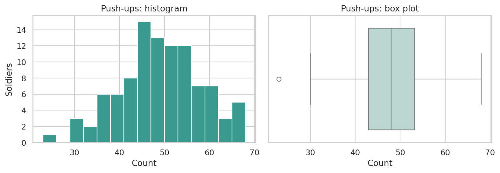

*팔굽혀펴기 횟수의 중앙값은 48회입니다. Box Plot에서는 낮은 쪽의 23회 기록이 따로 표시됩니다.*

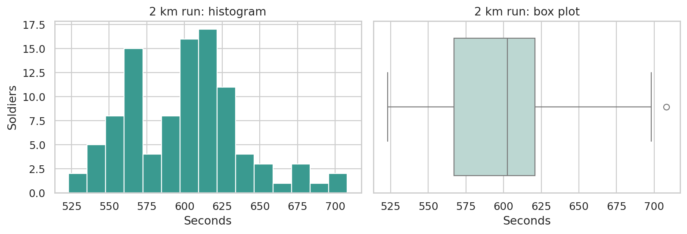

*2km 달리기 시간의 중앙값은 602.5초입니다. 오른쪽으로 갈수록 달리는 데 걸린 시간이 길어집니다.*

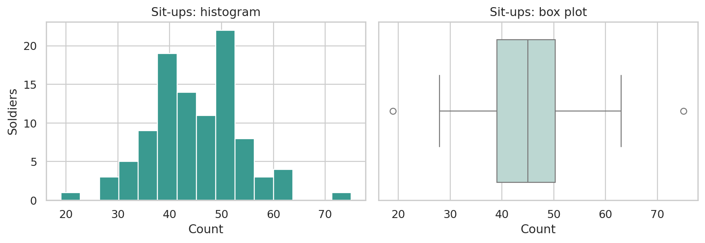

*윗몸일으키기 횟수의 중앙값은 45회입니다. 낮은 쪽 19회와 높은 쪽 75회가 각각 표시됩니다.*

Histogram은 값이 어느 구간에 많이 모이는지 보여 주고, Box Plot은 중앙값과 가운데 구간의 폭을 간단하게 보여 줍니다. 같은 열을 두 그래프로 보면 분포의 모양과 양 끝의 기록을 함께 확인할 수 있습니다. 달리기는 시간이 짧을수록 좋은 기록이므로, 오른쪽에 있는 값을 “좋은 점수”로 읽지 않습니다.

### 3-3. Box Plot의 상자 밖은 곧바로 이상치가 아닙니다

상자 안의 선은 중앙값이고, 상자 양 끝은 Q1과 Q3입니다. 상자는 IQR인 가운데 구간을 표시합니다. 상자 밖에도 수염 안에 있는 정상적인 관측값이 많습니다. 기본 `whis=1.5`에서 따로 표시되는 점은 다음 경계 밖의 값입니다.

`하한 = Q1 - 1.5 × IQR`

`상한 = Q3 + 1.5 × IQR`

수염은 이 경계 안에 있는 가장 바깥쪽 **실제 관측값**까지 뻗습니다. 계산된 경계값 자체까지 뻗는 것은 아닙니다. 따로 표시된 점은 이 기준에 따른 이상치 후보이며, 입력 오류라는 판정은 아닙니다.

```python
fitness_outlier_rows = []
for col in fitness_cols:
    q1, q3 = fitness[col].quantile([0.25, 0.75])
    iqr = q3 - q1
    lower = q1 - 1.5 * iqr
    upper = q3 + 1.5 * iqr
    candidates = fitness.loc[
        (fitness[col] < lower) | (fitness[col] > upper),
        ["soldier_id", col],
    ]
    for _, row in candidates.iterrows():
        fitness_outlier_rows.append({
            "feature": col, "soldier_id": row["soldier_id"],
            "value": row[col], "lower": lower, "upper": upper,
        })

fitness_outliers = pd.DataFrame(fitness_outlier_rows)
print(fitness_outliers.round(3).to_string(index=False))
```

```text
          feature soldier_id  value   lower   upper
     pushup_count       S075     23  27.625  68.625
run_time_2km(sec)       S080    708 486.375 701.375
      situp_count       S010     75  22.125  67.125
      situp_count       S063     19  22.125  67.125
```

| 항목 | ID | 관측값 | 하한 | 상한 |
| --- | --- | --- | --- | --- |
| `pushup_count` | S075 | 23 | 27.625 | 68.625 |
| run\_time\_2km(sec) | S080 | 708 | 486.375 | 701.375 |
| `situp_count` | S010 | 75 | 22.125 | 67.125 |
| `situp_count` | S063 | 19 | 22.125 | 67.125 |

현재 데이터에서는 팔굽혀펴기 23회, 달리기 708초, 윗몸일으키기 19회와 75회가 후보입니다. 측정 오류인지, 실제로 낮거나 높은 수행 기록인지 원본에서 확인합니다. 기록이 유효하다면 그 차이 자체가 분석할 정보가 될 수 있습니다.

## 4. Histogram의 bins를 바꾸면 무엇이 달라질까요?

`bins=15`는 관측된 값 범위 안에서 같은 폭의 구간 15개를 사용한다는 뜻입니다. 구간을 너무 크게 잡으면 작은 구조가 가려지고, 너무 잘게 나누면 비어 있는 구간과 들쑥날쑥한 막대가 강조될 수 있습니다. 구간 수를 바꿔도 원본 값은 그대로입니다.

```python
fig, axes = plt.subplots(1, 2, figsize=(10, 3.5), sharex=True)
for ax, bins in zip(axes, [5, 25]):
    ax.hist(
        fitness["pushup_count"], bins=bins,
        color="#3a9a90", edgecolor="white",
    )
    ax.set(title=f"Same data, bins={bins}", xlabel="Push-up count", ylabel="Soldiers")
fig.tight_layout()
fig.savefig("plots/histogram_bins_compare.png", dpi=160, bbox_inches="tight")
plt.close(fig)
```

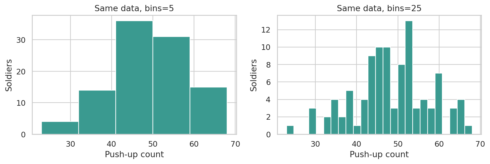

*왼쪽은 넓게 묶은 구간, 오른쪽은 잘게 나눈 구간입니다. 막대의 높이와 모양이 달라져도 두 그래프 모두 같은 100개 기록을 사용합니다.*

`bins=[20, 30, 40, 50, 60, 70]`처럼 경계를 직접 지정하거나 `bins="auto"`로 자동 선택할 수도 있습니다. 여러 부대의 Histogram을 비교할 때는 공통 구간과 축 범위를 사용해야 같은 위치의 막대가 같은 뜻을 가집니다. 관측 개수가 다르면 개수 분포와 비율 분포 중 무엇을 비교할지도 정합니다.

`density=True`는 막대 높이의 합이 아니라 **높이 × 구간 폭의 합이 1**이 되는 확률밀도를 그립니다. 구간 폭이 다를 때 높이를 곧바로 응답 비율로 읽으면 안 됩니다. 정수 횟수를 한 값씩 보고 싶다면 `value_counts().sort_index()`를 Bar Chart로 그리는 방법도 있습니다.

## 5. 실습 2: 스트레스 요인의 Scatter Plot과 Heatmap

### 5-1. 설문 항목의 범위와 부대별 응답 수를 확인합니다

```python
stress = pd.read_csv("stress_factors.csv")
stress_cols = [
    "sleep_quality", "training_pressure", "command_tension", "social_support"
]
os.makedirs("plots_stress", exist_ok=True)

print("데이터 크기:", stress.shape)
print("항목별 범위:")
print(stress[stress_cols].agg(["min", "max"]).to_string())
print("부대별 응답 수:")
print(stress["unit"].value_counts().sort_index().to_string())
```

```text
데이터 크기: (100, 6)
항목별 범위:
     sleep_quality  training_pressure  command_tension  social_support
min              1                  1                0               1
max             10                 10               12              10
부대별 응답 수:
unit
1사단    32
2사단    19
3사단    16
5사단    33
```

수면의 질, 훈련 압박, 지휘 긴장, 사회적 지지 점수를 비교합니다. `command_tension`에는 0\~12의 값이 있습니다. 이 점수가 어떤 범위를 허용하는지 설문 기준을 확인하고, 그래프를 그릴 때 임의로 1\~10 구간에 잘라 넣지 않습니다.

### 5-2. 부대별 색과 점 모양으로 관계를 구분합니다

```python
stress_plot = stress.copy()
stress_plot["unit_label"] = stress_plot["unit"].str.replace(
    "사단", " Division", regex=False
)
unit_order = sorted(stress_plot["unit_label"].unique())

fig, ax = plt.subplots(figsize=(7, 4.8))
sns.scatterplot(
    data=stress_plot,
    x="training_pressure", y="command_tension",
    hue="unit_label", style="unit_label",
    hue_order=unit_order, style_order=unit_order,
    palette="colorblind", alpha=0.7, s=65, ax=ax,
)
ax.set(
    title="Training pressure vs command tension",
    xlabel="Training pressure score", ylabel="Command tension score",
)
ax.legend(title="Unit", loc="upper left", bbox_to_anchor=(1.02, 1))
fig.tight_layout()
fig.savefig("plots_stress/scatter_plot.png", dpi=160, bbox_inches="tight")
plt.close(fig)
```

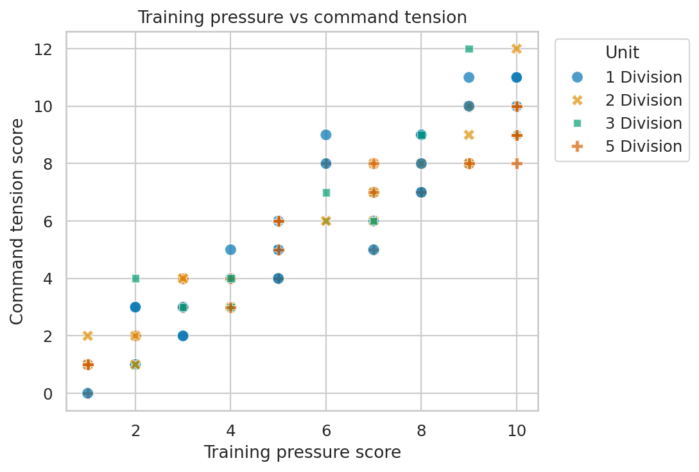

*오른쪽으로 갈수록 훈련 압박 점수가 높고, 위로 갈수록 지휘 긴장 점수가 높습니다. 범례의 1 Division은 원본의 1사단을 뜻합니다.*

`hue`는 부대마다 색을, `style`은 점 모양을 다르게 지정합니다. 같은 범주를 색과 모양으로 함께 표현하면 색 구분이 어려워도 범주를 읽기 쉽습니다. 원본 `unit`은 그대로 두고 그래프 범례용 `unit_label`만 추가했습니다. `bbox_to_anchor`로 범례를 밖으로 옮기고 `bbox_inches="tight"`로 저장하면 바깥 범례도 이미지에 포함됩니다.

### 5-3. 점이 겹치면 보이는 점의 수가 응답 수와 달라집니다

```python
stress_pair_counts = stress.groupby(
    ["training_pressure", "command_tension"]
).size().rename("responses").reset_index()
print("전체 응답 수:", len(stress))
print("서로 다른 좌표 수:", len(stress_pair_counts))
print("같은 좌표의 최대 응답 수:", stress_pair_counts["responses"].max())

fig, ax = plt.subplots(figsize=(7, 4.6))
sns.scatterplot(
    data=stress_pair_counts,
    x="training_pressure", y="command_tension",
    size="responses", sizes=(45, 300),
    color="#3a9a90", legend="full", ax=ax,
)
ax.set(
    title="Repeated responses at the same coordinates",
    xlabel="Training pressure score", ylabel="Command tension score",
)
ax.legend(title="Responses", loc="upper left", bbox_to_anchor=(1.02, 1))
fig.tight_layout()
fig.savefig("plots_stress/scatter_counts.png", dpi=160, bbox_inches="tight")
plt.close(fig)
```

```text
전체 응답 수: 100
서로 다른 좌표 수: 37
같은 좌표의 최대 응답 수: 5
```

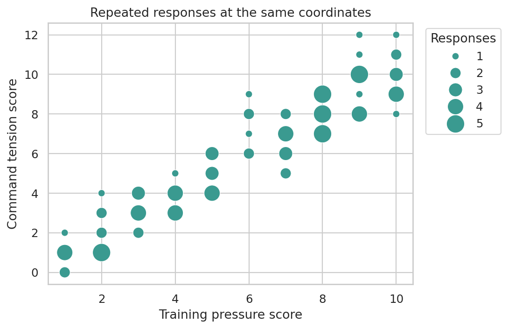

*한 좌표에 최대 5명의 응답이 겹칩니다. 이 그래프는 부대 구분 대신 같은 점수 조합의 응답 수를 보여 줍니다.*

정수 점수에서는 같은 좌표가 자주 생깁니다. 투명도를 낮추면 겹침을 조금 더 볼 수 있고, 위처럼 좌표별 개수를 구해 점 크기로 표현하면 빈도를 직접 확인할 수 있습니다. Jitter로 점 위치를 조금 흔드는 방법도 있지만, 실제 점수가 바뀐 것처럼 읽히지 않도록 위치를 옮겼다는 사실을 표시해야 합니다.

### 5-4. 숫자 항목만 골라 상관계수를 계산합니다

```python
stress_corr = stress[stress_cols].corr(method="pearson")
print(stress_corr.round(3).to_string())
print("훈련 압박·지휘 긴장:", round(
    stress_corr.loc["training_pressure", "command_tension"], 6
))
```

```text
                   sleep_quality  training_pressure  command_tension  social_support
sleep_quality              1.000             -0.907           -0.944           0.844
training_pressure         -0.907              1.000            0.942          -0.936
command_tension           -0.944              0.942            1.000          -0.877
social_support             0.844             -0.936           -0.877           1.000
훈련 압박·지휘 긴장: 0.94235
```

`corr()`의 기본 방식은 Pearson 상관계수입니다. 원본에는 `soldier_id`와 `unit` 문자열이 있으므로 계산할 점수 열을 명시적으로 선택합니다. 전체 DataFrame에 바로 `corr()`를 호출하면 문자열을 숫자로 변환하지 못해 오류가 날 수 있습니다. `numeric_only=True`로 숫자 열만 계산할 수도 있지만, 숫자로 저장된 ID까지 분석에 넣지 않도록 대상 열의 의미를 확인합니다.

### 5-5. 색상 기준을 고정해 Heatmap을 그립니다

```python
stress_labels = {
    "sleep_quality": "Sleep quality",
    "training_pressure": "Training pressure",
    "command_tension": "Command tension",
    "social_support": "Social support",
}
stress_corr_display = stress_corr.rename(
    index=stress_labels, columns=stress_labels
)
fig, ax = plt.subplots(figsize=(7.2, 5.2))
sns.heatmap(
    stress_corr_display, annot=True, fmt=".2f", cmap="coolwarm",
    vmin=-1, vmax=1, center=0, square=True, linewidths=0.5,
    cbar_kws={"label": "Pearson correlation"}, ax=ax,
)
ax.set_title("Correlation of stress factors")
ax.tick_params(axis="x", labelrotation=25)
ax.tick_params(axis="y", labelrotation=0)
fig.tight_layout()
fig.savefig("plots_stress/stress_correlation.png", dpi=160, bbox_inches="tight")
plt.close(fig)
```

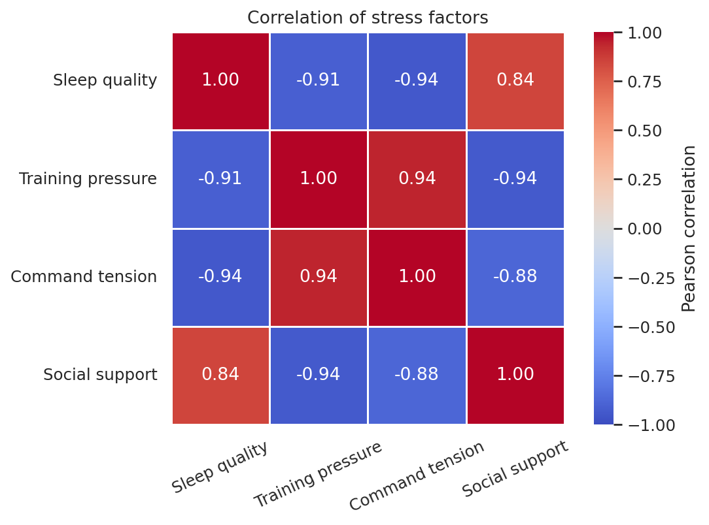

*`coolwarm`에서는 음수가 파란색, 양수가 빨간색으로 표시됩니다. 셀의 숫자는 소수점 둘째 자리까지 반올림한 값입니다.*

| 항목 쌍 | Pearson r | 현재 기록에서 보이는 관계 |
| --- | --- | --- |
| 훈련 압박 · 지휘 긴장 | 0.942 | 훈련 압박 점수가 높은 응답에서 지휘 긴장 점수도 높은 경향입니다. |
| 지휘 긴장 · 수면의 질 | \-0.944 | 지휘 긴장 점수가 높은 응답에서 수면의 질 점수는 낮은 경향입니다. |
| 훈련 압박 · 사회적 지지 | \-0.936 | 훈련 압박 점수가 높은 응답에서 사회적 지지 점수는 낮은 경향입니다. |
| 수면의 질 · 사회적 지지 | 0.844 | 두 항목이 같은 방향으로 높은 경향입니다. |

`annot=True`는 셀에 숫자를 쓰고, `fmt=".2f"`는 표시할 소수 자릿수를 정합니다. 계산된 `corr` 값 자체는 반올림되지 않습니다. `vmin=-1`, `vmax=1`, `center=0`으로 색의 기준을 고정하면 다른 데이터의 Heatmap도 같은 기준으로 비교할 수 있습니다. 설정하지 않으면 데이터에 따라 색 범위가 달라질 수 있습니다.

Heatmap은 행렬을 색으로 표현하는 그래프입니다. 상관계수뿐 아니라 부대·날짜별 응답 수나 결측치 패턴도 표시할 수 있습니다. 상관계수를 계산하는 것은 pandas의 `corr()`이고, 계산된 값에 색과 숫자를 붙이는 것은 Seaborn의 `heatmap()`입니다.

## 6. 실습 3: 장비 성능 지표의 상관관계

### 6-1. 숫자로 계산할 항목을 직접 정합니다

```python
equipment = pd.read_csv("equipment_performance.csv")
equipment_cols = [
    "fuel_efficiency", "operation_hours", "repair_freq", "mission_success_rate"
]
equipment_corr = equipment[equipment_cols].corr(method="pearson")
os.makedirs("plots_equipment", exist_ok=True)

print("데이터 크기:", equipment.shape)
print("열 이름:", equipment.columns.tolist())
print(equipment_corr.round(3).to_string())
fuel_success_r = equipment_corr.loc[
    "fuel_efficiency", "mission_success_rate"
]
print(f"연료 효율·임무 성공률 Pearson r: {fuel_success_r:.6f}")
print(f"같은 위치를 iloc으로 선택: {equipment_corr.iloc[0, 3]:.6f}")
```

```text
데이터 크기: (100, 6)
열 이름: ['equipment_id', 'type', 'fuel_efficiency', 'operation_hours', 'repair_freq', 'mission_success_rate']
                      fuel_efficiency  operation_hours  repair_freq  mission_success_rate
fuel_efficiency                 1.000            0.191       -0.255                 0.869
operation_hours                 0.191            1.000        0.588                 0.171
repair_freq                    -0.255            0.588        1.000                -0.269
mission_success_rate            0.869            0.171       -0.269                 1.000
연료 효율·임무 성공률 Pearson r: 0.868928
같은 위치를 iloc으로 선택: 0.868928
```

정비 지표의 실제 열 이름은 `repair_freq`입니다. `equipment_id`와 `type`은 계산 대상에서 제외합니다. `mission_success_rate`는 0\~1 사이의 비율로 저장되어 있어 0.95는 95%를 뜻합니다. `repair_freq`는 실수형 값이므로 정수 정비 건수라고 가정하기보다 지표의 정의와 집계 기간을 확인합니다.

연료 효율과 임무 성공률의 Pearson 상관계수는 약 **0.869**입니다. 현재 기록에서 연료 효율이 높은 장비에 임무 성공률도 높은 값이 함께 나타나는 경향을 보여 줍니다. `r=0.869`가 성공률 86.9%나 예측 정확도 86.9%를 뜻하는 것은 아닙니다.

`loc`은 열과 행의 이름을 지정하고, `iloc`은 위치를 지정합니다. 이번 열 순서에서는 `iloc[0, 3]`이 같은 셀을 선택하지만 열 순서를 바꾸면 다른 값을 가리킵니다. 두 항목의 의미를 직접 남기려면 `loc`으로 선택하는 편이 읽기 쉽습니다.

### 6-2. 전체 지표의 Heatmap을 저장합니다

```python
equipment_labels = {
    "fuel_efficiency": "Fuel efficiency",
    "operation_hours": "Operation hours",
    "repair_freq": "Repair frequency",
    "mission_success_rate": "Mission success",
}
equipment_corr_display = equipment_corr.rename(
    index=equipment_labels, columns=equipment_labels
)
fig, ax = plt.subplots(figsize=(7.2, 5.2))
sns.heatmap(
    equipment_corr_display, annot=True, fmt=".2f", cmap="coolwarm",
    vmin=-1, vmax=1, center=0, square=True, linewidths=0.5,
    cbar_kws={"label": "Pearson correlation"}, ax=ax,
)
ax.set_title("Correlation of equipment performance")
ax.tick_params(axis="x", labelrotation=25)
ax.tick_params(axis="y", labelrotation=0)
fig.tight_layout()
fig.savefig("plots_equipment/equipment_corr.png", dpi=160, bbox_inches="tight")
plt.close(fig)
```

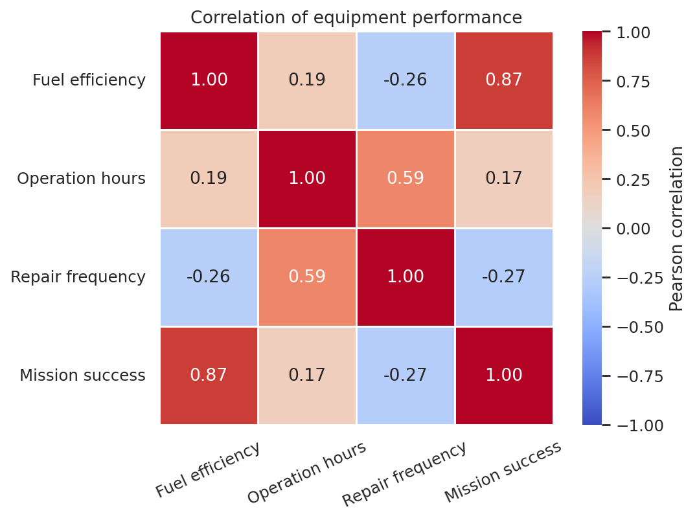

*연료 효율·임무 성공률의 셀은 0.87로 표시됩니다. 운용 시간·정비 지표도 약 0.59의 양의 상관을 보입니다.*

| 항목 쌍 | Pearson r | 현재 기록에서 보이는 관계 |
| --- | --- | --- |
| 연료 효율 · 임무 성공률 | 0.869 | 같은 방향으로 높은 값이 함께 나타나는 경향입니다. |
| 운용 시간 · 정비 지표 | 0.588 | 운용 시간이 긴 장비에서 정비 지표도 큰 경향입니다. |
| 정비 지표 · 임무 성공률 | \-0.269 | 반대 방향의 관계가 나타나지만 앞의 두 쌍보다 선형 관계가 약합니다. |

### 6-3. 관심 있는 한 쌍은 Scatter Plot으로 다시 확인합니다

```python
from matplotlib.ticker import PercentFormatter

type_labels = {
    "드론": "Drone", "레이다": "Radar",
    "지휘차량": "Command vehicle", "탱크": "Tank",
}
equipment_plot = equipment.copy()
equipment_plot["type_label"] = equipment_plot["type"].map(type_labels)
type_order = sorted(equipment_plot["type_label"].unique())

fig, ax = plt.subplots(figsize=(7, 4.8))
sns.scatterplot(
    data=equipment_plot,
    x="fuel_efficiency", y="mission_success_rate",
    hue="type_label", style="type_label",
    hue_order=type_order, style_order=type_order,
    palette="colorblind", s=60, alpha=0.8, ax=ax,
)
ax.set(
    title=f"Fuel efficiency vs mission success (r={fuel_success_r:.3f})",
    xlabel="Fuel efficiency", ylabel="Mission success rate",
)
ax.yaxis.set_major_formatter(PercentFormatter(xmax=1.0))
ax.legend(title="Type", loc="upper left", bbox_to_anchor=(1.02, 1))
fig.tight_layout()
fig.savefig("plots_equipment/fuel_success_scatter.png", dpi=160, bbox_inches="tight")
plt.close(fig)
```

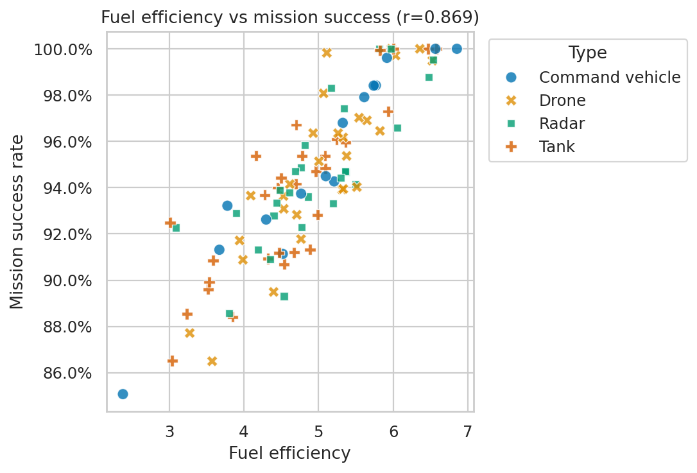

*Heatmap의 0.87 한 칸을 개별 관측값으로 펼쳤습니다. 같은 연료 효율 주변에서도 성공률의 차이가 있으며, 장비 유형별 분포도 함께 보입니다.*

Heatmap은 여러 관계를 빠르게 찾는 데 유용하고, Scatter Plot은 그 관계가 어떤 점들로 만들어졌는지 보여 줍니다. 일부 관측값이 관계를 끌어올리는지, 곡선인지, 집단이 나뉘는지 확인합니다. Y축은 `PercentFormatter(xmax=1.0)`로 표시만 백분율로 바꿨으며 원본 값은 그대로입니다.

### 6-4. 전체 관계와 유형 안의 관계를 비교합니다

```python
equipment_type_relations = pd.DataFrame([
    {
        "type": type_name,
        "count": len(group),
        "pearson_r": group["fuel_efficiency"].corr(
            group["mission_success_rate"]
        ),
    }
    for type_name, group in equipment.groupby("type")
])
print(equipment_type_relations.round(3).to_string(index=False))
```

```text
type  count  pearson_r
  드론     28      0.865
 레이다     27      0.792
지휘차량     15      0.954
  탱크     30      0.865
```

| 장비 유형 | 관측 개수 | 연료 효율·성공률 r |
| --- | --- | --- |
| 드론 | 28 | 0.865 |
| 레이다 | 27 | 0.792 |
| 지휘차량 | 15 | 0.954 |
| 탱크 | 30 | 0.865 |

현재 파일에서는 유형별로 나눠도 양의 상관이 보입니다. 전체 자료를 섞었을 때 생기는 관계인지, 같은 유형 안에서도 보이는 관계인지 확인하는 방법입니다. 다른 데이터에서는 전체 상관과 집단별 상관의 방향이 달라질 수도 있으므로, 색으로 집단을 나눈 Scatter Plot을 함께 살펴봅니다.

## 7. 상관계수를 읽을 때 기억할 것

### 7-1. 양의 상관은 비례식, 음의 상관은 반비례식이 아닙니다

Pearson 상관계수는 두 숫자 변수의 **선형 관계**를 -1부터 1까지 요약합니다. 양수이면 같은 방향으로 움직이는 경향, 음수이면 반대 방향으로 움직이는 경향입니다. 절댓값이 1에 가까울수록 점들이 직선 관계에 가깝게 모입니다.

| r의 모습 | 읽는 방법 | 함께 확인할 점 |
| --- | --- | --- |
| 양수 | X가 클 때 Y도 큰 경향 | Y가 X에 정확히 비례하거나 X가 Y를 변화시켰다는 뜻은 아닙니다. |
| 음수 | X가 클 때 Y는 작은 경향 | Y = a/X 같은 반비례식이 성립한다는 뜻은 아닙니다. |
| 0에 가까움 | 선형 관계가 약함 | 곡선이나 집단별 관계가 남아 있을 수 있습니다. |
| `NaN` | 상관계수를 계산할 수 없음 | 상수 열·유효값 부족·결측치 조건을 확인합니다. |

예를 들어 y = 2x + 10은 Pearson r이 1인 직선 관계이지만 원점을 지나는 비례식은 아닙니다. r이 음수여도 “X가 두 배면 Y는 절반” 같은 해석을 붙일 수 없습니다. 단위와 기울기는 Scatter Plot에서 따로 읽습니다.

### 7-2. r이 0이어도 뚜렷한 관계가 있을 수 있습니다

```python
curve_example = pd.DataFrame({"x": [-2, -1, 0, 1, 2]})
curve_example["y"] = curve_example["x"] ** 2
curve_r = curve_example["x"].corr(curve_example["y"])
print(f"x와 x²의 Pearson r: {curve_r:.6f}")

fig, ax = plt.subplots(figsize=(6.4, 3.8))
ax.scatter(curve_example["x"], curve_example["y"], color="#3a9a90", s=85)
ax.set(title=f"A clear curve, Pearson r={curve_r:.3f}", xlabel="x", ylabel="x squared")
ax.set_xticks([-2, -1, 0, 1, 2])
fig.tight_layout()
fig.savefig("plots/zero_correlation_curve.png", dpi=160, bbox_inches="tight")
plt.close(fig)
```

```text
x와 x²의 Pearson r: 0.000000
```

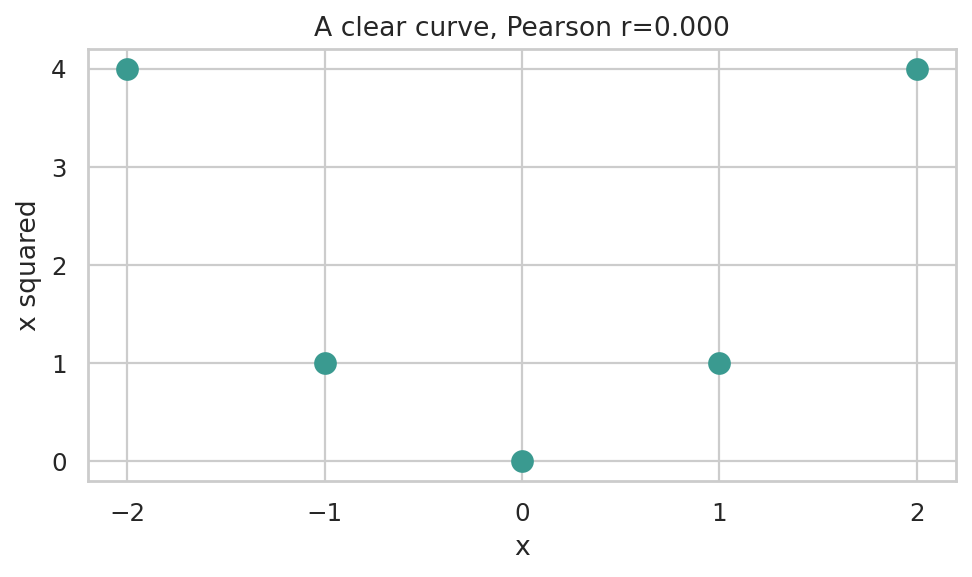

*x가 정해지면 y=x²도 정해집니다. Pearson r이 0이라는 숫자만으로 두 변수의 관계가 없다고 결론낼 수 없습니다.*

### 7-3. 점수의 순서를 보고 싶다면 Spearman을 비교합니다

```python
stress_spearman = stress[stress_cols].corr(method="spearman")
correlation_comparison = pd.DataFrame({
    "Pearson": [stress_corr.loc["training_pressure", "command_tension"]],
    "Spearman": [stress_spearman.loc["training_pressure", "command_tension"]],
}, index=["훈련 압박 · 지휘 긴장"])
print(correlation_comparison.round(3).to_string())
```

```text
               Pearson  Spearman
훈련 압박 · 지휘 긴장    0.942     0.941
```

Pearson은 원본 값의 선형 관계를 보고, Spearman은 순위를 이용해 한 변수가 증가할 때 다른 변수도 일관되게 증가하거나 감소하는 **단조 관계**를 봅니다. 순서형 설문 점수나 곡선이지만 한 방향으로 움직이는 관계에서 비교할 수 있습니다. 이번 훈련 압박·지휘 긴장 관계는 Pearson 약 0.942, Spearman 약 0.941입니다.

Spearman도 모든 비선형 관계를 찾는 도구는 아닙니다. 앞의 U자 예제는 감소했다가 증가하므로 단조 관계가 아닙니다. 방법을 바꾸는 것으로 분포 확인을 대신하지 않고, 어떤 종류의 관계를 보고 싶은지 먼저 정합니다.

### 7-4. 결측치가 있으면 각 셀의 관측 개수가 다를 수 있습니다

```python
missing_pairs = pd.DataFrame({
    "A": [1.0, 2.0, 3.0, np.nan],
    "B": [2.0, np.nan, 6.0, 8.0],
    "C": [1.0, 2.0, np.nan, 4.0],
})
valid = missing_pairs.notna().astype("int64")
pair_counts = valid.T @ valid
print("변수 쌍별 유효 관측 개수:")
print(pair_counts.to_string())
print("최소 3개 관측값을 요구한 상관계수:")
print(missing_pairs.corr(min_periods=3).to_string())
```

```text
변수 쌍별 유효 관측 개수:
   A  B  C
A  3  2  2
B  2  3  2
C  2  2  3
최소 3개 관측값을 요구한 상관계수:
     A    B    C
A  1.0  NaN  NaN
B  NaN  1.0  NaN
C  NaN  NaN  1.0
```

pandas의 `corr()`는 각 변수 쌍에서 두 값이 모두 있는 행으로 계산합니다. A와 B를 계산한 행과 A와 C를 계산한 행이 달라질 수 있습니다. 위 예제에서는 각 열에 유효값이 3개씩 있지만 서로 다른 열의 쌍에는 2개만 함께 있습니다. `min_periods=3`으로 최소 개수를 정하면 해당 셀은 `NaN`이 됩니다.

모든 셀을 같은 행 집합에서 비교하려면 대상 열에 대해 `dropna()`를 한 뒤 계산하는 방법이 있지만, 더 많은 행이 빠집니다. 분석 목적에 맞춰 공통 행을 사용할지, 쌍별 유효값을 사용할지 정하고 관측 개수도 함께 확인합니다. 상수 열은 표준편차가 0이어서 Pearson 상관계수가 정의되지 않습니다.

### 7-5. 높은 상관은 원인을 알려 주지 않습니다

훈련 압박과 지휘 긴장이 함께 높더라도 어느 항목이 먼저 변했는지는 이 표만으로 알 수 없습니다. 훈련 일정이나 설문 시점처럼 두 점수에 함께 연결되는 조건도 있을 수 있습니다. 연료 효율과 임무 성공률 역시 장비 유형·임무 난도·정비 상태 등의 영향을 함께 살펴봐야 합니다.

분석 문장은 “현재 기록에서 연료 효율이 높은 장비에 임무 성공률도 높은 경향이 나타납니다”처럼 관측한 관계를 설명합니다. “연료 효율을 높이면 성공률이 올라갑니다”처럼 개입의 효과를 말하려면 다른 설명을 구분할 수 있는 실험이나 분석 설계가 필요합니다.

> **Heatmap에서 관계를 찾고, Scatter Plot에서 모양을 확인하고, 원본에서 배경을 살펴봅니다.** 한 칸의 상관계수를 읽는 것과 원인을 설명하는 것은 서로 다른 단계입니다.

## 8. 한글 폰트와 그래프 저장을 정리합니다

### 8-1. 한글이 포함된 글자를 그릴 때 폰트가 필요합니다

CSV에 한글이 들어 있다는 사실만으로 폰트 설정이 필요한 것은 아닙니다. 그래프의 제목·축·범례에 한글을 표시할 때 해당 글자를 지원하는 폰트가 필요합니다. 예를 들어 원본 `unit`을 그대로 hue로 사용하면 범례에 1사단 같은 한글이 나타납니다.

```python
from matplotlib import font_manager

available_fonts = {font.name for font in font_manager.fontManager.ttflist}
font_candidates = [
    "Malgun Gothic", "AppleGothic", "NanumGothic", "Noto Sans CJK KR"
]
korean_font = next(
    (name for name in font_candidates if name in available_fonts), None
)
if korean_font is not None:
    plt.rcParams["font.family"] = korean_font
```

설치된 한글 폰트 이름을 `font.family`에 지정합니다. 이름만 지정한다고 폰트가 설치되는 것은 아닙니다. 폰트 파일을 직접 사용할 때는 `font_manager.fontManager.addfont("폰트 파일 경로")`로 등록하고, `FontProperties(fname="폰트 파일 경로").get_name()`으로 이름을 얻어 지정할 수 있습니다. 그래프를 그리기 전에 설정하며, Seaborn의 테마를 설정한다면 테마 설정 뒤에 폰트를 지정합니다.

축의 음수 기호가 깨지는 경우에는 폰트의 Unicode minus 지원 여부를 확인합니다. 필요한 경우 `plt.rcParams["axes.unicode_minus"] = False`로 일반 하이픈을 사용할 수 있습니다.

### 8-2. 저장할 Figure를 직접 지정합니다

| 작업 | 문법 | 기억할 점 |
| --- | --- | --- |
| 폴더 생성 | `os.makedirs(path, exist_ok=True)` | 같은 폴더가 있어도 다시 사용할 수 있습니다. |
| 경로 연결 | `os.path.join(folder, filename)` | 폴더와 파일 이름을 경로로 연결합니다. |
| 여백 정리 | `fig.tight_layout()` | 축·라벨 간 여백을 조정합니다. |
| 이미지 저장 | `fig.savefig(path, dpi=160)` | 저장할 Figure를 명시합니다. |
| 범례 포함 저장 | `bbox_inches="tight"` | 그림 바깥에 배치한 요소까지 저장 영역에 포함합니다. |
| Figure 닫기 | `plt.close(fig)` | 반복 작업에서 사용한 Figure를 정리합니다. |

`plt.savefig()`는 현재 활성화된 Figure를 저장하고, `fig.savefig()`는 지정한 Figure를 저장합니다. 여러 그림을 연속해서 만들 때는 `fig`에 저장 대상을 연결해 두면 그림이 바뀌어 저장되는 일을 피할 수 있습니다. **그리기 → 배치 조정 → 저장 → 닫기** 순서로 작성합니다.

`figsize=(10, 3.6)`의 단위는 inch이고 dpi는 inch당 픽셀 수입니다. 해상도를 조정하더라도 원본 폰트 크기와 라벨 배치가 읽기 쉬운지 함께 확인합니다. `bbox_inches="tight"`를 쓰면 최종 이미지 크기는 지정한 figsize × dpi와 조금 달라질 수 있습니다.

## 9. 그래프를 읽기 좋게 만드는 기준

-   **제목에 질문을 담습니다.** “그래프 1”보다 “훈련 압박과 지휘 긴장 점수의 관계”처럼 무엇을 보는지 적습니다.
-   **축에 단위를 남깁니다.** 횟수·초·비율·점수를 구분하고, Histogram의 Y축이 개수인지 밀도인지 표시합니다.
-   **비교 기준을 맞춥니다.** 집단별 Histogram은 구간과 축 범위를, 상관계수 Heatmap은 -1\~1 색 범위를 맞춥니다.
-   **막대의 기준선을 확인합니다.** Bar Chart의 높이로 크기를 비교한다면 일반적으로 0부터 시작하고, 다른 범위를 쓰면 그 기준을 드러냅니다.
-   **색만으로 구분하지 않습니다.** Scatter Plot에는 점 모양과 범례를 함께 사용하고, Heatmap에는 숫자를 덧붙입니다.
-   **겹침과 누락을 확인합니다.** 점이 겹치는지, 결측치가 빠졌는지, 축 범위 밖의 관측값이 잘렸는지 확인합니다.
-   **꾸민 뒤에도 원본과 연결합니다.** 화면에서 특이한 점을 찾으면 ID로 돌아가 어떤 기록인지 살펴봅니다.

그래프를 다시 볼 때는 점·막대·색 하나가 무엇을 나타내는지 먼저 읽습니다. 축 범위와 단위, 표본 수를 확인하면 그림에서 본 차이를 숫자로도 설명할 수 있습니다.

## 10. 더 살펴보기: 점이 많이 겹치면 밀도를 집계해서 그립니다

Scatter Plot에 점 5,000개를 그리면 가운데가 뭉쳐 보입니다. 투명도를 낮춰도 정확한 밀도 차이를 읽기 어려울 수 있습니다. `hexbin()`은 평면을 육각형 구간으로 나누고 구간마다 점이 몇 개 들어오는지 셉니다.

아래 그림은 같은 데이터를 점과 구간별 개수로 나란히 보여 줍니다. `bins="log"`는 색에 Log scale을 적용해 적은 개수와 많은 개수를 함께 구분하기 쉽게 합니다.

```python
from pathlib import Path
import numpy as np
import matplotlib.pyplot as plt

rng = np.random.default_rng(42)
x = rng.normal(size=5000)
y = 0.7 * x + rng.normal(scale=0.7, size=5000)
fig, axes = plt.subplots(1, 2, figsize=(10, 4))
axes[0].scatter(x, y, s=9, alpha=0.12, color="#287f78")
axes[0].set_title("Scatter: overlapping points")
counts = axes[1].hexbin(x, y, gridsize=30, mincnt=1,
                        bins="log", cmap="viridis")
fig.colorbar(counts, ax=axes[1], label="Count (log color scale)")
axes[1].set_title("Hexbin: observations per cell")
for ax in axes:
    ax.set(xlabel="x", ylabel="y")
fig.tight_layout()
fig.savefig("hexbin_comparison.png", dpi=150, bbox_inches="tight")
plt.close(fig)
print("집계한 점 수:", int(counts.get_array().sum()))
```

```text
집계한 점 수: 5000
```

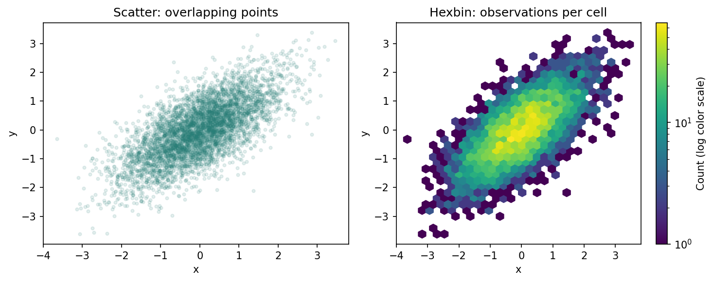

*같은 5,000개 관측을 Scatter와 Hexbin으로 비교합니다. 색상은 구간별 개수입니다.*

육각형의 색은 두 변수의 상관계수가 아니라 **그 구간의 관측 개수**입니다. `gridsize`를 바꾸면 보여 주는 해상도도 달라집니다. 분포를 비교할 때는 같은 구간 크기·축 범위·색상 기준을 적용합니다.

## 11. 이번 글을 다시 볼 때 기억할 것

| 하려는 일 | 문법 | 복습할 핵심 |
| --- | --- | --- |
| 두 그래프 나란히 배치 | `plt.subplots(1, 2)` | Figure와 Axes를 반환받아 각각 그립니다. |
| 분포 확인 | `ax.hist(values, bins=15)` | 구간 수가 모양을 바꿉니다. |
| 중앙값·IQR 확인 | `sns.boxplot(x=values, ax=ax)` | 상자 밖의 모든 값이 이상치 후보인 것은 아닙니다. |
| 두 변수의 관계 | `sns.scatterplot(data=df, x=..., y=...)` | 겹친 점과 집단별 분포를 확인합니다. |
| 범주 표현 | `hue` · `style` | 색과 점 모양을 같은 범주에 연결할 수 있습니다. |
| 상관계수 계산 | `df[cols].corr(method="pearson")` | 대상 열·방법·유효 관측 개수를 정합니다. |
| 순위 관계 비교 | `corr(method="spearman")` | 단조 관계를 보며 모든 곡선을 찾는 것은 아닙니다. |
| 행렬 시각화 | `sns.heatmap(..., vmin=-1, vmax=1)` | 색의 기준과 표시 자릿수를 확인합니다. |
| 특정 관계 선택 | `corr_matrix.loc[열1, 열2]` | 위치보다 항목 이름으로 의미를 남깁니다. |
| 그림 저장 | `fig.savefig()` · `plt.close(fig)` | 저장할 Figure를 명시하고 닫습니다. |

1.  같은 팔굽혀펴기 기록을 `bins=5`와 `bins=25`로 그리면 왜 다른 모양으로 보이나요?
2.  Box Plot의 Q1·Q3·수염·따로 표시된 점은 각각 무엇을 뜻하나요?
3.  Scatter Plot에서 한 점이 보이는데 그 좌표에 다섯 명이 응답했다면 어떻게 표현할 수 있나요?
4.  y=x² 예제에서 Pearson r이 0인 것이 왜 “관계 없음”을 뜻하지 않나요?
5.  전체 장비의 관계와 같은 장비 유형 안의 관계는 왜 함께 확인하나요?
6.  두 Heatmap을 비교할 때 색 범위를 -1\~1로 고정하는 이유는 무엇인가요?

> **숫자로 요약하고, 그래프로 확인하고, 원본으로 돌아가 해석합니다.** 보기 좋은 그림을 만드는 것과 그 그림이 보여 주는 관계를 정확하게 읽는 일을 함께 연습합니다.

## 참고자료

### 실습 데이터와 노트북

-   **실습 자료**: [Session05 실습 폴더](https://drive.google.com/drive/folders/1mQ7v9O6oHukHI3YTJ0W1YBI_jwZcXlRJ) · [session05\_데이터-시각화.pdf](https://drive.google.com/file/d/1mmpkKcMdd1nACy83ONi1FF-tLAYNdlRc/view) · [session05.ipynb](https://drive.google.com/file/d/1TCtbwqnvIey-ZDR1WdT0A70sv9v9krwk/view)
-   **CSV 데이터**: [fitness\_result.csv](https://drive.google.com/file/d/1JvWwcwe4Tw6oRISTHgfYlQDkf9RMJYOY/view) · [stress\_factors.csv](https://drive.google.com/file/d/1bkD5-iVC4nrz1kSx8V-UJIx4RXzXWnWb/view) · [equipment\_performance.csv](https://drive.google.com/file/d/1zhcCQTPaULdurdlCYcXA3n6j5jeWnHKx/view)
-   **심화 예제**: [심화 예제 자료](https://drive.google.com/file/d/1wG0fZ0uhBQ1tniHUVE42xxo2mhkdwzGf/view?usp=drivesdk "Google Drive에서 자료를 엽니다.") — 공부노트 01\~13의 Python 코드, 노트북, 예제 CSV와 실행 결과를 함께 받습니다.

### 연습문제

-   **복습 안내**: — 통계량과 그래프는 모든 유형의 입력 점검과 결과 해석에서 함께 사용합니다. 유형별 문제에서 관측 단위·비교 기준·분모를 설명하는 부분을 찾아 복습합니다.

### 공식 문서

-   **Matplotlib**: [Quick start guide](https://matplotlib.org/stable/users/explain/quick_start.html) — Figure·Axes와 그래프 구성  
    [pyplot.subplot](https://matplotlib.org/stable/api/_as_gen/matplotlib.pyplot.subplot.html) — 현재 그래프 영역 선택  
    [pyplot.subplots](https://matplotlib.org/stable/api/_as_gen/matplotlib.pyplot.subplots.html) — Figure와 여러 Axes 생성  
    [Axes.hist](https://matplotlib.org/stable/api/_as_gen/matplotlib.axes.Axes.hist.html) — bins·구간 경계·density  
    [Figure.savefig](https://matplotlib.org/stable/api/_as_gen/matplotlib.figure.Figure.savefig.html) — dpi·bbox\_inches와 이미지 저장  
    [pyplot.close](https://matplotlib.org/stable/api/_as_gen/matplotlib.pyplot.close.html) — Figure 닫기  
    [font\_manager](https://matplotlib.org/stable/api/font_manager_api.html) — 설치된 폰트와 폰트 파일 등록  
    [PercentFormatter](https://matplotlib.org/stable/api/ticker_api.html#matplotlib.ticker.PercentFormatter) — 비율을 백분율 눈금으로 표시
-   **Seaborn**: [Seaborn 소개](https://seaborn.pydata.org/tutorial/introduction.html) — DataFrame을 활용한 통계 시각화  
    [boxplot](https://seaborn.pydata.org/generated/seaborn.boxplot.html) — 중앙값·IQR·whis·이상치 후보  
    [scatterplot](https://seaborn.pydata.org/generated/seaborn.scatterplot.html) — hue·style·size와 범주 표현  
    [heatmap](https://seaborn.pydata.org/generated/seaborn.heatmap.html) — annot·fmt·색상 범위와 행렬 시각화
-   **pandas**: [DataFrame.corr](https://pandas.pydata.org/docs/reference/api/pandas.DataFrame.corr.html) — Pearson·Spearman·결측치·min\_periods·numeric\_only  
    [Series.quantile](https://pandas.pydata.org/docs/reference/api/pandas.Series.quantile.html) — Q1·Q3와 IQR 계산
-   **SciPy**: [pearsonr](https://docs.scipy.org/doc/scipy/reference/generated/scipy.stats.pearsonr.html) — 선형 상관계수와 비선형 관계 예제  
    [spearmanr](https://docs.scipy.org/doc/scipy/reference/generated/scipy.stats.spearmanr.html) — 순위와 단조 관계
-   **Python**: [os.makedirs](https://docs.python.org/3/library/os.html#os.makedirs) — 결과 폴더 생성과 exist\_ok  
    [Path.mkdir](https://docs.python.org/3/library/pathlib.html#pathlib.Path.mkdir) — Path 객체로 폴더 생성
-   **Plotly**: [Plotly Python 문서](https://plotly.com/python/) — Hover·Zoom을 이용한 대화형 시각화
-   **밀도 집계**: [Axes.hexbin](https://matplotlib.org/stable/api/_as_gen/matplotlib.axes.Axes.hexbin.html) — gridsize·bins·mincnt와 구간별 집계를 확인합니다.
