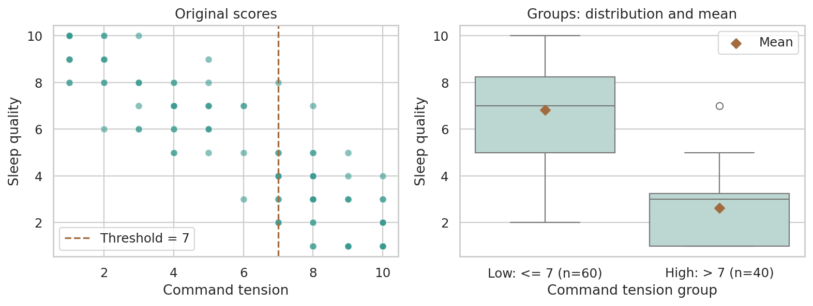
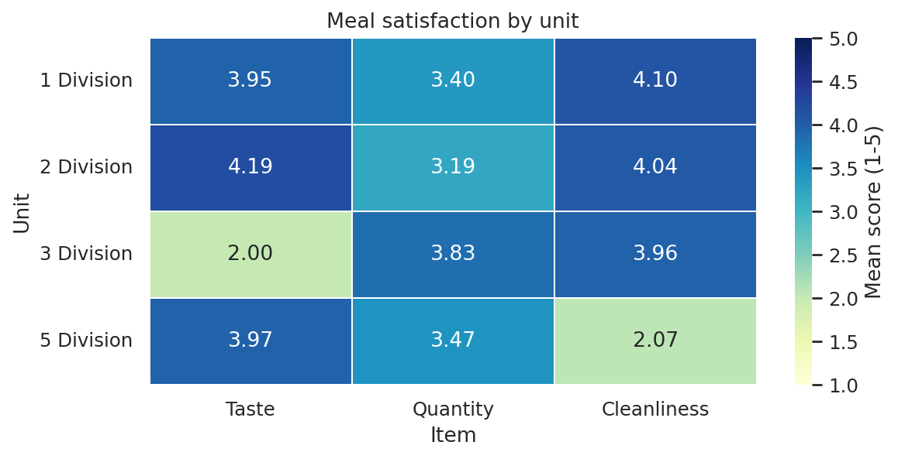

> **이번 글의 질문**
>
> 상관계수가 -0.94이면 훈련 강도가 수면의 질을 떨어뜨린다고 말할 수 있을까요? 부대별 평균을 다시 평균 내면 전체 평균이 될까요? `groupby()`와 `pivot_table()`은 언제 각각 사용하면 좋을까요?

> **핵심 요약**
>
> 상관계수로 변수 간 관계를 살펴보고, `threshold`로 그룹을 나눠 비교합니다. 전체 응답자 평균과 부대별 평균의 단순 평균은 서로 다른 기준입니다. `groupby()`는 그룹별 계산에, `pivot_table()`은 행·열 기준의 집계표에 사용하며, 결과를 해석할 때 관측 개수와 판단 기준을 함께 남깁니다.

## 1. 숫자를 계산한 다음에는 무엇을 읽어야 할까요?

표와 그래프를 만들고 나면 이제 숫자를 읽어야 합니다. 어느 그룹을 비교했는지, 평균의 분모가 무엇인지에 따라 같은 데이터도 다르게 보입니다. 상관관계와 부대별 만족도, 장비 지표를 살펴보며 해석의 기준을 정리합니다.

같은 데이터도 질문에 따라 다른 표가 필요합니다. 전체 응답자의 만족도를 알고 싶은지, 부대별로 같은 비중을 두고 비교하고 싶은지 먼저 정합니다. 계산식이 비슷해 보여도 답하는 질문은 달라질 수 있습니다.

| 실습 파일 | 데이터 구성 | 분석할 질문 |
| --- | --- | --- |
| `stress_analysis.csv` | 100행, 5열 | 수면 점수와 훈련 압박은 어떤 관계이며, 지휘 긴장도 그룹별 차이는 얼마나 될까요? |
| `meal_feedback.csv` | 100행, 5열 | 전체에서 낮은 항목과 각 부대에서 낮은 항목은 같을까요? |
| `equipment_operational.csv` | 100행, 5열 | 장비 유형별 연료 효율과 수리 빈도는 어떻게 다를까요? |

스트레스 파일에는 `unit` 열이 없습니다. 식단 파일의 양 점수는 `quantity_score`, 장비 파일의 연료 효율과 수리 빈도는 `fuel_efficiency`, `repair_freq`입니다. 파일마다 실제 열 이름을 확인하고 분석 대상을 선택합니다.

> **질문 → 계산 기준 → 결과 → 해석 → 다음 확인 사항**의 순서로 정리합니다. 결과를 보고 질문을 바꾸기보다, 어떤 기준으로 답을 구할지 먼저 정해 두면 해석이 분명해집니다.

## 2. 실습 1: 수면의 질과 훈련 압박의 관계

### 2-1. 두 Series의 상관계수는 corr()로 계산합니다

```python
import pandas as pd
import numpy as np

stress = pd.read_csv("stress_analysis.csv")
pair_cols = ["sleep_quality", "training_pressure"]
pairs = stress[pair_cols].dropna()

print("데이터 크기:", stress.shape)
print("열 이름:", stress.columns.tolist())
print("결측치 수:", stress.isna().sum().to_dict())

pearson_r = pairs["sleep_quality"].corr(
    pairs["training_pressure"], method="pearson",
)
spearman_r = pairs["sleep_quality"].corr(
    pairs["training_pressure"], method="spearman",
)
print("계산에 사용한 응답 수:", len(pairs))
print(f"Pearson r: {pearson_r:.6f}")
print(f"Spearman r: {spearman_r:.6f}")
```

```text
데이터 크기: (100, 5)
열 이름: ['soldier_id', 'sleep_quality', 'training_pressure', 'command_tension', 'social_support']
결측치 수: {'soldier_id': 0, 'sleep_quality': 0, 'training_pressure': 0, 'command_tension': 0, 'social_support': 0}
계산에 사용한 응답 수: 100
Pearson r: -0.941152
Spearman r: -0.933110
```

`Series.corr(other)`는 두 Series의 관계를 숫자 하나로 반환합니다. 여러 열의 관계를 행렬로 볼 때는 `DataFrame.corr()`를 사용합니다. `correlation`은 결과를 담는 변수 이름으로 사용할 수 있지만, pandas에서 호출하는 메서드 이름은 <strong>`corr()`</strong>입니다.

| 방법 | 현재 결과 | 주로 보는 관계 |
| --- | --- | --- |
| Pearson | \-0.9412 | 숫자 값 사이의 선형 관계를 요약합니다. |
| Spearman | \-0.9331 | 값의 순위를 이용해 단조 관계를 요약합니다. |

두 방법 모두 이 데이터에서 강한 음의 관계를 보여 줍니다. 점수의 간격을 동일하게 해석하는 것이 적절한지 살펴보고, 순서 중심의 관계가 궁금할 때는 Spearman도 함께 확인할 수 있습니다. 방법을 여러 개 계산한 뒤 마음에 드는 숫자만 고르기보다 어떤 관계를 보고 싶은지 먼저 정합니다.

### 2-2. -0.94를 “반비례”나 “원인”으로 읽지 않습니다

Pearson r은 약 -0.9412입니다. 이 응답 데이터에서는 **훈련 압박 점수가 높은 응답에서 수면의 질 점수가 낮게 나타나는 경향**이 뚜렷합니다. 음수는 방향을, 절댓값이 1에 가까운 정도는 선형 관계의 강도를 알려 줍니다.

수학에서 반비례는 `y = k / x`처럼 특정한 관계를 뜻합니다. 음의 상관관계가 있다고 해서 이 식을 따르는 것은 아닙니다. 또한 -0.94는 “수면이 94% 감소합니다”라는 뜻도 아닙니다. 서로 다른 두 점수가 함께 움직이는 정도를 요약한 값입니다.

이 결과만으로 훈련 압박이 수면 저하를 일으켰다고 확정하지 않습니다. 근무 일정, 생활 환경, 사회적 지지 등 다른 요인이 함께 작용할 수 있습니다. 이 데이터에는 지휘 긴장도와 사회적 지지 점수도 있으므로 관계를 추가로 살펴볼 수 있지만, 상관계수 몇 개를 더 구하는 것만으로 원인이 증명되지는 않습니다.

> **해석 문장:** “100개의 유효 응답에서 훈련 압박과 수면의 질 사이에 강한 음의 상관관계가 나타납니다(Pearson r ≈ -0.9412). 훈련 압박이 높은 응답에서 수면 점수가 낮은 경향을 보입니다.”

### 2-3. 같은 사람의 두 값을 짝지어야 합니다

`corr()`는 Index가 같은 값을 짝지어 계산하고, 짝 안에 결측치가 있으면 제외합니다. 위 코드는 같은 DataFrame에서 두 열을 선택하고 `dropna()`로 유효 응답 수까지 확인합니다. 파일을 따로 읽었다면 행 번호가 같다는 이유만으로 같은 사람이라고 가정하지 않고 `soldier_id` 등 식별자를 기준으로 연결합니다.

변수가 전부 같은 값이면 Pearson 상관계수를 계산할 수 없습니다. `NaN`은 관계가 0이라는 뜻이 아닙니다. `min_periods`로 최소 유효 관측 개수를 지정할 수도 있지만, 개수 조건을 통과했다는 사실이 결론의 신뢰도를 보장하지는 않습니다.

## 3. threshold로 그룹을 나누면 어떤 차이가 보일까요?

### 3-1. 중앙값 7을 기준으로 두 그룹을 만듭니다

```python
threshold = stress["command_tension"].median()

# 두 열의 값이 모두 있는 응답으로 그룹을 비교합니다.
stress_valid = stress.dropna(subset=["command_tension", "sleep_quality"]).copy()
stress_valid["command_group"] = np.where(
    stress_valid["command_tension"] > threshold, "high", "low",
)

group_stats = stress_valid.groupby("command_group")["sleep_quality"].agg(
    ["count", "mean", "median", "std"],
).reindex(["low", "high"])

high_mean = group_stats.loc["high", "mean"]
low_mean = group_stats.loc["low", "mean"]
sleep_gap = low_mean - high_mean

print("threshold:", threshold)
print("기준값과 같은 응답 수:", int(stress["command_tension"].eq(threshold).sum()))
print(group_stats.round(3).to_string())
print(f"평균 차이(low - high): {sleep_gap:.3f}")
```

```text
threshold: 7.0
기준값과 같은 응답 수: 12
               count   mean  median    std
command_group
low               60  6.833     7.0  2.256
high              40  2.625     3.0  1.462
평균 차이(low - high): 4.208
```

| 그룹 | 조건 | 유효 응답 수 | 수면 평균 | 수면 중앙값 |
| --- | --- | --- | --- | --- |
| `low` | `command_tension <= 7` | 60 | 6.833 | 7 |
| `high` | `command_tension > 7` | 40 | 2.625 | 3 |

지휘 긴장도가 7보다 큰 그룹의 수면 평균은 2.625, 7 이하 그룹의 평균은 약 6.833입니다. 평균 차이는 약 4.208점입니다. `high`·`low`는 **이번 데이터를 비교하기 위해 붙인 분류 이름**입니다.

중앙값을 사용했다고 두 그룹이 반드시 50명씩 나뉘는 것은 아닙니다. 7점인 응답이 12개 있고, 이를 모두 `low`에 포함했기 때문에 60명과 40명으로 나뉩니다. `>`와 `<=`를 짝지으면 경계값을 빠뜨리지 않습니다. 둘 다 `>`·`<`로 작성하면 7점 응답이 어느 쪽에도 들어가지 않습니다.

### 3-2. threshold를 조금 바꾸면 결과도 바뀝니다

```python
threshold_rows = []
for cut in [6, 7, 8]:
    high = stress_valid.loc[stress_valid["command_tension"] > cut, "sleep_quality"]
    low = stress_valid.loc[stress_valid["command_tension"] <= cut, "sleep_quality"]
    threshold_rows.append({
        "threshold": cut,
        "low_n": low.count(), "high_n": high.count(),
        "low_mean": low.mean(), "high_mean": high.mean(),
        "gap": low.mean() - high.mean(),
    })

threshold_check = pd.DataFrame(threshold_rows)
print(threshold_check.round(3).to_string(index=False))
```

```text
 threshold  low_n  high_n  low_mean  high_mean   gap
         6     48      52     7.583      2.904 4.679
         7     60      40     6.833      2.625 4.208
         8     77      23     6.065      2.087 3.978
```

기준을 6·7·8로 바꾸면 포함되는 응답과 평균 차이가 달라집니다. 이 데이터에서는 세 기준 모두 `low` 그룹의 수면 평균이 더 높지만, 평균 차이는 약 4.679·4.208·3.978점으로 바뀝니다. 중앙값은 간단한 출발점이고, 실제 업무에서 이미 정한 기준이 있다면 그 의미와 함께 사용합니다.

그룹으로 나누면 “두 집단이 얼마나 다른가요?”에 답하기 쉽지만, 같은 그룹 안의 차이는 가려집니다. 8점과 10점이 모두 `high`가 됩니다. 그룹 비교와 원래 점수의 관계를 함께 보면 기준선 하나에 해석이 지나치게 의존하는 일을 줄일 수 있습니다.

### 3-3. 평균과 분포를 함께 확인합니다

```python
from pathlib import Path
import matplotlib.pyplot as plt
import seaborn as sns

Path("plots").mkdir(exist_ok=True)
sns.set_theme(style="whitegrid")
fig, axes = plt.subplots(1, 2, figsize=(10, 3.9))

sns.scatterplot(
    data=stress, x="command_tension", y="sleep_quality",
    color="#3a9a90", alpha=0.6, ax=axes[0],
)
axes[0].axvline(threshold, color="#a26b3f", linestyle="--", label="Threshold = 7")
axes[0].set(title="Original scores", xlabel="Command tension", ylabel="Sleep quality")
axes[0].legend()

sns.boxplot(
    data=stress_valid, x="command_group", y="sleep_quality",
    order=["low", "high"], color="#b7dcd5", ax=axes[1],
)
axes[1].scatter([0, 1], [low_mean, high_mean], marker="D", color="#a26b3f", label="Mean", zorder=4)
axes[1].set(
    title="Groups: distribution and mean", xlabel="Command tension group",
    ylabel="Sleep quality",
)
axes[1].set_xticks([0, 1], ["Low: <= 7 (n=60)", "High: > 7 (n=40)"])
axes[1].legend()
fig.tight_layout()
fig.savefig("plots/stress_threshold_compare.png", dpi=160, bbox_inches="tight")
plt.close(fig)
```



*왼쪽은 원래 점수의 관계, 오른쪽은 그룹별 분포입니다. 마름모는 평균입니다. 산점도의 같은 좌표에 여러 응답이 겹칠 수 있습니다.*

평균 차이가 크더라도 두 그룹의 모든 응답을 완벽하게 구분하지는 못합니다. 분포가 겹치는지도 살펴봅니다. 여기서 표준편차는 그룹 안의 점수가 얼마나 퍼져 있는지를 나타내며, 평균 차이가 통계적으로 유의하다는 판정과는 구별합니다.

### 3-4. 결과를 Dictionary로 남기고 표시할 때 반올림합니다

```python
summary = {
    "sleep_training_correlation": float(pearson_r),
    "command_tension_threshold": float(threshold),
    "low_group_n": int(group_stats.loc["low", "count"]),
    "high_group_n": int(group_stats.loc["high", "count"]),
    "low_group_sleep_mean": float(low_mean),
    "high_group_sleep_mean": float(high_mean),
    "sleep_mean_gap": float(sleep_gap),
}

display_summary = {
    key: round(value, 2) if isinstance(value, float) else value
    for key, value in summary.items()
}
for key, value in display_summary.items():
    print(f"{key}: {value}")

print("round(2.625, 2):", round(2.625, 2))
```

```text
sleep_training_correlation: -0.94
command_tension_threshold: 7.0
low_group_n: 60
high_group_n: 40
low_group_sleep_mean: 6.83
high_group_sleep_mean: 2.62
sleep_mean_gap: 4.21
round(2.625, 2): 2.62
```

Dictionary에는 결과뿐 아니라 `threshold`와 그룹별 응답 수도 함께 저장합니다. 계산용 `summary`에는 원래 값을 남기고, 표시용 `display_summary`에서 자릿수를 줄입니다. 반올림한 평균으로 다시 차이를 계산하면 불필요한 오차가 생길 수 있습니다.

한 가지 눈에 띄는 점은 `round(2.625, 2)`가 **2.62**라는 것입니다. Python의 round()는 정확히 중간인 값에서 가까운 짝수 쪽을 선택합니다. 그래서 실제 그룹 평균 2.625를 round()로 두 자리 표시하면 2.62가 됩니다. 일반적인 float에는 이진수 표현 오차도 있으므로, 소수 자릿수의 표시와 원래 계산값을 구분해서 보관합니다.

## 4. 실습 2: 부대별 식단 만족도 비교

### 4-1. 평균을 구할 항목과 응답 수를 함께 선택합니다

```python
feedback = pd.read_csv("meal_feedback.csv")
score_cols = ["taste_score", "quantity_score", "cleanliness_score"]

print("데이터 크기:", feedback.shape)
print("열 이름:", feedback.columns.tolist())
print("결측치 수:", feedback.isna().sum().to_dict())
print(feedback[score_cols].describe().round(2).to_string())

unit_group = feedback.groupby("unit", observed=True, dropna=False)
unit_avg = unit_group[score_cols].mean()
unit_counts = unit_group[score_cols].count()
unit_sizes = unit_group.size().rename("responses")
unit_report = unit_avg.join(unit_sizes)
print(unit_report.round(3).to_string())

unit_avg.reset_index().to_csv(
    "meal_unit_avg.csv", index=False, encoding="utf-8-sig",
)
```

```text
데이터 크기: (100, 5)
열 이름: ['soldier_id', 'unit', 'taste_score', 'quantity_score', 'cleanliness_score']
결측치 수: {'soldier_id': 0, 'unit': 0, 'taste_score': 0, 'quantity_score': 0, 'cleanliness_score': 0}
       taste_score  quantity_score  cleanliness_score
count       100.00          100.00             100.00
mean          3.55            3.47               3.44
std           1.22            1.17               1.24
min           1.00            2.00               1.00
25%           3.00            2.00               3.00
50%           3.50            3.00               3.00
75%           5.00            5.00               5.00
max           5.00            5.00               5.00
      taste_score  quantity_score  cleanliness_score  responses
unit
1사단         3.950           3.400              4.100         20
2사단         4.192           3.192              4.038         26
3사단         2.000           3.833              3.958         24
5사단         3.967           3.467              2.067         30
```

| 부대 | 응답 수 | 맛 평균 | 양 평균 | 위생 평균 |
| --- | --- | --- | --- | --- |
| 1사단 | 20 | 3.950 | 3.400 | 4.100 |
| 2사단 | 26 | 4.192 | 3.192 | 4.038 |
| 3사단 | 24 | 2.000 | 3.833 | 3.958 |
| 5사단 | 30 | 3.967 | 3.467 | 2.067 |

현재 파일에는 1·2·3·5사단의 응답이 있습니다. 2사단의 맛 평균은 약 4.192로 가장 높고, 3사단은 2.000으로 낮습니다. 5사단은 위생 평균이 약 2.067로 다른 부대보다 낮습니다. 전체 평균을 보기 전에 이 표를 확인하면 어떤 부대의 어떤 항목을 더 살펴볼지 정하기 쉽습니다.

`size()`는 그룹의 행 수, `count()`는 각 열에서 결측치가 아닌 값의 개수입니다. 이번 파일은 결측치가 없어 값이 일치하지만, 맛 점수만 빠진 응답이 있다면 맛 평균의 분모는 그만큼 작아집니다. `dropna=False`는 부대 이름이 없는 행도 별도 그룹에 포함합니다. 점수 결측치를 평균에서 제외하는 동작과 그룹 이름 결측치의 처리는 서로 다른 설정입니다.

### 4-2. 전체 평균이 가장 낮은 항목은 위생입니다

```python
overall_avg = feedback[score_cols].mean()
lowest_item = overall_avg.idxmin()
lowest_score = overall_avg.min()

print(overall_avg.round(3).to_string())
print("가장 낮은 항목:", lowest_item)
print(f"해당 평균: {lowest_score:.3f}")
```

```text
taste_score          3.55
quantity_score       3.47
cleanliness_score    3.44
가장 낮은 항목: cleanliness_score
해당 평균: 3.440
```

| 항목 | 전체 응답자 평균 |
| --- | --- |
| 맛 (`taste_score`) | 3.550 |
| 양 (`quantity_score`) | 3.470 |
| 위생 (`cleanliness_score`) | 3.440 |

전체 응답자 기준으로 가장 낮은 항목은 위생입니다. `min()`은 최소값인 3.44를 반환하고, `idxmin()`은 그 값을 가진 Index인 `cleanliness_score`를 반환합니다. 항목 이름을 찾는 질문이므로 `idxmin()`을 사용합니다.

위생과 양의 전체 평균 차이는 0.03점입니다. 위생이 최저라는 순위와 다른 항목보다 큰 차이가 난다는 판단은 구별합니다. **위생을 우선 살펴볼 후보로 정하고, 부대별 분포와 낮은 점수의 응답 비중을 함께 확인합니다.**

## 5. 부대 평균을 다시 평균 내면 왜 답이 달라질까요?

### 5-1. 같은 데이터인데 최저 항목이 바뀝니다

```python
equal_unit_avg = unit_avg.mean()

# 각 항목의 유효 응답 수를 가중치로 사용합니다.
weighted_avg = pd.Series({
    col: np.average(unit_avg[col], weights=unit_counts[col])
    for col in score_cols
})

average_comparison = pd.DataFrame({
    "respondent_mean": overall_avg,
    "equal_unit_mean": equal_unit_avg,
    "weighted_unit_mean": weighted_avg,
})
print(average_comparison.round(4).to_string())
print("전체 응답자 기준 최저:", overall_avg.idxmin())
print("부대 동일 비중 기준 최저:", equal_unit_avg.idxmin())
```

```text
                   respondent_mean  equal_unit_mean  weighted_unit_mean
taste_score                   3.55           3.5272                3.55
quantity_score                3.47           3.4731                3.47
cleanliness_score             3.44           3.5409                3.44
전체 응답자 기준 최저: cleanliness_score
부대 동일 비중 기준 최저: quantity_score
```

| 항목 | 전체 응답자 평균 | 부대 동일 비중 평균 | 응답 수 가중 평균 |
| --- | --- | --- | --- |
| `taste_score` | 3.5500 | 3.5272 | 3.5500 |
| `quantity_score` | 3.4700 | 3.4731 | 3.4700 |
| `cleanliness_score` | 3.4400 | 3.5409 | 3.4400 |

전체 응답자를 같은 비중으로 보면 **위생**이 가장 낮습니다. 부대별 평균 네 개를 같은 비중으로 평균 내면 **양**이 가장 낮습니다. 계산 오류가 아니라 기준이 달라진 결과입니다. “전체 항목 평균”이라고만 적으면 이 차이가 가려집니다.

| 계산 | 비중을 같게 두는 대상 | 답하는 질문 |
| --- | --- | --- |
| `feedback[score_cols].mean()` | 개별 유효 응답 | 응답자들의 평균 만족도는 얼마인가요? |
| `unit_avg.mean()` | 각 부대 | 부대를 동일한 비중으로 볼 때 평균은 얼마인가요? |
| 부대 평균의 응답 수 가중 평균 | 개별 유효 응답 | 부대별 요약에서 전체 응답자 평균을 복원하면 얼마인가요? |

### 5-2. 위생 점수로 직접 계산해 봅니다

위생 평균은 1사단 4.1, 2사단 약 4.0385, 3사단 약 3.9583, 5사단 약 2.0667입니다. 부대별 응답 수는 각각 20·26·24·30명입니다. 단순 평균에서는 네 부대가 각각 25%의 비중을 갖지만, 전체 응답자 평균에서는 5사단이 30%의 비중을 갖습니다.

`부대 동일 비중 평균 = (4.1 + 4.0385… + 3.9583… + 2.0667…) / 4 ≈ 3.5409`

`전체 응답자 평균 = (82 + 105 + 95 + 62) / 100 = 3.44`

두 번째 식의 82·105·95·62는 부대별 위생 점수의 합입니다. 위생 점수가 낮은 5사단의 응답이 가장 많아, 전체 응답자 평균이 부대 동일 비중 평균보다 낮아집니다. 가중 평균은 각 부대 평균에 해당 항목의 유효 응답 수를 곱한 뒤, 유효 응답 수 합으로 나누어 계산합니다.

위 가중 평균 코드는 모든 부대에 유효 응답이 있는 현재 파일을 사용합니다. 어떤 부대의 특정 항목이 전부 결측이면 평균은 `NaN`, `count`는 0이 됩니다. 그때는 해당 항목의 유효 그룹만 골라 가중 평균을 계산합니다. 부대 이름이 없는 응답을 앞에서 제외했다면 원본 전체 평균과도 분석 대상이 달라집니다.

> **“누구를 한 표로 셀 것인가요?”를 먼저 정합니다.** 응답자 기준이면 원본 응답을 평균 내고, 부대에 같은 비중을 주려면 부대 평균을 다시 평균 냅니다. 응답자 수로 가중했다고 전체 병력의 대표성이 자동으로 확보되는 것은 아닙니다. 조사 참여 방식도 함께 확인합니다.

## 6. 전체 최저 항목과 부대별 개선 후보를 구분합니다

### 6-1. axis에 따라 찾는 대상이 달라집니다

```python
unit_lowest_items = unit_avg.idxmin(axis="columns")
item_lowest_units = unit_avg.idxmin(axis="index")

print("각 부대에서 평균이 가장 낮은 항목:")
print(unit_lowest_items.to_string())
print("\n각 항목에서 평균이 가장 낮은 부대:")
print(item_lowest_units.to_string())
```

```text
각 부대에서 평균이 가장 낮은 항목:
unit
1사단       quantity_score
2사단       quantity_score
3사단          taste_score
5사단    cleanliness_score

각 항목에서 평균이 가장 낮은 부대:
taste_score          3사단
quantity_score       2사단
cleanliness_score    5사단
```

`axis="columns"`는 한 행의 여러 열을 비교합니다. 따라서 각 부대에서 맛·양·위생 중 무엇이 낮은지 알려 줍니다. `axis="index"`는 한 열을 여러 부대에 걸쳐 비교하므로, 각 항목에서 어느 부대가 낮은지 알려 줍니다.

| 부대 | 부대 안에서 가장 낮은 항목 |
| --- | --- |
| 1사단 | `quantity_score` |
| 2사단 | `quantity_score` |
| 3사단 | `taste_score` |
| 5사단 | `cleanliness_score` |

전체에서 위생이 낮다고 모든 부대의 첫 개선 항목이 위생인 것은 아닙니다. 1·2사단은 양, 3사단은 맛, 5사단은 위생이 부대 안에서 가장 낮습니다. 같은 숫자 표를 전체 계획과 부대별 계획에 각각 다르게 활용할 수 있습니다.

### 6-2. 낮은 평균을 낮은 점수의 비중과 함께 봅니다

```python
# 이 예제에서는 위생 점수 1~2점을 낮은 점수로 정의합니다.
clean_valid = feedback.dropna(subset=["cleanliness_score"]).copy()
clean_valid["low_cleanliness"] = clean_valid["cleanliness_score"].le(2)

cleanliness_report = clean_valid.groupby(
    "unit", observed=True, dropna=False,
).agg(
    valid_n=("cleanliness_score", "count"),
    mean=("cleanliness_score", "mean"),
    low_n=("low_cleanliness", "sum"),
    low_ratio=("low_cleanliness", "mean"),
)
print(cleanliness_report.round(3).to_string())
```

```text
      valid_n   mean  low_n  low_ratio
unit
1사단        20  4.100      0        0.0
2사단        26  4.038      0        0.0
3사단        24  3.958      0        0.0
5사단        30  2.067     18        0.6
```

5사단의 위생 평균은 약 2.067이고, 30개의 유효 응답 중 18개가 1\~2점입니다. 낮은 점수의 비중은 60%입니다. 다른 세 부대에는 위생 1\~2점 응답이 없습니다. 평균뿐 아니라 어떤 점수에 응답이 모였는지를 보면 후속 확인 대상을 구체적으로 정할 수 있습니다.

1\~2점이라는 기준은 이 비교를 위해 명시한 기준입니다. 실제 설문의 응답 선택지에 어떤 설명이 붙어 있는지 확인해 해석합니다. 응답 수가 적은 그룹의 비율은 일부 응답에 크게 움직일 수 있으므로 비율 옆에 분자와 분모를 함께 남깁니다.

### 6-3. 만족도 Heatmap으로 부대별 패턴을 확인합니다

```python
meal_plot = unit_avg.copy()
meal_plot.index = meal_plot.index.str.replace("사단", " Division", regex=False)
meal_plot = meal_plot.rename(columns={
    "taste_score": "Taste",
    "quantity_score": "Quantity",
    "cleanliness_score": "Cleanliness",
})

fig, ax = plt.subplots(figsize=(7.6, 3.9))
sns.heatmap(
    meal_plot, annot=True, fmt=".2f", cmap="YlGnBu",
    vmin=1, vmax=5, linewidths=0.7,
    cbar_kws={"label": "Mean score (1-5)"}, ax=ax,
)
ax.set(title="Meal satisfaction by unit", xlabel="Item", ylabel="Unit")
ax.set_yticklabels(ax.get_yticklabels(), rotation=0)
fig.tight_layout()
fig.savefig("plots/meal_unit_means.png", dpi=160, bbox_inches="tight")
plt.close(fig)
```



*이 Heatmap의 셀은 상관계수가 아니라 만족도 평균입니다. 색상 범위를 점수 척도인 1\~5로 맞췄습니다.*

[파이썬 데이터 분석노트 05](/cs/data-analysis/pandas-05-data-visualization/)의 Heatmap은 -1\~1 범위의 상관계수를 표시했습니다. 지금은 1\~5 범위의 만족도 평균을 표시합니다. 같은 그래프 형태라도 셀과 색상 막대의 의미가 다릅니다. 표와 함께 보면 3사단의 맛, 5사단의 위생처럼 확인할 지점이 눈에 들어옵니다.

### 6-4. idxmin()은 공동 최저 항목을 모두 반환하지 않습니다

```python
tie_example = pd.Series({"taste": 3.0, "quantity": 3.0, "cleanliness": 4.0})
print("idxmin():", tie_example.idxmin())
print("공동 최저 항목:", tie_example[tie_example.eq(tie_example.min())].index.tolist())
```

```text
idxmin(): taste
공동 최저 항목: ['taste', 'quantity']
```

최소값이 같으면 `idxmin()`은 현재 순서에서 처음 만난 Label 하나를 반환합니다. 공동 최저 항목을 모두 남기려면 최소값과 같은 항목을 필터링합니다. 비교는 반올림 전 값으로 수행합니다. 화면에 모두 3.00이라고 표시되어도 원래 평균은 다를 수 있습니다. 유효값이 없는 Series에서는 먼저 `dropna()` 후 `empty`를 확인합니다.

## 7. groupby()와 pivot\_table()을 어떻게 선택할까요?

### 7-1. 같은 그룹 평균을 두 방법으로 만듭니다

```python
meal_pivot = pd.pivot_table(
    feedback, index="unit", values=score_cols,
    aggfunc="mean", observed=True, dropna=False,
)

# 표시 순서를 같은 열 순서로 맞춥니다.
meal_pivot = meal_pivot.reindex(columns=score_cols)
print(meal_pivot.round(3).to_string())
print("groupby 평균과 같은 결과:", np.allclose(meal_pivot, unit_avg))
```

```text
      taste_score  quantity_score  cleanliness_score
unit
1사단         3.950           3.400              4.100
2사단         4.192           3.192              4.038
3사단         2.000           3.833              3.958
5사단         3.967           3.467              2.067
groupby 평균과 같은 결과: True
```

지금처럼 행 기준이 `unit` 하나이고 값이 세 점수 열이면 `groupby().mean()`과 같은 평균표를 만들 수 있습니다. **`pivot_table()`은 그룹별 집계와 행·열 배치를 함께 지정하는 기능입니다.** aggfunc는 각 그룹의 값을 어떻게 요약할지 정하는 핵심 설정입니다.

| 파라미터 | 이 예제의 값 | 역할 |
| --- | --- | --- |
| `data` | `feedback` | 집계할 원본 DataFrame입니다. |
| `index` | `"unit"` | 결과 행을 나눌 기준입니다. |
| `columns` | 현재 예제에서는 생략 | 결과 열을 나눌 범주 기준입니다. |
| `values` | `score_cols` | 평균을 계산할 세 점수 열입니다. |
| `aggfunc` | `"mean"` | 같은 그룹의 응답을 평균으로 요약합니다. |
| `observed` | `True` | Categorical 기준에서 실제 관측한 범주를 사용합니다. |
| `dropna` | `False` | 그룹 기준에 결측값이 있는 경우도 포함합니다. |

Categorical을 그룹 기준으로 쓰면 observed에 따라 미관측 범주를 결과에 포함할지가 달라집니다. 최근 pandas에서는 `groupby()`와 `pivot_table()`의 observed 기본값이 `True`입니다. 보고서가 어떤 범주를 보여 줄지 코드에 남기려면 위처럼 직접 지정합니다. 현재 `unit`은 문자열 열이므로 observed가 이 표의 값에 영향을 주지는 않습니다.

### 7-2. 행은 부대, 열은 항목으로 지정해 봅니다

원본에는 맛·양·위생이 각각 열로 들어 있습니다. `melt()`로 항목명과 점수를 두 열에 모으면 “부대 × 항목”이라는 구조를 코드에서 직접 표현할 수 있습니다.

```python
feedback_long = feedback.melt(
    id_vars=["soldier_id", "unit"], value_vars=score_cols,
    var_name="item", value_name="score",
)
print("Long Format 크기:", feedback_long.shape)
print(feedback_long.head(4).to_string(index=False))

meal_cross = pd.pivot_table(
    feedback_long, index="unit", columns="item", values="score",
    aggfunc="mean", observed=True, dropna=False,
).reindex(columns=score_cols)
print("\n부대 × 항목 평균:")
print(meal_cross.round(3).to_string())
```

```text
Long Format 크기: (300, 4)
soldier_id unit        item  score
      S001  3사단 taste_score      3
      S002  5사단 taste_score      4
      S003  1사단 taste_score      4
      S004  3사단 taste_score      2

부대 × 항목 평균:
item  taste_score  quantity_score  cleanliness_score
unit
1사단         3.950           3.400              4.100
2사단         4.192           3.192              4.038
3사단         2.000           3.833              3.958
5사단         3.967           3.467              2.067
```

100명의 응답에 항목이 세 개 있으므로 Long Format은 300행입니다. `index="unit"`으로 행을, `columns="item"`으로 열을 나누고, 같은 부대·항목에 속한 `score`를 평균 냅니다. 응답 행이 모두 식별자로 남아 있으므로 집계한 셀이 어떤 원본 응답에서 나왔는지도 추적할 수 있습니다.

`groupby()`로 작성한다면 `feedback_long.groupby(["unit", "item"])["score"].mean().unstack("item")`처럼 그룹별 평균을 계산한 뒤 열로 펼칠 수 있습니다. `pivot_table()`은 이 집계표의 행·열 구조를 한 번에 지정하기 편합니다.

### 7-3. pivot()은 집계 없이 값의 자리를 바꿉니다

```python
pivot_demo = pd.DataFrame({
    "unit": ["A", "A", "B"],
    "item": ["taste", "taste", "taste"],
    "score": [2, 4, 5],
})
try:
    pivot_demo.pivot(index="unit", columns="item", values="score")
except ValueError as error:
    print("pivot() 오류:", error)

print("\npivot_table()의 평균 집계:")
print(pivot_demo.pivot_table(
    index="unit", columns="item", values="score", aggfunc="mean",
).to_string())
```

```text
pivot() 오류: Index contains duplicate entries, cannot reshape

pivot_table()의 평균 집계:
item  taste
unit
A       3.0
B       5.0
```

A 부대의 `taste`에 2와 4라는 두 값이 있습니다. `pivot()`은 둘 중 무엇을 한 셀에 넣을지 결정하지 않아 오류를 냅니다. `pivot_table()`에 평균을 지정하면 A·`taste` 셀은 3이 됩니다. 이것은 같은 응답을 삭제하는 작업이 아니라, 여러 응답을 요약하는 작업입니다.

| 방법 | 핵심 역할 | 선택하기 좋은 경우 |
| --- | --- | --- |
| `groupby().agg()` | 그룹별 계산 결과를 구성 | 평균·표준편차·응답 수에 원하는 결과 열 이름을 붙입니다. |
| `pivot_table()` | 그룹별 집계와 행·열 배치 | 부대 × 항목처럼 교차 집계표를 만듭니다. |
| `pivot()` | 집계 없이 구조 변경 | 각 행·열 조합에 값이 하나씩 있을 때 펼칩니다. |

### 7-4. margins는 평균의 평균이 아닌 원본 기준으로 읽습니다

```python
meal_with_total = pd.pivot_table(
    feedback_long, index="unit", columns="item", values="score",
    aggfunc="mean", margins=True, margins_name="전체",
    observed=True,
).reindex(columns=score_cols + ["전체"])
print(meal_with_total.round(3).to_string())
```

```text
item  taste_score  quantity_score  cleanliness_score     전체
unit
1사단         3.950           3.400              4.100  3.817
2사단         4.192           3.192              4.038  3.808
3사단         2.000           3.833              3.958  3.264
5사단         3.967           3.467              2.067  3.167
전체          3.550           3.470              3.440  3.487
```

마지막 “전체” 행의 항목별 값은 원본 유효 응답을 집계한 평균입니다. 그래서 위생은 3.44이며, 네 부대 위생 평균의 단순 평균인 약 3.5409와 다릅니다. 마지막 “전체” 열은 각 부대의 여러 항목 점수를 함께 평균 낸 값입니다. 두 방향의 “전체”가 어떤 대상을 묶었는지 구분합니다.

margins는 지정한 aggfunc를 사용합니다. 평균을 지정했다고 합계가 되는 것은 아닙니다. 결측치가 있으면 `dropna` 설정과 입력 형태에 따라 전체 집계에 포함되는 행도 확인합니다. `fill_value=0`은 집계 후 비어 있는 셀을 0으로 표시하므로, 응답이 없는 만족도 항목을 0점 응답처럼 바꾸지 않도록 합니다.

## 8. 실습 3: 장비 유형별 운용 지표 해석

### 8-1. 평균과 장비 수를 함께 확인합니다

```python
equipment = pd.read_csv("equipment_operational.csv")
equipment_cols = ["fuel_efficiency", "repair_freq"]

print("데이터 크기:", equipment.shape)
print("열 이름:", equipment.columns.tolist())
print("결측치 수:", equipment.isna().sum().to_dict())

equipment_group = equipment.groupby("type", observed=True, dropna=False)
type_avg = equipment_group[equipment_cols].mean()
equipment_report = equipment_group.agg(
    equipment_n=("equipment_id", "size"),
    fuel_efficiency_mean=("fuel_efficiency", "mean"),
    repair_freq_mean=("repair_freq", "mean"),
    operation_hours_mean=("operation_hours", "mean"),
)
print(equipment_report.round(3).to_string())
```

```text
데이터 크기: (100, 5)
열 이름: ['equipment_id', 'type', 'fuel_efficiency', 'operation_hours', 'repair_freq']
결측치 수: {'equipment_id': 0, 'type': 0, 'fuel_efficiency': 0, 'operation_hours': 0, 'repair_freq': 0}
      equipment_n  fuel_efficiency_mean  repair_freq_mean  operation_hours_mean
type
드론             20                 7.022             2.050               379.966
레이다            24                 0.999             3.625              1882.942
지휘차량           30                 4.537             2.733               781.278
탱크             26                 3.335             5.808              1052.970
```

| 유형 | 장비 수 | 연료 효율 평균 | 수리 빈도 평균 | 운용 시간 평균 |
| --- | --- | --- | --- | --- |
| 드론 | 20 | 7.022 | 2.050 | 379.966 |
| 레이다 | 24 | 0.999 | 3.625 | 1882.942 |
| 지휘차량 | 30 | 4.537 | 2.733 | 781.278 |
| 탱크 | 26 | 3.335 | 5.808 | 1052.970 |

드론은 연료 효율 평균이 약 7.022로 가장 높고, 수리 빈도 평균이 2.050으로 가장 낮습니다. 레이다의 연료 효율 평균은 약 0.999, 탱크의 수리 빈도 평균은 약 5.808입니다. 이 파일에서는 높은 연료 효율과 낮은 수리 빈도를 유리한 방향으로 비교합니다.

### 8-2. “가장 우수하다” 앞에 판단 기준을 붙입니다

```python
repair_ranking = type_avg.sort_values("repair_freq")
best_by_repair = repair_ranking.index[0]

print(repair_ranking.round(3).to_string())
print("평균 수리 빈도가 가장 낮은 유형:", best_by_repair)

# 수리 빈도가 같을 때 연료 효율이 높은 유형을 먼저 둡니다.
ranking_with_tie_break = type_avg.sort_values(
    ["repair_freq", "fuel_efficiency"], ascending=[True, False],
)
print("\n수리 빈도 우선, 동률이면 연료 효율 기준:")
print(ranking_with_tie_break.round(3).to_string())
```

```text
      fuel_efficiency  repair_freq
type
드론              7.022        2.050
지휘차량            4.537        2.733
레이다             0.999        3.625
탱크              3.335        5.808
평균 수리 빈도가 가장 낮은 유형: 드론

수리 빈도 우선, 동률이면 연료 효율 기준:
      fuel_efficiency  repair_freq
type
드론              7.022        2.050
지휘차량            4.537        2.733
레이다             0.999        3.625
탱크              3.335        5.808
```

수리 빈도는 낮은 쪽을 먼저 보므로 오름차순으로 정렬합니다. 첫 번째 유형은 드론입니다. 결과 문장은 <strong>“평균 수리 빈도 기준으로 드론이 가장 낮습니다”</strong>처럼 기준을 남깁니다. 장비 유형마다 임무와 운용 조건이 달라 이 순위만으로 모든 상황의 장비 선택을 결정하지는 않습니다.

여러 정렬 기준을 지정하면 앞 기준이 우선합니다. 위 코드는 수리 빈도가 같은 경우에만 연료 효율을 비교합니다. 두 지표를 같은 비중으로 점수화한 종합 평가가 아닙니다. 서로 다른 단위의 원본 평균을 그대로 더해 종합 점수를 만들면 큰 단위의 지표가 결과를 좌우할 수 있습니다.

### 8-3. 수리 지표와 운용 시간의 정의를 함께 봅니다

운용 시간 평균도 유형별로 다릅니다. 드론은 약 379.966시간, 레이다는 약 1882.942시간입니다. 수리 지표가 누적 수리 건수라면 운용 기회가 많은 장비에서 건수가 커질 수 있습니다. 이미 기간당 빈도로 계산한 값이라면 다시 운용 시간으로 나누면 안 됩니다. 먼저 `repair_freq`의 단위와 집계 기간을 확인합니다.

수리 건수를 비교하는 경우에는 같은 운용 시간당 건수, 동일 기간·임무·연식의 장비 등 비교 기준을 맞추는 방법을 검토합니다. 평균 수리 빈도가 낮다는 관찰을 곧바로 모든 운용 조건에서 더 견고하다는 결론으로 확대하지 않습니다.

### 8-4. 같은 지표를 pivot\_table로 요약하고 저장합니다

```python
equipment_pivot = pd.pivot_table(
    equipment, index="type", values=equipment_cols,
    aggfunc="mean", observed=True, dropna=False,
).reindex(columns=equipment_cols)

print(equipment_pivot.round(3).to_string())
print("groupby 평균과 같은 결과:", np.allclose(equipment_pivot, type_avg))

type_avg.reset_index().to_csv(
    "equipment_type_avg.csv", index=False, encoding="utf-8-sig",
)
equipment_report.reset_index().to_csv(
    "equipment_type_report.csv", index=False, encoding="utf-8-sig",
)
```

```text
      fuel_efficiency  repair_freq
type
드론              7.022        2.050
레이다             0.999        3.625
지휘차량            4.537        2.733
탱크              3.335        5.808
groupby 평균과 같은 결과: True
```

`reset_index()`로 `type`을 일반 열로 만들고 `index=False`로 저장하면 불필요한 행 번호 열이 붙지 않습니다. `equipment_type_avg.csv`에는 두 지표의 평균, `equipment_type_report.csv`에는 장비 수와 운용 시간 평균까지 함께 남깁니다. 표를 다시 열어 볼 때 비교의 맥락을 유지할 수 있습니다.

## 9. 계산 결과를 해석 문장으로 연결합니다

| 분석 결과 | 결과를 담은 해석 문장 | 다음에 확인할 내용 |
| --- | --- | --- |
| 수면·훈련 Pearson r ≈ -0.9412 | 훈련 압박이 높은 응답에서 수면 점수가 낮은 경향이 나타납니다. | 근무 일정·생활 조건·다른 설문 항목을 살펴봅니다. |
| 위생 전체 평균 3.44 | 전체 응답자 기준으로 위생 평균이 세 항목 중 가장 낮습니다. | 항목별 분포와 부대별 응답 구성을 확인합니다. |
| 5사단 위생 1\~2점 18/30 | 5사단 응답의 60%가 위생에 1\~2점을 주었습니다. | 설문 선택지 의미와 구체적인 불만 내용을 확인합니다. |
| 드론 수리 빈도 평균 2.05 | 장비 유형 중 드론의 평균 수리 빈도가 가장 낮습니다. | 지표의 단위·운용 기간·임무 조건을 확인합니다. |

좋은 해석은 계산식의 분모까지 설명합니다. 누구의 평균인지, 무엇을 같은 조건으로 비교했는지 남겨 두면 다음 분석에서도 기준을 이어갈 수 있습니다.

> **숫자가 답하는 질문의 범위를 지킵니다.** 상관계수는 관계를, 그룹 평균은 집단의 요약값을, 정렬은 정한 기준의 순위를 보여 줍니다. 이 결과를 바탕으로 다음에 확인할 질문을 구체적으로 만듭니다.

## 10. 더 살펴보기: 비율을 합칠 때는 분모부터 확인합니다

정비 횟수 4건이 3건보다 많다고 해서 더 자주 고장 났다고 바로 읽기 어렵습니다. 4건을 관측한 운용 시간이 열 배 길다면 시간당 빈도는 오히려 낮습니다.

기간이나 노출량이 다른 비율은 분자를 합하고 분모를 합해 전체 비율을 구합니다. 다음은 수리 건수와 운용 시간이 명확하게 주어진 별도 비교 예제입니다.

```python
import pandas as pd

records = pd.DataFrame({"repairs": [3, 4], "hours": [100, 1000]})
records["per_1000_hours"] = records["repairs"] / records["hours"] * 1000
pooled_rate = records["repairs"].sum() / records["hours"].sum() * 1000
print(records.to_string(index=False))
print("두 비율의 단순 평균:", round(records["per_1000_hours"].mean(), 3))
print("전체 운용 시간 기준:", round(pooled_rate, 3))
```

```text
 repairs  hours  per_1000_hours
       3    100            30.0
       4   1000             4.0
두 비율의 단순 평균: 17.0
전체 운용 시간 기준: 6.364
```

30건/1,000시간과 4건/1,000시간의 단순 평균은 17이지만, 전체 7건/1,100시간은 약 6.364건/1,000시간입니다. 원본의 `repair_frequency`가 횟수인지 이미 계산한 비율인지, 관측 기간이 같은지는 데이터 정의에서 확인합니다. 서로 다른 뜻의 지표를 같은 공식에 넣지 않도록 단위를 표에도 남깁니다.

## 11. 이번 글을 다시 볼 때 기억할 것

| 하려는 일 | 문법 | 복습할 핵심 |
| --- | --- | --- |
| 두 변수의 관계 계산 | `s1.corr(s2)` | 같은 응답의 값을 짝짓고 유효 관측 수를 확인합니다. |
| 그룹 나누기 | `> threshold` · `<= threshold` | 경계값의 포함 방향과 결측치를 확인합니다. |
| 그룹별 통계 | `groupby().agg()` | 평균과 관측 개수를 함께 요약합니다. |
| 전체 응답자 평균 | `df[cols].mean()` | 원본의 개별 유효 응답에 같은 비중을 둡니다. |
| 부대 동일 비중 평균 | `unit_avg.mean()` | 응답 수와 관계없이 각 부대에 같은 비중을 둡니다. |
| 최소값의 이름 | `idxmin()` | 값 대신 Label을 반환하며 동률이면 하나를 고릅니다. |
| 각 행의 최저 항목 | `idxmin(axis="columns")` | 한 부대 안의 여러 항목을 비교합니다. |
| 항목을 두 열로 모으기 | `melt()` | 항목명과 값을 Long Format으로 만듭니다. |
| 교차 집계표 | `pivot_table()` | 행·열 기준과 집계 함수를 지정합니다. |
| 집계 없이 펼치기 | `pivot()` | 행·열 조합이 유일해야 합니다. |
| 기준에 따른 순위 | `sort_values()` | 높을수록 좋은지 낮을수록 좋은지 먼저 정합니다. |
| 결과 자릿수 표시 | `round(value, 2)` | 원래 계산값은 별도로 보관합니다. |

1.  r = -0.94는 왜 “94% 감소”나 수학적 반비례를 뜻하지 않나요?
2.  중앙값 7로 나눈 그룹이 60명과 40명이 되는 이유는 무엇인가요?
3.  전체 응답자 평균에서는 위생, 부대 동일 비중 평균에서는 양이 최저가 되는 이유는 무엇인가요?
4.  각 부대의 최저 항목과 각 항목의 최저 부대를 구할 때 `axis`를 어떻게 바꾸나요?
5.  A 부대 `taste` 점수가 2와 4일 때 `pivot()`과 `pivot_table(aggfunc="mean")`은 어떻게 다르게 동작하나요?
6.  드론이 가장 우수하다고 쓰기 전에 어떤 평가 기준과 운용 조건을 확인해야 하나요?

## 참고자료

### 실습 데이터와 노트북

-   **실습 자료**: [Session06 실습 폴더](https://drive.google.com/drive/folders/1a5jw_v9qU0WrkNKj5IZL1b272hGLpX3W) · [session06\_데이터-해석.pdf](https://drive.google.com/file/d/1D_CWa0ifsrdhcz87bn5l25vrwnESZxdb/view) · [session06.ipynb](https://drive.google.com/file/d/1xTvBtY8Ra1Lpvkq39PKxquhKN31VdywB/view)
-   **CSV 데이터**: [stress\_analysis.csv](https://drive.google.com/file/d/1C_4OOvO62W3fEbtUD_WKvoU__q7a1U6U/view) · [meal\_feedback.csv](https://drive.google.com/file/d/1pkSudEVP2b4C_82mwRb53pGxncbnCqMb/view) · [equipment\_operational.csv](https://drive.google.com/file/d/1GKz9w_fC8DnRAIj9do45tLkeJOc5LqjU/view)
-   **심화 예제**: [심화 예제 자료](https://drive.google.com/file/d/1wG0fZ0uhBQ1tniHUVE42xxo2mhkdwzGf/view?usp=drivesdk "Google Drive에서 자료를 엽니다.") — 공부노트 01\~13의 Python 코드, 노트북, 예제 CSV와 실행 결과를 함께 받습니다.

### 연습문제

-   **문제**: [유형 01 문제](/cs/data-analysis/practice-01-tabular-preprocessing/) — 중복 거래와 단위가 다른 수량을 정리한 뒤, 팀별·일별 보급량을 어떻게 믿을 수 있게 계산할까요?
-   **풀이**: [유형 01 풀이](/cs/data-analysis/practice-01-tabular-preprocessing-solution/) — 최신 거래를 선택하고 수량 단위를 맞춘 뒤, 오류 기록을 분리해 팀별·일별로 집계합니다.

### 공식 문서

-   **pandas**: [Series.corr](https://pandas.pydata.org/docs/reference/api/pandas.Series.corr.html) — 상관계수·Index 정렬·결측치·min\_periods  
    [Series.median](https://pandas.pydata.org/docs/reference/api/pandas.Series.median.html) — 중앙값 계산  
    [DataFrame.groupby](https://pandas.pydata.org/docs/reference/api/pandas.DataFrame.groupby.html) — 그룹 기준·observed·dropna  
    [GroupBy.mean](https://pandas.pydata.org/docs/reference/api/pandas.api.typing.DataFrameGroupBy.mean.html) — 그룹별 평균과 결측치 처리  
    [GroupBy.count](https://pandas.pydata.org/docs/reference/api/pandas.api.typing.DataFrameGroupBy.count.html) — 항목별 유효 관측 개수  
    [Named aggregation](https://pandas.pydata.org/docs/user_guide/groupby.html#named-aggregation) — agg()의 결과 열 이름 지정  
    [Series.idxmin](https://pandas.pydata.org/docs/reference/api/pandas.Series.idxmin.html) — 최소값의 Label과 동률 처리  
    [DataFrame.idxmin](https://pandas.pydata.org/docs/reference/api/pandas.DataFrame.idxmin.html) — 행·열별 최소값의 Label  
    [pivot\_table](https://pandas.pydata.org/docs/reference/api/pandas.pivot_table.html) — 행·열 기준의 집계표와 주요 옵션  
    [DataFrame.pivot](https://pandas.pydata.org/docs/reference/api/pandas.DataFrame.pivot.html) — 집계 없이 구조 변경  
    [DataFrame.melt](https://pandas.pydata.org/docs/reference/api/pandas.DataFrame.melt.html) — Wide Format → Long Format  
    [Adding margins](https://pandas.pydata.org/docs/user_guide/reshaping.html#adding-margins) — Pivot Table의 전체 집계  
    [DataFrame.sort\_values](https://pandas.pydata.org/docs/reference/api/pandas.DataFrame.sort_values.html) — 단일·다중 기준 정렬
-   **NumPy**: [average](https://numpy.org/doc/stable/reference/generated/numpy.average.html) — weights를 사용하는 가중 평균
-   **SciPy**: [pearsonr](https://docs.scipy.org/doc/scipy/reference/generated/scipy.stats.pearsonr.html) — 선형 상관계수의 의미  
    [spearmanr](https://docs.scipy.org/doc/scipy/reference/generated/scipy.stats.spearmanr.html) — 순위 기반의 단조 관계
-   **Python**: [round](https://docs.python.org/3/library/functions.html#round) — 자릿수와 동률 반올림 규칙
-   **시각화**: [Matplotlib Quick start](https://matplotlib.org/stable/users/explain/quick_start.html) — Figure·Axes와 그래프 구성  
    [Seaborn boxplot](https://seaborn.pydata.org/generated/seaborn.boxplot.html) — 그룹별 분포 비교  
    [Seaborn scatterplot](https://seaborn.pydata.org/generated/seaborn.scatterplot.html) — 원래 점수의 관계 확인  
    [Seaborn heatmap](https://seaborn.pydata.org/generated/seaborn.heatmap.html) — 평균 집계표와 색상 범위
