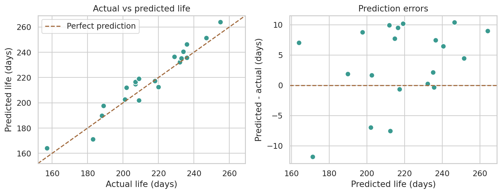
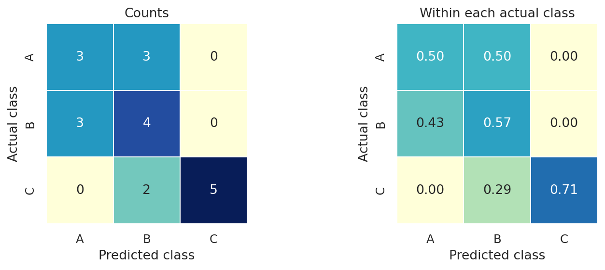

> **이번 글의 질문**
>
> 적합·부적합을 예측하는 문제와 남은 수명을 예측하는 문제는 무엇이 다를까요? Test Accuracy가 100%이면 새로운 데이터도 모두 맞출까요? RMSE 7.212일이라는 숫자를 어떻게 읽어야 할까요?

> **핵심 요약**
>
> 지도 학습은 Feature인 `X`와 Target인 `y`의 관계를 학습합니다. 분류는 클래스, 회귀는 숫자 값을 예측합니다. Train과 Test를 나눈 뒤 `fit()`·`predict()`를 수행하고, 분류는 Accuracy·Precision·Recall·F1, 회귀는 MAE·RMSE·R²로 평가합니다. 평가 대상과 클래스별 오류, Baseline, 데이터 누수를 함께 확인합니다.

## 1. 데이터를 설명하는 단계에서, 새로운 값을 예측하는 단계로

데이터를 요약하는 데서 한 걸음 더 나아가 새로운 결과를 예측해 봅니다. 적합 여부를 맞히는 분류와 남은 일수를 예측하는 회귀는 입력이 비슷해도 평가 방법이 다릅니다. `X`·`y`·ID를 나누고, 기준 모델과 비교하며 점수의 의미를 확인합니다.

모델은 입력을 받아 출력을 만드는 함수로 생각할 수 있습니다. 선형 회귀는 여러 Feature에 계수를 곱해 더하고, 트리 모델은 Feature 값에 따라 가지를 나눕니다. **학습은 데이터로 이 함수의 계수나 분기 기준을 정하는 과정**입니다. 예측은 학습한 기준을 새로운 입력에 적용하는 과정입니다.

| 학습 방식 | 학습할 때 주어지는 것 | 대표적인 작업 |
| --- | --- | --- |
| Supervised Learning | Feature `X`와 Target `y` | 적합 여부 분류, 잔여 수명 회귀 |
| Unsupervised Learning | 예측할 정답 `y` 없이 Feature `X` | 비슷한 기록의 Clustering, 차원 축소 |
| Reinforcement Learning | 환경과의 상호작용·보상 | 행동에 따른 누적 보상을 높이는 정책 학습 |

지도 학습에서는 “무엇을 맞혀야 하는가?”가 Target으로 주어집니다. 비지도 학습에서는 입력 데이터의 구조를 찾습니다. 군집 번호가 붙었다고 적합·부적합 같은 정답 클래스를 맞힌 것은 아닙니다. 서로 다른 질문에 답하는 방식입니다.

문제 유형별 도구는 scikit-learn의 [Supervised learning](https://scikit-learn.org/stable/supervised_learning.html)과 [Unsupervised learning](https://scikit-learn.org/stable/unsupervised_learning.html)에서 살펴볼 수 있습니다.

### 1-1. Target의 의미로 분류와 회귀를 구분합니다

| 문제 | Target | 예측할 결과 | 모델 |
| --- | --- | --- | --- |
| 체력 기반 적합도 | `status` | 적합 또는 부적합 | `RandomForestClassifier` |
| 장비 잔여 수명 | `remaining_life_days` | 남은 일수 | `LinearRegression` |
| 정비 시급성 등급 | `priority_level` | A·B·C 중 한 등급 | `GradientBoostingClassifier` |

분류(Classification)는 정해진 클래스 중 하나를 예측하고, 회귀(Regression)는 숫자 값을 예측합니다. A·B·C를 0·1·2로 바꿔도 여전히 분류입니다. 잔여 수명이 CSV에 정수로 저장되어 있어도 일수를 예측하는 회귀 문제입니다. `dtype`보다 **그 값이 나타내는 의미**를 먼저 봅니다.

## 2. X·y·ID를 나누고, 평가할 데이터를 따로 둡니다

### 2-1. Feature와 Target을 분리합니다

| 구성 | 역할 | 체력 데이터의 예 |
| --- | --- | --- |
| `X` | 예측에 사용할 Feature | `pushup_count`, `run_time_2km(sec)`, `sprint_100m(sec)` |
| `y` | 맞히려는 Target | `status` |
| ID | 예측 결과를 원본 기록과 연결 | `soldier_id` |

`X`는 여러 Feature를 가진 2차원 DataFrame, `y`는 관측값마다 Target 하나를 가진 1차원 Series로 준비합니다. 대문자 `X`와 소문자 `y`는 자주 쓰는 표기입니다. 병사·장비·무기 ID는 이번 실습에서 식별자로 보관하고 Feature에 넣지 않습니다.

Target을 인코딩한 `status_encoded`나 `priority_encoded`를 `X`에 넣으면 정답을 입력으로 알려 주는 셈입니다. Feature 열을 List로 명시하면 이런 실수를 막기 쉽습니다. 실제 예측 시점에 알 수 있는 값인지도 확인합니다.

### 2-2. Train은 학습, Test는 새 데이터에 대한 평가에 사용합니다

Train 데이터로 모델을 학습하고, 학습에 쓰지 않은 Test 데이터로 예측을 평가합니다. 학습한 데이터를 다시 잘 맞히는 능력과 새로운 데이터를 맞히는 능력은 다를 수 있습니다. Training 성능은 높지만 새로운 데이터에서 성능이 떨어지는 현상을 Overfitting이라고 합니다.

| 설정 | 이 예제의 값 | 의미 |
| --- | --- | --- |
| `test_size` | `0.2` | 100행 중 20행을 Test로 사용합니다. |
| `random_state` | `42` | 분할의 난수 동작을 고정합니다. |
| `shuffle` | `True`가 기본 | 원본 순서를 섞어 나눕니다. |
| `stratify` | 기본 실습에서는 생략 | 지정하면 클래스 비율을 고려해 분할합니다. |

아래 기본 실습은 세 파일 모두 `test_size=0.2`, `random_state=42`로 나눕니다. `X`·`y`·ID를 같은 `train_test_split()` 호출에 넣으면 서로 대응하는 행이 함께 나뉩니다. 각각 다른 호출로 나누다가 분할 조건이 달라지면 ID와 예측 결과가 어긋날 수 있습니다.

행 수를 확인할 때는 `len(X_train)`이나 `X_train.shape[0]`을 사용합니다. `.size`는 행 수가 아니라 전체 원소 수입니다. Feature 3개를 가진 Train 80행의 `size`는 240입니다.

## 3. 실습 1: 체력 기록으로 적합·부적합을 분류합니다

### 3-1. 파일의 실제 열 이름을 확인합니다

```python
import pandas as pd
import numpy as np
from sklearn.model_selection import train_test_split
from sklearn.preprocessing import LabelEncoder
from sklearn.ensemble import RandomForestClassifier
from sklearn.metrics import accuracy_score, confusion_matrix, classification_report

combat = pd.read_csv("combat_ready.csv")
combat_cols = ["pushup_count", "run_time_2km(sec)", "sprint_100m(sec)"]

print("데이터 크기:", combat.shape)
print("열 이름:", combat.columns.tolist())
print("결측치 수:", combat.isna().sum().to_dict())
print("Target 개수:", combat["status"].value_counts().to_dict())
```

```text
데이터 크기: (100, 5)
열 이름: ['soldier_id', 'pushup_count', 'run_time_2km(sec)', 'sprint_100m(sec)', 'status']
결측치 수: {'soldier_id': 0, 'pushup_count': 0, 'run_time_2km(sec)': 0, 'sprint_100m(sec)': 0, 'status': 0}
Target 개수: {'적합': 52, '부적합': 48}
```

체력 파일은 100행, 5열이며 적합 52건·부적합 48건입니다. 달리기 열에는 단위가 포함되어 있어 `run_time_2km(sec)`, `sprint_100m(sec)`로 선택합니다. ID와 Target을 제외하면 Feature는 세 개입니다.

### 3-2. 먼저 분할하고, 같은 LabelEncoder로 Target을 변환합니다

```python
X_combat = combat[combat_cols]
y_combat_raw = combat["status"]

Xc_train, Xc_test, yc_train_raw, yc_test_raw, idc_train, idc_test = train_test_split(
    X_combat, y_combat_raw, combat["soldier_id"],
    test_size=0.2, random_state=42,
)

combat_encoder = LabelEncoder()
yc_train = combat_encoder.fit_transform(yc_train_raw)
yc_test = combat_encoder.transform(yc_test_raw)
combat_labels = np.arange(len(combat_encoder.classes_))

print("Label 매핑:", dict(zip(combat_encoder.classes_, combat_labels.tolist())))
print("Train shape:", Xc_train.shape, "Test shape:", Xc_test.shape)
print("Train 행 수:", len(Xc_train), "전체 원소 수:", Xc_train.size)
print("Test Target 개수:", yc_test_raw.value_counts().to_dict())
```

```text
Label 매핑: {'부적합': 0, '적합': 1}
Train shape: (80, 3) Test shape: (20, 3)
Train 행 수: 80 전체 원소 수: 240
Test Target 개수: {'적합': 11, '부적합': 9}
```

매핑은 부적합 0, 적합 1입니다. `fit_transform()`은 클래스 목록을 정하고 변환하며, `transform()`은 이미 정한 매핑으로 변환합니다. Train과 Test에 Encoder를 따로 `fit`하지 않습니다. 같은 숫자가 두 데이터에서 같은 클래스를 가리켜야 합니다.

LabelEncoder는 **Target `y`를 위한 도구**입니다. 입력 `X`의 범주형 Feature를 바꾸는 OrdinalEncoder·OneHotEncoder와 역할이 다릅니다. A·B·C처럼 순서가 있는 등급을 인코딩해도 일반적인 분류 모델은 세 클래스로 다룹니다. 숫자 차이 2가 숫자 차이 1보다 두 배 중요한 오류라고 학습하는 것은 아닙니다.

### 3-3. fit()으로 학습하고 predict()로 예측합니다

```python
combat_model = RandomForestClassifier(n_estimators=100, random_state=42)
combat_model.fit(Xc_train, yc_train)
yc_pred = combat_model.predict(Xc_test)

combat_accuracy = accuracy_score(yc_test, yc_pred)
combat_cm = confusion_matrix(yc_test, yc_pred, labels=combat_labels)

print(f"Accuracy: {combat_accuracy:.3f}")
print("Confusion Matrix:")
print(combat_cm)
print(classification_report(
    yc_test, yc_pred, labels=combat_labels,
    target_names=combat_encoder.classes_, digits=3, zero_division=0,
))
```

```text
Accuracy: 1.000
Confusion Matrix:
[[ 9  0]
 [ 0 11]]
              precision    recall  f1-score   support

         부적합      1.000     1.000     1.000         9
          적합      1.000     1.000     1.000        11

    accuracy                          1.000        20
   macro avg      1.000     1.000     1.000        20
weighted avg      1.000     1.000     1.000        20
```

RandomForestClassifier는 여러 Decision Tree를 학습합니다. 각 트리가 여러 Feature의 기준값으로 입력을 나누고, scikit-learn의 Random Forest는 트리별 클래스 확률을 평균 내 최종 클래스를 선택합니다. `n_estimators=100`은 트리 개수입니다.

`random_state=42`는 무작위 표본 선택과 Feature 선택 등 모델의 난수 동작을 고정합니다. 신경망의 초기 가중치를 지정하는 옵션으로 읽지 않습니다. 데이터를 나눌 때의 `random_state`와 모델을 만들 때의 `random_state`는 각각 다른 단계의 무작위성을 제어합니다.

### 3-4. ID·Feature·실제값·예측값을 함께 저장합니다

```python
combat_result = Xc_test.copy()
combat_result.insert(0, "soldier_id", idc_test)
combat_result["actual_status"] = combat_encoder.inverse_transform(yc_test)
combat_result["predicted_status"] = combat_encoder.inverse_transform(yc_pred)
combat_result["is_correct"] = combat_result["actual_status"].eq(combat_result["predicted_status"])
combat_result.to_csv("combat_ready_result.csv", index=False, encoding="utf-8-sig")

print(combat_result.head(5).to_string(index=False))
```

```text
soldier_id  pushup_count  run_time_2km(sec)  sprint_100m(sec) actual_status predicted_status  is_correct
      S084            54              569.3              13.5           부적합              부적합        True
      S054            66              559.3              16.2            적합               적합        True
      S071            63              514.4              16.7           부적합              부적합        True
      S046            52              581.3              14.6           부적합              부적합        True
      S045            45              560.4              13.6           부적합              부적합        True
```

`inverse_transform()`은 0·1을 원래 문자열로 되돌립니다. `Xc_test`와 `idc_test`에는 같은 원본 Index가 남아 있어 ID를 같은 행에 붙일 수 있습니다. 결과 파일에 ID를 남기면 틀린 예측을 원본 기록에서 다시 찾아볼 수 있습니다.

### 3-5. 문자열 Target도 그대로 학습할 수 있습니다

```python
string_model = RandomForestClassifier(n_estimators=100, random_state=42)
string_model.fit(Xc_train, yc_train_raw)
string_pred = string_model.predict(Xc_test)

print("문자열 Target의 예측:", string_pred[:5].tolist())
print("문자열 Target Accuracy:", accuracy_score(yc_test_raw, string_pred))
```

```text
문자열 Target의 예측: ['부적합', '적합', '부적합', '부적합', '부적합']
문자열 Target Accuracy: 1.0
```

RandomForestClassifier는 적합·부적합 같은 문자열 Target도 직접 받을 수 있습니다. “머신러닝은 문자열을 전혀 처리할 수 없으므로 Target Encoding이 항상 필수”라고 외우지 않습니다. 여기서는 숫자 Label과 원래 클래스의 대응, Confusion Matrix의 순서를 익히기 위해 LabelEncoder를 사용합니다. 문자열 Feature를 가진 `X`의 전처리는 별도로 생각합니다.

## 4. 분류 평가: 몇 개 맞혔는지, 어떤 오류를 냈는지 봅니다

### 4-1. Confusion Matrix의 행은 실제값, 열은 예측값입니다

| 실제값 / 예측값 | 부적합 (0) | 적합 (1) |
| --- | --- | --- |
| 부적합 (0) | 9 (TN) | 0 (FP) |
| 적합 (1) | 0 (FN) | 11 (TP) |

위 표는 `labels=[0, 1]` 순서로 만든 실제 결과입니다. 적합인 1을 Positive로 두면 `TN=9`, `FP=0`, `FN=0`, `TP=11`입니다. Test 20건을 모두 맞혔으므로 Accuracy는 1.0입니다. 어떤 클래스가 먼저인지 지정하지 않으면 클래스의 정렬 순서에 따라 표를 잘못 읽을 수 있어 labels를 명시합니다.

| 항목 | 적합을 Positive로 둔 의미 | 이 예제에서 생각할 점 |
| --- | --- | --- |
| TP | 실제 적합을 적합으로 예측 | 적합 클래스를 올바르게 찾았습니다. |
| TN | 실제 부적합을 부적합으로 예측 | 부적합 클래스를 올바르게 찾았습니다. |
| FP | 실제 부적합을 적합으로 예측 | 적합 예측을 믿어도 되는지 확인할 때 봅니다. |
| FN | 실제 적합을 부적합으로 예측 | 적합 사례를 얼마나 놓치는지 확인할 때 봅니다. |

### 4-2. Accuracy·Precision·Recall·F1은 서로 다른 분모를 봅니다

| 지표 | 계산식 | 답하는 질문 |
| --- | --- | --- |
| Accuracy | `(TP + TN) / 전체 건수` | 전체에서 몇 건을 맞혔나요? |
| Precision | `TP / (TP + FP)` | Positive라고 예측한 것 중 실제 Positive는 얼마나 되나요? |
| Recall | `TP / (TP + FN)` | 실제 Positive 중 얼마나 찾아냈나요? |
| F1 | `2 × Precision × Recall / (Precision + Recall)` | Precision과 Recall을 조화 평균으로 요약하면 얼마인가요? |

현재 결과는 모든 지표가 1.0이라 차이가 잘 드러나지 않습니다. 같은 20건에서 오류가 있는 작은 비교 예제를 만들어 보면 분모의 차이가 선명해집니다.

```python
from sklearn.metrics import precision_score, recall_score, f1_score

# 설명용 예제: 실제 부적합 9건, 적합 11건입니다.
toy_actual = np.array([0] * 9 + [1] * 11)
toy_pred = np.array([0] * 7 + [1] * 2 + [0] * 3 + [1] * 8)
toy_cm = confusion_matrix(toy_actual, toy_pred, labels=[0, 1])

print("설명용 Confusion Matrix:")
print(toy_cm)
print(f"Accuracy : {accuracy_score(toy_actual, toy_pred):.4f}")
print(f"Precision: {precision_score(toy_actual, toy_pred, pos_label=1):.4f}")
print(f"Recall   : {recall_score(toy_actual, toy_pred, pos_label=1):.4f}")
print(f"F1       : {f1_score(toy_actual, toy_pred, pos_label=1):.4f}")
```

```text
설명용 Confusion Matrix:
[[7 2]
 [3 8]]
Accuracy : 0.7500
Precision: 0.8000
Recall   : 0.7273
F1       : 0.7619
```

이 비교 예제의 TN·FP·FN·TP는 7·2·3·8입니다. Accuracy는 15/20=0.75, Precision은 8/10=0.8, Recall은 8/11≈0.7273, F1은 약 0.7619입니다. Positive 예측의 정확함과 실제 Positive를 놓치지 않는 정도는 서로 다른 질문입니다.

F1은 Precision과 Recall에 같은 비중을 둡니다. 두 오류의 실제 비용까지 자동으로 반영하지는 않습니다. 목적에 따라 어떤 오류를 더 줄이고 싶은지 정한 뒤 지표를 선택합니다. 클래스 불균형이 심하면 한 클래스만 예측해도 Accuracy가 높을 수 있습니다. 예를 들어 100건 중 99건이 Negative이면 전부 Negative로 예측해도 Accuracy는 99%지만 Positive Recall은 0입니다.

### 4-3. Positive는 “좋은 결과”라는 뜻이 아닙니다

```python
print("적합을 찾는 Recall:", round(recall_score(toy_actual, toy_pred, pos_label=1), 4))
print("부적합을 찾는 Recall:", round(recall_score(toy_actual, toy_pred, pos_label=0), 4))
```

```text
적합을 찾는 Recall: 0.7273
부적합을 찾는 Recall: 0.7778
```

부적합을 놓치지 않는 것이 관심사라면 부적합 0을 Positive로 두고 `pos_label=0`으로 평가할 수 있습니다. 위 설명용 예제에서 적합 Recall은 8/11≈0.7273, 부적합 Recall은 7/9≈0.7778입니다. **Positive는 지표 계산의 기준 클래스**이며, 좋은 상태나 이상 상태로 고정된 이름이 아닙니다.

### 4-4. classification_report의 support와 평균을 읽습니다

support는 Test에 있는 해당 클래스의 실제 관측 개수입니다. 체력 데이터에서는 부적합 9건, 적합 11건입니다. macro avg는 클래스별 지표에 같은 비중을 주고, weighted avg는 support로 가중합니다. 클래스별 지표와 평균을 나란히 보면 적은 클래스에서 성능이 낮은지 확인하기 쉽습니다.

`zero_division=0`은 분모가 0이 되는 지표를 0으로 표시하는 설정입니다. 그 클래스의 예측이 전혀 없는지 등 원인을 함께 확인합니다. `labels`와 `target_names`를 같은 순서로 지정하면 어떤 클래스가 Test에 없더라도 보고서의 이름과 순서를 유지할 수 있습니다.

## 5. Accuracy 100%를 읽을 때 확인할 것

### 5-1. Baseline보다 얼마나 잘 맞히나요?

```python
from sklearn.dummy import DummyClassifier

combat_baseline = DummyClassifier(strategy="most_frequent")
combat_baseline.fit(Xc_train, yc_train)
yc_baseline = combat_baseline.predict(Xc_test)

print("Baseline이 항상 예측하는 클래스:", combat_encoder.inverse_transform(yc_baseline[:1])[0])
print(f"Baseline Accuracy: {accuracy_score(yc_test, yc_baseline):.3f}")
print(f"Random Forest Accuracy: {combat_accuracy:.3f}")
```

```text
Baseline이 항상 예측하는 클래스: 적합
Baseline Accuracy: 0.550
Random Forest Accuracy: 1.000
```

Train에서 더 많은 클래스는 적합입니다. 항상 적합만 예측하는 Baseline은 Test의 적합 11건을 맞혀 Accuracy 0.55가 됩니다. Random Forest의 1.0을 이 기준과 비교하면 Feature를 사용한 예측이 단순한 전략보다 얼마나 개선됐는지 볼 수 있습니다.

### 5-2. “이번 Test 20건을 모두 맞혔다”고 기록합니다

Accuracy 1.0은 이번에 나눈 Test 20건에서 모두 맞혔다는 결과입니다. Test가 20건이면 한 건의 오류가 Accuracy를 0.05만큼 바꿉니다. 평가 건수와 분할 기준을 함께 남기면 숫자의 크기를 더 정확하게 읽을 수 있습니다.

- **정답의 정의를 봅니다.** `status`가 체력 기록의 특정 기준으로 만들어졌다면 모델은 그 기준을 재현하는 문제를 푸는 셈입니다. Label이 만들어진 방식부터 확인합니다.
- **Feature를 확인합니다.** `status`·`status_encoded` 등 Target을 `X`에 넣지 않았는지 봅니다.
- **관측 단위를 확인합니다.** 같은 병사의 반복 기록이 Train과 Test에 걸쳐 섞이면 새로운 병사에 대한 성능과 다른 평가가 될 수 있습니다.
- **평가 목적을 확인합니다.** 미래 기록을 예측할 것이라면 시간 순서와 예측 시점에 알 수 있는 Feature를 고려해 나눕니다.

점수가 높다는 이유만으로 데이터 누수가 있다고 판단하지 않습니다. 높은 점수를 얻은 이유가 문제의 단순한 구조인지, 정답 정보의 유입인지, 평가 데이터의 구성인지 확인합니다. 같은 기록을 다른 조건의 데이터에도 적용할 수 있는지는 별도로 평가합니다.

## 6. 실습 2: 장비의 남은 수명을 회귀로 예측합니다

### 6-1. Feature 3개와 Target을 분리합니다

```python
from sklearn.linear_model import LinearRegression
from sklearn.metrics import mean_absolute_error, mean_squared_error, root_mean_squared_error, r2_score

life = pd.read_csv("equipment_life.csv")
life_cols = ["usage_hours", "temp_exposure", "humidity"]
X_life = life[life_cols]
y_life = life["remaining_life_days"]

print("데이터 크기:", life.shape)
print("열 이름:", life.columns.tolist())
print("결측치 수:", life.isna().sum().to_dict())

Xl_train, Xl_test, yl_train, yl_test, idl_train, idl_test = train_test_split(
    X_life, y_life, life["equipment_id"], test_size=0.2, random_state=42,
)
print("Train shape:", Xl_train.shape, "Test shape:", Xl_test.shape)
```

```text
데이터 크기: (100, 5)
열 이름: ['equipment_id', 'usage_hours', 'temp_exposure', 'humidity', 'remaining_life_days']
결측치 수: {'equipment_id': 0, 'usage_hours': 0, 'temp_exposure': 0, 'humidity': 0, 'remaining_life_days': 0}
Train shape: (80, 3) Test shape: (20, 3)
```

Feature는 사용 시간·온도 노출 지표·습도이며, Target은 `remaining_life_days`입니다. `equipment_id`는 결과 추적용으로 함께 나눕니다. `temp_exposure`는 파일에 있는 노출 지표로 다루고, 값만 보고 섭씨 온도라고 가정하지 않습니다.

### 6-2. LinearRegression은 제곱 오차를 줄이는 계수를 찾습니다

```python
life_model = LinearRegression()
life_model.fit(Xl_train, yl_train)
yl_pred = life_model.predict(Xl_test)

life_mae = mean_absolute_error(yl_test, yl_pred)
life_mse = mean_squared_error(yl_test, yl_pred)
life_rmse = root_mean_squared_error(yl_test, yl_pred)
life_r2 = r2_score(yl_test, yl_pred)

print(f"MAE : {life_mae:.3f} days")
print(f"MSE : {life_mse:.3f} days^2")
print(f"RMSE: {life_rmse:.3f} days")
print(f"R2  : {life_r2:.4f}")
print(f"LinearRegression.score(): {life_model.score(Xl_test, yl_test):.4f}")
```

```text
MAE : 6.202 days
MSE : 52.011 days^2
RMSE: 7.212 days
R2  : 0.9060
LinearRegression.score(): 0.9060
```

선형 회귀는 `예측값 = 절편 + 계수1 × Feature1 + 계수2 × Feature2 + …` 형태의 관계를 학습합니다. `LinearRegression`은 Train에서 실제 Target과 예측값 사이의 제곱 오차 합을 최소화하는 계수를 찾습니다. Feature가 여러 개이므로 하나의 직선을 화면에 그리는 것보다 더 많은 입력을 함께 사용합니다.

| 지표 | 현재 Test 결과 | 단위와 해석 |
| --- | --- | --- |
| MAE | 6.202 | 일 단위의 절대 오차 평균입니다. |
| MSE | 52.011 | 일² 단위의 제곱 오차 평균입니다. 큰 오차에 더 민감합니다. |
| RMSE | 7.212 | MSE의 제곱근으로 단위가 다시 일이 됩니다. |
| R² | 0.9060 | Test 평균을 기준으로 한 제곱 오차와 비교하는 무단위 지표입니다. |

### 6-3. RMSE 7.212일은 절대 오차 평균 7.212일이라는 뜻이 아닙니다

RMSE는 오차를 제곱해 평균 낸 뒤 제곱근을 취합니다. 이 결과에서는 약 7.212일입니다. 절대 오차를 그대로 평균 낸 MAE는 약 6.202일입니다. 두 수치는 같은 예측을 다른 방식으로 요약합니다.

RMSE는 원래 Target과 같은 단위로 읽기 쉽지만 큰 오차에 대한 민감도는 남습니다. 제곱근을 취했다고 이상치에 강한 지표가 되는 것은 아닙니다. 큰 오차를 더 중요하게 보고 싶으면 RMSE를, 오차의 절대 크기 평균을 설명하고 싶으면 MAE를 함께 봅니다.

```python
error_demo = np.array([1.0, 1.0, 1.0, 9.0])
print("오차 예제:", error_demo.tolist())
print("절대 오차 평균:", np.abs(error_demo).mean())
print("RMSE:", round(np.sqrt(np.mean(error_demo ** 2)), 3))
print("실제 수명 예제에서 두 RMSE 계산이 일치:", np.isclose(
    life_rmse, np.sqrt(mean_squared_error(yl_test, yl_pred)),
))
```

```text
오차 예제: [1.0, 1.0, 1.0, 9.0]
절대 오차 평균: 3.0
RMSE: 4.583
실제 수명 예제에서 두 RMSE 계산이 일치: True
```

오차 1·1·1·9의 절대 평균은 3이지만 RMSE는 약 4.583입니다. 큰 오차 9의 영향이 제곱 평균에 더 크게 들어갑니다. 또한 모든 장비의 오차가 RMSE 이하라는 뜻은 아닙니다.

| RMSE 계산 방법 | 역할 |
| --- | --- |
| `root_mean_squared_error(y_true, y_pred)` | 현재 API에서 RMSE를 직접 계산합니다. |
| `np.sqrt(mean_squared_error(y_true, y_pred))` | 단일 Target에서 MSE에 제곱근을 취합니다. |

이전 코드에서 보이는 `mean_squared_error(..., squared=False)`는 현재 API에서 사용하는 방식이 아닙니다. RMSE를 바로 구하는 `root_mean_squared_error()`를 사용하면 계산 목적이 함수 이름에 드러납니다. 위 두 계산은 이 글의 단일 Target에서 같습니다.

### 6-4. R²는 음수가 될 수 있으며, score()의 의미도 모델마다 다릅니다

Target이 상수가 아닌 경우 `R² = 1 - 예측의 제곱 오차 합 / 실제값과 Test 평균의 제곱 차이 합`으로 계산합니다. 완벽한 예측은 1이고, Test의 실제 평균을 항상 예측한 수학적 기준은 0입니다. 그 기준보다 제곱 오차가 크면 음수가 됩니다.

```python
print("좋은 예측의 R2:", r2_score([1, 2, 3], [1, 2, 3]))
print("평균만 예측한 R2:", r2_score([1, 2, 3], [2, 2, 2]))
print("큰 오차를 낸 예측의 R2:", r2_score([1, 2, 3], [3, 2, 1]))
```

```text
좋은 예측의 R2: 1.0
평균만 예측한 R2: 0.0
큰 오차를 낸 예측의 R2: -3.0
```

현재 R²는 약 0.9060입니다. 이를 “예측을 약 90.6% 맞혔습니다”로 읽지 않습니다. 회귀의 맞힘 비율을 계산한 지표가 아닙니다. RandomForestClassifier의 `score()`는 Accuracy이고, `LinearRegression`의 `score()`는 R²입니다. 같은 메서드 이름이라도 모델의 문서를 확인해야 합니다.

### 6-5. Train 평균만 예측하는 Baseline과 비교합니다

```python
from sklearn.dummy import DummyRegressor

life_baseline = DummyRegressor(strategy="mean")
life_baseline.fit(Xl_train, yl_train)
yl_baseline = life_baseline.predict(Xl_test)

regression_comparison = pd.DataFrame({
    "MAE": [mean_absolute_error(yl_test, yl_baseline), life_mae],
    "RMSE": [root_mean_squared_error(yl_test, yl_baseline), life_rmse],
    "R2": [r2_score(yl_test, yl_baseline), life_r2],
}, index=["Train-mean baseline", "LinearRegression"])
print(regression_comparison.round(4).to_string())
```

```text
                         MAE     RMSE      R2
Train-mean baseline  19.4812  23.8953 -0.0321
LinearRegression      6.2015   7.2119  0.9060
```

Train 평균만 예측하는 Baseline의 Test RMSE는 약 23.895일이고, `LinearRegression`은 약 7.212일입니다. 같은 Test에서 Feature를 활용한 모델의 오차가 더 작습니다. 약 7일의 오차를 허용할 수 있는지는 실제 사용 목적의 허용 범위와 비교합니다.

DummyRegressor는 **Train 평균**을 학습해 Test에 적용합니다. 위에서 설명한 R²=0의 수학적 기준은 **Test의 실제 평균**입니다. 두 평균은 다를 수 있어 Train-mean Baseline의 Test R²가 정확히 0일 필요는 없습니다. 여기서는 약 -0.0321입니다. 실제로 사용할 Baseline을 만들 때 Test Target의 평균을 미리 알려 주지 않습니다.

### 6-6. 실제값·예측값·오차를 저장하고 그래프로 확인합니다

```python
life_result = pd.DataFrame({
    "equipment_id": idl_test.to_numpy(),
    "actual_life": yl_test.to_numpy(),
    "predicted_life": yl_pred,
})
life_result["error"] = life_result["predicted_life"] - life_result["actual_life"]
life_result["absolute_error"] = life_result["error"].abs()
life_result.to_csv("life_prediction.csv", index=False, encoding="utf-8-sig")

print("절대 오차가 큰 기록:")
print(life_result.nlargest(5, "absolute_error").round(3).to_string(index=False))
print(f"최대 절대 오차: {life_result['absolute_error'].max():.3f} days")
```

```text
절대 오차가 큰 기록:
equipment_id  actual_life  predicted_life   error  absolute_error
        E074          183         171.192 -11.808          11.808
        E034          236         246.385  10.385          10.385
        E091          209         219.192  10.192          10.192
        E001          202         211.929   9.929           9.929
        E081          207         216.504   9.504           9.504
최대 절대 오차: 11.808 days
```

예측을 먼저 반올림해 평가하지 않고 원래 값으로 지표를 계산합니다. CSV에도 원래 예측값을 보관하고, 화면에 표시할 때만 자릿수를 줄입니다. 최대 절대 오차는 약 11.808일입니다. 평균 지표만 볼 때 놓치기 쉬운 큰 오차를 ID로 다시 확인할 수 있습니다.

```python
from pathlib import Path
import matplotlib.pyplot as plt
import seaborn as sns

Path("plots").mkdir(exist_ok=True)
sns.set_theme(style="whitegrid")
fig, axes = plt.subplots(1, 2, figsize=(10, 4.0))

axes[0].scatter(yl_test, yl_pred, color="#3a9a90", edgecolors="white", s=55)
low = min(yl_test.min(), yl_pred.min()) - 5
high = max(yl_test.max(), yl_pred.max()) + 5
axes[0].plot([low, high], [low, high], "--", color="#a26b3f", label="Perfect prediction")
axes[0].set(
    title="Actual vs predicted life", xlabel="Actual life (days)",
    ylabel="Predicted life (days)", xlim=(low, high), ylim=(low, high),
)
axes[0].legend()

axes[1].scatter(yl_pred, yl_pred - yl_test, color="#3a9a90", edgecolors="white", s=55)
axes[1].axhline(0, linestyle="--", color="#a26b3f")
axes[1].set(
    title="Prediction errors", xlabel="Predicted life (days)",
    ylabel="Predicted - actual (days)",
)
fig.tight_layout()
fig.savefig("plots/life_prediction_plot.png", dpi=160, bbox_inches="tight")
plt.close(fig)
```



*왼쪽에서 기준선에 가까울수록 실제값과 예측값이 비슷합니다. 오른쪽은 예측값−실제값이며, 0보다 위면 과대 예측, 아래면 과소 예측입니다.*

Test의 무작위 행 순서로 선을 이어도 시간 흐름이 생기는 것은 아닙니다. 여기서는 실제값과 예측값을 산점도로 비교하고, 오차가 값의 크기에 따라 어떤 패턴을 보이는지 함께 확인합니다. 모델 성능을 설명할 때 지표 하나와 그래프 하나가 서로 보완하도록 구성합니다.

## 7. 실습 3: A·B·C 정비 시급성 등급을 분류합니다

### 7-1. Feature와 등급의 관측 개수를 확인합니다

```python
from sklearn.ensemble import GradientBoostingClassifier

priority = pd.read_csv("maintenance_priority.csv")
priority_cols = ["age_years", "error_logs_per_month", "functional_score", "last_repair_months"]
X_priority = priority[priority_cols]
y_priority_raw = priority["priority_level"]

print("데이터 크기:", priority.shape)
print("열 이름:", priority.columns.tolist())
print("결측치 수:", priority.isna().sum().to_dict())
print("전체 클래스 개수:", y_priority_raw.value_counts().sort_index().to_dict())

Xp_train, Xp_test, yp_train_raw, yp_test_raw, idp_train, idp_test = train_test_split(
    X_priority, y_priority_raw, priority["weapon_id"],
    test_size=0.2, random_state=42,
)

priority_encoder = LabelEncoder()
yp_train = priority_encoder.fit_transform(yp_train_raw)
yp_test = priority_encoder.transform(yp_test_raw)
priority_labels = np.arange(len(priority_encoder.classes_))
print("Label 매핑:", dict(zip(priority_encoder.classes_, priority_labels.tolist())))
print("Train 클래스 개수:", yp_train_raw.value_counts().sort_index().to_dict())
print("Test 클래스 개수:", yp_test_raw.value_counts().sort_index().to_dict())
```

```text
데이터 크기: (100, 6)
열 이름: ['weapon_id', 'age_years', 'error_logs_per_month', 'functional_score', 'last_repair_months', 'priority_level']
결측치 수: {'weapon_id': 0, 'age_years': 0, 'error_logs_per_month': 0, 'functional_score': 0, 'last_repair_months': 0, 'priority_level': 0}
전체 클래스 개수: {'A': 18, 'B': 45, 'C': 37}
Label 매핑: {'A': 0, 'B': 1, 'C': 2}
Train 클래스 개수: {'A': 12, 'B': 38, 'C': 30}
Test 클래스 개수: {'A': 6, 'B': 7, 'C': 7}
```

A는 매우 시급, B는 보통, C는 낮음입니다. 전체에서 A·B·C의 개수는 18·45·37건이고, Train에서는 12·38·30건, Test에서는 6·7·7건입니다. 숫자 Label은 `A=0`, `B=1`, `C=2`입니다. 클래스 의미와 인코딩 번호를 함께 기록합니다.

### 7-2. Gradient Boosting으로 학습하고 클래스별 오류를 봅니다

```python
priority_model = GradientBoostingClassifier(random_state=42)
priority_model.fit(Xp_train, yp_train)
yp_pred = priority_model.predict(Xp_test)

priority_accuracy = accuracy_score(yp_test, yp_pred)
priority_cm = confusion_matrix(yp_test, yp_pred, labels=priority_labels)
priority_report = classification_report(
    yp_test, yp_pred, labels=priority_labels,
    target_names=priority_encoder.classes_, output_dict=True, zero_division=0,
)

print(f"Accuracy: {priority_accuracy:.3f}")
print("Confusion Matrix:")
print(priority_cm)
print(classification_report(
    yp_test, yp_pred, labels=priority_labels,
    target_names=priority_encoder.classes_, digits=3, zero_division=0,
))
```

```text
Accuracy: 0.600
Confusion Matrix:
[[3 3 0]
 [3 4 0]
 [0 2 5]]
              precision    recall  f1-score   support

           A      0.500     0.500     0.500         6
           B      0.444     0.571     0.500         7
           C      1.000     0.714     0.833         7

    accuracy                          0.600        20
   macro avg      0.648     0.595     0.611        20
weighted avg      0.656     0.600     0.617        20
```

`GradientBoostingClassifier`는 이전 단계의 예측을 개선하도록 트리를 순차적으로 추가합니다. 손실 함수의 음의 Gradient를 학습해 예측을 보정하는 방식입니다. Random Forest가 여러 트리의 결과를 모으는 방식이라면, Gradient Boosting은 앞선 결과를 바탕으로 다음 단계를 학습합니다.

| 실제값 / 예측값 | A | B | C |
| --- | --- | --- | --- |
| A | 3 | 3 | 0 |
| B | 3 | 4 | 0 |
| C | 0 | 2 | 5 |

대각선의 3+4+5=12건을 맞혔고, Test는 20건이므로 Accuracy는 0.60입니다. 실제 A 6건 중 3건을 A로 찾았고, 나머지 3건은 B로 예측했습니다. C는 7건 중 5건을 맞혔으며, 나머지 2건은 B로 예측했습니다.

| 클래스 | Precision | Recall | F1 | support |
| --- | --- | --- | --- | --- |
| A | 0.500 | 0.500 | 0.500 | 6 |
| B | 0.444 | 0.571 | 0.500 | 7 |
| C | 1.000 | 0.714 | 0.833 | 7 |

C의 Precision은 1.0입니다. C라고 예측한 5건이 모두 실제 C였습니다. 하지만 실제 C 7건 중 2건을 놓쳤으므로 C의 Recall은 약 0.714입니다. “C의 성능이 100%입니다”라고 한 숫자로 묶으면 이 차이가 사라집니다.

다중 분류의 클래스별 Precision·Recall은 그 클래스를 Positive로, 나머지를 묶어 Negative로 보는 방식으로 읽습니다. A를 놓치지 않는 것이 관심사라면 전체 Accuracy와 함께 A Recall을 따로 봅니다. 현재 A Recall은 0.5입니다.

### 7-3. macro avg와 weighted avg를 비교합니다

| 평균 방식 | 현재 F1 | 비중 |
| --- | --- | --- |
| macro avg | 0.6111 | A·B·C에 각각 같은 비중을 둡니다. |
| weighted avg | 0.6167 | Test support인 6·7·7건으로 가중합니다. |

macro F1은 약 0.6111, weighted F1은 약 0.6167입니다. 두 지표는 클래스별 F1을 서로 다른 비중으로 평균 냅니다. Precision과 Recall의 macro 평균을 먼저 구한 뒤 F1 식에 넣은 값과는 일반적으로 다릅니다. 클래스별 F1부터 확인하고 평균을 읽습니다.

### 7-4. 등급별 Confusion Matrix를 저장합니다

```python
priority_cm_normalized = confusion_matrix(
    yp_test, yp_pred, labels=priority_labels, normalize="true",
)
fig, axes = plt.subplots(1, 2, figsize=(9.5, 3.7))
for ax, matrix, fmt, title, vmax in [
    (axes[0], priority_cm, "d", "Counts", None),
    (axes[1], priority_cm_normalized, ".2f", "Within each actual class", 1),
]:
    sns.heatmap(
        matrix, annot=True, fmt=fmt, cmap="YlGnBu", vmin=0, vmax=vmax,
        xticklabels=priority_encoder.classes_, yticklabels=priority_encoder.classes_,
        cbar=False, linewidths=0.7, square=True, ax=ax,
    )
    ax.set(title=title, xlabel="Predicted class", ylabel="Actual class")
fig.tight_layout()
fig.savefig("plots/priority_confusion_matrix.png", dpi=160, bbox_inches="tight")
plt.close(fig)
```



*오른쪽은 `normalize="true"`로 실제 클래스별 행을 정규화했습니다. 대각선의 비율은 각 클래스의 Recall입니다.*

개수 표는 오류가 몇 건인지 보여 주고, 행 기준 비율 표는 해당 실제 클래스 중 어디로 예측되었는지 보여 줍니다. 실제 클래스가 있는 각 행의 비율 합은 1입니다. Prediction 클래스 기준의 비율을 보고 싶으면 `normalize="pred"`를 사용하며, 그때 대각선은 클래스별 Precision으로 읽습니다.

### 7-5. 틀린 예측을 원본 ID와 연결합니다

```python
priority_result = Xp_test.copy()
priority_result.insert(0, "weapon_id", idp_test)
priority_result["actual_priority"] = priority_encoder.inverse_transform(yp_test)
priority_result["predicted_priority"] = priority_encoder.inverse_transform(yp_pred)
priority_result["is_correct"] = priority_result["actual_priority"].eq(priority_result["predicted_priority"])
priority_result.to_csv("priority_prediction.csv", index=False, encoding="utf-8-sig")

print("잘못 예측한 기록:")
print(priority_result.loc[~priority_result["is_correct"]].to_string(index=False))
```

```text
잘못 예측한 기록:
weapon_id  age_years  error_logs_per_month  functional_score  last_repair_months actual_priority predicted_priority  is_correct
     W054          7                     1              10.0                  23               B                  A       False
     W023          8                     1               5.8                  20               A                  B       False
     W081          8                     1               7.6                  22               B                  A       False
     W001          7                     1               9.9                  19               C                  B       False
     W031         12                     0               5.3                  21               B                  A       False
     W091          2                     4               8.0                   8               C                  B       False
     W077         14                     1               4.1                   4               A                  B       False
     W032         10                     2               5.9                  16               A                  B       False
```

분류 보고서를 본 다음에는 어떤 기록에서 오류가 났는지 살펴봅니다. 실제 A를 B로 예측한 기록과 실제 B를 A로 예측한 기록은 서로 다른 방향의 오류입니다. ID·Feature·실제 등급·예측 등급을 함께 저장하면 기준이 모호한 기록이나 빠진 Feature를 검토하기 쉽습니다.

## 8. 세 모델의 차이와 가중치의 의미

| 모델 | 학습 방식 | 장점 | 살펴볼 한계 |
| --- | --- | --- | --- |
| `LinearRegression` | Feature의 선형 결합을 학습 | 단순한 기준 모델을 만들고 계수를 살펴보기 쉽습니다. | 비선형 관계를 그대로 표현하기 어렵고, 큰 오차·Feature 간 강한 상관관계를 살펴야 합니다. |
| `RandomForestClassifier` | 여러 트리의 클래스 확률을 평균 | 비선형 관계와 Feature 사이의 조합을 표현합니다. | 단일 트리보다 전체 판단 과정을 한 번에 설명하기 어렵고, 트리 크기·개수 설정이 필요합니다. |
| `GradientBoostingClassifier` | 앞선 결과를 보정하며 트리를 추가 | 단계별로 예측 오차를 줄이는 모델을 구성합니다. | `learning_rate`·트리 개수·깊이에 따라 학습 결과가 달라져 Validation이 필요합니다. |

세 모델 중 하나가 모든 데이터에서 우수한 것은 아닙니다. 같은 문제와 같은 분할·지표에서 Baseline과 비교합니다. 선형 회귀 계수의 절댓값은 Feature의 단위에 따라 달라지므로, 그대로 “가장 중요한 Feature”의 순위로 읽지 않습니다.

트리 모델은 Feature별 분기 기준을 사용하므로 이번 Random Forest와 Gradient Boosting 실습에는 Scaling을 추가하지 않았습니다. 거리나 정규화 페널티가 중요한 모델에서는 Scaling의 영향이 커질 수 있습니다. 전처리는 모델이 값을 어떻게 사용하는지와 연결해서 선택합니다.

학습 구조와 Scaling의 영향을 더 살펴보려면 [Ensemble 가이드](https://scikit-learn.org/stable/modules/ensemble.html), [Ordinary Least Squares](https://scikit-learn.org/stable/modules/linear_model.html#ordinary-least-squares), [Importance of Feature Scaling](https://scikit-learn.org/stable/auto_examples/preprocessing/plot_scaling_importance.html)을 참고합니다.

### 8-1. Gradient Boosting을 썼다고 클래스 가중치가 자동 적용되지는 않습니다

앞의 `GradientBoostingClassifier`에는 클래스 불균형을 보정하는 가중치를 따로 넣지 않았습니다. Boosting의 단계별 보정과 클래스별 중요도를 주는 가중치는 다른 설정입니다. RandomForestClassifier는 `class_weight="balanced"`, `GradientBoostingClassifier`는 `fit()`의 `sample_weight`로 가중치를 적용할 수 있습니다.

```python
from sklearn.utils.class_weight import compute_sample_weight

priority_weights = compute_sample_weight(class_weight="balanced", y=yp_train)
weight_by_class = {
    name: float(priority_weights[yp_train == label][0])
    for label, name in enumerate(priority_encoder.classes_)
}
print("Train 관측 수 기준 가중치:")
print({name: round(weight, 3) for name, weight in weight_by_class.items()})

# 가중 학습의 별도 예제입니다. 앞에서 평가한 기본 모델은 유지합니다.
weighted_priority_model = GradientBoostingClassifier(random_state=42)
weighted_priority_model.fit(Xp_train, yp_train, sample_weight=priority_weights)
```

```text
Train 관측 수 기준 가중치:
{'A': 2.222, 'B': 0.702, 'C': 0.889}
```

`balanced` 가중치는 적은 클래스의 각 관측에 더 큰 비중을 줍니다. Train에서 A는 12건으로 가장 적어 관측당 가중치가 약 2.222입니다. B는 약 0.702, C는 약 0.889입니다. 클래스 빈도를 보정하는 기준이며 A의 오류 비용을 업무적으로 정한 가중치와는 다릅니다. 가중치 사용 여부와 크기는 Training 데이터의 Validation에서 비교합니다.

## 9. 평가를 믿을 수 있게 만드는 분할·Pipeline·교차검증

### 9-1. stratify는 클래스 비율을 고려해 나눕니다

```python
_, _, yp_strat_train, yp_strat_test = train_test_split(
    X_priority, y_priority_raw, test_size=0.2, random_state=42,
    stratify=y_priority_raw,
)
split_counts = pd.DataFrame({
    "overall": y_priority_raw.value_counts(),
    "random_test": yp_test_raw.value_counts(),
    "stratified_test": yp_strat_test.value_counts(),
}).sort_index()
print(split_counts.to_string())
```

```text
                overall  random_test  stratified_test
priority_level
A                    18            6                4
B                    45            7                9
C                    37            7                7
```

기본 무작위 Test에서 A·B·C는 6·7·7건입니다. `stratify`를 지정한 Test에서는 4·9·7건으로 전체 비율인 18·45·37%에 더 가깝게 나뉩니다. 20행을 나누므로 비율이 정확히 같아지지는 않습니다. 관측 수가 매우 적은 클래스가 있으면 분할 가능한 최소 개수와 Train·Test 크기를 먼저 확인합니다.

`stratify`는 각 클래스가 평가에 포함되도록 비율을 고려하는 도구입니다. 반복 기록의 동일 인물 문제나 미래 정보 유입을 해결하는 도구는 아니므로, 관측 단위와 시간 조건을 별도로 봅니다.

| 평가하고 싶은 대상 | 분할에서 고려할 것 | 관련 도구 |
| --- | --- | --- |
| 독립적인 개별 기록 | 클래스 비율을 고려한 무작위 분할 | `train_test_split(..., stratify=y)` |
| 새로운 병사·새로운 장비 | 같은 ID의 반복 기록을 같은 그룹에 배치 | GroupKFold |
| 미래 시점의 기록 | 과거로 학습하고 이후 시점으로 평가 | TimeSeriesSplit |

### 9-2. 전처리 기준을 Test에서 학습하면 데이터가 새어 들어갑니다

데이터 누수(Data Leakage)는 예측 시점에 알 수 없는 정보를 모델 구성에 사용하는 문제입니다. 예를 들어 전체 데이터의 평균으로 결측치를 채운 뒤 Train과 Test를 나누면 Test의 값이 전처리 기준에 포함됩니다. Feature 선택, Scaling, PCA도 데이터로 기준을 학습한다면 같은 원칙을 적용합니다.

```python
from sklearn.impute import SimpleImputer

# 설명용 데이터: Train과 Test의 값 범위가 크게 다릅니다.
demo_train = np.array([[10.0], [20.0], [np.nan]])
demo_test = np.array([[1000.0], [np.nan]])

train_imputer = SimpleImputer(strategy="mean")
train_imputer.fit(demo_train)
print("Train만으로 구한 평균:", train_imputer.statistics_[0])
print("Test 결측치 대체 결과:", train_imputer.transform(demo_test).ravel().tolist())

# 비교를 위한 잘못된 예제: Test를 평균 계산에 포함합니다.
leaked_imputer = SimpleImputer(strategy="mean")
leaked_imputer.fit(np.vstack([demo_train, demo_test]))
print("Test가 들어간 전체 평균:", round(leaked_imputer.statistics_[0], 3))
```

```text
Train만으로 구한 평균: 15.0
Test 결측치 대체 결과: [1000.0, 15.0]
Test가 들어간 전체 평균: 343.333
```

Train만으로 구한 평균은 15입니다. Test의 1000을 포함하면 평균은 약 343.333이 됩니다. 모델 학습 코드에 `X_test`를 직접 넣지 않았더라도, 이런 전처리 기준을 통해 Test의 정보가 모델에 들어갈 수 있습니다.

원본을 나눈 뒤 Train에는 `fit_transform()`, Test에는 같은 전처리기의 `transform()`을 적용합니다. 단위 변환처럼 데이터에서 통계를 학습하지 않는 고정 연산과, 평균·최소값·범주·Feature 선택 기준을 학습하는 변환은 구분해서 생각합니다.

### 9-3. Pipeline으로 전처리와 모델을 연결합니다

```python
from sklearn.pipeline import Pipeline
from sklearn.preprocessing import StandardScaler

life_pipeline = Pipeline([
    ("imputer", SimpleImputer(strategy="median")),
    ("scaler", StandardScaler()),
    ("regressor", LinearRegression()),
])
life_pipeline.fit(Xl_train, yl_train)
yl_pipeline_pred = life_pipeline.predict(Xl_test)

print("Train Feature 평균:", life_pipeline.named_steps["scaler"].mean_.round(3).tolist())
print(f"Pipeline RMSE: {root_mean_squared_error(yl_test, yl_pipeline_pred):.3f} days")
```

```text
Train Feature 평균: [1940.35, 0.222, 65.859]
Pipeline RMSE: 7.212 days
```

Pipeline의 `fit()`은 Train에서 결측치 대체 기준과 Scaling 기준을 학습한 뒤 모델을 학습합니다. `predict()`는 Test에 이미 학습한 변환을 적용하고 예측합니다. 현재 수명 파일에는 결측치가 없고, 이 선형 회귀의 결과는 앞의 모델과 같은 수준입니다. 이 예제는 전처리와 모델을 한 흐름으로 관리하는 방법을 보여 줍니다.

Pipeline은 교차검증에서도 각 Fold의 Training 부분으로 전처리를 학습하게 합니다. 다만 Feature에 이미 미래 정보나 정답이 들어 있으면 Pipeline으로 감싸도 그 정보가 사라지지는 않습니다. Feature 정의와 분할 기준을 먼저 확인합니다.

### 9-4. Train 안에서 여러 Fold로 검증합니다

```python
from sklearn.model_selection import StratifiedKFold, cross_val_score

cv = StratifiedKFold(n_splits=5, shuffle=True, random_state=42)
cv_rows = []
for name, estimator, X_train, y_train in [
    ("Combat Random Forest", combat_model, Xc_train, yc_train),
    ("Priority Gradient Boosting", priority_model, Xp_train, yp_train),
]:
    scores = cross_val_score(estimator, X_train, y_train, cv=cv, scoring="f1_macro")
    cv_rows.append({
        "model": name, "mean_macro_f1": scores.mean(),
        "std_macro_f1": scores.std(), "min_macro_f1": scores.min(),
        "max_macro_f1": scores.max(),
    })
    print(name, "Fold macro F1:", scores.round(4).tolist())

cv_summary = pd.DataFrame(cv_rows)
print(cv_summary.round(4).to_string(index=False))
```

```text
Combat Random Forest Fold macro F1: [1.0, 1.0, 0.9373, 0.9373, 1.0]
Priority Gradient Boosting Fold macro F1: [0.8614, 0.2738, 0.5333, 0.6345, 0.5294]
                     model  mean_macro_f1  std_macro_f1  min_macro_f1  max_macro_f1
      Combat Random Forest         0.9749        0.0307        0.9373        1.0000
Priority Gradient Boosting         0.5665        0.1896        0.2738        0.8614
```

Train 80행 안에서 다섯 Fold를 만들고, 네 Fold로 학습한 뒤 나머지 한 Fold로 검증하는 과정을 반복합니다. 바깥에 남겨 둔 Test 20행은 이 교차검증에 사용하지 않습니다. 클래스별 비중을 같은 기준으로 보고 싶어 `scoring="f1_macro"`를 지정했습니다.

| 모델 | Train CV 평균 macro F1 | 최소 Fold | 최대 Fold |
| --- | --- | --- | --- |
| Combat Random Forest | 0.9749 | 0.9373 | 1.0000 |
| Priority Gradient Boosting | 0.5665 | 0.2738 | 0.8614 |

체력 분류는 Hold-out Test에서 F1이 1.0이지만 Train 내부 Fold에서는 모두 1.0이 나오지는 않습니다. 정비 등급은 Fold별 점수 차이가 더 큽니다. 한 번 나눈 Test 결과와 여러 Training 부분에서의 Validation 결과를 함께 보면 평가가 분할에 얼마나 민감한지 살펴볼 수 있습니다.

위 표의 Fold 간 표준편차는 분할별 점수의 퍼짐입니다. 서로 관련된 Fold에서 얻은 점수이므로 그대로 엄밀한 신뢰구간으로 읽지 않습니다. Fold의 관측 수가 작을 때는 클래스별 support도 함께 살펴봅니다.

다시 실행할 때는 모델 이름보다 분할 기준과 평가 지표를 먼저 확인합니다. ID가 맞는 예측 파일과 같은 Test의 Baseline이 있으면, 모델이 어디에서 개선됐는지 찾아보기 쉽습니다.

## 10. 더 살펴보기: 확률 예측과 최종 클래스 선택을 나눠 봅니다

같은 확률 예측도 Threshold에 따라 클래스 결과가 달라집니다. Positive를 놓치는 비용이 크다면 낮은 기준을 검토할 수 있지만, 그만큼 False Positive가 늘어나는지도 확인해야 합니다.

아래는 Validation 결과를 가정한 작은 예제입니다. 학습한 모델은 그대로 두고, Positive로 분류할 기준만 바꿉니다.

```python
import numpy as np
import pandas as pd
from sklearn.metrics import precision_score, recall_score, f1_score

actual = np.array([0, 0, 1, 0, 1, 1, 0, 1])
probability = np.array([0.1, 0.2, 0.35, 0.4, 0.55, 0.65, 0.7, 0.9])
rows = []
for threshold in [0.3, 0.5, 0.7]:
    predicted = (probability >= threshold).astype(int)
    rows.append({"threshold": threshold,
                 "precision": precision_score(actual, predicted),
                 "recall": recall_score(actual, predicted),
                 "f1": f1_score(actual, predicted)})
print(pd.DataFrame(rows).round(3).to_string(index=False))
```

```text
 threshold  precision  recall    f1
       0.3      0.667    1.00 0.800
       0.5      0.750    0.75 0.750
       0.7      0.500    0.25 0.333
```

Threshold 선택도 모델 선택의 일부입니다. Validation이나 Train 내부 Cross-validation으로 정하고, 최종 Test에는 선택한 기준을 그대로 적용합니다. ROC-AUC처럼 확률의 순서를 평가하는 지표와, 특정 Threshold에서 계산한 Precision·Recall은 질문이 다릅니다.

## 11. 이번 글을 다시 볼 때 기억할 것

| 하려는 일 | 문법 | 복습할 핵심 |
| --- | --- | --- |
| 데이터 나누기 | `train_test_split(X, y, ids)` | `X`·`y`·ID를 같은 행끼리 유지합니다. |
| 클래스 비율 고려 | `stratify=y` | 무작위 분할에서 클래스 비율을 고려합니다. |
| Target 인코딩 | LabelEncoder | `X`의 범주형 Feature Encoding과 구분합니다. |
| 원래 클래스 복원 | `inverse_transform()` | 평가와 저장에 같은 매핑을 사용합니다. |
| 학습·예측 | `fit()` · `predict()` | Train으로 학습하고 Test에 적용합니다. |
| 이진·다중 분류 | `RandomForestClassifier` · `GradientBoostingClassifier` | 예측할 클래스와 클래스별 오류를 확인합니다. |
| 회귀 | `LinearRegression` | 연속적인 Target과 숫자 오차를 다룹니다. |
| 분류 평가 | `confusion_matrix()` · `classification_report()` | 실제값이 행이며, 클래스 순서를 명시합니다. |
| RMSE 직접 계산 | `root_mean_squared_error()` | Target과 단위가 같고 큰 오차에 민감합니다. |
| Baseline 비교 | DummyClassifier · DummyRegressor | Train에서 정한 단순한 전략과 비교합니다. |
| 전처리 연결 | Pipeline | 전처리 기준은 Training 데이터에서 학습합니다. |
| 교차검증 | `cross_val_score(..., scoring="f1_macro")` | 최종 Test를 남기고 Train 안에서 검증합니다. |

1. A·B·C를 0·1·2로 바꿨는데도 왜 회귀가 아니라 분류인가요?
2. Feature 3개, Train 80행에서 `shape`·`len`·`size`는 각각 어떻게 다른가요?
3. 부적합을 Positive로 평가하고 싶다면 어떤 Label과 `pos_label`을 사용하나요?
4. Precision이 1.0인데 Recall이 1.0보다 작을 수 있는 이유는 무엇인가요?
5. RMSE 7.212일과 MAE 6.202일은 각각 무엇을 요약하나요?
6. 회귀 Baseline에서 Test 평균이 아니라 Train 평균을 사용해야 하는 이유는 무엇인가요?
7. 같은 장비의 반복 기록이나 미래 기록을 평가할 때 무작위 분할만으로 충분한가요?
8. Pipeline으로 감싸도 정답이 Feature에 들어가 있는 문제는 왜 해결되지 않나요?

> **예측할 대상을 정하고, 학습할 데이터와 평가할 데이터를 나누며, 문제에 맞는 지표로 결과를 읽습니다.** 점수와 함께 관측 개수·클래스별 오류·Baseline·분할 기준을 남기면 모델이 무엇을 배웠고 어디에서 어려움을 보였는지 다시 떠올리기 쉽습니다.

## 참고자료

### 실습 데이터와 노트북

- **실습 자료**: [session07_지도학습-및-평가.pdf](/files/maicon-2026/lectures/session07_%EC%A7%80%EB%8F%84%ED%95%99%EC%8A%B5-%EB%B0%8F-%ED%8F%89%EA%B0%80.pdf) · [session07.ipynb](/files/maicon-2026/code/session07/session07.ipynb)
- **CSV 데이터**: [combat_ready.csv](/files/maicon-2026/code/session07/combat_ready.csv) · [equipment_life.csv](/files/maicon-2026/code/session07/equipment_life.csv) · [maintenance_priority.csv](/files/maicon-2026/code/session07/maintenance_priority.csv)
- **심화 예제**: [심화 예제 자료](/files/maicon-2026/practice/%EA%B3%B5%EB%B6%80%EB%85%B8%ED%8A%B8_%EC%8B%AC%ED%99%94_%EC%98%88%EC%A0%9C.zip) — 공부노트 01\~13의 Python 코드, 노트북, 예제 CSV와 실행 결과를 함께 받습니다.

### 연습문제

- **문제**
  - [유형 02 문제](/cs/data-analysis/practice-02-tabular-modeling/) — 같은 장비의 반복 기록이 있을 때, 새로운 장비의 고장 여부와 정비 시간을 어떻게 평가할까요?
  - [유형 03 문제](/cs/data-analysis/practice-03-sensor-time-series/) — 누락된 센서 구간을 남기면서 다음 시간의 온도와 기준 초과 여부를 어떻게 함께 예측할까요?
  - [유형 04 문제](/cs/data-analysis/practice-04-text-classification/) — 표현이 조금씩 다른 접수 문장을 분류하면서, 같은 양식의 문장이 Train과 Test에 섞이는 문제를 어떻게 막을까요?
  - [유형 05 문제](/cs/data-analysis/practice-05-image-transfer-learning/) — 사전 학습된 이미지 모델을 고정한 채, 사진이 개미인지 벌인지 분류하는 새 모델을 어떻게 만들까요?
- **풀이**
  - [유형 02 풀이](/cs/data-analysis/practice-02-tabular-modeling-solution/) — 장비별로 데이터를 나누고 전처리 Pipeline과 그룹 CV로 고장 분류·정비 시간 회귀 모델을 평가합니다.
  - [유형 03 풀이](/cs/data-analysis/practice-03-sensor-time-series-solution/) — 센서별 시간 격자와 관측 수를 만들고 시간 순서대로 나눠 다음 시간 온도와 기준 초과를 예측합니다.
  - [유형 04 풀이](/cs/data-analysis/practice-04-text-classification-solution/) — 문장 양식별로 데이터를 나누고 TF-IDF와 Logistic Regression을 Pipeline으로 연결해 그룹 CV로 검증합니다.
  - [유형 05 풀이](/cs/data-analysis/practice-05-image-transfer-learning-solution/) — 고정한 MobileNet에서 특징을 추출하고 Validation에서 분류기를 선택한 뒤 Test 사진을 평가합니다.

### 공식 문서

- **문제·학습**
  - [Supervised learning](https://scikit-learn.org/stable/supervised_learning.html) — 분류·회귀 문제와 학습 도구
  - [Unsupervised learning](https://scikit-learn.org/stable/unsupervised_learning.html) — Clustering·차원 축소
  - [LabelEncoder](https://scikit-learn.org/stable/modules/generated/sklearn.preprocessing.LabelEncoder.html) — Target 클래스의 매핑과 복원
  - [RandomForestClassifier](https://scikit-learn.org/stable/modules/generated/sklearn.ensemble.RandomForestClassifier.html) — 여러 트리의 분류 결과 결합
  - [GradientBoostingClassifier](https://scikit-learn.org/stable/modules/generated/sklearn.ensemble.GradientBoostingClassifier.html) — 단계별 손실 보정과 모델 설정
  - [LinearRegression](https://scikit-learn.org/stable/modules/generated/sklearn.linear_model.LinearRegression.html) — 최소제곱 회귀와 score
  - [Ensemble 가이드](https://scikit-learn.org/stable/modules/ensemble.html) — Random Forest와 Gradient Boosting의 구조
  - [Ordinary Least Squares](https://scikit-learn.org/stable/modules/linear_model.html#ordinary-least-squares) — 선형 모델의 학습과 계수
  - [compute_sample_weight](https://scikit-learn.org/stable/modules/generated/sklearn.utils.class_weight.compute_sample_weight.html) — 클래스 빈도 기반의 관측 가중치
- **분류 평가**
  - [accuracy_score](https://scikit-learn.org/stable/modules/generated/sklearn.metrics.accuracy_score.html) — 전체 예측 중 맞힌 비율
  - [confusion_matrix](https://scikit-learn.org/stable/modules/generated/sklearn.metrics.confusion_matrix.html) — 클래스별 오류와 정규화 방향
  - [classification_report](https://scikit-learn.org/stable/modules/generated/sklearn.metrics.classification_report.html) — Precision·Recall·F1·support와 평균
  - [precision_score](https://scikit-learn.org/stable/modules/generated/sklearn.metrics.precision_score.html) — Positive 예측의 정밀도
  - [recall_score](https://scikit-learn.org/stable/modules/generated/sklearn.metrics.recall_score.html) — 실제 Positive를 찾은 비율과 pos_label
  - [f1_score](https://scikit-learn.org/stable/modules/generated/sklearn.metrics.f1_score.html) — Precision과 Recall의 조화 평균
- **회귀 평가**
  - [mean_absolute_error](https://scikit-learn.org/stable/modules/generated/sklearn.metrics.mean_absolute_error.html) — 절대 오차의 평균
  - [mean_squared_error](https://scikit-learn.org/stable/modules/generated/sklearn.metrics.mean_squared_error.html) — 제곱 오차의 평균
  - [root_mean_squared_error](https://scikit-learn.org/stable/modules/generated/sklearn.metrics.root_mean_squared_error.html) — 현재 API에서 RMSE 직접 계산
  - [r2_score](https://scikit-learn.org/stable/modules/generated/sklearn.metrics.r2_score.html) — R²의 기준·범위·음수 결과
  - [DummyClassifier](https://scikit-learn.org/stable/modules/generated/sklearn.dummy.DummyClassifier.html) — 분류 Baseline
  - [DummyRegressor](https://scikit-learn.org/stable/modules/generated/sklearn.dummy.DummyRegressor.html) — Training Target을 이용한 회귀 Baseline
- **분할·검증**
  - [train_test_split](https://scikit-learn.org/stable/modules/generated/sklearn.model_selection.train_test_split.html) — X·y·ID 분할과 stratify
  - [Cross-validation 가이드](https://scikit-learn.org/stable/modules/cross_validation.html) — 모델 선택과 최종 Test의 구분
  - [StratifiedKFold](https://scikit-learn.org/stable/modules/generated/sklearn.model_selection.StratifiedKFold.html) — 클래스 비율을 고려한 Fold
  - [cross_val_score](https://scikit-learn.org/stable/modules/generated/sklearn.model_selection.cross_val_score.html) — 여러 Fold에서 scoring으로 평가
  - [GroupKFold](https://scikit-learn.org/stable/modules/generated/sklearn.model_selection.GroupKFold.html) — 동일 그룹을 분리하지 않는 검증
  - [TimeSeriesSplit](https://scikit-learn.org/stable/modules/generated/sklearn.model_selection.TimeSeriesSplit.html) — 시간 순서를 고려한 검증
- **전처리**
  - [Common pitfalls and recommended practices](https://scikit-learn.org/stable/common_pitfalls.html) — 데이터 누수·전처리·random_state의 주의점
  - [Pipeline](https://scikit-learn.org/stable/modules/generated/sklearn.pipeline.Pipeline.html) — 전처리와 모델의 단계 연결
  - [SimpleImputer](https://scikit-learn.org/stable/modules/generated/sklearn.impute.SimpleImputer.html) — Train에서 결측치 대체 기준 학습
  - [Importance of Feature Scaling](https://scikit-learn.org/stable/auto_examples/preprocessing/plot_scaling_importance.html) — 모델별 Scaling의 영향
- **시각화**
  - [Matplotlib Quick start](https://matplotlib.org/stable/users/explain/quick_start.html) — Figure·Axes와 그래프 구성
  - [Figure.savefig](https://matplotlib.org/stable/api/_as_gen/matplotlib.figure.Figure.savefig.html) — 그래프 이미지 저장
  - [Seaborn heatmap](https://seaborn.pydata.org/generated/seaborn.heatmap.html) — 클래스별 오류 행렬 시각화
- **판정 기준**: [Decision threshold tuning](https://scikit-learn.org/stable/modules/classification_threshold.html) — 확률 모델과 의사결정 기준, 검증 데이터의 역할을 확인합니다.
- **평가 지표**: [Metrics and scoring](https://scikit-learn.org/stable/modules/model_evaluation.html) — 본문에서 사용한 함수와 옵션을 확인합니다.
