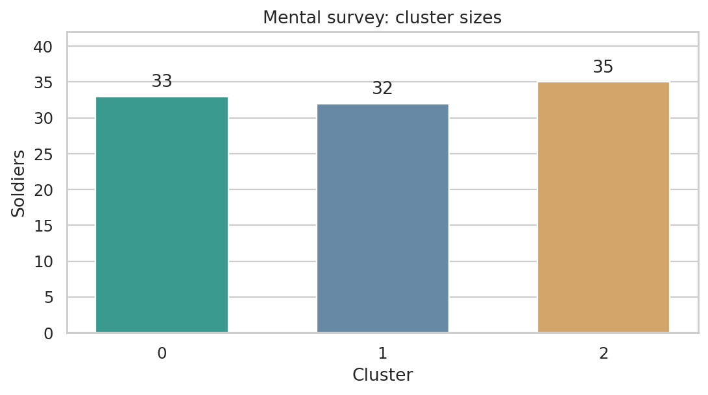
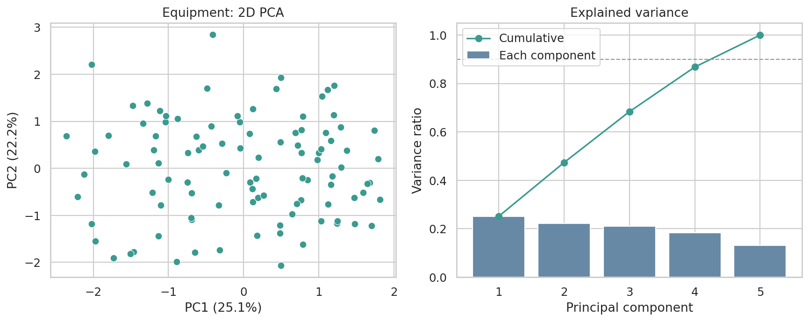
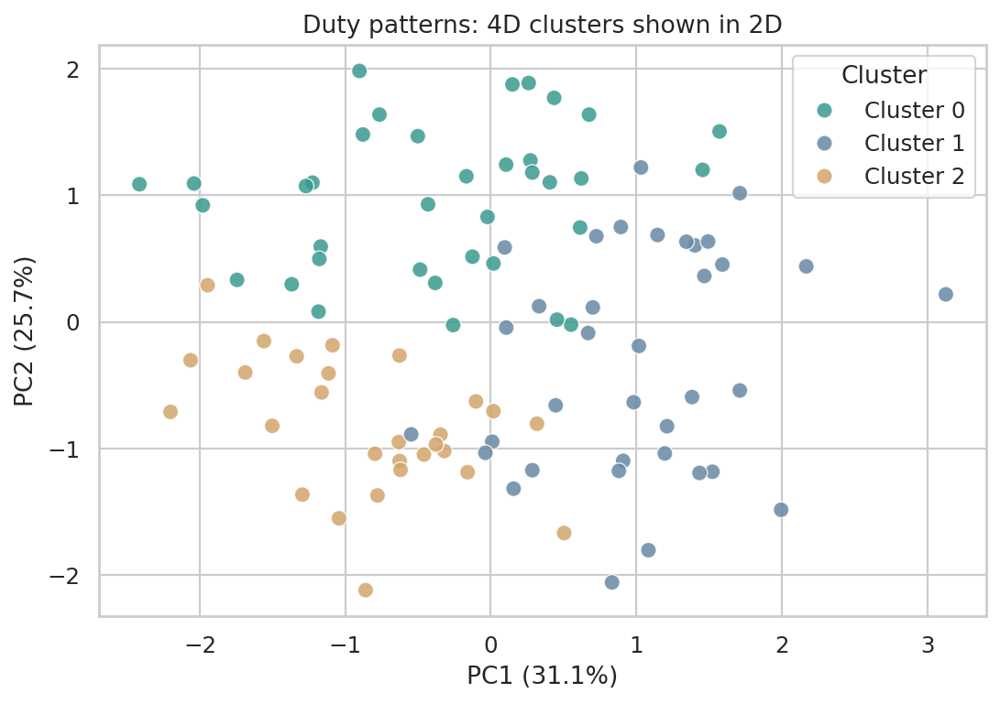
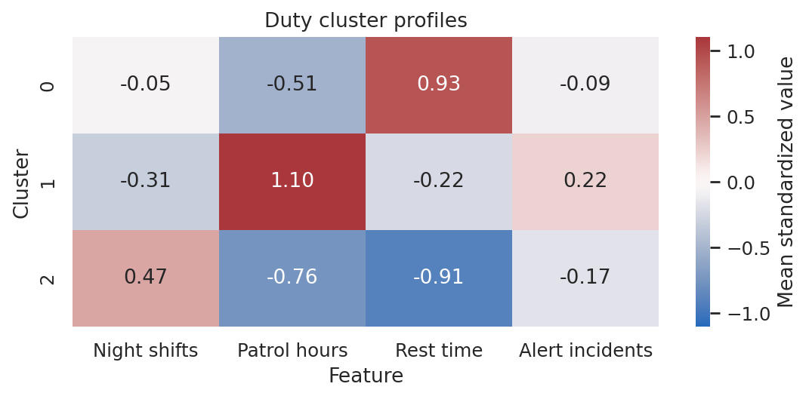
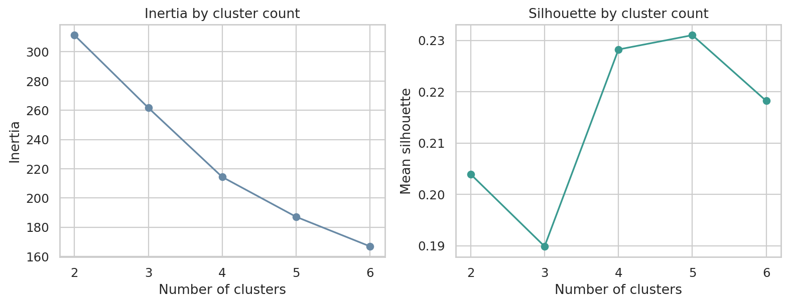

> **이번 글의 질문**
>
> 정답이 없는 데이터는 어떻게 나눌까요? 군집 번호 0·1·2는 무엇을 뜻할까요? Feature 5개를 점 하나로 그렸다면, 원래 정보는 얼마나 남아 있을까요?

> **핵심 요약**
>
> KMeans는 Feature 사이의 거리를 바탕으로 비슷한 관측값을 묶고, PCA는 분산이 큰 방향을 찾아 차원을 줄입니다. ID를 제외하고 Scaling 기준을 정한 뒤, 군집별 원본 평균·실루엣 계수·PCA의 설명 분산 비율을 함께 확인합니다. 군집 번호는 그룹의 이름이며, 2차원 그림은 원래 데이터의 일부를 보여 줍니다.

## 1. 정답을 맞히는 대신, 데이터의 구조를 찾아봅니다

정답 Label이 없어도 비슷한 응답끼리 묶어 볼 수 있습니다. 수면·스트레스·사회적 연결감·자신감 점수로 그룹을 만들고 평균을 비교하면, 전체 평균에 가려졌던 차이가 드러납니다. 군집을 만든 기준과 PCA 그림에서 생략한 정보도 함께 살펴봅니다.

| 작업 | 학습에 주어지는 것 | 알아보려는 것 |
| --- | --- | --- |
| 분류(Classification) | Feature `X`와 정답 클래스 `y` | 새로운 관측값이 어느 정답 클래스에 속하는지 예측합니다. |
| 군집화(Clustering) | 정답 클래스 없이 Feature `X` | 선택한 Feature와 유사성 기준으로 관측값을 묶습니다. |
| 차원 축소 | 여러 Feature로 구성된 `X` | 더 적은 좌표로 표현하면서 데이터의 주요 구조를 살펴봅니다. |

군집화 결과에 0·1·2가 붙으면 분류 결과와 비슷해 보입니다. 하지만 이 숫자는 데이터에서 만든 그룹의 이름입니다. 정상·주의·위험 같은 정답을 맞힌 결과가 아닙니다. PCA도 “가장 중요한 정답 Feature 두 개”를 고르는 방법이 아니라, **기존 Feature를 조합해 새로운 축을 만드는 방법**입니다.

[파이썬 데이터 분석노트 04](/cs/data-analysis/pandas-04-descriptive-statistics/)의 기술 통계량과 [파이썬 데이터 분석노트 05](/cs/data-analysis/pandas-05-data-visualization/)의 시각화를 군집별로 적용하면, 그룹이 어떻게 다른지 더 구체적으로 설명할 수 있습니다.

| 실습 파일 | 데이터 크기 | 사용할 Feature | 목표 |
| --- | --- | --- | --- |
| `mental_health.csv` | 100행, 5열 | 심리 설문 4개 항목 | KMeans로 세 그룹을 만들고 특성을 비교합니다. |
| `equipment_features.csv` | 100행, 6열 | 장비 지표 5개 | 표준화 후 PCA로 2차원 좌표를 만듭니다. |
| `duty_pattern.csv` | 100행, 5열 | 근무 패턴 4개 지표 | 4차원에서 군집화하고 PCA로 시각화합니다. |

차원은 이 예제에서 Feature 개수를 뜻합니다. 장비 100대를 5차원에서 2차원으로 줄여도 장비가 두 대만 남는 것이 아닙니다. **100행은 그대로 두고, 각 장비의 좌표를 다섯 개에서 두 개로 바꿉니다.** ID는 원본 기록과 결과를 연결할 때 사용하며 거리 계산에서는 제외합니다.

## 2. KMeans는 가까운 점을 묶고, 중심을 다시 계산합니다

### 2-1. 군집 중심과의 제곱 거리를 줄입니다

KMeans는 군집 개수 k를 먼저 정합니다. 초기 중심을 고른 뒤 각 관측값을 가장 가까운 중심에 배정하고, 배정된 관측값의 평균으로 중심을 갱신합니다. 이 과정을 반복하면서 군집 안의 점들이 중심 가까이에 모이도록 합니다. 중심(Centroid)은 Feature별 평균으로 만든 좌표이므로 실제 데이터에 있는 한 사람이나 한 장비와 같을 필요는 없습니다.

모델의 `inertia_`는 각 점과 자신이 속한 군집 중심 사이의 **제곱 거리 합**입니다. 같은 데이터와 Scaling 조건에서 값이 작으면 중심 주변에 더 가깝게 모였다는 뜻입니다. 정답을 얼마나 맞혔는지를 나타내는 Accuracy는 아닙니다.

| 설정 | 이 글의 기본값 | 역할 |
| --- | --- | --- |
| `n_clusters` | `3` | 만들 군집의 개수입니다. |
| `init` | `"k-means++"` | 초기 중심을 선택하는 방식입니다. |
| `n_init` | `"auto"` | 초기 중심을 바꿔 전체 학습을 반복할 횟수를 정합니다. |
| `random_state` | `42` | 초기 중심 선택에 사용하는 난수 동작을 고정합니다. |

현재 API의 기본 `n_init="auto"`는 기본 init인 k-means++와 함께 사용할 때 한 번의 초기화로 학습합니다. `n_init=10`이면 초기 중심을 바꿔 열 번 학습하고 Inertia가 가장 작은 결과를 선택합니다. 이것은 한 번의 학습 안에서 중심을 갱신하는 반복 횟수와 다릅니다. 그 상한은 `max_iter`가 제어합니다.

아래 기본 실습은 `n_init="auto"`를 명시하고, 뒤에서 `n_init=10`과 비교합니다. `random_state`가 같아도 `n_init`이나 입력 데이터, Scaling이 달라지면 군집 결과가 달라질 수 있습니다.

### 2-2. Scaling은 “가깝다”의 기준을 바꿉니다

[파이썬 데이터 분석 공부노트 02](/cs/data-analysis/pandas-02-normalization-encoding/)에서는 StandardScaler와 MinMaxScaler가 값을 바꾸는 기준을 비교했습니다. 이번에는 그 변환이 군집의 거리와 PCA의 분산에 어떤 영향을 주는지 연결해서 봅니다.

연료 효율 5와 전력 사용량 1000을 원래 숫자 그대로 거리 계산에 넣으면, 숫자 범위가 큰 Feature의 차이가 거리에 크게 반영될 수 있습니다. KMeans는 거리, PCA는 분산을 바탕으로 동작하므로 Scaling 기준에 민감합니다.

StandardScaler는 각 열의 평균을 빼고 표준편차로 나눕니다. 같은 크기의 변화가 아니라 **각 Feature의 표준편차를 기준으로 한 변화**를 비교하게 됩니다. 분포를 정규분포로 만드는 변환은 아니며, Feature의 업무상 중요도를 자동으로 정하는 것도 아닙니다. 같은 1\~10점 척도라도 분산이 다르면 표준화 전후의 거리 기준이 달라집니다.

이번 심리 설문은 네 항목 모두 1\~10점이므로 원래 점수로 먼저 묶어 봅니다. 장비와 근무 데이터는 서로 다른 지표를 비교하므로 표준화한 값을 사용합니다. 어떤 기준으로 묶었는지 기억해 두면 군집을 해석할 때도 기준이 흔들리지 않습니다.

## 3. 실습 1: 심리 설문으로 비슷한 응답을 묶습니다

### 3-1. ID를 제외하고 네 Feature를 선택합니다

```python
from pathlib import Path
import pandas as pd
import numpy as np
import matplotlib.pyplot as plt
import seaborn as sns
from sklearn.cluster import KMeans
from sklearn.preprocessing import StandardScaler
from sklearn.decomposition import PCA
from sklearn.metrics import silhouette_score, silhouette_samples

plot_dir = Path("plots")
plot_dir.mkdir(parents=True, exist_ok=True)
sns.set_theme(style="whitegrid", context="notebook")

mental = pd.read_csv("mental_health.csv")
mental_cols = [
    "sleep_quality", "stress_level",
    "social_connection", "self_confidence",
]
X_mental = mental[mental_cols]

print("데이터 크기:", mental.shape)
print("열 이름:", mental.columns.tolist())
print("결측치 수:", int(mental.isna().sum().sum()))
print(X_mental.agg(["min", "max"]).to_string())
```

```text
데이터 크기: (100, 5)
열 이름: ['soldier_id', 'sleep_quality', 'stress_level', 'social_connection', 'self_confidence']
결측치 수: 0
     sleep_quality  stress_level  social_connection  self_confidence
min              1             1                  1                1
max             10            10                 10               10
```

100명의 기록에 결측치는 없고, 선택한 네 항목은 모두 1\~10점입니다. `soldier_id`는 Feature List에 넣지 않습니다. 번호가 가깝다는 이유로 심리 상태도 비슷하다고 계산하지 않기 위해서입니다.

### 3-2. fit\_predict()로 학습과 군집 배정을 수행합니다

```python
mental_model = KMeans(
    n_clusters=3, init="k-means++",
    n_init="auto", random_state=42,
)
mental["cluster"] = mental_model.fit_predict(X_mental)

mental_counts = mental["cluster"].value_counts().sort_index()
mental_means = mental.groupby("cluster")[mental_cols].mean()

mental.to_csv("cluster_result.csv", index=False, encoding="utf-8-sig")
mental_means.to_csv("mental_cluster_means.csv", encoding="utf-8-sig")

print("군집별 인원:", mental_counts.to_dict())
print("중심 좌표 shape:", mental_model.cluster_centers_.shape)
print(f"Inertia: {mental_model.inertia_:.3f}")
```

```text
군집별 인원: {0: 33, 1: 32, 2: 35}
중심 좌표 shape: (3, 4)
Inertia: 2066.760
```

`fit_predict()`는 입력 데이터로 군집을 학습하고, 각 행이 속한 군집 번호를 반환합니다. 결과는 100개 번호를 가진 1차원 배열이며 원본과 같은 행 순서입니다. 중심 좌표는 군집 세 개 × Feature 네 개이므로 `(3, 4)`입니다.

개별 기록을 담은 `cluster_result.csv`와 그룹 평균을 담은 `mental_cluster_means.csv`를 따로 저장합니다. 어느 병사가 어느 그룹에 들어갔는지 찾는 질문과, 그 그룹이 어떤 응답 특성을 보이는지 보는 질문은 서로 다릅니다.

| 군집 | sleep\_quality | stress\_level | social\_connection | self\_confidence |
| --- | --- | --- | --- | --- |
| 0 | 4.64 | 4.67 | 7.39 | 7.61 |
| 1 | 4.72 | 6.62 | 2.44 | 7.19 |
| 2 | 8.20 | 4.43 | 4.69 | 2.80 |

0번은 사회적 연결감과 자신감 평균이 높고, 1번은 사회적 연결감이 가장 낮으며 스트레스 평균이 가장 높습니다. 2번은 수면의 질 평균이 가장 높지만 자신감 평균은 가장 낮습니다. 이렇게 **Feature별 평균을 함께 읽어야** 한 숫자로 뭉뚱그리지 않고 그룹의 차이를 설명할 수 있습니다.

이 결과는 선택한 설문 점수로 만든 그룹입니다. 1번이라는 번호 자체를 위험 등급으로 읽거나, 군집만으로 개인의 심리 상태를 진단하지 않습니다. 그룹 평균이 한 사람의 모든 응답을 대표하는 것도 아니므로 필요하면 개별 기록과 분포를 다시 확인합니다.

### 3-3. 군집별 인원을 Bar Chart로 확인합니다

```python
fig, ax = plt.subplots(figsize=(7, 4))
bars = ax.bar(
    mental_counts.index.astype(str), mental_counts.values,
    color=["#3a9a90", "#6889a5", "#d2a56b"], width=0.6,
)
ax.bar_label(bars, padding=4)
ax.set(title="Mental survey: cluster sizes", xlabel="Cluster", ylabel="Soldiers")
ax.set_ylim(0, mental_counts.max() * 1.2)
ax.grid(axis="x", visible=False)
fig.tight_layout()
fig.savefig(plot_dir / "cluster_barplot.png", dpi=160, bbox_inches="tight")
plt.close(fig)
```



*이번 결과는 33명·32명·35명입니다. KMeans가 인원을 같은 수로 맞춘 것은 아닙니다.*

### 3-4. 군집 번호가 바뀌어도 같은 묶음일 수 있습니다

```python
from sklearn.metrics import adjusted_rand_score

# 같은 네 사람을 똑같이 묶고, 그룹 이름만 바꾼 예제입니다.
labels_a = [0, 0, 1, 1]
labels_b = [1, 1, 0, 0]

print("같은 번호의 비율:", np.mean(np.array(labels_a) == np.array(labels_b)))
print("Adjusted Rand Index:", adjusted_rand_score(labels_a, labels_b))
```

```text
같은 번호의 비율: 0.0
Adjusted Rand Index: 1.0
```

번호를 직접 비교하면 전부 다르지만, 앞의 두 사람과 뒤의 두 사람을 나눈 묶음은 같습니다. ARI(Adjusted Rand Index)는 번호가 바뀌어도 같은 분할이면 1입니다. 여러 실행의 군집 결과를 비교할 때 번호 일치율을 Accuracy처럼 쓰지 않고, 어떤 관측값끼리 함께 묶였는지 비교합니다.

## 4. 실습 2: 장비 Feature 다섯 개를 2차원으로 표현합니다

### 4-1. PCA 전에 표준화합니다

```python
equipment = pd.read_csv("equipment_features.csv")
equipment_cols = [
    "fuel_efficiency", "repair_rate", "operational_range",
    "weight", "power_usage",
]
X_equipment = equipment[equipment_cols]

print("데이터 크기:", equipment.shape)
print("열 이름:", equipment.columns.tolist())
print("결측치 수:", int(equipment.isna().sum().sum()))
print(X_equipment.agg(["min", "max"]).T.to_string())

equipment_scaler = StandardScaler()
Z_equipment = equipment_scaler.fit_transform(X_equipment)

print("표준화 후 열별 평균:", np.round(Z_equipment.mean(axis=0), 6))
print("표준화 후 열별 표준편차:", np.round(Z_equipment.std(axis=0, ddof=0), 6))
```

```text
데이터 크기: (100, 6)
열 이름: ['equipment_id', 'fuel_efficiency', 'repair_rate', 'operational_range', 'weight', 'power_usage']
결측치 수: 0
                     min     max
fuel_efficiency      2.0     9.9
repair_rate          1.0    10.0
operational_range  201.0  1000.0
weight             104.0   983.0
power_usage        311.0  1491.0
표준화 후 열별 평균: [-0.  0.  0.  0.  0.]
표준화 후 열별 표준편차: [1. 1. 1. 1. 1.]
```

실제 파일의 연료 지표 이름은 `fuel_efficiency`이고, 장비 무게인 `weight`까지 포함해 Feature는 다섯 개입니다. 범위도 서로 다릅니다. 연료 효율은 2.0\~9.9지만 전력 사용량은 311\~1491입니다. 이 상태에서 큰 분산을 가진 축을 찾으면 숫자 범위가 큰 지표가 결과를 주도할 수 있습니다.

StandardScaler가 사용하는 표준편차는 `ddof=0` 기준입니다. 위 코드도 같은 기준으로 검사하므로 각 열의 표준편차가 1로 나옵니다. pandas의 기본 `std()`는 `ddof=1`이어서 그대로 비교하면 조금 다르게 나올 수 있습니다. **PCA는 입력을 평균 중심으로 옮기지만, Feature별 표준편차를 자동으로 맞추지는 않습니다.**

### 4-2. PCA는 원래 Feature를 조합해 새 축을 만듭니다

PCA(Principal Component Analysis)는 데이터가 많이 퍼져 있는 방향부터 새로운 축을 찾습니다. 첫 축인 PC1은 분산이 가장 큰 방향이고, PC2는 PC1과 직교하면서 그다음으로 분산이 큰 방향입니다. PC1·PC2는 원래 열 두 개를 이름만 바꾼 것이 아닙니다. 각 축이 여러 Feature의 가중합입니다.

```python
equipment_pca = PCA(n_components=2, svd_solver="full")
equipment_scores = equipment_pca.fit_transform(Z_equipment)

pca_df = pd.DataFrame(
    equipment_scores, columns=["PC1", "PC2"], index=equipment.index,
)
pca_df.insert(0, "equipment_id", equipment["equipment_id"])
pca_df.to_csv("pca_result.csv", index=False, encoding="utf-8-sig")

equipment_components = pd.DataFrame(
    equipment_pca.components_,
    index=["PC1", "PC2"], columns=equipment_cols,
)
equipment_components.to_csv("equipment_pca_components.csv", encoding="utf-8-sig")

print("PCA 입력 shape:", Z_equipment.shape)
print("PCA 출력 shape:", equipment_scores.shape)
print(pca_df.head(3).round(4).to_string(index=False))
```

```text
PCA 입력 shape: (100, 5)
PCA 출력 shape: (100, 2)
equipment_id     PC1     PC2
        E001  0.7618 -0.6766
        E002 -1.9723 -1.5519
        E003 -0.7468 -0.2968
```

입력 `(100, 5)`는 출력 `(100, 2)`로 바뀝니다. 결과 DataFrame을 만들 때 원본 Index를 지정하고, 같은 Index의 `equipment_id`를 붙이면 행 대응을 유지할 수 있습니다. PC1 값이 크다는 이유만으로 더 좋은 장비라고 읽지는 않습니다. 축의 의미는 계수를 확인한 뒤 해석합니다.

## 5. PCA 그림을 읽기 전에, 축과 남은 정보를 확인합니다

### 5-1. components\_의 절댓값과 부호를 함께 봅니다

| 원래 Feature | PC1 | PC2 |
| --- | --- | --- |
| `fuel_efficiency` | \-0.661 | \-0.381 |
| `repair_rate` | 0.668 | \-0.055 |
| `operational_range` | \-0.249 | 0.637 |
| `weight` | 0.133 | 0.378 |
| `power_usage` | 0.194 | \-0.551 |

이 표의 값은 표준화한 Feature를 각 PC 좌표로 조합할 때의 계수입니다. 절댓값이 클수록 같은 크기의 표준화 값 변화가 그 축 좌표에 더 크게 반영됩니다. 부호는 그 Feature가 증가할 때 해당 PC 좌표가 어느 방향으로 움직이는지를 나타냅니다. 기여율을 퍼센트로 표시한 표나, 예측 모델의 Feature Importance로 읽지 않습니다.

PC1은 연료 효율에 약 -0.661, 수리율에 약 +0.668의 계수를 둡니다. 다른 Feature가 같다면 연료 효율이 높아질수록 PC1은 작아지고, 수리율이 높아질수록 PC1은 커집니다. 따라서 이 방향은 주로 연료 효율과 수리율의 대비를 보여 줍니다. 작전 범위·무게·전력 사용량도 좌표 계산에 포함됩니다.

PC2는 작전 범위가 +0.637, 전력 사용량이 -0.551로 나타납니다. 다른 조건이 같으면 작전 범위가 클수록, 전력 사용량이 작을수록 PC2가 커지는 방향입니다. 무게 +0.378과 연료 효율 -0.381도 함께 반영됩니다. 한 축을 해석할 때 큰 계수 두 개만 보고 나머지 영향이 없다고 생각하지 않습니다.

### 5-2. 한 장비의 PC1을 직접 계산해 봅니다

```python
# PCA는 전달받은 입력의 평균을 빼고 계수를 적용합니다.
centered_equipment = Z_equipment - equipment_pca.mean_
manual_scores = centered_equipment @ equipment_pca.components_.T

pc1_terms = pd.DataFrame({
    "feature": equipment_cols,
    "centered_z": centered_equipment[0],
    "coefficient": equipment_pca.components_[0],
    "contribution": centered_equipment[0] * equipment_pca.components_[0],
})

print("첫 장비:", pca_df.iloc[0]["equipment_id"])
print(pc1_terms.round(4).to_string(index=False))
print("곱한 값의 합:", round(pc1_terms["contribution"].sum(), 6))
print("PCA의 PC1:", round(equipment_scores[0, 0], 6))
print("전체 좌표가 일치하나요?", np.allclose(manual_scores, equipment_scores))
```

```text
첫 장비: E001
          feature  centered_z  coefficient  contribution
  fuel_efficiency     -0.3236      -0.6610        0.2139
      repair_rate      0.6337       0.6676        0.4231
operational_range     -0.9271      -0.2492        0.2310
           weight     -0.6308       0.1329       -0.0838
      power_usage     -0.1152       0.1940       -0.0224
곱한 값의 합: 0.761843
PCA의 PC1: 0.761843
전체 좌표가 일치하나요? True
```

새로운 축의 좌표는 “표준화한 값 × 해당 축의 계수”를 모두 더해서 얻습니다. 첫 장비 E001의 PC1은 약 0.761843입니다. `components_`는 계산 규칙이고, `equipment_scores`는 그 규칙을 각 장비에 적용한 결과입니다. 둘의 행과 열 의미를 구분하면 배열 `shape`도 이해하기 쉽습니다.

| 값 | shape | 한 행의 의미 |
| --- | --- | --- |
| `Z_equipment` | `(100, 5)` | 한 장비의 표준화한 Feature 다섯 개입니다. |
| `components_` | `(2, 5)` | 한 주성분을 만드는 계수 다섯 개입니다. |
| `equipment_scores` | `(100, 2)` | 한 장비의 PC1·PC2 좌표입니다. |

### 5-3. 축 전체의 부호가 바뀌어도 구조는 같습니다

```python
from sklearn.metrics import pairwise_distances

flipped_scores = equipment_scores.copy()
flipped_scores[:, 0] *= -1

print("PC1 축 반전 전후 거리 일치:", np.allclose(
    pairwise_distances(equipment_scores),
    pairwise_distances(flipped_scores),
))
```

```text
PC1 축 반전 전후 거리 일치: True
```

PC1의 모든 계수와 모든 PC1 좌표에 -1을 곱하면 그림이 좌우로 뒤집힙니다. 점들 사이의 거리는 그대로입니다. PCA 주성분의 전체 부호는 반대로 나올 수 있으므로, 다른 결과와 비교할 때 오른쪽·왼쪽 자체보다 **같은 방향으로 움직이는 Feature와 반대 방향으로 움직이는 Feature의 관계**를 봅니다.

### 5-4. 2차원에 남은 분산은 약 47.3%입니다

```python
equipment_ratio = equipment_pca.explained_variance_ratio_

print("주성분별 설명 분산 비율:", np.round(equipment_ratio, 4))
print(f"PC1 + PC2 누적 비율: {equipment_ratio.sum():.2%}")

equipment_pca_all = PCA(svd_solver="full").fit(Z_equipment)
equipment_pca_90 = PCA(n_components=0.90, svd_solver="full").fit(Z_equipment)

print("전체 축의 누적 비율:", np.round(
    np.cumsum(equipment_pca_all.explained_variance_ratio_), 4,
))
print("90% 이상 보존에 필요한 축 수:", equipment_pca_90.n_components_)
```

```text
주성분별 설명 분산 비율: [0.2511 0.2223]
PC1 + PC2 누적 비율: 47.33%
전체 축의 누적 비율: [0.2511 0.4733 0.6836 0.8679 1.    ]
90% 이상 보존에 필요한 축 수: 5
```

PC1은 약 25.1%, PC2는 약 22.2%를 설명하며 합계는 약 47.3%입니다. 이것은 **표준화한 입력의 전체 분산 중 두 축에 담긴 비율**입니다. 정확도가 47.3%라는 뜻도, 모든 관계나 업무상 중요한 정보가 그만큼 보존되었다는 뜻도 아닙니다. 남은 약 52.7%의 분산은 이 2차원 그림에 담기지 않습니다.

이 데이터에서 90% 이상을 보존하려면 주성분 다섯 개가 필요합니다. Feature가 다섯 개였으므로 이 조건에서는 차원이 줄지 않습니다. PCA를 사용했다고 항상 정보가 잘 압축되는 것은 아닙니다. 시각화 목적이면 두 축을 쓰되 보존 비율을 함께 적고, 모델 입력을 줄이려면 필요한 정보와 성능을 따로 확인합니다.

```python
fig, axes = plt.subplots(1, 2, figsize=(11, 4.5))
sns.scatterplot(data=pca_df, x="PC1", y="PC2", ax=axes[0], color="#3a9a90", s=45)
axes[0].set(
    title="Equipment: 2D PCA",
    xlabel=f"PC1 ({equipment_ratio[0]:.1%})",
    ylabel=f"PC2 ({equipment_ratio[1]:.1%})",
)

all_ratio = equipment_pca_all.explained_variance_ratio_
pc_numbers = np.arange(1, len(all_ratio) + 1)
axes[1].bar(pc_numbers, all_ratio, color="#6889a5", label="Each component")
axes[1].plot(pc_numbers, np.cumsum(all_ratio), marker="o", color="#3a9a90", label="Cumulative")
axes[1].axhline(0.90, linestyle="--", color="#999999", linewidth=1)
axes[1].set(title="Explained variance", xlabel="Principal component", ylabel="Variance ratio", ylim=(0, 1.05))
axes[1].set_xticks(pc_numbers)
axes[1].legend(loc="upper left")
fig.tight_layout()
fig.savefig(plot_dir / "pca_2d.png", dpi=160, bbox_inches="tight")
plt.close(fig)
```



*왼쪽은 100대 장비의 두 좌표, 오른쪽은 각 축의 분산 비율입니다. 점이 가까워 보여도 생략된 축에서는 차이가 클 수 있습니다.*

### 5-5. 표준화하지 않으면 어떤 축이 만들어질까요?

```python
raw_equipment_pca = PCA(n_components=2, svd_solver="full").fit(X_equipment)
raw_pc1 = pd.Series(raw_equipment_pca.components_[0], index=equipment_cols)

print("표준화 없는 PC1 계수:")
print(raw_pc1.round(3).to_string())
print(f"표준화 없는 두 축의 누적 비율: {raw_equipment_pca.explained_variance_ratio_.sum():.2%}")
```

```text
표준화 없는 PC1 계수:
fuel_efficiency     -0.000
repair_rate          0.000
operational_range   -0.137
weight              -0.025
power_usage          0.990
표준화 없는 두 축의 누적 비율: 78.72%
```

표준화하지 않은 PC1에서는 `power_usage` 계수가 약 0.990으로 나타납니다. 두 축의 누적 비율도 약 78.7%로 올라갑니다. 하지만 이 비율의 분모는 원래 단위의 전체 분산입니다. 표준화한 데이터의 47.3%와 서로 다른 기준을 요약합니다. 숫자가 더 높다는 이유로 원래 단위의 PCA가 더 좋은 표현이라고 고르지 않습니다.

> **PCA를 해석할 때는 입력의 Scaling, 축의 계수, 설명 분산 비율을 함께 봅니다.** 산점도는 원래 데이터의 전체 모습이 아니라 선택한 두 방향으로 투영한 모습입니다.

## 6. 실습 3: 근무 패턴은 4차원에서 묶고, 2차원으로 봅니다

### 6-1. 근무 데이터의 실제 Feature를 선택합니다

```python
duty = pd.read_csv("duty_pattern.csv")
duty_cols = [
    "avg_night_shift_per_week", "avg_patrol_hours",
    "rest_time", "alert_incidents",
]
X_duty = duty[duty_cols]

print("데이터 크기:", duty.shape)
print("열 이름:", duty.columns.tolist())
print("결측치 수:", int(duty.isna().sum().sum()))
print(X_duty.describe().loc[["mean", "std", "min", "max"]].round(2).to_string())

duty_scaler = StandardScaler()
Z_duty = duty_scaler.fit_transform(X_duty)

duty_model = KMeans(n_clusters=3, n_init="auto", random_state=42)
duty["cluster"] = duty_model.fit_predict(Z_duty)
```

```text
데이터 크기: (100, 5)
열 이름: ['soldier_id', 'avg_night_shift_per_week', 'avg_patrol_hours', 'rest_time', 'alert_incidents']
결측치 수: 0
      avg_night_shift_per_week  avg_patrol_hours  rest_time  alert_incidents
mean                      3.21              4.79       6.56             1.73
std                       1.91              1.78       1.47             1.37
min                       0.00              2.00       4.00             0.00
max                       6.00              7.90       8.90             5.00
```

| Feature | 이 실습에서 비교할 내용 |
| --- | --- |
| `avg_night_shift_per_week` | 주당 평균 야간 근무 횟수 |
| `avg_patrol_hours` | 평균 순찰 시간 |
| `rest_time` | 휴식 시간 |
| `alert_incidents` | 비상 상황 발생 횟수 |

솔저 ID를 제외한 Feature 네 개를 표준화하고, 그 4차원 값으로 KMeans를 학습합니다. 뒤에서 결과 열을 더하더라도 `duty_cols`로 선택한 원래 네 열만 모델 입력에 사용합니다. `cluster`나 PC1·PC2를 다시 Feature에 섞지 않도록 입력 열을 명시합니다.

### 6-2. 같은 입력을 PCA로 줄이고, 군집 색을 붙입니다

```python
duty_pca = PCA(n_components=2, svd_solver="full")
duty_scores = duty_pca.fit_transform(Z_duty)
duty["PC1"] = duty_scores[:, 0]
duty["PC2"] = duty_scores[:, 1]

duty_counts = duty["cluster"].value_counts().sort_index()
duty_means = duty.groupby("cluster")[duty_cols].mean()
duty_summary = duty_means.copy()
duty_summary.insert(0, "count", duty_counts)

duty.to_csv("duty_clusters.csv", index=False, encoding="utf-8-sig")
duty_summary.to_csv("duty_cluster_summary.csv", encoding="utf-8-sig")

print("군집별 인원:", duty_counts.to_dict())
print(f"근무 PCA 두 축의 누적 비율: {duty_pca.explained_variance_ratio_.sum():.2%}")
print("개별 결과 행 수:", len(duty), "요약 결과 행 수:", len(duty_summary))
```

```text
군집별 인원: {0: 36, 1: 36, 2: 28}
근무 PCA 두 축의 누적 비율: 56.76%
개별 결과 행 수: 100 요약 결과 행 수: 3
```

이 코드에서 KMeans와 PCA는 같은 표준화 입력을 각각 사용합니다. **군집은 네 Feature로 만들고, PC1·PC2는 그림을 그릴 좌표로만 사용합니다.** PCA 좌표 두 개로 KMeans를 다시 실행하는 것은 다른 분석입니다. 입력에서 버린 방향이 달라지므로 결과가 같을 필요가 없습니다.

`duty_clusters.csv`에는 병사별 원본 값·`cluster`·`PC1`·`PC2`를 저장하고, `duty_cluster_summary.csv`에는 군집별 인원과 평균을 저장합니다. 개별 결과는 100행, 요약 결과는 3행입니다.

```python
duty_plot = duty.copy()
duty_plot["cluster_name"] = duty_plot["cluster"].map(lambda c: f"Cluster {c}")
duty_ratio = duty_pca.explained_variance_ratio_

fig, ax = plt.subplots(figsize=(7, 5))
sns.scatterplot(
    data=duty_plot, x="PC1", y="PC2", hue="cluster_name",
    hue_order=["Cluster 0", "Cluster 1", "Cluster 2"],
    palette=["#3a9a90", "#6889a5", "#d2a56b"],
    s=60, alpha=0.85, ax=ax,
)
ax.set(
    title="Duty patterns: 4D clusters shown in 2D",
    xlabel=f"PC1 ({duty_ratio[0]:.1%})",
    ylabel=f"PC2 ({duty_ratio[1]:.1%})",
)
ax.legend(title="Cluster")
fig.tight_layout()
fig.savefig(plot_dir / "duty_pca_plot.png", dpi=160, bbox_inches="tight")
plt.close(fig)
```



*색은 4차원 군집 결과, 점의 위치는 PCA의 두 좌표입니다. 두 축에 담긴 분산은 약 56.8%입니다.*

색이 섞여 보인다고 4차원 군집이 모두 잘못된 것은 아닙니다. 반대로 2차원에서 색이 잘 나뉘어 보여도 군집 품질이 보장되는 것은 아닙니다. 생략한 축 때문에 점들 사이의 거리가 달라질 수 있습니다. 평가 지표도 군집을 만든 입력인 `Z_duty`에서 계산합니다.

### 6-3. 군집의 의미는 원래 단위의 평균에서 찾습니다

| 군집 | avg\_night\_shift\_per\_week | avg\_patrol\_hours | rest\_time | alert\_incidents |
| --- | --- | --- | --- | --- |
| 0 | 3.11 | 3.89 | 7.93 | 1.61 |
| 1 | 2.61 | 6.74 | 6.24 | 2.03 |
| 2 | 4.11 | 3.45 | 5.23 | 1.50 |

0번은 휴식 시간 평균이 약 7.93으로 가장 높습니다. 1번은 평균 순찰 시간이 약 6.74로 가장 길고, 비상 상황 발생 횟수 평균도 가장 높습니다. 2번은 주당 야간 근무 횟수 평균이 약 4.11로 가장 높으며 휴식 시간 평균은 약 5.23으로 가장 짧습니다.

이처럼 “휴식 시간이 긴 그룹”, “순찰 시간이 긴 그룹”, “야간 근무가 잦고 휴식 시간이 짧은 그룹”으로 특징을 설명할 수 있습니다. 군집 번호 자체에 이름을 고정하기보다 매번 평균을 확인해 이름을 붙입니다. 평균 차이와 함께 그룹별 인원·분산·개별 기록도 살펴보면 해석을 더 구체화할 수 있습니다.

```python
duty_z_df = pd.DataFrame(Z_duty, columns=duty_cols, index=duty.index)
duty_z_means = duty_z_df.groupby(duty["cluster"]).mean()
profile_labels = ["Night shifts", "Patrol hours", "Rest time", "Alert incidents"]
profile_limit = float(np.abs(duty_z_means.to_numpy()).max())

fig, ax = plt.subplots(figsize=(7, 3.5))
sns.heatmap(
    duty_z_means, annot=True, fmt=".2f", cmap="vlag", center=0,
    vmin=-profile_limit, vmax=profile_limit,
    xticklabels=profile_labels, ax=ax,
    cbar_kws={"label": "Mean standardized value"},
)
ax.set(title="Duty cluster profiles", xlabel="Feature", ylabel="Cluster")
fig.tight_layout()
fig.savefig(plot_dir / "duty_cluster_profiles.png", dpi=160, bbox_inches="tight")
plt.close(fig)
```



*0보다 크면 전체 평균보다 높고, 0보다 작으면 낮습니다. 표준화 값의 평균이며 상관계수 Heatmap은 아닙니다.*

원본 평균 표는 실제 기록의 크기를 읽기 좋고, 표준화 평균 Heatmap은 전체 평균에서 어느 방향으로 다른지 비교하기 좋습니다. 두 표현을 함께 보면 단위가 다른 Feature도 비교하면서 실제 값의 의미를 유지할 수 있습니다.

## 7. 정답이 없어도 군집 결과를 평가할 수 있습니다

### 7-1. 실루엣 계수는 같은 그룹과 다른 그룹의 거리를 비교합니다

실루엣 계수(Silhouette Coefficient)는 각 관측값이 자기 군집에는 얼마나 가깝고, 다른 군집과는 얼마나 떨어져 있는지 요약합니다. 한 점을 기준으로 다음 두 거리를 계산합니다.

| 기호 | 계산할 거리 |
| --- | --- |
| `a` | 같은 군집의 다른 점들까지의 평균 거리입니다. |
| `b` | 다른 각 군집까지의 평균 거리를 계산한 뒤, 그중 가장 작은 값입니다. |

한 점의 점수는 `s = (b - a) / max(a, b)`입니다. b는 가장 가까운 중심까지의 거리나 가장 가까운 한 점까지의 거리가 아니라, **다른 군집의 점들까지 평균 낸 거리 중 최솟값**입니다.

| 값의 방향 | 거리로 읽는 의미 |
| --- | --- |
| 1에 가까움 | 자기 군집 안에서는 가깝고, 다른 군집과는 멀리 떨어져 있습니다. |
| 0에 가까움 | 자기 군집과 다른 군집까지의 평균 거리가 비슷합니다. |
| 음수 | 다른 군집까지의 평균 거리가 자기 군집 안의 평균 거리보다 작습니다. |

```python
mental_silhouette = silhouette_score(X_mental, mental["cluster"])
duty_silhouette = silhouette_score(Z_duty, duty["cluster"])

print(f"심리 설문 실루엣 평균: {mental_silhouette:.4f}")
print(f"근무 패턴 실루엣 평균: {duty_silhouette:.4f}")

duty_point_silhouette = silhouette_samples(Z_duty, duty["cluster"])
silhouette_detail = pd.DataFrame({
    "cluster": duty["cluster"],
    "silhouette": duty_point_silhouette,
    "is_negative": duty_point_silhouette < 0,
})
duty_silhouette_summary = silhouette_detail.groupby("cluster").agg(
    count=("silhouette", "size"),
    mean=("silhouette", "mean"),
    minimum=("silhouette", "min"),
    negative_count=("is_negative", "sum"),
)
print(duty_silhouette_summary.round(4).to_string())
```

```text
심리 설문 실루엣 평균: 0.2190
근무 패턴 실루엣 평균: 0.1899
         count    mean  minimum  negative_count
cluster
0           36  0.1470  -0.0242               4
1           36  0.1666  -0.0819               2
2           28  0.2749   0.0810               0
```

기본 결과는 심리 설문 약 0.2190, 근무 패턴 약 0.1899입니다. 0보다 크지만 1에 가까운 값은 아니어서 매우 선명하게 분리된 군집이라고 읽기 어렵습니다. 정답의 21.9%나 19.0%를 맞혔다는 뜻은 아닙니다. 전체 평균뿐 아니라 군집별 평균과 음수인 점의 수를 확인하면 어느 그룹의 경계를 더 살펴볼지 정할 수 있습니다.

실루엣 점수를 계산하려면 군집 개수가 2개 이상이고 관측값 수보다 작아야 합니다. 한 군집뿐인 결과에는 비교할 다른 그룹이 없습니다. 다른 데이터셋·거리·Scaling에서 나온 점수를 단순히 같은 성적표처럼 비교하지 않고, 현재 목적과 입력 기준을 함께 봅니다.

### 7-2. 군집 수 3개는 출발점이지 정답이 아닙니다

```python
k_records = []
for k in range(2, 7):
    candidate = KMeans(n_clusters=k, n_init="auto", random_state=42)
    labels = candidate.fit_predict(Z_duty)
    k_records.append({
        "k": k,
        "inertia": candidate.inertia_,
        "silhouette": silhouette_score(Z_duty, labels),
        "cluster_sizes": pd.Series(labels).value_counts().sort_index().tolist(),
    })

k_comparison = pd.DataFrame(k_records)
k_comparison.to_csv("duty_k_comparison.csv", index=False, encoding="utf-8-sig")
print(k_comparison.round(4).to_string(index=False))
```

```text
 k  inertia  silhouette            cluster_sizes
 2 311.3873      0.2039                 [56, 44]
 3 261.6998      0.1899             [36, 36, 28]
 4 214.3881      0.2282         [30, 25, 19, 26]
 5 187.1395      0.2310     [22, 21, 17, 21, 19]
 6 166.9175      0.2182 [21, 20, 14, 16, 16, 13]
```

k가 늘어나면 더 많은 중심으로 데이터를 설명하므로 Inertia는 보통 작아집니다. 이 값이 가장 작은 k만 고르면 군집을 너무 잘게 나눌 수 있습니다. 곡선이 완만해지는 지점인 Elbow, 실루엣 점수, 군집별 인원, 실제로 설명할 수 있는 차이를 함께 봅니다.

이 비교에서는 `k=5`의 실루엣 평균이 약 0.2310으로 가장 높고, `k=3`은 약 0.1899입니다. 비교한 범위와 같은 초기화 설정에서 나온 결과입니다. 점수 하나만으로 “다섯 그룹이 유일한 정답”이라고 정하지 않습니다. 각 그룹의 특징이 구분되는지, 다른 초기화에서도 비슷하게 묶이는지, 분석 목적에 쓸 수 있는지를 이어서 확인합니다.

```python
fig, axes = plt.subplots(1, 2, figsize=(10, 4))
axes[0].plot(k_comparison["k"], k_comparison["inertia"], marker="o", color="#6889a5")
axes[0].set(title="Inertia by cluster count", xlabel="Number of clusters", ylabel="Inertia")
axes[1].plot(k_comparison["k"], k_comparison["silhouette"], marker="o", color="#3a9a90")
axes[1].set(title="Silhouette by cluster count", xlabel="Number of clusters", ylabel="Mean silhouette")
for ax in axes:
    ax.set_xticks(k_comparison["k"])
fig.tight_layout()
fig.savefig(plot_dir / "duty_k_comparison.png", dpi=160, bbox_inches="tight")
plt.close(fig)
```



*같은 표준화 입력과 초기화 설정으로 비교합니다. Inertia의 감소와 실루엣 점수의 변화는 서로 다른 질문에 답합니다.*

### 7-3. n\_init을 바꾸면 실제로 묶음이 얼마나 달라질까요?

```python
init_records = []
for name, X, original_model in [
    ("mental", X_mental, mental_model),
    ("duty", Z_duty, duty_model),
]:
    multi_start = KMeans(n_clusters=3, n_init=10, random_state=42).fit(X)
    init_records.append({
        "data": name,
        "inertia_auto": original_model.inertia_,
        "inertia_10": multi_start.inertia_,
        "silhouette_auto": silhouette_score(X, original_model.labels_),
        "silhouette_10": silhouette_score(X, multi_start.labels_),
        "ARI_auto_vs_10": adjusted_rand_score(original_model.labels_, multi_start.labels_),
    })

init_comparison = pd.DataFrame(init_records)
print(init_comparison.round(4).to_string(index=False))
```

```text
  data  inertia_auto  inertia_10  silhouette_auto  silhouette_10  ARI_auto_vs_10
mental     2066.7603   2013.9081           0.2190         0.2204          0.5167
  duty      261.6998    255.4164           0.1899         0.2075          0.2108
```

심리 설문의 ARI는 약 0.5167, 근무 패턴은 약 0.2108입니다. 두 결과 모두 단순히 번호만 바뀐 같은 묶음은 아닙니다. `n_init=10`에서 Inertia는 낮아졌지만, 같은 관측값끼리 묶인 관계도 달라졌습니다. 기본값과 난수만 기억하기보다 **입력 Feature·Scaling·`n_clusters`·`n_init`을 함께 기록**하면 나중에 결과를 재현하고 비교하기 좋습니다.

여기서 ARI는 두 군집 결과의 일치도를 비교합니다. 정답 레이블과 비교한 성능이 아닙니다. Inertia나 실루엣이 조금 좋아졌더라도 그 그룹이 실제로 유용한지 판단하려면 원본 평균과 업무 맥락을 다시 확인합니다.

## 8. 모든 데이터에 KMeans와 PCA가 잘 맞는 것은 아닙니다

### 8-1. 군집 모양과 밀도에 따라 방법을 선택합니다

| 방법 | 묶는 기준 | 장점과 살펴볼 점 |
| --- | --- | --- |
| KMeans | 중심과의 제곱 거리 | 정해진 k개의 그룹과 중심을 얻습니다. 길게 휘어진 모양이나 크기·밀도가 크게 다른 군집, 이상치에 주의합니다. |
| `AgglomerativeClustering` | 가까운 군집을 단계적으로 병합 | 계층 구조를 살펴볼 수 있습니다. Linkage와 거리 기준에 따라 결과가 달라집니다. |
| `DBSCAN` | 주변 점의 밀도와 연결 | k를 직접 지정하지 않고 Noise를 구분합니다. eps·min\_samples를 정해야 하며 밀도 차이가 큰 그룹은 분리하기 어려울 수 있습니다. |

KMeans는 지정한 군집 중 하나에 모든 점을 배정하며 Noise 전용 번호를 만들지 않습니다. DBSCAN은 밀도 기준에 맞지 않는 점을 Noise인 -1로 표시할 수 있습니다. 이런 결과를 평가할 때는 Noise를 어떻게 다룰지 정하고, 일반 군집의 인원과 구조도 함께 확인합니다.

### 8-2. PCA·t-SNE·UMAP은 그림의 의미가 다릅니다

| 방법 | 표현의 특징 | 해석할 때 확인할 것 |
| --- | --- | --- |
| PCA | 분산을 기준으로 한 선형 투영 | 축의 계수와 설명 분산 비율을 읽고, 같은 변환을 새 데이터에 적용할 수 있습니다. |
| t-SNE | 주변 이웃 관계를 중심으로 한 비선형 시각화 | 축을 원래 Feature의 선형 가중합으로 읽지 않습니다. 군집 사이 거리와 면적은 원래 값 그대로 보존되지 않습니다. |
| UMAP | 이웃 관계를 바탕으로 한 비선형 표현 | n\_neighbors·min\_dist에 따라 모양이 달라집니다. PCA 같은 주성분 계수와 설명 분산 비율을 갖는 표현은 아닙니다. |

PCA는 `transform()`으로 새로운 행을 같은 축에 놓을 수 있습니다. scikit-learn의 `TSNE`는 학습한 표현에 새로운 행을 넣는 `transform()`을 제공하지 않습니다. umap-learn의 UMAP은 `transform()`을 제공하지만 별도 패키지입니다. 새 데이터에도 같은 표현을 적용해야 한다면 이런 차이가 선택 기준이 됩니다.

t-SNE의 perplexity는 관측값 수보다 작아야 하며, UMAP의 n\_neighbors는 이웃 관계를 살펴보는 범위, min\_dist는 낮은 차원에서 점이 얼마나 촘촘하게 모일지에 영향을 줍니다. 설정이나 난수에 따라 그림이 달라질 수 있으므로, 섬처럼 나뉜 그림 자체를 정답 군집의 증거로 삼지 않습니다.

### 8-3. 차원의 저주는 Feature 수가 늘 때 생각합니다

각 Feature를 열 구간으로만 나눠도 조합은 2차원에서 100개, 5차원에서 100,000개가 됩니다. 같은 관측값 수로 더 많은 조합을 채우려면 데이터가 드문드문 놓이기 쉽습니다. 거리의 차이가 덜 뚜렷해지거나 학습에 더 많은 데이터가 필요해지는 문제를 차원의 저주(Curse of Dimensionality)라고 합니다.

차원 축소는 이런 어려움을 줄이는 방법 중 하나지만 필요한 정보도 버릴 수 있습니다. Feature 선택, 충분한 데이터 확보, 모델의 Regularization 등도 목적에 따라 고려합니다. 이번 장비 데이터처럼 다섯 Feature의 분산이 여러 축에 고르게 퍼져 있으면, 두 축만으로는 많은 정보를 요약하기 어렵습니다.

## 9. 비지도 학습에서도 새 데이터는 같은 기준으로 처리합니다

### 9-1. 전체 데이터 분석과 새 데이터 적용을 구분합니다

[파이썬 데이터 분석 공부노트 07](/cs/data-analysis/pandas-07-supervised-learning/)에서는 Train과 Test를 먼저 나누고, 전처리 기준을 Train에서 학습했습니다. 새로운 데이터에 적용할 기준을 만들 때는 비지도 학습에서도 이 원칙을 사용합니다. 정답 `y`가 없다는 사실과 평가할 데이터의 정보를 미리 사용해도 된다는 것은 별개의 문제입니다.

현재 100명의 근무 패턴을 탐색하고 요약하는 목적이면 전체 데이터로 군집을 만들 수 있습니다. 하지만 이후 들어오는 병사를 기존 그룹에 배정하거나, PCA 결과를 다른 예측 모델의 입력으로 쓰고 일반화 성능을 평가하려면 학습과 평가 대상을 나눕니다. 정답 `y`가 없어도 입력 데이터에서 평균·표준편차·주성분·군집 중심을 학습하기 때문입니다.

| 목적 | 학습 기준 | 새 행을 처리하는 방법 |
| --- | --- | --- |
| 현재 데이터 탐색 | 분석할 데이터 전체 | 현재 그룹의 분포와 평균을 설명합니다. |
| 기존 군집에 신규 데이터 배정 | 기준 데이터로 Scaler·KMeans 학습 | 같은 Scaling과 기존 중심으로 `predict()`합니다. |
| PCA 후 예측 모델 평가 | Train 안에서 Scaler·PCA·모델 학습 | Test에는 이미 학습한 변환을 적용합니다. |

Test까지 포함해 StandardScaler나 PCA를 `fit`하면 평가 데이터의 정보가 변환 기준에 들어갑니다. 정답을 보지 않았더라도 데이터 누수가 될 수 있습니다. Train을 먼저 나누고 그 안에서 전처리 기준을 학습하며, Cross-validation에서는 Fold마다 다시 학습합니다. 시간 순서가 있는 미래 예측이라면 무작위 분할보다 시간 순서를 고려한 분할이 필요합니다.

### 9-2. Pipeline으로 Scaling과 KMeans를 연결합니다

```python
from sklearn.model_selection import train_test_split
from sklearn.pipeline import Pipeline

# 새 기록에 같은 기준을 적용하는 별도 예제입니다.
Xd_train, Xd_test, idd_train, idd_test = train_test_split(
    X_duty, duty["soldier_id"], test_size=0.2, random_state=42,
)
duty_pipeline = Pipeline([
    ("scaler", StandardScaler()),
    ("kmeans", KMeans(n_clusters=3, n_init=10, random_state=42)),
])
duty_pipeline.fit(Xd_train)
new_cluster_labels = duty_pipeline.predict(Xd_test)

new_assignments = pd.DataFrame({
    "soldier_id": idd_test,
    "cluster": new_cluster_labels,
}, index=Xd_test.index)
new_assignments.to_csv("duty_new_assignments.csv", index=False, encoding="utf-8-sig")

print("Train 행 수:", len(Xd_train), "새로 배정할 행 수:", len(Xd_test))
print(new_assignments.head(5).to_string(index=False))
print("Scaler의 학습 평균이 Train 평균과 일치하나요?", np.allclose(
    duty_pipeline.named_steps["scaler"].mean_, Xd_train.mean().to_numpy(),
))
```

```text
Train 행 수: 80 새로 배정할 행 수: 20
soldier_id  cluster
      S184        0
      S154        1
      S171        0
      S146        0
      S145        2
Scaler의 학습 평균이 Train 평균과 일치하나요? True
```

Pipeline.fit()은 Train 80행으로 Scaler를 학습한 뒤 변환된 값으로 KMeans를 학습합니다. `predict()`는 남은 20행에 같은 Scaler를 적용하고 가장 가까운 기존 중심의 번호를 반환합니다. 새 20행으로 Scaler나 중심을 다시 `fit`하지 않습니다.

이 모델은 앞에서 전체 100행을 사용한 `duty_model`과 별도로 학습했습니다. 같은 `cluster=0`이라도 같은 의미라는 보장은 없습니다. 각 모델에서 군집 평균을 확인해 해석해야 합니다. 이 데이터에는 정답 클래스가 없으므로 예측 번호와 비교해 분류 Accuracy를 계산하지 않습니다.

군집 번호는 이름이고 PCA 좌표는 투영 결과입니다. 원본 평균, 거리 기준, 남은 분산을 같이 읽어야 그룹과 그림의 의미가 이어집니다.

## 10. 더 살펴보기: 표본이 달라져도 비슷한 그룹이 만들어질까요?

한 번 그린 군집 그림만 보고 구조가 안정적이라고 판단하기는 어렵습니다. 원래 데이터에서 복원 추출한 표본으로 다시 군집을 만들고, 같은 기준 데이터의 배정이 얼마나 비슷한지 비교할 수 있습니다.

아래에서는 겹침이 있는 2차원 예제를 만들고, 다섯 번의 재표집 결과를 ARI로 비교합니다. 군집 번호가 바뀌어도 같은 묶음이면 ARI는 1입니다.

```python
import numpy as np
from sklearn.datasets import make_blobs
from sklearn.cluster import KMeans
from sklearn.metrics import adjusted_rand_score

X, _ = make_blobs(n_samples=180, centers=[[0, 0], [1.5, 0], [0, 1.5]],
                  cluster_std=1.1, random_state=42)
reference = KMeans(n_clusters=3, n_init=10, random_state=42).fit_predict(X)
rng = np.random.default_rng(42)
agreement = []
for seed in range(5):
    sampled = X[rng.integers(0, len(X), size=len(X))]
    candidate = KMeans(n_clusters=3, n_init=10, random_state=seed).fit(sampled)
    agreement.append(adjusted_rand_score(reference, candidate.predict(X)))
print("재표집별 ARI:", np.round(agreement, 3).tolist())
print("평균 ARI:", round(float(np.mean(agreement)), 3))
```

```text
재표집별 ARI: [0.323, 0.901, 0.933, 0.571, 0.93]
평균 ARI: 0.732
```

여기서 ARI는 정답과 비교한 Accuracy가 아니라 재표집 전후 묶음의 일치도입니다. 안정적인 묶음이어도 목적에 쓸 수 있는 차이가 없을 수 있습니다. 반대로 경계의 일부 관측만 배정이 흔들릴 수 있으므로 그룹 평균과 개별 기록도 함께 봅니다.

## 11. 다음에 다시 볼 때 기억할 문법과 질문

| 문법·속성 | 역할 | 이번 실습에서 기억할 점 |
| --- | --- | --- |
| `fit_predict(X)` | 학습하고 군집 번호 반환 | 입력 행 순서대로 Label 하나씩 얻습니다. |
| `predict(X_new)` | 기존 중심으로 군집 배정 | 기존 Scaler로 변환한 새 데이터에 적용합니다. |
| `cluster_centers_` | 군집별 중심 좌표 | 모델이 사용한 입력 단위입니다. 표준화했으면 중심도 표준화 값입니다. |
| `inertia_` | 군집 안의 제곱 거리 합 | Accuracy가 아니며, 같은 입력 기준에서 비교합니다. |
| `value_counts().sort_index()` | 군집별 행 수 확인 | 군집 크기가 같은지 KMeans가 강제하지 않습니다. |
| `groupby("cluster")[cols].mean()` | 군집별 원본 평균 | ID·`cluster`·PC 좌표를 Feature 평균에 섞지 않습니다. |
| `PCA(n_components=2)` | 두 주성분 좌표 생성 | 관측값 수를 줄이는 것이 아닙니다. |
| `components_` | 주성분을 만드는 계수 | 절댓값·부호·입력 Scaling을 함께 읽습니다. |
| `explained_variance_ratio_` | 축별 설명 분산 비율 | 합계로 선택한 축에 남은 분산을 확인합니다. |
| `silhouette_score(X, labels)` | 군집 분리의 평균 점수 | 군집을 만든 공간과 거리 기준에서 계산합니다. |
| `silhouette_samples(X, labels)` | 관측값별 실루엣 점수 | 평균이 숨긴 경계의 점들을 살펴봅니다. |
| `adjusted_rand_score(a, b)` | 두 군집 분할의 일치도 | Label 번호가 바뀌어도 같은 묶음이면 1입니다. |

-   ID는 왜 거리 계산에서 제외했나요? 식별 번호의 차이를 의미 있는 Feature 차이로 쓰지 않기 위해서입니다.
-   이번 군집은 원본 점수와 표준화 점수 중 무엇으로 만들었나요? 입력 단위를 알아야 거리와 중심을 해석할 수 있습니다.
-   0·1·2는 순위인가요? 그룹의 이름이며, 의미는 군집별 원본 평균에서 찾습니다.
-   PCA `components_`와 PC1·PC2 좌표는 어떻게 다른가요? 앞은 축의 계산 규칙, 뒤는 각 관측값을 그 축에 놓은 결과입니다.
-   장비 PCA의 두 축에는 얼마나 남았나요? 표준화한 입력 분산의 약 47.3%입니다.
-   근무 군집은 어디에서 만들었나요? 표준화한 네 Feature에서 만들고, PCA의 두 좌표로 그림만 그렸습니다.
-   실루엣 점수는 정답률인가요? 같은 군집과 다른 군집까지의 평균 거리로 분리를 평가합니다.
-   새 기록에는 `fit`을 다시 하나요? 기존 기준을 적용하려면 같은 Scaler의 `transform`과 기존 KMeans의 `predict`를 사용합니다.

> **비지도 학습의 결과는 해석할 출발점입니다.** 어떤 Feature와 거리 기준으로 묶었는지, 그룹이 어떻게 다른지, 차원 축소로 무엇을 생략했는지까지 설명하면 숫자와 그림이 분석 기록으로 남습니다.

## 참고자료

### 실습 데이터와 노트북

-   **실습 자료**: [Session08 실습 폴더](https://drive.google.com/drive/folders/1-PrLtifGQptDwvurOWDYfA_U48dubXzS) · [session08\_비지도학습.pdf](https://drive.google.com/file/d/1PPqnOtfceFoZSXeJcd72JRUiWXmW8NSt/view) · [session08.ipynb](https://drive.google.com/file/d/14O_VoVva7e-AHqeKNi2pajvU_YHcwEMy/view)
-   **CSV 데이터**: [mental\_health.csv](https://drive.google.com/file/d/1-Shso4Xy8KuSrR0rJ1VMxtpwzcyhHyzM/view) · [equipment\_features.csv](https://drive.google.com/file/d/1DdAgnu7NNlJh_TVgifk1rmIHsd7b06hC/view) · [duty\_pattern.csv](https://drive.google.com/file/d/1vPU9MLsC-6oytxxLWL720TfLpnL-K-80/view)
-   **심화 예제**: [심화 예제 자료](https://drive.google.com/file/d/1wG0fZ0uhBQ1tniHUVE42xxo2mhkdwzGf/view?usp=drivesdk "Google Drive에서 자료를 엽니다.") — 공부노트 01\~13의 Python 코드, 노트북, 예제 CSV와 실행 결과를 함께 받습니다.

### 연습문제

-   **복습 안내**: — 통계량과 그래프는 모든 유형의 입력 점검과 결과 해석에서 함께 사용합니다. 유형별 문제에서 관측 단위·비교 기준·분모를 설명하는 부분을 찾아 복습합니다.

### 공식 문서

-   **군집화**: [Clustering 가이드](https://scikit-learn.org/stable/modules/clustering.html) — 군집화의 목적·알고리즘·평가 방법  
    [KMeans](https://scikit-learn.org/stable/modules/generated/sklearn.cluster.KMeans.html) — 초기화·중심·Inertia·새 데이터 배정  
    [AgglomerativeClustering](https://scikit-learn.org/stable/modules/generated/sklearn.cluster.AgglomerativeClustering.html) — 계층적 병합과 Linkage  
    [DBSCAN](https://scikit-learn.org/stable/modules/generated/sklearn.cluster.DBSCAN.html) — eps·min\_samples·Noise Label
-   **PCA·Scaling**: [PCA](https://scikit-learn.org/stable/modules/generated/sklearn.decomposition.PCA.html) — 주성분 계수·설명 분산·transform  
    [PCA 가이드](https://scikit-learn.org/stable/modules/decomposition.html#pca) — 분산이 큰 방향으로의 선형 투영  
    [StandardScaler](https://scikit-learn.org/stable/modules/generated/sklearn.preprocessing.StandardScaler.html) — Feature별 평균·표준편차와 ddof=0  
    [Importance of Feature Scaling](https://scikit-learn.org/stable/auto_examples/preprocessing/plot_scaling_importance.html) — Scaling이 PCA와 거리 기반 모델에 미치는 영향
-   **군집 평가**: [silhouette\_score](https://scikit-learn.org/stable/modules/generated/sklearn.metrics.silhouette_score.html) — 평균 점수의 정의와 적용 조건  
    [silhouette\_samples](https://scikit-learn.org/stable/modules/generated/sklearn.metrics.silhouette_samples.html) — 관측값별 실루엣 계수  
    [Silhouette 기반 군집 수 선택](https://scikit-learn.org/stable/auto_examples/cluster/plot_kmeans_silhouette_analysis.html) — 평균과 군집별 분포를 함께 확인하는 예제  
    [adjusted\_rand\_score](https://scikit-learn.org/stable/modules/generated/sklearn.metrics.adjusted_rand_score.html) — Label 번호와 무관한 분할 일치도
-   **비선형 표현**: [TSNE](https://scikit-learn.org/stable/modules/generated/sklearn.manifold.TSNE.html) — 이웃 관계 시각화와 perplexity  
    [UMAP 기본 파라미터](https://umap-learn.readthedocs.io/en/latest/parameters.html) — n\_neighbors·min\_dist의 영향  
    [UMAP 새 데이터 변환](https://umap-learn.readthedocs.io/en/latest/transform.html) — 기존 표현에 transform으로 새 데이터 배치
-   **새 데이터**: [Common pitfalls and recommended practices](https://scikit-learn.org/stable/common_pitfalls.html) — 일관된 전처리와 데이터 누수  
    [Pipeline](https://scikit-learn.org/stable/modules/generated/sklearn.pipeline.Pipeline.html) — Scaler와 모델 단계의 연결  
    [train\_test\_split](https://scikit-learn.org/stable/modules/generated/sklearn.model_selection.train_test_split.html) — Feature와 ID를 같은 행 기준으로 분할
-   **집계·시각화**: [DataFrame.groupby](https://pandas.pydata.org/docs/reference/api/pandas.DataFrame.groupby.html) — 군집별 원본 Feature 요약  
    [NumPy allclose](https://numpy.org/doc/stable/reference/generated/numpy.allclose.html) — 계산 결과의 근사 일치 확인  
    [Matplotlib Quick start](https://matplotlib.org/stable/users/explain/quick_start.html) — Figure·Axes·그래프 구성  
    [Figure.savefig](https://matplotlib.org/stable/api/_as_gen/matplotlib.figure.Figure.savefig.html) — 이미지 파일 저장  
    [Seaborn scatterplot](https://seaborn.pydata.org/generated/seaborn.scatterplot.html) — PCA 좌표와 hue를 이용한 군집 표시  
    [Seaborn heatmap](https://seaborn.pydata.org/generated/seaborn.heatmap.html) — 군집별 표준화 평균 비교
