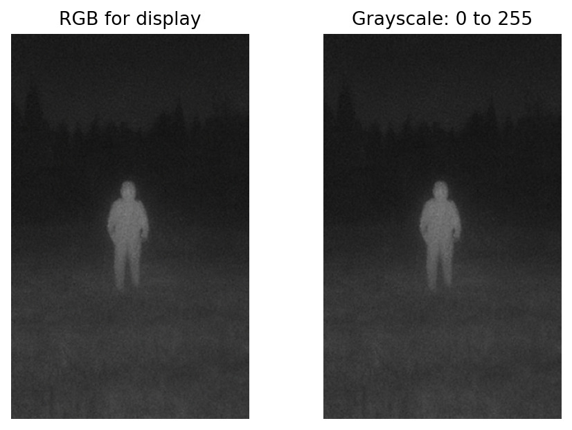
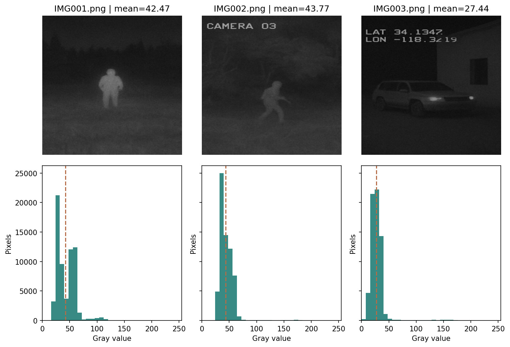
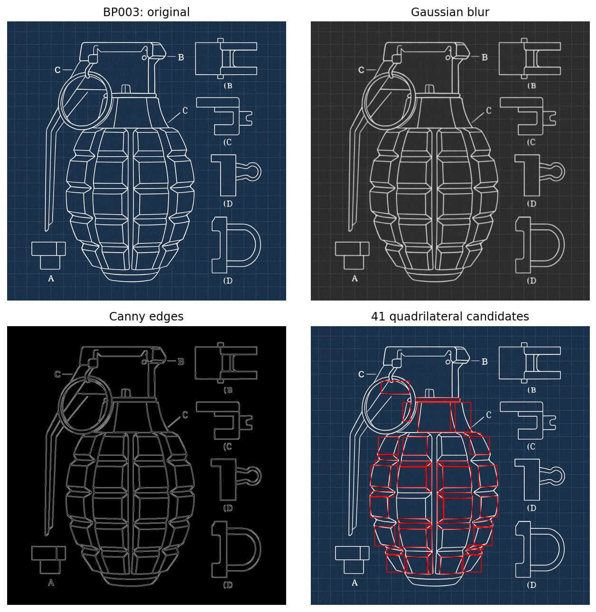
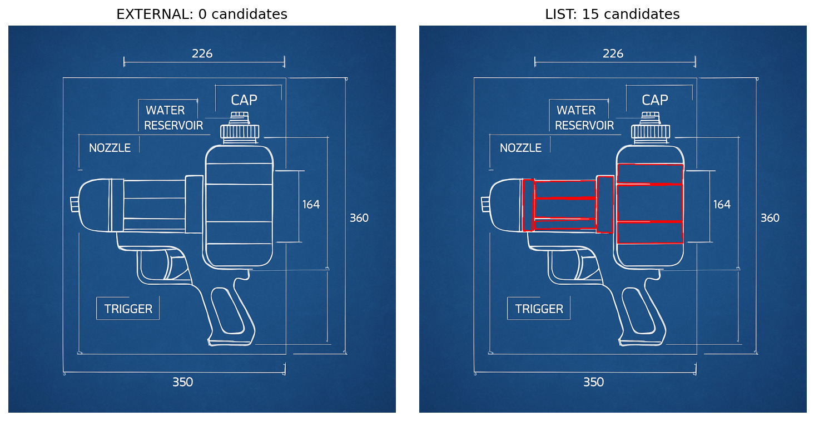
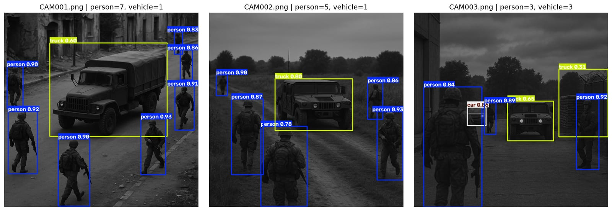
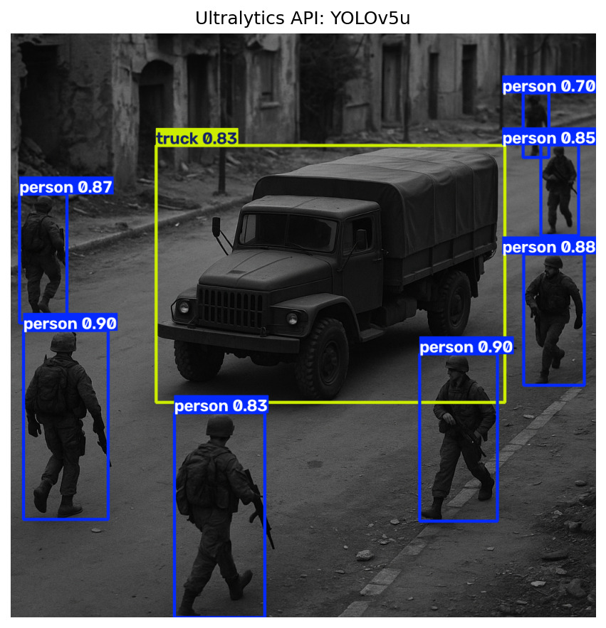

> **이번 글의 질문**
>
> 사진도 숫자로 분석할 수 있을까요? 평균 밝기가 높으면 대상도 잘 보일까요? 사각형을 찾는 코드와 사람을 찾는 모델은 무엇이 다를까요?

> **핵심 요약**
>
> 이미지는 픽셀로 이루어진 NumPy 배열입니다. OpenCV로 크기·색상·윤곽선을 처리하고, YOLOv5로 객체의 클래스와 위치를 예측합니다. 평균 밝기, 사각형 후보, 객체별 Bounding Box를 DataFrame으로 정리하되, 색상 순서·좌표 기준·탐지 조건을 함께 확인합니다.

## 1. 이미지 한 장을 숫자 배열로 바라봅니다

사진은 위치마다 숫자가 들어 있는 배열입니다. 픽셀의 밝기와 경계를 계산할 수도 있고, 학습된 모델로 사람과 차량을 찾을 수도 있습니다.

이번에는 세 가지 질문을 다룹니다. 야간 이미지의 평균 밝기를 비교하고, 설계도에서 사각형 후보의 좌표를 추출하며, 사전 학습된 YOLOv5로 사람과 차량을 탐지합니다. 결과는 모두 **파일명과 수치가 있는 표**로 정리합니다.

| 작업 | 입력 폴더 | 핵심 처리 | 주요 결과 파일 |
| --- | --- | --- | --- |
| 밝기 분석 | `images/night_ops` | Resize → Grayscale → 평균 | `brightness_result.csv` |
| 사각형 후보 검출 | `images/blueprints` | Blur → Canny → Contour | `rectangles.csv` |
| 객체 탐지 | `images/surv_imgs` | YOLOv5 Inference | `detections.csv` |

각 폴더에는 PNG 이미지가 세 장씩 있습니다. `images` 폴더를 작업 폴더 아래에 두고 실행합니다. 경로를 `Path`로 만들면 폴더와 파일명을 `/` 연산자로 연결할 수 있습니다.

## 2. 크기·색상·좌표부터 확인합니다

### 2-1. shape는 높이부터, resize는 너비부터입니다

```python
from pathlib import Path
import cv2
import numpy as np
import pandas as pd
import matplotlib.pyplot as plt
from PIL import Image

plot_dir = Path("plots")
plot_dir.mkdir(parents=True, exist_ok=True)

image_path = Path("images/night_ops/IMG001.png")
img = cv2.imread(str(image_path))
if img is None:
    raise FileNotFoundError(f"이미지를 읽을 수 없습니다: {image_path}")

print("원본 shape:", img.shape)
print("dtype:", img.dtype)

# resize의 크기는 (너비, 높이) 순서입니다.
resized = cv2.resize(img, (256, 256), interpolation=cv2.INTER_LINEAR)
gray = cv2.cvtColor(resized, cv2.COLOR_BGR2GRAY)

print("Resize shape:", resized.shape)
print("Grayscale shape:", gray.shape)
print("Grayscale의 서로 다른 픽셀 값 개수:", np.unique(gray).size)
```

```text
원본 shape: (475, 293, 3)
dtype: uint8
Resize shape: (256, 256, 3)
Grayscale shape: (256, 256)
Grayscale의 서로 다른 픽셀 값 개수: 108
```

원본 `shape` `(475, 293, 3)`은 높이 475픽셀, 너비 293픽셀, 채널 3개입니다. 그런데 `cv2.resize(img, (320, 240))`의 크기는 너비 320, 높이 240입니다. 결과 `shape`는 `(240, 320, 3)`이 됩니다. 정사각형 예제에서는 순서를 바꿔도 티가 나지 않으므로 직사각형 크기로 생각해 보면 기억하기 쉽습니다.

| 대상 | 순서 | 예시 |
| --- | --- | --- |
| 컬러 배열 `shape` | `(height, width, channels)` | `(475, 293, 3)` |
| Resize 크기 | `(width, height)` | `(320, 240)` |
| 한 픽셀 접근 | `img[y, x]` | 행 `y`, 열 `x`의 픽셀 |
| 영역 자르기 | `img[y:y+h, x:x+w]` | 높이 `h`, 너비 `w`의 ROI |

PNG라는 확장자가 채널 개수를 결정하지는 않습니다. Grayscale·RGB·Alpha 채널을 가진 파일도 있습니다. 여기서는 OpenCV의 기본 컬러 읽기를 사용하므로 BGR 채널 3개로 읽습니다. Alpha를 보존하려면 `cv2.IMREAD_UNCHANGED` 같은 읽기 옵션을 선택하고 반환된 `shape`를 확인합니다.

### 2-2. BGR과 RGB는 값의 순서가 다릅니다

OpenCV의 기본 컬러 배열은 **Blue·Green·Red**, Matplotlib의 컬러 표시는 **Red·Green·Blue** 순서입니다. BGR 배열을 그대로 `imshow()`에 넣으면 빨강과 파랑이 뒤바뀝니다. 원본 배열은 BGR로 유지하고, 표시할 때 RGB로 변환하면 흐름을 따라가기 쉽습니다.

```python
rgb = cv2.cvtColor(img, cv2.COLOR_BGR2RGB)
original_gray = cv2.cvtColor(img, cv2.COLOR_BGR2GRAY)

fig, axes = plt.subplots(1, 2, figsize=(6, 4))
axes[0].imshow(rgb)
axes[0].set_title("RGB for display")
axes[1].imshow(original_gray, cmap="gray", vmin=0, vmax=255)
axes[1].set_title("Grayscale: 0 to 255")
for ax in axes:
    ax.axis("off")
fig.tight_layout()
fig.savefig(plot_dir / "image_color_gray.png", dpi=160, bbox_inches="tight")
plt.close(fig)
```



*같은 이미지의 컬러 표시와 Grayscale입니다. `cmap="gray"`와 고정 범위 0\~255로 밝기를 표시합니다.*

밝기를 계산할 때 RGB로 먼저 바꿀 필요는 없습니다. BGR 배열에는 `COLOR_BGR2GRAY`, RGB 배열에는 `COLOR_RGB2GRAY`를 적용합니다. 변환한 배열의 채널 순서와 변환 옵션을 맞추는 것이 핵심입니다.

Grayscale은 검정과 흰색 두 값만 있는 Binary 이미지와 다릅니다. 이번 `uint8` Grayscale은 0\~255의 여러 밝기 단계를 표현합니다. 반면 Threshold나 Canny로 만든 Binary 이미지는 보통 0과 255로 배경·전경 또는 경계 여부를 나타냅니다.

2차원 배열을 표시할 때 `cmap="gray"`를 생략하면 기본 Colormap으로 색이 입혀집니다. 또한 이미지마다 표시 범위를 자동으로 잡으면 어두운 이미지도 밝아 보일 수 있습니다. **밝기를 비교하는 그림은 `vmin`·`vmax`를 동일하게 맞춥니다.**

## 3. 실습 1: 야간 이미지의 평균 밝기를 비교합니다

### 3-1. 같은 크기로 바꾸고 픽셀 평균을 계산합니다

Grayscale 픽셀 값의 합을 픽셀 수로 나누면 평균 밝기 값이 됩니다. 여기서는 세 이미지에 같은 순서로 Resize와 Grayscale 변환을 적용합니다. 컬러 채널 세 개의 단순 평균을 내는 대신, 색상별 가중치를 반영한 Grayscale 값의 평균을 구합니다.

```python
night_dir = Path("images/night_ops")
night_files = ["IMG001.png", "IMG002.png", "IMG003.png"]
brightness_rows = []
night_grays = {}

for filename in night_files:
    image = cv2.imread(str(night_dir / filename))
    if image is None:
        brightness_rows.append({
            "filename": filename, "brightness": np.nan,
            "status": "read_failed",
        })
        continue

    small = cv2.resize(image, (256, 256), interpolation=cv2.INTER_LINEAR)
    small_gray = cv2.cvtColor(small, cv2.COLOR_BGR2GRAY)
    night_grays[filename] = small_gray
    brightness_rows.append({
        "filename": filename, "brightness": float(small_gray.mean()),
        "status": "ok",
    })

brightness_df = pd.DataFrame(brightness_rows)
brightness_df.to_csv("brightness_result.csv", index=False, encoding="utf-8-sig")
valid_brightness = brightness_df.dropna(subset=["brightness"])

print(brightness_df.round({"brightness": 2}).to_string(index=False))
if not valid_brightness.empty:
    brightest_idx = valid_brightness["brightness"].idxmax()
    print("평균 밝기가 가장 높은 이미지:", brightness_df.loc[brightest_idx, "filename"])
else:
    print("밝기를 계산할 수 있는 이미지가 없습니다.")
```

```text
  filename  brightness status
IMG001.png       42.47     ok
IMG002.png       43.77     ok
IMG003.png       27.44     ok
평균 밝기가 가장 높은 이미지: IMG002.png
```

평균 밝기는 IMG002가 약 **43.77**, IMG001이 **42.47**, IMG003이 **27.44**입니다. `idxmax()`는 최댓값 자체가 아니라 그 값이 있는 행의 인덱스를 반환하므로, `loc`으로 파일명을 가져옵니다. 모든 파일을 읽지 못했을 때는 빈 데이터에서 `idxmax()`를 호출하지 않습니다.

읽기 실패는 밝기 0으로 기록하지 않습니다. 0은 완전히 검은 이미지의 유효한 평균일 수 있기 때문입니다. 실패한 파일은 `NaN`과 `status`를 남겨 계산 결과와 구분합니다.

```python
fig, axes = plt.subplots(2, 3, figsize=(10, 7), sharey="row")
for col, filename in enumerate(night_files):
    g = night_grays.get(filename)
    if g is None:
        for ax in axes[:, col]:
            ax.text(0.5, 0.5, f"{filename}: read failed", ha="center")
            ax.axis("off")
        continue
    axes[0, col].imshow(g, cmap="gray", vmin=0, vmax=255)
    axes[0, col].set_title(f"{filename} | mean={g.mean():.2f}")
    axes[0, col].axis("off")
    axes[1, col].hist(g.ravel(), bins=32, range=(0, 256), color="#388b84")
    axes[1, col].axvline(g.mean(), color="#b56c46", linestyle="--")
    axes[1, col].set(xlim=(0, 255), xlabel="Gray value", ylabel="Pixels")
fig.tight_layout()
fig.savefig(plot_dir / "brightness_histograms.png", dpi=150, bbox_inches="tight")
plt.close(fig)
```



*위쪽은 같은 밝기 범위로 표시한 이미지, 아래쪽은 픽셀 값의 Histogram입니다. 점선은 평균입니다.*

### 3-2. 평균이 높다고 대상이 더 잘 보이는 것은 아닙니다

[파이썬 데이터 분석 공부노트 04](/cs/data-analysis/pandas-04-descriptive-statistics/)에서 평균과 산포도를 함께 읽었던 것처럼, 이미지도 평균 하나로 모든 특성을 설명하기 어렵습니다. 밝은 배경이나 화면에 찍힌 글자가 평균을 높일 수 있고, 대상과 배경의 대비는 작을 수 있습니다.

예를 들어 모든 픽셀이 50인 이미지와, 절반이 0이고 절반이 100인 이미지는 평균이 모두 50입니다. 하지만 첫 번째는 균일한 회색이고 두 번째는 어두운 영역과 밝은 영역이 나뉩니다. Histogram, 밝기 분위수, 관심 영역인 ROI(Region of Interest)의 대비를 함께 보면 차이가 드러납니다.

```python
uniform = np.full((2, 2), 50, dtype=np.uint8)
mixed = np.array([[0, 0], [100, 100]], dtype=np.uint8)
print("균일한 이미지:", "평균", uniform.mean(), "표준편차", uniform.std())
print("밝기가 나뉜 이미지:", "평균", mixed.mean(), "표준편차", mixed.std())

distribution_rows = []
for filename, g in night_grays.items():
    distribution_rows.append({
        "filename": filename,
        "mean": float(g.mean()),
        "p10": float(np.quantile(g, 0.1)),
        "median": float(np.median(g)),
        "p90": float(np.quantile(g, 0.9)),
    })
brightness_distribution = pd.DataFrame(distribution_rows)
print(brightness_distribution.round(2).to_string(index=False))
```

```text
균일한 이미지: 평균 50.0 표준편차 0.0
밝기가 나뉜 이미지: 평균 50.0 표준편차 50.0
  filename  mean  p10  median  p90
IMG001.png 42.47 25.0    38.0 60.0
IMG002.png 43.77 32.0    41.0 57.0
IMG003.png 27.44 16.0    27.0 36.0
```

이 평균은 이미지에 저장된 디지털 픽셀 값의 평균입니다. 실제 조도나 사람이 느끼는 밝기를 직접 측정한 값으로 읽지는 않습니다. 같은 촬영·전처리 조건에서 이미지 특성을 비교하는 지표로 사용합니다.

### 3-3. Resize 방식과 픽셀 dtype도 결과에 영향을 줍니다

원본 야간 이미지는 세로가 긴데 256×256으로 바꾸면 가로·세로 비율이 달라집니다. 밝기 비교 예제는 이 크기로 통일하지만, 모양을 분석할 때는 비율을 유지한 Resize·Crop·Padding 중 목적에 맞는 방식을 고릅니다. 검은 Padding까지 포함해 평균을 내면 평균이 낮아집니다.

| 변환 | 주로 확인할 것 | 기억할 점 |
| --- | --- | --- |
| `INTER_LINEAR` | 확대·축소의 기본 보간 | 주변 픽셀을 선형 보간합니다. 이 실습의 Resize 기준입니다. |
| `INTER_AREA` | 이미지 축소 | 픽셀 영역을 반영합니다. 축소할 때 비교해 볼 수 있습니다. |
| `INTER_NEAREST` | Mask·Label 이미지 | 기존 값 중 하나를 선택하므로 중간 클래스 값이 생기지 않습니다. |

0\~255를 0\~1로 표현하려면 실수형으로 바꿔 255로 나눕니다. 이 변환은 픽셀 값의 표현 범위를 바꾸는 것입니다. Feature마다 평균과 표준편차를 학습하는 StandardScaler와는 계산 기준이 다릅니다. `uint8`에서 바로 값을 더하면 범위를 넘는 값이 되돌아갈 수 있으므로 밝기 보정 연산에서는 `dtype`을 먼저 확인합니다.

```python
gray_float = gray.astype(np.float32) / 255.0
print("dtype:", gray_float.dtype)
print("실수형 평균:", round(float(gray_float.mean()), 4))

pixel = np.array([250], dtype=np.uint8)
print("uint8에 10을 더한 결과:", (pixel + 10).tolist())
safe_pixel = np.clip(pixel.astype(np.float32) + 10, 0, 255).astype(np.uint8)
print("실수형 연산 후 범위를 제한한 결과:", safe_pixel.tolist())
```

```text
dtype: float32
실수형 평균: 0.1666
uint8에 10을 더한 결과: [4]
실수형 연산 후 범위를 제한한 결과: [255]
```

## 4. 실습 2: 설계도에서 사각형 후보를 찾습니다

### 4-1. 밝기 경계를 윤곽선으로 연결합니다

사람·차량이라는 의미를 학습하기 전에, 이미지의 모양을 규칙으로 찾아봅니다. Grayscale로 색상을 줄이고 Gaussian Blur로 작은 밝기 변화를 완화한 뒤, Canny로 경계를 추출합니다. `findContours()`는 경계 이미지에서 연결된 윤곽선을 찾습니다.

| 단계 | 함수·설정 | 역할 |
| --- | --- | --- |
| Grayscale | `COLOR_BGR2GRAY` | 색상 대신 하나의 밝기 값으로 표현합니다. |
| Blur | `GaussianBlur(gray, (5, 5), 0)` | 주변 픽셀을 반영해 작은 밝기 변화를 완화합니다. |
| Edge | `Canny(blurred, 50, 150)` | 밝기 변화가 큰 경계를 추출합니다. |
| Contour | `RETR_EXTERNAL` | 가장 바깥쪽 윤곽선을 가져옵니다. |
| 점 압축 | `CHAIN_APPROX_SIMPLE` | 수평·수직·대각선 구간의 중간 점을 줄입니다. |

Canny의 50·150은 픽셀 밝기가 아니라 **밝기 변화의 크기인 Gradient에 대한 임계값**입니다. 강한 경계에 연결된 약한 경계는 유지하는 방식으로 끊김을 줄입니다. Blur가 너무 강하면 작은 도형의 경계도 사라질 수 있습니다.

```python
blueprint_dir = Path("images/blueprints")
bp_files = ["BP001.png", "BP002.png", "BP003.png"]

def find_quadrilateral_candidates(image, mode=cv2.RETR_EXTERNAL):
    g = cv2.cvtColor(image, cv2.COLOR_BGR2GRAY)
    blurred = cv2.GaussianBlur(g, (5, 5), 0)
    edges = cv2.Canny(blurred, 50, 150)
    contours, hierarchy = cv2.findContours(edges, mode, cv2.CHAIN_APPROX_SIMPLE)
    candidates = []
    for contour in contours:
        perimeter = cv2.arcLength(contour, True)
        approx = cv2.approxPolyDP(contour, 0.02 * perimeter, True)
        if len(approx) == 4 and cv2.isContourConvex(approx):
            candidates.append(approx)
    return g, blurred, edges, contours, candidates

bp_image = cv2.imread(str(blueprint_dir / "BP003.png"))
if bp_image is None:
    raise FileNotFoundError("BP003.png를 읽을 수 없습니다.")
bp_gray, bp_blur, bp_edges, bp_contours, bp_candidates = find_quadrilateral_candidates(bp_image)
print("찾은 윤곽선 수:", len(bp_contours))
print("볼록한 사각형 후보 수:", len(bp_candidates))
```

```text
찾은 윤곽선 수: 124
볼록한 사각형 후보 수: 41
```

`arcLength(contour, True)`는 닫힌 윤곽선의 둘레를 구합니다. `approxPolyDP()`는 그 윤곽선을 더 적은 점으로 근사하며, 여기서는 둘레의 2%를 epsilon으로 사용합니다. `CHAIN_APPROX_SIMPLE`은 일직선 구간의 점을 압축하고, `approxPolyDP`는 전체 윤곽선을 허용 오차 안에서 단순화한다는 차이가 있습니다.

epsilon을 크게 하면 꼭짓점이 더 많이 생략될 수 있습니다. “2%를 넣으면 사각형을 정확히 찾는다”가 아니라, 실제 경계가 얼마나 끊겼고 복잡한지에 따라 근사 결과가 달라집니다.

### 4-2. Bounding Box 좌표와 이미지별 개수를 나눠 저장합니다

```python
rectangle_rows = []
rectangle_summary_rows = []
blueprint_outputs = {}

for filename in bp_files:
    image = cv2.imread(str(blueprint_dir / filename))
    if image is None:
        rectangle_summary_rows.append({
            "filename": filename, "rectangle_count": np.nan,
            "status": "read_failed",
        })
        continue

    _, _, _, contours, candidates = find_quadrilateral_candidates(image)
    # 저장 순서는 위에서 아래, 왼쪽에서 오른쪽으로 맞춥니다.
    candidates.sort(key=lambda q: (cv2.boundingRect(q)[1], cv2.boundingRect(q)[0]))
    canvas = image.copy()
    for rectangle_id, approx in enumerate(candidates, start=1):
        x, y, w, h = cv2.boundingRect(approx)
        rectangle_rows.append({
            "filename": filename, "rectangle_id": rectangle_id,
            "x": x, "y": y, "width": w, "height": h,
        })
        cv2.rectangle(canvas, (x, y), (x + w - 1, y + h - 1), (0, 0, 255), 2)

    rectangle_summary_rows.append({
        "filename": filename, "rectangle_count": len(candidates),
        "status": "ok",
    })
    blueprint_outputs[filename] = canvas

rectangle_columns = ["filename", "rectangle_id", "x", "y", "width", "height"]
rectangles = pd.DataFrame(rectangle_rows, columns=rectangle_columns)
rectangle_summary = pd.DataFrame(rectangle_summary_rows)
rectangles.to_csv("rectangles.csv", index=False, encoding="utf-8-sig")
rectangle_summary.to_csv("rectangle_counts.csv", index=False, encoding="utf-8-sig")
print(rectangle_summary.to_string(index=False))
print("후보 좌표 일부:")
print(rectangles.head().to_string(index=False))
```

```text
 filename  rectangle_count status
BP001.png                2     ok
BP002.png                2     ok
BP003.png               41     ok
후보 좌표 일부:
 filename  rectangle_id   x   y  width  height
BP001.png             1 490 253      4      23
BP001.png             2 345 293      3      45
BP002.png             1 785  93      3      41
BP002.png             2 178 337    479     108
BP003.png             1 258 202    104      48
```

`boundingRect()`의 `x`·`y`는 좌측 상단, `width`·`height`는 너비·높이입니다. 이것은 후보를 둘러싼 **축에 평행한 직사각형**의 좌표이며, 근사 도형의 네 꼭짓점 좌표와는 다릅니다. 이미지 좌측 상단이 원점이고, x는 오른쪽으로, y는 아래로 증가합니다.

CSV 한 행의 `rectangle_id`는 그 이미지 안의 후보 번호입니다. 이미지별 전체 개수인 `rectangle_count`는 별도의 `rectangle_counts.csv`에 저장합니다. 후보가 없으면 summary에 0을 기록하며, 좌표 파일에 가짜 `(0, 0, 0, 0)` 행을 만들지 않습니다.

```python
fig, axes = plt.subplots(2, 2, figsize=(9, 9))
axes[0, 0].imshow(cv2.cvtColor(bp_image, cv2.COLOR_BGR2RGB))
axes[0, 0].set_title("BP003: original")
axes[0, 1].imshow(bp_blur, cmap="gray", vmin=0, vmax=255)
axes[0, 1].set_title("Gaussian blur")
axes[1, 0].imshow(bp_edges, cmap="gray", vmin=0, vmax=255)
axes[1, 0].set_title("Canny edges")
axes[1, 1].imshow(cv2.cvtColor(blueprint_outputs["BP003.png"], cv2.COLOR_BGR2RGB))
axes[1, 1].set_title("41 quadrilateral candidates")
for ax in axes.flat:
    ax.axis("off")
fig.tight_layout()
fig.savefig(plot_dir / "contour_pipeline.png", dpi=145, bbox_inches="tight")
plt.close(fig)
```



*붉은 박스는 조건을 통과한 후보를 둘러싼 Bounding Box입니다. 실제 부품 영역과 같은 것은 아닙니다.*

## 5. “꼭짓점 네 개”에서 한 단계 더 확인합니다

### 5-1. 사다리꼴도 볼록한 사각형입니다

꼭짓점이 네 개이고 볼록하다는 조건만으로 직사각형을 확정할 수는 없습니다. 사다리꼴과 마름모도 통과할 수 있고, 얇은 선 조각이 작은 사각형으로 근사될 수도 있습니다. 실제 BP001에서 잡힌 두 후보의 Bounding Box는 3×45, 4×23픽셀처럼 매우 얇습니다.

직사각형에 가까운 후보를 찾으려면 최소 면적과 각도를 함께 확인합니다. 아래 비교에서는 후보 면적이 1000픽셀² 이상이고 네 각이 90도에서 10도 이내로 벗어나는지 봅니다. 면적 기준은 픽셀 단위이므로 이미지 크기를 바꿨다면 함께 조정해야 합니다.

```python
def is_near_rectangle(approx, min_area=1000, angle_tolerance=10):
    if len(approx) != 4 or not cv2.isContourConvex(approx):
        return False
    if cv2.contourArea(approx) < min_area:
        return False

    points = approx.reshape(4, 2).astype(np.float64)
    before = np.roll(points, 1, axis=0) - points
    after = np.roll(points, -1, axis=0) - points
    lengths = np.linalg.norm(before, axis=1) * np.linalg.norm(after, axis=1)
    if np.any(lengths == 0):
        return False
    cosines = np.sum(before * after, axis=1) / lengths
    # 90도에 가까울수록 두 변의 cos 값이 0에 가깝습니다.
    return bool(np.all(np.abs(cosines) <= np.sin(np.deg2rad(angle_tolerance))))

rectangle = np.array([[0, 0], [100, 0], [100, 60], [0, 60]], dtype=np.int32).reshape(-1, 1, 2)
trapezoid = np.array([[0, 0], [100, 0], [80, 60], [20, 60]], dtype=np.int32).reshape(-1, 1, 2)
for name, polygon in [("rectangle", rectangle), ("trapezoid", trapezoid)]:
    basic = len(polygon) == 4 and cv2.isContourConvex(polygon)
    print(name, "네 꼭짓점+볼록:", basic, "면적+각도 통과:", is_near_rectangle(polygon))
```

```text
rectangle 네 꼭짓점+볼록: True 면적+각도 통과: True
trapezoid 네 꼭짓점+볼록: True 면적+각도 통과: False
```

이렇게 각도를 확인하면 위 예제의 사다리꼴을 걸러낼 수 있습니다. 다만 원근감이 있는 사진에서는 실제 직사각형도 사다리꼴로 찍힐 수 있습니다. 어떤 모양을 검출하려는지에 따라 각도 조건이나 Perspective Transform 적용 여부를 정합니다.

### 5-2. RETR_EXTERNAL은 안쪽 윤곽선을 놓칠 수 있습니다

설계도에서는 큰 테두리 안에 작은 사각형이 들어 있는 경우가 많습니다. `RETR_EXTERNAL`은 가장 바깥쪽 윤곽선만 반환하므로, 안쪽 도형이 눈에 보여도 후보에 들어가지 않을 수 있습니다. `RETR_LIST`는 모든 윤곽선을 가져오고, `RETR_TREE`는 안팎의 계층 관계도 보존합니다.

```python
comparison_rows = []
for filename in bp_files:
    image = cv2.imread(str(blueprint_dir / filename))
    if image is None:
        continue
    for mode_name, mode in [("EXTERNAL", cv2.RETR_EXTERNAL), ("LIST", cv2.RETR_LIST)]:
        _, _, _, contours, candidates = find_quadrilateral_candidates(image, mode)
        large = [q for q in candidates if cv2.contourArea(q) >= 1000]
        near = [q for q in candidates if is_near_rectangle(q)]
        comparison_rows.append({
            "filename": filename, "mode": mode_name,
            "contours": len(contours), "quadrilaterals": len(candidates),
            "area_pass": len(large), "angle_pass": len(near),
        })
contour_comparison = pd.DataFrame(comparison_rows)
print(contour_comparison.to_string(index=False))
```

```text
 filename     mode  contours  quadrilaterals  area_pass  angle_pass
BP001.png EXTERNAL        80               2          0           0
BP001.png     LIST       243              21         15          15
BP002.png EXTERNAL        39               2          1           0
BP002.png     LIST       267              27         20          15
BP003.png EXTERNAL       124              41         34           5
BP003.png     LIST       262             107         88          26
```

BP001은 `EXTERNAL`의 기본 후보 2개가 면적 조건에서 모두 제외됩니다. `LIST`로 안쪽 윤곽선까지 가져오면 기본 후보 21개, 면적·각도 조건을 모두 통과한 후보 15개가 됩니다. BP003은 `EXTERNAL` 기본 후보 41개에서 면적·각도 조건을 통과한 후보 5개로 줄어듭니다. **탐색 방식과 필터 조건은 서로 다른 단계**에 영향을 줍니다.

`LIST`에서 개수가 늘었다고 정답을 더 많이 찾은 것은 아닙니다. Canny로 생긴 선의 양쪽 경계가 비슷한 도형으로 검출될 수도 있습니다. 계층 정보, 겹치는 Box, 실제 이미지의 표시 결과를 확인해 중복 후보를 정리합니다.

```python
fig, axes = plt.subplots(1, 2, figsize=(10, 5))
for ax, mode_name, mode in zip(axes, ["EXTERNAL", "LIST"], [cv2.RETR_EXTERNAL, cv2.RETR_LIST]):
    image = cv2.imread(str(blueprint_dir / "BP001.png"))
    _, _, _, _, candidates = find_quadrilateral_candidates(image, mode)
    selected = [q for q in candidates if is_near_rectangle(q)]
    canvas = image.copy()
    cv2.drawContours(canvas, selected, -1, (0, 0, 255), 2)
    ax.imshow(cv2.cvtColor(canvas, cv2.COLOR_BGR2RGB))
    ax.set_title(f"{mode_name}: {len(selected)} candidates")
    ax.axis("off")
fig.tight_layout()
fig.savefig(plot_dir / "contour_modes.png", dpi=150, bbox_inches="tight")
plt.close(fig)
```



*같은 면적·각도 조건을 적용해도 탐색 모드에 따라 반환되는 후보가 달라집니다.*

## 6. 실습 3: YOLOv5로 사람과 차량을 탐지합니다

### 6-1. 사전 학습된 모델로 Inference를 수행합니다

Contour 검출은 경계의 모양을 찾습니다. 객체 탐지(Object Detection)는 이미지 안에서 “사람인지 차량인지”와 “어디에 있는지”를 함께 예측합니다. YOLO(You Only Look Once)는 이 작업을 수행하는 객체 탐지 모델 계열입니다.

[파이썬 데이터 분석 공부노트 07](/cs/data-analysis/pandas-07-supervised-learning/)에서는 Feature와 정답으로 분류 모델을 학습했습니다. 여기서는 이미 클래스와 Bounding Box를 학습한 모델을 불러와 예측만 수행합니다. 입력할 때 정답을 전달하지 않는다고 비지도 학습이 되는 것은 아닙니다.

실습은 원래 YOLOv5 저장소의 PyTorch Hub API와 `yolov5s` 가중치를 사용합니다. 첫 로딩에서는 저장소와 가중치를 내려받으므로 인터넷 연결이 필요합니다. OpenCV·PyTorch·torchvision·Ultralytics 및 YOLOv5 저장소의 의존성을 설치한 뒤 실행합니다.

```python
import torch

model = torch.hub.load(
    "ultralytics/yolov5", "yolov5s",
    pretrained=True, trust_repo=True,
)
model.conf = 0.25
model.iou = 0.45
model.classes = [0, 2, 5, 7]  # COCO의 person, car, bus, truck

print("학습된 클래스 수:", len(model.names))
print("Confidence threshold:", model.conf)
print("NMS IoU threshold:", model.iou)
```

```text
학습된 클래스 수: 80
Confidence threshold: 0.25
NMS IoU threshold: 0.45
```

이 가중치는 COCO의 80개 클래스를 학습했습니다. `model.classes`로 `person`·`car`·`bus`·`truck`의 클래스 ID인 0·2·5·7을 선택하고, 이 네 클래스만 표시·집계합니다. 군복·특수 장비 같은 별도 클래스가 자동으로 생기는 것은 아니며, 필요한 클래스가 학습된 목록에 없다면 그 목적에 맞는 데이터로 추가 학습을 고려합니다.

밝기 실습에서 만든 256×256 Grayscale 이미지를 그대로 넣지 않고 원본 이미지를 RGB로 읽습니다. YOLOv5의 AutoShape가 입력 크기 조정과 Letterbox 처리를 수행하고, 결과 Box는 원본 이미지 좌표로 돌려줍니다. 여기서는 `size=640`을 지정합니다.

### 6-2. 객체별 Box와 이미지별 개수를 따로 저장합니다

```python
surv_dir = Path("images/surv_imgs")
cam_files = ["CAM001.png", "CAM002.png", "CAM003.png"]
target_classes = {"person", "car", "truck", "bus"}
vehicle_classes = {"car", "truck", "bus"}
detection_rows = []
detection_count_rows = []
cam_results = {}

for filename in cam_files:
    try:
        with Image.open(surv_dir / filename) as source:
            image_rgb = source.convert("RGB")
    except (OSError, ValueError) as error:
        print(f"이미지 읽기 실패: {filename}: {error}")
        detection_count_rows.append({
            "filename": filename, "person_count": np.nan,
            "vehicle_count": np.nan, "status": "read_failed",
        })
        continue

    result = model(image_rgb, size=640)
    cam_results[filename] = result
    people = vehicles = 0
    for x1, y1, x2, y2, confidence, class_id in result.xyxy[0].tolist():
        class_name = result.names[int(class_id)]
        if class_name not in target_classes:
            continue
        detection_rows.append({
            "filename": filename, "class": class_name,
            "confidence": confidence,
            "xmin": x1, "ymin": y1, "xmax": x2, "ymax": y2,
        })
        people += int(class_name == "person")
        vehicles += int(class_name in vehicle_classes)

    detection_count_rows.append({
        "filename": filename, "person_count": people,
        "vehicle_count": vehicles, "status": "ok",
    })

detection_columns = ["filename", "class", "confidence", "xmin", "ymin", "xmax", "ymax"]
detections = pd.DataFrame(detection_rows, columns=detection_columns)
detection_counts = pd.DataFrame(detection_count_rows)
detections.to_csv("detections.csv", index=False, encoding="utf-8-sig")
detection_counts.to_csv("detection_counts.csv", index=False, encoding="utf-8-sig")
print(detection_counts.to_string(index=False))
print("전체 객체별 탐지 수:", detections["class"].value_counts().to_dict())
```

```text
  filename  person_count  vehicle_count status
CAM001.png             7              1     ok
CAM002.png             5              1     ok
CAM003.png             3              3     ok
전체 객체별 탐지 수: {'person': 15, 'truck': 4, 'car': 1}
```

이번 결과는 CAM001 사람 7건·차량 1건, CAM002 사람 5건·차량 1건, CAM003 사람 3건·차량 3건입니다. 전체 탐지 합계는 사람 15건·차량 5건이며, 차량 클래스는 `truck` 4건·`car` 1건으로 예측되었습니다.

결과의 한 행은 `[xmin, ymin, xmax, ymax, confidence, class_id]`입니다. 클래스 ID는 클래스 이름으로 바꾸고, 좌표는 원본 이미지 기준의 실수 값으로 저장합니다. CSV 저장 단계에서 정수로 바꾸면 위치 정보의 소수 부분이 사라집니다.

| 결과 | 한 행의 의미 | 비어 있을 때 |
| --- | --- | --- |
| `detections.csv` | 탐지한 객체 한 개의 클래스·점수·Box | 열 이름을 유지하고 객체 행은 저장하지 않습니다. |
| `detection_counts.csv` | 이미지 한 장의 사람·차량 탐지 수 | 읽기는 성공했지만 탐지가 없으면 0입니다. |

여기서 차량은 `car`·`truck`·`bus`의 합입니다. `bicycle`·`motorcycle`까지 포함하려면 클래스 정의를 바꿔야 합니다. “차량 수”라는 이름을 붙이기 전에 어떤 클래스를 합쳤는지 정해 둡니다. 이미지 세 장의 합계는 **탐지 건수의 합**이며, 여러 장에 반복해서 나온 사람을 합친 고유 인원 수는 아닙니다.

### 6-3. 박스가 그려진 이미지에서 결과를 확인합니다

```python
fig, axes = plt.subplots(1, 3, figsize=(15, 5))
for ax, filename in zip(axes, cam_files):
    result = cam_results.get(filename)
    if result is None:
        ax.text(0.5, 0.5, f"{filename}: read failed", ha="center")
        ax.axis("off")
        continue
    # RGB 이미지를 입력한 YOLOv5의 render() 결과도 RGB입니다.
    annotated_rgb = result.render()[0]
    ax.imshow(annotated_rgb)
    counts = detection_counts.set_index("filename").loc[filename]
    ax.set_title(
        f"{filename} | person={int(counts['person_count'])}, "
        f"vehicle={int(counts['vehicle_count'])}"
    )
    ax.axis("off")
fig.tight_layout()
fig.savefig(plot_dir / "yolov5_detections.png", dpi=150, bbox_inches="tight")
plt.close(fig)
```



*Box와 클래스 이름을 원본 이미지에서 확인합니다. 작은 대상·가림·어두운 영역에서 놓친 대상이 있는지도 살펴봅니다.*

YOLOv5의 RGB `render` 결과에 다시 `COLOR_BGR2RGB`를 적용하면 색상이 뒤집힙니다. OpenCV로 읽은 BGR 배열과 모델이 반환하는 표시 배열을 구분합니다. 화면에서 박스가 보인다는 사실만으로 탐지가 정확한지 판단하지 않고, 해당 위치와 클래스가 실제 이미지에 맞는지 확인합니다.

CAM003의 오른쪽 적재물 주변에도 `truck 0.31` Box가 생겼습니다. 이 박스는 차량을 올바르게 찾은 결과로 보기 어렵습니다. 그래서 CSV의 `vehicle_count`가 3이라고 해도 실제 차량이 세 대 있다고 바로 결론 내리지 않습니다. 그림을 확인하는 과정이 수치 해석의 일부입니다.

## 7. Confidence와 NMS를 어떻게 읽을까요?

### 7-1. Confidence는 탐지 결과의 점수입니다

Confidence threshold 0.25는 낮은 점수의 후보를 걸러내는 기준입니다. 점수가 0.8이라고 해서 그 객체가 정확할 확률이 검증된 80%라는 뜻은 아닙니다. 임계값을 높이면 낮은 점수 후보가 제외되어 오탐이 줄 수도 있지만, 실제 대상까지 놓칠 수 있습니다.

```python
threshold_rows = []
for filename in cam_files:
    if filename not in cam_results:
        continue
    frame = cam_results[filename].pandas().xyxy[0]
    frame = frame[frame["name"].isin(target_classes)]
    for threshold in [0.25, 0.50, 0.75]:
        selected = frame[frame["confidence"] >= threshold]
        threshold_rows.append({
            "filename": filename, "threshold": threshold,
            "person_count": int((selected["name"] == "person").sum()),
            "vehicle_count": int(selected["name"].isin(vehicle_classes).sum()),
        })
threshold_comparison = pd.DataFrame(threshold_rows)
print(threshold_comparison.to_string(index=False))
```

```text
  filename  threshold  person_count  vehicle_count
CAM001.png       0.25             7              1
CAM001.png       0.50             7              1
CAM001.png       0.75             7              0
CAM002.png       0.25             5              1
CAM002.png       0.50             5              1
CAM002.png       0.75             5              1
CAM003.png       0.25             3              3
CAM003.png       0.50             3              2
CAM003.png       0.75             3              1
```

CAM003에서는 0.50 기준을 적용하면 점수 약 0.31의 적재물 Box가 제외되어 차량 탐지가 3건에서 2건으로 줄어듭니다. 0.75까지 높이면 실제 중앙 차량의 `truck` Box도 점수 약 0.65여서 제외됩니다. **오탐을 하나 줄이는 기준이 다른 대상을 놓치는 기준이 될 수도 있습니다.**

위 표는 threshold 0.25와 같은 NMS 설정으로 나온 결과를 더 높은 Confidence 기준으로 다시 필터링한 비교입니다. threshold를 낮춰 새 후보를 찾으려면 모델 설정을 바꾸고 다시 Inference를 수행해야 합니다. 이미 걸러진 후보는 결과 DataFrame에 남아 있지 않기 때문입니다.

### 7-2. NMS는 겹치는 탐지 후보를 정리합니다

같은 대상을 여러 Box가 둘러싸면 중복 탐지처럼 보입니다. NMS(Non-Maximum Suppression)는 높은 점수의 후보를 기준으로, 많이 겹치는 후보를 억제합니다. 겹치는 정도는 **IoU = 교집합 면적 / 합집합 면적**으로 계산하며 값의 범위는 0\~1입니다.

이번 `model.iou=0.45`는 NMS에서 Box 겹침을 판단하는 임계값입니다. 이 값을 낮추면 더 작은 겹침에도 후보를 억제할 수 있습니다. 가까이 붙은 서로 다른 사람의 Box도 겹칠 수 있으므로 무조건 낮추면 좋은 것은 아닙니다. 기본 클래스별 NMS와 모든 클래스를 함께 비교하는 Class-agnostic NMS도 구분합니다.

오탐(False Positive)과 놓침(False Negative)은 [파이썬 데이터 분석 공부노트 07](/cs/data-analysis/pandas-07-supervised-learning/)의 Precision·Recall과 연결됩니다. 객체 탐지에서는 정답 클래스뿐 아니라 정답 Box와의 위치 일치도도 평가에 들어갑니다. NMS의 IoU 임계값과 정답 Box 매칭에 쓰는 IoU 기준은 역할이 다릅니다.

탐지 수가 적다고 모델이 나쁘고, 많다고 좋은 것도 아닙니다. 정답 Annotation이 있어야 어떤 Box가 오탐이고 어떤 대상이 누락됐는지 평가할 수 있습니다. 객체 탐지의 mAP는 여러 Confidence 기준에서 얻은 Precision·Recall 관계와 Box 매칭 기준을 반영합니다.

## 8. 최신 Ultralytics API에서는 결과에 접근하는 방식이 다릅니다

PyTorch Hub의 원래 YOLOv5와 현재 `ultralytics.YOLO` API는 결과 객체가 다릅니다. `results.xyxy[0]` 예제를 최신 API 코드에 그대로 옮기면 속성을 찾을 수 없습니다. 어떤 API로 모델을 만들었는지부터 확인합니다.

| 작업 | YOLOv5 PyTorch Hub | Ultralytics YOLO API |
| --- | --- | --- |
| 모델 생성 | `torch.hub.load(...)` | `YOLO("yolov5su.pt")` |
| 크기 지정 | `model(image, size=640)` | `model.predict(image, imgsz=640)` |
| 좌표 | `results.xyxy[0][:, :4]` | `results[0].boxes.xyxy` |
| 점수 | `results.xyxy[0][:, 4]` | `results[0].boxes.conf` |
| 클래스 ID | `results.xyxy[0][:, 5]` | `results[0].boxes.cls` |
| 표시 배열 | `results.render()[0]` | `results[0].plot()` |

아래는 현재 Ultralytics API로 같은 종류의 작업을 하는 예입니다. `yolov5su.pt`는 YOLOv5u 계열의 별도 가중치입니다. 원래 저장소의 `yolov5s.pt`와 모델 구조·학습 가중치가 달라 결과도 달라질 수 있습니다. 기존 가중치 파일을 새 API에 무조건 넣는 대신 지원되는 모델 파일을 선택합니다.

```python
from ultralytics import YOLO

modern_model = YOLO("yolov5su.pt")
modern_results = modern_model.predict(
    source=str(surv_dir / "CAM001.png"),
    imgsz=640, conf=0.25, iou=0.45, verbose=False,
    classes=[0, 2, 5, 7],
)
modern_result = modern_results[0]
modern_boxes = modern_result.boxes
modern_frame = pd.DataFrame(
    modern_boxes.xyxy.cpu().numpy(),
    columns=["xmin", "ymin", "xmax", "ymax"],
)
modern_frame["confidence"] = modern_boxes.conf.cpu().numpy()
modern_frame["class"] = [
    modern_result.names[int(class_id)]
    for class_id in modern_boxes.cls.cpu().tolist()
]
print(modern_frame["class"].value_counts().to_dict())

# plot() 기본 반환은 BGR 배열이므로 표시할 때 RGB로 바꿉니다.
modern_annotated_rgb = cv2.cvtColor(modern_result.plot(), cv2.COLOR_BGR2RGB)
fig, ax = plt.subplots(figsize=(6, 6))
ax.imshow(modern_annotated_rgb)
ax.set_title("Ultralytics API: YOLOv5u")
ax.axis("off")
fig.tight_layout()
fig.savefig(plot_dir / "yolov5u_api.png", dpi=150, bbox_inches="tight")
plt.close(fig)
```

```text
{'person': 7, 'truck': 1}
```



*최신 API의 Box·Confidence·Class 접근과 `plot()`의 색상 순서를 확인하는 예입니다.*

이미지 결과를 해석할 때는 원본 크기, 색상 순서, Box 좌표부터 확인합니다. 탐지 수가 궁금하면 요약 표를 보고, 잘못 센 이유가 궁금하면 해당 파일의 Box로 돌아갑니다.

## 9. 더 살펴보기: Box의 좌표 형식을 바꿀 때 기준을 남깁니다

`xyxy`는 좌측 상단·우측 하단, `xywh`는 중심·너비·높이를 뜻할 수 있습니다. 같은 네 숫자여도 순서와 정의가 다르면 완전히 다른 영역이 됩니다. 특히 중심 좌표인지 좌측 상단 좌표인지 확인합니다.

아래는 원본 너비 200·높이 100의 Box를 **중심 기준의 정규화한 xywh**로 바꾸고 되돌리는 예제입니다.

```python
import numpy as np

width, height = 200, 100
xmin, ymin, xmax, ymax = 40.0, 20.0, 120.0, 80.0
assert 0 <= xmin < xmax <= width and 0 <= ymin < ymax <= height
cx = (xmin + xmax) / 2 / width
cy = (ymin + ymax) / 2 / height
bw = (xmax - xmin) / width
bh = (ymax - ymin) / height
restored = np.array([(cx - bw / 2) * width, (cy - bh / 2) * height,
                     (cx + bw / 2) * width, (cy + bh / 2) * height])
print("정규화한 중심 xywh:", [cx, cy, bw, bh])
print("복원한 원본 xyxy:", restored.tolist())
```

```text
정규화한 중심 xywh: [0.4, 0.5, 0.4, 0.6]
복원한 원본 xyxy: [40.0, 20.0, 120.00000000000001, 80.0]
```

크기를 바꾼 이미지나 Letterbox 좌표라면 먼저 Resize 비율과 Padding을 되돌려야 합니다. 이번 계산은 이미 원본 좌표로 표현한 Box를 사용합니다. Label Mask를 Resize할 때는 중간 클래스 번호가 생기지 않도록 Nearest interpolation을 사용합니다.

## 10. 복습할 때 다시 확인할 질문

1. **색상과 배열 순서는 무엇인가요?** OpenCV의 기본 컬러 입력은 BGR, Matplotlib 컬러 표시는 RGB입니다. `shape`는 높이·너비 순서이고, `resize` 크기는 너비·높이 순서입니다.
2. **평균 밝기가 무엇을 설명하나요?** 전체 픽셀의 평균을 설명합니다. 대상의 선명도나 식별 가능성을 보려면 분포·ROI·대비도 확인합니다.
3. **사각형 후보를 어떻게 골랐나요?** Edge와 Contour를 구한 뒤 꼭짓점·볼록성·면적·각도 조건을 적용합니다. 안쪽 윤곽선을 포함할지도 별도로 선택합니다.
4. **객체 한 개와 이미지 한 장을 구분했나요?** 객체별 좌표와 이미지별 개수를 다른 표로 저장하고, 읽기 실패와 탐지 0건도 구분합니다.
5. **모델 결과를 어떻게 해석하나요?** 클래스·Box·Confidence를 원본 이미지에서 확인합니다. 탐지 건수는 고유 인원 수나 모델 정확도와 다릅니다.

| 함수·속성 | 다시 떠올릴 역할 |
| --- | --- |
| `cv2.imread()` | 이미지를 BGR 배열로 읽고 실패 여부를 확인합니다. |
| `cv2.resize()` | 너비·높이와 보간법을 정해 크기를 바꿉니다. |
| `cv2.cvtColor()` | 입력 채널 순서에 맞춰 RGB·Grayscale로 변환합니다. |
| `gray.mean()` | Grayscale 픽셀 값의 평균을 계산합니다. |
| `cv2.GaussianBlur()` | 주변 픽셀을 반영해 작은 변화를 완화합니다. |
| `cv2.Canny()` | 밝기 Gradient를 바탕으로 경계를 추출합니다. |
| `cv2.findContours()` | 경계의 연결된 윤곽선과 계층 정보를 구합니다. |
| `cv2.approxPolyDP()` | 윤곽선을 허용 오차 안에서 다각형으로 근사합니다. |
| `cv2.boundingRect()` | 축에 평행한 Box의 `x`·`y`·`width`·`height`를 구합니다. |
| `results.xyxy[0]` | YOLOv5 Hub의 좌표·Confidence·Class를 읽습니다. |
| `results[0].boxes` | 최신 Ultralytics API의 탐지 Box를 읽습니다. |

## 참고자료

### 실습 데이터와 노트북

- **실습 자료**: [session09_이미지-처리.pdf](/files/maicon-2026/lectures/session09_%EC%9D%B4%EB%AF%B8%EC%A7%80-%EC%B2%98%EB%A6%AC.pdf) · [session09.ipynb](/files/maicon-2026/code/session09/session09.ipynb)
- **이미지 데이터**: night_ops: [IMG001.png](/files/maicon-2026/code/session09/images/night_ops/IMG001.png) · [IMG002.png](/files/maicon-2026/code/session09/images/night_ops/IMG002.png) · [IMG003.png](/files/maicon-2026/code/session09/images/night_ops/IMG003.png) · blueprints: [BP001.png](/files/maicon-2026/code/session09/images/blueprints/BP001.png) · [BP002.png](/files/maicon-2026/code/session09/images/blueprints/BP002.png) · [BP003.png](/files/maicon-2026/code/session09/images/blueprints/BP003.png) · surv_imgs: [CAM001.png](/files/maicon-2026/code/session09/images/surv_imgs/CAM001.png) · [CAM002.png](/files/maicon-2026/code/session09/images/surv_imgs/CAM002.png) · [CAM003.png](/files/maicon-2026/code/session09/images/surv_imgs/CAM003.png)
- **심화 예제**: [심화 예제 자료](/files/maicon-2026/practice/%EA%B3%B5%EB%B6%80%EB%85%B8%ED%8A%B8_%EC%8B%AC%ED%99%94_%EC%98%88%EC%A0%9C.zip) — 공부노트 01\~13의 Python 코드, 노트북, 예제 CSV와 실행 결과를 함께 받습니다.

### 연습문제

- **문제**
  - [유형 05 문제](/cs/data-analysis/practice-05-image-transfer-learning/) — 사전 학습된 이미지 모델을 고정한 채, 사진이 개미인지 벌인지 분류하는 새 모델을 어떻게 만들까요?
  - [유형 06 문제](/cs/data-analysis/practice-06-object-detection/) — 정상 사진·빈 사진·누락 사진이 섞여 있을 때, 장면별 사람·차량 탐지 수를 어떻게 요약할까요?
  - [유형 07 문제](/cs/data-analysis/practice-07-video-frame-sampling/) — 29.97 FPS 영상에서 1초마다 관측하려면 어떤 프레임을 골라야 하며, 빈 프레임은 그래프에 어떻게 남겨야 할까요?
- **풀이**
  - [유형 05 풀이](/cs/data-analysis/practice-05-image-transfer-learning-solution/) — 고정한 MobileNet에서 특징을 추출하고 Validation에서 분류기를 선택한 뒤 Test 사진을 평가합니다.
  - [유형 06 풀이](/cs/data-analysis/practice-06-object-detection-solution/) — YOLO 탐지 결과와 사진별 처리 상태를 저장하고, 탐지 0건과 처리 실패를 구분해 장면별로 집계합니다.
  - [유형 07 풀이](/cs/data-analysis/practice-07-video-frame-sampling-solution/) — 목표 시각마다 프레임을 계산하고 객체가 없는 프레임도 포함해 시간 구간별 개수를 요약합니다.

### 공식 문서

- **이미지 입출력**
  - [OpenCV Image codecs](https://docs.opencv.org/4.x/d4/da8/group__imgcodecs.html) — imread·imwrite·채널 순서·읽기 옵션
  - [OpenCV Color conversions](https://docs.opencv.org/4.x/de/d25/imgproc_color_conversions.html) — BGR·RGB·Grayscale 변환
  - [OpenCV Geometric Image Transformations](https://docs.opencv.org/4.x/da/d54/group__imgproc__transform.html) — resize·보간법·크기 설정
  - [Pillow Image](https://pillow.readthedocs.io/en/stable/reference/Image.html) — Image.open·RGB 변환·파일 처리
- **경계·윤곽선**
  - [Canny Edge Detection](https://docs.opencv.org/4.x/da/d22/tutorial_py_canny.html) — Gradient·두 임계값·경계 연결
  - [Contour Features](https://docs.opencv.org/4.x/dd/d49/tutorial_py_contour_features.html) — arcLength·approxPolyDP·면적·볼록성·Box
  - [Contours Hierarchy](https://docs.opencv.org/4.x/d9/d8b/tutorial_py_contours_hierarchy.html) — EXTERNAL·LIST·TREE와 계층 관계
- **객체 탐지**
  - [YOLOv5 PyTorch Hub](https://docs.ultralytics.com/yolov5/tutorials/pytorch-hub-model-loading) — 모델 로딩·Inference 설정·xyxy·Pandas·render
  - [YOLOv5 공식 저장소](https://github.com/ultralytics/yolov5) — 원래 YOLOv5의 코드·가중치·의존성
  - [Ultralytics YOLOv5](https://docs.ultralytics.com/models/yolov5) — YOLOv5u와 기존 가중치의 차이
  - [Ultralytics Predict](https://docs.ultralytics.com/modes/predict) — 최신 API의 Results·Boxes·Confidence·plot
  - [YOLO Performance Metrics](https://docs.ultralytics.com/guides/yolo-performance-metrics) — IoU·Precision·Recall·mAP
- **집계·시각화**
  - [NumPy mean](https://numpy.org/doc/stable/reference/generated/numpy.mean.html) — 배열의 평균과 계산 dtype
  - [NumPy quantile](https://numpy.org/doc/stable/reference/generated/numpy.quantile.html) — 픽셀 밝기 분포의 분위수
  - [pandas Series.idxmax](https://pandas.pydata.org/docs/reference/api/pandas.Series.idxmax.html) — 최댓값이 있는 인덱스 반환
  - [Matplotlib imshow](https://matplotlib.org/stable/api/_as_gen/matplotlib.pyplot.imshow.html) — RGB 배열·Grayscale·Colormap·표시 범위
- **좌표 변환**: [Ultralytics coordinate operations](https://docs.ultralytics.com/reference/utils/ops/) — xyxy·xywh 변환과 Box scaling의 기준을 확인합니다.
