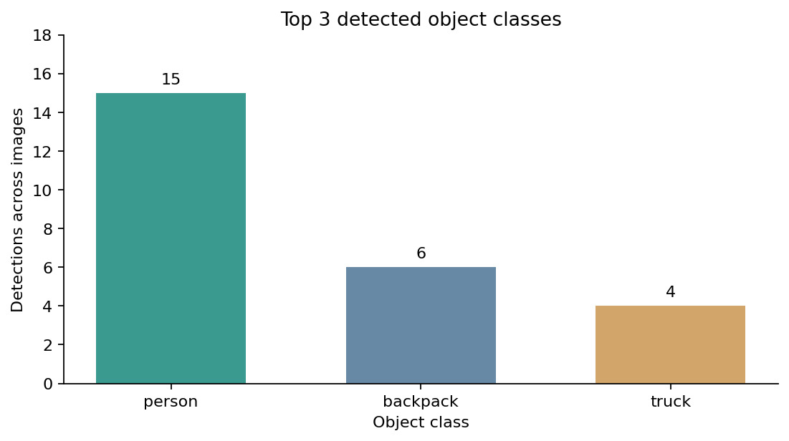
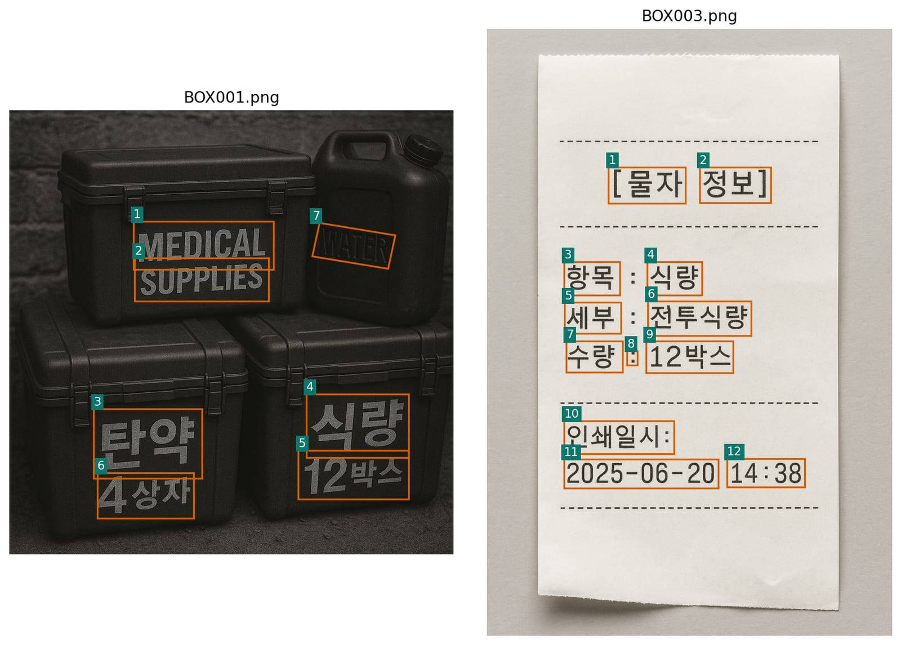
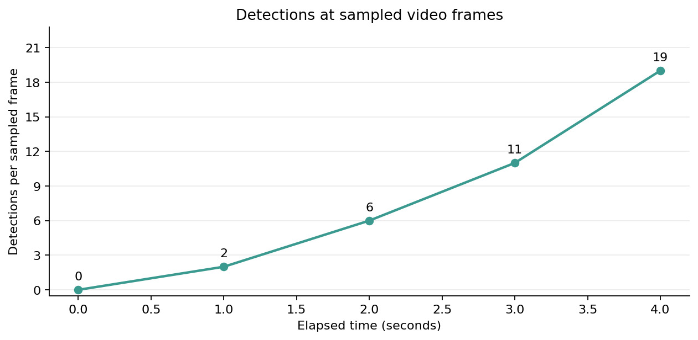
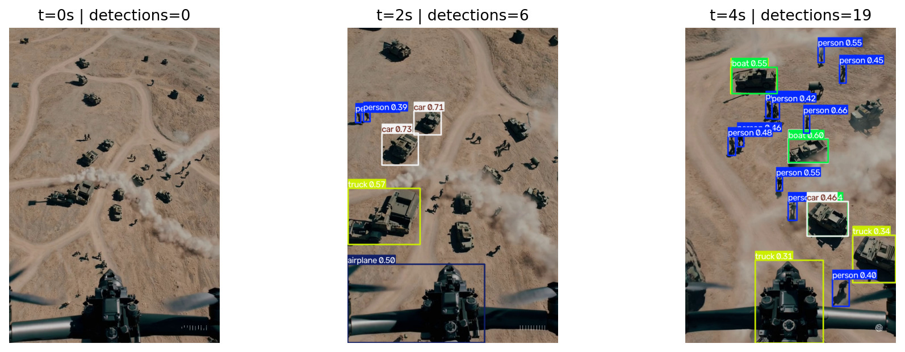

> **이번 글의 질문**
>
> 사진 세 장에서 `person`이 15건 탐지됐다면 서로 다른 사람이 15명 있다는 뜻일까요? 이미지 속 글자를 정리할 때는 어떤 정보를 남겨야 할까요? 영상에서 탐지 0건인 프레임은 그래프에서 빼도 될까요?

> **핵심 요약**
>
> YOLO의 탐지 결과는 클래스별 빈도와 프레임별 변화로, OCR 결과는 파일명·텍스트·좌표가 있는 표로 정리합니다. Counter로 개수를 누적하고, 정규 표현식으로 텍스트를 정리하며, OpenCV로 영상 프레임을 읽습니다. 집계 단위, 원본 텍스트, 탐지 0건인 시점을 함께 남겨야 결과의 의미를 다시 확인할 수 있습니다.

## 1. 모델의 결과를 분석할 수 있는 표로 바꿉니다

사진에 Box를 그렸다면 그다음은 집계입니다. 어떤 대상이 몇 번 탐지됐는지, 글자는 어느 이미지에서 읽혔는지, 영상에서는 시간이 지나며 어떻게 바뀌는지 기록합니다. 결과를 다시 확인할 수 있도록 원본 위치와 처리 상태도 남깁니다.

[파이썬 데이터 분석 공부노트 09](/cs/data-analysis/pandas-09-image-object-detection/)에서는 픽셀 배열, BGR·RGB, Bounding Box와 객체 탐지 결과를 살펴봤습니다. 이번에는 그 결과를 Counter와 DataFrame으로 집계하고, OCR과 영상 분석으로 확장합니다.

| 작업 | 모델이 반환하는 것 | 분석할 때의 단위 |
| --- | --- | --- |
| 이미지 분류 | 이미지 전체에 대한 클래스 예측 | 이미지 한 장 |
| 객체 탐지 | 객체별 클래스·Box·Confidence | 탐지된 객체 한 건 |
| OCR | 텍스트 영역·인식한 글자·Confidence | 인식된 텍스트 영역 한 개 |

YOLO로 한 이미지에서 `person` 일곱 건과 `truck` 한 건을 찾는 작업은 **객체 탐지**(Object Detection)입니다. 이미지 전체에 라벨 하나를 붙이는 분류와 구분합니다. OCR은 글자가 있는 영역을 찾고 그 내용을 읽는 작업이며, 반환된 영역 하나가 문장 한 줄이나 문서의 항목 하나와 항상 일치하지는 않습니다.

| 실습 입력 | 구성 | 만들 결과 |
| --- | --- | --- |
| `images/surv_imgs` | `CAM001~003.png` 세 장 | 클래스별 빈도와 상위 3개 객체의 Bar Chart |
| `images/supplies_imgs` | `BOX001~004.png` 네 장 | OCR 원본과 정리한 텍스트의 CSV |
| `videos/drone_mission.mp4` | 30 FPS, 150프레임, 약 5초 | 탐지 상세 CSV와 프레임별 시계열 그래프 |

`images`와 `videos` 폴더를 작업 폴더 아래에 두고 실행합니다. 저장할 표의 한 행이 무엇을 나타내는지 먼저 정하면, 나중에 개수를 세거나 데이터를 합칠 때도 기준이 분명해집니다.

## 2. 파일을 고르고, Counter로 개수를 누적합니다

### 2-1. List Comprehension으로 이미지 파일만 선택합니다

```python
from pathlib import Path
from collections import Counter, defaultdict
import re
import json
import pandas as pd
import numpy as np
import matplotlib.pyplot as plt
from matplotlib.ticker import MaxNLocator
from PIL import Image

plot_dir = Path("plots")
plot_dir.mkdir(parents=True, exist_ok=True)

def list_image_files(directory):
    directory = Path(directory)
    extensions = {".jpg", ".jpeg", ".png"}
    return sorted([
        path for path in directory.iterdir()
        if path.is_file() and path.suffix.lower() in extensions
    ])

image_files = list_image_files("images/surv_imgs")
supply_files = list_image_files("images/supplies_imgs")

print("탐지 이미지:", [path.name for path in image_files])
print("OCR 이미지:", [path.name for path in supply_files])
```

```text
탐지 이미지: ['CAM001.png', 'CAM002.png', 'CAM003.png']
OCR 이미지: ['BOX001.png', 'BOX002.png', 'BOX003.png', 'BOX004.png']
```

`[표현식 for 항목 in 반복 대상 if 조건]`이 **List Comprehension**입니다. for 부분부터 읽으면 이해하기 쉽습니다. 폴더 안의 각 `path`를 순회하고, 실제 파일이면서 확장자가 jpg·jpeg·png일 때만 List에 넣습니다. `lower()`를 사용하므로 `.PNG`처럼 대문자로 된 확장자도 선택됩니다.

`os.listdir()`와 `filename.lower().endswith((".jpg", ".png", ".jpeg"))`를 조합해도 파일 목록을 만들 수 있습니다. 여기서는 `Path`의 `is_file()`로 같은 이름의 폴더를 제외하고, `sorted()`로 처리 순서를 일정하게 맞춥니다. 확장자는 파일 선택 기준이고, 실제로 읽을 수 있는지는 이미지를 열 때 확인합니다.

### 2-2. Counter.update()는 기존 개수에 더합니다

```python
counter_example = Counter(["person", "person", "truck"])
counter_example.update(["person", "backpack"])

print("누적 결과:", dict(counter_example))
print("없는 클래스의 개수:", counter_example["car"])
print("빈도가 높은 순서:", counter_example.most_common(3))

dictionary_example = {"person": 2}
dictionary_example.update({"person": 1})
counter_update_example = Counter({"person": 2})
counter_update_example.update({"person": 1})
print("Dictionary.update:", dictionary_example)
print("Counter.update:", dict(counter_update_example))
```

```text
누적 결과: {'person': 3, 'truck': 1, 'backpack': 1}
없는 클래스의 개수: 0
빈도가 높은 순서: [('person', 3), ('truck', 1), ('backpack', 1)]
Dictionary.update: {'person': 1}
Counter.update: {'person': 3}
```

Counter는 항목별 개수를 저장합니다. 클래스 이름 List를 넘기면 같은 이름이 나올 때마다 1씩 더하고, `update()`로 다음 이미지의 결과를 누적할 수 있습니다. 일반 Dictionary의 `update`는 같은 키의 값을 덮어쓰지만, Counter의 `update`는 개수를 더합니다.

`most_common(3)`은 빈도가 높은 항목 세 개를 반환합니다. 결과를 CSV로 저장할 때는 `items()`를 DataFrame으로 바꿔 정렬하면 편합니다. 또 `update("person")`처럼 문자열 하나를 그대로 넘기면 글자별 개수를 세므로, 클래스 하나를 추가할 때도 `update(["person"])`처럼 List로 전달합니다.

> **Counter는 이미지 반복문 밖에서 한 번 초기화합니다.** 반복문 안에서 새로 만들면 마지막 이미지의 개수만 남고, 이미 누적한 Counter에 같은 결과를 다시 `update`하면 개수가 중복됩니다.

## 3. 실습 1: 객체 빈도를 집계하고 상위 3개를 그립니다

### 3-1. 모델은 한 번 로드하고 탐지 조건을 정합니다

```python
import torch

model = torch.hub.load(
    "ultralytics/yolov5", "yolov5s",
    pretrained=True, trust_repo=True,
)
model.conf = 0.25
model.iou = 0.45
model.classes = None

print("Confidence threshold:", model.conf)
print("NMS IoU threshold:", model.iou)
print("클래스 필터:", model.classes)
```

```text
Confidence threshold: 0.25
NMS IoU threshold: 0.45
클래스 필터: None
```

COCO로 사전 학습된 YOLOv5s를 사용합니다. `model.conf`는 남길 탐지 결과의 Confidence 기준이고, `model.iou`는 NMS에서 겹치는 후보를 정리할 때 사용하는 IoU 기준입니다. `classes=None`은 특정 클래스만 골라내는 필터를 사용하지 않는다는 뜻입니다. 모델의 전체 클래스 중 기준을 통과한 결과를 집계합니다.

`torch.hub.load()`는 저장소의 모델 코드를 가져와 사용합니다. 여기서는 공식 Ultralytics 저장소를 지정합니다. `trust_repo=True`는 해당 저장소를 신뢰하도록 설정하는 옵션이며, 탐지 정확도를 높이는 설정은 아닙니다.

### 3-2. 객체별 상세 정보와 이미지별 개수를 함께 저장합니다

```python
total_counter = Counter()
image_detail_rows = []
image_summary_rows = []

for path in image_files:
    try:
        with Image.open(path) as source:
            image = source.convert("RGB")
    except (OSError, ValueError):
        image_summary_rows.append({
            "filename": path.name, "total_count": pd.NA,
            "status": "read_failed",
        })
        continue

    results = model(image, size=640)
    detections = results.pandas().xyxy[0]
    class_names = detections["name"].tolist()
    total_counter.update(class_names)

    image_summary_rows.append({
        "filename": path.name, "total_count": len(detections),
        "status": "ok",
    })
    for object_index, row in enumerate(detections.itertuples(), start=1):
        image_detail_rows.append({
            "filename": path.name, "object_index": object_index,
            "object_class": row.name, "confidence": float(row.confidence),
            "x_min": float(row.xmin), "y_min": float(row.ymin),
            "x_max": float(row.xmax), "y_max": float(row.ymax),
        })

image_details = pd.DataFrame(image_detail_rows, columns=[
    "filename", "object_index", "object_class", "confidence",
    "x_min", "y_min", "x_max", "y_max",
])
image_summary = pd.DataFrame(image_summary_rows, columns=[
    "filename", "total_count", "status",
])
object_count = pd.DataFrame(
    total_counter.items(), columns=["object_class", "count"],
).sort_values(["count", "object_class"], ascending=[False, True])

image_details.to_csv("image_detection_details.csv", index=False)
image_summary.to_csv("image_detection_summary.csv", index=False)
object_count.to_csv("object_count.csv", index=False)

print(image_summary.to_string(index=False))
print(object_count.to_string(index=False))
```

```text
  filename  total_count status
CAM001.png           10     ok
CAM002.png           10     ok
CAM003.png            6     ok
object_class  count
      person     15
    backpack      6
       truck      4
         car      1
```

Pillow로 이미지를 열고 RGB로 변환한 뒤 모델에 전달합니다. `results.pandas().xyxy[0]`은 첫 번째 입력 이미지의 탐지 결과 DataFrame입니다. 이번 반복문에서는 이미지를 한 장씩 넣으므로 매번 `[0]`을 사용합니다. 클래스 이름은 `name` 열에서 가져옵니다.

상세 표에는 파일명과 객체별 좌표·Confidence를 남기고, 요약 표에는 이미지별 총 탐지 수를 남깁니다. 어떤 클래스를 잘못 셌는지 확인하고 싶을 때는 상세 표로 돌아갈 수 있습니다. 정상적으로 읽었지만 탐지 결과가 없으면 `total_count`는 0이고, 읽기 실패는 결측값과 `status`로 구분합니다.

세 이미지에서 총 **26건**이 탐지됐습니다. `person`은 15건, `backpack`은 6건, `truck`은 4건, `car`는 1건입니다. 여기서 15는 **세 이미지에 걸친 `person` 탐지 건수의 합**입니다. 이미지 사이에 같은 사람이 다시 나타났는지는 이 집계만으로 판단할 수 없습니다.

### 3-3. 내림차순 정렬한 뒤 head(3)을 사용합니다

```python
top3 = object_count.head(3)

fig, ax = plt.subplots(figsize=(7, 4))
bars = ax.bar(
    top3["object_class"], top3["count"],
    color=["#3a9a90", "#6889a5", "#d2a56b"], width=0.6,
)
ax.bar_label(bars, padding=4)
ax.set(
    title="Top 3 detected object classes",
    xlabel="Object class", ylabel="Detections across images",
)
ax.set_ylim(0, max(1, top3["count"].max() * 1.2) if not top3.empty else 1)
ax.yaxis.set_major_locator(MaxNLocator(integer=True))
ax.spines[["top", "right"]].set_visible(False)
fig.tight_layout()
fig.savefig(plot_dir / "top3_objects.png", dpi=160, bbox_inches="tight")
plt.close(fig)
```



*정렬 후 `head(3)`을 사용합니다. `y`축은 이미지 전체에 누적한 탐지 건수이며, 고유 객체 수가 아닙니다.*

`head(3)`은 가장 큰 값 세 개를 찾아주는 함수가 아니라 **현재 행 순서의 앞 세 행**을 가져오는 함수입니다. `count`를 내림차순으로 정렬한 다음 적용해야 상위 3개가 됩니다. `count`가 같을 때는 `object_class`를 오름차순으로 정렬해 순서를 일정하게 맞췄습니다.

### 3-4. “많이 탐지됐다”와 “여러 이미지에 등장했다”는 다릅니다

```python
images_with_class = image_details.groupby("object_class")["filename"].nunique()
valid_image_count = int(image_summary["status"].eq("ok").sum())

class_summary = object_count.copy()
class_summary["images_with_class"] = images_with_class.reindex(
    class_summary["object_class"], fill_value=0,
).to_numpy()
class_summary["image_fraction"] = (
    class_summary["images_with_class"] / valid_image_count
    if valid_image_count else np.nan
)
print(class_summary.round(3).to_string(index=False))
```

```text
object_class  count  images_with_class  image_fraction
      person     15                  3           1.000
    backpack      6                  2           0.667
       truck      4                  3           1.000
         car      1                  1           0.333
```

| 클래스 | 탐지 건수 | 탐지된 이미지 수 | 정상 처리 이미지 중 비율 |
| --- | --- | --- | --- |
| `person` | 15 | 3 | 100.0% |
| `backpack` | 6 | 2 | 66.7% |
| `truck` | 4 | 3 | 100.0% |
| `car` | 1 | 1 | 33.3% |

`backpack`은 6건으로 `truck`의 4건보다 많이 탐지됐지만, 등장한 이미지는 두 장입니다. `truck`은 세 장 모두에서 탐지됐습니다. **객체 빈도**를 묻는다면 `count`를, **이미지별 등장 여부**를 묻는다면 파일명의 `nunique`를 사용합니다. 이 비율도 모델이 탐지한 결과를 기준으로 계산한 것입니다.

## 4. 실습 2: OCR 텍스트를 읽고 정리합니다

### 4-1. detail=0과 detail=1이 남기는 정보가 다릅니다

EasyOCR은 이미지 속 텍스트 영역을 찾고 글자를 인식합니다. 노트북에서는 `%pip install easyocr`, 터미널에서는 `pip install easyocr`로 설치합니다. `Reader`는 반복문 밖에서 한 번 생성합니다. 언어를 `ko`·`en`으로 지정하면 한국어와 영어를 읽고, `gpu=False`는 CPU를 사용하도록 설정합니다.

| 설정 | 반환되는 정보 | 활용 |
| --- | --- | --- |
| `detail=0` | 인식한 텍스트 List | 내용만 빠르게 확인합니다. |
| `detail=1` | Box·텍스트·Confidence | 원본 위치와 인식 결과를 검토하고 표로 저장합니다. |

`reader.readtext(image_path, detail=0)`은 간단하지만 좌표와 Confidence가 빠집니다. 데이터로 활용할 때는 `detail=1`을 사용해 원본과 결과를 연결할 정보를 남깁니다. 아래에서는 정리하기 전의 텍스트도 함께 보관합니다.

### 4-2. re.match()는 특수문자를 제거하지 않습니다

`re.match(r"[가-힣A-Za-z0-9]+", text)`는 문자열의 **시작 부분**이 패턴에 맞는지 확인합니다. 문자열 전체를 검사하거나 특수문자를 삭제하는 함수가 아닙니다. 예를 들어 “식량: 12박스”에서는 시작 부분인 “식량”이 매칭되므로, if 조건을 통과한 뒤 원래 `text`를 저장하면 콜론과 공백도 그대로 남습니다.

```python
def clean_ocr_text(raw_text):
    text = raw_text.strip()
    # 허용하지 않는 문자는 공백으로 바꿔 단어가 붙지 않게 합니다.
    text = re.sub(r"[^가-힣A-Za-z0-9\s]", " ", text)
    return re.sub(r"\s+", " ", text).strip()

pattern = r"[가-힣A-Za-z0-9]+"
examples = ["식량: 12박스", "(12박스)", "12박스", "5.56mm", "---"]

for text in examples:
    prefix_match = re.match(pattern, text)
    matched_text = prefix_match.group(0) if prefix_match else None
    print(
        repr(text), "| match:", matched_text,
        "| fullmatch:", bool(re.fullmatch(pattern, text)),
        "| cleaned:", repr(clean_ocr_text(text)),
    )
```

```text
'식량: 12박스' | match: 식량 | fullmatch: False | cleaned: '식량 12박스'
'(12박스)' | match: None | fullmatch: False | cleaned: '12박스'
'12박스' | match: 12박스 | fullmatch: True | cleaned: '12박스'
'5.56mm' | match: 5 | fullmatch: False | cleaned: '5 56mm'
'---' | match: None | fullmatch: False | cleaned: ''
```

| 함수 | 검사·변경 범위 | 선택할 때 |
| --- | --- | --- |
| `re.match()` | 문자열의 시작 | 시작 부분이 특정 형식인지 확인합니다. |
| `re.search()` | 문자열 안에서 일치하는 부분 | 앞에 다른 문자가 있어도 패턴을 찾습니다. |
| `re.fullmatch()` | 문자열 전체 | 모든 문자가 허용한 형식인지 검사합니다. |
| `re.sub()` | 패턴에 맞는 부분을 교체 | 불필요한 문자를 제거하거나 바꿉니다. |

위 `fullmatch` 예제의 패턴은 한글 완성형·영문·숫자만 허용하고 공백도 허용하지 않습니다. 공백까지 허용해 전체를 검사하려면 `r"[가-힣A-Za-z0-9\s]+"`처럼 조건을 바꿉니다. “문장 전체를 걸러낼 것인지”와 “문장 안의 불필요한 문자를 바꿀 것인지”에 따라 `fullmatch`와 `sub`를 구분합니다.

| 패턴 | 뜻 |
| --- | --- |
| `가-힣` | 한글 완성형 음절의 범위입니다. ㄱ·ㅏ 같은 낱자까지 포함하지는 않습니다. |
| `A-Za-z0-9` | 영문 대문자·소문자와 숫자를 허용합니다. |
| `\s` | 공백·탭·줄바꿈 같은 공백 문자를 뜻합니다. |
| `[^...]` | 대괄호 안의 문자 집합에 포함되지 않는 문자를 뜻합니다. |
| `+` | 앞의 패턴이 한 번 이상 반복되는 것을 뜻합니다. |

`r` 접두사는 Raw String을 만듭니다. Python 문자열 처리 단계에서 백슬래시를 그대로 전달하기 위한 표현입니다. 정규 표현식 엔진은 전달된 `\s`를 공백 패턴으로 해석합니다. `strip()`은 문자열 양 끝의 공백을 정리하고, 두 번째 `sub`는 여러 공백을 하나로 합칩니다.

### 4-3. 현재 파일명, 원본 텍스트, 좌표를 함께 저장합니다

```python
import easyocr

reader = easyocr.Reader(["ko", "en"], gpu=False, verbose=False)
ocr_raw_rows = []
ocr_clean_rows = []
ocr_summary_rows = []
ocr_results_by_file = {}

for path in supply_files:
    results = reader.readtext(str(path), detail=1)
    ocr_results_by_file[path.name] = results
    kept_count = 0

    for region_index, (bbox, raw_text, confidence) in enumerate(results, start=1):
        coordinates = [[float(x), float(y)] for x, y in bbox]
        row = {
            "filename": path.name, "region_index": region_index,
            "raw_text": raw_text, "confidence": float(confidence),
            "bbox": json.dumps(coordinates),
        }
        ocr_raw_rows.append(row)

        cleaned_text = clean_ocr_text(raw_text)
        if cleaned_text:
            ocr_clean_rows.append({**row, "text": cleaned_text})
            kept_count += 1

    ocr_summary_rows.append({
        "filename": path.name, "raw_region_count": len(results),
        "saved_region_count": kept_count,
    })

ocr_raw = pd.DataFrame(ocr_raw_rows, columns=[
    "filename", "region_index", "raw_text", "confidence", "bbox",
])
supply_info = pd.DataFrame(ocr_clean_rows, columns=[
    "filename", "region_index", "text", "raw_text", "confidence", "bbox",
])
ocr_summary = pd.DataFrame(ocr_summary_rows)

ocr_raw.to_csv("ocr_raw_results.csv", index=False, encoding="utf-8-sig")
supply_info.to_csv("supply_info.csv", index=False, encoding="utf-8-sig")
ocr_summary.to_csv("ocr_image_summary.csv", index=False, encoding="utf-8-sig")
print(ocr_summary.to_string(index=False))
```

```text
  filename  raw_region_count  saved_region_count
BOX001.png                 7                   6
BOX002.png                12                  12
BOX003.png                12                  11
BOX004.png                16                  16
```

네 이미지에서 텍스트 영역 **47개**가 반환되고, 정리 후 내용이 남는 **45개**를 `supply_info.csv`에 저장합니다. BOX001의 작은따옴표와 BOX003의 콜론만 있는 영역은 정리 후 빈 문자열이 되므로 저장 목록에서 제외됩니다. 원본 결과 47개는 `ocr_raw_results.csv`에 남습니다.

`filename`에는 반복 중인 `path.name`을 넣습니다. 다른 파일을 가리키는 변수를 사용하면 텍스트는 맞아도 출처 파일명이 섞일 수 있습니다. `region_index`는 각 이미지 안에서 텍스트 영역을 다시 찾기 위한 번호이고, `bbox`에는 영역을 둘러싼 네 꼭짓점 좌표를 JSON 문자열로 저장합니다.

| 파일명 | 원본 인식 텍스트 | 정리한 텍스트 | Confidence |
| --- | --- | --- | --- |
| `BOX001.png` | MEDIGAL | MEDIGAL | 0.9754 |
| `BOX001.png` | 12박스 | 12박스 | 0.9961 |
| `BOX002.png` | 탄약류: 5,56mm | 탄약류 5 56mm | 0.5519 |
| `BOX003.png` | 12박스 | 12박스 | 0.8519 |
| `BOX003.png` | 2025-06-20 | 2025 06 20 | 0.9982 |
| `BOX003.png` | 14 : 38 | 14 38 | 0.5718 |

### 4-4. 텍스트 정리와 인식 오류 수정은 다른 작업입니다

BOX001의 상자에는 “MEDICAL”이라고 적혀 있지만 OCR은 <strong>“MEDIGAL”</strong>로 읽었습니다. Confidence는 약 0.9754로 높습니다. 이 문자열은 영문 패턴에 잘 맞으므로 정규 표현식 검사도 통과합니다. 글자의 형식을 확인하는 것만으로 철자가 맞는지까지 판단할 수는 없습니다.

```python
from matplotlib.patches import Polygon

preview_files = ["BOX001.png", "BOX003.png"]
fig, axes = plt.subplots(1, 2, figsize=(10, 7))
for ax, filename in zip(axes, preview_files):
    with Image.open(Path("images/supplies_imgs") / filename) as source:
        ax.imshow(source.convert("RGB"))
    for number, (bbox, text, confidence) in enumerate(
        ocr_results_by_file[filename], start=1,
    ):
        points = np.array(bbox, dtype=float)
        ax.add_patch(Polygon(points, closed=True, fill=False,
                             edgecolor="#d55e00", linewidth=1.4))
        ax.text(
            points[:, 0].min(), max(0, points[:, 1].min() - 8), str(number),
            color="white", fontsize=9,
            bbox={"facecolor": "#0f766e", "edgecolor": "none", "pad": 2},
        )
    ax.set_title(filename)
    ax.axis("off")
fig.tight_layout()
fig.savefig(plot_dir / "ocr_text_regions.png", dpi=170, bbox_inches="tight")
plt.close(fig)
```



*숫자는 각 파일의 `region_index`입니다. 인식한 글자와 원본 위치를 함께 보면 철자 오류와 영역 분할을 확인하기 쉽습니다.*

또한 `5.56mm`를 위 함수로 정리하면 `5 56mm`, `2025-06-20`은 `2025 06 20`, `14 : 38`은 `14 38`이 됩니다. 검색용 텍스트에서는 쓸 수 있는 표현이어도, 수량·날짜·소수 값을 해석할 때는 구분 기호가 필요합니다. **숫자를 데이터 타입으로 변환할 때는 `raw_text`를 바탕으로 항목별 규칙을 적용합니다.**

BOX003의 “수량”과 “12박스”도 각각 다른 OCR 영역으로 반환됩니다. 숫자가 있다는 이유로 모든 텍스트를 이어 붙이면 수량, 날짜, 시각이 섞입니다. 같은 행의 `y`좌표와 항목 옆의 위치를 확인해 영역을 연결하고, 단위와 허용 범위를 검토한 뒤 수량 열을 만듭니다. 이 글의 `supply_info.csv`는 인식 텍스트 기록이며, 검증을 마친 재고 수량표와는 구분합니다.

> **원본 인식 텍스트는 남기고, 정리한 텍스트를 새 열로 만듭니다.** Confidence가 낮은 결과를 우선 검토하되, 중요한 숫자와 항목명은 원본 이미지의 해당 영역에서도 확인합니다.

## 5. 실습 3: 영상의 탐지 수를 시간에 따라 기록합니다

### 5-1. FPS와 샘플링 간격을 확인합니다

```python
import cv2

video_path = Path("videos/drone_mission.mp4")
cap = cv2.VideoCapture(str(video_path))
if not cap.isOpened():
    cap.release()
    raise RuntimeError(f"영상을 열 수 없습니다: {video_path}")

fps = cap.get(cv2.CAP_PROP_FPS)
total_frames = int(cap.get(cv2.CAP_PROP_FRAME_COUNT))
if not np.isfinite(fps) or fps <= 0:
    cap.release()
    raise ValueError("유효한 FPS를 가져오지 못했습니다.")

sampling_seconds = 1.0
frame_interval = max(1, round(fps * sampling_seconds))

print("FPS:", fps)
print("전체 프레임 수:", total_frames)
print("영상 길이(초):", round(total_frames / fps, 3))
print("샘플링 간격(프레임):", frame_interval)
```

```text
FPS: 30.0
전체 프레임 수: 150
영상 길이(초): 5.0
샘플링 간격(프레임): 30
```

FPS는 초당 프레임 수입니다. 이 파일은 30 FPS이므로 1초 간격으로 처리하려면 30프레임마다 탐지합니다. 0부터 시작하는 프레임 번호 0·30·60·90·120은 각각 0·1·2·3·4초에 해당합니다. 총 150프레임이므로 프레임 번호 150은 범위 밖입니다.

`isOpened()`는 영상이 열렸는지 확인하고, `read()`는 다음 프레임과 읽기 성공 여부를 반환합니다. FPS를 가져오지 못해 0이 반환되는 경우에는 나눗셈이나 샘플링 계산을 진행하지 않습니다. FPS와 프레임 수는 영상 속성 정보이므로, 처리 후 실제로 읽은 프레임 수도 확인합니다.

### 5-2. 탐지 결과가 없어도 프레임별 기록은 남깁니다

```python
video_detail_rows = []
frame_summary_rows = []
detection_counts_by_frame = defaultdict(int)
frame_previews = {}
frame_number = 0

try:
    while True:
        ok, frame_bgr = cap.read()
        if not ok:
            break

        if frame_number % frame_interval == 0:
            # YOLOv5 Hub의 NumPy 입력은 RGB로 전달합니다.
            frame_rgb = cv2.cvtColor(frame_bgr, cv2.COLOR_BGR2RGB)
            results = model(frame_rgb, size=640)
            detections = results.pandas().xyxy[0]
            frame_classes = Counter(detections["name"].tolist())

            # 객체 반복문 밖에서 0건인 프레임도 기록합니다.
            detection_counts_by_frame[frame_number] = len(detections)
            frame_summary_rows.append({
                "frame_number": frame_number,
                "time_seconds": frame_number / fps,
                "total_count": len(detections),
                "person_count": frame_classes["person"],
            })

            for row in detections.itertuples():
                video_detail_rows.append({
                    "frame_number": frame_number,
                    "time_seconds": frame_number / fps,
                    "class_name": row.name,
                    "confidence": float(row.confidence),
                    "x_min": float(row.xmin), "y_min": float(row.ymin),
                    "x_max": float(row.xmax), "y_max": float(row.ymax),
                })

            frame_previews[frame_number] = results.render()[0].copy()

        frame_number += 1
finally:
    cap.release()

video_details = pd.DataFrame(video_detail_rows, columns=[
    "frame_number", "time_seconds", "class_name", "confidence",
    "x_min", "y_min", "x_max", "y_max",
])
frame_counts = pd.DataFrame(frame_summary_rows, columns=[
    "frame_number", "time_seconds", "total_count", "person_count",
])
video_details.to_csv("drone_detection.csv", index=False)
frame_counts.to_csv("frame_detection_counts.csv", index=False)

print("읽은 프레임 수:", frame_number)
print("분석한 프레임 수:", len(frame_counts))
print("누적 탐지 건수:", len(video_details))
print(frame_counts.to_string(index=False))
```

```text
읽은 프레임 수: 150
분석한 프레임 수: 5
누적 탐지 건수: 38
 frame_number  time_seconds  total_count  person_count
            0           0.0            0             0
           30           1.0            2             0
           60           2.0            6             2
           90           3.0           11             2
          120           4.0           19            10
```

OpenCV에서 읽은 컬러 프레임은 BGR입니다. YOLOv5 Hub 모델에 NumPy 배열을 전달할 때는 RGB로 변환합니다. 이 순서는 앞선 이미지 실습의 Pillow RGB 입력과도 일치합니다. 라이브러리의 입력 규칙을 맞춰야 색상 채널이 바뀐 상태로 모델에 들어가는 일을 막을 수 있습니다.

객체별 상세 정보는 `drone_detection.csv`에 저장하고, 분석한 모든 프레임의 개수는 `frame_detection_counts.csv`에 저장합니다. 첫 프레임의 탐지 수가 0이면 상세 표에는 그 프레임의 객체 행이 없지만, 프레임 요약 표에는 **0초·0건이라는 행**이 남습니다. `finally`에서 `release`를 호출해 도중에 예외가 발생해도 영상 자원을 해제합니다.

| 프레임 번호 | 경과 시간(초) | 전체 탐지 수 | person 탐지 수 |
| --- | --- | --- | --- |
| 0 | 0.0 | 0 | 0 |
| 30 | 1.0 | 2 | 0 |
| 60 | 2.0 | 6 | 2 |
| 90 | 3.0 | 11 | 2 |
| 120 | 4.0 | 19 | 10 |

### 5-3. x축을 경과 시간으로 표시합니다

```python
fig, ax = plt.subplots(figsize=(8, 4))
ax.plot(
    frame_counts["time_seconds"], frame_counts["total_count"],
    marker="o", color="#3a9a90", linewidth=2,
)
for row in frame_counts.itertuples():
    ax.annotate(
        str(row.total_count), (row.time_seconds, row.total_count),
        xytext=(0, 8), textcoords="offset points", ha="center",
    )
ax.set(
    title="Detections at sampled video frames",
    xlabel="Elapsed time (seconds)", ylabel="Detections per sampled frame",
)
ax.set_ylim(-0.5, max(1, frame_counts["total_count"].max() * 1.2))
ax.yaxis.set_major_locator(MaxNLocator(integer=True))
ax.grid(axis="y", alpha=0.25)
ax.spines[["top", "right"]].set_visible(False)
fig.tight_layout()
fig.savefig(plot_dir / "detection_over_time.png", dpi=160, bbox_inches="tight")
plt.close(fig)
```



*점은 실제로 분석한 다섯 프레임입니다. 점 사이의 선은 흐름을 보여 주며, 그 사이의 모든 프레임을 탐지한 결과를 뜻하지는 않습니다.*

```python
preview_numbers = [0, 2 * frame_interval, 4 * frame_interval]
fig, axes = plt.subplots(1, 3, figsize=(12, 4))
for ax, number in zip(axes, preview_numbers):
    ax.imshow(frame_previews[number])
    ax.set_title(
        f"t={number / fps:.0f}s | detections={detection_counts_by_frame[number]}"
    )
    ax.axis("off")
fig.tight_layout()
fig.savefig(plot_dir / "video_sampled_frames.png", dpi=160, bbox_inches="tight")
plt.close(fig)
```



*그래프의 숫자를 샘플 프레임과 함께 확인합니다. 클래스 이름은 모델의 예측입니다.*

이번 출력에는 `car`·`truck`·`person` 외에 `airplane`·`boat`라는 클래스 예측도 포함됩니다. 작은 대상의 모양이나 화면 구도가 달라지면 잘못된 클래스가 붙을 수 있습니다. 따라서 그래프가 올라간 이유를 곧바로 “실제 객체가 그만큼 증가했다”라고 설명하기보다, 해당 시점의 이미지와 Box·Confidence를 함께 확인합니다.

## 6. 시계열로 해석할 때 집계 기준을 다시 확인합니다

### 6-1. defaultdict(int)도 기록하지 않은 시점을 만들지는 않습니다

`defaultdict(int)`는 없는 키에 대괄호로 접근하면 int의 기본값인 0을 만들고 저장합니다. 하지만 객체가 없어서 해당 키에 한 번도 접근하지 않았다면 그 프레임 기록도 생기지 않습니다. 객체 반복문 안에서만 개수를 더하면 0건인 프레임이 빠지는 이유입니다.

```python
sampled_counts = [(0, 0), (30, 2)]

counts_inside_loop = defaultdict(int)
for number, detected_count in sampled_counts:
    for _ in range(detected_count):
        counts_inside_loop[number] += 1
print("객체 반복문 안에서만 기록:", dict(counts_inside_loop))

counts_for_every_frame = {}
for number, detected_count in sampled_counts:
    counts_for_every_frame[number] = detected_count
print("모든 분석 프레임에 기록:", counts_for_every_frame)
```

```text
객체 반복문 안에서만 기록: {30: 2}
모든 분석 프레임에 기록: {0: 0, 30: 2}
```

| 상태 | 개수 값 | 의미 |
| --- | --- | --- |
| 정상 처리, 탐지 없음 | `0` | 모델을 실행했지만 기준을 통과한 객체가 없습니다. |
| 프레임을 분석하지 않음 | 관측값 없음 | 샘플링 대상이 아니어서 탐지 결과를 모릅니다. |
| 영상·프레임 읽기 실패 | 결측값과 실패 상태 | 실제 개수가 0이라고 해석하지 않습니다. |

`cap.read()`가 `False`를 반환하면 영상이 끝났거나 프레임을 읽지 못한 상태이므로 반복을 종료합니다. 예상보다 일찍 끝났다면 프레임 수와 파일 상태를 확인합니다. 확인하지 않은 시간을 0으로 채우면 “탐지되지 않은 것”과 “관측하지 못한 것”이 섞입니다.

### 6-2. 프레임별 개수를 합쳐도 고유 객체 수가 되지 않습니다

같은 차량 한 대가 세 프레임에 연속으로 보이면 객체 탐지 집계에서는 세 건이 됩니다. 영상 상세 표의 38행은 다섯 샘플 프레임에서 누적한 **탐지 38건**이고, 서로 다른 객체 38개가 아닙니다. 프레임별 `count`는 각 시점에 모델이 몇 개를 탐지했는지 설명하는 값입니다.

연속된 프레임에서 같은 객체를 연결하려면 Object Tracking처럼 ID를 연결하는 별도 과정이 필요합니다. Tracking에서도 가림이나 놓친 탐지 때문에 ID가 바뀔 수 있으므로, 단순히 ID 개수를 세는 것과 검증된 고유 객체 수를 구하는 것은 구분합니다.

### 6-3. 2초 간격으로 요약할 때 mean·max·count를 함께 봅니다

[파이썬 데이터 분석 공부노트 03](/cs/data-analysis/pandas-03-time-series-resampling/)의 `resample`을 경과 시간에도 적용할 수 있습니다. 촬영 시작 날짜·시각을 모르므로 임의의 날짜를 붙이지 않고, `time_seconds`를 Timedelta로 변환합니다.

```python
timeline = frame_counts.assign(
    elapsed=pd.to_timedelta(frame_counts["time_seconds"], unit="s"),
).set_index("elapsed")["total_count"]

window_stats = timeline.resample("2s").agg(["mean", "max", "count"])
window_stats = window_stats.rename(columns={
    "mean": "mean_detections", "max": "max_detections", "count": "sample_count",
})
window_stats.to_csv("detection_windows_2s.csv")
print(window_stats.to_string())
```

```text
                 mean_detections  max_detections  sample_count
elapsed
0 days 00:00:00              1.0               2             2
0 days 00:00:02              8.5              11             2
0 days 00:00:04             19.0              19             1
```

0초 이상 2초 미만 구간은 0건과 2건의 평균인 **1건**, 2초 이상 4초 미만 구간은 6건과 11건의 평균인 **8.5건**입니다. 4초 이상 6초 미만 구간에는 마지막 샘플 하나만 들어가므로 평균은 19건, `sample_count`는 1입니다. 같은 2초 구간이어도 실제 관측 수가 다르다는 점을 함께 읽습니다.

`mean`은 샘플 프레임별 탐지 수의 평균이고, `max`는 그중 가장 큰 탐지 수입니다. `sum`을 사용하면 반복해서 보인 객체도 계속 더해집니다. 무엇을 설명하려는지에 따라 집계 함수를 선택합니다. 여기서는 동일한 1초 간격의 샘플을 평균 낸 것이며, 영상 전체의 모든 프레임 평균을 계산한 것은 아닙니다.

### 6-4. FPS가 달라지면 “1초마다”의 계산도 확인합니다

이번 파일에서는 FPS가 정확히 30이므로 30프레임 간격이 1초와 맞습니다. 29.97 FPS라면 30프레임 간격은 약 1.001초가 됩니다. 긴 영상에서 목표 시점을 맞추려면 `round(샘플 번호 × FPS × 목표 간격)`처럼 각 목표 프레임을 계산하는 방법을 사용할 수 있습니다.

Variable Frame Rate 영상에서는 모든 프레임의 간격이 같지 않을 수 있어 `frame_number / fps`만으로 정확한 시각을 복원하기 어렵습니다. 이런 경우는 실제 타임스탬프를 확인합니다. OpenCV의 `CAP_PROP_POS_MSEC` 등 시간 속성도 백엔드와 파일 형식에 따라 지원·정확도가 달라지므로, 반환된 시간이 정상적으로 증가하는지 점검합니다.

## 7. 최신 Ultralytics API에서도 집계 방법은 이어집니다

### 7-1. Results를 하나씩 받아 Counter에 누적합니다

Ultralytics의 현재 API에서는 `YOLO(...).predict()`로 추론하고, Results의 `boxes`에서 클래스·좌표·Confidence를 읽습니다. 클래스 번호를 이름으로 바꾸는 위치가 달라질 뿐, 클래스 이름 List를 Counter에 누적하는 흐름은 같습니다. 여기서는 이 API에 맞는 YOLOv5u 가중치인 `yolov5su.pt`를 사용합니다.

```python
from ultralytics import YOLO

modern_model = YOLO("yolov5su.pt")
modern_counter = Counter()
processed_images = 0

for result in modern_model.predict(
    source=[str(path) for path in image_files],
    stream=True, conf=0.25, iou=0.45, verbose=False,
):
    class_names = [
        result.names[int(class_id)]
        for class_id in result.boxes.cls.cpu().tolist()
    ]
    modern_counter.update(class_names)
    processed_images += 1

print("처리한 이미지:", processed_images)
print("객체 빈도:", dict(modern_counter))
```

```text
처리한 이미지: 3
객체 빈도: {'person': 15, 'truck': 3, 'backpack': 3, 'umbrella': 1, 'car': 2}
```

YOLOv5u는 앞서 `torch.hub`로 로드한 YOLOv5s와 모델 구조·가중치가 다릅니다. 이 예제는 API와 모델을 함께 바꾼 것이므로 결과 개수가 같을 필요는 없습니다. 기존 `yolov5s.pt`를 그대로 이 코드의 가중치 이름으로 바꾸는 대신, 사용할 API와 호환되는 모델을 선택합니다.

| 항목 | YOLOv5 Hub | Ultralytics predict |
| --- | --- | --- |
| 모델 생성 | `torch.hub.load(...)` | `YOLO("yolov5su.pt")` |
| 객체별 결과 | `results.pandas().xyxy[0]` | `result.boxes` |
| 클래스 이름 | DataFrame의 `name` 열 | `result.names[class_id]` |
| NumPy 컬러 입력 | RGB | BGR |
| Pillow 컬러 입력 | RGB | RGB |
| 여러 결과 처리 | 반복문에서 입력을 나눕니다. | `stream=True`로 결과를 순차적으로 받습니다. |

특히 **NumPy 배열의 색상 순서가 다릅니다.** 앞의 YOLOv5 Hub 영상 코드에서는 OpenCV BGR 프레임을 RGB로 바꿨습니다. 최신 Ultralytics `predict`에 OpenCV NumPy 프레임을 직접 전달할 때는 BGR 입력 규칙을 따릅니다. API만 교체하고 색상 변환 코드를 그대로 두면 채널 순서가 어긋날 수 있습니다.

이미지·영상도 표로 만들면 비교하기 쉽습니다. 파일명·시간·원본 결과·처리 상태가 남아 있어야 집계한 숫자를 다시 추적할 수 있습니다.

## 8. 더 살펴보기: 불규칙한 간격의 평균은 시간 평균과 다릅니다

0·1·9초에 관측한 개수가 0·10·2라면 샘플 평균은 4입니다. 하지만 1초부터 9초까지 같은 값이 유지됐다고 가정하면 10이 훨씬 긴 시간을 차지합니다.

다음은 마지막 값을 다음 관측까지 유지한다는 가정을 명시한 계산입니다. 관측 종료는 10초로 둡니다.

```python
import numpy as np

time_seconds = np.array([0.0, 1.0, 9.0])
counts = np.array([0.0, 10.0, 2.0])
duration = np.diff(np.append(time_seconds, 10.0))
print("샘플 평균:", counts.mean())
print("각 값의 유지 시간:", duration.tolist())
print("유지 가정의 시간 가중 평균:", np.average(counts, weights=duration))
```

```text
샘플 평균: 4.0
각 값의 유지 시간: [1.0, 8.0, 1.0]
유지 가정의 시간 가중 평균: 8.2
```

시간 가중 평균은 8.2입니다. 이는 관측하지 않은 프레임에서도 실제 개수가 그대로였다고 확인한 결과가 아니라, 마지막 값을 유지한다는 모델링 가정의 결과입니다. 같은 간격의 샘플 평균, 불규칙한 샘플 평균, 시간 가중 평균 중 무엇을 계산했는지 결과 이름에 남깁니다.

## 9. 복습할 때 다시 확인할 질문

1. **무엇을 한 건으로 셌나요?** 객체 탐지 건수, 해당 클래스가 나타난 이미지 수, 프레임별 개수는 서로 다른 집계입니다.
2. **Counter에 무엇을 넣었나요?** 클래스 이름 List를 넣고, 반복문 밖에서 초기화한 Counter에 `update`합니다.
3. **텍스트를 검사했나요, 바꿨나요?** `match`는 시작, `fullmatch`는 전체를 검사하고, `sub`는 내용을 교체합니다.
4. **OCR 원본을 다시 찾을 수 있나요?** 파일명·`region_index`·`raw_text`·`bbox`·Confidence를 함께 남깁니다.
5. **0건인 시점도 기록했나요?** 정상 처리 후 탐지 0건인 프레임은 기록하고, 읽기 실패나 미처리 시점과 구분합니다.
6. **시간축과 모델 입력 규칙은 맞나요?** FPS와 경과 시간의 관계를 확인하고, 사용하는 API에 맞춰 BGR·RGB를 전달합니다.

| 함수·속성 | 다시 떠올릴 역할 |
| --- | --- |
| `Path.iterdir()` | 폴더 안의 파일·폴더 경로를 순회합니다. |
| `Counter.update()` | 항목별 개수를 기존 값에 누적합니다. |
| `Counter.most_common()` | 빈도가 높은 항목부터 가져옵니다. |
| `groupby().nunique()` | 그룹 안에서 서로 다른 파일명의 수를 셉니다. |
| `reader.readtext()` | 이미지의 텍스트 영역과 인식 결과를 반환합니다. |
| `re.fullmatch()` | 문자열 전체가 패턴에 맞는지 검사합니다. |
| `re.sub()` | 패턴에 맞는 부분을 지정한 문자열로 바꿉니다. |
| `cv2.VideoCapture()` | 영상을 열고 프레임과 속성에 접근합니다. |
| `defaultdict(int)` | 없는 키를 조회할 때 기본 정수 값 0을 만듭니다. |
| `resample("2s")` | 시간 인덱스를 2초 간격으로 묶어 집계합니다. |

### 9-1. 저장 파일의 한 행이 뜻하는 것

| 결과 파일 | 한 행의 단위 |
| --- | --- |
| `object_count.csv` | 객체 클래스별 전체 탐지 건수 |
| `image_detection_details.csv` | 이미지에서 탐지된 객체 한 건 |
| `image_detection_summary.csv` | 이미지 한 장의 처리 상태와 탐지 수 |
| `ocr_raw_results.csv` | OCR이 반환한 텍스트 영역 한 개 |
| `supply_info.csv` | 정리 후 내용이 남은 텍스트 영역 한 개 |
| `ocr_image_summary.csv` | 이미지 한 장의 원본·저장 텍스트 영역 수 |
| `drone_detection.csv` | 샘플 프레임에서 탐지된 객체 한 건 |
| `frame_detection_counts.csv` | 분석한 프레임 한 개의 탐지 수 |
| `detection_windows_2s.csv` | 2초 구간의 평균·최대·샘플 수 |

> **이미지·영상 분석 결과도 표로 바꾸면 비교하고 집계할 수 있습니다.** 그때 파일명과 시간, 원본 결과, 한 행의 의미를 함께 남기면 숫자만 보고 해석을 건너뛰는 일을 줄일 수 있습니다.

## 참고자료

### 실습 데이터와 노트북

- **실습 자료**: [session10_이미지-분류.pdf](/files/maicon-2026/lectures/session10_%EC%9D%B4%EB%AF%B8%EC%A7%80-%EB%B6%84%EB%A5%98.pdf) · [session10.ipynb](/files/maicon-2026/code/session10/session10.ipynb)
- **이미지 데이터**: surv_imgs: [CAM001.png](/files/maicon-2026/code/session10/images/surv_imgs/CAM001.png) · [CAM002.png](/files/maicon-2026/code/session10/images/surv_imgs/CAM002.png) · [CAM003.png](/files/maicon-2026/code/session10/images/surv_imgs/CAM003.png) · supplies_imgs: [BOX001.png](/files/maicon-2026/code/session10/images/supplies_imgs/BOX001.png) · [BOX002.png](/files/maicon-2026/code/session10/images/supplies_imgs/BOX002.png) · [BOX003.png](/files/maicon-2026/code/session10/images/supplies_imgs/BOX003.png) · [BOX004.png](/files/maicon-2026/code/session10/images/supplies_imgs/BOX004.png)
- **영상 데이터**: [drone_mission.mp4](/files/maicon-2026/code/session10/videos/drone_mission.mp4)
- **심화 예제**: [심화 예제 자료](/files/maicon-2026/practice/%EA%B3%B5%EB%B6%80%EB%85%B8%ED%8A%B8_%EC%8B%AC%ED%99%94_%EC%98%88%EC%A0%9C.zip) — 공부노트 01\~13의 Python 코드, 노트북, 예제 CSV와 실행 결과를 함께 받습니다.

### 연습문제

- **문제**
  - [유형 04 문제](/cs/data-analysis/practice-04-text-classification/) — 표현이 조금씩 다른 접수 문장을 분류하면서, 같은 양식의 문장이 Train과 Test에 섞이는 문제를 어떻게 막을까요?
  - [유형 06 문제](/cs/data-analysis/practice-06-object-detection/) — 정상 사진·빈 사진·누락 사진이 섞여 있을 때, 장면별 사람·차량 탐지 수를 어떻게 요약할까요?
  - [유형 07 문제](/cs/data-analysis/practice-07-video-frame-sampling/) — 29.97 FPS 영상에서 1초마다 관측하려면 어떤 프레임을 골라야 하며, 빈 프레임은 그래프에 어떻게 남겨야 할까요?
  - [유형 08 문제](/cs/data-analysis/practice-08-ocr-structured-data/) — 이미지에서 읽은 날짜·수량·가격을 표로 옮길 때, 구분 기호와 음수 부호를 어떻게 보존할까요?
- **풀이**
  - [유형 04 풀이](/cs/data-analysis/practice-04-text-classification-solution/) — 문장 양식별로 데이터를 나누고 TF-IDF와 Logistic Regression을 Pipeline으로 연결해 그룹 CV로 검증합니다.
  - [유형 06 풀이](/cs/data-analysis/practice-06-object-detection-solution/) — YOLO 탐지 결과와 사진별 처리 상태를 저장하고, 탐지 0건과 처리 실패를 구분해 장면별로 집계합니다.
  - [유형 07 풀이](/cs/data-analysis/practice-07-video-frame-sampling-solution/) — 목표 시각마다 프레임을 계산하고 객체가 없는 프레임도 포함해 시간 구간별 개수를 요약합니다.
  - [유형 08 풀이](/cs/data-analysis/practice-08-ocr-structured-data-solution/) — OCR 원문과 좌표를 보관하고 항목별 값을 추출·검증한 뒤, 정답 표와 필드별 일치도를 비교합니다.

### 공식 문서

- **파일·집계**
  - [Python List Comprehensions](https://docs.python.org/3/tutorial/datastructures.html#list-comprehensions) — 조건에 맞는 파일을 List로 구성
  - [Python pathlib](https://docs.python.org/3/library/pathlib.html) — iterdir·is_file·suffix·경로 처리
  - [Python collections](https://docs.python.org/3/library/collections.html#collections.Counter) — Counter의 누적·정렬과 defaultdict의 기본값
  - [pandas GroupBy](https://pandas.pydata.org/docs/reference/groupby.html) — 그룹별 집계와 nunique
- **객체 탐지**
  - [YOLOv5 PyTorch Hub](https://docs.ultralytics.com/yolov5/tutorials/pytorch-hub-model-loading) — 모델 로딩·설정·Pandas 탐지 결과
  - [Ultralytics YOLOv5](https://docs.ultralytics.com/models/yolov5) — YOLOv5u와 기존 모델·가중치의 차이
  - [Ultralytics Predict](https://docs.ultralytics.com/modes/predict) — Results·Boxes·Generator·입력 색상·vid_stride
  - [Ultralytics Track](https://docs.ultralytics.com/modes/track) — 객체 탐지와 연속 프레임의 ID 연결
- **OCR·텍스트**
  - [EasyOCR API](https://www.jaided.ai/easyocr/documentation/) — Reader 언어 설정과 readtext·detail 옵션
  - [EasyOCR 공식 저장소](https://github.com/JaidedAI/EasyOCR) — 설치·모델 준비·출력 형식
  - [Python re](https://docs.python.org/3/library/re.html) — match·search·fullmatch·sub와 Raw String
- **영상·시간축**
  - [OpenCV VideoCapture](https://docs.opencv.org/4.x/d8/dfe/classcv_1_1VideoCapture.html) — isOpened·read·get·release
  - [OpenCV VideoCapture properties](https://docs.opencv.org/4.x/d4/d15/group__videoio__flags__base.html) — FPS·프레임 수·경과 시간 속성
  - [pandas resample](https://pandas.pydata.org/docs/reference/api/pandas.DataFrame.resample.html) — TimedeltaIndex와 시간 구간 집계
  - [Matplotlib Bar Chart](https://matplotlib.org/stable/api/_as_gen/matplotlib.axes.Axes.bar.html) — 범주별 빈도를 막대로 표현
- **가중 평균**: [numpy.average](https://numpy.org/doc/stable/reference/generated/numpy.average.html) — 시간 길이를 가중치로 주는 평균을 확인합니다.
