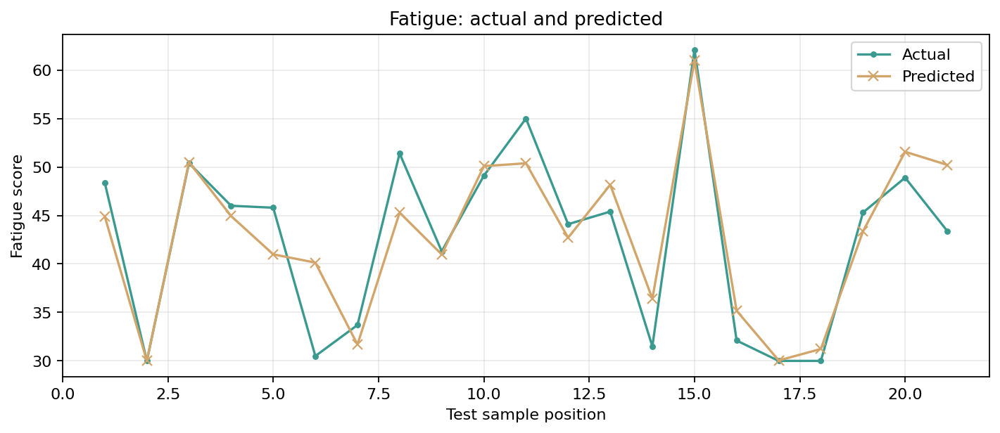
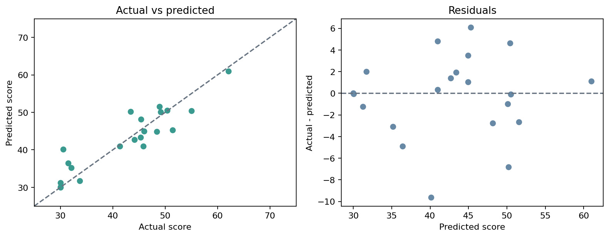
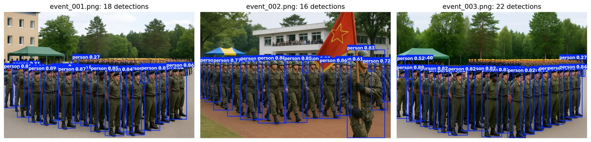
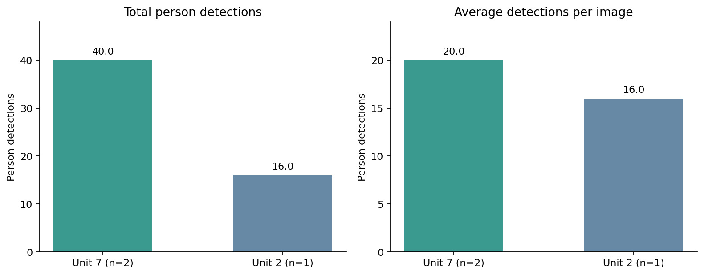
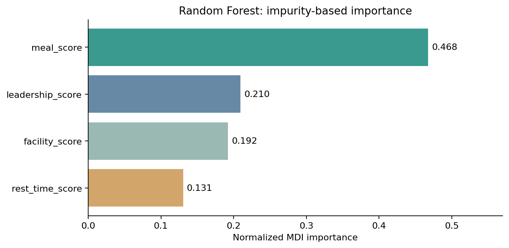
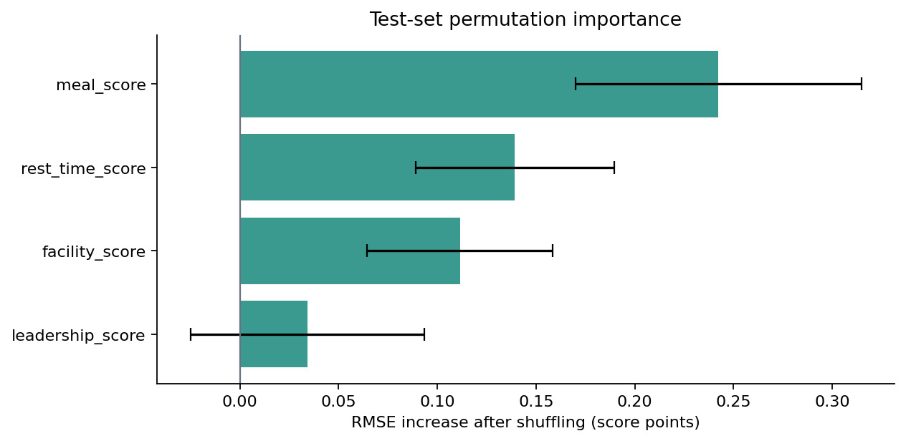
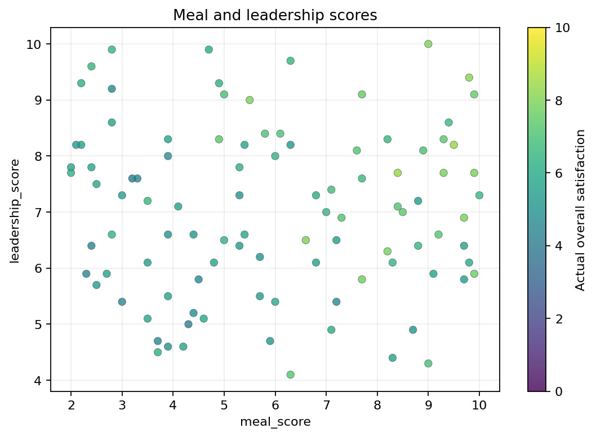

> **이번 글의 질문**
>
> 피로도를 예측한 RMSE가 3.756이면 어느 정도 잘 맞춘 걸까요? 행사 사진 세 장에서 사람을 56건 탐지했다면 참석자는 56명일까요? 식사 점수의 변수 중요도가 가장 높다면 식사 개선의 효과까지 알 수 있을까요?

> **핵심 요약**
>
> 종합 문제는 모델을 호출하는 것보다 입력·평가 기준·집계 단위를 정하는 일이 먼저입니다. Train 안에서 전처리를 학습하고, 회귀 결과는 Baseline과 비교합니다. 사진별 탐지 수는 처리 상태와 함께 집계하며, 변수 중요도는 모델이 사용하는 정보로 해석합니다.

## 1. 문제를 읽고, 먼저 무엇을 만들지 정합니다

종합 문제는 사용할 함수보다 만들 결과를 먼저 읽는 연습입니다. 피로도는 어떤 값으로 예측할지, 사진은 어떤 단위로 셀지, 만족도 모델의 중요도는 무엇을 뜻하는지 정한 다음 코드로 옮깁니다.

| 문제 | 입력 | 핵심 작업 | 결과의 단위 |
| --- | --- | --- | --- |
| 피로도 예측 | `sleep_fatigue.csv` | 생활 패턴으로 연속형 점수를 예측합니다. | Test에 포함된 병사 한 명 |
| 행사 사진 집계 | `event_meta.csv`와 이미지 | `person` 탐지 수를 사진별로 저장하고 부대별로 요약합니다. | 사진 한 장 / 부대 한 곳 |
| 복무 만족도 분석 | `service_survey.csv` | 전체 만족도를 예측하고 Feature 중요도를 비교합니다. | Test 병사 / Feature 한 개 |

피로도와 만족도는 숫자로 표현한 점수를 예측하므로 **Regression** 문제입니다. 사진에서는 사전 학습된 Object Detection 모델의 결과를 집계합니다. 마지막 문제의 변수 중요도는 학습한 회귀 모델에서 얻는 해석 자료입니다.

| 확인할 것 | 이번 실습에서의 기준 |
| --- | --- |
| Feature와 Target | `soldier_id`는 결과 연결에 사용하고 Feature에서는 제외합니다. |
| 전처리 순서 | Train/Test를 먼저 나눈 뒤 Train으로 Scaler를 `fit`합니다. |
| 평가 기준 | 같은 Test에서 Random Forest와 평균 예측 Baseline을 비교합니다. |
| 집계 기준 | 탐지 0건인 정상 사진과 파일이 없는 사진을 구분합니다. |
| 해석 기준 | 모델의 중요도를 원인이나 개선 효과로 확대하지 않습니다. |

CSV 세 개와 `images/unit_events` 폴더를 작업 폴더 아래에 두고 진행합니다. 결과 표는 CSV로, 그래프는 `plots` 폴더에 저장합니다. 실습 폴더·PDF·Notebook과 원본 데이터의 링크는 글 마지막에 각각 구분해 두었습니다.

```python
from pathlib import Path
import pandas as pd
import numpy as np
import matplotlib.pyplot as plt

from sklearn.model_selection import train_test_split
from sklearn.preprocessing import StandardScaler
from sklearn.pipeline import Pipeline
from sklearn.ensemble import RandomForestRegressor
from sklearn.dummy import DummyRegressor
from sklearn.metrics import (
    root_mean_squared_error, mean_absolute_error, r2_score,
)

plot_dir = Path("plots")
plot_dir.mkdir(parents=True, exist_ok=True)

for filename in [
    "sleep_fatigue.csv", "event_meta.csv", "service_survey.csv",
]:
    data = pd.read_csv(filename)
    print(filename, "행·열:", data.shape,
          "결측값:", int(data.isna().sum().sum()))
```

```text
sleep_fatigue.csv 행·열: (101, 5) 결측값: 0
event_meta.csv 행·열: (20, 3) 결측값: 0
service_survey.csv 행·열: (100, 6) 결측값: 0
```

피로도 데이터는 **101행**, 행사 메타데이터는 20행, 만족도 데이터는 100행입니다. CSV 안에 결측값이 없더라도 연결된 이미지 파일이 모두 존재하는지는 별도로 확인해야 합니다.

## 2. 실습 1: 생활 패턴으로 피로도 점수를 예측합니다

### 2-1. ID를 빼고 Feature와 Target을 선택합니다

| 열 이름 | 의미 | 역할 |
| --- | --- | --- |
| `soldier_id` | 병사 식별자 | 예측 결과를 원본과 연결합니다. |
| `avg_sleep_hours` | 평균 수면 시간 | Feature |
| `night_shift_days` | 야간 근무 일수 | Feature |
| `caffeine_intake` | 카페인 섭취량 | Feature |
| `fatigue_score` | 피로도 점수 | Target |

```python
fatigue = pd.read_csv("sleep_fatigue.csv")
fatigue_features = [
    "avg_sleep_hours", "night_shift_days", "caffeine_intake",
]
X_fatigue = fatigue[fatigue_features]
y_fatigue = fatigue["fatigue_score"]

Xf_train, Xf_test, yf_train, yf_test = train_test_split(
    X_fatigue, y_fatigue, test_size=0.2, random_state=42,
)

print("ID 중복:", int(fatigue["soldier_id"].duplicated().sum()))
print("Train:", len(Xf_train), "Test:", len(Xf_test))
print("Target 범위:", y_fatigue.min(), "~", y_fatigue.max())
```

```text
ID 중복: 0
Train: 80 Test: 21
Target 범위: 30.0 ~ 69.2
```

101행의 20%를 Test로 지정하면 Test는 21행, Train은 80행이 됩니다. `X`와 `y`를 같은 호출에서 나누므로 각 병사의 Feature와 Target이 함께 이동합니다. `random_state=42`는 분할을 다시 실행했을 때 같은 구성을 얻기 위한 설정입니다.

ID는 수면 시간이나 야간 근무처럼 의미 있는 설명 변수가 아닙니다. Feature에 넣지 않고 예측 결과를 저장할 때 다시 연결합니다. 현재 데이터에서는 병사 ID가 모두 고유합니다. 같은 병사의 여러 기록을 다루게 된다면, 같은 ID가 Train과 Test 양쪽에 섞이지 않도록 그룹 단위 분할을 검토합니다.

### 2-2. Pipeline으로 전처리와 모델을 연결합니다

```python
fatigue_model = Pipeline([
    ("scaler", StandardScaler()),
    ("forest", RandomForestRegressor(
        n_estimators=100, random_state=42,
    )),
])
fatigue_model.fit(Xf_train, yf_train)
fatigue_pred = fatigue_model.predict(Xf_test)

scaler = fatigue_model.named_steps["scaler"]
print("Scaler가 학습한 행 수:", scaler.n_samples_seen_)
print(pd.Series(
    scaler.mean_, index=fatigue_features, name="train_mean",
).round(3).to_string())
```

```text
Scaler가 학습한 행 수: 80.0
avg_sleep_hours       6.545
night_shift_days      2.450
caffeine_intake     157.400
```

Pipeline의 `fit`은 Train으로 평균·표준편차를 학습해 변환하고, 그 결과로 Random Forest를 학습합니다. `predict`에서는 <strong>Train에서 정한 같은 기준으로 Test를 `transform`</strong>한 뒤 예측합니다. 출력에서 Scaler가 본 행 수가 101이 아니라 80인 점을 확인합니다.

> **분할 전에 전체 데이터를 `fit_transform`하면 Test의 분포가 전처리에 들어갑니다.** 정답을 넘기지 않았더라도 Test의 평균·표준편차를 사용한 것입니다. Pipeline을 Train에 `fit`하는 순서로 데이터 누수를 막습니다.

평균과 표준편차도 데이터에서 학습하는 기준이라는 점은 [파이썬 데이터 분석 공부노트 01](/cs/data-analysis/pandas-01-missing-values-outliers/)에서, StandardScaler와 MinMaxScaler의 차이는 [파이썬 데이터 분석 공부노트 02](/cs/data-analysis/pandas-02-normalization-encoding/)에서 이어서 복습할 수 있습니다.

Random Forest Regressor는 여러 Decision Tree의 예측을 평균해 결과를 만듭니다. 기본 bootstrap 설정에서는 각 Tree가 복원 추출한 학습 표본을 사용하고, 노드의 분할 후보 Feature도 max\_features 설정으로 제어합니다. `n_estimators=100`은 Tree를 100개 만든다는 뜻입니다.

**Random Forest에는 Scaling이 보통 필수는 아닙니다.** Tree는 Feature의 임계값으로 데이터를 나누므로, 거리의 크기를 직접 비교하는 모델과 다릅니다. 여기서는 표준화 과정까지 Pipeline으로 연결해 연습합니다. StandardScaler가 분포를 정규분포로 만드는 것도 아닙니다.

### 2-3. 평균 예측 Baseline과 같은 Test에서 비교합니다

```python
fatigue_baseline = DummyRegressor(strategy="mean")
fatigue_baseline.fit(Xf_train, yf_train)
fatigue_baseline_pred = fatigue_baseline.predict(Xf_test)

def regression_metrics(actual, predicted):
    return {
        "RMSE": root_mean_squared_error(actual, predicted),
        "MAE": mean_absolute_error(actual, predicted),
        "R2": r2_score(actual, predicted),
    }

fatigue_metrics = pd.DataFrame({
    "Mean baseline": regression_metrics(yf_test, fatigue_baseline_pred),
    "Random forest": regression_metrics(yf_test, fatigue_pred),
}).T
fatigue_metrics.to_csv("fatigue_metrics.csv", index_label="model")
print(fatigue_metrics.round(3).to_string())
```

```text
                RMSE    MAE     R2
Mean baseline  9.234  8.038 -0.015
Random forest  3.756  2.814  0.832
```

Baseline은 Feature를 보지 않고 Train의 평균 피로도를 모든 Test 병사에게 예측합니다. Random Forest의 RMSE는 **3.756**, Baseline은 **9.234**입니다. 같은 Test에서 생활 패턴을 사용한 모델이 평균만 예측하는 방법보다 오차를 줄였습니다.

| 지표 | 계산에서 보는 것 | 읽는 방법 |
| --- | --- | --- |
| RMSE | 오차를 제곱해 평균한 뒤 제곱근을 구합니다. | Target과 같은 점수 단위이며, 큰 오차를 더 강하게 반영합니다. |
| MAE | 절대 오차의 평균을 구합니다. | 평균적으로 몇 점 차이가 났는지를 직접 읽습니다. |
| R² | Test의 평균을 기준으로 한 오차와 비교합니다. | 1에 가까울수록 좋으며, 음수도 가능합니다. 정답 비율이 아닙니다. |

MAE는 **2.814점**입니다. RMSE 3.756을 “평균 3.756점 차이”나 “대부분 3.756점 안으로 맞춘다”로 읽으면 의미가 달라집니다. R² 0.832도 83.2%의 병사를 정확히 맞췄다는 뜻이 아닙니다. DummyRegressor가 사용하는 Train 평균과 R²의 기준인 Test 평균도 구분합니다.

RMSE는 `root_mean_squared_error()`로 바로 계산합니다. 단일 Target에서는 `np.sqrt(mean_squared_error(actual, predicted))`도 같은 계산입니다. `root_mean_squared_error`는 scikit-learn 1.4부터 제공됩니다.

지표별 계산과 Train/Test 평가의 기본 흐름은 [파이썬 데이터 분석 공부노트 07](/cs/data-analysis/pandas-07-supervised-learning/)의 회귀 평가 내용과 연결됩니다.

### 2-4. 표준화를 뺀 Random Forest도 비교해 봅니다

```python
unscaled_forest = RandomForestRegressor(
    n_estimators=100, random_state=42,
)
unscaled_forest.fit(Xf_train, yf_train)
unscaled_pred = unscaled_forest.predict(Xf_test)

print("표준화 + Random Forest RMSE:",
      f"{root_mean_squared_error(yf_test, fatigue_pred):.3f}")
print("Random Forest RMSE:",
      f"{root_mean_squared_error(yf_test, unscaled_pred):.3f}")
```

```text
표준화 + Random Forest RMSE: 3.756
Random Forest RMSE: 3.748
```

표준화를 적용한 결과는 3.756, 원본 Feature를 사용한 결과는 3.748입니다. 이 분할에서는 차이가 작습니다. Scaling을 모든 모델에 반드시 넣는 규칙으로 외우기보다, **어떤 연산을 하는 모델인지**와 함께 판단합니다. 여기서 두 결과를 비교한 뒤 Test 점수에 맞춰 모델 설정을 계속 바꾸지는 않습니다.

### 2-5. ID를 유지해 예측을 저장하고 오차를 확인합니다

```python
fatigue_result = fatigue.loc[
    Xf_test.index, ["soldier_id"],
].copy()
fatigue_result["actual_score"] = yf_test
fatigue_result["predicted_score"] = fatigue_pred
fatigue_result["residual"] = (
    fatigue_result["actual_score"] - fatigue_result["predicted_score"]
)
fatigue_result.to_csv("fatigue_pred.csv", index=False, encoding="utf-8-sig")

print(fatigue_result.head().round(3).to_string(index=False))
print("최대 절대 오차:", f"{fatigue_result['residual'].abs().max():.3f}")
```

```text
soldier_id  actual_score  predicted_score  residual
      S085          48.4           44.920     3.480
      S056          30.0           30.002    -0.002
      S067          50.4           50.497    -0.097
      S068          46.0           44.940     1.060
      S046          45.8           40.989     4.811
최대 절대 오차: 9.638
```

`loc[Xf_test.index]`로 Test의 원본 ID를 같은 순서로 가져옵니다. `yf_test`는 Series이므로 Index에 맞춰 연결되고, 예측값은 `Xf_test`의 행 순서대로 들어갑니다. ID만 원본 전체의 앞 21개를 가져오면 서로 다른 병사의 실제값과 예측값이 붙을 수 있습니다.

`residual`은 **실제값 − 예측값**으로 정했습니다. 양수이면 실제보다 낮게 예측했고, 음수이면 실제보다 높게 예측한 것입니다. 최대 절대 오차는 **9.638점**으로, 평균 지표 하나가 모든 병사의 오차를 설명하지는 않습니다.

```python
positions = np.arange(1, len(fatigue_result) + 1)
fig, ax = plt.subplots(figsize=(9, 4))
ax.plot(positions, fatigue_result["actual_score"],
        marker=".", label="Actual", color="#3a9a90")
ax.plot(positions, fatigue_result["predicted_score"],
        marker="x", label="Predicted", color="#d2a56b")
ax.set(title="Fatigue: actual and predicted",
       xlabel="Test sample position", ylabel="Fatigue score")
ax.grid(alpha=0.25)
ax.legend()
fig.tight_layout()
fig.savefig(plot_dir / "fatigue_lineplot.png", dpi=160, bbox_inches="tight")
plt.close(fig)

fig, axes = plt.subplots(1, 2, figsize=(10, 4))
axes[0].scatter(fatigue_result["actual_score"],
                fatigue_result["predicted_score"], color="#3a9a90")
limits = [25, 75]
axes[0].plot(limits, limits, "--", color="#66727f")
axes[0].set(xlim=limits, ylim=limits, xlabel="Actual score",
            ylabel="Predicted score", title="Actual vs predicted")
axes[1].scatter(fatigue_result["predicted_score"],
                fatigue_result["residual"], color="#6889a5")
axes[1].axhline(0, color="#66727f", linestyle="--")
axes[1].set(xlabel="Predicted score", ylabel="Actual - predicted",
            title="Residuals")
fig.tight_layout()
fig.savefig(plot_dir / "fatigue_diagnostics.png", dpi=160, bbox_inches="tight")
plt.close(fig)
```



*x축은 무작위 분할로 선택된 **Test 샘플의 순서**입니다. 날짜가 없으므로 시간에 따른 피로도 변화로 읽지 않습니다.*



*왼쪽 점선은 실제값과 예측값이 같은 위치입니다. 오른쪽 0선 위의 점은 과소 예측, 아래의 점은 과대 예측을 나타냅니다.*

선 그래프는 두 값이 벌어지는 샘플을 찾기 쉽고, 실제값·예측값 산점도는 전체적인 일치 정도를 보기 좋습니다. 잔차 그래프에서는 큰 오차가 특정 예측 구간에 몰리는지 살펴봅니다. 그래프의 연결선 자체를 새로운 추세로 해석하지 않습니다.

## 3. 실습 2: 행사 사진에서 사람을 탐지하고 집계합니다

### 3-1. 메타데이터의 사진이 실제로 있는지 확인합니다

```python
event_meta = pd.read_csv("event_meta.csv")
image_dir = Path("images/unit_events")
file_exists = event_meta["filename"].map(
    lambda filename: (image_dir / filename).is_file()
)

print("메타데이터 사진 수:", len(event_meta))
print("존재하는 파일 수:", int(file_exists.sum()))
print("없는 파일 수:", int((~file_exists).sum()))
print("파일명 중복:", int(event_meta["filename"].duplicated().sum()))
```

```text
메타데이터 사진 수: 20
존재하는 파일 수: 3
없는 파일 수: 17
파일명 중복: 0
```

메타데이터에는 사진 **20장**이 등록되어 있지만 현재 이미지 폴더에는 **3장**만 있습니다. 파일이 없는 17장을 건너뛰기만 하면, 결과 표에서 어느 부대의 자료가 빠졌는지 알기 어렵습니다. 모든 메타데이터 행을 유지하고 처리 상태를 남깁니다.

| 상태 | person\_count | 집계에서의 의미 |
| --- | --- | --- |
| `ok` | 0 이상의 정수 | 정상 처리한 사진입니다. 탐지 0건도 평균의 분모에 포함합니다. |
| `missing_file` | 결측값 | 파일이 없어 사람 수를 계산하지 못했습니다. |
| `read_failed` | 결측값 | 파일은 있지만 이미지로 읽지 못했습니다. |

> **사진이 없다는 것은 사람이 0명이라는 뜻이 아닙니다.** 정상 사진에서 탐지 0건인 경우는 0으로, 처리하지 못한 사진은 결측값으로 남깁니다.

### 3-2. person 클래스만 탐지하고 사진별 결과를 저장합니다

```python
import torch
import cv2

person_model = torch.hub.load(
    "ultralytics/yolov5", "yolov5s",
    pretrained=True, trust_repo=True,
)
person_model.classes = [0]
person_model.conf = 0.25
person_model.iou = 0.45

print("탐지 클래스:", person_model.names[0])
print("Confidence threshold:", person_model.conf)
print("NMS IoU threshold:", person_model.iou)
```

```text
탐지 클래스: person
Confidence threshold: 0.25
NMS IoU threshold: 0.45
```

COCO로 사전 학습된 YOLOv5s의 0번 클래스는 `person`입니다. 모델은 반복문 밖에서 한 번만 로드하고, Confidence 기준과 NMS IoU 기준을 정합니다. 클래스 번호는 사용한 모델의 클래스 목록을 기준으로 확인합니다.

```python
image_count_rows = []
event_detail_rows = []
event_preview_images = []

for filename in event_meta["filename"]:
    path = image_dir / filename
    count = pd.NA
    status = "missing_file"

    if path.is_file():
        bgr = cv2.imread(str(path))
        if bgr is None:
            status = "read_failed"
        else:
            rgb = cv2.cvtColor(bgr, cv2.COLOR_BGR2RGB)
            detection = person_model(rgb, size=640)
            boxes = detection.pandas().xyxy[0]
            people = boxes.loc[boxes["name"].eq("person")]
            count = len(people)
            status = "ok"

            event_preview_images.append((
                filename, detection.render()[0].copy(), count,
            ))
            for box in people.itertuples(index=False):
                event_detail_rows.append({
                    "filename": filename,
                    "confidence": float(box.confidence),
                    "x_min": float(box.xmin), "y_min": float(box.ymin),
                    "x_max": float(box.xmax), "y_max": float(box.ymax),
                })

    image_count_rows.append({
        "filename": filename, "person_count": count, "status": status,
    })

image_counts = pd.DataFrame(image_count_rows)
image_counts["person_count"] = image_counts["person_count"].astype("Int64")
event_results = event_meta.merge(
    image_counts, on="filename", how="left", validate="one_to_one",
)
event_results.to_csv("event_image_counts.csv", index=False, encoding="utf-8-sig")
event_details = pd.DataFrame(event_detail_rows, columns=[
    "filename", "confidence", "x_min", "y_min", "x_max", "y_max",
])
event_details.to_csv("event_detection_details.csv", index=False)

print(event_results.head(5).to_string(index=False))
print(event_results["status"].value_counts().to_string())
```

```text
     filename unit_name event_date  person_count       status
event_001.png       7사단 2024-05-15            18           ok
event_002.png       2사단 2024-05-15            16           ok
event_003.png       7사단 2024-05-15            22           ok
event_004.png       2사단 2024-05-06          <NA> missing_file
event_005.png       7사단 2024-05-15          <NA> missing_file
status
missing_file    17
ok               3
```

OpenCV의 `imread`는 BGR 배열을 반환하므로 RGB로 변환해 YOLOv5 Hub 모델에 전달합니다. 같은 변환을 슬라이싱으로 쓰면 `bgr[:, :, ::-1]`입니다. **`bgr[::-1]`은 첫 번째 축을 뒤집어 이미지를 상하 반전**하므로 색상 변환이 아닙니다.

`results.pandas().xyxy[0]` 형태의 결과에서 name이 `person`인 행의 수를 셉니다. 파일명별 한 행으로 만든 탐지 수를 메타데이터와 `left` `merge`하고, `validate="one_to_one"`으로 양쪽 파일명이 고유한지 검사합니다. 중복 키 때문에 사진 한 장이 여러 행으로 늘어나는 문제도 확인할 수 있습니다.

`person_count`의 자료형 `Int64`는 정수와 결측값을 함께 담는 Pandas Nullable Integer입니다. 소문자 `int64`와 구분합니다. 사진별 요약 표와 객체별 좌표 표를 따로 저장하면, 집계 결과를 확인한 뒤 특정 사진의 탐지 Box로 돌아갈 수 있습니다.

```python
fig, axes = plt.subplots(1, 3, figsize=(15, 4))
for ax, (filename, preview, count) in zip(axes, event_preview_images):
    ax.imshow(preview)
    ax.set_title(f"{filename}: {count} detections")
    ax.axis("off")
fig.tight_layout()
fig.savefig(plot_dir / "event_detection_preview.png", dpi=160, bbox_inches="tight")
plt.close(fig)
```



*탐지 수는 각각 18건, 16건, 22건입니다. 뒤쪽의 작거나 가려진 사람까지 모두 셌는지는 원본 이미지와 Box를 함께 확인해야 합니다.*

### 3-3. 부대별 합계·사진당 평균·처리 사진 수를 함께 구합니다

```python
unit_stats = event_results.groupby("unit_name").agg(
    metadata_images=("filename", "size"),
    processed_images=("person_count", "count"),
    total_count=("person_count", lambda values: values.sum(min_count=1)),
    average_count=("person_count", "mean"),
)
unit_stats["missing_or_failed"] = (
    unit_stats["metadata_images"] - unit_stats["processed_images"]
)
unit_stats["coverage"] = (
    unit_stats["processed_images"] / unit_stats["metadata_images"]
)
unit_stats = unit_stats.sort_values(
    "total_count", ascending=False, na_position="last",
)
unit_stats.to_csv("event_people_stats.csv", encoding="utf-8-sig")
print(unit_stats.round(3).to_string())

valid_results = event_results.loc[event_results["status"].eq("ok")]
print("정상 사진의 전체 탐지 합계:", int(valid_results["person_count"].sum()))
print("정상 사진 전체의 사진당 평균:",
      f"{valid_results['person_count'].mean():.3f}")
```

```text
           metadata_images  processed_images  total_count  average_count  missing_or_failed  coverage
unit_name
7사단                      5                 2           40           20.0                  3       0.4
2사단                      7                 1           16           16.0                  6     0.143
1사단                      3                 0         <NA>           <NA>                  3       0.0
3사단                      5                 0         <NA>           <NA>                  5       0.0
정상 사진의 전체 탐지 합계: 56
정상 사진 전체의 사진당 평균: 18.667
```

`size`는 메타데이터 행 수를, `count`는 `person_count`가 결측값이 아닌 행 수를 셉니다. 정상 처리한 사진의 0건은 `count`에 포함됩니다. `sum(min_count=1)`은 관측값이 하나도 없는 부대의 합계를 결측값으로 유지합니다. 기본 `sum`만 사용하면 전부 결측값인 그룹이 0으로 표시될 수 있습니다.

| 부대 | 등록 사진 | 정상 사진 | 탐지 합계 | 사진당 평균 | 누락·실패 |
| --- | --- | --- | --- | --- | --- |
| 7사단 | 5 | 2 | 40 | 20.0 | 3 |
| 2사단 | 7 | 1 | 16 | 16.0 | 6 |
| 1사단 | 3 | 0 | 미집계 | 미집계 | 3 |
| 3사단 | 5 | 0 | 미집계 | 미집계 | 5 |

7사단은 18건과 22건을 합해 **40건**, 두 사진의 평균은 **20건**입니다. 2사단은 정상 사진 한 장에서 **16건**이 탐지됐습니다. 전체 정상 사진의 평균은 `(18 + 16 + 22) / 3 = 18.667`입니다. 두 부대의 사진당 평균을 다시 평균하면 `(20 + 16) / 2 = 18`로, 부대마다 같은 가중치를 주는 다른 계산이 됩니다.

전체 응답자 평균과 그룹 평균의 단순 평균이 다른 이유는 [파이썬 데이터 분석 공부노트 06](/cs/data-analysis/pandas-06-data-interpretation/)의 집계 기준과 같습니다. 이번에는 분모가 병사 수 대신 정상 처리한 사진 수입니다.

> **56건은 사진 세 장의 `person` 탐지 수를 더한 값입니다.** 같은 사람이 여러 사진에 등장할 수 있으므로 고유 참석자 56명으로 바꾸어 말하지 않습니다. event\_date가 같다고 같은 행사를 유일하게 식별할 수 있는 것도 아닙니다.

행사별 평균 참석자를 구하려면 먼저 `event_id`처럼 행사 하나를 식별하는 기준과 여러 사진의 중복 인원 처리 방법이 필요합니다. 현재 결과는 **사진당 평균 `person` 탐지 수**입니다. 처리된 사진이 없는 부대는 비교에 넣지 않고, 다른 부대도 자료가 일부만 남아 있다는 점을 처리 사진 수와 함께 읽습니다.

탐지 건수와 고유 객체 수의 차이, 객체별 결과를 표로 만드는 방법은 [파이썬 데이터 분석 공부노트 10](/cs/data-analysis/pandas-10-image-video-analysis/)에서 이어서 볼 수 있습니다.

### 3-4. 합계와 사진당 평균을 나누어 그립니다

```python
plot_stats = unit_stats.loc[unit_stats["processed_images"].gt(0)].copy()
plot_labels = [
    f"Unit {name.replace('사단', '')} (n={int(count)})"
    for name, count in zip(plot_stats.index, plot_stats["processed_images"])
]
fig, axes = plt.subplots(1, 2, figsize=(10, 4))
for ax, column, title in [
    (axes[0], "total_count", "Total person detections"),
    (axes[1], "average_count", "Average detections per image"),
]:
    values = plot_stats[column].astype(float)
    bars = ax.bar(plot_labels, values, color=["#3a9a90", "#6889a5"], width=0.55)
    ax.bar_label(bars, fmt="%.1f", padding=4)
    ax.set(title=title, ylabel="Person detections")
    ax.set_ylim(0, max(1, values.max() * 1.2))
    ax.spines[["top", "right"]].set_visible(False)
fig.tight_layout()
fig.savefig(plot_dir / "top_units.png", dpi=160, bbox_inches="tight")
plt.close(fig)
```



*Unit 7은 7사단, Unit 2는 2사단입니다. n은 정상 처리 사진 수입니다. 합계가 큰 이유를 볼 때는 사진 수 차이도 함께 확인합니다.*

## 4. 실습 3: 복무 만족도를 예측하고 기준 모델과 비교합니다

### 4-1. 네 가지 만족도 점수로 전체 만족도를 예측합니다

| 열 이름 | 의미 | 역할 |
| --- | --- | --- |
| `soldier_id` | 병사 식별자 | 결과 연결 |
| `leadership_score` | 리더십 만족도 | Feature |
| `facility_score` | 시설 만족도 | Feature |
| `meal_score` | 식사 만족도 | Feature |
| `rest_time_score` | 휴식 시간 만족도 | Feature |
| `overall_satisfaction` | 전체 복무 만족도 | Target |

```python
service = pd.read_csv("service_survey.csv")
service_features = [
    "leadership_score", "facility_score", "meal_score", "rest_time_score",
]
X_service = service[service_features]
y_service = service["overall_satisfaction"]
Xs_train, Xs_test, ys_train, ys_test = train_test_split(
    X_service, y_service, test_size=0.2, random_state=42,
)

service_model = RandomForestRegressor(
    n_estimators=100, random_state=42,
)
service_model.fit(Xs_train, ys_train)
service_pred = service_model.predict(Xs_test)

service_baseline = DummyRegressor(strategy="mean")
service_baseline.fit(Xs_train, ys_train)
service_baseline_pred = service_baseline.predict(Xs_test)
service_metrics = pd.DataFrame({
    "Mean baseline": regression_metrics(ys_test, service_baseline_pred),
    "Random forest": regression_metrics(ys_test, service_pred),
}).T
service_metrics.to_csv("satisfaction_metrics.csv", index_label="model")
print("Train:", len(Xs_train), "Test:", len(Xs_test))
print(service_metrics.round(3).to_string())
```

```text
Train: 80 Test: 20
                RMSE    MAE     R2
Mean baseline  0.953  0.767 -0.109
Random forest  0.729  0.599  0.351
```

Tree 모델인 점을 고려해 이번에는 원본 Feature로 학습합니다. 모델의 RMSE는 **0.729**, Baseline은 **0.953**입니다. 평균만 예측하는 모델보다 오차가 줄었지만, R²는 **0.351**입니다. RMSE가 소수점 아래라는 이유만으로 성능이 아주 좋다고 판단하기보다 Target의 점수 단위와 Baseline을 함께 읽습니다.

피로도 모델의 RMSE 3.756과 만족도 모델의 0.729를 숫자 크기로 비교해 어느 모델이 더 좋다고 말할 수는 없습니다. Target의 단위와 분포가 다르기 때문입니다. 현재 만족도 Test의 MAE는 **0.599점**입니다.

```python
service_result = service.loc[Xs_test.index, ["soldier_id"]].copy()
service_result["actual"] = ys_test
service_result["predicted"] = service_pred
service_result["residual"] = ys_test - service_pred
service_result.to_csv("satisfaction_pred.csv", index=False, encoding="utf-8-sig")

print(service_result.head().round(3).to_string(index=False))
```

```text
soldier_id  actual  predicted  residual
      S084     7.9      6.988     0.912
      S054     5.1      5.787    -0.687
      S071     5.9      5.750     0.150
      S046     5.5      5.598    -0.098
      S045     4.7      6.131    -1.431
```

예측 CSV에는 Test 병사 20명의 실제값과 예측값만 저장합니다. 학습 데이터의 예측 오차와 Test의 예측 오차는 의미가 다르므로, 어떤 데이터의 결과인지 파일에서도 유지합니다.

## 5. 변수 중요도는 무엇을 설명할까요?

### 5-1. feature\_importances\_로 학습한 모델의 분할을 요약합니다

```python
mdi_importance = pd.Series(
    service_model.feature_importances_,
    index=service_features, name="MDI",
).sort_values(ascending=False)

print(mdi_importance.round(3).to_string())
print("중요도 합계:", round(mdi_importance.sum(), 3))

fig, ax = plt.subplots(figsize=(8, 4))
bars = ax.barh(mdi_importance.index, mdi_importance,
               color=["#3a9a90", "#6889a5", "#9bb9b3", "#d2a56b"])
ax.invert_yaxis()
ax.bar_label(bars, fmt="%.3f", padding=4)
ax.set(title="Random Forest: impurity-based importance",
       xlabel="Normalized MDI importance", xlim=(0, 0.57))
ax.spines[["top", "right"]].set_visible(False)
fig.tight_layout()
fig.savefig(plot_dir / "importance.png", dpi=160, bbox_inches="tight")
plt.close(fig)
```

```text
meal_score          0.468
leadership_score    0.210
facility_score      0.192
rest_time_score     0.131
중요도 합계: 1.0
```



*`meal_score`의 MDI 중요도는 약 0.468입니다. 합계가 1이 되도록 정규화한 **학습 중 불순도 감소량의 비중**이며, 만족도 46.8%를 설명한다는 뜻은 아닙니다.*

회귀 Tree는 분할 전후의 불순도 감소를 기준으로 Feature를 사용합니다. `feature_importances_`는 여러 Tree의 감소 기여를 모아 정규화한 값으로, <strong>MDI(Mean Decrease in Impurity)</strong>라고 부릅니다. 이 모델에서는 식사 점수, 리더십 점수, 시설 점수, 휴식 시간 점수 순입니다.

중요도가 크다는 것은 이 모델이 예측할 때 해당 Feature를 많이 활용했다는 뜻입니다. 이 값에는 점수가 높아질 때 만족도가 오르는지 내려가는지에 대한 방향 정보도 없습니다. **식사를 개선하면 전체 만족도가 얼마나 올라가는지**를 알려주는 효과 크기로 읽지 않습니다.

MDI는 Train에서 만들어진 Tree의 분할을 요약하며, 고유 값이 많은 Feature를 선호할 수 있습니다. 또 비슷한 정보를 담는 Feature가 여러 개면 기여가 나뉘거나 한쪽으로 몰릴 수 있습니다. 이를 보완해 다른 기준으로도 살펴봅니다.

### 5-2. argsort는 정렬된 값 대신 원래 위치를 반환합니다

```python
importance_array = service_model.feature_importances_
sorted_indices = np.argsort(importance_array)[::-1]
top_two = X_service.columns[sorted_indices[:2]].tolist()

print("내림차순 위치:", sorted_indices.tolist())
print("상위 두 Feature:", top_two)
```

```text
내림차순 위치: [2, 0, 1, 3]
상위 두 Feature: ['meal_score', 'leadership_score']
```

`np.argsort()`는 작은 값부터 정렬할 때의 **원래 위치**를 반환합니다. `[::-1]`로 순서를 뒤집고 `[:2]`로 앞의 두 위치를 선택합니다. 그 위치를 같은 순서의 Feature 이름에 적용하면 식사 점수와 리더십 점수를 가져올 수 있습니다. 이름이 붙은 Series를 `sort_values`하는 방법은 이름과 값의 대응을 한눈에 보기 편합니다.

### 5-3. Test에서 한 Feature를 섞었을 때 오차가 얼마나 늘어날까요?

```python
from sklearn.inspection import permutation_importance

permutation = permutation_importance(
    service_model, Xs_test, ys_test,
    scoring="neg_root_mean_squared_error",
    n_repeats=30, random_state=42,
)
permutation_table = pd.DataFrame({
    "feature": service_features,
    "rmse_increase": permutation.importances_mean,
    "repeat_std": permutation.importances_std,
}).sort_values("rmse_increase", ascending=False)

importance_summary = pd.DataFrame({
    "feature": service_features,
    "MDI": service_model.feature_importances_,
    "permutation_rmse_increase": permutation.importances_mean,
    "permutation_repeat_std": permutation.importances_std,
})
importance_summary.to_csv("service_importance.csv", index=False)
print(permutation_table.round(3).to_string(index=False))

fig, ax = plt.subplots(figsize=(8, 4))
ax.barh(permutation_table["feature"], permutation_table["rmse_increase"],
        xerr=permutation_table["repeat_std"], capsize=4, color="#3a9a90")
ax.invert_yaxis()
ax.axvline(0, color="#66727f", linewidth=1)
ax.set(title="Test-set permutation importance",
       xlabel="RMSE increase after shuffling (score points)")
ax.spines[["top", "right"]].set_visible(False)
fig.tight_layout()
fig.savefig(plot_dir / "permutation_importance.png", dpi=160, bbox_inches="tight")
plt.close(fig)
```

```text
         feature  rmse_increase  repeat_std
      meal_score          0.242       0.072
 rest_time_score          0.139       0.050
  facility_score          0.111       0.047
leadership_score          0.034       0.059
```



*막대는 30번 섞었을 때의 평균 RMSE 증가량, 오차 막대는 반복 간 표준편차입니다. 표본 불확실성의 신뢰구간은 아닙니다.*

Permutation Importance는 **이미 학습한 모델을 고정**하고, Test의 한 Feature 값만 행 사이에서 섞어 원래 대응 관계를 끊습니다. 그때 예측 성능이 나빠지면 모델이 그 정보에 의존했다는 뜻입니다. 모델을 매번 다시 학습하는 방식이 아닙니다.

scikit-learn의 scoring은 큰 값이 좋다는 방향을 따르므로 `neg_root_mean_squared_error`를 사용합니다. 중요도는 원래 점수에서 섞은 점수를 뺀 값이며, 이 설정에서는 **섞은 RMSE − 원래 RMSE**가 됩니다. 식사 점수를 섞으면 RMSE가 평균 약 **0.242점** 증가했습니다.

| 순위 | MDI | Test Permutation |
| --- | --- | --- |
| 1 | `meal_score` · 0.468 | `meal_score` · +0.242점 |
| 2 | `leadership_score` · 0.210 | `rest_time_score` · +0.139점 |
| 3 | `facility_score` · 0.192 | `facility_score` · +0.111점 |
| 4 | `rest_time_score` · 0.131 | `leadership_score` · +0.034점 |

두 방법 모두 식사 점수가 가장 높지만, 나머지 순위는 달라집니다. MDI는 **학습 중 분할 기여**, 여기서 계산한 Permutation은 **Test에서 정보를 흐트러뜨렸을 때의 오차 변화**를 보기 때문입니다. MDI에서 휴식 점수가 낮았다는 이유만으로 휴식이 만족도와 무관하다고 결론 내리지 않습니다.

이번 Test는 20명입니다. Permutation 결과도 선택한 모델과 표본에 따른 값이며, 관련 Feature가 서로 정보를 대신하면 중요도가 작게 나올 수 있습니다. 이 결과를 보고 Feature를 제거하거나 설정을 조정하려면 Train 안의 Validation·Cross-validation에서 결정하고, 최종 Test는 마지막 평가에 남깁니다.

## 6. 상위 두 Feature의 산점도로 원본 데이터를 다시 봅니다

```python
x_feature, y_feature = top_two
fig, ax = plt.subplots(figsize=(7, 5))
points = ax.scatter(
    service[x_feature], service[y_feature],
    c=service["overall_satisfaction"], cmap="viridis",
    vmin=0, vmax=10, alpha=0.8, edgecolors="#52606d", linewidths=0.4,
)
ax.set(title="Meal and leadership scores",
       xlabel=x_feature, ylabel=y_feature)
colorbar = fig.colorbar(points, ax=ax)
colorbar.set_label("Actual overall satisfaction")
ax.grid(alpha=0.2)
fig.tight_layout()
fig.savefig(plot_dir / "top2_scatter.png", dpi=160, bbox_inches="tight")
plt.close(fig)
```



*점 하나는 원본 설문 응답 한 명입니다. 색상은 **실제 전체 만족도**이며, 예측값이나 Confidence가 아닙니다. 전체 100명의 데이터 분포를 보여 줍니다.*

x축은 `meal_score`, `y`축은 `leadership_score`입니다. 식사 점수가 높은 오른쪽에서 상대적으로 밝은 색의 점이 더 많이 보입니다. 같은 점수에서도 색이 완전히 같지는 않으므로 두 Feature만으로 전체 만족도를 모두 설명하지는 않습니다.

`c`에 실제 만족도를 전달하면 cmap이 그 값을 색으로 매핑합니다. `vmin=0, vmax=10`은 점수 척도를 일정하게 표시하고, `alpha=0.8`은 겹친 점을 보기 위한 투명도입니다. hatch는 채움 무늬를 지정하는 옵션이므로 투명도와 구분합니다.

> **예측에 유용한 정보와 원인은 구분합니다.** 여기서 확인한 것은 식사 점수가 이 모델의 예측에 유용하고, 원본 설문에서도 전체 만족도와 함께 달라지는 패턴입니다. 식사 개선의 효과를 판단하려면 개입 전후 비교와 다른 요인에 대한 검토가 추가로 필요합니다.

## 7. 더 살펴보기: Train의 오류도 자신을 학습하지 않은 예측으로 봅니다

Train에 대한 `predict()`는 그 행을 학습한 모델의 결과입니다. 어떤 기록이 어려운지 살펴보려면, 해당 기록을 학습에서 제외한 Fold의 모델로 만든 Out-of-fold 예측을 사용할 수 있습니다.

아래의 180행은 최종 Test와 별도로 둔 Train을 가정한 비교 데이터입니다. 각 행은 자신을 제외하고 학습한 모델에서 예측 하나를 받습니다.

```python
from sklearn.datasets import make_regression
from sklearn.ensemble import RandomForestRegressor
from sklearn.model_selection import KFold, cross_val_predict
from sklearn.metrics import mean_absolute_error

X_train, y_train = make_regression(n_samples=180, n_features=3,
                                  noise=8, random_state=42)
model = RandomForestRegressor(n_estimators=80, random_state=42)
folds = KFold(n_splits=5, shuffle=True, random_state=42)
oof = cross_val_predict(model, X_train, y_train, cv=folds)
model.fit(X_train, y_train)
print("Train 재예측 MAE:", round(mean_absolute_error(y_train, model.predict(X_train)), 3))
print("Out-of-fold MAE:", round(mean_absolute_error(y_train, oof), 3))
print("OOF 예측 수:", len(oof))
```

```text
Train 재예측 MAE: 7.603
Out-of-fold MAE: 21.335
OOF 예측 수: 180
```

OOF 오차가 큰 ID를 찾아 입력과 Label을 검토하거나 오류 유형을 비교할 수 있습니다. 전처리가 있다면 Pipeline 전체를 `cross_val_predict()`에 넣습니다. OOF 결과도 Feature·설정 선택에 활용했다면 최종 Test 역할을 대신하지 않습니다. 그룹·시간 구조에 맞는 Fold를 선택하는 원칙도 같습니다.

## 8. 결과 파일을 열었을 때 바로 이해할 수 있게 남깁니다

| 결과 파일 | 한 행의 의미 | 기억할 기준 |
| --- | --- | --- |
| `fatigue_pred.csv` | Test 병사 한 명의 실제·예측 피로도 | ID와 원본 Index를 맞춥니다. |
| `fatigue_metrics.csv` | 피로도 모델 한 개의 평가 결과 | 같은 Test의 Baseline과 비교합니다. |
| `event_image_counts.csv` | 메타데이터 사진 한 장 | 누락·실패와 탐지 0건을 구분합니다. |
| `event_detection_details.csv` | 사진에서 탐지된 `person` 한 건 | 파일명·좌표·Confidence를 남깁니다. |
| `event_people_stats.csv` | 부대 한 곳의 사진 집계 | 정상 사진 수와 사진당 평균을 함께 봅니다. |
| `satisfaction_pred.csv` | Test 병사 한 명의 실제·예측 만족도 | 전체 설문의 예측 결과와 구분합니다. |
| `satisfaction_metrics.csv` | 만족도 모델 한 개의 평가 결과 | Target 단위와 RMSE·MAE·R²를 함께 봅니다. |
| `service_importance.csv` | Feature 한 개의 중요도 | MDI와 Permutation의 기준이 다릅니다. |

### 기억할 문법

| 문법 | 이번 실습에서의 역할 |
| --- | --- |
| `train_test_split()` | Feature와 Target을 같은 순서로 Train/Test에 나눕니다. |
| `Pipeline.fit()` | Train에서 전처리와 모델을 순서대로 학습합니다. |
| DummyRegressor | Train 평균만 사용하는 비교 기준을 만듭니다. |
| `root_mean_squared_error()` | 실제값과 예측값으로 RMSE를 계산합니다. |
| `cv2.cvtColor()` | BGR 이미지를 RGB로 변환합니다. |
| `merge(validate=...)` | 키 중복으로 결과 행이 늘어나는지 확인합니다. |
| `sum(min_count=1)` | 관측값이 전혀 없는 합계를 결측값으로 유지합니다. |
| `feature_importances_` | 학습한 Tree들의 불순도 감소 기여를 요약합니다. |
| `np.argsort()` | 정렬에 사용할 원래 위치를 가져옵니다. |
| `permutation_importance()` | Feature를 섞었을 때 모델의 성능 변화를 계산합니다. |

### 다시 읽을 때 확인할 질문

-   Scaler는 전체 101행이 아니라 Train 80행으로 학습했나요?
-   RMSE와 MAE는 각각 어떤 오차를 요약하고, Baseline은 같은 Test에서 비교했나요?
-   예측 CSV의 ID·실제값·예측값은 같은 병사의 기록인가요?
-   사진이 없는 경우를 0건으로 처리하지 않았나요? 평균의 분모는 정상 사진 수인가요?
-   여러 사진의 탐지 합계를 고유 참석자 수로 읽고 있지는 않나요?
-   변수 중요도가 어느 모델·데이터·평가 기준에서 나온 값인지 설명할 수 있나요?

완성한 CSV의 한 행을 말로 설명해 봅니다. 어떤 입력에서 얻었고, 무엇과 비교했고, 값의 분모가 무엇인지 설명할 수 있으면 풀이의 흐름도 다시 떠오릅니다.

## 참고자료

### 실습 데이터와 노트북

-   **실습 자료**: [Session11 실습 폴더](https://drive.google.com/drive/folders/1xhJDb2XtqoAiGRA7uYayANGMO4Adxxkc) · [session11\_종합문제풀이(1).pdf](https://drive.google.com/file/d/19WHR_07KjL7ZPqEt6maOSnOgyQhnRAQZ/view) · [session11.ipynb](https://drive.google.com/file/d/11zpNqPduZUHz1IjQIiE5PUCQkcxEU8gs/view)
-   **CSV 데이터**: [sleep\_fatigue.csv](https://drive.google.com/file/d/1a0lpboe3nopWcg0NIlMpDNkg8FLuPQru/view) · [event\_meta.csv](https://drive.google.com/file/d/1k6lmMSZnWqextWhyON3rp8huzh7ioYUA/view) · [service\_survey.csv](https://drive.google.com/file/d/1C_uFG_4mDgh_LWc8N4Ch6IDA3TvIlPhK/view)
-   **이미지 데이터**: [unit\_events: event\_001\~003.png](https://drive.google.com/drive/folders/15i2FuG3mlOpwGWJ-lLAu1ztmJ0YRju3a)
-   **심화 예제**: [심화 예제 자료](https://drive.google.com/file/d/1wG0fZ0uhBQ1tniHUVE42xxo2mhkdwzGf/view?usp=drivesdk "Google Drive에서 자료를 엽니다.") — 공부노트 01\~13의 Python 코드, 노트북, 예제 CSV와 실행 결과를 함께 받습니다.

### 연습문제

-   **문제**: [유형 02 문제](/cs/data-analysis/practice-02-tabular-modeling/) — 같은 장비의 반복 기록이 있을 때, 새로운 장비의 고장 여부와 정비 시간을 어떻게 평가할까요?  
    [유형 06 문제](/cs/data-analysis/practice-06-object-detection/) — 정상 사진·빈 사진·누락 사진이 섞여 있을 때, 장면별 사람·차량 탐지 수를 어떻게 요약할까요?
-   **풀이**: [유형 02 풀이](/cs/data-analysis/practice-02-tabular-modeling-solution/) — 장비별로 데이터를 나누고 전처리 Pipeline과 그룹 CV로 고장 분류·정비 시간 회귀 모델을 평가합니다.  
    [유형 06 풀이](/cs/data-analysis/practice-06-object-detection-solution/) — YOLO 탐지 결과와 사진별 처리 상태를 저장하고, 탐지 0건과 처리 실패를 구분해 장면별로 집계합니다.

### 공식 문서

-   **전처리·학습**: [scikit-learn Common pitfalls](https://scikit-learn.org/stable/common_pitfalls.html) — Train에서 전처리를 학습하고 데이터 누수를 방지하는 방법  
    [Pipeline](https://scikit-learn.org/stable/modules/generated/sklearn.pipeline.Pipeline.html) — 전처리와 모델의 fit·predict 흐름  
    [train\_test\_split](https://scikit-learn.org/stable/modules/generated/sklearn.model_selection.train_test_split.html) — 여러 입력의 일치하는 분할과 random\_state  
    [RandomForestRegressor](https://scikit-learn.org/stable/modules/generated/sklearn.ensemble.RandomForestRegressor.html) — Tree·bootstrap·n\_estimators·feature\_importances\_  
    [Importance of Feature Scaling](https://scikit-learn.org/stable/auto_examples/preprocessing/plot_scaling_importance.html) — 모델에 따른 Scaling의 영향
-   **회귀 평가**: [DummyRegressor](https://scikit-learn.org/stable/modules/generated/sklearn.dummy.DummyRegressor.html) — Train 평균을 사용하는 Baseline  
    [root\_mean\_squared\_error](https://scikit-learn.org/stable/modules/generated/sklearn.metrics.root_mean_squared_error.html) — RMSE 계산과 반환값  
    [Regression metrics](https://scikit-learn.org/stable/modules/model_evaluation.html#regression-metrics) — MAE·RMSE·R²의 평가 기준
-   **탐지·집계**: [YOLOv5 PyTorch Hub](https://docs.ultralytics.com/yolov5/tutorials/pytorch-hub-model-loading) — 클래스 필터·색상 입력·Pandas 결과 변환  
    [Pandas DataFrame.merge](https://pandas.pydata.org/docs/reference/api/pandas.DataFrame.merge.html) — left merge와 validate의 키 관계 검사  
    [Pandas GroupBy.sum](https://pandas.pydata.org/docs/reference/api/pandas.api.typing.SeriesGroupBy.sum.html) — min\_count로 관측값 없는 그룹을 구분
-   **모델 해석**: [Forest feature importances](https://scikit-learn.org/stable/auto_examples/ensemble/plot_forest_importances.html) — MDI와 Permutation Importance의 비교  
    [Permutation feature importance](https://scikit-learn.org/stable/modules/permutation_importance.html) — 점수 변화의 계산·상관된 Feature·해석 기준  
    [permutation\_importance API](https://scikit-learn.org/stable/modules/generated/sklearn.inspection.permutation_importance.html) — scoring·n\_repeats·반환 평균과 표준편차  
    [NumPy argsort](https://numpy.org/doc/stable/reference/generated/numpy.argsort.html) — 정렬 순서에 해당하는 Index 반환  
    [Matplotlib Axes.scatter](https://matplotlib.org/stable/api/_as_gen/matplotlib.axes.Axes.scatter.html) — c·cmap·vmin·vmax·alpha의 의미
-   **CV 예측**: [cross\_val\_predict](https://scikit-learn.org/stable/modules/generated/sklearn.model_selection.cross_val_predict.html) — 각 관측값의 Fold 외부 예측과 평가 지표 사용 시 주의점을 확인합니다.
