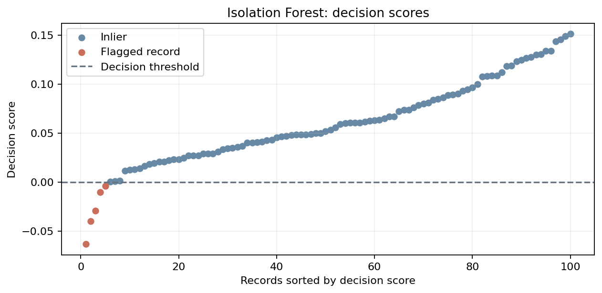
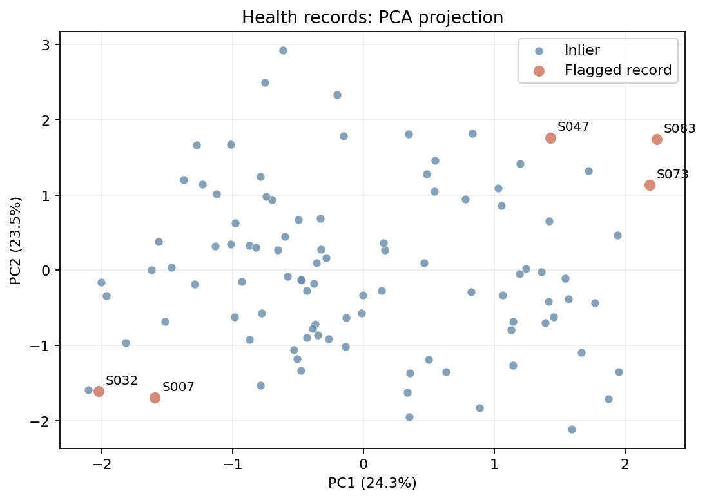
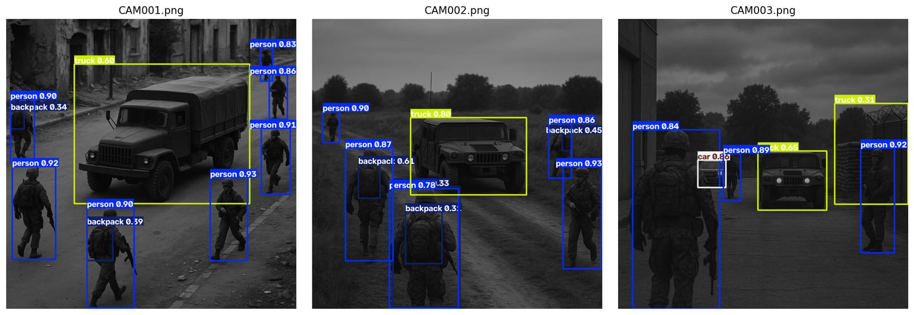
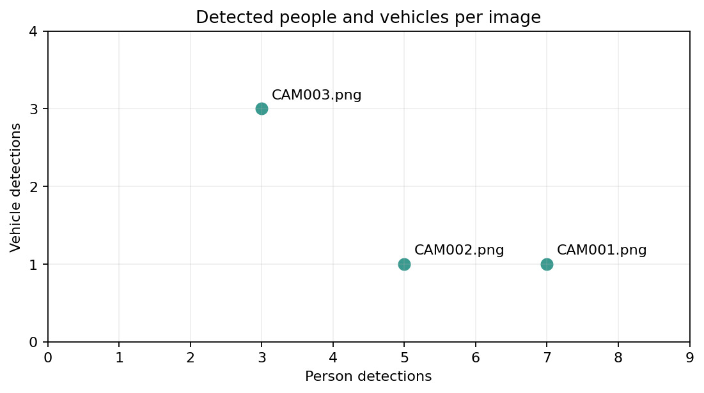
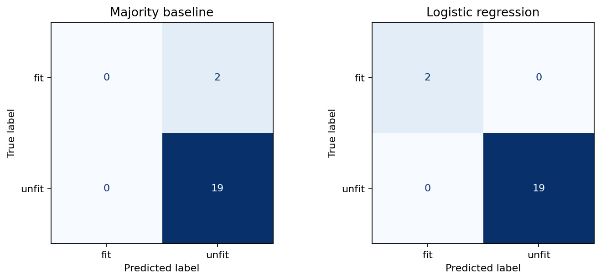
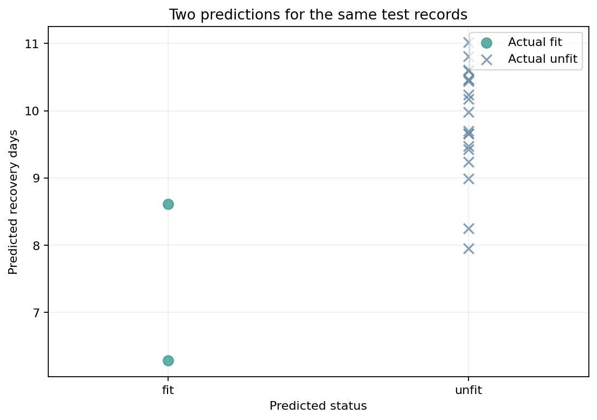
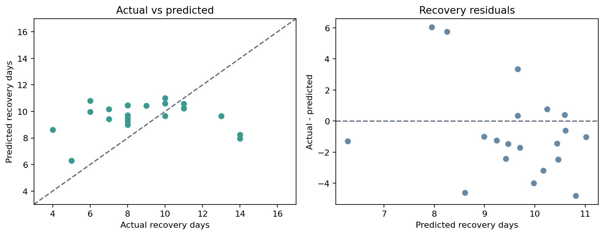

> **이번 글의 질문**
>
> Isolation Forest가 5%를 이상치로 표시했다면 실제 이상 비율도 5%일까요? 사진 세 장의 사람·차량 탐지 수로 어떤 관계까지 설명할 수 있을까요? 분류를 모두 맞춘 모델이 회복 기간도 잘 예측할까요?

> **핵심 요약**
>
> 이상치 탐지는 데이터에서 드문 기록을 찾고, 객체 탐지는 사진별 결과를 표로 만듭니다. 분류와 회귀는 같은 Feature를 사용하더라도 Target과 평가 기준이 다릅니다. 이상치의 임계값, 탐지 클래스의 범위, Train/Test 분할과 Baseline을 확인해야 결과의 의미가 분명해집니다.

## 1. 같은 데이터 분석이라도 질문에 따라 모델이 달라집니다

드문 기록을 찾는 일, 사진 속 객체를 세는 일, 상태와 회복 기간을 예측하는 일은 서로 다른 질문입니다. 마지막 종합 실습에서는 각 결과의 기준을 분명하게 두고, 숫자를 저장하는 단계까지 연결합니다.

| 실습 | 입력 | 모델·처리 | 결과의 의미 |
| --- | --- | --- | --- |
| 건강 데이터 이상치 탐지 | `health_survey.csv` | IsolationForest와 PCA | 다섯 Feature에서 상대적으로 드문 기록을 찾습니다. |
| 사람·차량 탐지 | `images/training_scene` | YOLOv5와 클래스별 개수 집계 | 사진 한 장의 `person`·차량 탐지 수를 정리합니다. |
| 상태·회복 기간 예측 | `soldier_full_profile.csv` | LogisticRegression과 RandomForestRegressor | 같은 Test 병사의 `status`와 `recovery_days`를 예측합니다. |

이상치 탐지에는 정답 Target이 없습니다. 마지막 문제에는 **`status`와 `recovery_days`라는 Target 두 개**가 있고, 각각 별도의 모델을 학습합니다. Logistic Regression은 이름에 Regression이 들어 있어도 여기서는 클래스 예측에 사용하는 분류 모델입니다.

회귀 모델의 Baseline 비교와 사진 집계 단위를 다룬 [파이썬 데이터 분석 공부노트 11](/cs/data-analysis/pandas-11-comprehensive-problems-1/)에 이어, 이번에는 이상치 기준과 두 Target의 평가를 더 자세히 확인합니다.

```python
from pathlib import Path
import pandas as pd
import numpy as np
import matplotlib.pyplot as plt

from sklearn.preprocessing import StandardScaler, LabelEncoder
from sklearn.ensemble import IsolationForest, RandomForestRegressor
from sklearn.decomposition import PCA
from sklearn.linear_model import LogisticRegression
from sklearn.pipeline import Pipeline
from sklearn.model_selection import (
    train_test_split, StratifiedKFold, cross_validate,
)
from sklearn.dummy import DummyClassifier, DummyRegressor
from sklearn.metrics import (
    accuracy_score, balanced_accuracy_score, confusion_matrix,
    classification_report, ConfusionMatrixDisplay,
    root_mean_squared_error, mean_absolute_error, r2_score,
)

plot_dir = Path("plots")
plot_dir.mkdir(parents=True, exist_ok=True)

for filename in ["health_survey.csv", "soldier_full_profile.csv"]:
    data = pd.read_csv(filename)
    print(filename, "행·열:", data.shape,
          "결측값:", int(data.isna().sum().sum()),
          "ID 중복:", int(data["soldier_id"].duplicated().sum()))
```

```text
health_survey.csv 행·열: (100, 6) 결측값: 0 ID 중복: 0
soldier_full_profile.csv 행·열: (101, 7) 결측값: 0 ID 중복: 0
```

건강 설문은 100행, 병사 프로필은 **101행**입니다. 두 파일 모두 결측값과 ID 중복이 없습니다. CSV 두 개와 `images` 폴더를 같은 작업 폴더에 두고, 결과 그래프는 `plots` 폴더에 저장합니다. 열 이름과 이미지 경로는 실제 파일의 이름을 사용합니다.

## 2. 실습 1: Isolation Forest로 드문 기록을 찾습니다

### 2-1. 한 항목의 극단값과 여러 항목의 조합을 구분합니다

| 열 이름 | 내용 | 분석에서의 역할 |
| --- | --- | --- |
| `soldier_id` | 병사 식별자 | 결과를 원본에 연결합니다. |
| `bmi` | 체질량 지수 | Feature |
| `sleep_hours` | 하루 평균 수면 시간 | Feature |
| `exercise_freq` | 주간 운동 횟수 | Feature |
| `smoke` | 흡연 여부: 0 또는 1 | Feature |
| `alcohol` | 음주 여부: 0 또는 1 | Feature |

IQR이나 Z-score로 한 열의 극단값을 살펴볼 수 있었다면, 이번에는 다섯 Feature를 함께 사용합니다. 개별 값이 아주 크거나 작지 않더라도, **함께 나타나는 조합이 드문 기록**은 다른 기록보다 쉽게 구분될 수 있습니다.

Isolation Forest는 Feature와 분할 값을 무작위로 고르며 데이터를 나눕니다. 여러 Tree에서 적은 분할만으로 떨어져 나온 관측값은 더 드물게 봅니다. 정답 Label을 맞추는 대신, 다른 관측값들과 얼마나 쉽게 분리되는지를 이용합니다.

모델이 표시한 것은 **이 데이터에서 상대적으로 드문 기록**입니다. 건강 위험이나 질환을 진단한 결과가 아닙니다. 원본 값과 입력 오류, 기록의 맥락을 다시 확인할 후보로 사용합니다.

```python
health = pd.read_csv("health_survey.csv")
health_features = [
    "bmi", "sleep_hours", "exercise_freq", "smoke", "alcohol",
]
health_scaler = StandardScaler()
health_scaled = health_scaler.fit_transform(health[health_features])

iso = IsolationForest(
    n_estimators=100, contamination=0.05, random_state=42,
)
isolation_labels = iso.fit_predict(health_scaled)
health["anomaly"] = (isolation_labels == -1).astype(int)
health["decision_score"] = iso.decision_function(health_scaled)

print("Feature 수:", iso.n_features_in_)
print("이상치 후보 수:", int(health["anomaly"].sum()))
print("이상치 후보 비율:", f"{health['anomaly'].mean():.1%}")
print("원래 Label:", sorted(np.unique(isolation_labels).tolist()))
```

```text
Feature 수: 5
이상치 후보 수: 5
이상치 후보 비율: 5.0%
원래 Label: [-1, 1]
```

StandardScaler는 각 Feature의 평균과 표준편차를 기준으로 표준화합니다. `smoke`와 `alcohol`도 모델 입력에서는 변환되지만, 원본 DataFrame에는 0·1을 그대로 남깁니다. 표준화가 데이터 분포를 정규분포로 바꾸는 것은 아닙니다.

Isolation Forest는 Tree의 무작위 분할을 사용합니다. 표준화한 입력으로 후보를 찾고, 같은 입력을 PCA에도 사용합니다. PCA는 분산을 기준으로 축을 만들기 때문에 Feature별 스케일을 어떻게 정했는지가 해석에 영향을 줍니다.

현재 100행 안에서 드문 기록을 찾는 **탐색**이므로 전체 설문에 `fit_predict`를 적용합니다. 앞으로 들어올 기록의 탐지 성능을 평가하는 문제라면 참조용 Train에서 Scaler와 모델을 학습하고 새 기록에는 `transform`·`predict`를 적용합니다. 정답이 없다는 이유로 모든 목적에서 데이터 분할이 불필요한 것은 아닙니다.

전체 데이터를 설명하는 비지도 분석과 새 데이터에 적용하는 평가의 차이는 [파이썬 데이터 분석 공부노트 08](/cs/data-analysis/pandas-08-unsupervised-learning/)의 Pipeline 설명과 연결됩니다.

### 2-2. anomaly, decision_function, score_samples를 구분합니다

| 값·함수 | 이 실습에서 읽는 기준 |
| --- | --- |
| `fit_predict()` | -1은 Outlier, 1은 Inlier입니다. |
| `anomaly` | Outlier를 1, Inlier를 0으로 바꾼 저장용 열입니다. |
| `score_samples()` | 작을수록 더 드문 기록이며, 0을 판정 기준으로 삼지 않습니다. |
| `decision_function()` | `score_samples`에서 학습한 `offset_`을 뺀 값입니다. 음수이면 Outlier입니다. |

`anomaly`는 0·1 열이므로 평균을 구하면 1의 비율이 됩니다. 여기서는 `5 / 100 = 0.05`입니다. `decision_score`가 작을수록 모델이 더 드물게 본 기록이지만, 이 점수는 건강 위험의 확률이 아닙니다.

```python
flagged_records = health.loc[health["anomaly"].eq(1)].sort_values(
    "decision_score",
)
print(flagged_records[
    ["soldier_id", *health_features, "decision_score"]
].round(3).to_string(index=False))

print("offset_:", round(iso.offset_, 3))
print("Score 관계 일치:", np.allclose(
    health["decision_score"],
    iso.score_samples(health_scaled) - iso.offset_,
))
```

```text
soldier_id  bmi  sleep_hours  exercise_freq  smoke  alcohol  decision_score
      S007 16.7          8.5              0      0        1          -0.063
      S047 31.2          6.2              1      1        1          -0.040
      S083 29.0          4.2              3      1        1          -0.029
      S073 27.5          4.0              6      1        0          -0.010
      S032 15.6          7.8              1      0        0          -0.004
offset_: -0.578
Score 관계 일치: True
```

후보는 **S007, S032, S047, S073, S083**의 다섯 기록입니다. BMI가 낮은 기록과 높은 기록이 모두 포함되어 있으며, 운동 횟수·흡연·음주 조합도 다릅니다. Label만 보고 같은 원인을 가진 그룹으로 묶지 않고 원래 Feature를 함께 봅니다.

```python
sorted_health = health.sort_values("decision_score").reset_index(drop=True)
fig, ax = plt.subplots(figsize=(8, 4))
for flag, label, color in [
    (0, "Inlier", "#6889a5"), (1, "Flagged record", "#c86e5b"),
]:
    mask = sorted_health["anomaly"].eq(flag)
    ax.scatter(sorted_health.index[mask] + 1,
               sorted_health.loc[mask, "decision_score"],
               label=label, color=color, s=30)
ax.axhline(0, color="#66727f", linestyle="--", label="Decision threshold")
ax.set(title="Isolation Forest: decision scores",
       xlabel="Records sorted by decision score", ylabel="Decision score")
ax.legend()
ax.grid(alpha=0.2)
fig.tight_layout()
fig.savefig(plot_dir / "anomaly_scores.png", dpi=160, bbox_inches="tight")
plt.close(fig)
```



*0선 아래의 다섯 기록이 후보입니다. x축은 Score로 정렬한 순서이며, 병사 ID의 순서나 시간이 아닙니다.*

### 2-3. contamination=0.05는 “5%를 발견했다”와 다릅니다

```python
contamination_rows = []
for setting in [0.03, 0.05, 0.10, "auto"]:
    candidate = IsolationForest(
        n_estimators=100, contamination=setting, random_state=42,
    ).fit(health_scaled)
    labels = candidate.predict(health_scaled)
    contamination_rows.append({
        "contamination": setting,
        "flagged_count": int((labels == -1).sum()),
        "offset": candidate.offset_,
    })

contamination_comparison = pd.DataFrame(contamination_rows)
print(contamination_comparison.round(3).to_string(index=False))
```

```text
contamination  flagged_count  offset
         0.03              3  -0.589
         0.05              5  -0.578
          0.1             10  -0.565
         auto             69  -0.500
```

같은 데이터에서 `contamination`을 0.03, 0.05, 0.10으로 바꾸면 후보 수는 각각 **3건, 5건, 10건**이 됩니다. 이 설정은 학습 데이터의 Score에 적용할 임계값을 정합니다. 5%가 실제 이상 비율이라는 사실을 모델이 검증한 것이 아닙니다.

`contamination="auto"`는 원래 알고리즘의 기준에 따라 `offset`을 정하며, 현재 데이터에서는 69건이 표시됩니다. `auto`를 “실제 이상 비율을 알아서 추정한다”거나 “기본 5%”로 읽지 않습니다. 관측 수와 Score 동점에 따라 비율이 정확히 지정값과 같지 않을 수도 있고, 새 데이터의 판정 비율도 5%로 고정되지 않습니다.

> **이상치 탐지 결과를 읽을 때는 선택한 Feature와 임계값을 함께 확인합니다.** 후보 비율은 모델 설정을 반영한 결과이고, 모델의 정확도를 나타내는 평가 지표는 아닙니다.

### 2-4. 다섯 Feature의 판정을 두 PCA 축 위에 표시합니다

```python
health_pca = PCA(n_components=2)
health_coordinates = health_pca.fit_transform(health_scaled)
health["PC1"] = health_coordinates[:, 0]
health["PC2"] = health_coordinates[:, 1]
health.to_csv("health_anomaly.csv", index=False, encoding="utf-8-sig")

variance = health_pca.explained_variance_ratio_
print("PC1 설명 분산:", f"{variance[0]:.1%}")
print("PC2 설명 분산:", f"{variance[1]:.1%}")
print("두 축의 누적 설명 분산:", f"{variance.sum():.1%}")

fig, ax = plt.subplots(figsize=(7, 5))
for flag, label, color in [
    (0, "Inlier", "#6889a5"), (1, "Flagged record", "#c86e5b"),
]:
    mask = health["anomaly"].eq(flag)
    ax.scatter(health.loc[mask, "PC1"], health.loc[mask, "PC2"],
               label=label, color=color, alpha=0.8,
               s=65 if flag else 35, edgecolors="white", linewidths=0.4)
for row in flagged_records.itertuples(index=False):
    index = health.index[health["soldier_id"].eq(row.soldier_id)][0]
    ax.annotate(row.soldier_id, (health.loc[index, "PC1"], health.loc[index, "PC2"]),
                xytext=(5, 5), textcoords="offset points", fontsize=9)
ax.set(title="Health records: PCA projection",
       xlabel=f"PC1 ({variance[0]:.1%})", ylabel=f"PC2 ({variance[1]:.1%})")
ax.legend()
ax.grid(alpha=0.2)
fig.tight_layout()
fig.savefig(plot_dir / "anomaly_scatter.png", dpi=160, bbox_inches="tight")
plt.close(fig)
```

```text
PC1 설명 분산: 24.3%
PC2 설명 분산: 23.5%
두 축의 누적 설명 분산: 47.8%
```



*후보 판정은 표준화한 **다섯 Feature**로 수행했습니다. 두 PCA 축은 전체 분산의 약 47.8%를 보여 주는 시각화입니다.*

PC1은 약 **24.3%**, PC2는 약 <strong>23.5%</strong>의 분산을 담습니다. 나머지 약 52.2%는 이 평면에 표시되지 않습니다. 2차원 그림에서 다른 점과 가깝다고 판정이 틀렸다고 단정하거나, 그림의 가장자리만 이상치라고 읽지 않습니다.

PCA는 판정 결과를 보는 좌표를 만들었으며, 여기서는 PCA 좌표로 Isolation Forest를 다시 학습하지 않았습니다. **판정한 공간과 그려 놓은 공간을 구분**하면 산점도에 모든 정보를 기대하지 않게 됩니다.

## 3. 실습 2: 사진별 사람과 차량 탐지 수를 비교합니다

### 3-1. 먼저 “차량”에 포함할 클래스를 정합니다

입력은 `images/training_scene`의 `CAM001.png`, `CAM002.png`, `CAM003.png`입니다. 사람은 `person`으로, 차량은 <strong>`car`·`truck`·`bus`</strong>로 집계합니다. 차량이라는 열 이름 하나만 남기면 어떤 클래스를 합친 값인지 잊기 쉬우므로 코드에서도 범위를 분명하게 둡니다.

```python
import torch
import cv2

image_dir = Path("images/training_scene")
image_files = ["CAM001.png", "CAM002.png", "CAM003.png"]
vehicle_classes = ["car", "truck", "bus"]

detection_model = torch.hub.load(
    "ultralytics/yolov5", "yolov5s",
    pretrained=True, trust_repo=True,
)
detection_model.classes = None
detection_model.conf = 0.25
detection_model.iou = 0.45

print("클래스 필터:", detection_model.classes)
print("Confidence threshold:", detection_model.conf)
print("차량 집계 클래스:", vehicle_classes)
```

```text
클래스 필터: None
Confidence threshold: 0.25
차량 집계 클래스: ['car', 'truck', 'bus']
```

`classes`를 `None`으로 두어 전체 클래스에서 탐지합니다. 이전에 같은 모델에 `classes=[0]`을 설정했다면 차량이 결과에 포함되지 않으므로 설정을 다시 확인합니다. `motorcycle`·`bicycle` 등은 이번 `vehicle_count`에 포함하지 않았습니다. COCO의 `person` Label 역시 병사인지 여부까지 분류하지는 않습니다.

### 3-2. 파일 읽기 실패와 탐지 0건을 구분해 저장합니다

```python
image_summary_rows = []
image_detail_rows = []
image_previews = []

for filename in image_files:
    path = image_dir / filename
    person_count = pd.NA
    vehicle_count = pd.NA
    status = "missing_file"

    if path.is_file():
        bgr = cv2.imread(str(path))
        if bgr is None:
            status = "read_failed"
        else:
            rgb = cv2.cvtColor(bgr, cv2.COLOR_BGR2RGB)
            result = detection_model(rgb, size=640)
            boxes = result.pandas().xyxy[0]
            person_count = int(boxes["name"].eq("person").sum())
            vehicle_count = int(boxes["name"].isin(vehicle_classes).sum())
            status = "ok"
            image_previews.append((filename, result.render()[0].copy()))

            for box in boxes.itertuples(index=False):
                image_detail_rows.append({
                    "filename": filename, "object_class": box.name,
                    "confidence": float(box.confidence),
                    "x_min": float(box.xmin), "y_min": float(box.ymin),
                    "x_max": float(box.xmax), "y_max": float(box.ymax),
                })

    image_summary_rows.append({
        "filename": filename, "person_count": person_count,
        "vehicle_count": vehicle_count, "status": status,
    })

detection_summary = pd.DataFrame(image_summary_rows)
detection_summary[["person_count", "vehicle_count"]] = (
    detection_summary[["person_count", "vehicle_count"]].astype("Int64")
)
detection_summary.to_csv("detection_summary.csv", index=False)
detection_details = pd.DataFrame(image_detail_rows, columns=[
    "filename", "object_class", "confidence",
    "x_min", "y_min", "x_max", "y_max",
])
detection_details.to_csv("training_detection_details.csv", index=False)
print(detection_summary.to_string(index=False))
```

```text
  filename  person_count  vehicle_count status
CAM001.png             7              1     ok
CAM002.png             5              1     ok
CAM003.png             3              3     ok
```

BGR에서 RGB로 변환한 이미지를 YOLOv5 Hub 모델에 전달합니다. `name.isin(vehicle_classes)`는 각 탐지 행의 클래스가 차량 List에 있는지 `True`·`False`로 반환하고, `sum`으로 `True`의 개수를 셉니다. 두 개수가 모두 0인 정상 사진과 읽지 못한 사진의 결측값을 구분합니다.

| 파일 | person 탐지 | 차량 탐지 | 차량 클래스 구성 |
| --- | --- | --- | --- |
| `CAM001.png` | 7 | 1 | `truck` 1건 |
| `CAM002.png` | 5 | 1 | `truck` 1건 |
| `CAM003.png` | 3 | 3 | `truck` 2건, `car` 1건 |

세 사진의 합계는 `person` **15건**, 선택한 차량 클래스 **5건**입니다. `backpack`은 전체 탐지 결과에 포함되어도 차량 집계에서는 제외합니다. 여러 사진에 같은 대상이 반복될 수 있으므로 합계를 고유 인원·차량 수로 바꾸어 읽지 않습니다.

```python
fig, axes = plt.subplots(1, 3, figsize=(15, 5))
for ax, (filename, preview) in zip(axes, image_previews):
    ax.imshow(preview)
    ax.set_title(filename)
    ax.axis("off")
fig.tight_layout()
fig.savefig(plot_dir / "training_detection_preview.png", dpi=160, bbox_inches="tight")
plt.close(fig)
```



*집계 숫자와 함께 원본·Box·클래스를 확인합니다. CAM003의 오른쪽 영역에도 `truck` Box가 있으므로, 이 탐지 건은 원본에서 다시 검토할 대상입니다.*

탐지 결과는 실제 사진에 표시된 모델 예측입니다. 어둡거나 가려진 대상은 빠질 수 있고 다른 영역에 잘못된 Box가 생길 수도 있습니다. 숫자만 저장하는 대신 상세 좌표와 Confidence를 함께 남기면, 어느 탐지 건을 다시 확인할지 찾기 쉽습니다.

객체별 표와 파일별 표를 나누는 방식은 [파이썬 데이터 분석 공부노트 10](/cs/data-analysis/pandas-10-image-video-analysis/)의 이미지 빈도 분석과 같은 기준입니다.

### 3-3. 산점도의 한 점은 이미지 한 장입니다

```python
valid_images = detection_summary.loc[detection_summary["status"].eq("ok")]
fig, ax = plt.subplots(figsize=(7, 4))
ax.scatter(valid_images["person_count"].astype(float),
           valid_images["vehicle_count"].astype(float),
           color="#3a9a90", s=100, edgecolors="white")
for row in valid_images.itertuples(index=False):
    ax.annotate(row.filename, (row.person_count, row.vehicle_count),
                xytext=(7, 7), textcoords="offset points")
ax.set(title="Detected people and vehicles per image",
       xlabel="Person detections", ylabel="Vehicle detections",
       xlim=(0, 9), ylim=(0, 4))
ax.set_xticks(range(0, 10))
ax.set_yticks(range(0, 5))
ax.grid(alpha=0.2)
fig.tight_layout()
fig.savefig(plot_dir / "person_vs_vehicle_scatter.png", dpi=160, bbox_inches="tight")
plt.close(fig)
```



*점은 각각 (7, 1), (5, 1), (3, 3)입니다. x·y축은 모델이 탐지한 건수입니다.*

CAM003은 다른 두 사진보다 `person` 탐지가 적고 차량 탐지가 많습니다. 이 세 사진에서 확인한 차이입니다. **점 세 개와 탐지 오차가 포함된 집계**만으로 “차량이 많을수록 인원은 적다”는 일반적인 관계를 결론 내리지는 않습니다. 먼저 이미지별 차이를 찾고 해당 사진을 다시 확인하는 데 사용합니다.

## 4. 실습 3: 두 Target을 같은 병사 기준으로 나눕니다

### 4-1. Feature는 네 개, Target은 두 개입니다

| 열 이름 | 내용 | 역할 |
| --- | --- | --- |
| `soldier_id` | 병사 식별자 | 결과 연결 |
| `pushup` | 팔굽혀펴기 횟수 | Feature |
| `run_time` | 2km 달리기 시간: 분 | Feature |
| `sleep_quality` | 수면의 질 점수 | Feature |
| `stress_level` | 스트레스 점수 | Feature |
| `status` | `fit` / `unfit` | 분류 Target |
| `recovery_days` | 회복 기간: 일 | 회귀 Target |

두 모델 모두 네 Feature를 입력으로 사용합니다. `status`를 예측할 때 `recovery_days`를 넣거나, `recovery_days`를 예측할 때 실제 `status`를 추가하지 않습니다. 예측하려는 Target의 정보를 입력에 섞으면 목적이 달라지고, 실제 예측 시점에 없는 정보를 사용할 수 있습니다.

```python
profile = pd.read_csv("soldier_full_profile.csv")
profile_features = ["pushup", "run_time", "sleep_quality", "stress_level"]

train_index, test_index = train_test_split(
    profile.index, test_size=0.2, random_state=42,
    stratify=profile["status"],
)
X_train = profile.loc[train_index, profile_features]
X_test = profile.loc[test_index, profile_features]
y_status_train_text = profile.loc[train_index, "status"]
y_status_test_text = profile.loc[test_index, "status"]
y_recovery_train = profile.loc[train_index, "recovery_days"]
y_recovery_test = profile.loc[test_index, "recovery_days"]

print("전체 클래스 수:")
print(profile["status"].value_counts().to_string())
print("Train:", len(train_index), "Test:", len(test_index))
print("Test 클래스 수:")
print(y_status_test_text.value_counts().to_string())
```

```text
전체 클래스 수:
status
unfit    89
fit      12
Train: 80 Test: 21
Test 클래스 수:
status
unfit    19
fit       2
```

전체 101행 중 `unfit`은 **89행**, `fit`은 **12행**입니다. 클래스 비율을 유지하는 `stratify`를 사용해 Train 80행, Test 21행으로 나눴습니다. Test에는 `unfit` 19행과 `fit` 2행이 들어갑니다. `stratify`가 두 클래스의 수를 같게 만드는 것은 아닙니다.

> **Index를 한 번 나누고 두 Target에 같은 Index를 적용합니다.** 이렇게 해야 결과 CSV의 한 행에 같은 병사의 분류 예측과 회귀 예측을 안전하게 붙일 수 있습니다.

분류와 회귀를 따로 분할하면 설정이 바뀌었을 때 두 Test의 병사 구성이 달라질 수 있습니다. 예측값의 길이가 같아도 같은 사람을 나타낸다는 보장은 없습니다. 원본 Index와 ID를 기준으로 묶습니다.

### 4-2. LabelEncoder의 실제 매핑을 확인합니다

```python
status_encoder = LabelEncoder()
y_status_train = status_encoder.fit_transform(y_status_train_text)
y_status_test = status_encoder.transform(y_status_test_text)

label_mapping = dict(zip(
    status_encoder.classes_.tolist(),
    range(len(status_encoder.classes_)),
))
print("Label 매핑:", label_mapping)
```

```text
Label 매핑: {'fit': 0, 'unfit': 1}
```

실제 매핑은 **`fit` → 0, `unfit` → 1**입니다. LabelEncoder가 의미상 “적합”을 자동으로 1에 배정하지는 않습니다. `classes_`의 순서를 확인하고, 예측값을 저장할 때 `inverse_transform`으로 원래 문자열을 복원합니다.

LabelEncoder는 여기서 Target `y`를 변환합니다. 입력 `X`의 범주형 Feature를 Encoding하는 도구와 구분합니다. “`fit`이 1이어야 한다”처럼 별도 규칙이 있다면 명시적인 Dictionary 매핑을 사용하고, 평가 Label 순서도 그 규칙에 맞춥니다.

### 4-3. Scaler는 Train에서 학습하도록 두 Pipeline을 만듭니다

```python
status_model = Pipeline([
    ("scaler", StandardScaler()),
    ("classifier", LogisticRegression(
        solver="lbfgs", C=1.0, max_iter=1000, random_state=42,
    )),
])
recovery_model = Pipeline([
    ("scaler", StandardScaler()),
    ("regressor", RandomForestRegressor(
        n_estimators=100, random_state=42,
    )),
])
```

Logistic Regression은 Feature의 선형 조합으로 클래스 확률을 모델링하며, 기본적으로 Regularization을 적용합니다. 단위가 다른 Feature의 스케일을 맞춰 학습합니다. `max_iter=1000`은 최적화 반복의 상한으로, Tree의 개수나 데이터 반복 학습 횟수를 뜻하지 않습니다.

`C`는 Regularization 강도의 역수입니다. 값이 작을수록 제약이 강합니다. 최신 API에서는 `penalty` 인자가 deprecated되었고, Regularization 종류는 `l1_ratio`와 `C`로 지정하는 방향입니다. 이번 코드에서는 기본 L2 설정과 `C=1.0`을 사용하고, `solver`와 반복 상한을 명시했습니다.

Random Forest에 Scaling이 일반적으로 필수는 아니지만, 여기서는 두 모델 모두 동일한 Feature를 같은 표준화 기준으로 처리합니다. Scaler 객체는 각각 별도로 만들고, `fit`할 Train 행은 동일하게 사용합니다. 회복 기간 Target 자체는 표준화하지 않습니다.

분할 전에 전체 `X`를 `fit_transform`하면 Test의 평균과 표준편차가 전처리에 들어갑니다. 이 데이터 누수는 [파이썬 데이터 분석 공부노트 01](/cs/data-analysis/pandas-01-missing-values-outliers/)에서 설명한 `fit` 범위의 문제입니다. 여기서는 Pipeline을 Train에만 `fit`합니다.

### 4-4. Train 안에서 교차검증을 먼저 확인합니다

```python
folds = list(StratifiedKFold(
    n_splits=5, shuffle=True, random_state=42,
).split(X_train, y_status_train))

status_cv = cross_validate(
    status_model, X_train, y_status_train, cv=folds,
    scoring={"accuracy": "accuracy", "balanced": "balanced_accuracy"},
)
recovery_cv = cross_validate(
    recovery_model, X_train, y_recovery_train, cv=folds,
    scoring="neg_root_mean_squared_error",
)
cv_summary = pd.DataFrame({
    "fold": np.arange(1, 6),
    "accuracy": status_cv["test_accuracy"],
    "balanced_accuracy": status_cv["test_balanced"],
    "recovery_rmse": -recovery_cv["test_score"],
})
cv_summary.to_csv("dual_train_cv.csv", index=False)
print(cv_summary.round(3).to_string(index=False))
print("Fold 평균:")
print(cv_summary.drop(columns="fold").mean().round(3).to_string())
```

```text
 fold  accuracy  balanced_accuracy  recovery_rmse
    1     1.000              1.000          2.260
    2     0.812              0.464          3.312
    3     0.875              0.714          2.698
    4     1.000              1.000          2.760
    5     1.000              1.000          2.759
Fold 평균:
accuracy             0.938
balanced_accuracy    0.836
recovery_rmse        2.758
```

80행의 Train 안에서 다섯 Fold로 나누어 평가합니다. 분류는 `status` 비율을 유지하고, 회귀도 같은 검증 병사를 보도록 **만들어 둔 분할 List를 공유**합니다. 회귀 Target을 구간으로 나눠 `stratify`한 것이 아니라 `status`를 기준으로 만든 Fold를 재사용한 것입니다.

`cross_validate`는 각 Fold마다 Pipeline을 새로 학습하므로 Scaler도 해당 Fold의 학습 부분만 봅니다. 반환값의 `test_score`·`test_accuracy`에서 `test`는 **Fold의 Validation**을 뜻하며, 따로 보관한 최종 Test 21행이 아닙니다. RMSE scoring에는 음수가 붙어 반환되므로 다시 부호를 바꿉니다.

분류의 Fold 평균 Accuracy는 **0.938**, Balanced Accuracy는 **0.836**입니다. Balanced Accuracy는 각 클래스의 Recall을 같은 비중으로 평균합니다. Fold별 값이 달라지는 모습을 보면 한 번의 평가 점수만으로 전체 성능을 판단하기 어려운 이유가 드러납니다.

## 5. 분류와 회귀는 각각의 기준으로 평가합니다

### 5-1. Train 80행으로 학습하고 Test 21행을 예측합니다

```python
status_model.fit(X_train, y_status_train)
recovery_model.fit(X_train, y_recovery_train)
status_pred = status_model.predict(X_test)
recovery_pred = recovery_model.predict(X_test)

status_baseline = DummyClassifier(strategy="most_frequent")
status_baseline.fit(X_train, y_status_train)
status_baseline_pred = status_baseline.predict(X_test)

recovery_baseline = DummyRegressor(strategy="mean")
recovery_baseline.fit(X_train, y_recovery_train)
recovery_baseline_pred = recovery_baseline.predict(X_test)

print("분류 Scaler의 학습 행 수:",
      status_model.named_steps["scaler"].n_samples_seen_)
print("회귀 Scaler의 학습 행 수:",
      recovery_model.named_steps["scaler"].n_samples_seen_)
```

```text
분류 Scaler의 학습 행 수: 80.0
회귀 Scaler의 학습 행 수: 80.0
```

두 Scaler가 본 행 수는 각각 80입니다. Test는 `predict`할 때 Train에서 정한 기준으로 변환됩니다. 분류 Baseline은 Train에서 가장 많은 클래스인 `unfit`을 항상 예측하고, 회귀 Baseline은 Train의 평균 회복 기간만 예측합니다.

### 5-2. Accuracy 1.000을 Confusion Matrix와 함께 읽습니다

```python
classification_metrics = pd.DataFrame({
    "Majority baseline": {
        "accuracy": accuracy_score(y_status_test, status_baseline_pred),
        "balanced_accuracy": balanced_accuracy_score(
            y_status_test, status_baseline_pred,
        ),
    },
    "Logistic regression": {
        "accuracy": accuracy_score(y_status_test, status_pred),
        "balanced_accuracy": balanced_accuracy_score(y_status_test, status_pred),
    },
}).T
classification_metrics.to_csv("status_metrics.csv", index_label="model")
label_order = [0, 1]
cm = confusion_matrix(y_status_test, status_pred, labels=label_order)
cm_table = pd.DataFrame(
    cm, index=["actual_fit", "actual_unfit"],
    columns=["pred_fit", "pred_unfit"],
)
cm_table.to_csv("status_confusion_matrix.csv", index_label="actual")

print(classification_metrics.round(3).to_string())
print(cm_table.to_string())
print(classification_report(
    y_status_test, status_pred, labels=label_order,
    target_names=status_encoder.classes_, digits=3, zero_division=0,
))
```

```text
                     accuracy  balanced_accuracy
Majority baseline       0.905                0.5
Logistic regression     1.000                1.0
              pred_fit  pred_unfit
actual_fit           2           0
actual_unfit         0          19
              precision    recall  f1-score   support

         fit      1.000     1.000     1.000         2
       unfit      1.000     1.000     1.000        19

    accuracy                          1.000        21
   macro avg      1.000     1.000     1.000        21
weighted avg      1.000     1.000     1.000        21
```

이번 Test에서 Logistic Regression의 Accuracy는 **1.000**입니다. `fit` 2행과 `unfit` 19행을 모두 맞췄습니다. Baseline도 `unfit`만 예측해 **19 / 21 = 0.905**의 Accuracy를 얻지만 `fit`의 Recall은 0입니다. 높은 Accuracy만 보면 놓칠 수 있는 클래스 차이를 확인합니다.

Confusion Matrix의 **행은 실제 Label, 열은 예측 Label**입니다. 순서는 `[fit, unfit]`으로 명시했습니다. `unfit`을 Positive인 1로 보면 왼쪽 위는 TN, 오른쪽 위는 FP, 왼쪽 아래는 FN, 오른쪽 아래는 TP입니다. Label 숫자가 바뀌면 이 기준도 확인합니다.

```python
baseline_cm = confusion_matrix(
    y_status_test, status_baseline_pred, labels=label_order,
)
fig, axes = plt.subplots(1, 2, figsize=(9, 4))
for ax, matrix, title in [
    (axes[0], baseline_cm, "Majority baseline"),
    (axes[1], cm, "Logistic regression"),
]:
    ConfusionMatrixDisplay(matrix, display_labels=["fit", "unfit"]).plot(
        ax=ax, cmap="Blues", colorbar=False, values_format="d",
    )
    ax.set_title(title)
fig.tight_layout()
fig.savefig(plot_dir / "status_confusion_matrix.png", dpi=160, bbox_inches="tight")
plt.close(fig)
```



*Baseline은 실제 `fit` 두 행을 모두 `unfit`으로 예측했습니다. Logistic Regression은 이번 Test 21행에서 오류가 없었습니다.*

이 Test의 `fit` 표본은 두 개입니다. 앞서 Train 안의 교차검증에서는 오류가 있는 Fold도 확인했습니다. 따라서 Test 1.000은 **이번 분할의 21행에서 모두 맞췄다**는 결과로 남깁니다. 새 데이터에서도 오류가 없다는 뜻으로 확대하지 않습니다.

Precision·Recall·F1·support의 계산과 읽는 방법은 [파이썬 데이터 분석 공부노트 07](/cs/data-analysis/pandas-07-supervised-learning/)에서 이어서 복습할 수 있습니다.

### 5-3. 회복 기간은 평균 예측 Baseline보다 나아졌을까요?

```python
def recovery_metrics(actual, predicted):
    return {
        "RMSE": root_mean_squared_error(actual, predicted),
        "MAE": mean_absolute_error(actual, predicted),
        "R2": r2_score(actual, predicted),
    }

regression_metrics = pd.DataFrame({
    "Mean baseline": recovery_metrics(y_recovery_test, recovery_baseline_pred),
    "Random forest": recovery_metrics(y_recovery_test, recovery_pred),
}).T
regression_metrics.to_csv("recovery_metrics.csv", index_label="model")
print(regression_metrics.round(3).to_string())

print("Train Accuracy:",
      f"{accuracy_score(y_status_train, status_model.predict(X_train)):.3f}")
print("Train 회복 기간 RMSE:", f"{root_mean_squared_error(
    y_recovery_train, recovery_model.predict(X_train)
):.3f}")
```

```text
                RMSE    MAE     R2
Mean baseline  2.754  2.310 -0.067
Random forest  2.949  2.396 -0.224
Train Accuracy: 0.963
Train 회복 기간 RMSE: 0.995
```

Random Forest의 RMSE는 **2.949일**, 평균 예측 Baseline은 **2.754일**입니다. 이번 Test에서는 복잡한 모델이 평균만 예측하는 방법보다 오차가 컸습니다. “약 3일이니 잘 예측했다”로 끝내기보다 비교 기준을 통해 결과를 판단합니다.

Random Forest의 MAE는 **2.396일**, R²는 **−0.224**입니다. RMSE는 큰 오차를 더 강하게 반영하고, MAE는 절대 오차의 평균입니다. R²가 음수라는 것은 Test의 실제값 평균을 항상 예측하는 기준보다 제곱 오차가 컸다는 뜻입니다. 이 기준 평균과 DummyRegressor가 사용하는 Train 평균은 구분합니다.

Train RMSE는 **0.995일**로 Test보다 훨씬 낮습니다. 학습한 데이터에서 계산한 오차를 일반화 성능으로 보고하면 새 병사의 회복 기간을 잘 예측하는 것처럼 보일 수 있습니다. 같은 모델이어도 **어떤 데이터에서 평가했는지**가 수치의 의미를 바꿉니다.

> **분류를 잘했다고 회귀도 잘한 것은 아닙니다.** 같은 네 Feature를 사용했어도 `status`와 `recovery_days`는 다른 Target입니다. 이번에는 분류가 Baseline보다 나았고, 회귀는 Baseline보다 나아지지 않았습니다.

이 결과를 바탕으로 모델을 개선한다면 Target과 Feature의 관계, 입력 기록의 품질, Train 안의 검증 결과를 먼저 살펴봅니다. 설정은 Train의 Cross-validation으로 결정하고, 최종 Test 점수에 맞춰 반복적으로 고르지 않습니다.

## 6. 두 예측을 같은 ID의 한 행에 저장합니다

```python
dual_result = profile.loc[
    test_index, ["soldier_id", "status", "recovery_days"],
].copy()
dual_result["predicted_status"] = status_encoder.inverse_transform(status_pred)
dual_result["predicted_recovery_days"] = recovery_pred
dual_result["status_correct"] = (
    dual_result["status"] == dual_result["predicted_status"]
)
dual_result["recovery_residual"] = (
    dual_result["recovery_days"] - dual_result["predicted_recovery_days"]
)
dual_result.to_csv("soldier_dual_prediction.csv", index=False, encoding="utf-8-sig")

print("저장 행 수:", len(dual_result))
print(dual_result.head().round(3).to_string(index=False))
```

```text
저장 행 수: 21
soldier_id status  recovery_days predicted_status  predicted_recovery_days  status_correct  recovery_residual
      S025  unfit             13            unfit                     9.66            True               3.34
      S054  unfit              6            unfit                    10.81            True              -4.81
      S003  unfit             11            unfit                    10.59            True               0.41
      S097  unfit              7            unfit                     9.42            True              -2.42
      S072  unfit             14            unfit                     7.95            True               6.05
```

원본 전체 101행에 Test 예측 21개를 붙이면 길이가 맞지 않습니다. `loc[test_index]`로 Test에 해당하는 ID와 실제 Target 두 개만 가져와 예측을 추가합니다. 표시할 때는 `round`를 사용해도 저장할 예측값은 반올림하지 않아 평가 수치와 일치하도록 둡니다.

### 6-1. 분류 Label과 회귀 예측을 한 그림에 표시합니다

```python
fig, ax = plt.subplots(figsize=(7, 5))
status_positions = {"fit": 0, "unfit": 1}
for label, color, marker in [
    ("fit", "#3a9a90", "o"), ("unfit", "#6889a5", "x"),
]:
    subset = dual_result.loc[dual_result["status"].eq(label)]
    ax.scatter(subset["predicted_status"].map(status_positions),
               subset["predicted_recovery_days"],
               label=f"Actual {label}", color=color, marker=marker,
               s=70, alpha=0.8)
ax.set_xticks([0, 1], ["fit", "unfit"])
ax.set(xlim=(-0.4, 1.4), title="Two predictions for the same test records",
       xlabel="Predicted status", ylabel="Predicted recovery days")
ax.grid(alpha=0.2)
ax.legend()
fig.tight_layout()
fig.savefig(plot_dir / "dual_prediction.png", dpi=160, bbox_inches="tight")
plt.close(fig)
```



*x축은 예측한 클래스이며 숫자 0·1은 배치 위치입니다. `y`축은 예측 회복 기간입니다. 이번에는 분류 오류가 없어 실제 Label과 예측 Label이 모두 일치합니다.*

이 그림은 두 모델의 결과를 함께 보여 줍니다. `fit`과 `unfit`은 범주이므로 x축의 간격에 수치적인 의미를 부여하지 않습니다. 점의 색상·모양은 실제 `status`를 나타냅니다. 같은 위치에 점이 겹칠 수 있으므로 점 개수는 CSV에서도 확인합니다.

`y`축에 **예측 회복 기간만** 있으므로 이 그림 하나로 회귀 오차를 읽을 수는 없습니다. 실제 회복 기간과 예측을 비교한 그림을 함께 봅니다.

### 6-2. 실제 회복 기간과 잔차를 따로 확인합니다

```python
fig, axes = plt.subplots(1, 2, figsize=(10, 4))
axes[0].scatter(dual_result["recovery_days"],
                dual_result["predicted_recovery_days"], color="#3a9a90")
limits = [3, 17]
axes[0].plot(limits, limits, "--", color="#66727f")
axes[0].set(xlim=limits, ylim=limits, xlabel="Actual recovery days",
            ylabel="Predicted recovery days", title="Actual vs predicted")
axes[1].scatter(dual_result["predicted_recovery_days"],
                dual_result["recovery_residual"], color="#6889a5")
axes[1].axhline(0, color="#66727f", linestyle="--")
axes[1].set(xlabel="Predicted recovery days", ylabel="Actual - predicted",
            title="Recovery residuals")
fig.tight_layout()
fig.savefig(plot_dir / "recovery_diagnostics.png", dpi=160, bbox_inches="tight")
plt.close(fig)
```



*왼쪽 점선에 가까울수록 실제값과 예측값이 비슷합니다. 오른쪽 잔차가 양수이면 회복 기간을 실제보다 짧게 예측했고, 음수이면 길게 예측했습니다.*

회복 기간이 긴 기록을 얼마나 놓쳤는지, 예측값이 특정 구간에 몰리는지 살펴봅니다. 회귀 결과를 이해할 때는 분류 색상보다 실제값·예측값의 차이가 직접적인 정보입니다.

## 7. 더 살펴보기: 새 데이터의 후보 비율은 5%로 고정되지 않습니다

`contamination=0.05`로 참조 데이터를 학습한 뒤 분포가 다른 새 데이터를 넣으면 어떤 일이 생길까요? 학습한 경계는 그대로이고, 새 데이터에서 그 경계를 넘는 기록 수가 달라집니다.

평균 0 부근의 참조 기록과, 그 기록에 비해 값이 큰 새 기록을 섞은 작은 비교 예제로 확인합니다.

```python
import numpy as np
from sklearn.pipeline import make_pipeline
from sklearn.preprocessing import StandardScaler
from sklearn.ensemble import IsolationForest

rng = np.random.default_rng(42)
reference = rng.normal(size=(100, 3))
new = np.vstack([rng.normal(size=(20, 3)),
                 rng.normal(loc=2.8, size=(20, 3))])
detector = make_pipeline(StandardScaler(), IsolationForest(
    contamination=0.05, random_state=42,
))
detector.fit(reference)
print("참조 데이터 후보 비율:", (detector.predict(reference) == -1).mean())
print("새 데이터 후보 비율:", (detector.predict(new) == -1).mean())
```

```text
참조 데이터 후보 비율: 0.05
새 데이터 후보 비율: 0.475
```

새 데이터에도 기존 Scaler와 모델을 적용했습니다. 새 데이터에 다시 `fit_predict()`하면 비교 기준 자체가 바뀝니다. 후보 비율이 늘었을 때는 입력 단위·수집 조건·분포 변화부터 확인하고, 상대적으로 드문 기록과 실제 오류를 구분해 검토합니다.

## 8. 마지막까지 남겨야 할 것은 모델 이름보다 분석 기준입니다

| 결과 파일 | 한 행의 의미 | 다시 확인할 기준 |
| --- | --- | --- |
| `health_anomaly.csv` | 건강 설문 기록 한 개 | 원본 Feature·후보 Label·Score·PCA 좌표 |
| `detection_summary.csv` | 이미지 한 장 | `person`·차량 클래스 범위·처리 상태 |
| `training_detection_details.csv` | 탐지된 객체 한 건 | 파일명·클래스·Confidence·Box |
| `dual_train_cv.csv` | Train 안의 검증 Fold 한 개 | Fold별 분류 지표와 회귀 RMSE |
| `status_metrics.csv` | 분류 모델 한 개 | Accuracy와 Balanced Accuracy |
| `status_confusion_matrix.csv` | 실제 클래스 한 개 | Label 순서와 예측 클래스별 개수 |
| `recovery_metrics.csv` | 회귀 모델 한 개 | 같은 Test의 RMSE·MAE·R² |
| `soldier_dual_prediction.csv` | Test 병사 한 명 | 같은 ID의 실제 Target·두 예측·오차 |

### 8-1. 기억할 문법

| 문법 | 이번 실습에서의 역할 |
| --- | --- |
| `IsolationForest.fit_predict()` | 학습 데이터의 드문 기록을 -1·1로 표시합니다. |
| `decision_function()` | 학습한 임계값을 기준으로 판정 Score를 반환합니다. |
| `PCA.explained_variance_ratio_` | 그림에 담긴 분산의 비율을 확인합니다. |
| `Series.isin()` | 차량 List에 속하는 탐지 클래스를 선택합니다. |
| `train_test_split(stratify=...)` | 클래스 비율을 고려해 한 번 분할합니다. |
| `LabelEncoder.classes_` | `fit`·`unfit`의 실제 숫자 매핑을 확인합니다. |
| Pipeline | 전처리와 모델을 같은 학습 범위 안에 묶습니다. |
| `cross_validate()` | Train 안의 여러 검증 Fold에서 지표를 비교합니다. |
| `confusion_matrix(labels=...)` | 실제·예측 클래스의 방향과 순서를 고정합니다. |
| `root_mean_squared_error()` | 회복 기간의 예측 오차를 일 단위로 계산합니다. |

### 8-2. 다시 읽을 때 확인할 질문

- 5%라는 비율은 데이터에서 검증한 사실인가요, `contamination`으로 정한 기준인가요?
- 후보 판정은 다섯 Feature에서 했나요, 두 PCA 좌표에서 했나요?
- `vehicle_count`에 어떤 클래스가 포함됐고, 사진을 읽지 못한 경우는 어떻게 저장했나요?
- LabelEncoder의 `classes_`에서 `fit`과 `unfit`이 어떤 숫자로 매핑됐나요?
- 두 모델의 Test ID는 같고, 두 Scaler는 Train만 학습했나요?
- 각 Target의 결과는 같은 Test에서 계산한 Baseline보다 나아졌나요?

전처리부터 예측까지 도구는 달라도 기준은 이어집니다. 입력을 확인하고, 평가 대상을 따로 두고, 결과의 단위를 남깁니다. 다음 문제에서도 이 순서를 먼저 떠올립니다.

## 참고자료

### 실습 데이터와 노트북

- **실습 자료**: [Session12 실습 폴더](https://github.com/juwkim/juwkim.github.io/tree/master/public/files/maicon-2026/code/session12) · [session12_종합문제풀이(2).pdf](/files/maicon-2026/lectures/session12_%EC%A2%85%ED%95%A9%EB%AC%B8%EC%A0%9C%ED%92%80%EC%9D%B4%282%29.pdf) · [session12.ipynb](/files/maicon-2026/code/session12/session12.ipynb)
- **CSV 데이터**: [health_survey.csv](/files/maicon-2026/code/session12/health_survey.csv) · [soldier_full_profile.csv](/files/maicon-2026/code/session12/soldier_full_profile.csv)
- **이미지 데이터**: [training_scene: CAM001\~003.png](https://github.com/juwkim/juwkim.github.io/tree/master/public/files/maicon-2026/code/session12/images/training_scene)
- **심화 예제**: [심화 예제 자료](/files/maicon-2026/practice/%EA%B3%B5%EB%B6%80%EB%85%B8%ED%8A%B8_%EC%8B%AC%ED%99%94_%EC%98%88%EC%A0%9C.zip "Google Drive에서 자료를 엽니다.") — 공부노트 01\~13의 Python 코드, 노트북, 예제 CSV와 실행 결과를 함께 받습니다.

### 연습문제

- **문제**
  - [유형 02 문제](/cs/data-analysis/practice-02-tabular-modeling/) — 같은 장비의 반복 기록이 있을 때, 새로운 장비의 고장 여부와 정비 시간을 어떻게 평가할까요?
  - [유형 06 문제](/cs/data-analysis/practice-06-object-detection/) — 정상 사진·빈 사진·누락 사진이 섞여 있을 때, 장면별 사람·차량 탐지 수를 어떻게 요약할까요?
- **풀이**
  - [유형 02 풀이](/cs/data-analysis/practice-02-tabular-modeling-solution/) — 장비별로 데이터를 나누고 전처리 Pipeline과 그룹 CV로 고장 분류·정비 시간 회귀 모델을 평가합니다.
  - [유형 06 풀이](/cs/data-analysis/practice-06-object-detection-solution/) — YOLO 탐지 결과와 사진별 처리 상태를 저장하고, 탐지 0건과 처리 실패를 구분해 장면별로 집계합니다.

### 공식 문서

- **이상치·PCA**
  - [IsolationForest](https://scikit-learn.org/stable/modules/generated/sklearn.ensemble.IsolationForest.html) — contamination·Label·Score·offset_의 의미
  - [Novelty and Outlier Detection](https://scikit-learn.org/stable/modules/outlier_detection.html) — 현재 데이터의 탐색과 새 관측값 적용의 차이
  - [PCA](https://scikit-learn.org/stable/modules/generated/sklearn.decomposition.PCA.html) — 중심화·입력 Scaling·설명 분산
- **전처리·모델**
  - [scikit-learn Common pitfalls](https://scikit-learn.org/stable/common_pitfalls.html) — 데이터 누수와 Train 안에서의 전처리 학습
  - [StandardScaler](https://scikit-learn.org/stable/modules/generated/sklearn.preprocessing.StandardScaler.html) — 학습한 평균·표준편차와 transform
  - [LabelEncoder](https://scikit-learn.org/stable/modules/generated/sklearn.preprocessing.LabelEncoder.html) — Target Encoding·classes_·inverse_transform
  - [Pipeline](https://scikit-learn.org/stable/modules/generated/sklearn.pipeline.Pipeline.html) — 전처리와 모델의 순차 학습·교차검증
  - [LogisticRegression](https://scikit-learn.org/stable/modules/generated/sklearn.linear_model.LogisticRegression.html) — solver·Regularization·max_iter
  - [RandomForestRegressor](https://scikit-learn.org/stable/modules/generated/sklearn.ensemble.RandomForestRegressor.html) — Tree와 n_estimators 설정
- **분할·평가**
  - [train_test_split](https://scikit-learn.org/stable/modules/generated/sklearn.model_selection.train_test_split.html) — Index 분할과 stratify
  - [StratifiedKFold](https://scikit-learn.org/stable/modules/generated/sklearn.model_selection.StratifiedKFold.html) — 클래스 비율을 유지하는 Fold 구성
  - [cross_validate](https://scikit-learn.org/stable/modules/generated/sklearn.model_selection.cross_validate.html) — 여러 지표와 검증 Fold의 결과 반환
  - [DummyClassifier](https://scikit-learn.org/stable/modules/generated/sklearn.dummy.DummyClassifier.html) — 다수 클래스를 예측하는 Baseline
  - [confusion_matrix](https://scikit-learn.org/stable/modules/generated/sklearn.metrics.confusion_matrix.html) — 행·열 방향과 labels 순서
  - [classification_report](https://scikit-learn.org/stable/modules/generated/sklearn.metrics.classification_report.html) — 클래스별 Precision·Recall·F1·support
  - [balanced_accuracy_score](https://scikit-learn.org/stable/modules/generated/sklearn.metrics.balanced_accuracy_score.html) — 클래스별 Recall을 평균한 평가
  - [root_mean_squared_error](https://scikit-learn.org/stable/modules/generated/sklearn.metrics.root_mean_squared_error.html) — 회귀 RMSE 계산
  - [r2_score](https://scikit-learn.org/stable/modules/generated/sklearn.metrics.r2_score.html) — 평균 예측 기준과 음수 R²
- **탐지·그래프**
  - [YOLOv5 PyTorch Hub](https://docs.ultralytics.com/yolov5/tutorials/pytorch-hub-model-loading) — 클래스 필터·RGB 입력·Pandas 결과
  - [Matplotlib Axes.scatter](https://matplotlib.org/stable/api/_as_gen/matplotlib.axes.Axes.scatter.html) — 범주별 산점도와 색상·투명도
