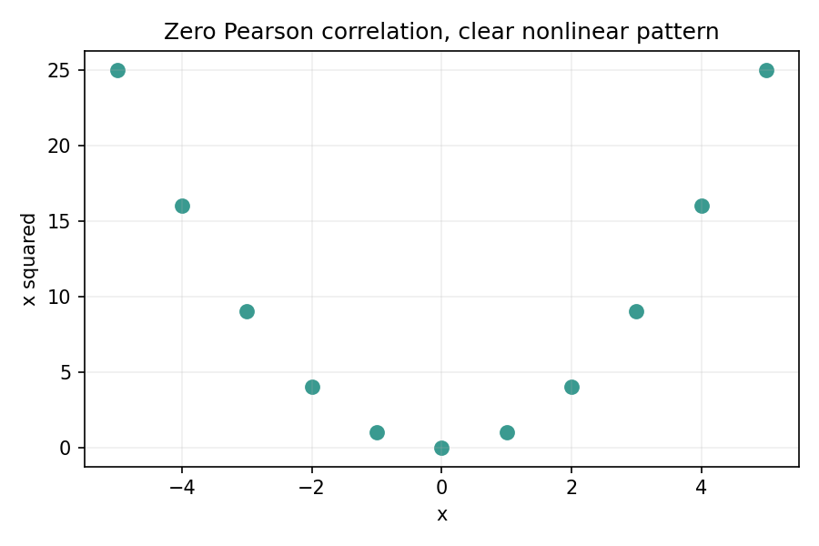

> **이번 글의 질문**
>
> 코드는 잘 실행됐는데 결과가 틀릴 수도 있을까요? 높은 평가 점수, 깔끔한 그래프, 비어 있지 않은 CSV를 믿기 전에 무엇을 확인해야 할까요?

> **핵심 요약**
>
> 데이터 한 행의 의미와 예측 시점부터 정합니다. 결측값·0·처리 실패를 구분하고, 전처리 기준은 Train에서 학습합니다. 그룹·시간에 맞게 검증하고 Baseline과 비교한 뒤, ID와 결과의 단위가 유지되는지 저장 파일까지 확인합니다.

## 1. 모델보다 먼저, 무엇을 한 건으로 볼지 정합니다

사람 100명의 데이터라고 생각했는데 같은 사람의 열흘 기록이었다면 어떨까요? 행 수는 같아도 관측 단위와 평가 대상이 달라집니다. 데이터 분석은 이 작은 정의에서부터 시작합니다.

이번 노트는 자주 쓰는 함수를 더 외우기보다, 결과를 바꾸는 선택을 다시 보는 글입니다. 전처리·통계·모델·이미지 분석을 하나의 흐름으로 연결하고, 헷갈리는 부분은 작은 코드로 확인합니다.

| 먼저 적을 질문 | 확인할 내용 | 흔한 실수 |
| --- | --- | --- |
| 한 행은 무엇인가요? | 사람·기록·사진·객체·프레임·시간 구간 | 객체 표의 행 수를 사진 수로 읽습니다. |
| 어떤 결과를 만들까요? | 집계표·클래스·숫자 예측·이상치 후보 | Target이 정수라는 이유로 분류를 선택합니다. |
| 언제 예측하나요? | 그 순간까지 알 수 있는 Feature | 점검 후 판정이나 미래 값으로 현재를 예측합니다. |
| 어디에 적용하나요? | 새 사람·새 장비·미래 기록·현재 데이터 탐색 | 아무 상황에서나 행을 무작위로 나눕니다. |
| 한 숫자의 분모는 무엇인가요? | 정상 사진 수·응답 수·운용 시간 | 파일이 없는 사례까지 0으로 평균 냅니다. |

관측 단위와 집계는 [파이썬 데이터 분석 공부노트 06](/cs/data-analysis/pandas-06-data-interpretation/), Train/Test와 지표는 [파이썬 데이터 분석 공부노트 07](/cs/data-analysis/pandas-07-supervised-learning/)의 예제와 연결해서 보면 더 잘 기억할 수 있습니다.

## 2. CSV를 읽었다고 타입과 단위가 맞는 것은 아닙니다

ID 0012가 12로 바뀌어도 코드는 실행됩니다. 하지만 원본 파일과 Join하려면 다른 키가 될 수 있습니다. 숫자처럼 보이는 식별자는 문자열로 읽고, 계산할 숫자와 구분합니다.

| 착각 | 확인할 기준 |
| --- | --- |
| `object`면 모두 문자열입니다. | `object`에는 숫자·문자열·다른 객체가 섞일 수 있습니다. 실제 값과 `dtype`을 함께 봅니다. |
| `astype(float)`만 하면 숫자가 됩니다. | 쉼표·단위·error 문자열이 있으면 먼저 변환 규칙을 정합니다. |
| `errors="coerce"`가 데이터를 고쳐 줍니다. | 변환 실패를 결측값으로 표시합니다. 어떤 원문이 실패했는지 남깁니다. |
| 시간 문자열은 그대로 정렬하면 됩니다. | 일관된 ISO 문자열은 정렬이 맞을 수 있지만, 형식·시간대가 섞이면 datetime으로 통일합니다. |
| 단위는 열 이름에서 대충 알 수 있습니다. | 분·초, m·km, kg·g를 데이터 정의에서 확인하고 통일합니다. |
| 빈 문자열과 NA는 언제나 같습니다. | `read_csv`의 `na_values`·`keep_default_na`에 따라 NA 같은 문자열이 결측값으로 해석될 수 있습니다. |

```python
import io
import numpy as np
import pandas as pd
import matplotlib.pyplot as plt

csv_text = "record_id,amount\n0012,12\n0013,error\n0014,\n"
df = pd.read_csv(io.StringIO(csv_text), dtype={"record_id": "string"})
df["amount_raw"] = df["amount"]
df["amount_numeric"] = pd.to_numeric(df["amount"], errors="coerce")
df["parse_failed"] = df["amount_raw"].notna() & df["amount_numeric"].isna()
print(df.to_string(index=False))
```

```text
record_id amount amount_raw  amount_numeric  parse_failed
     0012     12         12            12.0         False
     0013  error      error             NaN          True
     0014    NaN        NaN             NaN         False
```

0012를 보존했고, 원래 빈칸과 error로 인한 변환 실패를 구분했습니다. 파일이 크면 처음에 작은 부분을 확인하더라도 전체의 변환 실패 수·키 중복·값 범위를 별도로 검사합니다.

## 3. 결측치를 채우고 이상치를 지우기 전에 뜻을 봅니다

온도 0은 유효한 관측값일 수 있습니다. 탐지 0건은 모델을 실행했지만 대상이 없었다는 결과입니다. 반면 파일을 읽지 못한 경우는 개수를 모릅니다. 셋을 같은 0으로 바꾸면 평균도 해석도 달라집니다.

| 자주 하는 선택 | 놓치기 쉬운 점 | 처리 기준 |
| --- | --- | --- |
| 빈칸을 모두 0으로 채웁니다. | 관측하지 못한 값이 실제 0처럼 보입니다. | 결측 이유를 보고 대체·제외·상태 표시를 선택합니다. |
| 평균 대치 후 결과를 원본이라고 저장합니다. | 관측한 값과 만들어 넣은 값이 섞입니다. | 원본과 missing indicator를 남깁니다. |
| IQR·Z-score 기준 밖이면 삭제합니다. | 드물지만 실제로 중요한 사례를 지울 수 있습니다. | 입력 오류·단위 오류·드문 정상·관심 사례를 구분합니다. |
| 빈 구간의 합계는 당연히 0입니다. | `sum`의 기본 동작이 관측 없음도 0으로 만들 수 있습니다. | `sum(min_count=1)`과 관측 수를 같이 봅니다. |
| 결측 행 삭제는 언제나 공정합니다. | 누락이 특정 그룹·큰 값에 몰렸다면 표본이 달라집니다. | 삭제 전후 그룹별 건수와 분포를 비교합니다. |

```python
counts = pd.Series([4.0, np.nan, 0.0], name="count")
print("관측한 값만의 평균:", counts.mean())
print("모르는 값을 0으로 바꾼 평균:", counts.fillna(0).mean())
empty = pd.Series([np.nan, np.nan])
print("전부 결측인 합계:", empty.sum())
print("최소 관측 1개를 요구한 합계:", empty.sum(min_count=1))
```

```text
관측한 값만의 평균: 2.0
모르는 값을 0으로 바꾼 평균: 1.3333333333333333
전부 결측인 합계: 0.0
최소 관측 1개를 요구한 합계: nan
```

관측한 4와 0의 평균은 2입니다. 모르는 값을 0으로 채우면 1.333으로 내려갑니다. 결측값을 어떻게 처리했는지는 단순한 코드 옵션이 아니라 어떤 질문에 답했는지의 일부입니다.

결측이 왜 생겼는지에 따라 MCAR·MAR·MNAR로 생각할 수 있습니다. 모든 관측이 무작위로 빠진 경우와, 관측한 다른 변수와 관련해 빠진 경우, 빠진 값 자체와 관련해 누락된 경우를 구분하는 관점입니다. 현재 표만으로 누락 원인을 확정할 수는 없으므로 수집 과정을 확인하고 여러 대체 방식의 결과도 비교합니다.

평균·중앙값 대치와 Missing Indicator는 [파이썬 데이터 분석 공부노트 01](/cs/data-analysis/pandas-01-missing-values-outliers/)에서 이어서 복습할 수 있습니다.

## 4. merge와 concat은 행의 의미까지 맞춰 주지 않습니다

Join 전후 행 수가 늘었다면 정말 기록이 많아진 것인지, 같은 키의 모든 조합이 생긴 것인지부터 봅니다. 양쪽에 같은 키가 두 번 있으면 그 키에서 네 행이 만들어질 수 있습니다.

pandas는 양쪽의 null key도 서로 매칭합니다. 일반적인 SQL Join과 다른 부분입니다. 미확인 ID끼리 연결해도 되는지 먼저 정하고, 보통은 오른쪽 기준표의 미확인 키를 분리합니다.

```python
left = pd.DataFrame({"id": ["A", "A", None], "quantity": [5, 7, 9]})
right = pd.DataFrame({"id": ["A", "A", None], "version": [1, 2, 1],
                      "owner": ["old", "new", "unknown"]})
print("검사 없는 Join 행:", len(left.merge(right, on="id", how="left")))
try:
    left.merge(right, on="id", how="left", validate="many_to_one")
except pd.errors.MergeError:
    print("validate가 오른쪽 중복 키를 발견했습니다.")

# 이 예제의 기준표는 가장 큰 version을 채택한다는 규칙이 있습니다.
master = right.dropna(subset=["id"]).sort_values("version").drop_duplicates("id", keep="last")
joined = left.merge(master, on="id", how="left", validate="many_to_one", indicator=True)
print(joined.to_string(index=False))
```

```text
검사 없는 Join 행: 5
validate가 오른쪽 중복 키를 발견했습니다.
  id  quantity  version owner    _merge
   A         5      2.0   new      both
   A         7      2.0   new      both
None         9      NaN   NaN left_only
```

중복을 발견했다고 아무 행이나 `drop_duplicates`로 버리면 근거가 사라집니다. 여기서는 최신 `version`을 선택한다는 규칙을 먼저 두었습니다. 실제 자료에 그런 규칙이 없다면 중복이 생긴 원인부터 확인합니다.

### 4-1. Index 정렬과 행 순서는 다릅니다

```python
result = pd.DataFrame({"record_id": ["R42", "R09"]}, index=[42, 9])
prediction = pd.Series([0.2, 0.8])
result["wrong_alignment"] = prediction
result["same_row_order"] = prediction.to_numpy()
print(result.to_string())
```

```text
   record_id  wrong_alignment  same_row_order
42       R42              NaN             0.2
9        R09              NaN             0.8
```

Series를 대입하면 Index Label을 맞춥니다. 예측이 `result`의 행 순서대로 나왔다는 조건에서는 NumPy 배열로 대입할 수 있습니다. 예측에 별도의 ID가 있다면 ID로 Join하는 편이 안전합니다. 길이가 같다는 사실만으로 같은 기록이라는 보장은 없습니다.

| 연산 | 자동으로 맞추는 것 | 별도로 확인할 것 |
| --- | --- | --- |
| `merge` | 지정한 Key | Key의 유일성·null·매칭 실패·행 수 |
| `concat(axis=0)` | 같은 열 이름 | 각 행이 같은 종류의 관측인지 |
| `concat(axis=1)` | Index Label | 같은 사람·사진·기록을 가리키는 Index인지 |
| Series 대입 | Index Label | 예측 Series의 Index가 원본과 대응하는지 |
| NumPy 배열 대입 | 현재 행 순서 | 그 순서로 생성한 예측인지 |

## 5. 시간순 정렬만으로 미래 정보가 차단되지는 않습니다

t시점 값을 예측하면서 t를 포함한 이동평균을 Feature로 넣으면, 정답이 평균을 통해 들어갑니다. 현재 구간이 끝난 뒤 다음 구간을 예측하는 경우에는 현재 구간을 사용할 수 있습니다. 예측 시점을 한 문장으로 정해 놓으면 차이가 분명해집니다.

```python
series = pd.Series([10.0, 20.0, 90.0, 40.0])
past_mean = series.shift(1).rolling(2, min_periods=2).mean()
contains_current = series.rolling(2, min_periods=2).mean()
print(pd.DataFrame({"value": series, "current_included": contains_current,
                    "past_only": past_mean}).to_string(index=False))
```

```text
 value  current_included  past_only
  10.0               NaN        NaN
  20.0              15.0        NaN
  90.0              55.0       15.0
  40.0              65.0       55.0
```

| 착각 | 확인할 기준 |
| --- | --- |
| `resample("1h")`만 하면 시간 처리가 끝납니다. | 센서·장비별 그룹, `closed`·`label`, 시간대, 집계 함수와 관측 수를 정합니다. |
| `sum`은 언제나 적합합니다. | 횟수는 합계, 상태·온도는 평균이나 마지막 값 등 질문에 맞게 선택합니다. |
| 보간은 언제나 무해합니다. | 양쪽 관측을 사용하는 보간은 미래 예측 Feature에 다음 시점 값을 넣을 수 있습니다. |
| 시간 데이터를 행 순서로 CV하면 됩니다. | 같은 Timestamp의 여러 센서를 시간 블록으로 묶고 Target 기간을 고려합니다. |
| `gap=1`이면 모든 시계열 누수가 사라집니다. | Target 기간·Feature 집계·지연 공개 정보를 따져 간격을 정합니다. |

Train에 속한 행이라도 Target이 검증 기간의 결과를 사용한다면 경계가 겹칠 수 있습니다. 다음 24시간의 고장을 예측한다면 마지막 Training 구간의 Target이 어느 시간까지 사용하는지 확인합니다. 원본 시간·Feature에 사용한 시간·Target 시간을 함께 남기는 습관이 도움이 됩니다.

구간 경계와 센서별 리샘플링은 [파이썬 데이터 분석 공부노트 03](/cs/data-analysis/pandas-03-time-series-resampling/), 영상의 경과 시간 집계는 [파이썬 데이터 분석 공부노트 10](/cs/data-analysis/pandas-10-image-video-analysis/)에서 연결해서 볼 수 있습니다.

## 6. Scaling은 분포를 정규분포로 만들지 않습니다

StandardScaler는 평균을 빼고 표준편차로 나눕니다. 치우친 분포나 여러 봉우리가 이 연산만으로 정규분포가 되지는 않습니다. MinMaxScaler도 학습한 최솟값과 최댓값을 기준으로 범위를 바꿀 뿐, 새 값까지 항상 0\~1에 가두지는 않습니다.

```python
from sklearn.preprocessing import StandardScaler, MinMaxScaler

train_values = np.array([[10.0], [20.0]])
new_values = np.array([[30.0]])
minmax = MinMaxScaler().fit(train_values)
standard = StandardScaler().fit(np.array([[7.0], [7.0]]))
print("새 값의 MinMax 결과:", minmax.transform(new_values).ravel().tolist())
print("상수 Feature의 StandardScaler 결과:", standard.transform([[7.0]]).ravel().tolist())
print("상수 Feature의 scale_:", standard.scale_.tolist())
```

```text
새 값의 MinMax 결과: [2.0]
상수 Feature의 StandardScaler 결과: [0.0]
상수 Feature의 scale_: [1.0]
```

| 착각 | 실제로 바뀌는 것 |
| --- | --- |
| StandardScaler 후 모든 열의 `std`는 무조건 1입니다. | 상수 Feature는 보통 0으로 변환되며 `scale_=1`을 사용합니다. 검사할 `ddof`도 맞춥니다. |
| RobustScaler는 이상치를 없앱니다. | 중앙값·분위수 기반으로 Scaling 기준을 정하며 원래 관측값은 유지합니다. |
| Normalizer는 MinMaxScaler와 같습니다. | Normalizer는 보통 각 행의 벡터 길이를 맞춥니다. Feature별 MinMax 변환과 다릅니다. |
| 모든 모델에 표준화가 필수입니다. | 거리·정규화 페널티·분산을 사용하는 모델과 Tree 모델의 연산을 구분합니다. |
| Test에도 `fit_transform`하면 됩니다. | Train과 다른 좌표 기준이 만들어집니다. 같은 Scaler의 `transform`을 사용합니다. |
| `clip=True`가 범위 밖 값의 문제를 해결합니다. | 범위 밖 값을 경계로 잘라 정보를 잃을 수 있습니다. 입력 분포 변화도 함께 봅니다. |

이상치를 Train 분위수로 Clip하는 변환도 데이터에서 기준을 학습합니다. Scaling만 Pipeline에 넣고 그전에 전체 데이터의 분위수로 잘랐다면 누수가 남습니다. **데이터로 기준을 정하는 전처리 전체**를 검증 안으로 가져옵니다.

Scaling 방식과 드문 범주 처리는 [파이썬 데이터 분석 공부노트 02](/cs/data-analysis/pandas-02-normalization-encoding/)의 심화 예제까지 함께 복습할 수 있습니다.

## 7. 숫자로 Encoding했다고 의미 있는 순서가 생기지는 않습니다

보직을 0·1·2로 바꾸면 단순한 이름에 크기 차이가 생깁니다. 모델이 이 차이를 순서나 거리로 사용할지 생각해야 합니다. 실제로 순서가 있는 등급인지, 서로 다른 이름일 뿐인지가 선택 기준입니다.

| 상황 | 흔한 실수 | 선택할 기준 |
| --- | --- | --- |
| 입력 범주형 Feature | LabelEncoder를 `X`의 모든 열에 적용합니다. | OrdinalEncoder·OneHotEncoder 등 Feature용 도구를 사용합니다. |
| 문자열 Target | LabelEncoder가 항상 필수라고 외웁니다. | 문자열 `y`를 받는 모델도 있습니다. 인코딩하면 매핑을 저장합니다. |
| Train/Test `get_dummies` | 각각 만든 열을 그대로 모델에 넣습니다. | 이름·개수·순서를 일치시키거나 Train에서 `fit`한 Encoder를 씁니다. |
| `drop_first=True` | 모든 상황의 정답 옵션으로 사용합니다. | 절편 있는 선형 모델의 중복과 Regularization·unknown 표현을 함께 검토합니다. |
| Target mean encoding | 각 행의 정답으로 같은 행의 Feature를 만듭니다. | Training 행은 Out-of-fold, 새 행은 Train에서 정한 매핑으로 변환합니다. |
| unknown category | 일단 Encoder를 새 데이터에 다시 `fit`합니다. | 기존 변환을 유지하고 unknown·드문 범주 규칙을 정합니다. |

```python
train_categories = pd.Series(["A", "B"], name="region")
new_categories = pd.Series(["B", "C"], name="region")
train_onehot = pd.get_dummies(train_categories, prefix="region", dtype=int)
new_onehot = pd.get_dummies(new_categories, prefix="region", dtype=int)
aligned = new_onehot.reindex(columns=train_onehot.columns, fill_value=0)
print("Train 열:", train_onehot.columns.tolist())
print("새 데이터 열:", new_onehot.columns.tolist())
print("Train 열에 맞춘 결과:")
print(aligned.to_string(index=False))
```

```text
Train 열: ['region_A', 'region_B']
새 데이터 열: ['region_B', 'region_C']
Train 열에 맞춘 결과:
 region_A  region_B
        0         1
        0         0
```

C는 Train에 없어서 기존 열의 값이 모두 0입니다. 이 방식은 새 범주를 구분하는 열을 만들지는 못합니다. unknown 상태를 따로 남길지, 드문 범주와 묶을지는 목적에 맞게 정합니다. 원래 문자열 열을 평균·모델 입력에 잘못 섞지 않는지도 확인합니다.

## 8. 통계와 그래프가 보여 주는 질문을 정확하게 읽습니다

상관계수 0은 두 변수가 아무 관계도 없다는 뜻일까요? x가 0에서 멀어질수록 `y`가 커지는 U자 관계에서도 Pearson 상관계수는 0이 될 수 있습니다.

```python
x = np.arange(-5, 6, dtype=float)
y = x ** 2
print("Pearson correlation:", round(pd.Series(x).corr(pd.Series(y)), 6))
fig, ax = plt.subplots(figsize=(6, 4))
ax.scatter(x, y, color="#3a9a90", s=50)
ax.set(xlabel="x", ylabel="x squared", title="Zero Pearson correlation, clear nonlinear pattern")
ax.grid(alpha=.2)
fig.tight_layout(); fig.savefig("nonlinear_correlation.png", dpi=150); plt.close(fig)
```

```text
Pearson correlation: 0.0
```



*Pearson 상관계수는 0이지만 두 값 사이에 뚜렷한 비선형 관계가 있습니다.*

| 착각 | 다시 읽을 기준 |
| --- | --- |
| 그룹 평균들의 평균이 전체 평균입니다. | 그룹별 관측 수가 다르면 가중치가 다릅니다. 각 항목의 유효 `count`를 봅니다. |
| 상관계수는 영향의 크기입니다. | 함께 변하는 정도입니다. 원인·개입 효과는 다른 설계가 필요합니다. |
| 음의 상관이면 반비례식입니다. | 큰 값이 낮은 값과 함께 나타나는 경향입니다. `y = k/x` 관계를 보장하지 않습니다. |
| `std`는 어디에서 계산해도 같습니다. | pandas의 기본 `ddof=1`, NumPy·StandardScaler의 기본 `ddof=0` 등 정의를 맞춥니다. |
| `quantile`에 1·2·3을 넣습니다. | `q`는 보통 0\~1입니다. Q1·Q2·Q3은 0.25·0.5·0.75입니다. |
| 박스 밖의 모든 점이 이상치입니다. | 기본 Box Plot의 점은 보통 1.5×IQR 울타리 바깥입니다. Q1\~Q3 밖과 다릅니다. |
| Histogram은 `bins`를 바꿔도 같은 모습입니다. | 구간 크기·경계에 따라 봉우리와 꼬리가 달라 보입니다. 여러 기준을 비교합니다. |
| Box Plot만 보면 분포를 알 수 있습니다. | 여러 봉우리와 점의 밀도는 가려질 수 있습니다. Histogram·Strip·Violin 등으로 보완합니다. |
| Heatmap의 진한 색은 항상 같은 강도입니다. | 비교할 상관 Heatmap은 `vmin=-1`·`vmax=1`·`center=0` 같은 공통 기준을 둡니다. |
| 막대의 높이 차이가 곧 효과 크기입니다. | `y`축 시작점·단위·관측 수·불확실성을 같이 봅니다. |

Scatter의 겹친 점을 투명도·Jitter·Hexbin으로 보여 주더라도, 시각화용 Jitter를 모델 입력에 다시 섞지 않습니다. 선택한 그룹 안에서는 보이던 관계가 전체에서는 반대로 보이는 Simpson’s paradox도 가능합니다. 그룹 크기와 조건을 나눠 보는 습관이 도움이 됩니다.

통계량의 기준은 [파이썬 데이터 분석 공부노트 04](/cs/data-analysis/pandas-04-descriptive-statistics/), 그래프 선택과 밀도 표현은 [파이썬 데이터 분석 공부노트 05](/cs/data-analysis/pandas-05-data-visualization/), 그룹 평균의 분모는 [파이썬 데이터 분석 공부노트 06](/cs/data-analysis/pandas-06-data-interpretation/)에서 확인할 수 있습니다.

## 9. Pipeline을 썼어도 분할과 Feature 정의는 직접 확인합니다

Pipeline은 전처리와 모델의 학습 범위를 함께 관리합니다. 그런데 이미 `X`에 정답 복사본이 들어 있거나 같은 사람의 복제 기록이 Train과 Test에 섞였다면 Pipeline으로 감싼다고 해결되지 않습니다.

| 전처리·설계 | 학습 범위 | 자주 빠뜨리는 부분 |
| --- | --- | --- |
| 대치·Scaling·PCA·Feature 선택 | 각 Fold의 Training 부분 | 전체 데이터에서 미리 `fit`한 배열을 CV에 넣습니다. |
| TF-IDF·범주 목록·Target encoding | 각 Fold의 Training 부분 | `y`를 안 썼으니 Test까지 `fit`해도 된다고 생각합니다. |
| Hyperparameter·Threshold·Early stopping | Validation 또는 Train 내부 CV | 최종 Test로 좋은 설정을 고릅니다. |
| 고정 단위 변환·고정 사전 학습 transforms | 데이터에서 새로 `fit`하지 않는 규칙 | 데이터 통계를 학습한 변환과 역할을 혼동합니다. |
| 증강·Oversampling | 해당 Fold의 Training 부분 | 복제·파생된 같은 원본이 Validation에 들어갑니다. |

| 평가하려는 것 | 나눌 단위 | 확인할 조건 |
| --- | --- | --- |
| 독립적인 새 기록 | 행 단위 무작위 분할 | 클래스 수·중복 기록·실제 독립성 |
| 새 사람·새 장비 | ID 그룹 | 그룹 교집합이 비어 있는지 |
| 미래의 기록 | 시간 순서 | Target 기간·공개 지연·그룹과 시간의 결합 |
| 처음 본 문장 양식·촬영 장면 | 원본·양식·장면 그룹 | 비슷한 복제 문장이나 연속 프레임이 양쪽에 있는지 |

`stratify`는 클래스 비율을 고려하며 데이터의 독립성을 만들어 주지는 않습니다. 같은 사람의 여러 기록이 있다면 그룹 단위로 나누고, 그 사람이 미래에도 등장하는 상황과 처음 등장하는 상황 중 어느 것을 평가할지 정합니다.

> **`fit`의 범위, 분할의 단위, Feature가 알려지는 시점은 서로 다른 검사입니다.** 이 세 가지를 따로 확인하면 Pipeline을 사용하면서도 남을 수 있는 누수를 찾기 쉽습니다.

## 10. 점수 하나로 모델을 평가하지 않습니다

### 10-1. Accuracy가 높아도 관심 클래스를 놓칠 수 있습니다

```python
from sklearn.metrics import (accuracy_score, balanced_accuracy_score,
    precision_score, recall_score, roc_auc_score, average_precision_score)

actual = np.array([0] * 95 + [1] * 5)
scores = np.r_[np.linspace(.01, .4, 95), [.15, .35, .55, .75, .95]]
predicted = (scores >= .5).astype(int)
baseline = np.zeros_like(actual)
for name, pred in [("model", predicted), ("always_zero", baseline)]:
    print(name, "Accuracy:", round(accuracy_score(actual, pred), 3),
          "Balanced Accuracy:", round(balanced_accuracy_score(actual, pred), 3),
          "Recall:", round(recall_score(actual, pred, zero_division=0), 3))
print("ROC-AUC:", round(roc_auc_score(actual, scores), 3))
print("Average Precision:", round(average_precision_score(actual, scores), 3))
```

```text
model Accuracy: 0.98 Balanced Accuracy: 0.8 Recall: 0.6
always_zero Accuracy: 0.95 Balanced Accuracy: 0.5 Recall: 0.0
ROC-AUC: 0.844
Average Precision: 0.662
```

항상 0으로 예측해도 Accuracy는 95%입니다. 하지만 실제 Positive 다섯 건을 하나도 찾지 못했습니다. 관심 클래스의 support·Recall·Precision을 함께 봅니다. Positive는 좋은 결과라는 뜻이 아니라 지표의 기준 클래스입니다.

ROC-AUC와 Average Precision은 확률 점수의 순서를 평가하며, 어느 Threshold에서 클래스를 결정했는지와 구분합니다. AP는 Recall 증가량으로 Precision을 가중한 값입니다. PR 곡선을 어떤 방식으로 적분했는지에 따라 값이 달라질 수 있어 AP와 모든 PR-AUC를 같은 숫자로 부르지 않습니다.

### 10-2. 로그로 예측했다면 평가할 단위도 확인합니다

```python
from sklearn.metrics import mean_absolute_error, root_mean_squared_error

actual_amount = np.array([10.0, 20.0, 100.0])
predicted_log = np.log1p([12.0, 22.0, 80.0])
predicted_amount = np.expm1(predicted_log)
print("원래 단위의 예측:", predicted_amount.round(3).tolist())
print("MAE:", round(mean_absolute_error(actual_amount, predicted_amount), 3))
print("RMSE:", round(root_mean_squared_error(actual_amount, predicted_amount), 3))
```

```text
원래 단위의 예측: [12.0, 22.0, 80.0]
MAE: 8.0
RMSE: 11.662
```

| 착각 | 해석할 기준 |
| --- | --- |
| RMSE는 평균 절대 오차입니다. | MAE가 절대 오차의 평균입니다. RMSE는 큰 오차를 더 강하게 반영합니다. |
| R²=0.8이면 80%를 맞혔습니다. | 평균 기준의 제곱 오차와 비교한 지표이며 음수도 가능합니다. |
| 회귀 `score()`도 Accuracy입니다. | 분류·회귀 Estimator의 `score` 정의를 확인합니다. |
| 확률 0.8은 검증된 정답 확률 80%입니다. | Calibration을 별도로 확인합니다. 탐지 Confidence와 OCR 점수도 같은 원칙입니다. |
| CV Fold 표준편차가 곧 95% 신뢰구간입니다. | 관련된 Fold의 점수 퍼짐입니다. 구간을 추정할 단위·가정·방법을 별도로 정합니다. |
| 가장 잘 나온 `random_state`를 고릅니다. | Test에 맞춘 선택이 될 수 있습니다. 분할 기준을 먼저 정하고 Train 안에서 비교합니다. |
| 점수가 낮아도 복잡한 모델이 더 좋습니다. | 동일한 평가 대상의 Baseline과 비교합니다. 단순한 모델이 더 나을 수 있습니다. |
| 테스트를 계속 보며 튜닝해도 Test입니다. | 설정 선택에 사용했다면 Validation 역할입니다. 최종 평가를 따로 남깁니다. |

확률을 다루는 문제라면 Log loss나 Brier score, Calibration curve도 살펴볼 수 있습니다. 잘 정렬하는 모델과 잘 보정된 확률을 주는 모델은 다를 수 있습니다. 지표는 제출 규칙과 실제 오류 비용에 맞춰 고릅니다.

## 11. 군집·PCA·이상치 탐지의 숫자는 정답률이 아닙니다

| 결과 | 흔한 착각 | 읽을 기준 |
| --- | --- | --- |
| `cluster=0`·1·2 | 위험 순위라고 읽습니다. | 그룹 이름입니다. 번호가 바뀌어도 같은 묶음일 수 있습니다. |
| `inertia_` 감소 | k를 늘릴수록 무조건 좋은 군집입니다. | 중심을 더 많이 두면 거리가 줄 수 있습니다. 크기·분리·해석·안정성도 봅니다. |
| Silhouette 높음 | 업무상 의미 있는 그룹이 확정됐습니다. | 선택한 공간과 거리의 분리 지표입니다. 원본 특성을 해석합니다. |
| PCA 설명 분산 80% | 예측 정확도·중요 정보가 80%입니다. | 입력 분산 중 선택한 축에 담긴 비율입니다. Target 정보 보존과 다릅니다. |
| `components_`의 큰 값 | 원인의 중요도·기여율입니다. | 주성분을 만드는 계수입니다. 입력 Scaling·절댓값·부호를 같이 봅니다. |
| PCA 2차원에서 섞임 | 원래 공간의 군집이 틀렸습니다. | 생략된 축에 차이가 있을 수 있습니다. 군집을 만든 공간에서 평가합니다. |
| `contamination=0.05` | 실제 이상 비율 5%를 찾아냈습니다. | 학습 Score에 적용할 Threshold를 정한 설정입니다. |
| `anomaly=-1` | 실제 오류·건강 위험이 확인됐습니다. | 선택한 Feature에서 상대적으로 드문 기록입니다. 원본을 검토합니다. |
| 비지도이므로 Test는 필요 없습니다. | 새 데이터 일반화 평가에도 모두 `fit`합니다. | 현재 데이터 탐색과 새로운 데이터 적용·평가를 구분합니다. |

Isolation Forest의 `score_samples`는 작을수록 드문 기록이며, `decision_function`은 학습한 `offset_`을 뺀 값입니다. 0보다 작을 때 Outlier로 판정합니다. 이 숫자를 위험 확률로 바꾸어 읽지 않습니다. 참조 데이터에 5%를 설정했어도 분포가 다른 새 데이터의 후보 비율은 달라집니다.

군집의 재표집 안정성은 [파이썬 데이터 분석 공부노트 08](/cs/data-analysis/pandas-08-unsupervised-learning/), 새 데이터의 이상치 후보 비율은 [파이썬 데이터 분석 공부노트 12](/cs/data-analysis/pandas-12-comprehensive-problems-2/)의 심화 예제로 비교할 수 있습니다.

## 12. 사진·영상·OCR도 입력 규칙과 집계 단위가 먼저입니다

| 착각 | 확인할 기준 |
| --- | --- |
| 이미지 `shape`와 Resize 인자는 같은 순서입니다. | `shape`는 보통 H·W·C, OpenCV resize의 크기는 W·H입니다. |
| OpenCV 이미지는 모두 RGB입니다. | 기본 컬러 읽기는 BGR입니다. API마다 NumPy·PIL 입력 규칙을 확인합니다. |
| `img[::-1]`로 색상 채널을 바꿉니다. | 첫 축을 뒤집으면 상하 반전입니다. `cvtColor` 또는 `img[:, :, ::-1]`의 의미를 확인합니다. |
| `uint8`에서 밝기를 더하면 안전합니다. | 범위를 넘으면 Wraparound가 생길 수 있습니다. 실수형 변환·Clip·`dtype`을 정합니다. |
| Mask를 선형 보간해도 됩니다. | Label Mask는 중간 클래스 값이 생기지 않도록 Nearest 등을 선택합니다. |
| 네 숫자는 어느 API에서나 같은 Box입니다. | xyxy·중심 xywh·좌측 상단 xywh, 정규화 여부와 원본 크기를 확인합니다. |
| NMS IoU가 평가의 IoU와 같은 기준입니다. | 후보 억제와 정답 Box 매칭은 다른 단계입니다. |
| 탐지 수 합계가 고유 사람 수입니다. | 사진·프레임 사이 반복 대상을 중복 계산합니다. Tracking도 ID 오류를 검토합니다. |
| FPS가 29.97이어도 30프레임이면 항상 1초입니다. | 긴 영상에서 시점이 어긋날 수 있습니다. 목표 시각·실제 시각·시간 속성을 기록합니다. |
| 탐지 0건 프레임은 생략해도 됩니다. | 분모와 시계열이 달라집니다. 정상 분석한 0건을 남깁니다. |
| `re.match`가 특수문자를 지웁니다. | 시작 부분의 일치를 확인합니다. 전체 검사는 `fullmatch`, 교체는 `sub`입니다. |
| OCR 숫자는 기호를 지운 뒤 `int`로 바꿉니다. | 날짜·소수점·음수·단위를 보존하고 항목별로 파싱합니다. |
| 사전 학습 모델을 불러왔으니 독립 Test입니다. | Test 사진이 사전 학습 데이터와 겹치는지도 자료의 출처에서 확인합니다. |

```python
import re

texts = ["12.5", "-3", "2026-08-01"]
for text in texts:
    digits_only = re.sub(r"[^0-9]", "", text)
    print("원문:", text, "숫자만 남긴 결과:", digits_only)
number = "-3.25"
valid_number = re.fullmatch(r"[+-]?\d+(?:\.\d+)?", number)
print("부호·소수점을 보존한 값:", float(number) if valid_number else None)
```

```text
원문: 12.5 숫자만 남긴 결과: 125
원문: -3 숫자만 남긴 결과: 3
원문: 2026-08-01 숫자만 남긴 결과: 20260801
부호·소수점을 보존한 값: -3.25
```

12.5를 125로, -3을 3으로 바꾸면 파싱은 성공해도 값의 뜻이 달라집니다. 원문과 위치를 남기고, 항목별 허용 범위와 단위를 확인합니다. OCR Confidence가 높아도 숫자 자체는 원본 영역에서 다시 검토할 수 있어야 합니다.

입력 색상·좌표는 [파이썬 데이터 분석 공부노트 09](/cs/data-analysis/pandas-09-image-object-detection/), OCR·영상 집계는 [파이썬 데이터 분석 공부노트 10](/cs/data-analysis/pandas-10-image-video-analysis/), 실패 사진의 처리와 정상 사진당 평균은 [파이썬 데이터 분석 공부노트 11](/cs/data-analysis/pandas-11-comprehensive-problems-1/)에서 이어서 볼 수 있습니다.

## 13. 저장한 파일이 최종 결과입니다

화면에서 잘 보였던 결과도 CSV를 다시 읽으면 ID가 바뀌거나 불필요한 Index 열이 생길 수 있습니다. 제출·공유할 파일을 실제로 열어 보고 값의 타입과 행의 의미를 확인합니다.

| 놓치기 쉬운 부분 | 저장 전후에 확인할 것 |
| --- | --- |
| 행 수 | 예측할 대상 수와 같은지, 실패 기록이 사라지지 않았는지 |
| ID 대응 | 실제값·예측값·두 Target이 같은 ID의 행인지 |
| Index | 일반 결과 CSV는 `index=False`, 시간 Index를 저장할 때는 이름을 명시합니다. |
| 열 이름·순서 | 요구한 정확한 이름·순서인지, `Unnamed: 0`이 생기지 않았는지 |
| Label | 숫자 Label과 문자열 매핑이 일치하고 Positive 순서가 명확한지 |
| 반올림 | 지표는 원래 예측값으로 계산하고 필요한 표시만 반올림했는지 |
| 그래프 | `savefig` 전에 레이아웃을 정하고, 다른 Figure·빈 Figure를 저장하지 않았는지 |
| 반복 실행 | Counter를 두 번 누적하거나 이전 결과를 다시 읽어 더하지 않았는지 |
| 원본과 처리 결과 | raw text·상태·키·모델 설정·분할 기준을 다시 추적할 수 있는지 |

### 13-1. 원본 수정은 한 번의 명확한 대입으로 씁니다

pandas 3.0의 Copy-on-Write에서는 연속 선택한 임시 객체를 바꾸는 Chained assignment로 부모 DataFrame을 수정할 수 없습니다. `df["score"].fillna(0, inplace=True)`처럼 선택한 Series의 `inplace` 연산에 기대기보다 열을 재할당하거나 `loc` 한 번으로 대입합니다.

```python
records = pd.DataFrame({"id": ["A", "B"], "score": [1.0, np.nan]})
records["score"] = records["score"].fillna(0)
records.loc[records["id"].eq("A"), "score"] = 2
records.to_csv("checked_result.csv", index=False, encoding="utf-8-sig")
saved = pd.read_csv("checked_result.csv", dtype={"id": "string"})
assert len(saved) == len(records)
assert saved["id"].is_unique
assert saved.columns.tolist() == ["id", "score"]
print(saved.to_string(index=False))
```

```text
id  score
 A    2.0
 B    0.0
```

CSV를 다시 읽어 확인하면 저장하면서 바뀐 ID나 불필요한 Index 열을 발견할 수 있습니다. 행 수·키·허용 범위·필수 열만 확인해도 제출 전에 많은 실수를 잡을 수 있습니다.

## 14. 다음 문제에서 이 순서로 다시 시작합니다

| 분석 단계 | 바로 확인할 질문 |
| --- | --- |
| 문제 읽기 | 관측 단위·Target·제출 결과가 무엇인가요? |
| 입력 확인 | 파일·키·타입·단위·시간대·빈 값은 맞나요? |
| 분할 설계 | 새 사람·새 장비·미래·현재 탐색 중 어느 질문인가요? |
| 전처리 | 학습할 기준을 Train·각 Fold 안에서 정했나요? |
| Feature 설계 | 예측 시점에 아직 모르는 값을 넣지 않았나요? |
| Baseline | 평균·다수 클래스·Persistence 같은 단순 기준은 얼마인가요? |
| 모델 선택 | Validation에서 고르고 최종 Test는 남겼나요? |
| 평가 | 클래스별 오류·Target 단위·관측 수도 봤나요? |
| 집계 | 결측값·0·처리 실패와 평균의 분모를 구분했나요? |
| 해석 | 상관·중요도·후보 Score를 원인·확률·정답으로 확대하지 않았나요? |
| 저장 | ID·행 수·열·Label·단위가 요구사항과 맞나요? |
| 다시 읽기 | 저장한 CSV와 그래프만 봐도 분석 기준을 설명할 수 있나요? |

결과가 예상과 다르면 모델부터 바꾸기보다 앞의 기준을 한 단계씩 돌아봅니다. 점수가 너무 좋아도 같은 순서로 확인합니다. 입력과 평가가 맞아야 다음 모델 비교도 의미가 있습니다.

01\~12편에서 익힌 도구는 이 흐름의 각 단계에 놓입니다. 새 문제를 풀 때는 익숙한 함수를 모두 사용하는 것보다, 필요한 질문에 맞는 도구를 고르고 그 선택을 설명하는 연습을 합니다.

## 참고자료

### 실습 데이터와 노트북

- **심화 예제**: [심화 예제 자료](/files/maicon-2026/practice/%EA%B3%B5%EB%B6%80%EB%85%B8%ED%8A%B8_%EC%8B%AC%ED%99%94_%EC%98%88%EC%A0%9C.zip) — 공부노트 01\~13의 Python 코드, 노트북, 예제 CSV와 실행 결과를 함께 받습니다.

### 연습문제

- **문제**
  - [유형 03 문제](/cs/data-analysis/practice-03-sensor-time-series/) — 누락된 센서 구간을 남기면서 다음 시간의 온도와 기준 초과 여부를 어떻게 함께 예측할까요?
  - [유형 04 문제](/cs/data-analysis/practice-04-text-classification/) — 표현이 조금씩 다른 접수 문장을 분류하면서, 같은 양식의 문장이 Train과 Test에 섞이는 문제를 어떻게 막을까요?
  - [유형 05 문제](/cs/data-analysis/practice-05-image-transfer-learning/) — 사전 학습된 이미지 모델을 고정한 채, 사진이 개미인지 벌인지 분류하는 새 모델을 어떻게 만들까요?
  - [유형 07 문제](/cs/data-analysis/practice-07-video-frame-sampling/) — 29.97 FPS 영상에서 1초마다 관측하려면 어떤 프레임을 골라야 하며, 빈 프레임은 그래프에 어떻게 남겨야 할까요?
  - [유형 08 문제](/cs/data-analysis/practice-08-ocr-structured-data/) — 이미지에서 읽은 날짜·수량·가격을 표로 옮길 때, 구분 기호와 음수 부호를 어떻게 보존할까요?
- **풀이**
  - [유형 03 풀이](/cs/data-analysis/practice-03-sensor-time-series-solution/) — 센서별 시간 격자와 관측 수를 만들고 시간 순서대로 나눠 다음 시간 온도와 기준 초과를 예측합니다.
  - [유형 04 풀이](/cs/data-analysis/practice-04-text-classification-solution/) — 문장 양식별로 데이터를 나누고 TF-IDF와 Logistic Regression을 Pipeline으로 연결해 그룹 CV로 검증합니다.
  - [유형 05 풀이](/cs/data-analysis/practice-05-image-transfer-learning-solution/) — 고정한 MobileNet에서 특징을 추출하고 Validation에서 분류기를 선택한 뒤 Test 사진을 평가합니다.
  - [유형 07 풀이](/cs/data-analysis/practice-07-video-frame-sampling-solution/) — 목표 시각마다 프레임을 계산하고 객체가 없는 프레임도 포함해 시간 구간별 개수를 요약합니다.
  - [유형 08 풀이](/cs/data-analysis/practice-08-ocr-structured-data-solution/) — OCR 원문과 좌표를 보관하고 항목별 값을 추출·검증한 뒤, 정답 표와 필드별 일치도를 비교합니다.

### 공식 문서

- **전처리·누수**
  - [Common pitfalls and recommended practices](https://scikit-learn.org/stable/common_pitfalls.html) — 누수·일관된 전처리·Pipeline의 학습 범위를 확인합니다.
  - [Pipelines and composite estimators](https://scikit-learn.org/stable/modules/compose.html) — ColumnTransformer·Pipeline·Target 변환을 확인합니다.
- **pandas**
  - [Working with missing data](https://pandas.pydata.org/docs/user_guide/missing_data.html) — 결측값·Nullable dtype·집계 기준입니다.
  - [pandas.merge](https://pandas.pydata.org/docs/reference/api/pandas.merge.html) — 중복 Key·null 매칭·validate를 확인합니다.
  - [Time series](https://pandas.pydata.org/docs/user_guide/timeseries.html) — 시간대·리샘플링·시간 구간을 확인합니다.
  - [Copy-on-Write](https://pandas.pydata.org/docs/user_guide/copy_on_write.html) — Chained assignment와 명확한 대입을 확인합니다.
- **전처리**
  - [Preprocessing data](https://scikit-learn.org/stable/modules/preprocessing.html) — Scaling·Normalizer·범주 표현을 비교합니다.
  - [OneHotEncoder](https://scikit-learn.org/stable/modules/generated/sklearn.preprocessing.OneHotEncoder.html) — unknown·드문 범주·열 구성을 확인합니다.
  - [TargetEncoder](https://scikit-learn.org/stable/modules/generated/sklearn.preprocessing.TargetEncoder.html) — fit_transform의 내부 Cross-fitting을 확인합니다.
- **검증·평가**
  - [Cross-validation](https://scikit-learn.org/stable/modules/cross_validation.html) — 그룹·시간과 검증의 역할입니다.
  - [Metrics and scoring](https://scikit-learn.org/stable/modules/model_evaluation.html) — 분류·회귀·평균 방식의 정의입니다.
  - [Decision threshold](https://scikit-learn.org/stable/modules/classification_threshold.html) — Validation으로 의사결정 기준을 선택합니다.
  - [Probability calibration](https://scikit-learn.org/stable/modules/calibration.html) — 확률의 순위와 보정 정도를 구분합니다.
- **비지도 학습**
  - [Clustering](https://scikit-learn.org/stable/modules/clustering.html) — 거리·군집 구조·평가 기준입니다.
  - [PCA](https://scikit-learn.org/stable/modules/generated/sklearn.decomposition.PCA.html) — 주성분·설명 분산·Scaling 기준입니다.
  - [IsolationForest](https://scikit-learn.org/stable/modules/generated/sklearn.ensemble.IsolationForest.html) — Label·Score·contamination의 의미입니다.
- **시각화**
  - [Box Plot](https://matplotlib.org/stable/api/_as_gen/matplotlib.pyplot.boxplot.html) — 사분위수·Whisker·울타리 밖 점의 정의입니다.
  - [Seaborn Heatmap](https://seaborn.pydata.org/generated/seaborn.heatmap.html) — 공통 색상 범위와 중심을 지정합니다.
- **이미지·영상**
  - [OpenCV image codecs](https://docs.opencv.org/4.x/d4/da8/group__imgcodecs.html) — 이미지 채널과 읽기 규칙입니다.
  - [OpenCV VideoCapture](https://docs.opencv.org/4.x/dd/d43/tutorial_py_video_display.html) — FPS·프레임 읽기·시간을 확인합니다.
  - [Ultralytics predict](https://docs.ultralytics.com/modes/predict/) — 입력 형식·Boxes·Confidence·영상 결과입니다.
- **텍스트·OCR**
  - [Python re](https://docs.python.org/3/library/re.html) — match·fullmatch·sub의 범위입니다.
  - [EasyOCR API](https://www.jaided.ai/easyocr/documentation/) — 텍스트·좌표·Confidence 반환을 확인합니다.
