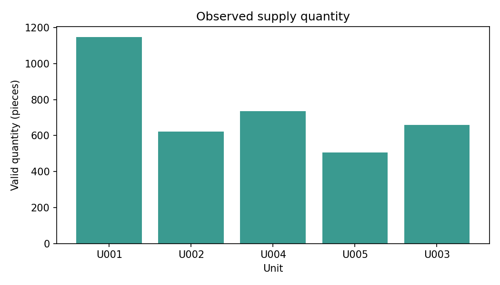

> **이번 글의 질문**
>
> 중복 거래와 단위가 다른 수량을 정리한 뒤, 팀별·일별 보급량을 어떻게 믿을 수 있게 계산할까요?

> **핵심 요약**
>
> 키의 버전을 먼저 정하고 JSON을 평탄화합니다. 오류를 0으로 바꾸지 않고 상태를 남긴 뒤, 단위를 `piece`로 맞춰 집계합니다.

## 1. 문제를 분석 순서로 바꿉니다

보급 기록이 CSV와 JSON에 나뉘어 있습니다. 같은 `event_id`가 재전송됐고, 수량은 `piece`·`box`가 섞여 있습니다. 최신 수정본을 채택하고 등록 팀에 연결되는 유효한 기록으로 일별 수량을 계산합니다. 데이터는 이 문제의 오류 처리와 집계를 연습하기 위해 구성했습니다.

- 입력 구조와 중복을 확인합니다
- 버전과 Join의 대응 관계를 정합니다
- 수량과 단위를 검증하고 Reject 이유를 남깁니다
- 일별·팀별로 요약하고 합계가 보존되는지 봅니다

아래 기본 풀이의 출력은 첨부한 `solution.ipynb`와 결과 CSV에 기록된 실제 실행 결과입니다. 추가 비교 예제는 별도 Notebook에서 실행했으며, 가상 예제는 그 범위를 표시했습니다.

## 2. 단계별 코드와 실행 결과

```python
from pathlib import Path
import json
import numpy as np
import pandas as pd
import matplotlib.pyplot as plt

ROOT = Path.cwd()
DATA = ROOT / "data"
RESULTS = ROOT / "results"
PLOTS = ROOT / "plots"
RESULTS.mkdir(exist_ok=True)
PLOTS.mkdir(exist_ok=True)

def save_csv(frame, name):
    frame.to_csv(RESULTS / name, index=False, encoding="utf-8-sig")
```

### 입력 구조와 중복을 확인합니다

거래 한 건의 키는 `event_id`입니다. 행 수와 고유 키 수가 다르면 재전송이나 수정 기록이 섞였을 수 있습니다. JSON의 `profile.name`처럼 안쪽에 있는 필드는 `json_normalize()`로 꺼내 같은 표에서 읽습니다.

```python
raw = pd.read_csv(DATA / "logistics_raw.csv", dtype={"event_id":"string", "unit_id":"string"})
registry = pd.json_normalize(json.loads((DATA / "unit_registry.json").read_text()))
catalog = pd.read_csv(DATA / "item_catalog.csv")
print("원본 행:", len(raw), "중복 event_id:", int(raw.event_id.duplicated().sum()))
print(registry.columns.tolist())
```

```text
원본 행: 184 중복 event_id: 4
['unit_id', 'updated_at', 'profile.name', 'profile.region']
```

### 버전과 Join의 대응 관계를 정합니다

이 문제에서는 수정 시각이 가장 늦은 기록을 채택합니다. 이 규칙을 먼저 적용한 뒤 Join해야 같은 거래를 두 번 셀 가능성을 줄일 수 있습니다.

```python
raw["updated_at"] = pd.to_datetime(raw["updated_at"], utc=True, errors="raise")
events = raw.sort_values("updated_at").drop_duplicates("event_id", keep="last").copy()
registry["updated_at"] = pd.to_datetime(registry["updated_at"], utc=True)
units = registry.sort_values("updated_at").drop_duplicates("unit_id", keep="last")
units = units.rename(columns={"profile.name":"unit_name", "profile.region":"region"})
events = events.merge(units[["unit_id","unit_name","region"]], on="unit_id", how="left", validate="many_to_one", indicator="unit_match")
events = events.merge(catalog, on="item_id", how="left", validate="many_to_one")
assert len(events) == raw.event_id.nunique()
print("최신 event:", len(events), "등록 팀:", len(units))
```

```text
최신 event: 180 등록 팀: 6
```

`validate="many_to_one"`은 기준표의 키가 중복 없이 하나씩만 있는지 검사합니다. Join 뒤에도 거래 수가 그대로인지 확인해, 연결 과정에서 생긴 행 증식을 찾습니다.

### 수량과 단위를 검증하고 Reject 이유를 남깁니다

숫자로 읽을 수 없다는 이유로 수량을 0으로 채우면 오류 기록이 실제 0개 거래처럼 보입니다. 잘못된 값은 별도 표에 남기고 유효한 기록만 집계합니다.

```python
events["timestamp"] = pd.to_datetime(events["timestamp"], utc=True, errors="coerce")
events["quantity_numeric"] = pd.to_numeric(events["quantity"], errors="coerce")
factor = events["quantity_unit"].map({"piece":1.0, "box":np.nan})
factor = factor.where(events["quantity_unit"].ne("box"), events["pieces_per_box"])
events["quantity_piece"] = events["quantity_numeric"] * factor
checks = {
    "missing_unit": events.unit_id.isna(),
    "unregistered_unit": events.unit_id.notna() & events.unit_match.ne("both"),
    "invalid_time": events.timestamp.isna(),
    "unknown_item": events.pieces_per_box.isna(),
    "invalid_quantity": events.quantity_numeric.isna() | events.quantity_numeric.lt(0),
    "unknown_unit": ~events.quantity_unit.isin(["piece","box"]),
    "fractional_piece": events.quantity_piece.notna() & ~np.isclose(events.quantity_piece.fillna(0) % 1, 0),
}
flags = pd.DataFrame(checks)
events["reject_reason"] = flags.apply(lambda row: "|".join(row.index[row]), axis=1)
accepted = events.loc[events.reject_reason.eq("")].copy()
rejected = events.loc[events.reject_reason.ne("")].copy()
accepted["quantity_piece"] = accepted["quantity_piece"].astype("Int64")
assert len(accepted) + len(rejected) == len(events)
save_csv(accepted, "clean_records.csv")
save_csv(rejected, "rejected_records.csv")
print("유효 기록:", len(accepted), "Reject:", len(rejected))
print(flags.sum().to_string())
```

```text
유효 기록: 167 Reject: 13
missing_unit         1
unregistered_unit    1
invalid_time         1
unknown_item         1
invalid_quantity     7
unknown_unit         1
fractional_piece     1
```

오류 이유는 한 행에 여러 개가 붙을 수 있습니다. 따라서 이유별 건수의 합과 제외한 행 수는 언제나 같지는 않습니다. `box` 수량은 품목별 환산 계수를 적용합니다.

### 일별·팀별로 요약하고 합계가 보존되는지 봅니다

일별 합계와 원본 유효 수량의 합이 같으면 집계하면서 기록을 빠뜨리거나 두 번 더했는지 빠르게 점검할 수 있습니다.

```python
accepted["day"] = accepted["timestamp"].dt.floor("D")
daily = accepted.groupby(["day","unit_id","unit_name"], as_index=False).agg(quantity_piece=("quantity_piece","sum"), valid_records=("event_id","size"))
totals = units[["unit_id","unit_name"]].merge(accepted.groupby("unit_id", as_index=False).agg(quantity_piece=("quantity_piece",lambda s:s.sum(min_count=1)), valid_records=("event_id","size")), how="left", on="unit_id", validate="one_to_one")
totals["valid_records"] = totals.valid_records.fillna(0).astype(int)
assert daily.quantity_piece.sum() == accepted.quantity_piece.sum()
save_csv(daily,"daily_unit_summary.csv")
save_csv(totals,"unit_totals.csv")
quality = pd.DataFrame({"check":["raw_rows","unique_events","accepted","rejected","duplicate_versions"],"value":[len(raw),len(events),len(accepted),len(rejected),len(raw)-len(events)]})
save_csv(quality,"quality_report.csv")
print(totals.to_string(index=False))
fig, ax = plt.subplots(figsize=(7,4))
observed = totals.loc[totals.quantity_piece.notna()]
ax.bar(observed.unit_id, observed.quantity_piece, color="#3a9a90")
ax.set(xlabel="Unit",ylabel="Valid quantity (pieces)",title="Observed supply quantity")
fig.tight_layout(); fig.savefig(PLOTS/"unit_totals.png",dpi=150); plt.close(fig)
```

```text
unit_id unit_name  quantity_piece  valid_records
   U001      지원팀1            1148             33
   U002      지원팀2             622             35
   U004      지원팀4             736             33
   U005      지원팀5             505             34
   U006      지원팀6            <NA>              0
   U003   지원팀3-개편             658             32
```

등록만 있고 유효한 거래가 없는 팀의 총량은 알 수 없는 값으로 남깁니다. 거래가 관측됐고 수량이 0인 경우와 구분하기 위해 `valid_records`도 함께 저장합니다.

## 3. 표·그래프를 해석하고 오류를 확인합니다

등록만 있는 U006은 수량을 관측하지 못했습니다. 합계가 0인 팀과 같은 의미로 바꾸지 않습니다.

Reject 사유는 한 행에 여러 개 붙을 수 있습니다. 사유 개수를 더한 값과 Reject 행 수가 같을 필요는 없습니다.

시각화는 유효 기록의 보급량입니다. 누락된 수량까지 추정한 전체 실적은 아니므로 유효 기록 수와 함께 읽습니다.



## 4. 처리 기준이 결과를 바꾸는 비교 예제

### 기준표의 중복 키가 거래 행을 늘리는 경우

자료: 실습 입력 데이터

거래를 최신 버전으로 정리해도 기준표의 키가 중복이면 Join에서 행이 늘어납니다. 다음 비교는 같은 거래 목록에 수정 이력이 있는 기준표와 최신 기준표를 각각 연결합니다.

```python
import json
import pandas as pd

events = pd.read_csv("data/logistics_raw.csv")
events["updated_at"] = pd.to_datetime(events.updated_at, utc=True)
events = events.sort_values("updated_at").drop_duplicates("event_id", keep="last")
registry = pd.json_normalize(json.loads(open("data/unit_registry.json", encoding="utf-8").read()))
registry["updated_at"] = pd.to_datetime(registry.updated_at, utc=True)
latest_registry = registry.sort_values("updated_at").drop_duplicates("unit_id", keep="last")
wrong = events.merge(registry, on="unit_id", how="left")
correct = events.merge(latest_registry, on="unit_id", how="left", validate="many_to_one")
print("거래 목록:", len(events))
print("중복 기준표 연결:", len(wrong))
print("최신 기준표 연결:", len(correct))
assert len(correct) == len(events)
```

```text
거래 목록: 180
중복 기준표 연결: 216
최신 기준표 연결: 180
```

Join의 방향을 정하는 일과 키의 유일성을 확인하는 일은 함께 필요합니다. `validate`는 행 수가 늘어난 뒤 원인을 추측하는 대신 연결 조건을 바로 검사하게 해 줍니다.

### 관측하지 못한 팀과 수량 0인 팀을 구분합니다

자료: 실습에서 저장한 결과

등록된 모든 팀이 거래를 보낸 것은 아닙니다. 저장한 결과에서 관측 건수가 없는 팀을 찾고, 결측 수량을 0으로 채우면 어떤 정보가 사라지는지 비교합니다.

```python
import pandas as pd

totals = pd.read_csv("results/unit_totals.csv")
comparison = totals[["unit_id", "valid_records", "quantity_piece"]].copy()
comparison["zero_filled_quantity"] = comparison.quantity_piece.fillna(0)
comparison["meaning"] = comparison.quantity_piece.isna().map({True: "unobserved", False: "observed"})
print(comparison.to_string(index=False))
print("관측하지 못한 팀:", int(comparison.quantity_piece.isna().sum()))
```

```text
unit_id  valid_records  quantity_piece  zero_filled_quantity    meaning
   U001             33          1148.0                1148.0   observed
   U002             35           622.0                 622.0   observed
   U004             33           736.0                 736.0   observed
   U005             34           505.0                 505.0   observed
   U006              0             NaN                   0.0 unobserved
   U003             32           658.0                 658.0   observed
관측하지 못한 팀: 1
```

단순 합계는 같아 보일 수 있어도 팀별 활동 여부와 평균의 분모는 달라집니다. 관측 건수와 수량을 함께 남겨 두면 미수신 상태를 다시 확인할 수 있습니다.

## 5. 저장한 파일로 분석을 다시 확인합니다

| 결과 파일 | 행 수 | 전체 열 |
| --- | --- | --- |
| `clean_records.csv` | 167 | `event_id`, `unit_id`, `timestamp`, `item_id`, `quantity`, `quantity_unit`, `updated_at`, `unit_name`, `region`, `unit_match`, `pieces_per_box`, `quantity_numeric`, `quantity_piece`, `reject_reason` |
| `daily_unit_summary.csv` | 40 | `day`, `unit_id`, `unit_name`, `quantity_piece`, `valid_records` |
| `quality_report.csv` | 5 | `check`, `value` |
| `rejected_records.csv` | 13 | `event_id`, `unit_id`, `timestamp`, `item_id`, `quantity`, `quantity_unit`, `updated_at`, `unit_name`, `region`, `unit_match`, `pieces_per_box`, `quantity_numeric`, `quantity_piece`, `reject_reason` |
| `unit_totals.csv` | 6 | `unit_id`, `unit_name`, `quantity_piece`, `valid_records` |

Notebook 화면의 점수와 파일의 값이 같은지, 입력 ID가 빠지거나 중복되지 않았는지 확인합니다. 비교 예제는 기존 풀이가 만든 `results`를 읽으므로 기본 풀이를 먼저 실행합니다.

```bash
# 예선_유형별_실습 폴더에서 실행합니다.
python check_outputs.py --types 1
```

검사 도구는 저장 파일의 행·열·ID·상태·지표 대응을 확인합니다. 데이터 분할의 의미, Feature를 사용할 수 있는 시점, 모델 선택 과정은 본문의 기준과 Notebook을 함께 읽어 확인합니다.

## 6. 확장 문제를 설계하고 확인할 결과를 정합니다

다음 항목은 후속 실험을 위한 문제와 풀이 방향입니다. 앞의 실행 결과에 포함된 실험과 구분합니다. 새 데이터나 Annotation이 필요한 항목은 그 입력부터 준비합니다.

### 한 거래에 여러 품목이 들어오면 키는 어떻게 정할까요?

거래 헤더의 `event_id`와 품목 행의 `line_id`를 구분합니다. 여러 품목 행이 존재하는 자료라면 두 필드를 함께 행 키로 사용합니다. 같은 거래의 품목을 정정한 수정본이라면 `event_id`의 최신 버전을 채택해야 하며, 바뀐 `item_id`를 새 키로 추가하면 이전 품목과 수정 품목을 동시에 셀 수 있습니다.

남길 결과: 거래 수정본과 품목별 행이 섞인 작은 표를 만들고 최신 버전 선택 전후의 거래·품목 행 수를 비교합니다.

### 오류가 특정 날짜에 몰리면 무엇을 확인할까요?

날짜별 전체 입력·유효 입력·제외 입력을 같은 분모로 집계합니다. 여러 오류 이유가 한 행에 붙을 수 있으므로 사유별 합계를 제외 행 수와 혼동하지 않습니다.

남길 결과: `daily_quality.csv`에 날짜·입력 건수·유효 건수·제외 비율을 저장하고, 입력이 없는 날의 상태도 구분합니다.

## 참고자료

### 실습 데이터와 노트북

- **문제 자료**: [문제 자료](/files/maicon-2026/practice/%EC%8B%A4%EC%8A%B5_01_%EB%AC%B8%EC%A0%9C%EC%9E%90%EB%A3%8C.zip) — 입력 데이터와 `starter.ipynb`로 직접 구현을 시작합니다.
- **풀이 자료**: [풀이와 결과](/files/maicon-2026/practice/%EC%8B%A4%EC%8A%B5_01_%ED%92%80%EC%9D%B4%EC%99%80_%EA%B2%B0%EA%B3%BC.zip) — 전체 Python 코드, 노트북과 실행 결과를 함께 받습니다.
- **공통 자료**: [실습 공통 자료](/files/maicon-2026/practice/%EC%8B%A4%EC%8A%B5_%EA%B3%B5%ED%86%B5%EC%A4%80%EB%B9%84.zip) — 공유 모델과 유형별 실습에 필요한 공통 준비 자료입니다.
- **예선 가이드**: [국방AI경진대회 예선가이드](/files/maicon-2026/%EA%B5%AD%EB%B0%A9AI%EA%B2%BD%EC%A7%84%EB%8C%80%ED%9A%8C%20%EC%98%88%EC%84%A0%EA%B0%80%EC%9D%B4%EB%93%9C.pdf) — 제공된 가이드의 범위를 바탕으로 만든 연습문제입니다.
- **실행 안내**: 같은 작업 폴더에 압축을 푼 뒤 유형 폴더에서 `solution.ipynb` 또는 `solution.py`를 실행합니다. `blog_comparison.ipynb`에는 본문에서 추가한 두 비교 예제와 실제 출력이 들어 있습니다.
- **데이터 출처**: 거래·팀·품목 데이터는 이 실습을 위해 Seed 2026으로 구성한 합성 데이터입니다. 실제 부대의 보급 기록이 아닙니다.

### 연습문제

- **문제**: [유형 01 문제](/cs/data-analysis/practice-01-tabular-preprocessing/) — 중복 거래와 단위가 다른 수량을 정리한 뒤, 팀별·일별 보급량을 어떻게 믿을 수 있게 계산할까요?
- **모의 실습**: [모의 실습 A](/cs/data-analysis/mock-exam-a-90-min-review/) — 세 문항을 20·35·45점으로 묶어 입력부터 저장까지 연습합니다.  
  [모의 실습 B](/cs/data-analysis/mock-exam-b-90-min-review/) — 세 문항을 20·35·45점으로 묶어 입력부터 저장까지 연습합니다.

### 관련 공부노트

- **공부노트 01**: [결측치와 이상치 처리](/cs/data-analysis/pandas-01-missing-values-outliers/)
- **공부노트 03**: [시계열 데이터 정렬 및 리샘플링](/cs/data-analysis/pandas-03-time-series-resampling/)
- **공부노트 04**: [데이터 통계량](/cs/data-analysis/pandas-04-descriptive-statistics/)
- **공부노트 06**: [데이터 해석](/cs/data-analysis/pandas-06-data-interpretation/)

### 공식 문서

- **사용한 도구**: [pandas.merge](https://pandas.pydata.org/docs/reference/api/pandas.merge.html) — validate·indicator와 null key의 매칭을 확인합니다.  
  [json_normalize](https://pandas.pydata.org/docs/reference/api/pandas.json_normalize.html) — 중첩 JSON을 열로 펼치는 방법입니다.
