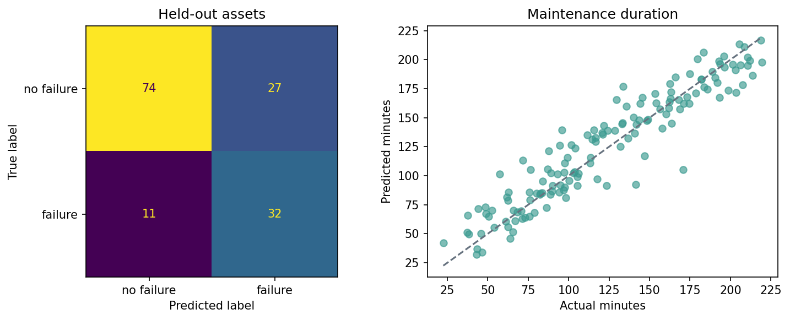

> **이번 글의 질문**
>
> 같은 장비의 반복 기록이 있을 때, 새로운 장비의 고장 여부와 정비 시간을 어떻게 평가할까요?

> **핵심 요약**
>
> 장비 ID가 겹치지 않는 Train/Test를 사용합니다. 결측치·범주 처리와 모델을 Pipeline으로 연결하고, 그룹 CV에서 설정을 고른 뒤 두 Target을 각각 평가합니다.

## 1. 문제를 분석 순서로 바꿉니다

장비 90개의 관측 기록 720행입니다. 다음 주 고장 여부는 분류, 정비 시간은 회귀로 예측합니다. 관측 시점의 Feature와 점검이 끝난 뒤 만들어진 `post_inspection_code`가 함께 있어 입력의 시점을 구분해야 합니다. 값은 반복 관측과 누수 방지를 연습하도록 구성한 합성 데이터입니다.

- ID와 두 Target을 함께 유지합니다
- 전처리도 그룹별 Validation 안에서 학습합니다
- 고정한 모델과 Baseline을 같은 Test에서 평가합니다
- 같은 기록의 두 예측을 한 행에 저장합니다

아래 기본 풀이의 출력은 첨부한 `solution.ipynb`와 결과 CSV에 기록된 실제 실행 결과입니다. 추가 비교 예제는 별도 Notebook에서 실행했으며, 가상 예제는 그 범위를 표시했습니다.

## 2. 단계별 코드와 실행 결과

```python
from pathlib import Path
import json
import numpy as np
import pandas as pd
import matplotlib.pyplot as plt

ROOT = Path.cwd()
DATA = ROOT / "data"
RESULTS = ROOT / "results"
PLOTS = ROOT / "plots"
RESULTS.mkdir(exist_ok=True)
PLOTS.mkdir(exist_ok=True)

def save_csv(frame, name):
    frame.to_csv(RESULTS / name, index=False, encoding="utf-8-sig")
```

### ID와 두 Target을 함께 유지합니다

같은 장비의 기록이 여러 번 있으므로 행을 무작위로 나누면 익숙한 장비를 다시 평가하게 됩니다. 여기서는 새로운 장비에 적용하는 질문에 맞춰 장비 ID 전체를 한쪽에 둡니다.

```python
from sklearn.compose import ColumnTransformer
from sklearn.pipeline import Pipeline
from sklearn.impute import SimpleImputer
from sklearn.preprocessing import StandardScaler, OneHotEncoder
from sklearn.linear_model import LogisticRegression
from sklearn.ensemble import RandomForestRegressor
from sklearn.dummy import DummyClassifier, DummyRegressor
from sklearn.model_selection import GroupKFold, GridSearchCV
from sklearn.metrics import (f1_score, balanced_accuracy_score, classification_report,
    confusion_matrix, ConfusionMatrixDisplay, root_mean_squared_error, mean_absolute_error, r2_score)

records = pd.read_csv(DATA/"asset_records.csv")
splits = pd.read_csv(DATA/"splits.csv")
records = records.merge(splits,on="record_id",validate="one_to_one")
train = records.loc[records.split.eq("train")].copy()
test = records.loc[records.split.eq("test")].copy()
assert set(train.asset_id).isdisjoint(test.asset_id)
numeric = ["vibration","temperature","hours_since_service","asset_age_years"]
categorical = ["manufacturer","device_type"]
features = numeric+categorical
print("Train/Test 행:", len(train), len(test))
print("Train/Test 장비:", train.asset_id.nunique(), test.asset_id.nunique())
print("Train 고장 비율:", round(train.failure_next_week.mean(),3))
```

```text
Train/Test 행: 576 144
Train/Test 장비: 72 18
Train 고장 비율: 0.42
```

점검을 마친 뒤에 생긴 `post_inspection_code`는 정답과 관계가 깊더라도 예측 시점에 사용할 수 없습니다. ID와 두 Target도 입력에서 제외합니다.

### 전처리도 그룹별 Validation 안에서 학습합니다

결측치의 중앙값과 범주 표현도 각 Fold의 Training 부분에서 정합니다. Pipeline을 모델과 함께 검색하면 검증 Fold의 값을 전처리 학습에 쓰는 실수를 줄일 수 있습니다.

```python
def preprocessing():
    return ColumnTransformer([
        ("numeric",Pipeline([("impute",SimpleImputer(strategy="median",add_indicator=True)),("scale",StandardScaler())]),numeric),
        ("category",Pipeline([("impute",SimpleImputer(strategy="most_frequent")),("onehot",OneHotEncoder(handle_unknown="ignore",sparse_output=False))]),categorical),
    ])
folds = list(GroupKFold(n_splits=4).split(train[features],groups=train.asset_id))
classifier = GridSearchCV(Pipeline([("prepare",preprocessing()),("model",LogisticRegression(max_iter=2000,class_weight="balanced"))]),
                          {"model__C":[0.1,1.0,10.0]},cv=folds,scoring="f1_macro",n_jobs=1)
regressor = GridSearchCV(Pipeline([("prepare",preprocessing()),("model",RandomForestRegressor(n_estimators=80,random_state=42,n_jobs=1))]),
                         {"model__max_depth":[4,8,None]},cv=folds,scoring="neg_root_mean_squared_error",n_jobs=1)
classifier.fit(train[features],train.failure_next_week)
regressor.fit(train[features],train.maintenance_minutes)
print("분류 선택:", classifier.best_params_, "CV macro F1:", round(classifier.best_score_,3))
print("회귀 선택:", regressor.best_params_, "CV RMSE:", round(-regressor.best_score_,3))
```

```text
분류 선택: {'model__C': 0.1} CV macro F1: 0.699
회귀 선택: {'model__max_depth': 8} CV RMSE: 19.471
```

수치형에는 중앙값 대체와 표준화를, 범주형에는 최빈값 대체와 One-Hot Encoding을 적용합니다. 새로운 범주는 `handle_unknown="ignore"`로 처리합니다.

### 고정한 모델과 Baseline을 같은 Test에서 평가합니다

다수 클래스와 평균값 예측을 같은 Test 장비에서 비교합니다. 분류의 F1과 회귀의 RMSE는 대상과 단위가 다르므로 하나의 종합 점수처럼 읽지 않습니다.

```python
class_pred = classifier.predict(test[features])
reg_pred = regressor.predict(test[features])
baseline_c = DummyClassifier(strategy="most_frequent").fit(train[features],train.failure_next_week)
baseline_r = DummyRegressor(strategy="mean").fit(train[features],train.maintenance_minutes)
rows=[]
for name,cp,rp in [("selected_model",class_pred,reg_pred),("dummy",baseline_c.predict(test[features]),baseline_r.predict(test[features]))]:
    rows.append({"model":name,"macro_f1":f1_score(test.failure_next_week,cp,average="macro"),
                 "balanced_accuracy":balanced_accuracy_score(test.failure_next_week,cp),
                 "RMSE_minutes":root_mean_squared_error(test.maintenance_minutes,rp),
                 "MAE_minutes":mean_absolute_error(test.maintenance_minutes,rp),"R2":r2_score(test.maintenance_minutes,rp)})
metrics=pd.DataFrame(rows); save_csv(metrics,"asset_metrics.csv")
print(metrics.round(3).to_string(index=False))
print(classification_report(test.failure_next_week,class_pred,zero_division=0))
```

```text
         model  macro_f1  balanced_accuracy  RMSE_minutes  MAE_minutes     R2
selected_model     0.712              0.738        17.542       13.403  0.884
         dummy     0.412              0.500        51.542       44.669 -0.001
              precision    recall  f1-score   support

           0       0.87      0.73      0.80       101
           1       0.54      0.74      0.63        43

    accuracy                           0.74       144
   macro avg       0.71      0.74      0.71       144
weighted avg       0.77      0.74      0.75       144
```

고장 클래스의 Precision이 낮다면 고장이라고 예측한 기록 중 오경보가 많다는 뜻입니다. 실제 운영에서 어느 오류가 더 큰 비용인지 정해야 Threshold 선택도 설명할 수 있습니다.

### 같은 기록의 두 예측을 한 행에 저장합니다

두 모델이 같은 Test 행 순서로 예측했으므로 원본 `record_id`를 유지한 표에 함께 넣습니다. 저장 전에 ID의 유일성과 행 수를 확인합니다.

```python
prediction=test[["record_id","asset_id","failure_next_week","maintenance_minutes"]].copy()
prediction["predicted_failure"]=class_pred
prediction["predicted_minutes"]=reg_pred
prediction["absolute_error_minutes"]=(prediction.maintenance_minutes-reg_pred).abs()
assert prediction.record_id.is_unique and len(prediction)==len(test)
save_csv(prediction,"asset_test_predictions.csv")
fig, axes=plt.subplots(1,2,figsize=(10,4))
ConfusionMatrixDisplay.from_predictions(test.failure_next_week,class_pred,labels=[0,1],display_labels=["no failure","failure"],ax=axes[0],colorbar=False)
axes[0].set_title("Held-out assets")
axes[1].scatter(test.maintenance_minutes,reg_pred,alpha=.65,color="#3a9a90")
limits=[min(test.maintenance_minutes.min(),reg_pred.min()),max(test.maintenance_minutes.max(),reg_pred.max())]
axes[1].plot(limits,limits,"--",color="#66727f")
axes[1].set(xlabel="Actual minutes",ylabel="Predicted minutes",title="Maintenance duration")
fig.tight_layout();fig.savefig(PLOTS/"asset_evaluation.png",dpi=150,bbox_inches="tight");plt.close(fig)
print("예측 행 수:",len(prediction))
```

```text
예측 행 수: 144
```

회귀 산점도의 대각선에서 멀수록 오차가 큽니다. 전체 점수만 보는 대신 큰 오차가 난 장비의 원본 값을 확인할 수 있습니다.

## 3. 표·그래프를 해석하고 오류를 확인합니다

Train/Test를 나눈 단위는 행이 아니라 장비입니다. 같은 장비의 반복 관측을 공유하지 않아 새로운 장비에 적용하는 질문에 맞춥니다.

두 Target의 난도는 다릅니다. 분류 점수가 높다고 회귀도 잘했다고 읽지 않고 각각의 Baseline을 비교합니다.

처음 보는 `device_type` 범주는 Train에서 학습한 OneHotEncoder의 unknown 처리 규칙을 따릅니다. Test에서 Encoder를 다시 `fit`하지 않습니다.



*왼쪽은 새 장비 Test의 분류 오류, 오른쪽은 실제 정비 시간과 예측 시간입니다. 대각선에서 멀수록 회귀 오차가 큽니다.*

## 4. 처리 기준이 결과를 바꾸는 비교 예제

### 행을 나눈 평가와 장비를 나눈 평가의 차이

자료: 실습 입력 데이터

새 장비에 적용하는 문제에서는 같은 장비의 기록이 양쪽에 섞이는지 먼저 봅니다. 아래에서는 행 단위 무작위 분할과 제공한 장비 단위 분할의 교집합을 비교합니다. 성능 지표의 차이를 추정하는 실험은 아닙니다.

```python
import pandas as pd
from sklearn.model_selection import train_test_split

records = pd.read_csv("data/asset_records.csv")
left, right = train_test_split(records, test_size=0.2, random_state=42)
row_overlap = set(left.asset_id) & set(right.asset_id)
assigned = records.merge(pd.read_csv("data/splits.csv"), on="record_id", validate="one_to_one")
group_overlap = set(assigned.loc[assigned.split.eq("train"), "asset_id"]) & set(assigned.loc[assigned.split.eq("test"), "asset_id"])
print("행 단위 분할에서 겹치는 장비:", len(row_overlap))
print("제공한 분할에서 겹치는 장비:", len(group_overlap))
assert not group_overlap
```

```text
행 단위 분할에서 겹치는 장비: 72
제공한 분할에서 겹치는 장비: 0
```

같은 장비의 미래를 예측하는 문제라면 시간 순서가 또 필요합니다. 무엇을 새 데이터로 보는지 정해야 분할 방식과 점수의 의미도 설명할 수 있습니다.

### 점검 후 생긴 값이 정답을 알려 주는 경우

자료: 실습 입력 데이터의 의도적 오류 비교

점검 결과 코드와 다음 주 고장 Target의 대응을 확인합니다. 이 필드는 예측 시점에 제공되지 않도록 문제를 구성했습니다. 다음 일치율은 사용할 수 있는 예측 모델의 성능이 아닙니다.

```python
import pandas as pd

records = pd.read_csv("data/asset_records.csv")
after_inspection = records.post_inspection_code.eq("confirmed_failure").astype(int)
print("점검 후 코드와 Target의 일치율:", round(after_inspection.eq(records.failure_next_week).mean(), 3))
available_features = ["vibration", "temperature", "hours_since_service", "asset_age_years", "manufacturer", "device_type"]
excluded = ["record_id", "asset_id", "failure_next_week", "maintenance_minutes", "post_inspection_code"]
print("예측 시점에 사용할 Feature:", available_features)
print("입력에서 제외할 열:", excluded)
assert "post_inspection_code" not in available_features
```

```text
점검 후 코드와 Target의 일치율: 1.0
예측 시점에 사용할 Feature: ['vibration', 'temperature', 'hours_since_service', 'asset_age_years', 'manufacturer', 'device_type']
입력에서 제외할 열: ['record_id', 'asset_id', 'failure_next_week', 'maintenance_minutes', 'post_inspection_code']
```

정답과 강하게 연결된 열을 찾았을 때는 생성 시점을 먼저 확인합니다. Test를 분리하고 Pipeline을 사용해도 이미 정답이 들어 있는 Feature의 문제는 해결되지 않습니다.

## 5. 저장한 파일로 분석을 다시 확인합니다

| 결과 파일 | 행 수 | 전체 열 |
| --- | --- | --- |
| `asset_metrics.csv` | 2 | `model`, `macro_f1`, `balanced_accuracy`, `RMSE_minutes`, `MAE_minutes`, `R2` |
| `asset_test_predictions.csv` | 144 | `record_id`, `asset_id`, `failure_next_week`, `maintenance_minutes`, `predicted_failure`, `predicted_minutes`, `absolute_error_minutes` |

Notebook 화면의 점수와 파일의 값이 같은지, 입력 ID가 빠지거나 중복되지 않았는지 확인합니다. 비교 예제는 기존 풀이가 만든 `results`를 읽으므로 기본 풀이를 먼저 실행합니다.

```bash
# 예선_유형별_실습 폴더에서 실행합니다.
python check_outputs.py --types 2
```

검사 도구는 저장 파일의 행·열·ID·상태·지표 대응을 확인합니다. 데이터 분할의 의미, Feature를 사용할 수 있는 시점, 모델 선택 과정은 본문의 기준과 Notebook을 함께 읽어 확인합니다.

## 6. 확장 문제를 설계하고 확인할 결과를 정합니다

다음 항목은 후속 실험을 위한 문제와 풀이 방향입니다. 앞의 실행 결과에 포함된 실험과 구분합니다. 새 데이터나 Annotation이 필요한 항목은 그 입력부터 준비합니다.

### 오경보와 미탐의 비용이 다르면 Threshold를 어떻게 정할까요?

Train 내부 그룹 Validation에서 확률 예측을 모으고, 후보 Threshold마다 FP와 FN에 정한 비용을 곱합니다. 최소 비용 규칙을 고정한 뒤 Test를 한 번 평가합니다. `class_weight="balanced"`만으로 운영 Threshold가 정해지는 것은 아닙니다.

남길 결과: Threshold·FP·FN·비용 표와 선택한 기준의 Confusion Matrix를 남깁니다.

### 같은 장비의 미래를 예측하면 분할은 어떻게 달라질까요?

이 자료에는 신뢰할 수 있는 관측 시각 열이 없습니다. 실제 시각과 예측 시점에 알려진 Feature를 추가한 새 자료가 먼저 필요합니다. `record_id`의 문자 순서를 실제 시간이라고 가정해 평가하지 않습니다.

남길 결과: 관측 시각·Target 기간·학습 종료·검증 시작을 명시하고 시간 기준 평가와 장비 기준 평가의 질문을 각각 적습니다.

## 참고자료

### 실습 데이터와 노트북

- **문제 자료**: [문제 자료](/files/maicon-2026/practice/%EC%8B%A4%EC%8A%B5_02_%EB%AC%B8%EC%A0%9C%EC%9E%90%EB%A3%8C.zip "Google Drive에서 자료를 엽니다.") — 입력 데이터와 `starter.ipynb`로 직접 구현을 시작합니다.
- **풀이 자료**: [풀이와 결과](/files/maicon-2026/practice/%EC%8B%A4%EC%8A%B5_02_%ED%92%80%EC%9D%B4%EC%99%80_%EA%B2%B0%EA%B3%BC.zip "Google Drive에서 자료를 엽니다.") — 전체 Python 코드, 노트북과 실행 결과를 함께 받습니다.
- **공통 자료**: [실습 공통 자료](/files/maicon-2026/practice/%EC%8B%A4%EC%8A%B5_%EA%B3%B5%ED%86%B5%EC%A4%80%EB%B9%84.zip "Google Drive에서 자료를 엽니다.") — 공유 모델과 유형별 실습에 필요한 공통 준비 자료입니다.
- **예선 가이드**: [국방AI경진대회 예선가이드](/files/maicon-2026/%EA%B5%AD%EB%B0%A9AI%EA%B2%BD%EC%A7%84%EB%8C%80%ED%9A%8C%20%EC%98%88%EC%84%A0%EA%B0%80%EC%9D%B4%EB%93%9C.pdf) — 제공된 가이드의 범위를 바탕으로 만든 연습문제입니다.
- **실행 안내**: 같은 작업 폴더에 압축을 푼 뒤 유형 폴더에서 `solution.ipynb` 또는 `solution.py`를 실행합니다. `blog_comparison.ipynb`에는 본문에서 추가한 두 비교 예제와 실제 출력이 들어 있습니다.
- **데이터 출처**: 장비 90개의 720행은 반복 관측과 누수 방지를 연습하도록 만든 합성 데이터입니다. 실제 고장 예측 성능을 입증하는 자료로 사용하지 않습니다.

### 연습문제

- **문제**: [유형 02 문제](/cs/data-analysis/practice-02-tabular-modeling/) — 같은 장비의 반복 기록이 있을 때, 새로운 장비의 고장 여부와 정비 시간을 어떻게 평가할까요?
- **모의 실습**: [모의 실습 B](/cs/data-analysis/mock-exam-b-90-min-review/) — 세 문항을 20·35·45점으로 묶어 입력부터 저장까지 연습합니다.

### 관련 공부노트

- **공부노트 02**: [정규화와 인코딩](/cs/data-analysis/pandas-02-normalization-encoding/)
- **공부노트 07**: [지도 학습 및 평가](/cs/data-analysis/pandas-07-supervised-learning/)
- **공부노트 11**: [종합 문제 풀이 (1)](/cs/data-analysis/pandas-11-comprehensive-problems-1/)
- **공부노트 12**: [종합 문제 풀이 (2)](/cs/data-analysis/pandas-12-comprehensive-problems-2/)

### 공식 문서

- **사용한 도구**: [ColumnTransformer와 Pipeline](https://scikit-learn.org/stable/modules/compose.html) — 수치형·범주형 전처리를 Fold 안에서 학습합니다.  
  [GroupKFold](https://scikit-learn.org/stable/modules/generated/sklearn.model_selection.GroupKFold.html) — 같은 장비를 같은 Fold에 둡니다.
