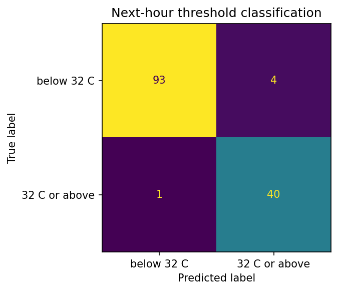
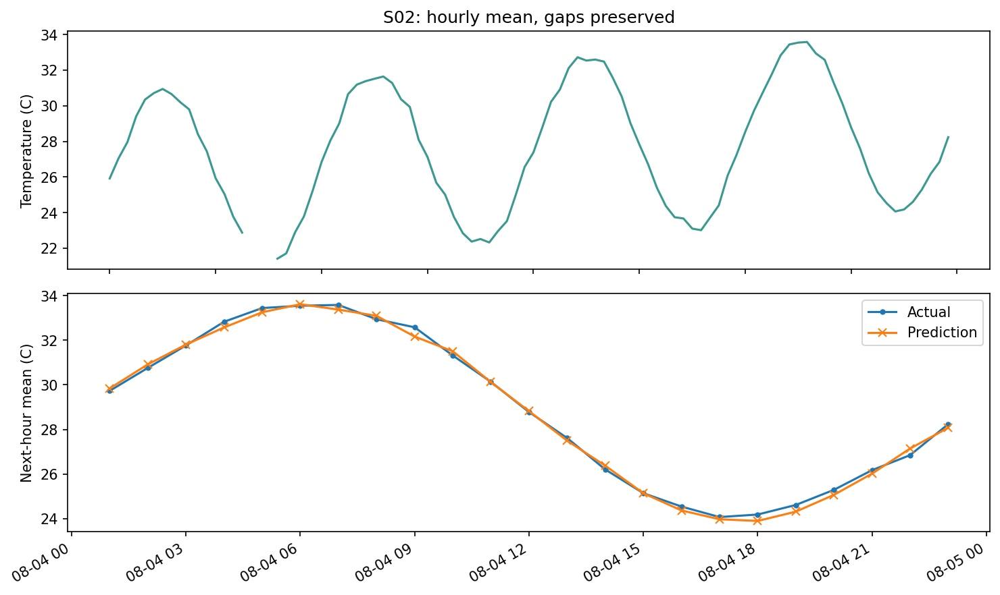

> **이번 글의 질문**
>
> 누락된 센서 구간을 남기면서 다음 시간의 온도와 기준 초과 여부를 어떻게 함께 예측할까요?

> **핵심 요약**
>
> 센서별 시간 표와 관측 수를 만들고 시간 블록으로 검증합니다. 회귀와 분류를 같은 Test 구간에서 평가하고, 제외한 구간의 이유와 예측 시점을 함께 저장합니다.

## 1. 문제를 분석 순서로 바꿉니다

센서 여섯 개의 5분 주기 기록을 96시간 수집한 상황입니다. 일부 기록과 연속한 시간 구간이 빠졌고 비정상 측정값도 있습니다. 각 한 시간이 끝난 시점에 다음 한 시간의 평균 온도를 예측합니다. 시간 구간과 예측 시점의 관계를 연습하도록 구성한 합성 데이터입니다. 다음 시간 평균이 32°C 이상이면 기준 초과로 분류하는 문제도 함께 풉니다. 32°C는 이 연습에서 정한 가상의 운영 기준입니다.

-   원본의 순서와 유효 측정값을 확인합니다
-   빈 시간도 포함한 센서별 표를 만듭니다
-   Feature와 Target이 가리키는 시점을 맞춥니다
-   시간을 먼저 나누고 해당 시간의 모든 센서를 함께 이동합니다
-   마지막 기간과 Persistence Baseline을 비교합니다
-   다음 시간의 기준 초과를 분류합니다

아래 기본 풀이의 출력은 첨부한 solution.ipynb와 결과 CSV에 기록된 실제 실행 결과입니다. 추가 비교 예제는 별도 Notebook에서 실행했으며, 가상 예제는 그 범위를 표시했습니다.

## 2. 단계별 코드와 실행 결과

```python
from pathlib import Path
import json
import numpy as np
import pandas as pd
import matplotlib.pyplot as plt

ROOT = Path.cwd()
DATA = ROOT / "data"
RESULTS = ROOT / "results"
PLOTS = ROOT / "plots"
RESULTS.mkdir(exist_ok=True)
PLOTS.mkdir(exist_ok=True)

def save_csv(frame, name):
    frame.to_csv(RESULTS / name, index=False, encoding="utf-8-sig")
```

### 원본의 순서와 유효 측정값을 확인합니다

허용 온도 범위는 설정 파일에서 정합니다. 범위를 벗어난 측정은 삭제하기보다 온도만 결측값으로 바꿔, 기록이 들어왔다는 사실과 유효한 측정 여부를 구분합니다.

```python
from sklearn.pipeline import Pipeline
from sklearn.impute import SimpleImputer
from sklearn.preprocessing import StandardScaler
from sklearn.linear_model import Ridge
from sklearn.ensemble import RandomForestRegressor
from sklearn.model_selection import TimeSeriesSplit, GridSearchCV
from sklearn.metrics import root_mean_squared_error, mean_absolute_error

config=json.loads((DATA/"sensor_config.json").read_text())
logs=pd.read_csv(DATA/"sensor_logs.csv")
logs["timestamp"]=pd.to_datetime(logs["timestamp"],utc=True,errors="raise")
low,high=config["valid_temperature_range_c"]
logs["temperature_valid"]=logs.temperature_c.where(logs.temperature_c.between(low,high))
logs=logs.sort_values(["sensor_id","timestamp"])
assert not logs.duplicated(["sensor_id","timestamp"]).any()
print("원본 기록:",len(logs),"허용 범위 밖 온도:",int(logs.temperature_valid.isna().sum()))
```

```text
원본 기록: 6647 허용 범위 밖 온도: 1
```

### 빈 시간도 포함한 센서별 표를 만듭니다

센서마다 따로 리샘플링하고 전체 시간 격자를 다시 붙입니다. 이 과정을 거치면 한 시간 동안 아무 로그도 없는 구간이 표에서 사라지지 않습니다.

```python
grid=pd.date_range(config["start"],periods=config["periods"],freq="1h",name="timestamp")
parts=[]
for sensor_id,group in logs.groupby("sensor_id"):
    hourly=group.set_index("timestamp").resample("1h",closed="left",label="left").agg(
        temp_mean=("temperature_valid","mean"),
        obs_count=("log_id","size"),valid_temp_count=("temperature_valid","count"),
        energy_sum=("energy_kwh",lambda s:s.sum(min_count=1)),
    ).reindex(grid)
    hourly[["obs_count","valid_temp_count"]]=hourly[["obs_count","valid_temp_count"]].fillna(0).astype(int)
    hourly["coverage"]=hourly["obs_count"]/config["expected_records_per_hour"]
    hourly["sensor_id"]=sensor_id
    parts.append(hourly.reset_index())
hourly=pd.concat(parts,ignore_index=True).sort_values(["sensor_id","timestamp"])
assert len(hourly)==6*config["periods"]
save_csv(hourly,"hourly_sensor.csv")
print("시간별 표:",len(hourly),"완전히 빈 시간:",int(hourly.obs_count.eq(0).sum()))
print(hourly.loc[hourly.obs_count.eq(0),["sensor_id","timestamp","temp_mean","energy_sum"]].to_string(index=False))
```

```text
시간별 표: 576 완전히 빈 시간: 3
sensor_id                 timestamp  temp_mean  energy_sum
      S02 2026-08-01 16:00:00+00:00        NaN         NaN
      S02 2026-08-01 17:00:00+00:00        NaN         NaN
      S02 2026-08-01 18:00:00+00:00        NaN         NaN
```

`obs_count`는 들어온 기록 수, `valid_temp_count`는 사용할 수 있는 온도 수입니다. 에너지는 증가량이라 합계를, 온도는 상태 값이라 평균을 사용합니다.

### Feature와 Target이 가리키는 시점을 맞춥니다

t구간이 끝난 시점에 t+1구간을 예측합니다. 완료한 현재 평균은 쓸 수 있지만 다음 구간의 평균은 Target입니다. 이전 구간의 이동평균은 센서별 `shift(1)` 뒤에 계산합니다.

```python
groups=hourly.groupby("sensor_id",sort=False)
hourly["temp_lag1"]=groups.temp_mean.shift(1)
hourly["temp_lag3"]=groups.temp_mean.shift(3)
hourly["past_rolling3"]=groups.temp_mean.transform(lambda s:s.shift(1).rolling(3,min_periods=2).mean())
hourly["next_hour_temp"]=groups.temp_mean.shift(-1)
hourly["hour_sin"]=np.sin(2*np.pi*hourly.timestamp.dt.hour/24)
hourly["hour_cos"]=np.cos(2*np.pi*hourly.timestamp.dt.hour/24)
features=["temp_mean","temp_lag1","temp_lag3","past_rolling3","energy_sum","obs_count","hour_sin","hour_cos"]
# 현재 온도가 없는 구간은 예측에서 제외하고 원본 시간 표에는 남깁니다.
hourly["forecast_issued_at"]=hourly.timestamp+pd.Timedelta(hours=1)
hourly["target_hour_start"]=hourly.timestamp+pd.Timedelta(hours=1)
hourly["target_hour_end"]=hourly.timestamp+pd.Timedelta(hours=2)
hourly["forecast_eligible"]=hourly.next_hour_temp.notna() & hourly.temp_mean.notna()
hourly["exclusion_reason"]=np.select(
    [hourly.temp_mean.isna() & hourly.next_hour_temp.isna(),
     hourly.temp_mean.isna(), hourly.next_hour_temp.isna()],
    ["current_and_target_missing","current_missing","target_missing"],default="")
eligible=hourly.loc[hourly.forecast_eligible].copy()
cutoff=pd.Timestamp(config["test_starts"])
train=eligible.loc[eligible.timestamp.lt(cutoff-pd.Timedelta(hours=1))].copy()
test=eligible.loc[eligible.timestamp.ge(cutoff)].copy()
assert train.timestamp.max()+pd.Timedelta(hours=1)<test.timestamp.min()
print("Train:",len(train),"Test:",len(test),"예측 대상 제외:",len(hourly)-len(eligible))
hourly["evaluation_period"]=np.select(
    [hourly.timestamp.lt(cutoff-pd.Timedelta(hours=1)),hourly.timestamp.ge(cutoff)],
    ["train","test"],default="boundary_gap")
hourly["status"]=np.where(hourly.forecast_eligible,"eligible","excluded")
save_csv(hourly,"hourly_sensor.csv")
save_csv(hourly.loc[~hourly.forecast_eligible],"excluded_intervals.csv")
print("시간별 처리 상태:",hourly.status.value_counts().to_dict())
```

```text
Train: 422 Test: 138 예측 대상 제외: 10
시간별 처리 상태: {'eligible': 566, 'excluded': 10}
```

현재 온도나 다음 시간 정답이 없는 행은 제외 이유를 남깁니다. Train/Test 경계에서는 학습용 Target 기간이 검증 기간으로 넘어가지 않도록 한 구간을 비웁니다.

### 시간을 먼저 나누고 해당 시간의 모든 센서를 함께 이동합니다

한 시간에 센서 여섯 개의 기록이 있습니다. 행 번호로 시간 분할을 하면 같은 시간이 양쪽에 들어갈 수 있어, 먼저 시간 목록을 나누고 그 시간의 모든 센서를 함께 이동합니다.

```python
times=np.array(sorted(train.timestamp.unique()))
folds=[]
for train_time_idx,valid_time_idx in TimeSeriesSplit(n_splits=3,gap=1).split(times):
    train_rows=np.flatnonzero(train.timestamp.isin(times[train_time_idx]))
    valid_rows=np.flatnonzero(train.timestamp.isin(times[valid_time_idx]))
    assert train.iloc[train_rows].timestamp.max()+pd.Timedelta(hours=1)<train.iloc[valid_rows].timestamp.min()
    folds.append((train_rows,valid_rows))
def prepare(model):
    return Pipeline([("impute",SimpleImputer(strategy="median")),("scale",StandardScaler()),("model",model)])
ridge=GridSearchCV(prepare(Ridge()),{"model__alpha":[0.1,1,10]},cv=folds,scoring="neg_root_mean_squared_error")
forest=GridSearchCV(prepare(RandomForestRegressor(n_estimators=60,random_state=42,n_jobs=1)),{"model__max_depth":[4,8]},cv=folds,scoring="neg_root_mean_squared_error")
searches={"ridge":ridge,"forest":forest}
for search in searches.values(): search.fit(train[features],train.next_hour_temp)
cv_report=pd.DataFrame([{"model":name,"CV_RMSE":-search.best_score_,"settings":str(search.best_params_)} for name,search in searches.items()])
save_csv(cv_report,"time_cv_scores.csv")
selected_name=max(searches,key=lambda name:searches[name].best_score_)
selected=searches[selected_name]
print(cv_report.round(3).to_string(index=False))
print("Train CV로 선택:",selected_name)
```

```text
 model  CV_RMSE                settings
 ridge    0.298   {'model__alpha': 0.1}
forest    0.672 {'model__max_depth': 8}
Train CV로 선택: ridge
```

Ridge와 Random Forest의 설정은 Train 내부 CV에서 선택합니다. 최종 Test를 본 뒤 모델을 고르는 방식은 사용하지 않습니다.

### 마지막 기간과 Persistence Baseline을 비교합니다

다음 시간도 현재 온도와 같다고 예측하는 Persistence를 비교 기준으로 둡니다. 마지막 기간의 RMSE와 MAE를 °C 단위로 저장하고, 빠진 원본 구간은 선을 연결하지 않습니다.

```python
predicted=selected.predict(test[features])
baseline=test.temp_mean.to_numpy()
metrics=pd.DataFrame([{"model":name,"RMSE_C":root_mean_squared_error(test.next_hour_temp,pred),"MAE_C":mean_absolute_error(test.next_hour_temp,pred)} for name,pred in [(selected_name,predicted),("persistence",baseline)]])
save_csv(metrics,"forecast_metrics.csv")
prediction=test[["sensor_id","timestamp","forecast_issued_at","target_hour_start","target_hour_end","next_hour_temp","obs_count","coverage"]].copy()
prediction["prediction_for_hour"]=prediction.timestamp+pd.Timedelta(hours=1)
prediction["predicted_temp"]=predicted
prediction["baseline_temp"]=baseline
save_csv(prediction,"forecast_predictions.csv")
print(metrics.round(3).to_string(index=False))
fig,axes=plt.subplots(2,1,figsize=(10,6))
sample=hourly.loc[hourly.sensor_id.eq("S02")]
axes[0].plot(sample.timestamp,sample.temp_mean,color="#3a9a90")
axes[0].set(title="S02: hourly mean, gaps preserved",ylabel="Temperature (C)")
forecast=prediction.loc[prediction.sensor_id.eq("S02")]
axes[1].plot(forecast.prediction_for_hour,forecast.next_hour_temp,label="Actual",marker=".")
axes[1].plot(forecast.prediction_for_hour,forecast.predicted_temp,label="Prediction",marker="x")
axes[1].set(ylabel="Next-hour mean (C)");axes[1].legend()
fig.autofmt_xdate();fig.tight_layout();fig.savefig(PLOTS/"sensor_forecast.png",dpi=150,bbox_inches="tight");plt.close(fig)
```

```text
      model  RMSE_C  MAE_C
      ridge   0.265  0.215
persistence   0.929  0.809
```

### 다음 시간의 기준 초과를 분류합니다

같은 시간 표에서 다음 시간 평균이 가상의 상한을 넘는지 분류합니다. 연속 온도 예측과 기준 초과 판정은 서로 다른 문제이므로 Dummy와 지표도 각각 계산합니다.

```python
from sklearn.linear_model import LogisticRegression
from sklearn.dummy import DummyClassifier
from sklearn.metrics import f1_score, balanced_accuracy_score, ConfusionMatrixDisplay

threshold_c=32.0  # 이 실습에서 정한 가상의 운영 기준입니다.
y_train=(train.next_hour_temp>=threshold_c).astype(int)
y_test=(test.next_hour_temp>=threshold_c).astype(int)
class_search=GridSearchCV(
    prepare(LogisticRegression(max_iter=2000,class_weight="balanced")),
    {"model__C":[0.1,1.0,10.0]},cv=folds,scoring="f1_macro")
class_search.fit(train[features],y_train)
class_pred=class_search.predict(test[features])
dummy=DummyClassifier(strategy="most_frequent").fit(train[features],y_train)
class_metrics=pd.DataFrame([
    {"model":name,"macro_f1":f1_score(y_test,pred,average="macro",zero_division=0),
     "balanced_accuracy":balanced_accuracy_score(y_test,pred)}
    for name,pred in [("logistic",class_pred),("dummy",dummy.predict(test[features]))]])
save_csv(class_metrics,"sensor_classification_metrics.csv")
prediction["actual_threshold_exceeded"]=y_test.to_numpy()
prediction["predicted_threshold_exceeded"]=class_pred
save_csv(prediction,"forecast_predictions.csv")
print("Train에서 선택한 C:",class_search.best_params_)
print("Test 클래스별 구간 수:",y_test.value_counts().sort_index().to_dict())
print(class_metrics.round(3).to_string(index=False))
fig,ax=plt.subplots(figsize=(5,4))
ConfusionMatrixDisplay.from_predictions(y_test,class_pred,labels=[0,1],
    display_labels=["below 32 C","32 C or above"],ax=ax,colorbar=False)
ax.set_title("Next-hour threshold classification")
fig.tight_layout();fig.savefig(PLOTS/"sensor_classification.png",dpi=150,bbox_inches="tight");plt.close(fig)
```

```text
Train에서 선택한 C: {'model__C': 10.0}
Test 클래스별 구간 수: {0: 97, 1: 41}
   model  macro_f1  balanced_accuracy
logistic     0.957              0.967
   dummy     0.413              0.500
```

혼동 행렬을 보면 상한 초과를 놓친 경우와 잘못 경보를 낸 경우를 나눠 읽을 수 있습니다. 32°C 기준과 모델의 확률 Threshold는 서로 다른 설정입니다.

## 3. 표·그래프를 해석하고 오류를 확인합니다

현재 시간 평균은 그 구간이 끝나야 알 수 있습니다. 구간 시작 시점의 예측으로 질문을 바꾼다면 같은 Feature를 그대로 사용할 수 없습니다.

관측 수가 0인 구간의 평균과 에너지 합계를 0으로 채우지 않았습니다. 결측값을 가진 구간은 원본 시간 표에 남고 예측 대상 여부는 별도로 기록합니다.

다음 시간 온도를 현재 온도와 같게 예측하는 Persistence는 강한 비교 기준이 될 수 있습니다. 복잡한 모델의 결과도 이 기준보다 나은지 확인합니다.

Test는 입력 구간의 시작이 마지막 24시간에 속하는 경우입니다. 마지막 입력 구간에는 다음 시간 정답이 없어, 실제 평가 대상은 23시간 × 6센서인 138행입니다. 예측을 내보내는 시각은 각 입력 구간이 끝나는 때이며 결과 파일에 따로 남겼습니다.

분류 Target은 다음 시간 평균이 32°C 이상인지입니다. 입력 시점에 이미 아는 현재 온도를 그대로 정답으로 쓰지 않습니다. 같은 시간에도 센서별로 클래스가 달라질 수 있어 시간 블록을 먼저 분리합니다.



*다음 시간 평균이 가상 기준 32°C 이상인지 분류한 Test 결과입니다. 현재 시간의 기준 초과 여부와 구분합니다.*



*센서 시계열 정리와 분류·예측의 실행 결과를 보여 줍니다. 단위와 관측 대상을 본문의 기준으로 읽습니다.*

## 4. 처리 기준이 결과를 바꾸는 비교 예제

### 중앙 이동평균에 미래 값이 들어갑니다

자료: 시간 관계를 확인하는 작은 예제

t구간이 끝난 뒤 다음 구간을 예측한다고 가정합니다. 현재까지 관측한 값의 평균은 사용할 수 있지만 `center=True`의 중앙 창은 t+1 값을 포함합니다. 이전 구간만 사용하는 평균도 함께 계산합니다.

```python
import pandas as pd

temperature = pd.Series([20.0, 21.0, 22.0, 100.0, 24.0], name="temperature")
comparison = pd.DataFrame({
    "current": temperature,
    "centered_rolling3": temperature.rolling(3, center=True).mean(),
    "completed_rolling3": temperature.rolling(3).mean(),
    "previous_rolling3": temperature.shift(1).rolling(3).mean(),
})
print(comparison.round(3).to_string())
assert comparison.loc[2, "centered_rolling3"] > 40
assert comparison.loc[2, "completed_rolling3"] == 21
```

```text
   current  centered_rolling3  completed_rolling3  previous_rolling3
0     20.0                NaN                 NaN                NaN
1     21.0             21.000                 NaN                NaN
2     22.0             47.667              21.000                NaN
3    100.0             48.667              47.667             21.000
4     24.0                NaN              48.667             47.667
```

완료한 현재 구간을 Feature에 넣을지는 예측을 내보내는 시각에 달려 있습니다. `shift`가 항상 정답인 것은 아니며, 각 Feature가 어느 구간의 정보를 사용하는지 명시해야 합니다.

### 현재 기준 초과와 다음 시간 기준 초과는 다른 Target입니다

자료: 분류 Target을 확인하는 작은 예제

현재 평균이 32°C 이상인지와 다음 평균이 32°C 이상인지는 서로 다른 질문입니다. 실제 풀이에서는 `next_hour_temp`에서 분류 Target을 만들었습니다. 차이가 눈에 보이는 짧은 온도열로 확인합니다.

```python
import pandas as pd

example = pd.DataFrame({"current_temp": [30, 34, 31, 35], "next_hour_temp": [34, 31, 35, 28]})
example["current_exceeded"] = example.current_temp.ge(32).astype(int)
example["next_hour_exceeded"] = example.next_hour_temp.ge(32).astype(int)
print(example.to_string(index=False))
print("서로 다른 Target 행:", int(example.current_exceeded.ne(example.next_hour_exceeded).sum()))
```

```text
 current_temp  next_hour_temp  current_exceeded  next_hour_exceeded
           30              34                 0                   1
           34              31                 1                   0
           31              35                 0                   1
           35              28                 1                   0
서로 다른 Target 행: 4
```

다음 시간 온도를 입력에 넣고 그 값의 기준 초과를 맞히면 미래를 예측한 결과가 아닙니다. 결과 CSV의 예측 발행 시각·Target 시작·Target 종료를 함께 읽어 이 관계를 확인합니다.

## 5. 저장한 파일로 분석을 다시 확인합니다

| 결과 파일 | 행 수 | 전체 열 |
| --- | --- | --- |
| `excluded_intervals.csv` | 10 | `timestamp`, `temp_mean`, `obs_count`, `valid_temp_count`, `energy_sum`, `coverage`, `sensor_id`, `temp_lag1`, `temp_lag3`, `past_rolling3`, `next_hour_temp`, `hour_sin`, `hour_cos`, `forecast_issued_at`, `target_hour_start`, `target_hour_end`, `forecast_eligible`, `exclusion_reason`, `evaluation_period`, `status` |
| `forecast_metrics.csv` | 2 | `model`, `RMSE_C`, `MAE_C` |
| `forecast_predictions.csv` | 138 | `sensor_id`, `timestamp`, `forecast_issued_at`, `target_hour_start`, `target_hour_end`, `next_hour_temp`, `obs_count`, `coverage`, `prediction_for_hour`, `predicted_temp`, `baseline_temp`, `actual_threshold_exceeded`, `predicted_threshold_exceeded` |
| `hourly_sensor.csv` | 576 | `timestamp`, `temp_mean`, `obs_count`, `valid_temp_count`, `energy_sum`, `coverage`, `sensor_id`, `temp_lag1`, `temp_lag3`, `past_rolling3`, `next_hour_temp`, `hour_sin`, `hour_cos`, `forecast_issued_at`, `target_hour_start`, `target_hour_end`, `forecast_eligible`, `exclusion_reason`, `evaluation_period`, `status` |
| `sensor_classification_metrics.csv` | 2 | `model`, `macro_f1`, `balanced_accuracy` |
| `time_cv_scores.csv` | 2 | `model`, `CV_RMSE`, `settings` |

Notebook 화면의 점수와 파일의 값이 같은지, 입력 ID가 빠지거나 중복되지 않았는지 확인합니다. 비교 예제는 기존 풀이가 만든 `results`를 읽으므로 기본 풀이를 먼저 실행합니다.

```bash
# 예선_유형별_실습 폴더에서 실행합니다.
python check_outputs.py --types 3
```

검사 도구는 저장 파일의 행·열·ID·상태·지표 대응을 확인합니다. 데이터 분할의 의미, Feature를 사용할 수 있는 시점, 모델 선택 과정은 본문의 기준과 Notebook을 함께 읽어 확인합니다.

## 6. 확장 문제를 설계하고 확인할 결과를 정합니다

다음 항목은 후속 실험을 위한 문제와 풀이 방향입니다. 앞의 실행 결과에 포함된 실험과 구분합니다. 새 데이터나 Annotation이 필요한 항목은 그 입력부터 준비합니다.

### 처음 보는 센서를 평가하려면 무엇을 더 나눌까요?

센서 ID와 시간 조건을 함께 둡니다. 예를 들어 일부 센서를 Train에서 제외하고, 남겨 둔 센서의 이후 기간만 Test로 사용합니다. 센서별 값을 보정하는 통계도 Train에서만 정합니다.

남길 결과: 센서 교집합·시간 범위·누락 구간 수와 Persistence Baseline을 함께 기록합니다.

### 다음 3시간의 평균을 예측하면 어디가 바뀔까요?

Target을 다음 세 완료 구간의 평균으로 정의하고 Target 시작·끝 시각을 저장합니다. Training Target이 Validation 정보 시점과 겹치지 않도록 시간 기준으로 Gap을 계산합니다. 행 수를 3개 띄우는 방식은 센서가 여러 개일 때 같은 의미가 아닙니다.

남길 결과: 각 Fold의 최대 Training Target 종료 시각과 최소 Validation 발행 시각을 비교하는 표를 만듭니다.

## 참고자료

### 실습 데이터와 노트북

-   **문제 자료**: [문제 자료](https://drive.google.com/file/d/1n8qTp4-vILRAfVINEsRoHgudsLE5yDwT/view?usp=drivesdk "Google Drive에서 자료를 엽니다.") — 입력 데이터와 starter.ipynb로 직접 구현을 시작합니다.
-   **풀이 자료**: [풀이와 결과](https://drive.google.com/file/d/1z2u6-lldSdlreel5Ot-Q0HnaWeidHVe1/view?usp=drivesdk "Google Drive에서 자료를 엽니다.") — 전체 Python 코드, 노트북과 실행 결과를 함께 받습니다.
-   **공통 자료**: [실습 공통 자료](https://drive.google.com/file/d/1-W9cVOlqQ4BUYRX3AGH3qbC9CsUQjf-g/view?usp=drivesdk "Google Drive에서 자료를 엽니다.") — 공유 모델과 유형별 실습에 필요한 공통 준비 자료입니다.
-   **예선 가이드**: [국방AI경진대회 예선가이드](https://drive.google.com/file/d/1YDxg9ngucdJR7y4zUaBuW5bEYhzh1EJl/view) — 제공된 가이드의 범위를 바탕으로 만든 연습문제입니다.
-   **실행 안내**: — 같은 작업 폴더에 압축을 푼 뒤 유형 폴더에서 solution.ipynb 또는 solution.py를 실행합니다. blog\_comparison.ipynb에는 본문에서 추가한 두 비교 예제와 실제 출력이 들어 있습니다.
-   **데이터 출처**: — 센서 로그는 이 실습을 위해 만든 합성 데이터입니다. 32°C는 가상의 운영 기준이며 실제 장비의 경보 기준을 뜻하지 않습니다.

### 연습문제

-   **문제**: [유형 03 문제](/cs/data-analysis/practice-03-sensor-time-series/) — 누락된 센서 구간을 남기면서 다음 시간의 온도와 기준 초과 여부를 어떻게 함께 예측할까요?
-   **모의 실습**: [모의 실습 A](/cs/data-analysis/mock-exam-a-90-min-review/) — 세 문항을 20·35·45점으로 묶어 입력부터 저장까지 연습합니다.

### 관련 공부노트

-   **공부노트 03**: [시계열 데이터 정렬 및 리샘플링](/cs/data-analysis/pandas-03-time-series-resampling/)
-   **공부노트 07**: [지도 학습 및 평가](/cs/data-analysis/pandas-07-supervised-learning/)
-   **공부노트 13**: [데이터 분석의 흔한 착각과 실수](/cs/data-analysis/pandas-13-common-pitfalls/)

### 공식 문서

-   **사용한 도구**: [DataFrame.resample](https://pandas.pydata.org/docs/reference/api/pandas.DataFrame.resample.html) — 그룹별 시간 구간과 closed·label을 확인합니다.  
    [TimeSeriesSplit](https://scikit-learn.org/stable/modules/generated/sklearn.model_selection.TimeSeriesSplit.html) — 과거에서 이후 시점으로 검증하고 gap을 둡니다.  
    [모델 평가 지표](https://scikit-learn.org/stable/modules/model_evaluation.html) — 같은 시계열 Test에서 분류·회귀의 지표를 각각 읽습니다.
