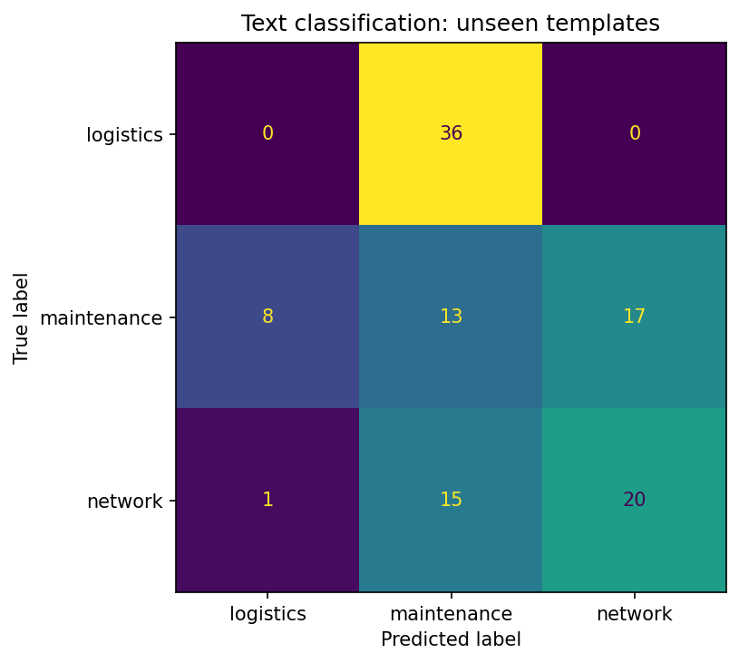

> **이번 글의 질문**
>
> 표현이 조금씩 다른 접수 문장을 분류하면서, 같은 양식의 문장이 Train과 Test에 섞이는 문제를 어떻게 막을까요?

> **핵심 요약**
>
> JSONL 텍스트를 읽고 빈 입력을 분리합니다. 문장 양식별로 Train/Test를 나누고, TF-IDF와 Logistic Regression을 그룹 CV로 검증합니다.

## 1. 문제를 분석 순서로 바꿉니다

정비·보급·네트워크 요청을 분류하는 접수 기록입니다. 핵심 요청과 다른 분야의 상황 설명이 한 문장에 함께 들어 있습니다. 같은 양식의 반복 문장과 완전히 같은 재접수 문장도 포함했습니다. 실제 접수 기록 대신 분류와 검증 방식을 연습하도록 작성한 문장 데이터입니다.

- JSONL과 빈 입력을 확인합니다
- Char n-gram과 모델을 하나의 Pipeline으로 둡니다
- Baseline과 클래스별 오류를 읽습니다

아래 기본 풀이의 출력은 첨부한 `solution.ipynb`와 결과 CSV에 기록된 실제 실행 결과입니다. 추가 비교 예제는 별도 Notebook에서 실행했으며, 가상 예제는 그 범위를 표시했습니다.

## 2. 단계별 코드와 실행 결과

```python
from pathlib import Path
import json
import numpy as np
import pandas as pd
import matplotlib.pyplot as plt

ROOT = Path.cwd()
DATA = ROOT / "data"
RESULTS = ROOT / "results"
PLOTS = ROOT / "plots"
RESULTS.mkdir(exist_ok=True)
PLOTS.mkdir(exist_ok=True)

def save_csv(frame, name):
    frame.to_csv(RESULTS / name, index=False, encoding="utf-8-sig")
```

### JSONL과 빈 입력을 확인합니다

JSONL은 한 줄에 객체 하나가 있는 형식입니다. 빈 원문은 분류할 내용이 없으므로 별도 파일에 남기고 학습·평가에서 제외합니다.

```python
from sklearn.pipeline import Pipeline
from sklearn.feature_extraction.text import TfidfVectorizer
from sklearn.linear_model import LogisticRegression
from sklearn.model_selection import StratifiedGroupKFold, GridSearchCV
from sklearn.dummy import DummyClassifier
from sklearn.metrics import f1_score, classification_report, ConfusionMatrixDisplay
import re

records=pd.read_json(DATA/"reports.jsonl",lines=True)
records["clean_text"]=records.text.fillna("").map(lambda text: re.sub(r"\s+"," ",text).strip())
empty=records.loc[records.clean_text.eq("")].copy()
empty["status"]="empty_text"
save_csv(empty,"empty_reports.csv")
usable=records.loc[records.clean_text.ne("")].copy()
train=usable.loc[usable.split.eq("train")].copy()
test=usable.loc[usable.split.eq("test")].copy()
assert set(train.template_group).isdisjoint(test.template_group)
assert set(train.clean_text).isdisjoint(test.clean_text)
print("원문:",len(records),"빈 입력:",len(empty),"Train/Test:",len(train),len(test))
print("Train의 완전 중복:",int(train.clean_text.duplicated().sum()))
```

```text
원문: 369 빈 입력: 3 Train/Test: 256 110
Train의 완전 중복: 4
```

같은 문장 양식과 완전히 같은 원문이 Train/Test 양쪽에 들어가지 않았는지 검사합니다. 접수 번호나 팀 이름을 답을 알려 주는 Feature처럼 사용하지 않습니다.

### Char n-gram과 모델을 하나의 Pipeline으로 둡니다

Char n-gram은 문자열을 짧은 조각으로 나눠 표현합니다. 단어 단위 토큰화 없이 한국어에서 시작할 수 있지만 부정 표현과 요청 의도를 완전히 이해하지는 못합니다.

```python
pipeline=Pipeline([
    ("tfidf",TfidfVectorizer(analyzer="char",ngram_range=(2,5),min_df=2,max_features=12000)),
    ("model",LogisticRegression(max_iter=2000)),
])
folds=list(StratifiedGroupKFold(n_splits=3,shuffle=True,random_state=42).split(train.clean_text,train.label,groups=train.template_group))
search=GridSearchCV(pipeline,{"model__C":[0.2,1.0,3.0]},cv=folds,scoring="f1_macro")
search.fit(train.clean_text,train.label)
model=search.best_estimator_
print("선택:",search.best_params_,"CV macro F1:",round(search.best_score_,3))
print("학습한 Vocabulary 수:",len(model.named_steps["tfidf"].vocabulary_))
```

```text
선택: {'model__C': 3.0} CV macro F1: 0.632
학습한 Vocabulary 수: 1785
```

TF-IDF의 Vocabulary와 IDF도 학습 결과입니다. 이를 미리 전체 문장에서 만들지 않고 그룹 CV의 각 Training Fold에서 다시 학습합니다.

### Baseline과 클래스별 오류를 읽습니다

Macro F1은 각 클래스의 F1에 같은 비중을 줍니다. 전체 점수와 함께 어떤 요청 분야를 놓쳤는지 혼동 행렬과 오류 파일을 읽습니다.

```python
predicted=model.predict(test.clean_text)
dummy=DummyClassifier(strategy="most_frequent").fit(np.zeros((len(train),1)),train.label)
dummy_pred=dummy.predict(np.zeros((len(test),1)))
metrics=pd.DataFrame({"model":["tfidf_logistic","dummy"],"macro_f1":[f1_score(test.label,predicted,average="macro"),f1_score(test.label,dummy_pred,average="macro")]})
save_csv(metrics,"text_metrics.csv")
print(metrics.round(3).to_string(index=False))
print(classification_report(test.label,predicted,zero_division=0))
probability=model.predict_proba(test.clean_text)
prediction=test[["report_id","template_group","text","label"]].copy()
prediction["prediction"]=predicted
prediction["max_probability"]=probability.max(axis=1)
prediction["status"]="ok"
save_csv(prediction,"text_predictions.csv")
errors=prediction.loc[prediction.label.ne(prediction.prediction)]
save_csv(errors,"text_errors.csv")
print("잘못 분류한 기록:",len(errors))
fig,ax=plt.subplots(figsize=(6,5))
ConfusionMatrixDisplay.from_predictions(test.label,predicted,labels=model.classes_,ax=ax,colorbar=False)
ax.set_title("Text classification: unseen templates")
fig.tight_layout();fig.savefig(PLOTS/"text_confusion.png",dpi=150,bbox_inches="tight");plt.close(fig)
```

```text
         model  macro_f1
tfidf_logistic     0.268
         dummy     0.171
              precision    recall  f1-score   support

   logistics       0.00      0.00      0.00        36
 maintenance       0.20      0.34      0.25        38
     network       0.54      0.56      0.55        36

    accuracy                           0.30       110
   macro avg       0.25      0.30      0.27       110
weighted avg       0.25      0.30      0.27       110

잘못 분류한 기록: 77
```

`max_probability`는 모델이 낸 점수입니다. 검증된 정답 확률로 받아들이기보다, 검토가 필요한 문장을 고르는 기준을 Validation에서 따로 확인합니다.

## 3. 표·그래프를 해석하고 오류를 확인합니다

같은 양식의 반복 문장은 단어만 조금 달라도 매우 비슷합니다. 행 단위 무작위 분할보다 양식 그룹을 분리해야 처음 본 표현을 분류하는 평가에 맞습니다.

Char n-gram은 한국어에서 별도 형태소 분석기 없이 시작하기 좋은 Baseline입니다. 철자가 조금 바뀐 표현도 일부 조각을 공유하지만, 문맥을 완전히 이해하는 모델은 아닙니다.

없는 증상에 대한 설명도 문장에 들어 있습니다. '없음'이나 '발생하지 않았습니다' 같은 표현을 지우면 요청의 뜻이 바뀔 수 있습니다.

이 실행의 Test macro F1은 약 0.268로 Train 내부 CV의 약 0.632보다 낮습니다. 특히 logistics의 Recall이 0이므로, Baseline을 넘었다는 사실만으로 충분한 모델이라고 판단하기 어렵습니다. 처음 보는 양식에서 요청과 부정 문맥을 잘 구분하는지 오류 문장을 다시 읽습니다.

Test 결과를 보고 `C`나 데이터 분할을 계속 바꾸면 그 자료는 Validation 역할을 하게 됩니다. 후속 실험은 Train 내부에서 비교하고, 최종 성능 확인에는 새 양식 그룹을 따로 남깁니다.



*비정형 텍스트 분류의 실행 결과를 보여 줍니다. 단위와 관측 대상을 본문의 기준으로 읽습니다.*

## 4. 처리 기준이 결과를 바꾸는 비교 예제

### 문장이 달라도 같은 양식이 양쪽에 들어갈 수 있습니다

자료: 실습 입력 데이터

빈 입력을 제외한 뒤 행 단위 무작위 분할과 제공된 양식 그룹 분할을 비교합니다. 문자 단위 특징이 반복 표현을 기억할 수 있으므로 완전히 같은 문장만 검사해서는 부족합니다.

```python
import pandas as pd
from sklearn.model_selection import train_test_split

reports = pd.read_json("data/reports.jsonl", lines=True)
usable = reports.loc[reports.text.fillna("").str.strip().ne("")].copy()
left, right = train_test_split(usable, test_size=0.3, random_state=42, stratify=usable.label)
random_overlap = set(left.template_group) & set(right.template_group)
fixed_overlap = set(usable.loc[usable.split.eq("train"), "template_group"]) & set(usable.loc[usable.split.eq("test"), "template_group"])
print("무작위 분할의 양식 교집합:", len(random_overlap))
print("제공한 분할의 양식 교집합:", len(fixed_overlap))
assert not fixed_overlap
```

```text
무작위 분할의 양식 교집합: 29
제공한 분할의 양식 교집합: 0
```

실제 수집 데이터에서는 양식 외에도 작성자·기관·수집 기간이 독립 평가의 기준이 될 수 있습니다. 이 실습의 `template_group`은 그 조건을 명시적으로 연습하기 위한 필드입니다.

### 확률 점수와 실제 정답 여부를 함께 확인합니다

자료: 실습에서 저장한 예측 결과

각 문장의 최대 확률 점수를 구간으로 묶고 정답 여부를 함께 봅니다. 이 표는 현재 Test에서의 오류 분석이며, 운영 Threshold를 이 자료로 선택하는 절차는 아닙니다.

```python
import pandas as pd

prediction = pd.read_csv("results/text_predictions.csv")
prediction["correct"] = prediction.label.eq(prediction.prediction)
prediction["score_band"] = pd.cut(prediction.max_probability, bins=[0, 0.4, 0.6, 0.8, 1.0], include_lowest=True)
summary = prediction.groupby("score_band", observed=True).agg(
    reports=("report_id", "size"), observed_accuracy=("correct", "mean"),
    mean_max_probability=("max_probability", "mean"))
print(summary.round(3).to_string())
print("클래스별 정답률:")
print(prediction.groupby("label").correct.agg(["size", "mean"]).round(3).to_string())
```

```text
               reports  observed_accuracy  mean_max_probability
score_band
(-0.001, 0.4]       18              0.222                 0.383
(0.4, 0.6]          80              0.362                 0.440
(0.6, 0.8]          12              0.000                 0.635
클래스별 정답률:
             size   mean
label
logistics      36  0.000
maintenance    38  0.342
network        36  0.556
```

`max_probability`가 0.8이라는 이유만으로 실제 정답률도 80%라고 읽을 수는 없습니다. 검토 대상으로 보내는 규칙은 Train 내부 Validation에서 정하고, 양식이 바뀔 때도 유효한지 별도 자료로 확인합니다.

## 5. 저장한 파일로 분석을 다시 확인합니다

| 결과 파일 | 행 수 | 전체 열 |
| --- | --- | --- |
| `empty_reports.csv` | 3 | `report_id`, `template_group`, `text`, `label`, `team`, `split`, `clean_text`, `status` |
| `text_errors.csv` | 77 | `report_id`, `template_group`, `text`, `label`, `prediction`, `max_probability`, `status` |
| `text_metrics.csv` | 2 | `model`, `macro_f1` |
| `text_predictions.csv` | 110 | `report_id`, `template_group`, `text`, `label`, `prediction`, `max_probability`, `status` |

Notebook 화면의 점수와 파일의 값이 같은지, 입력 ID가 빠지거나 중복되지 않았는지 확인합니다. 비교 예제는 기존 풀이가 만든 `results`를 읽으므로 기본 풀이를 먼저 실행합니다.

```bash
# 예선_유형별_실습 폴더에서 실행합니다.
python check_outputs.py --types 4
```

검사 도구는 저장 파일의 행·열·ID·상태·지표 대응을 확인합니다. 데이터 분할의 의미, Feature를 사용할 수 있는 시점, 모델 선택 과정은 본문의 기준과 Notebook을 함께 읽어 확인합니다.

## 6. 확장 문제를 설계하고 확인할 결과를 정합니다

다음 항목은 후속 실험을 위한 문제와 풀이 방향입니다. 앞의 실행 결과에 포함된 실험과 구분합니다. 새 데이터나 Annotation이 필요한 항목은 그 입력부터 준비합니다.

### 양식 대신 작성자·기간을 기준으로 나누면 무엇이 필요할까요?

현재 자료에는 실제 작성자 ID와 작성 시각이 없습니다. `template_group`을 다른 이름으로 바꾸는 것만으로 그 평가가 되지는 않습니다. 새 메타데이터를 가진 자료에서 같은 작성자 또는 이후 기간이 양쪽에 섞이지 않도록 설계합니다.

남길 결과: 분할 단위·평가하려는 새 입력의 의미·클래스별 문장 수를 명시합니다.

### 자동 분류와 사람 검토를 함께 운영하려면 어떻게 할까요?

Train 내부 Validation에서 검토 Threshold를 정하고 자동 처리 비율과 자동 처리된 문장의 오류율을 함께 봅니다. 낮은 점수의 문장을 검토로 보냈다는 이유만으로 전체 요청 품질이 보장되지는 않습니다.

남길 결과: 검토 건수·자동 처리 건수·분야별 오류·비용을 같은 입력 집합에서 계산합니다.

## 참고자료

### 실습 데이터와 노트북

- **문제 자료**: [문제 자료](/files/maicon-2026/practice/%EC%8B%A4%EC%8A%B5_04_%EB%AC%B8%EC%A0%9C%EC%9E%90%EB%A3%8C.zip) — 입력 데이터와 `starter.ipynb`로 직접 구현을 시작합니다.
- **풀이 자료**: [풀이와 결과](/files/maicon-2026/practice/%EC%8B%A4%EC%8A%B5_04_%ED%92%80%EC%9D%B4%EC%99%80_%EA%B2%B0%EA%B3%BC.zip) — 전체 Python 코드, 노트북과 실행 결과를 함께 받습니다.
- **공통 자료**: [실습 공통 자료](/files/maicon-2026/practice/%EC%8B%A4%EC%8A%B5_%EA%B3%B5%ED%86%B5%EC%A4%80%EB%B9%84.zip) — 공유 모델과 유형별 실습에 필요한 공통 준비 자료입니다.
- **예선 가이드**: [국방AI경진대회 예선가이드](/files/maicon-2026/%EA%B5%AD%EB%B0%A9AI%EA%B2%BD%EC%A7%84%EB%8C%80%ED%9A%8C%20%EC%98%88%EC%84%A0%EA%B0%80%EC%9D%B4%EB%93%9C.pdf) — 제공된 가이드의 범위를 바탕으로 만든 연습문제입니다.
- **실행 안내**: 같은 작업 폴더에 압축을 푼 뒤 유형 폴더에서 `solution.ipynb` 또는 `solution.py`를 실행합니다. `blog_comparison.ipynb`에는 본문에서 추가한 두 비교 예제와 실제 출력이 들어 있습니다.
- **데이터 출처**: 한국어 요청 문장은 이 실습을 위해 작성한 양식과 변형입니다. 실제 접수 기록에서 추출한 데이터가 아닙니다.

### 연습문제

- **문제**: [유형 04 문제](/cs/data-analysis/practice-04-text-classification/) — 표현이 조금씩 다른 접수 문장을 분류하면서, 같은 양식의 문장이 Train과 Test에 섞이는 문제를 어떻게 막을까요?
- **모의 실습**: [모의 실습 A](/cs/data-analysis/mock-exam-a-90-min-review/) — 세 문항을 20·35·45점으로 묶어 입력부터 저장까지 연습합니다.

### 관련 공부노트

- **공부노트 07**: [지도 학습 및 평가](/cs/data-analysis/pandas-07-supervised-learning/)
- **공부노트 10**: [이미지·영상 데이터 분석](/cs/data-analysis/pandas-10-image-video-analysis/)
- **공부노트 13**: [데이터 분석의 흔한 착각과 실수](/cs/data-analysis/pandas-13-common-pitfalls/)

### 공식 문서

- **사용한 도구**: [TfidfVectorizer](https://scikit-learn.org/stable/modules/generated/sklearn.feature_extraction.text.TfidfVectorizer.html) — char n-gram·vocabulary·idf의 학습 범위를 확인합니다.  
  [StratifiedGroupKFold](https://scikit-learn.org/stable/modules/generated/sklearn.model_selection.StratifiedGroupKFold.html) — 그룹을 유지하며 클래스 비율을 고려합니다.
