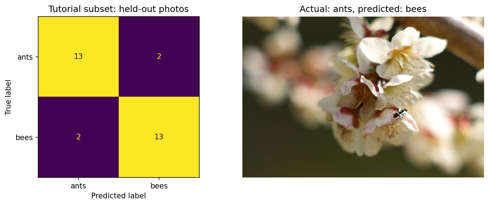

> **이번 글의 질문**
>
> 사전 학습된 이미지 모델을 고정한 채, 사진이 개미인지 벌인지 분류하는 새 모델을 어떻게 만들까요?

> **핵심 요약**
>
> 실제 사진 140장을 Train·Validation·Test로 나눕니다. MobileNet의 고정된 특징을 추출하고, Train에서 학습한 분류기를 Validation으로 선택한 뒤 Test를 평가합니다.

## 1. 문제를 분석 순서로 바꿉니다

이미지 분류는 사진 전체에 클래스 하나를 붙입니다. PyTorch 공식 Transfer Learning 튜토리얼의 개미·벌 사진에서 140장을 골라 새 메타데이터와 문제를 구성했습니다. 원래 사진은 ImageNet에서 가져온 자료이므로, ImageNet으로 사전 학습한 모델과 사진이 겹칠 수 있습니다. 이 실습의 Test 점수는 전이학습 절차를 확인하는 결과이며 독립적으로 수집한 새 사진의 벤치마크로 확대하지 않습니다.

- 사진과 Split을 검증합니다
- 고정한 CNN에서 특징을 추출합니다
- Validation에서 새 분류기를 선택합니다
- 선택을 끝낸 뒤 Test를 평가합니다

아래 기본 풀이의 출력은 첨부한 `solution.ipynb`와 결과 CSV에 기록된 실제 실행 결과입니다. 추가 비교 예제는 별도 Notebook에서 실행했으며, 가상 예제는 그 범위를 표시했습니다.

## 2. 단계별 코드와 실행 결과

```python
from pathlib import Path
import json
import numpy as np
import pandas as pd
import matplotlib.pyplot as plt

ROOT = Path.cwd()
DATA = ROOT / "data"
RESULTS = ROOT / "results"
PLOTS = ROOT / "plots"
RESULTS.mkdir(exist_ok=True)
PLOTS.mkdir(exist_ok=True)

def save_csv(frame, name):
    frame.to_csv(RESULTS / name, index=False, encoding="utf-8-sig")
```

### 사진과 Split을 검증합니다

사진마다 경로·크기·클래스·Split을 메타데이터에 기록했습니다. 파일 Hash로 같은 바이트의 사진이 중복됐는지 검사하되, Hash가 다른 비슷한 사진도 육안으로 확인할 수 있습니다.

```python
import hashlib
import torch
from PIL import Image
from torchvision.models import mobilenet_v3_small, MobileNet_V3_Small_Weights
from sklearn.pipeline import make_pipeline
from sklearn.preprocessing import StandardScaler
from sklearn.linear_model import LogisticRegression
from sklearn.dummy import DummyClassifier
from sklearn.metrics import accuracy_score, f1_score, ConfusionMatrixDisplay

metadata=pd.read_csv(DATA/"photo_metadata.csv")
assert metadata.image_id.is_unique and metadata.sha256.is_unique
for row in metadata.itertuples(index=False):
    assert hashlib.sha256((DATA/row.path).read_bytes()).hexdigest()==row.sha256
print(metadata.groupby(["split","label"]).size().to_string())
```

```text
split       label
test        ants     15
            bees     15
train       ants     40
            bees     40
validation  ants     15
            bees     15
```

### 고정한 CNN에서 특징을 추출합니다

사전 학습 MobileNet의 마지막 분류기를 제거해 사진당 576개 특징을 얻습니다. CNN은 고정하고 이 특징 위에 새 분류기를 학습합니다.

```python
torch.set_num_threads(4)
weights=MobileNet_V3_Small_Weights.DEFAULT
network=mobilenet_v3_small(weights=None)
state=torch.load(ROOT.parent/"_models/mobilenet_v3_small-047dcff4.pth",map_location="cpu",weights_only=True)
network.load_state_dict(state)
network.classifier=torch.nn.Identity()
network.requires_grad_(False)
network.eval()
preprocess=weights.transforms()
parts=[]
with torch.inference_mode():
    for start in range(0,len(metadata),8):
        images=[]
        for path in metadata.iloc[start:start+8].path:
            with Image.open(DATA/path) as image:
                images.append(preprocess(image.convert("RGB")))
        parts.append(network(torch.stack(images)).numpy())
features=np.vstack(parts)
np.save(RESULTS/"extracted_features.npy",features)
cached=np.load(DATA/"photo_features.npy")
assert np.allclose(features,cached,atol=1e-5)
print("추출한 특징:",features.shape,"고정된 파라미터:",all(not p.requires_grad for p in network.parameters()))
```

```text
추출한 특징: (140, 576) 고정된 파라미터: True
```

`eval()`은 Dropout과 BatchNorm의 동작을 바꿉니다. Gradient 기록을 끄는 `inference_mode()`와 파라미터를 고정하는 `requires_grad_(False)`도 각각 따로 설정합니다.

### Validation에서 새 분류기를 선택합니다

분류기의 `C`는 Validation에서 선택합니다. 점수가 같은 후보에는 미리 정한 작은 `C` 우선 규칙을 적용해 같은 결과로 다시 선택할 수 있게 합니다.

```python
train=metadata.split.eq("train").to_numpy()
validation=metadata.split.eq("validation").to_numpy()
test=metadata.split.eq("test").to_numpy()
rows=[]
for c in [0.01,0.1,1.0,10.0]:
    candidate=make_pipeline(StandardScaler(),LogisticRegression(C=c,max_iter=2000))
    candidate.fit(features[train],metadata.loc[train,"label"])
    prediction=candidate.predict(features[validation])
    rows.append({"C":c,"validation_macro_f1":f1_score(metadata.loc[validation,"label"],prediction,average="macro")})
scores=pd.DataFrame(rows).sort_values(["validation_macro_f1","C"],ascending=[False,True])
selected_c=float(scores.iloc[0].C)
save_csv(scores,"validation_scores.csv")
print(scores.round(3).to_string(index=False))
print("선택한 C:",selected_c)
```

```text
    C  validation_macro_f1
 0.01                0.933
 0.10                0.933
 1.00                0.933
10.00                0.933
선택한 C: 0.01
```

이미지 변환은 사전 학습 가중치의 고정 기준입니다. 새 특징에 쓰는 Scaler는 Train에서 학습하므로 두 전처리가 어느 데이터에서 정해졌는지 구분합니다.

### 선택을 끝낸 뒤 Test를 평가합니다

설정 선택을 끝낸 뒤 Train과 Validation을 합쳐 새 분류기를 다시 학습합니다. 이때 Test는 추가하지 않으며 Scaler도 합친 학습 자료에서 다시 정합니다.

```python
train_validation=train|validation
model=make_pipeline(StandardScaler(),LogisticRegression(C=selected_c,max_iter=2000))
model.fit(features[train_validation],metadata.loc[train_validation,"label"])
predicted=model.predict(features[test])
dummy=DummyClassifier(strategy="most_frequent").fit(features[train_validation],metadata.loc[train_validation,"label"])
metrics=pd.DataFrame([{"model":name,"accuracy":accuracy_score(metadata.loc[test,"label"],pred),"macro_f1":f1_score(metadata.loc[test,"label"],pred,average="macro")} for name,pred in [("frozen_mobilenet_logistic",predicted),("dummy",dummy.predict(features[test]))]])
save_csv(metrics,"photo_metrics.csv")
prediction=metadata.loc[test,["image_id","path","label"]].copy()
prediction["prediction"]=predicted
save_csv(prediction,"photo_test_predictions.csv")
print(metrics.round(3).to_string(index=False))
fig,axes=plt.subplots(1,2,figsize=(10,4))
ConfusionMatrixDisplay.from_predictions(metadata.loc[test,"label"],predicted,labels=["ants","bees"],ax=axes[0],colorbar=False)
axes[0].set_title("Tutorial subset: held-out photos")
error=prediction.loc[prediction.label.ne(prediction.prediction)]
example=error.iloc[0] if len(error) else prediction.iloc[0]
with Image.open(DATA/example.path) as image: axes[1].imshow(image.convert("RGB"))
axes[1].set_title(f"Actual: {example.label}, predicted: {example.prediction}");axes[1].axis("off")
fig.tight_layout();fig.savefig(PLOTS/"photo_evaluation.png",dpi=150,bbox_inches="tight");plt.close(fig)
print("오류 사진:",len(error))
```

```text
                    model  accuracy  macro_f1
frozen_mobilenet_logistic     0.867     0.867
                    dummy     0.500     0.333
오류 사진: 4
```

틀린 사진을 보며 배경·자세·해상도에 따른 오류를 살펴볼 수 있습니다. 사전 학습 데이터와의 중복 가능성은 별도로 남겨, 이 점수를 독립된 새 사진의 성능으로 확대하지 않습니다.

## 3. 표·그래프를 해석하고 오류를 확인합니다

CNN은 이미 학습한 특징을 제공하고, 새 데이터에서는 분류기만 학습했습니다. 이것도 Transfer Learning의 한 방식입니다.

`eval()`은 Dropout·BatchNorm의 동작을 추론 모드로 바꾸며, `inference_mode()`는 Gradient 기록을 끕니다. 학습할 파라미터를 고정하는 설정과 각각의 역할이 다릅니다.

이미지 전처리의 평균·표준편차는 사전 학습 가중치가 요구하는 고정 기준입니다. 추출한 특징에 적용한 StandardScaler는 새 Train에서 학습한 기준입니다.



*사진 분류와 Transfer Learning의 실행 결과를 보여 줍니다. 단위와 관측 대상을 본문의 기준으로 읽습니다.*

## 4. 처리 기준이 결과를 바꾸는 비교 예제

### Test에서 다시 fit하면 특징의 좌표계가 바뀝니다

자료: 실습의 고정 CNN 특징

사진에서 추출한 576개 특징 중 Train 분산이 큰 세 열을 골라 비교합니다. 같은 Test를 Train 기준으로 변환하는 경우와 Test 자체에서 기준을 다시 만드는 경우를 나란히 봅니다.

```python
import numpy as np
import pandas as pd
from sklearn.preprocessing import StandardScaler

metadata = pd.read_csv("data/photo_metadata.csv")
features = np.load("results/extracted_features.npy")
train = features[metadata.split.eq("train").to_numpy()]
test = features[metadata.split.eq("test").to_numpy()]
columns = np.argsort(train.var(axis=0))[-3:]
train_scaler = StandardScaler().fit(train[:, columns])
proper_test = train_scaler.transform(test[:, columns])
refitted_test = StandardScaler().fit_transform(test[:, columns])
comparison = pd.DataFrame({"feature": columns, "mean_train_reference": proper_test.mean(axis=0), "mean_refitted_on_test": refitted_test.mean(axis=0)})
print(comparison.round(4).to_string(index=False))
print("변환값의 평균 절대 차이:", round(float(np.abs(proper_test - refitted_test).mean()), 4))
```

```text
 feature  mean_train_reference  mean_refitted_on_test
     569                0.2311                    0.0
     308               -0.0682                   -0.0
     471               -0.2432                   -0.0
변환값의 평균 절대 차이: 0.2093
```

분류기는 Train에서 정한 좌표계의 특징으로 학습했습니다. Test 평균을 0으로 만드는 일은 평가를 공정하게 만드는 기준이 아니며, 학습한 변환을 그대로 적용해야 합니다.

### Validation 선택과 Test 선택을 나눠 생각합니다

자료: 선택 원리를 보여 주는 가상 점수표

아래 점수는 설명을 위해 만든 값입니다. Validation에서 선택한 후보와 Test 점수를 보고 선택한 후보가 달라질 수 있습니다. 후자는 같은 Test를 선택과 평가에 함께 사용합니다.

```python
import pandas as pd

scores = pd.DataFrame({"C": [0.1, 1.0, 10.0], "validation_f1": [0.80, 0.90, 0.85], "test_f1": [0.95, 0.84, 0.88]})
selected_validation = scores.sort_values(["validation_f1", "C"], ascending=[False, True]).iloc[0]
selected_test = scores.sort_values(["test_f1", "C"], ascending=[False, True]).iloc[0]
print(scores.to_string(index=False))
print("Validation에서 선택한 C:", selected_validation.C)
print("Test를 보고 선택한 C:", selected_test.C)
```

```text
   C  validation_f1  test_f1
 0.1           0.80     0.95
 1.0           0.90     0.84
10.0           0.85     0.88
Validation에서 선택한 C: 1.0
Test를 보고 선택한 C: 0.1
```

실제 사진 풀이에서는 `validation_scores.csv`에서 `C`를 선택하고, Train과 Validation을 합쳐 다시 학습한 뒤 Test를 평가했습니다. 가상 점수표와 실제 사진의 평가 결과를 구분해서 읽습니다.

## 5. 저장한 파일로 분석을 다시 확인합니다

| 결과 파일 | 행 수 | 전체 열 |
| --- | --- | --- |
| `photo_metrics.csv` | 2 | `model`, `accuracy`, `macro_f1` |
| `photo_test_predictions.csv` | 30 | `image_id`, `path`, `label`, `prediction` |
| `validation_scores.csv` | 4 | `C`, `validation_macro_f1` |

Notebook 화면의 점수와 파일의 값이 같은지, 입력 ID가 빠지거나 중복되지 않았는지 확인합니다. 비교 예제는 기존 풀이가 만든 `results`를 읽으므로 기본 풀이를 먼저 실행합니다.

```bash
# 예선_유형별_실습 폴더에서 실행합니다.
python check_outputs.py --types 5
```

검사 도구는 저장 파일의 행·열·ID·상태·지표 대응을 확인합니다. 데이터 분할의 의미, Feature를 사용할 수 있는 시점, 모델 선택 과정은 본문의 기준과 Notebook을 함께 읽어 확인합니다.

## 6. 확장 문제를 설계하고 확인할 결과를 정합니다

다음 항목은 후속 실험을 위한 문제와 풀이 방향입니다. 앞의 실행 결과에 포함된 실험과 구분합니다. 새 데이터나 Annotation이 필요한 항목은 그 입력부터 준비합니다.

### 촬영 배경이 달라진 사진에서도 같은 점수가 나올까요?

튜토리얼 사진과 독립적으로 수집한 사진을 새 Test로 둡니다. 개미·벌의 정답과 촬영 출처를 확인하고, 동일 개체나 연속 촬영 이미지가 Train에 섞이는지도 검사합니다.

남길 결과: 출처별·배경별 오류와 기존 Test 결과를 구분해 보고합니다.

### 마지막 CNN 블록을 Fine-tuning하려면 무엇을 바꿀까요?

마지막 블록과 새 분류기의 파라미터만 학습 대상으로 정하고 Train에만 Augmentation을 적용합니다. 작은 Learning rate와 Validation 기준으로 Epoch를 선택하며 Test 변환은 고정합니다. 고정 CNN 특징 파일을 그대로 읽는 방식으로는 Fine-tuning이 되지 않습니다.

남길 결과: 학습 파라미터 수·Epoch별 Train/Validation 곡선·선택 Epoch·독립 Test 결과를 남깁니다.

## 참고자료

### 실습 데이터와 노트북

- **문제 자료**: [문제 자료](/files/maicon-2026/practice/%EC%8B%A4%EC%8A%B5_05_%EB%AC%B8%EC%A0%9C%EC%9E%90%EB%A3%8C.zip "Google Drive에서 자료를 엽니다.") — 입력 데이터와 `starter.ipynb`로 직접 구현을 시작합니다.
- **풀이 자료**: [풀이와 결과](/files/maicon-2026/practice/%EC%8B%A4%EC%8A%B5_05_%ED%92%80%EC%9D%B4%EC%99%80_%EA%B2%B0%EA%B3%BC.zip "Google Drive에서 자료를 엽니다.") — 전체 Python 코드, 노트북과 실행 결과를 함께 받습니다.
- **공통 자료**: [실습 공통 자료](/files/maicon-2026/practice/%EC%8B%A4%EC%8A%B5_%EA%B3%B5%ED%86%B5%EC%A4%80%EB%B9%84.zip "Google Drive에서 자료를 엽니다.") — 공유 모델과 유형별 실습에 필요한 공통 준비 자료입니다.
- **예선 가이드**: [국방AI경진대회 예선가이드](/files/maicon-2026/%EA%B5%AD%EB%B0%A9AI%EA%B2%BD%EC%A7%84%EB%8C%80%ED%9A%8C%20%EC%98%88%EC%84%A0%EA%B0%80%EC%9D%B4%EB%93%9C.pdf) — 제공된 가이드의 범위를 바탕으로 만든 연습문제입니다.
- **실행 안내**: 같은 작업 폴더에 압축을 푼 뒤 유형 폴더에서 `solution.ipynb` 또는 `solution.py`를 실행합니다. `blog_comparison.ipynb`에는 본문에서 추가한 두 비교 예제와 실제 출력이 들어 있습니다.
- **데이터 출처**: PyTorch Transfer Learning 튜토리얼의 실제 개미·벌 사진 중 140장을 사용했습니다. 원본이 ImageNet 자료에서 왔으므로 ImageNet 사전 학습 모델과의 중복 가능성을 남겨 둡니다. 사진의 원본 출처와 이용 조건은 함께 확인합니다.

### 연습문제

- **문제**: [유형 05 문제](/cs/data-analysis/practice-05-image-transfer-learning/) — 사전 학습된 이미지 모델을 고정한 채, 사진이 개미인지 벌인지 분류하는 새 모델을 어떻게 만들까요?
- **모의 실습**: [모의 실습 C](/cs/data-analysis/mock-exam-c-90-min-review/) — 세 문항을 20·35·45점으로 묶어 입력부터 저장까지 연습합니다.

### 관련 공부노트

- **공부노트 07**: [지도 학습 및 평가](/cs/data-analysis/pandas-07-supervised-learning/)
- **공부노트 09**: [이미지 처리 및 객체 탐지](/cs/data-analysis/pandas-09-image-object-detection/)
- **공부노트 13**: [데이터 분석의 흔한 착각과 실수](/cs/data-analysis/pandas-13-common-pitfalls/)

### 공식 문서

- **사용한 도구**: [PyTorch Transfer Learning](https://docs.pytorch.org/tutorials/beginner/transfer_learning_tutorial.html) — 고정 특징 추출기와 Fine-tuning을 비교하며, 개미·벌 원본 사진의 출처입니다.  
  [MobileNet V3 Small](https://docs.pytorch.org/vision/stable/models/generated/torchvision.models.mobilenet_v3_small.html) — 사전 학습 가중치와 transforms를 확인합니다.  
  [ImageNet 자료 안내](https://www.image-net.org/download.php) — 원본 자료의 출처와 이용 조건을 확인합니다.
