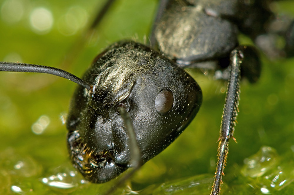
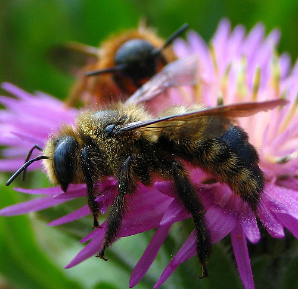

> **이번 글의 질문**
>
> 사전 학습된 이미지 모델을 고정한 채, 사진이 개미인지 벌인지 분류하는 새 모델을 어떻게 만들까요?

## 1. 어떤 문제를 풀까요?

이미지 분류는 사진 전체에 클래스 하나를 붙입니다. PyTorch 공식 Transfer Learning 튜토리얼의 개미·벌 사진에서 140장을 골라 새 메타데이터와 문제를 구성했습니다. 원래 사진은 ImageNet에서 가져온 자료이므로, ImageNet으로 사전 학습한 모델과 사진이 겹칠 수 있습니다. 이 실습의 Test 점수는 전이학습 절차를 확인하는 결과이며 독립적으로 수집한 새 사진의 벤치마크로 확대하지 않습니다.

예선 가이드의 범위로 구성한 연습문제입니다. 실제 예선 문제 원문이나 공식 채점 기준이 아닙니다. 이 유형의 연습용 배점은 100점입니다.

## 2. 입력 데이터와 관측 단위

| 입력 파일 | 구성 | 열·내용 |
| --- | --- | --- |
| `photo_metadata.csv` | 140행 | `image_id`, `path`, `label`, `split`, `sha256`, 원본 파일명, `width`, `height` |
| `images/` | 실제 JPG·PNG 사진 | Train 80장 / Validation 30장 / Test 30장 |
| `photo_features.npy` | 140 × 576 | 동일한 사진 순서로 추출한 고정 모델의 특징 |



*Train에 포함된 ants 사진의 예시입니다. 원본 출처는 데이터 출처 항목에서 확인합니다.*



*Train에 포함된 bees 사진의 예시입니다. 원본 출처는 데이터 출처 항목에서 확인합니다.*

## 3. 구현할 요구사항

- 파일 경로와 Hash를 확인합니다. 같은 바이트의 사진이 여러 Split에 없음을 검사합니다. 원본과 증강 이미지를 다른 Split으로 보내지 않습니다.
- 제공된 공식 가중치를 로드하고 모델을 `eval` 모드로 둡니다. `weights.transforms()`로 RGB 사진을 전처리합니다.
- 특징 추출기는 고정하고 분류기의 `C`는 Validation macro F1로 고릅니다. Test 점수로 다시 선택하지 않습니다.
- 선택한 `C`로 Train+Validation에서 분류기를 다시 학습한 뒤 Test를 한 번 평가합니다.
- `photo_test_predictions.csv`·`photo_metrics.csv`·`validation_scores.csv`와 Confusion Matrix를 저장합니다.

## 4. 제출 파일의 구조

CSV는 `results` 폴더, 그래프는 `plots` 폴더에 저장합니다. ID와 상태 열을 유지해 입력과 결과가 다시 연결되도록 합니다. 아래 열 목록은 풀이 결과의 파일 계약입니다.

| 결과 파일 | 전체 열 |
| --- | --- |
| `photo_metrics.csv` | `model`, `accuracy`, `macro_f1` |
| `photo_test_predictions.csv` | `image_id`, `path`, `label`, `prediction` |
| `validation_scores.csv` | `C`, `validation_macro_f1` |

## 5. 연습용 채점 기준

| 평가할 내용 | 배점 |
| --- | --- |
| 사진·Split 확인 | 20 |
| 사전 학습 모델·전처리 | 30 |
| Validation 선택·Test 분리 | 30 |
| 평가·파일·오류 이미지 | 20 |

## 6. 실습 준비와 점검

참고자료의 문제 자료와 공통 자료를 준비한 뒤, 데이터 폴더 구성을 확인합니다.

```python
from pathlib import Path

root = Path.cwd()
assert (root / "data").is_dir()
print("입력 폴더:", root / "data")
```

### 풀이를 열기 전에 남길 메모

- 한 행이 무엇을 나타내는지 적습니다.
- 기준표·시간·ID·Target 중 어떤 조건이 결과를 바꿀지 적습니다.
- 필수 결과 파일을 먼저 만들고, 추가 실험은 기본 결과를 저장한 뒤 진행합니다.

## 참고자료

### 실습 데이터와 노트북

- **문제 자료**: [문제 자료](/files/maicon-2026/practice/%EC%8B%A4%EC%8A%B5_05_%EB%AC%B8%EC%A0%9C%EC%9E%90%EB%A3%8C.zip) — 입력 데이터와 `starter.ipynb`로 직접 구현을 시작합니다.
- **공통 자료**: [실습 공통 자료](/files/maicon-2026/practice/%EC%8B%A4%EC%8A%B5_%EA%B3%B5%ED%86%B5%EC%A4%80%EB%B9%84.zip) — 공유 모델과 유형별 실습에 필요한 공통 준비 자료입니다.
- **예선 가이드**: [국방AI경진대회 예선가이드](/files/maicon-2026/%EA%B5%AD%EB%B0%A9AI%EA%B2%BD%EC%A7%84%EB%8C%80%ED%9A%8C%20%EC%98%88%EC%84%A0%EA%B0%80%EC%9D%B4%EB%93%9C.pdf) — 제공된 가이드의 범위를 바탕으로 만든 연습문제입니다.
- **실행 안내**: 두 압축파일을 같은 작업 폴더에 풀면 `예선_유형별_실습` 아래에 유형 폴더와 공유 `_models` 폴더가 놓입니다. 해당 유형 폴더의 `starter.ipynb`에서 시작합니다. 공통 준비는 최초 한 번만 압축을 풀면 됩니다.
- **데이터 출처**: PyTorch Transfer Learning 튜토리얼의 실제 개미·벌 사진 중 140장을 사용했습니다. 원본이 ImageNet 자료에서 왔으므로 ImageNet 사전 학습 모델과의 중복 가능성을 남겨 둡니다. 사진의 원본 출처와 이용 조건은 함께 확인합니다.

### 연습문제

- **풀이**: [유형 05 풀이](/cs/data-analysis/practice-05-image-transfer-learning-solution/) — 고정한 MobileNet에서 특징을 추출하고 Validation에서 분류기를 선택한 뒤 Test 사진을 평가합니다.

### 관련 공부노트

- **공부노트 07**: [지도 학습 및 평가](/cs/data-analysis/pandas-07-supervised-learning/)
- **공부노트 09**: [이미지 처리 및 객체 탐지](/cs/data-analysis/pandas-09-image-object-detection/)
- **공부노트 13**: [데이터 분석의 흔한 착각과 실수](/cs/data-analysis/pandas-13-common-pitfalls/)

### 공식 문서

- **사용한 도구**: [PyTorch Transfer Learning](https://docs.pytorch.org/tutorials/beginner/transfer_learning_tutorial.html) — 고정 특징 추출기와 Fine-tuning을 비교하며, 개미·벌 원본 사진의 출처입니다.  
  [MobileNet V3 Small](https://docs.pytorch.org/vision/stable/models/generated/torchvision.models.mobilenet_v3_small.html) — 사전 학습 가중치와 transforms를 확인합니다.  
  [ImageNet 자료 안내](https://www.image-net.org/download.php) — 원본 자료의 출처와 이용 조건을 확인합니다.
