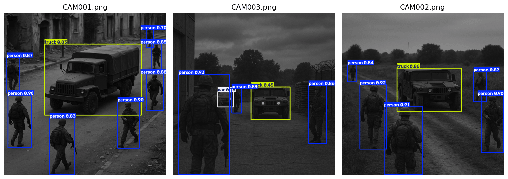

> **이번 글의 질문**
>
> 정상 사진·빈 사진·누락 사진이 섞여 있을 때, 장면별 사람·차량 탐지 수를 어떻게 요약할까요?

> **핵심 요약**
>
> 메타데이터를 먼저 정리하고 YOLO의 결과를 객체별·사진별로 저장합니다. 탐지 0건과 처리 실패를 구분하고 정상 처리 사진 수로 평균을 계산합니다.

## 1. 문제를 분석 순서로 바꿉니다

Drive 실습 사진 세 장을 사용하고, 빈 화면·읽을 수 없는 파일·누락 파일을 별도 사례로 추가했습니다. 이미지 전체 분류와 달리 객체마다 클래스·Box를 얻습니다. 정답 Box Annotation은 제공되지 않으므로 탐지 정확도 대신 집계와 추적 가능성을 점검합니다.

- 파일 목록을 정리하고 모델 기준을 둡니다
- 모든 사진의 처리 상태와 객체별 결과를 남깁니다
- 정상 사진의 분모로 합계와 평균을 계산합니다

아래 기본 풀이의 출력은 첨부한 `solution.ipynb`와 결과 CSV에 기록된 실제 실행 결과입니다. 추가 비교 예제는 별도 Notebook에서 실행했으며, 가상 예제는 그 범위를 표시했습니다.

## 2. 단계별 코드와 실행 결과

```python
from pathlib import Path
import json
import numpy as np
import pandas as pd
import matplotlib.pyplot as plt

ROOT = Path.cwd()
DATA = ROOT / "data"
RESULTS = ROOT / "results"
PLOTS = ROOT / "plots"
RESULTS.mkdir(exist_ok=True)
PLOTS.mkdir(exist_ok=True)

def save_csv(frame, name):
    frame.to_csv(RESULTS / name, index=False, encoding="utf-8-sig")
```

### 파일 목록을 정리하고 모델 기준을 둡니다

먼저 최신 메타데이터로 사진 목록을 정합니다. 이 실습은 Ultralytics의 YOLOv5u API를 사용하며 `torch.hub`의 YOLOv5 코드와 결과 접근 방식이 다릅니다.

```python
import cv2
import torch
from ultralytics import YOLO

torch.set_num_threads(2)
registry=pd.read_csv(DATA/"photo_registry.csv")
registry["updated_at"]=pd.to_datetime(registry.updated_at,utc=True)
registry=registry.sort_values("updated_at").drop_duplicates("photo_id",keep="last")
assert registry.photo_id.is_unique
model=YOLO(str(ROOT.parent/"_models/yolov5su.pt"))
selected_names={"person","car","bus","truck"}
selected_ids=[key for key,value in model.names.items() if value in selected_names]
vehicle_names={"car","bus","truck"}
print("처리할 사진:",len(registry),"집계 클래스:",sorted(selected_names))
```

```text
처리할 사진: 6 집계 클래스: ['bus', 'car', 'person', 'truck']
```

### 모든 사진의 처리 상태와 객체별 결과를 남깁니다

각 사진을 읽을 수 있었는지 먼저 남깁니다. 정상적으로 읽은 빈 화면은 탐지 0건이고, 누락·손상 파일의 개수는 알 수 없으므로 결측값입니다.

```python
summaries=[]; details=[]; rendered=[]
for row in registry.itertuples(index=False):
    path=DATA/"images"/row.filename
    summary={"photo_id":row.photo_id,"filename":row.filename,"scene":row.scene,
             "person_count":pd.NA,"vehicle_count":pd.NA,"status":"missing_file"}
    if path.is_file():
        image=cv2.imread(str(path))
        if image is None:
            summary["status"]="read_failed"
        else:
            # This API accepts an OpenCV BGR NumPy image.
            result=model.predict(image,imgsz=640,conf=.25,iou=.45,classes=selected_ids,device="cpu",verbose=False)[0]
            names=[result.names[int(c)] for c in result.boxes.cls.cpu().tolist()]
            summary.update(status="ok",person_count=names.count("person"),vehicle_count=sum(name in vehicle_names for name in names))
            for i,(box,confidence,class_id) in enumerate(zip(result.boxes.xyxy.cpu().numpy(),result.boxes.conf.cpu().numpy(),result.boxes.cls.cpu().numpy())):
                details.append({"photo_id":row.photo_id,"filename":row.filename,"detection_index":i,"class_name":result.names[int(class_id)],"confidence":float(confidence),"xmin":float(box[0]),"ymin":float(box[1]),"xmax":float(box[2]),"ymax":float(box[3])})
            if row.filename.startswith("CAM"): rendered.append((row.filename,result.plot()))
    summaries.append(summary)
counts=pd.DataFrame(summaries)
counts[["person_count","vehicle_count"]]=counts[["person_count","vehicle_count"]].astype("Int64")
detections=pd.DataFrame(details,columns=["photo_id","filename","detection_index","class_name","confidence","xmin","ymin","xmax","ymax"])
assert len(counts)==len(registry)
save_csv(counts,"photo_counts.csv");save_csv(detections,"photo_detections.csv")
print(counts.to_string(index=False))
```

```text
photo_id    filename scene  person_count  vehicle_count       status
    P001  CAM001.png     A             7              1           ok
    P003  CAM003.png     B             3              3           ok
    P004   blank.png     B             0              0           ok
    P005 damaged.png     C          <NA>           <NA>  read_failed
    P006 missing.png     C          <NA>           <NA> missing_file
    P002  CAM002.png     A             5              1           ok
```

이 API는 OpenCV의 BGR NumPy 이미지를 받을 수 있습니다. `boxes.xyxy`는 원본 이미지의 픽셀 좌표이며 `result.plot()`도 BGR이므로 Matplotlib 표시 전에 RGB로 바꿉니다.

### 정상 사진의 분모로 합계와 평균을 계산합니다

평균의 분모는 정상 처리한 사진 수입니다. 등록 사진 수를 분모로 쓰면 누락 파일이 사실상 0명으로 계산되어 평균이 줄어듭니다.

```python
scene=counts.groupby("scene",as_index=False).agg(
    registered_images=("photo_id","size"),processed_images=("person_count","count"),
    person_detections=("person_count",lambda s:s.sum(min_count=1)),
    vehicle_detections=("vehicle_count",lambda s:s.sum(min_count=1)),
    mean_person_per_processed_image=("person_count","mean"),
)
scene["failed_images"]=scene.registered_images-scene.processed_images
save_csv(scene,"scene_summary.csv")
comparisons=[]
for threshold in [.25,.50,.75]:
    subset=detections.loc[detections.confidence.ge(threshold)]
    comparisons.append({"confidence_threshold":threshold,"person_detections":int(subset.class_name.eq("person").sum()),"vehicle_detections":int(subset.class_name.isin(vehicle_names).sum())})
comparison=pd.DataFrame(comparisons);save_csv(comparison,"confidence_comparison.csv")
print(scene.to_string(index=False));print(comparison.to_string(index=False))
fig,axes=plt.subplots(1,len(rendered),figsize=(12,5))
for ax,(filename,bgr) in zip(np.atleast_1d(axes),rendered):
    ax.imshow(cv2.cvtColor(bgr,cv2.COLOR_BGR2RGB));ax.set_title(filename);ax.axis("off")
fig.tight_layout();fig.savefig(PLOTS/"detection_review.png",dpi=130,bbox_inches="tight");plt.close(fig)
```

```text
scene  registered_images  processed_images  person_detections  vehicle_detections  mean_person_per_processed_image  failed_images
    A                  2                 2                 12                   2                              6.0              0
    B                  2                 2                  3                   3                              1.5              0
    C                  2                 0               <NA>                <NA>                             <NA>              2
 confidence_threshold  person_detections  vehicle_detections
                 0.25                 15                   5
                 0.50                 15                   3
                 0.75                 14                   3
```

높은 Confidence 기준의 비교는 이미 남긴 탐지를 필터링한 결과입니다. NMS가 제거한 후보를 복원하는 비교는 아니며, 실제 탐지 성능 평가는 정답 Box가 있어야 가능합니다.

## 3. 표·그래프를 해석하고 오류를 확인합니다

사진별 `count`는 모델이 탐지한 건수입니다. 같은 사람이 여러 사진에 나올 수 있어 장면 합계를 고유 인원 수로 바꾸지 않습니다.

아무 파일도 읽지 못한 장면의 합계는 결측값입니다. 빈 화면을 정상 처리해 0건이 나온 장면과 구분합니다.

0.50·0.75 비교는 0.25에서 남은 결과를 다시 필터링했습니다. 기준을 더 낮춰 새로운 후보를 보려면 추론을 다시 실행해야 합니다.



*원본 실습 사진에 남긴 예측 Box입니다. 눈으로 오류 후보를 확인하는 자료이며 정답 Box와 비교한 정확도 그림은 아닙니다.*

## 4. 처리 기준이 결과를 바꾸는 비교 예제

### 실패 사진을 0으로 채우면 장면의 의미가 달라집니다

자료: 실습에서 저장한 탐지 결과

`photo_counts.csv`의 정상·누락·손상 상태를 그대로 두는 경우와 결측 개수를 0으로 채우는 경우를 비교합니다. 특히 장면 C는 정상 처리한 사진이 없습니다.

```python
import pandas as pd

counts = pd.read_csv("results/photo_counts.csv")
proper = counts.groupby("scene").person_count.agg(mean="mean", processed="count")
filled = counts.assign(person_count=counts.person_count.fillna(0)).groupby("scene").person_count.mean()
comparison = proper.join(filled.rename("mean_after_zero_fill"))
comparison["registered"] = counts.groupby("scene").size()
print(counts[["photo_id", "scene", "status", "person_count"]].to_string(index=False))
print(comparison.to_string())
assert pd.isna(comparison.loc["C", "mean"])
assert comparison.loc["C", "mean_after_zero_fill"] == 0
```

```text
photo_id scene       status  person_count
    P001     A           ok           7.0
    P003     B           ok           3.0
    P004     B           ok           0.0
    P005     C  read_failed           NaN
    P006     C missing_file           NaN
    P002     A           ok           5.0
       mean  processed  mean_after_zero_fill  registered
scene
A       6.0          2                   6.0           2
B       1.5          2                   1.5           2
C       NaN          0                   0.0           2
```

장면 C의 상태는 미관측입니다. 0으로 바꾸면 정상적으로 확인한 빈 장면처럼 보입니다. 일부 사진만 실패한 장면에서도 등록 사진 수와 처리 사진 수를 함께 남겨 평균의 분모를 설명합니다.

### Confidence를 높여도 정확도를 바로 알 수는 없습니다

자료: 실습에서 저장한 객체별 결과

0.25 기준에서 NMS까지 거친 객체 목록을 0.50·0.75로 다시 필터링합니다. 남은 건수는 확인할 수 있지만 정답 Box가 없으므로 그중 몇 건이 맞는지는 계산하지 않습니다.

```python
import pandas as pd

detections = pd.read_csv("results/photo_detections.csv")
rows = []
for threshold in [0.25, 0.50, 0.75]:
    kept = detections.loc[detections.confidence.ge(threshold)]
    rows.append({"threshold": threshold, "person": int(kept.class_name.eq("person").sum()), "vehicle": int(kept.class_name.isin(["car", "bus", "truck"]).sum())})
print(pd.DataFrame(rows).to_string(index=False))
print("이 표의 기준: 기존 NMS 결과의 재필터링, 정답 기반 정확도 평가 아님")
```

```text
 threshold  person  vehicle
      0.25      15        5
      0.50      15        3
      0.75      14        3
이 표의 기준: 기존 NMS 결과의 재필터링, 정답 기반 정확도 평가 아님
```

Threshold를 높이면 탐지가 줄지만 오탐과 미탐의 변화는 Annotation을 기준으로 봐야 합니다. 낮은 기준에서 추론을 다시 실행하는 실험과 기존 결과를 걸러 보는 실험도 구분합니다.

## 5. 저장한 파일로 분석을 다시 확인합니다

| 결과 파일 | 행 수 | 전체 열 |
| --- | --- | --- |
| `confidence_comparison.csv` | 3 | `confidence_threshold`, `person_detections`, `vehicle_detections` |
| `photo_counts.csv` | 6 | `photo_id`, `filename`, `scene`, `person_count`, `vehicle_count`, `status` |
| `photo_detections.csv` | 20 | `photo_id`, `filename`, `detection_index`, `class_name`, `confidence`, `xmin`, `ymin`, `xmax`, `ymax` |
| `scene_summary.csv` | 3 | `scene`, `registered_images`, `processed_images`, `person_detections`, `vehicle_detections`, `mean_person_per_processed_image`, `failed_images` |

Notebook 화면의 점수와 파일의 값이 같은지, 입력 ID가 빠지거나 중복되지 않았는지 확인합니다. 비교 예제는 기존 풀이가 만든 `results`를 읽으므로 기본 풀이를 먼저 실행합니다.

```bash
# 예선_유형별_실습 폴더에서 실행합니다.
python check_outputs.py --types 6
```

검사 도구는 저장 파일의 행·열·ID·상태·지표 대응을 확인합니다. 데이터 분할의 의미, Feature를 사용할 수 있는 시점, 모델 선택 과정은 본문의 기준과 Notebook을 함께 읽어 확인합니다.

## 6. 확장 문제를 설계하고 확인할 결과를 정합니다

다음 항목은 후속 실험을 위한 문제와 풀이 방향입니다. 앞의 실행 결과에 포함된 실험과 구분합니다. 새 데이터나 Annotation이 필요한 항목은 그 입력부터 준비합니다.

### 탐지 성능을 계산하려면 어떤 정답이 필요할까요?

클래스와 원본 좌표계의 정답 Box를 Annotation합니다. 같은 이미지·같은 클래스에서 예측과 정답을 일대일로 매칭하고 IoU 기준을 정해 TP·FP·FN을 계산합니다. 여러 후보가 같은 정답 Box를 중복으로 맞혔다고 셀 수 없습니다.

남길 결과: 정답 Annotation 형식·매칭 기준·클래스별 Precision/Recall과 오류 이미지를 남깁니다.

### 사진별 개수 오차와 Box 성능이 왜 다를까요?

사진별 정답 개수로 MAE를 계산할 수 있지만 오탐과 미탐이 상쇄되면 개수가 같아질 수도 있습니다. Box 위치를 평가하는 지표와 사람 수를 집계하는 지표를 목적에 맞춰 함께 봅니다.

남길 결과: 같은 사진의 정답 개수·예측 개수·절대 오차와 Box 매칭 오류를 나란히 저장합니다.

## 참고자료

### 실습 데이터와 노트북

- **문제 자료**: [문제 자료](/files/maicon-2026/practice/%EC%8B%A4%EC%8A%B5_06_%EB%AC%B8%EC%A0%9C%EC%9E%90%EB%A3%8C.zip "Google Drive에서 자료를 엽니다.") — 입력 데이터와 `starter.ipynb`로 직접 구현을 시작합니다.
- **풀이 자료**: [풀이와 결과](/files/maicon-2026/practice/%EC%8B%A4%EC%8A%B5_06_%ED%92%80%EC%9D%B4%EC%99%80_%EA%B2%B0%EA%B3%BC.zip "Google Drive에서 자료를 엽니다.") — 전체 Python 코드, 노트북과 실행 결과를 함께 받습니다.
- **공통 자료**: [실습 공통 자료](/files/maicon-2026/practice/%EC%8B%A4%EC%8A%B5_%EA%B3%B5%ED%86%B5%EC%A4%80%EB%B9%84.zip "Google Drive에서 자료를 엽니다.") — 공유 모델과 유형별 실습에 필요한 공통 준비 자료입니다.
- **예선 가이드**: [국방AI경진대회 예선가이드](/files/maicon-2026/%EA%B5%AD%EB%B0%A9AI%EA%B2%BD%EC%A7%84%EB%8C%80%ED%9A%8C%20%EC%98%88%EC%84%A0%EA%B0%80%EC%9D%B4%EB%93%9C.pdf) — 제공된 가이드의 범위를 바탕으로 만든 연습문제입니다.
- **실행 안내**: 같은 작업 폴더에 압축을 푼 뒤 유형 폴더에서 `solution.ipynb` 또는 `solution.py`를 실행합니다. `blog_comparison.ipynb`에는 본문에서 추가한 두 비교 예제와 실제 출력이 들어 있습니다.
- **데이터 출처**: 제공된 Drive 실습 사진 세 장과 직접 만든 빈 화면·손상·누락 사례를 사용했습니다. 정답 Box가 제공되지 않아 집계와 처리 상태를 검증하며, AP나 탐지 정확도를 보고하지 않습니다.

### 연습문제

- **문제**: [유형 06 문제](/cs/data-analysis/practice-06-object-detection/) — 정상 사진·빈 사진·누락 사진이 섞여 있을 때, 장면별 사람·차량 탐지 수를 어떻게 요약할까요?
- **모의 실습**: [모의 실습 B](/cs/data-analysis/mock-exam-b-90-min-review/) — 세 문항을 20·35·45점으로 묶어 입력부터 저장까지 연습합니다.

### 관련 공부노트

- **공부노트 09**: [이미지 처리 및 객체 탐지](/cs/data-analysis/pandas-09-image-object-detection/)
- **공부노트 10**: [이미지·영상 데이터 분석](/cs/data-analysis/pandas-10-image-video-analysis/)
- **공부노트 11**: [종합 문제 풀이 (1)](/cs/data-analysis/pandas-11-comprehensive-problems-1/)
- **공부노트 12**: [종합 문제 풀이 (2)](/cs/data-analysis/pandas-12-comprehensive-problems-2/)

### 공식 문서

- **사용한 도구**: [YOLOv5u](https://docs.ultralytics.com/models/yolov5/) — 원래 YOLOv5 Hub 모델과 구분되는 가중치·API입니다.  
  [Ultralytics predict](https://docs.ultralytics.com/modes/predict/) — BGR 입력·Results·Boxes·plot 반환 형식을 확인합니다.
