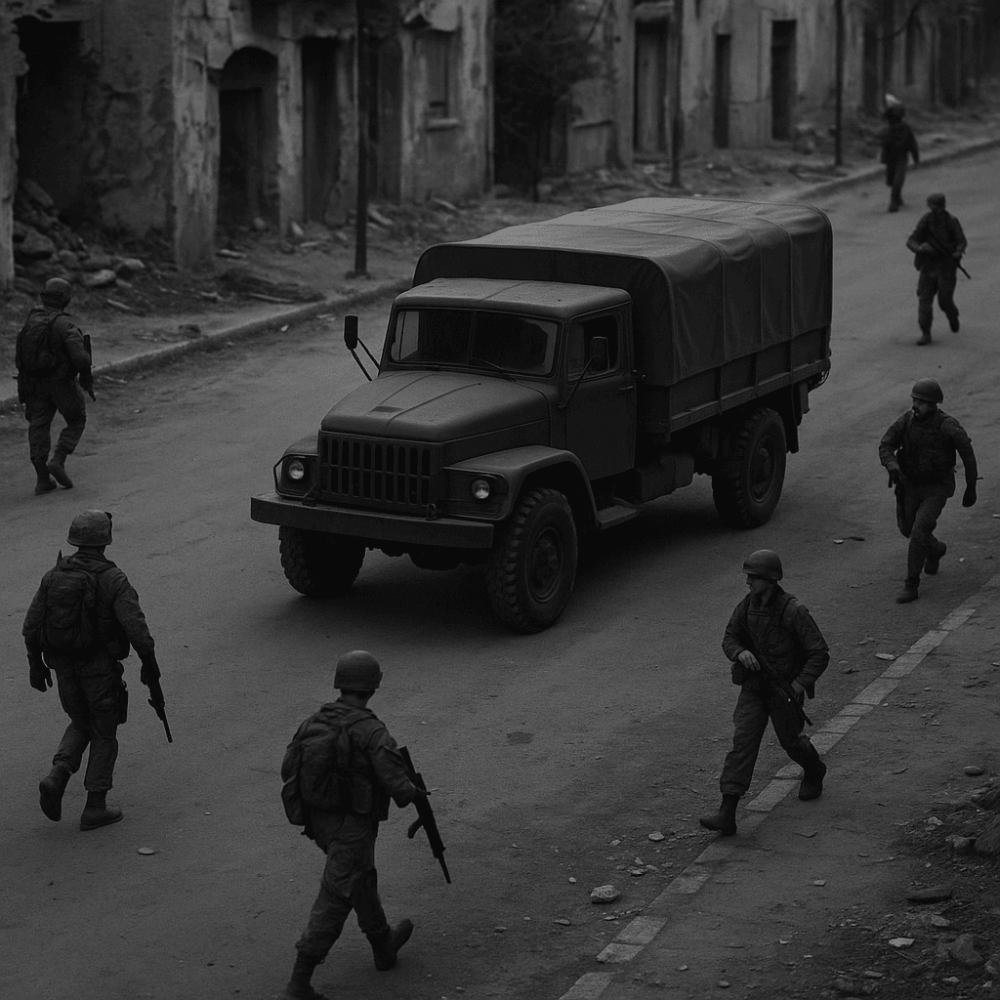

> **이번 글의 질문**
>
> 정상 사진·빈 사진·누락 사진이 섞여 있을 때, 장면별 사람·차량 탐지 수를 어떻게 요약할까요?

> **핵심 요약**
>
> 입력의 관측 단위·처리 규칙·결과 파일을 먼저 확인하고 직접 구현합니다. 풀이와 실행 결과는 연결된 풀이편에서 확인합니다.

## 1. 어떤 문제를 풀까요?

Drive 실습 사진 세 장을 사용하고, 빈 화면·읽을 수 없는 파일·누락 파일을 별도 사례로 추가했습니다. 이미지 전체 분류와 달리 객체마다 클래스·Box를 얻습니다. 정답 Box Annotation은 제공되지 않으므로 탐지 정확도 대신 집계와 추적 가능성을 점검합니다.

예선 가이드의 범위로 구성한 연습문제입니다. 실제 예선 문제 원문이나 공식 채점 기준이 아닙니다. 이 유형의 연습용 배점은 100점입니다.

## 2. 입력 데이터와 관측 단위

| 입력 파일 | 구성 | 열·내용 |
| --- | --- | --- |
| `photo_registry.csv` | 7행 / `photo_id` 6개 | `photo_id`, `filename`, `scene`, `updated_at` |
| `images/` | 원본 3장 + 빈 화면 + 손상 파일 | `missing.png`는 의도적으로 없습니다. |
| `source_manifest.json` | 출처·구성 | 원본 사진과 구성한 사례를 구분합니다. |



*입력 사진의 예시입니다. 이 문제편에는 탐지 결과 Box를 표시하지 않았습니다.*

## 3. 구현할 요구사항

- `photo_id`가 반복되면 최신 `updated_at` 행을 선택합니다. 같은 수정 시각 충돌은 없습니다.
- YOLOv5u의 person·car·bus·truck만 집계하고 `Confidence=0.25`, NMS `IoU=0.45`로 고정합니다.
- `ok` 사진은 0을 포함한 정수를, `missing_file`·`read_failed` 사진은 결측값을 남깁니다.
- 사진별·객체별 결과를 저장하고 장면별 등록·처리 사진 수, 탐지 합계, 정상 사진당 평균을 계산합니다.
- `photo_counts.csv`·`photo_detections.csv`·`scene_summary.csv`·`confidence_comparison.csv`와 Box 확인 이미지를 저장합니다.

## 4. 제출 파일의 구조

CSV는 `results` 폴더, 그래프는 `plots` 폴더에 저장합니다. ID와 상태 열을 유지해 입력과 결과가 다시 연결되도록 합니다. 아래 열 목록은 풀이 결과의 파일 계약입니다.

| 결과 파일 | 행의 기준 | 전체 열 |
| --- | --- | --- |
| `confidence_comparison.csv` | 요구사항의 관측 단위를 유지합니다. | `confidence_threshold`, `person_detections`, `vehicle_detections` |
| `photo_counts.csv` | 요구사항의 관측 단위를 유지합니다. | `photo_id`, `filename`, `scene`, `person_count`, `vehicle_count`, `status` |
| `photo_detections.csv` | 요구사항의 관측 단위를 유지합니다. | `photo_id`, `filename`, `detection_index`, `class_name`, `confidence`, `xmin`, `ymin`, `xmax`, `ymax` |
| `scene_summary.csv` | 요구사항의 관측 단위를 유지합니다. | `scene`, `registered_images`, `processed_images`, `person_detections`, `vehicle_detections`, `mean_person_per_processed_image`, `failed_images` |

## 5. 연습용 채점 기준

| 평가할 내용 | 배점 |
| --- | --- |
| 메타데이터·실패 처리 | 25 |
| 모델 입력·클래스·Box | 25 |
| 분모·집계·상태 보존 | 30 |
| 출력·그림 검토 | 20 |

## 6. 실습 준비와 점검

참고자료의 문제 자료와 공통 자료를 준비한 뒤, 데이터 폴더 구성을 확인합니다.

```python
from pathlib import Path

root = Path.cwd()
assert (root / "data").is_dir()
print("입력 폴더:", root / "data")
```

### 풀이를 열기 전에 남길 메모

- 한 행이 무엇을 나타내는지 적습니다.
- 기준표·시간·ID·Target 중 어떤 조건이 결과를 바꿀지 적습니다.
- 필수 결과 파일을 먼저 만들고, 추가 실험은 기본 결과를 저장한 뒤 진행합니다.

## 참고자료

### 실습 데이터와 노트북

- **문제 자료**: [문제 자료](/files/maicon-2026/practice/%EC%8B%A4%EC%8A%B5_06_%EB%AC%B8%EC%A0%9C%EC%9E%90%EB%A3%8C.zip) — 입력 데이터와 `starter.ipynb`로 직접 구현을 시작합니다.
- **공통 자료**: [실습 공통 자료](/files/maicon-2026/practice/%EC%8B%A4%EC%8A%B5_%EA%B3%B5%ED%86%B5%EC%A4%80%EB%B9%84.zip) — 공유 모델과 유형별 실습에 필요한 공통 준비 자료입니다.
- **예선 가이드**: [국방AI경진대회 예선가이드](/files/maicon-2026/%EA%B5%AD%EB%B0%A9AI%EA%B2%BD%EC%A7%84%EB%8C%80%ED%9A%8C%20%EC%98%88%EC%84%A0%EA%B0%80%EC%9D%B4%EB%93%9C.pdf) — 제공된 가이드의 범위를 바탕으로 만든 연습문제입니다.
- **실행 안내**: 두 압축파일을 같은 작업 폴더에 풀면 `예선_유형별_실습` 아래에 유형 폴더와 공유 `_models` 폴더가 놓입니다. 해당 유형 폴더의 `starter.ipynb`에서 시작합니다. 공통 준비는 최초 한 번만 압축을 풀면 됩니다.
- **데이터 출처**: 제공된 Drive 실습 사진 세 장과 직접 만든 빈 화면·손상·누락 사례를 사용했습니다. 정답 Box가 제공되지 않아 집계와 처리 상태를 검증하며, AP나 탐지 정확도를 보고하지 않습니다.

### 연습문제

- **풀이**: [유형 06 풀이](/cs/data-analysis/practice-06-object-detection-solution/) — YOLO 탐지 결과와 사진별 처리 상태를 저장하고, 탐지 0건과 처리 실패를 구분해 장면별로 집계합니다.

### 관련 공부노트

- **공부노트 09**: [이미지 처리 및 객체 탐지](/cs/data-analysis/pandas-09-image-object-detection/)
- **공부노트 10**: [이미지·영상 데이터 분석](/cs/data-analysis/pandas-10-image-video-analysis/)
- **공부노트 11**: [종합 문제 풀이 (1)](/cs/data-analysis/pandas-11-comprehensive-problems-1/)
- **공부노트 12**: [종합 문제 풀이 (2)](/cs/data-analysis/pandas-12-comprehensive-problems-2/)

### 공식 문서

- **사용한 도구**: [YOLOv5u](https://docs.ultralytics.com/models/yolov5/) — 원래 YOLOv5 Hub 모델과 구분되는 가중치·API입니다.  
  [Ultralytics predict](https://docs.ultralytics.com/modes/predict/) — BGR 입력·Results·Boxes·plot 반환 형식을 확인합니다.
