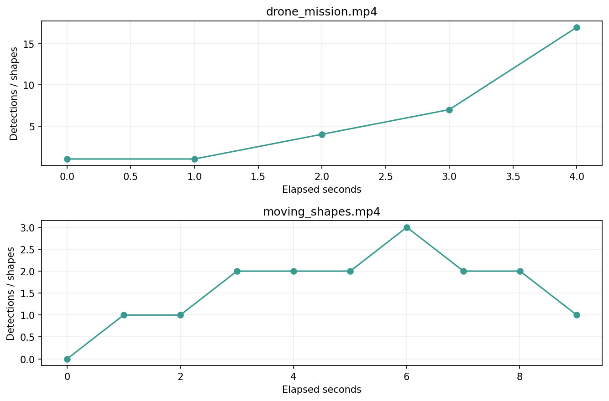

> **이번 글의 질문**
>
> 29.97 FPS 영상에서 1초마다 관측하려면 어떤 프레임을 골라야 하며, 빈 프레임은 그래프에 어떻게 남겨야 할까요?

> **핵심 요약**
>
> 실제 영상과 정답 개수가 있는 도형 영상을 분석합니다. 목표 시점별 프레임을 계산하고, 분석한 모든 프레임의 개수를 저장한 뒤 시간 구간으로 요약합니다.

## 1. 문제를 분석 순서로 바꿉니다

Drive의 짧은 영상에는 YOLO를 적용합니다. 따로 구성한 29.97 FPS 도형 영상은 프레임·시간·개수 계산을 정확한 정답과 비교하는 용도입니다. 도형은 사람이 아니므로 YOLO의 객체 정답으로 사용하지 않습니다. 모델 결과와 시간 처리 알고리즘을 분리해 검증합니다.

- 두 영상의 기준을 먼저 확인합니다
- 목표 시각마다 프레임을 관측합니다
- 도형의 정답과 비교하고 시간 구간을 요약합니다

아래 기본 풀이의 출력은 첨부한 `solution.ipynb`와 결과 CSV에 기록된 실제 실행 결과입니다. 추가 비교 예제는 별도 Notebook에서 실행했으며, 가상 예제는 그 범위를 표시했습니다.

## 2. 단계별 코드와 실행 결과

```python
from pathlib import Path
import json
import numpy as np
import pandas as pd
import matplotlib.pyplot as plt

ROOT = Path.cwd()
DATA = ROOT / "data"
RESULTS = ROOT / "results"
PLOTS = ROOT / "plots"
RESULTS.mkdir(exist_ok=True)
PLOTS.mkdir(exist_ok=True)

def save_csv(frame, name):
    frame.to_csv(RESULTS / name, index=False, encoding="utf-8-sig")
```

### 두 영상의 기준을 먼저 확인합니다

영상별 FPS와 선언된 프레임 수를 읽습니다. 파일에서 읽은 FPS가 0이거나 유효하지 않다면 시간 계산을 계속하지 않습니다.

```python
import cv2
import torch
from ultralytics import YOLO

torch.set_num_threads(2)
model=YOLO(str(ROOT.parent/"_models/yolov5su.pt"))
truth=pd.read_csv(DATA/"shape_frame_truth.csv")
for filename in ["drone_mission.mp4","moving_shapes.mp4"]:
    cap=cv2.VideoCapture(str(DATA/"videos"/filename))
    assert cap.isOpened()
    print(filename,"FPS:",cap.get(cv2.CAP_PROP_FPS),"프레임:",int(cap.get(cv2.CAP_PROP_FRAME_COUNT)))
    cap.release()
```

```text
drone_mission.mp4 FPS: 30.0 프레임: 150
moving_shapes.mp4 FPS: 29.97 프레임: 300
```

### 목표 시각마다 프레임을 관측합니다

샘플 번호마다 목표 프레임을 새로 계산합니다. 일정한 정수 프레임 간격을 반복하면 29.97 FPS 영상에서 시간이 조금씩 어긋날 수 있습니다.

```python
sample_rows=[]; detection_rows=[]; status_rows=[]
for filename in ["drone_mission.mp4","moving_shapes.mp4"]:
    cap=cv2.VideoCapture(str(DATA/"videos"/filename))
    if not cap.isOpened(): raise ValueError(f"영상 열기 실패: {filename}")
    fps=cap.get(cv2.CAP_PROP_FPS)
    declared=int(cap.get(cv2.CAP_PROP_FRAME_COUNT))
    if not np.isfinite(fps) or fps<=0: raise ValueError("유효한 FPS가 필요합니다.")
    frame_number=0; sample_number=0; next_frame=0
    try:
        while True:
            ok,frame=cap.read()
            if not ok: break
            if frame_number==next_frame:
                if filename=="moving_shapes.mp4":
                    hsv=cv2.cvtColor(frame,cv2.COLOR_BGR2HSV)
                    mask=cv2.inRange(hsv,np.array([0,80,70]),np.array([179,255,255]))
                    labels,_,stats,_=cv2.connectedComponentsWithStats(mask)
                    total=int((stats[1:,cv2.CC_STAT_AREA]>=200).sum())
                    person=0
                else:
                    result=model.predict(frame,imgsz=640,conf=.25,iou=.45,device="cpu",verbose=False)[0]
                    names=[result.names[int(c)] for c in result.boxes.cls.cpu().tolist()]
                    total=len(names);person=names.count("person")
                    for i,(box,confidence,class_id) in enumerate(zip(result.boxes.xyxy.cpu().numpy(),result.boxes.conf.cpu().numpy(),result.boxes.cls.cpu().numpy())):
                        detection_rows.append({"video":filename,"frame_number":frame_number,"time_seconds":frame_number/fps,"detection_index":i,"class_name":result.names[int(class_id)],"confidence":float(confidence),"xmin":float(box[0]),"ymin":float(box[1]),"xmax":float(box[2]),"ymax":float(box[3])})
                sample_rows.append({"video":filename,"sample_number":sample_number,"requested_seconds":float(sample_number),"frame_number":frame_number,"time_seconds":frame_number/fps,"backend_position_ms":cap.get(cv2.CAP_PROP_POS_MSEC),"total_count":total,"person_count":person,"status":"ok"})
                sample_number+=1;next_frame=round(sample_number*fps)
            frame_number+=1
    finally:
        cap.release()
    status_rows.append({"video":filename,"declared_frames":declared,"decoded_frames":frame_number,"status":"ok" if frame_number==declared else "early_end"})
samples=pd.DataFrame(sample_rows)
detections=pd.DataFrame(detection_rows,columns=["video","frame_number","time_seconds","detection_index","class_name","confidence","xmin","ymin","xmax","ymax"])
save_csv(samples,"video_sample_counts.csv");save_csv(detections,"video_detections.csv")
save_csv(pd.DataFrame(status_rows),"video_read_status.csv")
print(samples[["video","requested_seconds","frame_number","time_seconds","total_count"]].round(4).to_string(index=False))
```

```text
            video  requested_seconds  frame_number  time_seconds  total_count
drone_mission.mp4                0.0             0         0.000            1
drone_mission.mp4                1.0            30         1.000            1
drone_mission.mp4                2.0            60         2.000            4
drone_mission.mp4                3.0            90         3.000            7
drone_mission.mp4                4.0           120         4.000           17
moving_shapes.mp4                0.0             0         0.000            0
moving_shapes.mp4                1.0            30         1.001            1
moving_shapes.mp4                2.0            60         2.002            1
moving_shapes.mp4                3.0            90         3.003            2
moving_shapes.mp4                4.0           120         4.004            2
moving_shapes.mp4                5.0           150         5.005            2
moving_shapes.mp4                6.0           180         6.006            3
moving_shapes.mp4                7.0           210         7.007            2
moving_shapes.mp4                8.0           240         8.008            2
moving_shapes.mp4                9.0           270         9.009            1
```

한 프레임의 관측 시각과 요청 시각을 둘 다 저장합니다. 실제 영상은 YOLO 결과를, 도형 영상은 색상 Mask의 연결 요소를 세므로 검증 대상이 서로 다릅니다.

### 도형의 정답과 비교하고 시간 구간을 요약합니다

도형은 프레임별 정답 개수가 있어 시간과 개수 계산을 직접 검증할 수 있습니다. 개수 0인 프레임도 포함해 2초 구간의 관측 수와 평균을 계산합니다.

```python
controlled=samples.loc[samples.video.eq("moving_shapes.mp4")].merge(truth[["frame_number","object_count"]],on="frame_number",validate="one_to_one")
assert controlled.total_count.eq(controlled.object_count).all()
assert np.abs(controlled.time_seconds-controlled.requested_seconds).max()<=1/29.97
windows=[]
for video,group in samples.groupby("video"):
    indexed=group.set_index(pd.to_timedelta(group.time_seconds,unit="s"))
    summary=indexed.resample("2s",closed="left",label="left").agg(mean_count=("total_count","mean"),max_count=("total_count","max"),sample_count=("total_count","count"))
    summary.index.name="elapsed_window";summary=summary.reset_index();summary["video"]=video;windows.append(summary)
summary=pd.concat(windows,ignore_index=True);save_csv(summary,"video_windows.csv")
print("도형 샘플 정답 일치:",len(controlled),"/",len(controlled))
print(summary.round(3).to_string(index=False))
fig,axes=plt.subplots(2,1,figsize=(9,6))
for ax,(video,group) in zip(axes,samples.groupby("video",sort=True)):
    ax.plot(group.time_seconds,group.total_count,marker="o",color="#3a9a90")
    ax.set(title=video,xlabel="Elapsed seconds",ylabel="Detections / shapes")
    ax.grid(alpha=.2)
fig.tight_layout();fig.savefig(PLOTS/"video_counts.png",dpi=150,bbox_inches="tight");plt.close(fig)
```

```text
도형 샘플 정답 일치: 10 / 10
 elapsed_window  mean_count  max_count  sample_count             video
0 days 00:00:00         1.0          1             2 drone_mission.mp4
0 days 00:00:02         5.5          7             2 drone_mission.mp4
0 days 00:00:04        17.0         17             1 drone_mission.mp4
0 days 00:00:00         0.5          1             2 moving_shapes.mp4
0 days 00:00:02         1.5          2             2 moving_shapes.mp4
0 days 00:00:04         2.0          2             2 moving_shapes.mp4
0 days 00:00:06         2.5          3             2 moving_shapes.mp4
0 days 00:00:08         1.5          2             2 moving_shapes.mp4
```

실제 영상에는 정답 Box가 없어 YOLO의 정확도를 계산하지 않습니다. 시간별 탐지 건수 그래프에서 갑자기 늘어난 구간을 찾아 원본 프레임으로 돌아갈 수 있습니다.

## 3. 표·그래프를 해석하고 오류를 확인합니다

30프레임을 계속 건너뛰는 방식과 매 목표 시각을 새로 계산하는 방식은 긴 29.97 FPS 영상에서 차이가 납니다. 요청 시각과 실제 프레임 시각의 차이도 저장했습니다.

이 파일들은 일정한 FPS 기준으로 계산합니다. Variable Frame Rate 영상은 실제 Timestamp를 확인하고 시간 속성이 정상적으로 증가하는지 검토해야 합니다.

여러 프레임의 개수를 더하면 같은 객체가 반복해서 세어집니다. YOLO의 여러 시점 합계는 고유 객체 수가 아닙니다. 도형의 정답 일치는 시간·개수 코드의 검증이며 실제 영상 YOLO의 정확도 검증을 대신하지 않습니다.



*영상 프레임 샘플링과 시계열 분석의 실행 결과를 보여 줍니다. 단위와 관측 대상을 본문의 기준으로 읽습니다.*

## 4. 처리 기준이 결과를 바꾸는 비교 예제

### 정수 프레임 간격을 반복하면 시간이 밀릴 수 있습니다

자료: 29.97 FPS의 가상 600초 시간 계산

실제 제공 영상의 길이를 늘린 실험은 아닙니다. 29.97 FPS에서 매초 30프레임씩 이동하는 계산과 각 요청 시각에서 목표 프레임을 다시 계산하는 방식을 비교합니다.

```python
import pandas as pd

fps = 29.97
rows = []
for requested_seconds in [1, 60, 300, 600]:
    accumulated_frame = requested_seconds * round(fps)
    direct_frame = round(requested_seconds * fps)
    rows.append({"requested_seconds": requested_seconds, "accumulated_actual_seconds": accumulated_frame / fps, "direct_actual_seconds": direct_frame / fps, "accumulated_error_seconds": accumulated_frame / fps - requested_seconds})
print(pd.DataFrame(rows).round(6).to_string(index=False))
```

```text
 requested_seconds  accumulated_actual_seconds  direct_actual_seconds  accumulated_error_seconds
                 1                    1.001001               1.001001                   0.001001
                60                   60.060060              59.993327                   0.060060
               300                  300.300300             300.000000                   0.300300
               600                  600.600601             600.000000                   0.600601
```

프레임 번호만 남기면 이 오차를 놓칠 수 있습니다. 실제 풀이에서는 요청 시각과 선택 프레임의 시각을 함께 저장했습니다. 시간이 일정하지 않은 VFR 영상에는 별도의 Timestamp 기반 처리가 필요합니다.

### 객체가 없던 프레임도 평균에 포함합니다

자료: 실습에서 저장한 도형 영상 샘플

객체가 0개인 샘플을 제외하면 나타나 있을 때의 평균으로 질문이 바뀝니다. 구성한 도형 영상의 모든 정상 샘플과 양수 샘플만 사용한 평균을 비교합니다.

```python
import pandas as pd

samples = pd.read_csv("results/video_sample_counts.csv")
shapes = samples.loc[samples.video.eq("moving_shapes.mp4") & samples.status.eq("ok")]
positive = shapes.loc[shapes.total_count.gt(0)]
print("전체 정상 샘플:", len(shapes))
print("객체 0개 샘플:", int(shapes.total_count.eq(0).sum()))
print("모든 정상 샘플의 평균:", round(shapes.total_count.mean(), 3))
print("양수 샘플만 남긴 평균:", round(positive.total_count.mean(), 3))
print("샘플별 개수:", shapes.total_count.tolist())
```

```text
전체 정상 샘플: 10
객체 0개 샘플: 1
모든 정상 샘플의 평균: 1.6
양수 샘플만 남긴 평균: 1.778
샘플별 개수: [0, 1, 1, 2, 2, 2, 3, 2, 2, 1]
```

프레임에서 반복 탐지된 객체 수의 합은 고유 객체 수가 아닙니다. 고유 수를 질문하려면 Tracking ID와 가림·재등장 조건을 따로 검증해야 합니다.

## 5. 저장한 파일로 분석을 다시 확인합니다

| 결과 파일 | 행 수 | 전체 열 |
| --- | --- | --- |
| `video_detections.csv` | 30 | `video`, `frame_number`, `time_seconds`, `detection_index`, `class_name`, `confidence`, `xmin`, `ymin`, `xmax`, `ymax` |
| `video_read_status.csv` | 2 | `video`, `declared_frames`, `decoded_frames`, `status` |
| `video_sample_counts.csv` | 15 | `video`, `sample_number`, `requested_seconds`, `frame_number`, `time_seconds`, `backend_position_ms`, `total_count`, `person_count`, `status` |
| `video_windows.csv` | 8 | `elapsed_window`, `mean_count`, `max_count`, `sample_count`, `video` |

Notebook 화면의 점수와 파일의 값이 같은지, 입력 ID가 빠지거나 중복되지 않았는지 확인합니다. 비교 예제는 기존 풀이가 만든 `results`를 읽으므로 기본 풀이를 먼저 실행합니다.

```bash
# 예선_유형별_실습 폴더에서 실행합니다.
python check_outputs.py --types 7
```

검사 도구는 저장 파일의 행·열·ID·상태·지표 대응을 확인합니다. 데이터 분할의 의미, Feature를 사용할 수 있는 시점, 모델 선택 과정은 본문의 기준과 Notebook을 함께 읽어 확인합니다.

## 6. 확장 문제를 설계하고 확인할 결과를 정합니다

다음 항목은 후속 실험을 위한 문제와 풀이 방향입니다. 앞의 실행 결과에 포함된 실험과 구분합니다. 새 데이터나 Annotation이 필요한 항목은 그 입력부터 준비합니다.

### 0.5초 샘플링은 무엇을 더 보여 줄까요?

요청 시각을 0.5초 간격으로 다시 만들고 목표 프레임을 매번 계산합니다. 도형 영상은 `frame_number`로 정답 표에 연결해 개수 검증을 반복할 수 있습니다. 실제 영상은 동일 시점의 정답 Box가 없으므로 추가 탐지를 정확도 향상이라고 단정하지 않습니다.

남길 결과: 간격별 샘플 수·처리 시간·요청/실제 시각 차이와 짧은 등장 구간의 포착 여부를 기록합니다.

### Tracking을 붙이면 고유 객체 수를 바로 알 수 있을까요?

Tracker ID는 실제 사람의 신원을 보장하지 않습니다. 가림·재등장·ID switch를 확인하고 고유 수를 셀 시간 구간과 재입장 규칙을 정합니다. 현재 영상의 탐지 합계를 Tracking 정답처럼 사용하지 않습니다.

남길 결과: 프레임별 Track ID와 재등장 사례를 저장하고 수동 확인한 짧은 구간에서 비교합니다.

## 참고자료

### 실습 데이터와 노트북

- **문제 자료**: [문제 자료](/files/maicon-2026/practice/%EC%8B%A4%EC%8A%B5_07_%EB%AC%B8%EC%A0%9C%EC%9E%90%EB%A3%8C.zip) — 입력 데이터와 `starter.ipynb`로 직접 구현을 시작합니다.
- **풀이 자료**: [풀이와 결과](/files/maicon-2026/practice/%EC%8B%A4%EC%8A%B5_07_%ED%92%80%EC%9D%B4%EC%99%80_%EA%B2%B0%EA%B3%BC.zip) — 전체 Python 코드, 노트북과 실행 결과를 함께 받습니다.
- **공통 자료**: [실습 공통 자료](/files/maicon-2026/practice/%EC%8B%A4%EC%8A%B5_%EA%B3%B5%ED%86%B5%EC%A4%80%EB%B9%84.zip) — 공유 모델과 유형별 실습에 필요한 공통 준비 자료입니다.
- **예선 가이드**: [국방AI경진대회 예선가이드](/files/maicon-2026/%EA%B5%AD%EB%B0%A9AI%EA%B2%BD%EC%A7%84%EB%8C%80%ED%9A%8C%20%EC%98%88%EC%84%A0%EA%B0%80%EC%9D%B4%EB%93%9C.pdf) — 제공된 가이드의 범위를 바탕으로 만든 연습문제입니다.
- **실행 안내**: 같은 작업 폴더에 압축을 푼 뒤 유형 폴더에서 `solution.ipynb` 또는 `solution.py`를 실행합니다. `blog_comparison.ipynb`에는 본문에서 추가한 두 비교 예제와 실제 출력이 들어 있습니다.
- **데이터 출처**: 제공된 실제 실습 영상과 직접 만든 색 사각형 영상을 함께 사용했습니다. 도형 영상에는 프레임별 개수 정답이 있고 실제 영상에는 정답 Box가 없습니다. 두 결과의 검증 기준을 구분합니다.

### 연습문제

- **문제**: [유형 07 문제](/cs/data-analysis/practice-07-video-frame-sampling/) — 29.97 FPS 영상에서 1초마다 관측하려면 어떤 프레임을 골라야 하며, 빈 프레임은 그래프에 어떻게 남겨야 할까요?
- **모의 실습**: [모의 실습 C](/cs/data-analysis/mock-exam-c-90-min-review/) — 세 문항을 20·35·45점으로 묶어 입력부터 저장까지 연습합니다.

### 관련 공부노트

- **공부노트 03**: [시계열 데이터 정렬 및 리샘플링](/cs/data-analysis/pandas-03-time-series-resampling/)
- **공부노트 09**: [이미지 처리 및 객체 탐지](/cs/data-analysis/pandas-09-image-object-detection/)
- **공부노트 10**: [이미지·영상 데이터 분석](/cs/data-analysis/pandas-10-image-video-analysis/)
- **공부노트 13**: [데이터 분석의 흔한 착각과 실수](/cs/data-analysis/pandas-13-common-pitfalls/)

### 공식 문서

- **사용한 도구**: [OpenCV VideoCapture](https://docs.opencv.org/4.x/dd/d43/tutorial_py_video_display.html) — 프레임 읽기와 FPS·시간 속성을 확인합니다.  
  [Ultralytics predict](https://docs.ultralytics.com/modes/predict/) — 영상 프레임과 Box 결과를 처리합니다.
