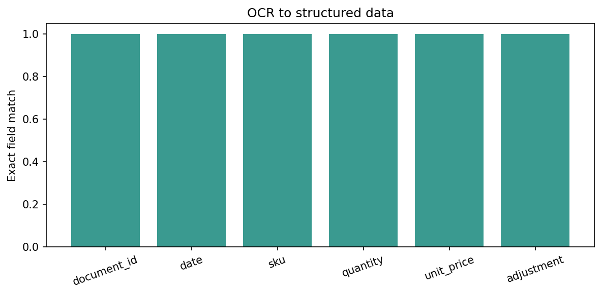

> **이번 글의 질문**
>
> 이미지에서 읽은 날짜·수량·가격을 표로 옮길 때, 구분 기호와 음수 부호를 어떻게 보존할까요?

> **핵심 요약**
>
> 구성한 문서 12장의 OCR 원문과 단어 좌표를 저장합니다. 항목별 패턴으로 값을 읽고 타입·범위를 검증한 뒤, 정답 표와 필드별 일치도를 비교합니다.

## 1. 문제를 분석 순서로 바꿉니다

동일한 서식의 보급 기록 이미지를 만들었습니다. 깨끗한 문서, 조금 회전한 문서, 해상도를 낮춘 문서를 포함합니다. 수량은 piece, 단가는 USD, `adjustment`는 합계에 더하는 USD 조정 금액입니다. 날짜의 하이픈·가격의 소수점·음수 부호를 모두 남겨야 올바른 값을 만들 수 있습니다.

- 원문과 단어의 위치를 저장합니다
- 항목마다 형식과 허용 범위를 확인합니다
- 정답과 필드별로 비교합니다

아래 기본 풀이의 출력은 첨부한 `solution.ipynb`와 결과 CSV에 기록된 실제 실행 결과입니다. 추가 비교 예제는 별도 Notebook에서 실행했으며, 가상 예제는 그 범위를 표시했습니다.

## 2. 단계별 코드와 실행 결과

```python
from pathlib import Path
import json
import numpy as np
import pandas as pd
import matplotlib.pyplot as plt

ROOT = Path.cwd()
DATA = ROOT / "data"
RESULTS = ROOT / "results"
PLOTS = ROOT / "plots"
RESULTS.mkdir(exist_ok=True)
PLOTS.mkdir(exist_ok=True)

def save_csv(frame, name):
    frame.to_csv(RESULTS / name, index=False, encoding="utf-8-sig")
```

### 원문과 단어의 위치를 저장합니다

Tesseract의 TSV 출력에는 텍스트뿐 아니라 단어 위치와 점수가 있습니다. 원문을 행 순서로 재구성하고 파일명·좌표를 보관해 잘못 읽은 영역을 다시 찾습니다.

```python
import subprocess
import io
import re

raw_rows=[];word_rows=[]
for path in sorted((DATA/"documents").glob("*.png")):
    completed=subprocess.run(["tesseract",str(path),"stdout","-l","eng","--psm","6","tsv"],check=True,capture_output=True,text=True)
    words=pd.read_csv(io.StringIO(completed.stdout),sep="\t")
    words=words.loc[words.level.eq(5) & words.text.notna()].copy()
    words["text"]=words.text.astype(str)
    words["filename"]=path.name
    lines=words.sort_values(["block_num","par_num","line_num","word_num"]).groupby(["block_num","par_num","line_num"],sort=True).text.agg(" ".join)
    raw_text="\n".join(lines)
    raw_rows.append({"filename":path.name,"raw_text":raw_text})
    word_rows.extend(words[["filename","text","conf","left","top","width","height"]].to_dict("records"))
raw=pd.DataFrame(raw_rows);word_table=pd.DataFrame(word_rows)
save_csv(raw,"ocr_raw.csv");save_csv(word_table,"ocr_words.csv")
print("문서:",len(raw),"OCR 단어:",len(word_table))
print(raw.iloc[0].raw_text)
```

```text
문서: 12 OCR 단어: 168
SUPPLY RECORD
Doc: DOC-001
DATE: 2026-08-01
SKU: KIT-001
QTY: 29
PRICE: 38.81
ADJUSTMENT: -2.50
```

### 항목마다 형식과 허용 범위를 확인합니다

문서 번호·날짜·수량·가격은 허용 형식이 다릅니다. 항목마다 패턴을 정해 날짜 구분자, 소수점, 음수 조정 금액을 보존합니다.

```python
patterns={
    "document_id":r"(?im)^\s*DOC:\s*(DOC-\d{3})\s*$",
    "date":r"(?im)^\s*DATE:\s*(\d{4}-\d{2}-\d{2})\s*$",
    "sku":r"(?im)^\s*SKU:\s*(KIT-\d{3})\s*$",
    "quantity":r"(?im)^\s*QTY:\s*(\d+)\s*$",
    "unit_price":r"(?im)^\s*PRICE:\s*(\d+\.\d{2})\s*$",
    "adjustment":r"(?im)^\s*ADJUSTMENT:\s*(-?\d+\.\d{2})\s*$",
}
rows=[]
for row in raw.itertuples(index=False):
    normalized=row.raw_text.replace("−","-")
    parsed={"filename":row.filename}
    for field,pattern in patterns.items():
        match=re.search(pattern,normalized)
        parsed[field]=match.group(1) if match else pd.NA
    rows.append(parsed)
fields=pd.DataFrame(rows)
for field in ["quantity","unit_price","adjustment"]:
    fields[field]=pd.to_numeric(fields[field],errors="coerce")
valid_date=pd.to_datetime(fields.date,format="%Y-%m-%d",errors="coerce").notna()
complete=fields[list(patterns)].notna().all(axis=1)
valid=complete & valid_date & fields.quantity.ge(0) & fields.unit_price.ge(0)
fields["status"]=np.where(valid,"parsed","review")
fields["total_value"]=(fields.quantity*fields.unit_price+fields.adjustment).where(valid)
save_csv(fields,"document_fields.csv")
print(fields.to_string(index=False))
```

```text
        filename document_id       date     sku  quantity  unit_price  adjustment status  total_value
document_001.png     DOC-001 2026-08-01 KIT-001        29       38.81        -2.5 parsed      1122.99
document_002.png     DOC-002 2026-08-02 KIT-002        24        6.94         0.0 parsed       166.56
document_003.png     DOC-003 2026-08-03 KIT-003         3       33.16         0.0 parsed        99.48
document_004.png     DOC-004 2026-08-04 KIT-004         4        4.30        -2.5 parsed        14.70
document_005.png     DOC-005 2026-08-05 KIT-005        12        7.13         0.0 parsed        85.56
document_006.png     DOC-006 2026-08-06 KIT-006        31       40.28         0.0 parsed      1248.68
document_007.png     DOC-007 2026-08-07 KIT-007        24       21.99        -2.5 parsed       525.26
document_008.png     DOC-008 2026-08-08 KIT-008        32       40.29         0.0 parsed      1289.28
document_009.png     DOC-009 2026-08-09 KIT-009        25       33.43         0.0 parsed       835.75
document_010.png     DOC-010 2026-08-10 KIT-010         3        5.70        -2.5 parsed        14.60
document_011.png     DOC-011 2026-08-11 KIT-011        36       43.20         0.0 parsed      1555.20
document_012.png     DOC-012 2026-08-12 KIT-012        18       44.25         0.0 parsed       796.50
```

형식이 맞아도 없는 날짜일 수 있어 날짜 변환으로 다시 검사합니다. 수량과 단가는 0 이상이어야 하지만 합계 조정액은 음수도 허용합니다.

### 정답과 필드별로 비교합니다

파싱에 성공한 비율과 정답이 맞은 비율은 다릅니다. 정답 표를 파일명으로 연결한 뒤 문자열은 정확히, 숫자는 지정한 허용 오차 안에서 비교합니다.

```python
truth=pd.read_csv(DATA/"document_truth.csv")
comparison=truth.merge(fields,on="filename",suffixes=("_true","_pred"),validate="one_to_one")
matches={}
for field in ["document_id","date","sku"]:
    matches[field]=comparison[field+"_true"].eq(comparison[field+"_pred"]).fillna(False)
for field in ["quantity","unit_price","adjustment"]:
    matches[field]=np.isclose(comparison[field+"_true"],comparison[field+"_pred"].astype(float),equal_nan=False)
match_frame=pd.DataFrame(matches)
scores=pd.DataFrame({"field":match_frame.columns,"accuracy":match_frame.mean().to_numpy(),"correct":match_frame.sum().to_numpy(),"documents":len(comparison)})
comparison["all_fields_match"]=match_frame.all(axis=1)
save_csv(scores,"field_accuracy.csv");save_csv(comparison,"document_comparison.csv")
print(scores.to_string(index=False))
print("문서 전체 일치:",int(comparison.all_fields_match.sum()),"/",len(comparison))
fig,ax=plt.subplots(figsize=(8,4))
ax.bar(scores.field,scores.accuracy,color="#3a9a90");ax.set(ylim=(0,1.05),ylabel="Exact field match",title="OCR to structured data")
ax.tick_params(axis="x",rotation=20)
fig.tight_layout();fig.savefig(PLOTS/"ocr_field_accuracy.png",dpi=150,bbox_inches="tight");plt.close(fig)
```

```text
      field  accuracy  correct  documents
document_id       1.0       12         12
       date       1.0       12         12
        sku       1.0       12         12
   quantity       1.0       12         12
 unit_price       1.0       12         12
 adjustment       1.0       12         12
문서 전체 일치: 12 / 12
```

단위가 USD인 가격 계산은 학습용 실수형 예제입니다. 실제 금액 시스템을 만들 때는 센트 단위 정수나 `Decimal` 같은 표현도 검토합니다.

## 3. 표·그래프를 해석하고 오류를 확인합니다

형식이 맞는 값도 원문과 다를 수 있습니다. 예를 들어 12를 17로 읽으면 숫자 검사와 범위 검사는 모두 통과합니다. 필드 정확도는 정답 표와 비교해야 알 수 있습니다.

Confidence는 검토 우선순위에 도움을 주는 OCR 점수입니다. 90을 검증된 정확도 90%로 읽지 않습니다.

이 패턴은 주어진 서식에 맞춘 시작점입니다. 항목 위치가 다른 문서에는 좌표 관계로 항목과 값을 연결하거나 별도의 문서 구조 분석이 필요합니다.

이번 12장에서는 모든 필드가 맞았습니다. 같은 서식의 작은 검증 데이터이므로 다른 문서·손글씨·복잡한 표에서도 같은 성능을 보인다는 뜻은 아닙니다. 회전·해상도와 서식 변화를 따로 늘려 볼 수 있습니다.



*OCR 문서에서 구조화 데이터 만들기의 실행 결과를 보여 줍니다. 단위와 관측 대상을 본문의 기준으로 읽습니다.*

## 4. 처리 기준이 결과를 바꾸는 비교 예제

### 숫자만 남기면 부호와 소수점이 사라집니다

자료: 금액 파싱을 확인하는 작은 예제

OCR 문자열의 기호를 모두 제거하면 10.50과 -3.50이 전혀 다른 수가 됩니다. 허용한 숫자 형식을 확인한 뒤 `Decimal`로 읽는 경우와 비교합니다.

```python
import re
from decimal import Decimal

quantity = 4
price_text = "10.50"
adjustment_text = "-3.50"
wrong_price = int(re.sub(r"\D", "", price_text))
wrong_adjustment = int(re.sub(r"\D", "", adjustment_text))
pattern = r"[+-]?\d+(?:\.\d+)?"
assert re.fullmatch(pattern, price_text)
assert re.fullmatch(pattern, adjustment_text)
correct_total = quantity * Decimal(price_text) + Decimal(adjustment_text)
wrong_total = quantity * wrong_price + wrong_adjustment
print("부호·소수점 보존 합계:", correct_total)
print("숫자만 남긴 합계:", wrong_total)
assert correct_total == Decimal("38.50")
```

```text
부호·소수점 보존 합계: 38.50
숫자만 남긴 합계: 4550
```

수량·단가·조정액은 서로 다른 허용 조건을 가집니다. 음수 조정액은 허용하면서 수량과 단가는 0 이상으로 검사하는 식으로 항목별 규칙을 둡니다.

### 형식 검사와 정답 일치는 다른 검사입니다

자료: 실습 정답에서 한 필드를 바꾼 오류 예제

실습 문서의 첫 정답에서 수량만 1 늘린 가상 인식 결과를 만듭니다. 숫자 형식이 맞아도 정답과 다를 수 있고, 날짜 모양이 맞아도 존재하지 않는 날짜일 수 있습니다.

```python
import re
import pandas as pd

truth = pd.read_csv("data/document_truth.csv").iloc[0]
changed_quantity = int(truth.quantity) + 1
valid_quantity_format = changed_quantity >= 0
matches_truth = changed_quantity == int(truth.quantity)
date_text = "2026-02-30"
looks_like_date = bool(re.fullmatch(r"\d{4}-\d{2}-\d{2}", date_text))
valid_calendar_date = pd.notna(pd.to_datetime(date_text, format="%Y-%m-%d", errors="coerce"))
print("수량 형식 정상 / 정답 일치:", valid_quantity_format, matches_truth)
print("날짜 형식 정상 / 실제 날짜:", looks_like_date, valid_calendar_date)
assert valid_quantity_format and not matches_truth
assert looks_like_date and not valid_calendar_date
```

```text
수량 형식 정상 / 정답 일치: True False
날짜 형식 정상 / 실제 날짜: True False
```

`status=parsed`는 파싱 규칙을 통과했다는 뜻입니다. 실제 정확도는 정답 표와 필드별로 비교해야 하며, 문서 합계가 내부적으로 맞는다는 사실만으로 OCR 원문까지 맞다고 판단할 수는 없습니다.

## 5. 저장한 파일로 분석을 다시 확인합니다

| 결과 파일 | 행 수 | 전체 열 |
| --- | --- | --- |
| `document_comparison.csv` | 12 | `filename`, `document_id_true`, `date_true`, `sku_true`, `quantity_true`, `unit_price_true`, `adjustment_true`, `document_id_pred`, `date_pred`, `sku_pred`, `quantity_pred`, `unit_price_pred`, `adjustment_pred`, `status`, `total_value`, `all_fields_match` |
| `document_fields.csv` | 12 | `filename`, `document_id`, `date`, `sku`, `quantity`, `unit_price`, `adjustment`, `status`, `total_value` |
| `field_accuracy.csv` | 6 | `field`, `accuracy`, `correct`, `documents` |
| `ocr_raw.csv` | 12 | `filename`, `raw_text` |
| `ocr_words.csv` | 168 | `filename`, `text`, `conf`, `left`, `top`, `width`, `height` |

Notebook 화면의 점수와 파일의 값이 같은지, 입력 ID가 빠지거나 중복되지 않았는지 확인합니다. 비교 예제는 기존 풀이가 만든 `results`를 읽으므로 기본 풀이를 먼저 실행합니다.

```bash
# 예선_유형별_실습 폴더에서 실행합니다.
python check_outputs.py --types 8
```

검사 도구는 저장 파일의 행·열·ID·상태·지표 대응을 확인합니다. 데이터 분할의 의미, Feature를 사용할 수 있는 시점, 모델 선택 과정은 본문의 기준과 Notebook을 함께 읽어 확인합니다.

## 6. 확장 문제를 설계하고 확인할 결과를 정합니다

다음 항목은 후속 실험을 위한 문제와 풀이 방향입니다. 앞의 실행 결과에 포함된 실험과 구분합니다. 새 데이터나 Annotation이 필요한 항목은 그 입력부터 준비합니다.

### 부호와 소수점 오류를 따로 평가하려면 어떻게 할까요?

조정액의 음수 부호, 가격의 소수점, 수량의 자릿수가 서로 다른 방식으로 손상된 작은 입력을 만듭니다. 각각 파싱 성공·정답 일치·계산된 합계를 별도로 기록합니다. 앞의 `Decimal` 예제는 그 비교의 출발점입니다.

남길 결과: 오류 유형별 원문·파싱 값·정답 값·합계 오차 표를 만듭니다.

### OCR 도구를 바꿀 때 어떤 기준으로 비교할까요?

같은 문서와 같은 필드 정답으로 비교합니다. 문자 인식률뿐 아니라 문서번호·날짜·수량 등 최종 필드의 일치율을 계산합니다. 전처리·파싱 규칙은 Validation 문서에서 정하고 최종 문서는 남겨 둡니다.

남길 결과: 도구·전처리·필드별 정확도·전체 필드 일치 문서 비율·처리 시간을 기록합니다.

## 참고자료

### 실습 데이터와 노트북

- **문제 자료**: [문제 자료](/files/maicon-2026/practice/%EC%8B%A4%EC%8A%B5_08_%EB%AC%B8%EC%A0%9C%EC%9E%90%EB%A3%8C.zip) — 입력 데이터와 `starter.ipynb`로 직접 구현을 시작합니다.
- **풀이 자료**: [풀이와 결과](/files/maicon-2026/practice/%EC%8B%A4%EC%8A%B5_08_%ED%92%80%EC%9D%B4%EC%99%80_%EA%B2%B0%EA%B3%BC.zip) — 전체 Python 코드, 노트북과 실행 결과를 함께 받습니다.
- **공통 자료**: [실습 공통 자료](/files/maicon-2026/practice/%EC%8B%A4%EC%8A%B5_%EA%B3%B5%ED%86%B5%EC%A4%80%EB%B9%84.zip) — 공유 모델과 유형별 실습에 필요한 공통 준비 자료입니다.
- **예선 가이드**: [국방AI경진대회 예선가이드](/files/maicon-2026/%EA%B5%AD%EB%B0%A9AI%EA%B2%BD%EC%A7%84%EB%8C%80%ED%9A%8C%20%EC%98%88%EC%84%A0%EA%B0%80%EC%9D%B4%EB%93%9C.pdf) — 제공된 가이드의 범위를 바탕으로 만든 연습문제입니다.
- **실행 안내**: 같은 작업 폴더에 압축을 푼 뒤 유형 폴더에서 `solution.ipynb` 또는 `solution.py`를 실행합니다. `blog_comparison.ipynb`에는 본문에서 추가한 두 비교 예제와 실제 출력이 들어 있습니다.
- **데이터 출처**: 문서 이미지는 가상의 문서번호·상품·가격을 넣어 직접 만든 12장입니다. 이번 서식에서의 일치 결과이며 실제 문서 전체에 대한 OCR 성능을 나타내지 않습니다.

### 연습문제

- **문제**: [유형 08 문제](/cs/data-analysis/practice-08-ocr-structured-data/) — 이미지에서 읽은 날짜·수량·가격을 표로 옮길 때, 구분 기호와 음수 부호를 어떻게 보존할까요?
- **모의 실습**: [모의 실습 C](/cs/data-analysis/mock-exam-c-90-min-review/) — 세 문항을 20·35·45점으로 묶어 입력부터 저장까지 연습합니다.

### 관련 공부노트

- **공부노트 10**: [이미지·영상 데이터 분석](/cs/data-analysis/pandas-10-image-video-analysis/)
- **공부노트 13**: [데이터 분석의 흔한 착각과 실수](/cs/data-analysis/pandas-13-common-pitfalls/)

### 공식 문서

- **사용한 도구**: [Tesseract CLI](https://tesseract-ocr.github.io/tessdoc/Command-Line-Usage.html) — PSM·언어·TSV 출력과 단어 좌표를 확인합니다.  
  [Python re](https://docs.python.org/3/library/re.html) — search·fullmatch·sub와 Raw String의 역할을 확인합니다.
