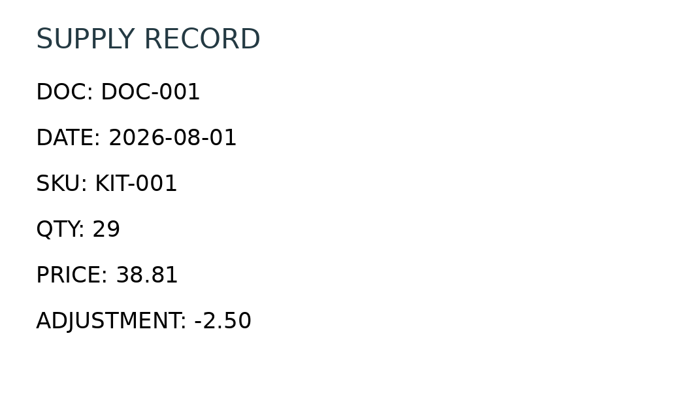

> **이번 글의 질문**
>
> 이미지에서 읽은 날짜·수량·가격을 표로 옮길 때, 구분 기호와 음수 부호를 어떻게 보존할까요?

> **핵심 요약**
>
> 입력의 관측 단위·처리 규칙·결과 파일을 먼저 확인하고 직접 구현합니다. 풀이와 실행 결과는 연결된 풀이편에서 확인합니다.

## 1. 어떤 문제를 풀까요?

동일한 서식의 보급 기록 이미지를 만들었습니다. 깨끗한 문서, 조금 회전한 문서, 해상도를 낮춘 문서를 포함합니다. 수량은 piece, 단가는 USD, `adjustment`는 합계에 더하는 USD 조정 금액입니다. 날짜의 하이픈·가격의 소수점·음수 부호를 모두 남겨야 올바른 값을 만들 수 있습니다.

예선 가이드의 범위로 구성한 연습문제입니다. 실제 예선 문제 원문이나 공식 채점 기준이 아닙니다. 이 유형의 연습용 배점은 100점입니다.

## 2. 입력 데이터와 관측 단위

| 입력 파일 | 구성 | 열·내용 |
| --- | --- | --- |
| `documents/` | PNG 12장 | DOC, DATE, SKU, QTY, PRICE, ADJUSTMENT |
| `document_truth.csv` | 12행 | `filename`, `document_id`, `date`, `sku`, `quantity`, `unit_price`, `adjustment` |



*직접 구성한 문서 이미지의 예시입니다. 문서번호·날짜·수량·단가·조정액을 구분해 읽습니다.*

## 3. 구현할 요구사항

- Tesseract 영어 OCR로 단어·좌표·Confidence를 읽고 원문을 재구성합니다. 문서 결과 한 행에 파일명을 반드시 남깁니다.
- 정규 표현식은 항목의 전체 형식을 검사합니다. 모든 특수문자를 지우는 공통 정리 함수로 숫자·날짜를 만들지 않습니다.
- 빈 필드·잘못된 타입·음수 수량·음수 단가는 review로 남깁니다. `adjustment`의 음수는 유효합니다.
- `total_value` = `quantity` × `unit_price` + `adjustment`를 계산하되 검토가 필요한 문서의 금액은 결측값으로 둡니다.
- `ocr_raw.csv`·`ocr_words.csv`·`document_fields.csv`·`field_accuracy.csv`·`document_comparison.csv`를 저장합니다.

## 4. 제출 파일의 구조

CSV는 `results` 폴더, 그래프는 `plots` 폴더에 저장합니다. ID와 상태 열을 유지해 입력과 결과가 다시 연결되도록 합니다. 아래 열 목록은 풀이 결과의 파일 계약입니다.

| 결과 파일 | 행의 기준 | 전체 열 |
| --- | --- | --- |
| `document_comparison.csv` | 요구사항의 관측 단위를 유지합니다. | `filename`, `document_id_true`, `date_true`, `sku_true`, `quantity_true`, `unit_price_true`, `adjustment_true`, `document_id_pred`, `date_pred`, `sku_pred`, `quantity_pred`, `unit_price_pred`, `adjustment_pred`, `status`, `total_value`, `all_fields_match` |
| `document_fields.csv` | 요구사항의 관측 단위를 유지합니다. | `filename`, `document_id`, `date`, `sku`, `quantity`, `unit_price`, `adjustment`, `status`, `total_value` |
| `field_accuracy.csv` | 요구사항의 관측 단위를 유지합니다. | `field`, `accuracy`, `correct`, `documents` |
| `ocr_raw.csv` | 요구사항의 관측 단위를 유지합니다. | `filename`, `raw_text` |
| `ocr_words.csv` | 요구사항의 관측 단위를 유지합니다. | `filename`, `text`, `conf`, `left`, `top`, `width`, `height` |

## 5. 연습용 채점 기준

| 평가할 내용 | 배점 |
| --- | --- |
| OCR·원문·좌표 추적 | 25 |
| 필드 파싱·기호 보존 | 30 |
| 검증·정답 비교 | 25 |
| 출력·오류 검토 | 20 |

## 6. 실습 준비와 점검

참고자료의 문제 자료와 공통 자료를 준비한 뒤, 데이터 폴더 구성을 확인합니다.

```python
from pathlib import Path

root = Path.cwd()
assert (root / "data").is_dir()
print("입력 폴더:", root / "data")
```

### 풀이를 열기 전에 남길 메모

- 한 행이 무엇을 나타내는지 적습니다.
- 기준표·시간·ID·Target 중 어떤 조건이 결과를 바꿀지 적습니다.
- 필수 결과 파일을 먼저 만들고, 추가 실험은 기본 결과를 저장한 뒤 진행합니다.

## 참고자료

### 실습 데이터와 노트북

- **문제 자료**: [문제 자료](/files/maicon-2026/practice/%EC%8B%A4%EC%8A%B5_08_%EB%AC%B8%EC%A0%9C%EC%9E%90%EB%A3%8C.zip) — 입력 데이터와 `starter.ipynb`로 직접 구현을 시작합니다.
- **공통 자료**: [실습 공통 자료](/files/maicon-2026/practice/%EC%8B%A4%EC%8A%B5_%EA%B3%B5%ED%86%B5%EC%A4%80%EB%B9%84.zip) — 공유 모델과 유형별 실습에 필요한 공통 준비 자료입니다.
- **예선 가이드**: [국방AI경진대회 예선가이드](/files/maicon-2026/%EA%B5%AD%EB%B0%A9AI%EA%B2%BD%EC%A7%84%EB%8C%80%ED%9A%8C%20%EC%98%88%EC%84%A0%EA%B0%80%EC%9D%B4%EB%93%9C.pdf) — 제공된 가이드의 범위를 바탕으로 만든 연습문제입니다.
- **실행 안내**: 두 압축파일을 같은 작업 폴더에 풀면 `예선_유형별_실습` 아래에 유형 폴더와 공유 `_models` 폴더가 놓입니다. 해당 유형 폴더의 `starter.ipynb`에서 시작합니다. 공통 준비는 최초 한 번만 압축을 풀면 됩니다.
- **데이터 출처**: 문서 이미지는 가상의 문서번호·상품·가격을 넣어 직접 만든 12장입니다. 이번 서식에서의 일치 결과이며 실제 문서 전체에 대한 OCR 성능을 나타내지 않습니다.

### 연습문제

- **풀이**: [유형 08 풀이](/cs/data-analysis/practice-08-ocr-structured-data-solution/) — OCR 원문과 좌표를 보관하고 항목별 값을 추출·검증한 뒤, 정답 표와 필드별 일치도를 비교합니다.

### 관련 공부노트

- **공부노트 10**: [이미지·영상 데이터 분석](/cs/data-analysis/pandas-10-image-video-analysis/)
- **공부노트 13**: [데이터 분석의 흔한 착각과 실수](/cs/data-analysis/pandas-13-common-pitfalls/)

### 공식 문서

- **사용한 도구**: [Tesseract CLI](https://tesseract-ocr.github.io/tessdoc/Command-Line-Usage.html) — PSM·언어·TSV 출력과 단어 좌표를 확인합니다.  
  [Python re](https://docs.python.org/3/library/re.html) — search·fullmatch·sub와 Raw String의 역할을 확인합니다.
