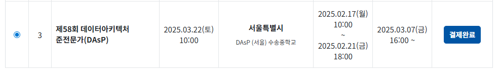
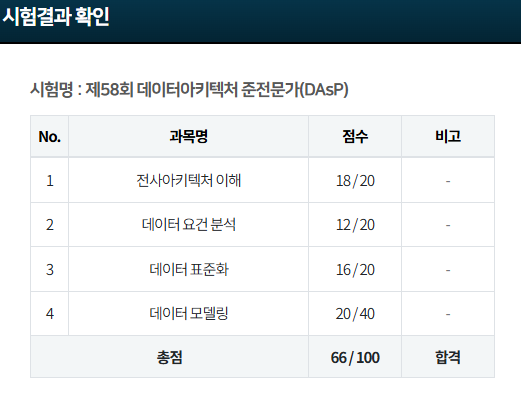

안녕하세요. **juwkim**입니다.

이번 글은 예전에 취득해두었던 **데이터아키텍처 준전문가(DAsP)** 자격을 기록용으로 정리해보는 글입니다.

이 자격증은 제가 블로그를 시작하기 전에 취득했던 자격증이라,  
뒤늦게라도 남겨두면 좋겠다고 생각해서 정리하게 됐습니다.

---

## 시험 정보

제가 응시한 시험은 **제58회 데이터아키텍처 준전문가(DAsP)** 입니다.

-   **시험일:** 2025. 03. 22. (토) 10:00
-   **시험장:** DAsP (서울) 수송중학교
-   **지역:** 서울특별시

공식 안내 기준으로 데이터아키텍처 준전문가(DAsP)는  
데이터 요건 분석, 데이터 표준화, 데이터 모델링 등을 수행할 수 있는 기본 역량을 검정하는 시험입니다.

시험은 총 4과목으로 구성됩니다.

-   전사아키텍처 이해
-   데이터 요건 분석
-   데이터 표준화
-   데이터 모델링

또한 **총 50문항**, **90분 시험**으로 진행되며,  
**총점 60점 이상**이면서 **과목별 40% 미만이 없어야 합격**입니다.

응시자격 제한은 없고, 연 2회 정기 시행되는 시험입니다.

공식 사이트: [데이터아키텍처 준전문가(DAsP)](https://www.dataq.or.kr/www/sub/a_02.do#none)

---

## 시험 결과

결과는 **합격**이었습니다.

과목별 점수는 아래와 같았습니다.

점수만 보면 아주 여유 있는 합격은 아니었지만,  
필요한 기준은 넘겼고 무난하게 마무리할 수 있어서 다행이라고 생각합니다.

---

## 어떻게 준비했는가

사실 이 시험을 위해 따로 많은 시간을 들여 준비하지는 않았습니다.

집에서 시험장인 **수송중학교**까지 전철로 약 2시간 정도 걸렸는데,  
그 이동 시간 동안 관련 내용을 정리한 블로그 글을 보면서 공부했습니다.

제가 참고했던 글은 아래 링크입니다.

-   [DAsP 요약 정리 글](https://programmingyoon.tistory.com/226)

이동하면서 전체 범위를 빠르게 훑어보는 용도로 보기 괜찮았습니다.

전공자이기도 했고,  
이름 그대로 **준전문가** 자격이기 때문에  
입문 성격의 시험이라고 생각해서 아주 길게 준비하지는 않았습니다.

대신 이미 알고 있는 개념과 시험 범위를 빠르게 연결하면서  
전체 흐름을 정리하는 방식으로 접근했습니다.

---

## 시험을 보고 나서

결과적으로는 좋은 결과로 마무리해서 만족스럽습니다.

특히 시험 시간은 90분이었지만,  
실제로는 **50분도 채 쓰지 않았던 것**으로 기억합니다.

기존에 가지고 있던 전공 지식이 있었고,  
익숙한 개념도 적지 않아서 문제를 푸는 데 큰 부담은 없었습니다.

물론 점수 구성을 보면  
모든 과목이 여유 있었던 것은 아니었기 때문에,  
시험을 아주 가볍게 볼 수 있는 종류는 아니었다는 점도 같이 느꼈습니다.

그래도 기록으로 다시 남겨보니,  
예전에 하나씩 쌓아두었던 자격과 경험들이  
지금의 저를 만드는 과정이었다는 생각이 듭니다.

---

## 마치며

이 자격증은 블로그를 시작하기 전에 취득했던 자격증이라  
한동안 따로 정리하지 않고 지나갔습니다.

그래도 뒤늦게라도 이렇게 기록으로 남겨두면  
당시의 흐름과 시험 경험을 한 번에 돌아볼 수 있어서 의미가 있는 것 같습니다.

앞으로도 예전에 취득해두었던 자격증이나 경험들을  
하나씩 정리해서 남겨둘 생각입니다.
