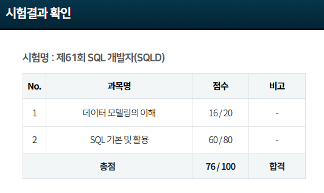

안녕하세요. **juwkim**입니다.

이번 글은 SQL 개발자(SQLD) 자격시험 합격 후기를 기록해보려고 합니다.

---

## 시험 정보

제가 응시한 시험은 **제61회 SQL 개발자(SQLD)** 입니다.

-   시험일: 2026. 05. 31. (일) 10:00
-   시험장: 용강중학교
-   지역: 서울특별시

*SQL 개발자 접수*

SQLD(SQL Developer)는 한국데이터산업진흥원에서 시행하는 데이터베이스 분야 자격시험으로,

데이터 모델링과 SQL에 대한 이해를 바탕으로 데이터를 정확하고 효율적으로 조회·조작할 수 있는 능력을 검정합니다.

SQL(Structured Query Language)은 데이터베이스에 접근하기 위한 표준 언어로,

개발자가 데이터를 조회하고 저장하고 수정하는 대부분의 작업은 SQL을 통해 이루어집니다.

SQLD는 단순히 SQL 문법을 암기하는 시험이라기보다는 데이터 모델링과 관계형 데이터베이스에 대한 이해를 바탕으로 데이터를 정확하고 효율적으로 조회·조작할 수 있는 능력을 평가하는 시험에 가깝습니다.

시험은 총 2과목으로 구성됩니다.

-   데이터 모델링의 이해
-   SQL 기본 및 활용

총 50문항, 90분 동안 진행되며 합격 기준은 총점 60점 이상, 과목별 40% 이상입니다.

응시 자격 제한은 없으며 연 4회 시행됩니다.

---

## 시험 준비

5월 26일 정보통신기사 필기시험을 보고 난 뒤,

5월 27일부터 5월 30일까지 약 4일 동안 SQLD를 준비했습니다.

사용한 교재는 <strong>「[이지패스 2026 SQLD SQL 개발자](https://www.aladin.co.kr/shop/wproduct.aspx?ItemId=383403572)」</strong>였습니다.

이 책은 SQL을 처음 접하는 사람도 이해할 수 있도록 설명이 비교적 쉽게 되어 있었고,

교재와 연계된 [유튜브 강의](https://www.youtube.com/playlist?list=PLRkxDdrb2YzjdRN8RaYq58JtMxV3_PzSZ)도 제공되어 있어서 공부하기 편했습니다.

저는 책을 읽으면서 동시에 유튜브 강의를 함께 시청하는 방식으로 공부했습니다.

사실 데이터베이스 관련 내용은 컴퓨터공학 전공 과정에서도 접했던 부분이 많아서 처음부터 완전히 새로운 내용은 아니었습니다. 그래서 기본 개념을 다시 정리하고, SQLD 시험 범위에 맞춰 내용을 복습하는 느낌으로 공부했습니다.

---

## 시험 결과

*제 61회 SQLD 시험 결과*

76점으로 **합격**했습니다.

시험을 마치고 나왔을 때도 <strong>"이 정도면 합격은 하겠다"</strong>는 느낌이 있었습니다.

물론 몇 문제는 확신이 없었지만, 과락이나 불합격을 걱정할 정도는 아니라고 생각했습니다.

실제 결과도 예상과 크게 다르지 않았습니다.

---

## 시험을 보면서 느낀 점

이번 시험에서 가장 도움이 되었던 것은 암기보다 **추론**이었습니다.

시험을 보면서 처음 보는 함수나 익숙하지 않은 기능이 몇 개 있었는데,

그때마다 단순히 기억을 떠올리기보다는 <strong>"내가 SQL을 설계한 사람이라면 어떻게 만들었을까?"</strong>를 생각했습니다.

**왜 이런 기능이 필요한지**, **어떤 상황에서 사용될지**,

**설계자라면 어떤 방식으로 동작하도록 만들었을지**를 생각하면서 답을 좁혀 나갔습니다.

컴퓨터공학을 공부하면서 얻은 경험 중 하나가 새로운 기술을 만났을 때

사용자보다 **설계자의 입장에서 먼저 바라보는 습관**인데,

이번 시험에서도 꽤 도움이 되었습니다.

그래서 개인적으로는 SQLD가 단순 암기형 시험이라기보다는

데이터베이스의 동작 원리를 이해하고 있는 사람이 조금 더 유리한 시험이라고 느꼈습니다.

특히 전공자라면 처음 보는 내용이 나오더라도

설계 의도를 추론하면서 문제를 해결할 수 있기 때문에 체감 난도가 크게 높지는 않을 것 같습니다.

반대로 비전공자라면 SQL과 데이터 모델링의 기본기를 체계적으로 쌓을 수 있는 좋은 입문 시험이라고 생각합니다.

---

## 마치며

SQLD는 난도가 아주 높은 시험은 아니지만,

관계형 데이터베이스와 SQL의 기본 개념을 체계적으로 정리할 수 있다는 점에서 의미 있는 자격증이라고 생각합니다.

이번 시험을 준비하면서 데이터 모델링과 SQL을 다시 한 번 정리할 수 있었고,

데이터베이스를 바라보는 시야도 조금 넓어진 것 같습니다.

앞으로는 SQLP(SQL 전문가), DAP(데이터아키텍처 전문가), ADP(데이터분석 전문가) 등

상위 자격증도 차근차근 준비해볼 계획입니다.

이번 SQLD 합격 역시 그 과정의 한 단계였다고 생각합니다.
