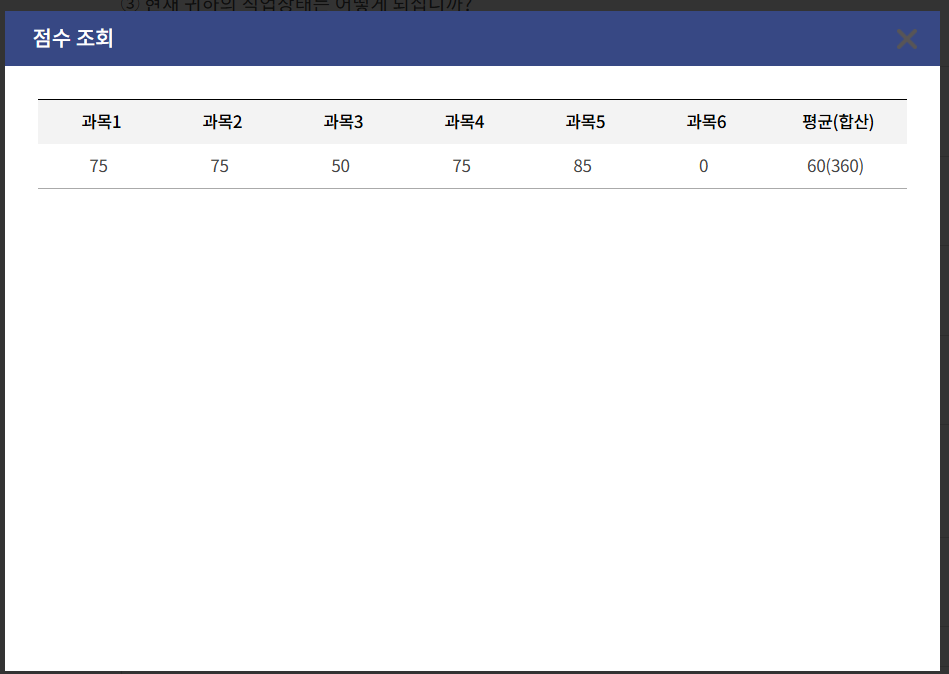

안녕하세요. **juwkim**입니다.

오늘은 정보통신기사 필기시험 후기를 하나 기록해보려고 합니다.

2026년도 정기검정(CBT) 2회차 정보통신기사 필기시험을 보고 왔습니다.

시험은 5월 26일 화요일 13시 30분, 송파구 서울본부 CBT 시험장에서 응시했습니다.  
CBT 시험이라 종료 후 바로 결과가 화면에 표시됐는데, 다행히 과락 없이 합격했습니다.

## 시험 결과

Examination Report

### 정보통신기사 필기

정보전송일반

75

정보통신기기

75

정보통신네트워크

50

정보시스템운용

75

컴퓨터 / 정보설비

85

시험 일자 2026-05-26

평균 점수 72 점

최종 결과 PASS / 합격

2026년도 정기검정(CBT) 2회차

*시험 결과*

## 군생활 중 준비했던 시험

평일에는 점심시간이나 저녁 식사 이후 개인정비 시간, 연등 시간을 최대한 활용해서 공부했습니다.

아무래도 군대에서는 하루 종일 공부만 할 수 있는 환경은 아니다 보니,  
짧은 시간이라도 꾸준히 보는 쪽으로 방향을 잡았습니다.

이번 시험은 생각보다 범위가 꽤 넓었습니다.

특히 정보통신네트워크나 정보시스템운용 쪽은 처음 볼 때 내용이 낯설어서,  
초반에는 어디서부터 정리해야 할지 조금 막막하기도 했습니다.

그래도 하루 단위로 분량을 정해놓고 계속 진도를 밀었습니다.

## 사용한 교재와 공부 방법

「[2026 시대에듀 유선배 정보통신기사 필기 합격노트](https://www.aladin.co.kr/shop/wproduct.aspx?ItemId=379728628)」 교재로 공부했습니다.

1권, 2권으로 나뉘어 있는 책인데,  
[네이버 카페](https://cafe.naver.com/specialist1) 영상 강의도 같이 보면서 공부했습니다.

혼자 책만 볼 때보다 강의를 병행하니까 이해가 훨씬 빨랐습니다.

특히 통신 이론이나 계산 문제처럼 처음 보면 헷갈리는 부분들은  
강의를 같이 들으면서 흐름을 잡는 데 도움이 많이 됐습니다.

군생활 중에는 집중할 수 있는 시간이 제한적이다 보니,  
짧은 시간 안에 핵심을 빠르게 이해하는 게 중요했는데 그런 부분에서 꽤 효율적이었습니다.

## 공부 기록

5.16 / 1.1 ~ 1.8(1p ~ 52p)

5.17 / 1.9 ~ 1.34(53p ~ 198p)

5.18 / 1.35 ~ 1.38, 2.1 ~ 2.3(199p ~ 234p)

5.19 / 2.4 ~ 2.13(235p ~ 294p)

5.20 / 2.14 ~ 2.17(295p ~ 328p)

5.21 / 2.18 ~ 2.28(329p ~ 402p)

5.22 / 3.1 ~ 3.12(403p ~ 459p)

5.23 / 3.13 ~ 3.51(460p ~ 693p)

5.24 / 3.52 ~ 3.55, 4.1 ~ 4.20, 5.1 ~ 5.21 (694p ~ 716p, 2권 1p ~ 256p)

5.25 / 5.22 ~ 5.33, 6.1 ~ 6.20 (2권 257p ~ 448p)

그리고 마지막으로 기출문제 400제 + 추가 100제를 풀었고, 정보통신기사 CBT 모의고사 3회도 같이 봤습니다.

확실히 정보통신기사는 기출 반복 비중이 꽤 중요하다고 느꼈습니다.

## 시험 당일

시험장은 송파구 서울본부 CBT 시험장이었습니다.

CBT 시험이라 문제를 체크하거나 수정하는 건 편했습니다.

시험은 13:30에 시작했는데, 14:24분에 시험을 마무리했습니다.

확실히 공부를 충분히 하고 가면 1시간 내로도 풀 수 있는 시험이라고 느꼈습니다.

다만 정보통신네트워크 과목은 생각보다 어렵게 느껴졌습니다.

중간에 처음 보는 개념을 물어보는 문제가 나와서 순간적으로 많이 흔들렸는데,  
이미 알고 있는 내용을 최대한 확실하게 맞춘다는 생각으로 풀었습니다.

덕분에 정보통신네트워크 과목도 과락은 겨우 면할 수 있었습니다.  
(정보통신네트워크 50점...)

반대로 다른 과목들은 비교적 무난하게 봤던 것 같습니다.  
정보통신네트워크에서 잃은 점수를 다른 과목에서 많이 가져왔습니다ㅋㅋ

특히 컴퓨터 일반 및 정보설비 기준 과목은 비교적 안정적으로 점수가 나온 편이었습니다.

## 마무리

길게 보면 아직 공부해야 할 것도 많고,  
앞으로 준비하고 싶은 자격증들도 계속 남아있습니다.

그래도 이번 정보통신기사 필기를 통해서  
꾸준히 시간을 쌓으면 조금씩 결과가 나온다는 걸 다시 느꼈습니다.

이제 바로 5월 31일에 보는 SQLD를 4일 벼락치기로 준비해보려고 합니다.
