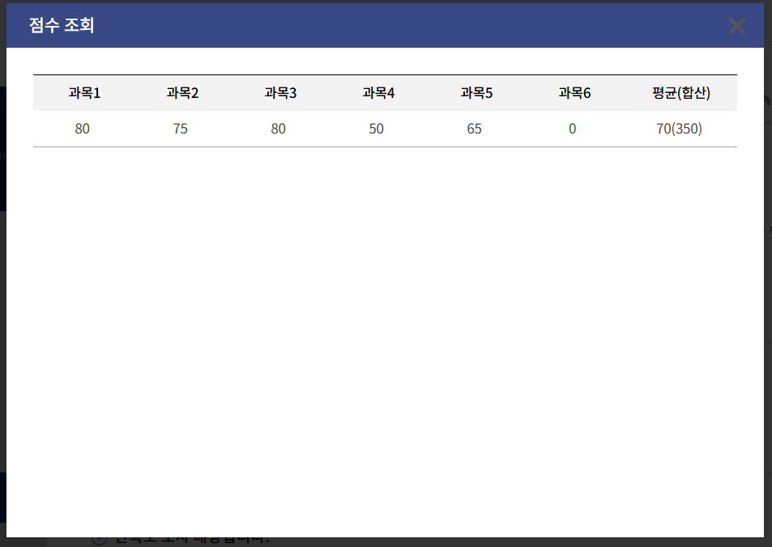
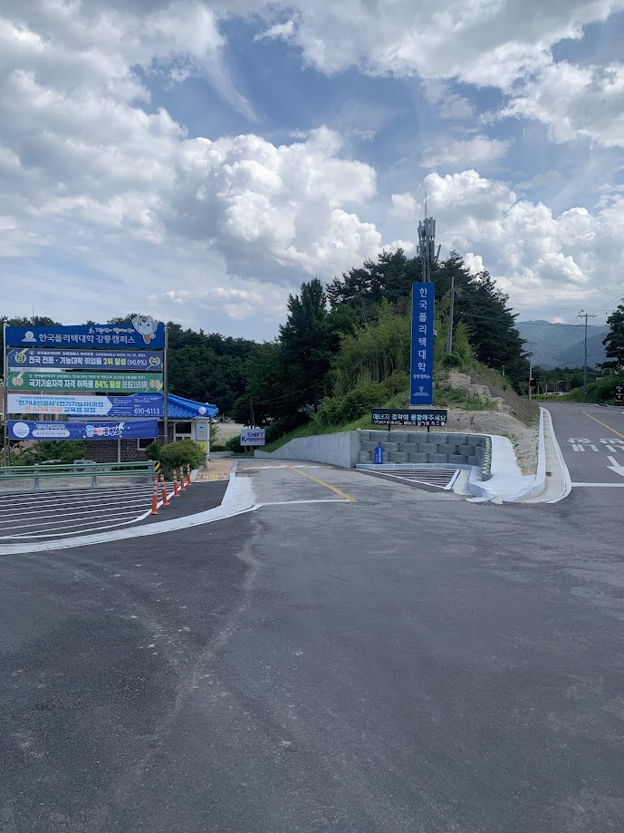
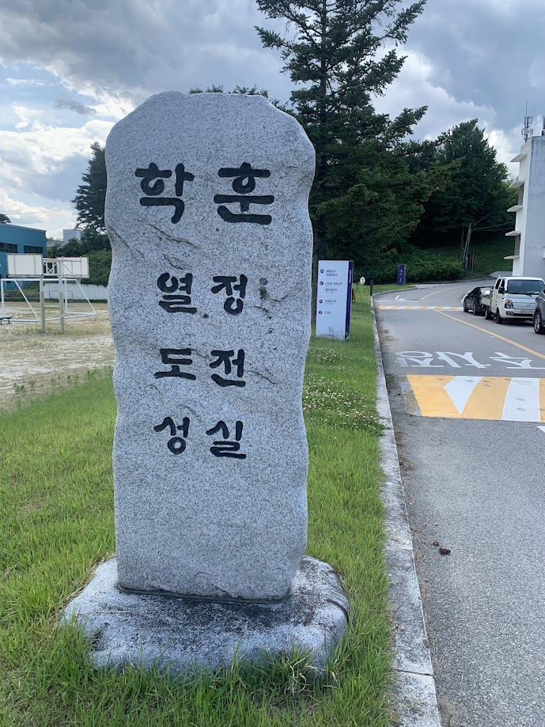
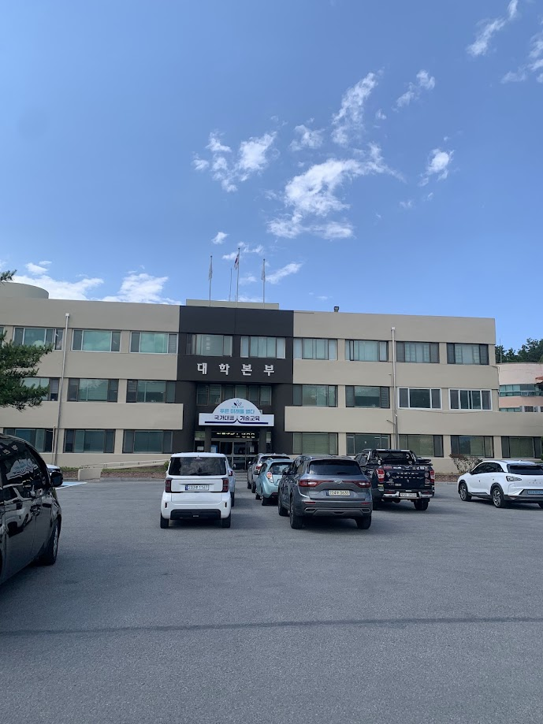
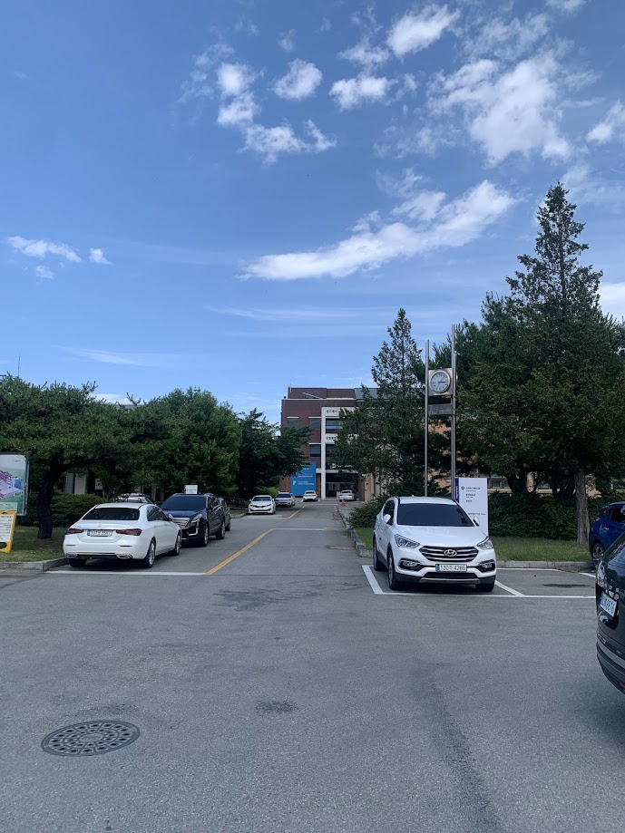
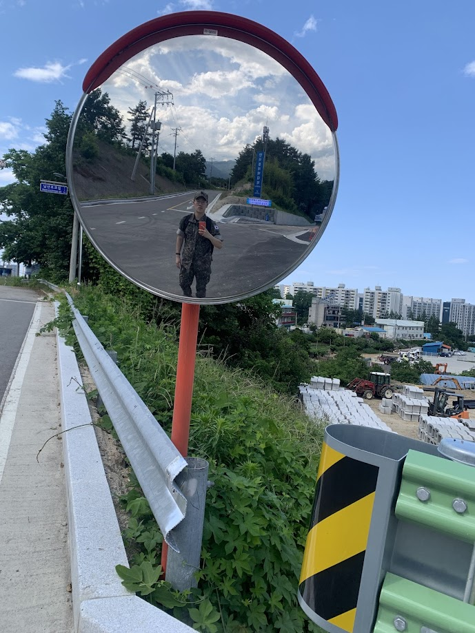

**정보보안기사 필기시험** 후기를 기록해 보려고 합니다.

2026년도 정기검정(CBT) 2회차 정보보안기사 필기시험에 응시했습니다. 시험은 **2026년 6월 9일**, 강릉 CBT 시험장에서 치렀습니다.

원래는 서울·경기·인천 지역 시험장을 희망했지만, 정보통신기사 때와 마찬가지로 접수 시작 직후 대부분의 시험장이 빠르게 마감되었습니다. 결국 남아 있던 강릉 시험장을 선택했고, 오랜만에 강릉까지 다녀오게 되었습니다.

## 시험 결과

*Examination Report: 정보보안기사 필기 (2026년도 정기검정(CBT) 2회차, 시험 일자 2026-06-09)*

| 과목 | 점수 |
| --- | --- |
| 시스템보안 | 80 |
| 네트워크보안 | 75 |
| 애플리케이션보안 | 80 |
| 정보보안일반 | 50 |
| 정보보안 관리 및 법규 | 65 |
| 평균 점수 | 70점 |
| 최종 결과 | PASS / 합격 |

*시험결과*

## 사용한 교재와 공부 방법

「[2026 알기사 정보보안기사 필기](https://www.aladin.co.kr/shop/wproduct.aspx?ItemId=375684701)」 교재로 공부했습니다. 이론서 2권, 기출문제집, 핵심요약노트로 구성되어 있으며, 전반적으로 개념 설명이 자세하고 기출문제가 충분히 수록되어 있어 공부하기 좋았습니다.

## 공부 기록

공부 기간은 7일이었습니다.

먼저 이론서를 읽으며 전체 내용을 정리한 뒤, 기출문제를 풀면서 부족한 부분을 보완하는 방식으로 공부했습니다. 시간이 넉넉하지 않아 기출문제집에 수록된 모의고사까지는 풀지 못했습니다. 짧은 기간이었지만 매일 조금씩 진도를 나가면서 전체 범위를 한 번 훑는 데 집중했습니다.

- 6.2: Chapter 1 ~ 3
- 6.3: Chapter 4 ~ 9
- 6.4: Chapter 10 ~ 12
- 6.5: Chapter 13 ~ 14
- 6.6: Chapter 15 ~ 20
- 6.7: Chapter 21 ~ 32
- 6.8: Chapter 33 ~ 43

## 시험 당일

시험 당일에는 위로휴가를 사용해 강릉으로 이동했습니다. 08시 30분에 부대를 출발해 09시 30분경 청량리역에 도착했습니다.

원래는 청량리역에서 TMO 후급을 받을 예정이었지만, 2023년에 국군장병라운지가 운영을 종료했다는 사실을 뒤늦게 알게 되었습니다. 다행히 출발 전에 춘천 TMO로 연락드렸고, 유선으로 후급 처리를 받을 수 있었습니다.

이후 청량리역에서 10시 15분 KTX-이음을 타고 강릉역으로 이동했습니다. 11시 58분 강릉역에 도착한 뒤, 버스와 도보를 이용해 시험장인 한국폴리텍대학 강릉캠퍼스로 향했습니다. 생각보다 이동 거리가 길어 조금 힘들었지만, 입실 시간에는 충분히 여유 있게 도착할 수 있었습니다.

나중에 이날을 다시 떠올릴 수 있도록, 이동 중에 촬영한 사진 몇 장을 함께 남겨봅니다.

*한국폴리텍대학 강릉캠퍼스*

*대학본부 / AI 테크관*

*기념사진.. 찰칵!*

## 마무리

예전에 어디선가 이런 말을 본 적이 있습니다.

> 감정은 사라져도 결과는 남는다

공부하기 싫은 날도 있었고, 쉬고 싶은 날도 있었습니다. 그래도 지금의 귀찮음과 피곤함을 잠시 참고 꾸준히 준비한 덕분에 좋은 결과를 얻을 수 있었습니다.

정보보안기사는 필기보다 실기가 더 어렵다고 알려져 있는 만큼, 실기는 여유를 갖고 준비하겠습니다. 다음에는 정보보안기사 실기 합격 후기로 돌아오겠습니다!
