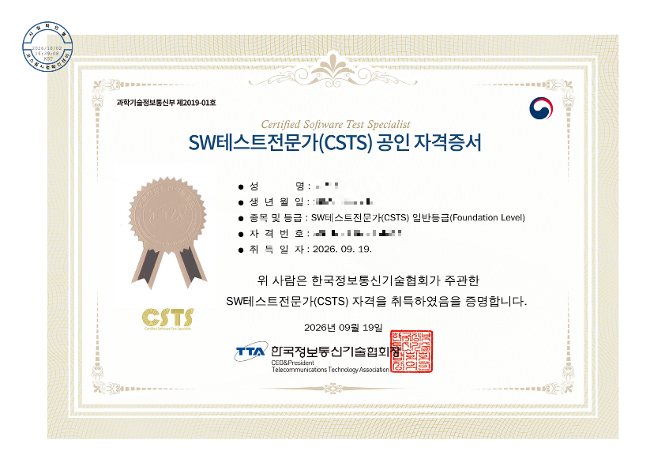

사실 이번 시험은 합격을 거의 기대하지 않았습니다. 9월 19일에 시험을 보고 난 뒤에도 별다른 자신이 없었고, 10월 2일 결과 발표 전까지 다음 시험 일정을 미리 찾아보고 다시 응시할 계획까지 세워두었습니다. 그런데 결과를 확인해 보니 예상하지 못하게 합격했습니다.

*CSTS 공인 자격증서*

## 시험 일정

시험은 9월 19일 오전 10시 30분부터 12시까지 스페이스쉐어 을지로입구(명동)센터에서 봤습니다.

오전 10시까지 입실해야 해서 8시 30분쯤 출발했고, 9시 51분쯤 을지로입구역에 도착했습니다. 역에서 시험장까지는 걸어서 3분 정도라 거의 계획대로 도착했습니다. 시험은 약 1시간 정도 봤고, 11시 30분 정도에 퇴실했습니다.

## 공부는 전날 3시간 30분

공부는 시험 전날인 9월 18일 밤 10시부터 다음 날 새벽 1시 30분까지 했습니다.

CSTS가 소프트웨어 테스팅을 다루는 시험이고 평소 프로그래밍을 많이 해왔기 때문에, 처음에는 조금 쉽게 생각했던 것 같습니다. 개발을 계속 해왔으니 소프트웨어 테스트 정도는 어느 정도 알고 있을 거라는 생각이 있었습니다.

## CSTS보다 우선순위가 높았던 일들

공부를 미룬 이유가 다른 데 있었던 것은 아닙니다. 9월 18일까지 육군 빅데이터 분석 경연대회를 준비했고, 시험 다음 날인 9월 20일까지는 육군 인공지능 아이디어 발굴·구현 경진대회 서류를 제출해야 했습니다.

당시에는 자격증을 하나 더 취득하는 것보다 AI와 빅데이터 분야에서 직접 결과물을 만들어 보는 대회에 시간을 쓰는 것이 낫다고 판단했습니다. 그러다 보니 CSTS 공부가 가장 뒤로 밀렸습니다.

## 공부 방법

임구마 님의 블로그에 정리된 CSTS 요약 글 세 편을 빠르게 훑어본 뒤, [TTA에서 공개한 예제문제](https://edu.tta.or.kr/edu/selectBbsNttView.do?key=68&bbsNo=1&nttNo=5814&searchCtgry=&searchCnd=SJ&searchKrwd=%EC%98%88%EC%A0%9C&integrDeptCode=&pageIndex=1#n)를 풀었습니다.

세 편이 시험 범위를 개요, 설계기법, 프로세스 순서로 나누어 정리하고 있어서, 어떤 내용이 나오는지 전체 구조를 파악하는 데 도움이 되었습니다.

- [\[CSTS\] PART 01. 테스트 개요](https://im-gu-ma.tistory.com/144)
- [\[CSTS\] PART 02. 테스트 설계기법](https://im-gu-ma.tistory.com/145)
- [\[CSTS\] PART 03. 테스트 프로세스](https://im-gu-ma.tistory.com/146)

## 마무리

떨어질 것이라 생각하고 다음 시험 일정까지 찾아봤는데 합격했다는 점에서, 이번 합격은 오래 기억에 남을 것 같습니다. CSTS에 시간을 많이 쓰지 못한 동안에는 다른 대회들을 준비하고 있었습니다.

결과를 보고 이런 생각이 들었습니다.

**뭐라도 계속 하고 있으니, 세상이 한 번쯤은 결과를 좋게 해준 건가.**

물론 실제로는 그동안 쌓아온 경험과 시험 당일의 판단, 그리고 어느 정도의 운이 맞아떨어진 결과일 것 같습니다.
