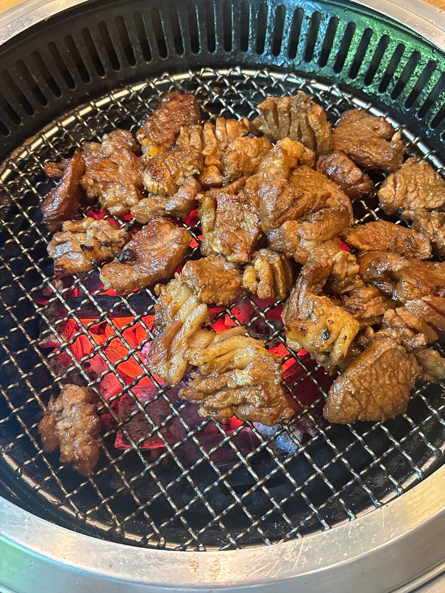
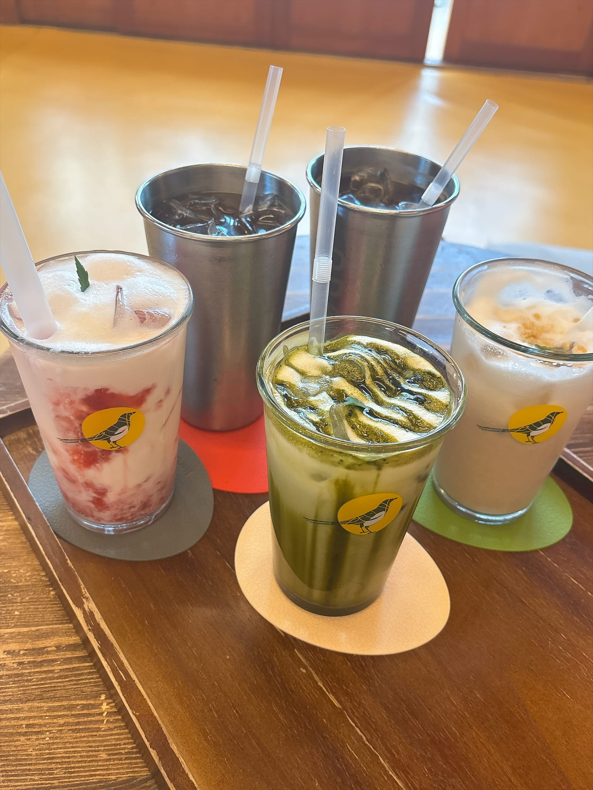
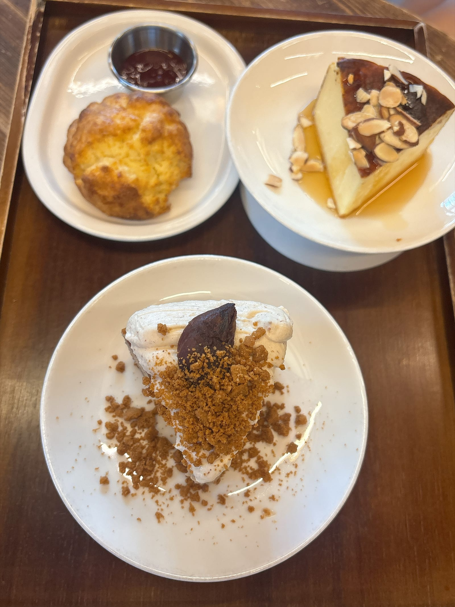

8월 휴가 기간 동안 가족들과 함께 오랜만에 나들이를 다녀왔습니다.

평소에는 각자 바쁘게 지내다 보니 가족들과 함께 시간을 보낼 기회가 많지 않았는데,

이번 휴가를 계기로 맛있는 것도 먹고 카페에서 여유롭게 시간을 보내며 즐거운 하루를 보냈습니다.  

### 점심은 송도갈비에서

첫 번째로 향한 곳은 **송도갈비 본점**입니다.

점심으로 무엇을 먹을지 고민하던 중 어머니께서 고기를 먹고 싶다고 하셔서 방문하게 되었습니다.

> **[네이버지도](https://map.naver.com/p/entry/place/1793709502?placePath=/home)**  
> 송도갈비 본점  
> map.naver.com

송도갈비에서 가장 편했던 점은 **고기를 직원분이 직접 구워주신다는 것**입니다. 고기를 먹을 때 직접 굽다 보면 고기가 타지는 않을까 신경 쓰게 되는데, 직원분이 알아서 구워주시니 가족들과 이야기를 나누면서 편하게 식사를 즐길 수 있었습니다.

고기뿐만 아니라 함께 나오는 밑반찬들도 인상적이었습니다. 특히 **가지튀김과 깻잎튀김, 잡채**가 맛있어서 고기와 함께 잘 먹었습니다. 식사를 마친 뒤에는 후식으로 **단호박 식혜**도 나왔는데, 달달하면서도 깔끔해서 식사를 마무리하기 좋았습니다.

전체적으로 음식도 맛있었고, 무엇보다 고기를 직접 구워주셔서 편하게 식사할 수 있다는 점이 좋았습니다.

*송도갈비*

### 한옥 분위기의 카페, 오담

점심을 먹은 뒤에는 **오담**이라는 카페로 이동했습니다.

한옥을 콘셉트로 한 카페라 일반적인 카페와는 분위기가 조금 달랐습니다.

> **[네이버지도](https://map.naver.com/p/entry/place/1996084163?placePath=/home)**  
> 오담  
> map.naver.com

처음에는 직사광선이 들어오는 자리에 자리를 잡았는데, 생각보다 햇빛이 강해서 실내 온도가 꽤 높았습니다. 그래서 조금 더 시원한 안쪽 자리로 이동했습니다. 안쪽에는 **좌식으로 앉을 수 있는 공간**도 있어서 그곳에 앉아 음료와 디저트를 먹으며 잠시 쉬었습니다. 음식은 전체적으로 무난한 편이었지만, 한옥을 활용한 인테리어와 분위기는 일반적인 카페와는 확실히 달랐습니다. 특히 좌식으로 앉아 있으니 카페라기보다는 한옥에서 잠시 쉬어가는 듯한 느낌도 들었습니다.

*음료와 디저트*
