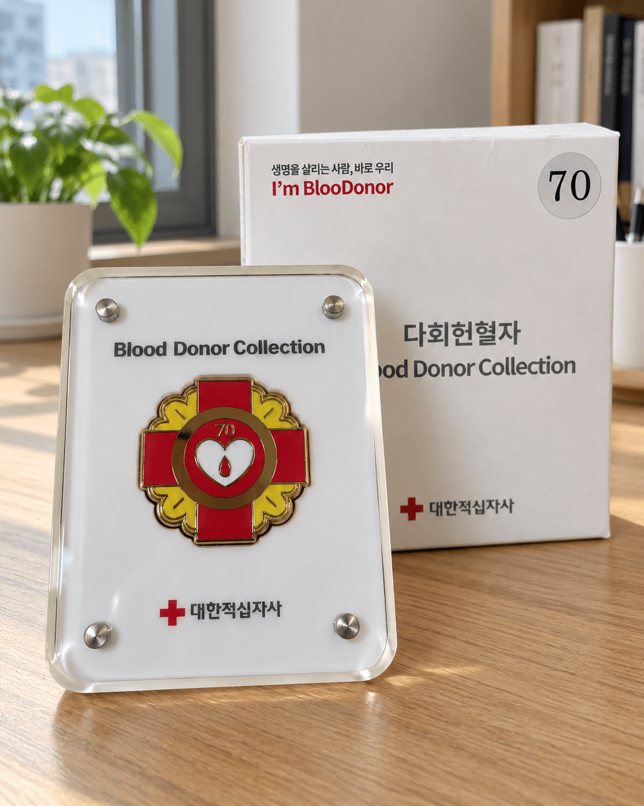

처음 헌혈을 시작한 이후로 무언가를 꾸준히 해보고 싶다는 마음으로 계속 이어왔다.

그렇게 30회와 50회 때 헌혈유공장을 받았고, 이번에는 70회를 채워 블러드도너 컬렉션을 받았다.

헌혈을 하면서 가장 기억에 남는 일은 46회 되었을 때다. 아는 형의 지인이 오토바이 사고로 크게 다쳤다는 이야기를 듣고, 그동안 모아두었던 헌혈증을 모두 드렸다.

내가 해온 헌혈이 실제로 누군가에게 도움이 될 수 있다는 걸 그때 처음 크게 느꼈다. 그래서 앞으로도 할 수 있을 때 계속 헌혈해야겠다고 생각했다.

2019년에 별생각 없이 시작한 일이 어느새 70회가 됐다.

앞으로도 건강이 허락하는 동안 꾸준히 이어가려고 한다.

*헌혈 70회, 블러드도너 컬렉션*
