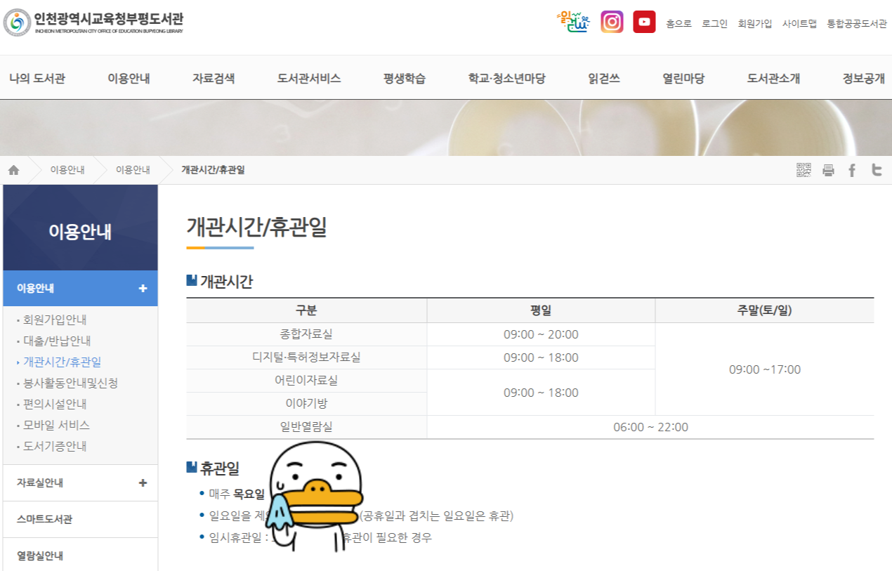
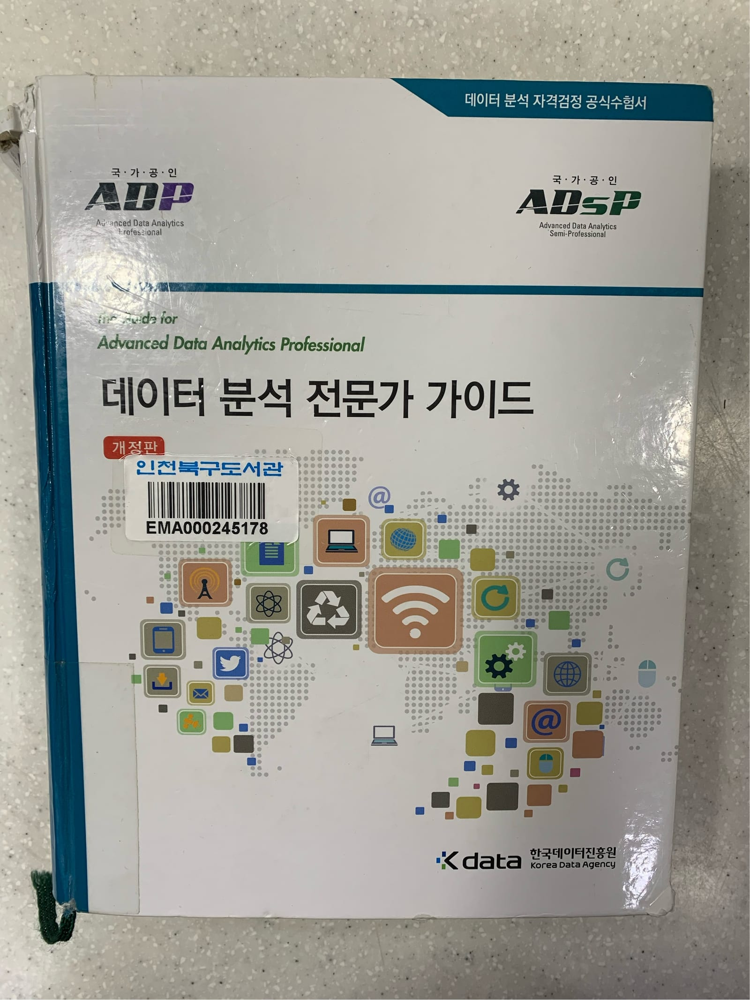
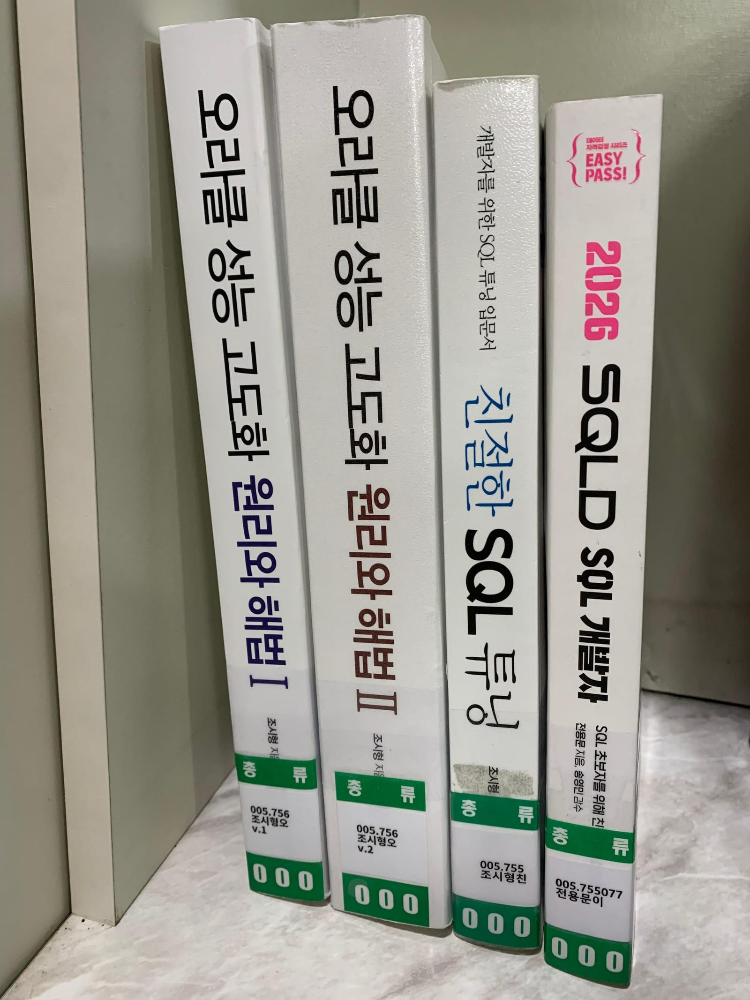
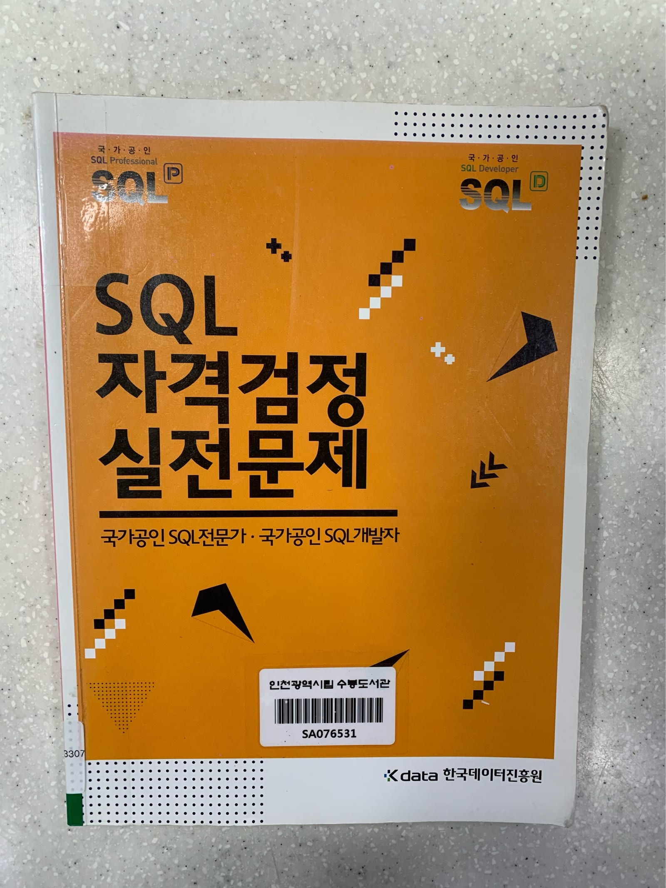
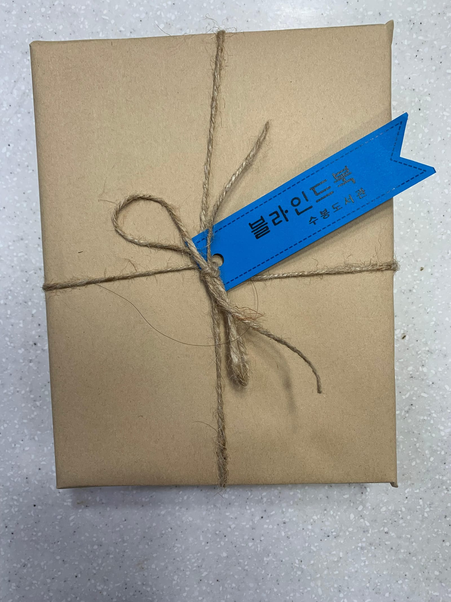
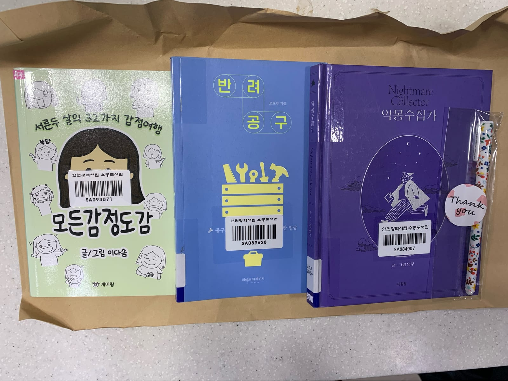
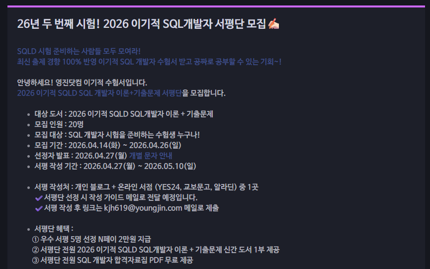

안녕하세요. **juwkim**입니다.

오늘은 시험 후기가 아니라, 일상 기록을 하나 남겨보려고 합니다.

4월 23일은 인천 도서관들을 돌면서 SQL, 데이터아키텍처, 데이터분석 관련 책들을 빌린 날이었습니다.

요즘 관심을 두고 있는 방향이 **SQL 전문가(SQLP)** 와 **데이터아키텍처 전문가(DAP)** 쪽이다 보니,

관련 책을 미리 모아두고 차근차근 공부해보자는 생각으로 움직였습니다.

자격증 책은 가격이 생각보다 만만하지 않은데,

이번에는 도서관을 잘 활용해서 비교적 경제적으로 공부할 수 있게 됐다는 점이 좋았습니다.

---

## 원래 계획했던 동선

처음에는 책을 보유한 도서관을 직접 돌면서 필요한 책을 하나씩 빌릴 생각이었습니다.

대략 계획했던 순서는 이랬습니다.

1.  부평도서관
2.  신트리도서관
3.  계양도서관
4.  연수도서관
5.  화도진도서관
6.  수봉도서관

빌릴 계획이었던 책들은 대략 아래와 같았습니다.

**계양도서관**

-   『오라클 성능 고도화 원리와 해법 1』(조시형 저 | 디비안(DBian))
-   『오라클 성능 고도화 원리와 해법 2』(조시형 저 | 디비안(DBian))
-   『친절한 SQL 튜닝』(조시형 저 | 디비안(DBian))
-   『이지패스 2026 SQLD SQL 개발자』(전용문 저 | 위키북스)

**부평도서관**

-   『SQL 전문가 가이드』(한국데이터산업진흥원 저 | 한국데이터산업진흥원)
-   『새로 쓴 대용량 데이터베이스솔루션 1』(이화식 저 | 엔코아정보컨설팅)
-   『관계형 데이터 모델링 노트』(김기창 저 | 위즈덤마인드)
-   『Rocky Linux8로 리눅스마스터 1급 정복하기』(정성재, 백승찬 저 | 북스홀릭퍼블리싱)

**신트리도서관**

-   『데이터분석전문가가이드』(한국데이터산업진흥원 저 | 한국데이터산업진흥원)

**연수도서관**

-   『관계형 데이터 모델링 프리미엄 가이드』(김기창 | 위즈덤마인드)

**화도진도서관**

-   『데이터아키텍처 전문가 가이드』(한국데이터산업진흥원 저 | 한국데이터산업진흥원)

**수봉도서관**

-   『SQL 자격검정 실전문제』(한국데이터산업진흥원 저 | 한국데이터산업진흥원)

처음에는 이 도서관들을 끝까지 직접 다 돌 생각이었습니다.

---

## 부평도서관, 그리고 바로 틀어진 첫 일정

가장 먼저 **부평도서관**으로 갔습니다.

그런데 막상 도착해보니 하필 **목요일이 휴관일**이었습니다.

처음부터 계획이 조금 틀어졌지만,

부평도서관은 이번 주 토요일에 **컴퓨터활용능력 1급 실기 시험**을 치른 뒤 다시 오기로 하고 바로 다음 도서관으로 이동했습니다.

---

## 신트리도서관에서

다음으로 간 곳은 **신트리도서관**이었습니다.

여기서는 『데이터분석전문가가이드』를 빌렸습니다.  
이 책은 당장 바로 쓰기보다는, 나중에 **데이터분석전문가(ADP)** 준비할 때 볼 책입니다.

ADP는 바로 응시할 계획은 아니고, 현재로서는 **2027년 상반기쯤** 도전하게 될 것 같습니다.

그때는 장병e음 포인트가 **64,000원** 정도 들어올 예정이라,

부족한 책인 <strong>『</strong>ADP 필기 데이터 분석 전문가 : 올패키지<strong>』</strong>(윤종식 저 | 데이터에듀) 는

그 시점에 구매하는 방향으로 생각하고 있습니다.

---

## 계양도서관에서

그 다음으로는 **계양도서관**으로 갔습니다.

여기서는 아래 책들을 빌렸습니다.

-   『오라클 성능 고도화 원리와 해법 1』(조시형 저 | 디비안(DBian))
-   『오라클 성능 고도화 원리와 해법 2』(조시형 저 | 디비안(DBian))
-   『친절한 SQL 튜닝』(조시형 저 | 디비안(DBian))
-   『이지패스 2026 SQLD SQL 개발자』(전용문 저 | 위키북스)

이번에 빌린 책들만으로도 당분간은 SQLD, SQLP, SQL 튜닝 쪽을 같이 볼 수 있는 구성이 됐습니다.

---

## 여기서 생각이 바뀌었다

실제로 **부평도서관 → 신트리도서관 → 계양도서관**까지 다녀오고 나니 생각이 조금 바뀌었습니다.

막상 움직여보니 여러 도서관을 하나하나 직접 도는 방식은 생각보다 비효율적이었습니다.

시간도 많이 들고, 이동 거리도 길고, 책 한두 권 때문에 계속 다른 도서관으로 넘어가는 게

꼭 좋은 방법은 아니라는 생각이 들었습니다.

그래서 중간부터는 **남은 책들은 부평도서관에서 상호대차 서비스로 한꺼번에 받는 게 더 낫겠다**고 생각했습니다.

그래서 아래 책들은 다음에 **누나 결혼식 겸 나오는 휴가** 때 **부평도서관 상호대차 서비스**를 이용해서 한꺼번에 빌릴 계획입니다.

-   『SQL 전문가 가이드』
-   『데이터아키텍처 전문가 가이드』
-   『새로 쓴 대용량 데이터베이스솔루션 1』
-   『핵심 데이터 모델링』
-   『관계형 데이터 모델링 프리미엄 가이드』
-   『관계형 데이터 모델링 노트』
-   『Rocky Linux8로 리눅스마스터 1급 정복하기』

---

## 수봉도서관에서

이후에는 **수봉도서관**에도 들렀습니다.

여기서는 『SQL 자격검정 실전문제』를 빌렸습니다.

그리고 여기서 예상하지 못했던 재미있는 일도 하나 있었습니다.

---

## 블라인드북 이벤트

수봉도서관에서는 **블라인드북 이벤트**를 하고 있었습니다.

책 제목이 보이지 않도록 포장을 해둔 상태로 대출하고, 빌린 뒤에 포장을 열어봐야 어떤 책인지 알 수 있는 방식이었습니다.

이런 이벤트는 처음 봤는데 꽤 좋았습니다. 평소라면 제가 직접 고르지 않았을 책을 우연히 만나보게 된다는 점이 재미있었습니다.

포장을 풀고 나서 나온 책은 총 3권입니다.

-   『모든 감정 도감』(이다솜 저 | 개띠랑)
-   『반려공구』(모호 저 | 라이프앤페이)
-   『악몽수집가』(엄주 저 | 아침달)

어떤 책이든 일단 빌렸으니 이번 기회에 잘 읽어보려고 합니다.

---

## 책바다라는 서비스도 알게 됐다

오늘 도서관 책을 찾다 보니 [**책바다**](http://books.nl.go.kr/nill/ "책바다")라는 서비스도 알게 됐습니다.

책바다는 **국가상호대차 서비스**로, 내가 원하는 책이 가까운 도서관에 없더라도

참여 도서관끼리 자료를 주고받아 가까운 도서관에서 빌릴 수 있도록 해주는 서비스입니다.

자격증 책은 가격이 저렴하지 않은 경우가 많아서,

예전 같으면 망설였을 책들도 이 서비스를 활용하면 부담을 많이 줄일 수 있겠다는 생각이 들었습니다.

그래서 앞으로는 주변 도서관에 없는 책들을 **책바다**를 통해 빌려볼 생각입니다.

---

## 이기적 SQLD 서평단

오늘은 책만 빌린 게 아니라 **이기적 SQLD 서평단**도 신청했습니다.

꼭 당첨돼서 책까지 받으면 좋겠습니다.

---

## 마무리

오늘은 앞으로 공부하기 위한 기반을 잘 다져둔 날입니다.

부평도서관이 휴관이라 처음부터 조금 꼬이긴 했지만,

신트리, 계양, 수봉도서관을 돌면서 필요한 책들을 많이 빌렸습니다.

무엇보다 좋았던 건 도서관, 상호대차, 책바다 같은 서비스를 잘 활용하면

비용 부담을 줄이면서도 충분히 깊이 있게 공부할 수 있다는 점이었습니다.

올해는 SQL 전문가와 데이터아키텍처 전문가 공부를 조금 더 차분하고 길게 가져가보려고 합니다.

하나씩 읽고, 정리하고, 필요한 만큼 제대로 쌓아가보겠습니다.
