집에서 지하철을 타고 코엑스가 있는 봉은사역까지 가는 데만 꼬박 1시간 30분이 걸렸다. 14시에 시작한 행사는 17시 30분이 넘어 끝났고, 다시 1시간 30분을 달려 집에 돌아오니 19시였다. 왕복 3시간의 이동과 3시간 30분의 참관. 몸은 피곤했지만, 스마트폰 메모장에는 그 어느 때보다 묵직한 문장들이 빼곡히 남았다.

2026년 10월 28일 수요일, 코엑스 오디토리움에서 열린 '2026 정주영 창업경진대회 데모데이'에 다녀왔다.

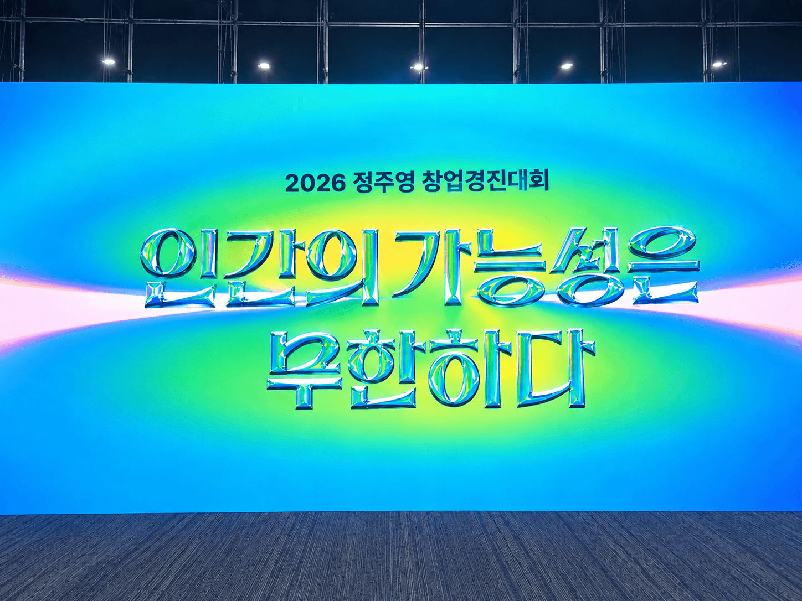

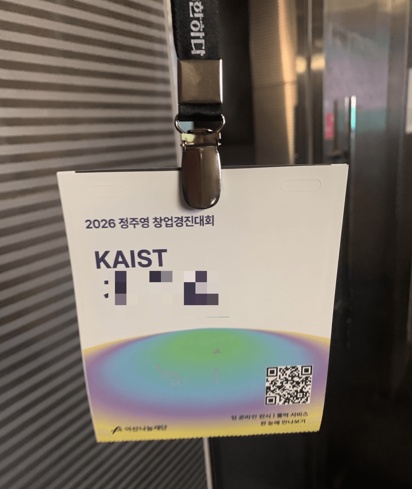

## 행사 타임테이블 및 개요

- **일시 및 장소:** 2026. 10. 28.(수) 13:00 ~ 18:00 / 코엑스 오디토리움
- **공식 홈페이지:** [정주영 창업경진대회 데모데이 사이트](https://startup.asan-nanum.org/)
- **세부 일정:**
    - 13:00 ~ 14:00 현장 등록 및 스타트업 전시 관람
    - 14:05 ~ 14:08 아산나눔재단 엄윤미 이사장 환영사
    - 14:08 ~ 14:28 크래프톤 장병규 의장 키노트
    - 14:30 ~ 17:14 비기너 · 뉴커머 · 기후테크 · 글로벌 부문별 피칭
    - 17:14 ~ 17:55 시상식
    - 17:55 ~ 18:00 행사 마무리

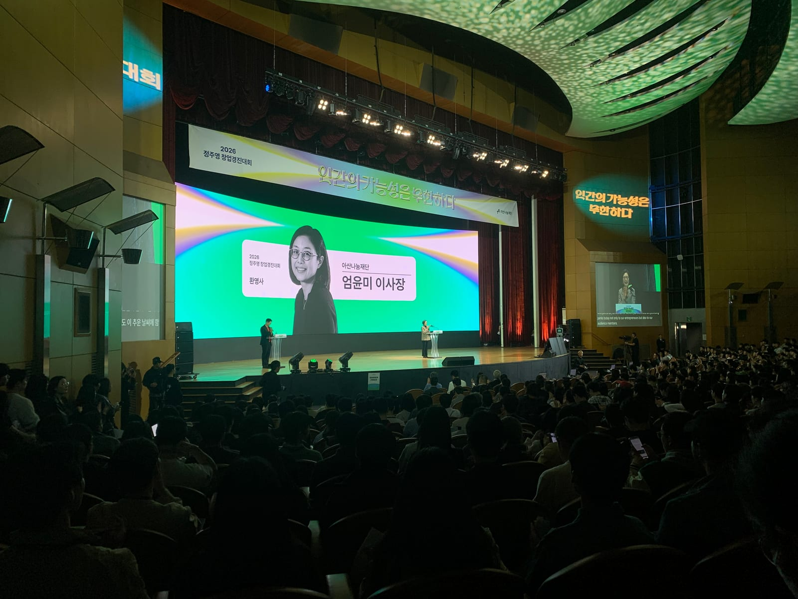

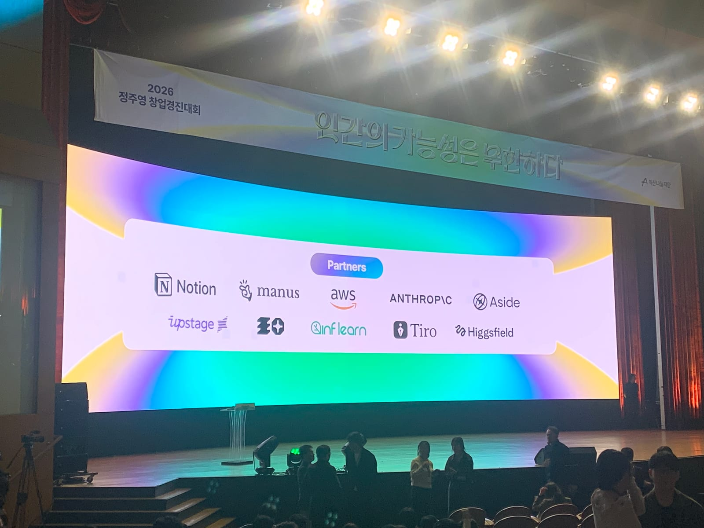

## 키노트: 크래프톤 장병규 의장, '무한으로의 확장'과 주 100시간의 의미

오후 2시, 아산나눔재단 엄윤미 이사장님의 환영사에 이어 크래프톤 장병규 의장님이 무대에 올랐다. 강연 주제는 '무한으로의 확장'이었다.

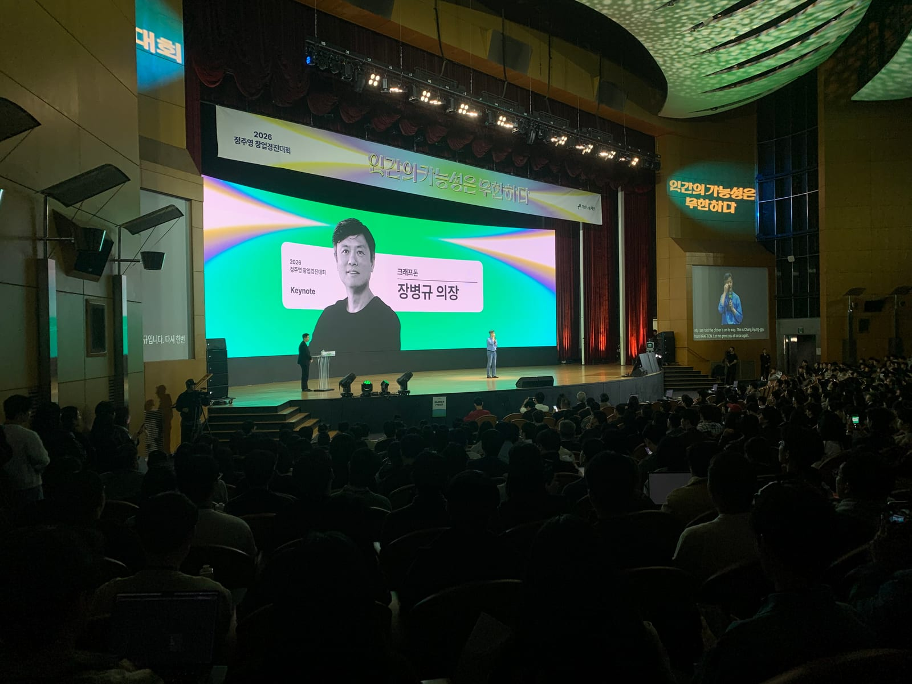

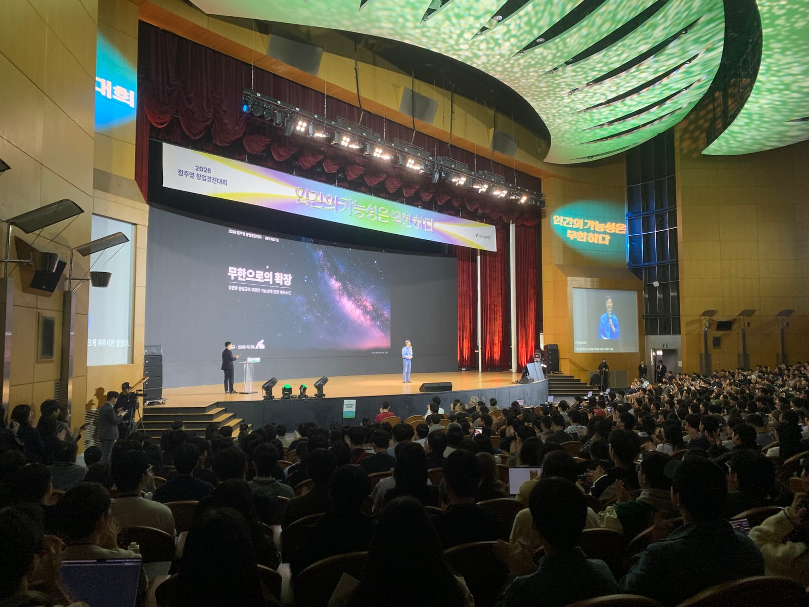

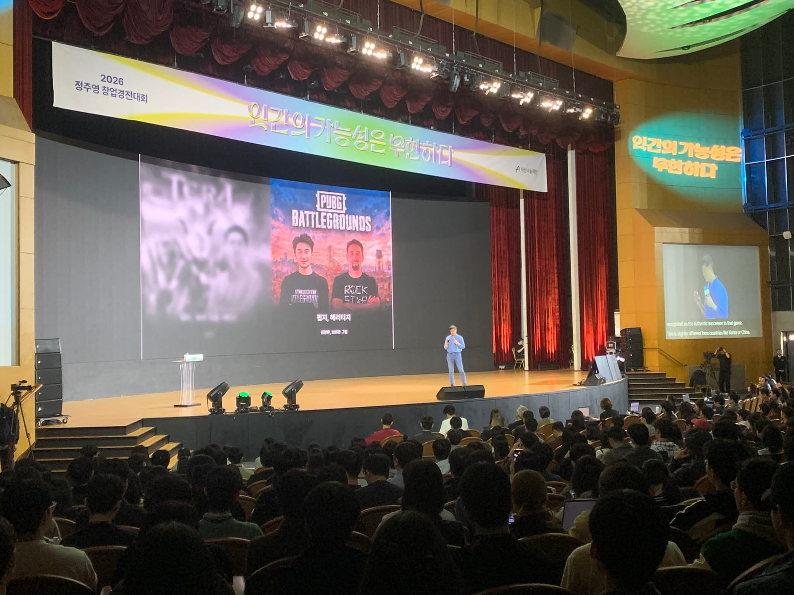

네오위즈를 공동 창업하고 첫눈, 본엔젤스, 그리고 블루홀(현 크래프톤)에서 《테라》와 《배틀그라운드》의 신화를 쓰기까지, 그의 초기 창업 시절을 관통하는 키워드는 단연 '주 100시간의 몰입'이었다.

흔히 주 100시간 근무라고 하면 누군가는 과로와 착취를 떠올린다. 하지만 창업가의 주 100시간은 결이 다르다. 자본도 네트워크도 없는 초기 팀이 거대 기업과의 경쟁에서 이기고 세상에 없던 서비스를 만들어낼 수 있는 유일한 무기는 압도적인 물리적 시간 투입뿐이다. 누가 시켜서 하는 노동이 아니라, 내 손으로 문제를 해결하고 성취를 얻기 위해 스스로를 갈아 넣는 자발적 몰입이다.

키노트에서 던져진 이 '주 100시간'이라는 화두는, 뒤이어 무대에 오른 11개 창업팀의 발표를 들으며 더욱 선명한 현실로 다가왔다.

## 현장에서 기록한 창업팀들의 피칭과 치열한 생존기

오후 2시 반부터 약 3시간 동안 비기너, 뉴커머, 기후테크, 글로벌 트랙 참가팀들의 발표와 심사위원 질의응답이 이어졌다. 발표를 들으며 실시간으로 받아 적은 팀별 핵심 내용과 인사이트를 정리해 본다.

### 타로랩스: "먼저 팔고, 나중에 만들자"

발표 시작과 함께 머리를 한 대 맞은 듯한 문장이 나왔다.

> 문제는 현장에 있다. 내가 좋은 제품을 만들면 고객이 알아서 써줄 거라고 기대하지 말자.

개발자나 엔지니어는 흔히 '기술적으로 훌륭한 제품을 만들면 팔릴 것'이라는 착각에 빠진다. 하지만 타로랩스는 반대로 말했다. 고객과 직접 소통하며 무엇이 아픈지 물어보고, 제품을 다 만들기 전에 **먼저 팔고 나서 제품을 만들라**는 것이다. 책상 앞이 아니라 고객이 지갑을 여는 현장에서 검증부터 마쳐야 살아남는다.

### 에이올로: 인바운드·아웃바운드와 숫자의 증명

AI로 기업 웹사이트의 광고 효율을 높이는 팀이다. 고객이 스스로 찾아오게 만드는 '인바운드(Inbound)'와 직접 기업을 찾아가 영업하는 '아웃바운드(Outbound)' 전략을 들으며 B2B 세일즈의 기본 개념을 배웠다.

특히 심사위원의 질문이 날카로웠다. "8월 매출 901만 원에서 9월 3,020만 원으로 한 달 만에 매출이 3배 넘게 늘었는데, 왜 늘었는지 설명해달라"는 질문이었다. 투자자들은 숫자가 뛰었을 때 박수부터 치지 않는다. 일회성 운인지, 아니면 대표가 성장의 원인을 정확히 알고 다음 달에도 재현할 수 있는 '구조적 성장'인지를 집요하게 검증한다는 점이 인상 깊었다.

### 루타일: 의심을 확신으로 바꾸는 법

"모든 기업이 안심하고 AI를 쓰는 환경"을 슬로건으로 내걸고 기업용 AI 에이전트 보안 통제 솔루션을 만드는 팀이다. 솔직히 발표 초반에는 '신생 스타트업이 대기업이 쓸 만한 고도화된 AI 보안 기술을 정말 구현할 수 있을까?' 하는 의심이 먼저 들었다. 하지만 루타일은 그 의심을 세 가지 팩트로 단숨에 잠재웠다. **보안 대회 1위 수상(객관적 기술력 증명), 대기업과의 PoC(개념 검증) 수행, 실제 제품 유료 판매**. 백 마디 말보다 확실한 레퍼런스와 KPI가 어떻게 시장의 불신을 깨는지 눈으로 확인한 순간이었다.

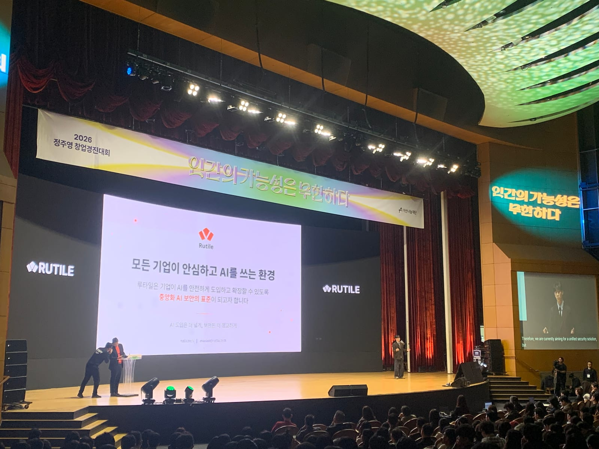

### 더블제로: 프로덕션 창작자의 진짜 페인 포인트, 'Shoty'

프로덕션 창작자의 의도와 제작 맥락을 이해하는 AI 영상 제작 플랫폼 'Shoty'를 개발한다. AI로 영상을 만들어 본 사람이라면 누구나 겪는 고통이 있다. "이 부분만 조금 수정해 줘"라고 하면 AI가 의도를 못 알아듣고 영상 전체를 아예 새로 뽑아버리는 문제다. 더블제로는 내가 미처 생각지도 못했던 현업 영상 제작자의 가장 답답한 병목을 정확히 짚어내 해결하고 있었다.

### 세이프코어(SAFECORE): 결국은 사람, 그리고 "이봐, 해 봤어?"

세이프코어 발표에서는 심사위원들이 '팀빌딩(Team Building)'에 대해 깊이 질문했다. 초기 스타트업의 사업 아이템은 시장 상황에 따라 바뀔 수 있지만, 문제를 끝까지 물고 늘어지는 '팀'은 바뀌지 않기 때문이다.

무엇보다 발표 마지막 슬라이드가 깊은 울림을 주었다. 고 정주영 회장의 자서전 『이 땅에 태어나서』 표지와 함께 적힌 "이봐, 해 봤어?"라는 문구, 그리고 "한 소년의 동경에서, 기업가의 실천으로. 그분의 서사를 듣고 자란 소년이 영광의 무대에 섰습니다!"라는 고백이었다. 발표를 마치고 무대 오른편에서 청중을 향해 90도로 깊이 허리 숙여 인사하던 신광성 대표님의 모습에서 창업가의 진심이 그대로 전해졌다.

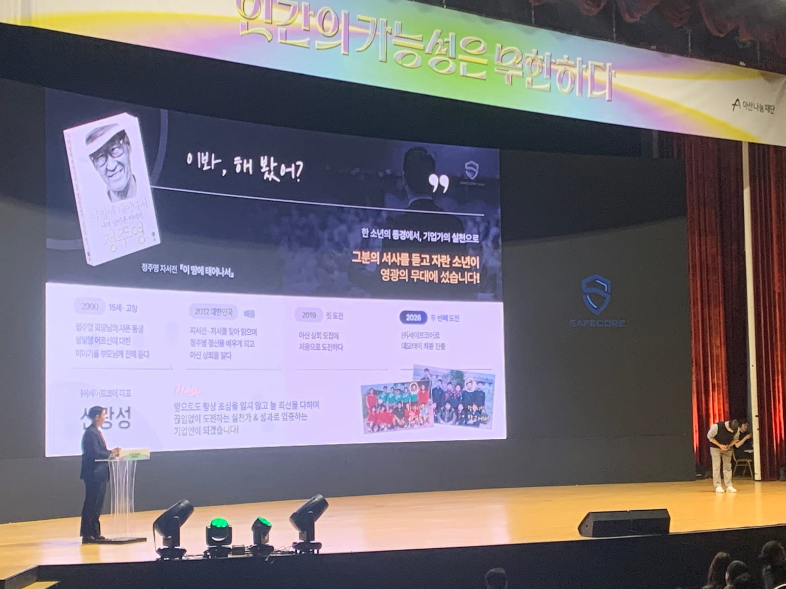

### 커넥트: 5년의 뼈아픈 당사자 경험이 만든 외국인 생활 인프라

인도 출신 라비 샨카르 판딧 대표는 5년 전 석사 과정으로 한국에 왔을 때, 기본적인 생활 서비스를 쓰는 데도 매번 현지인의 도움을 받아야만 했다. 본인 인증과 복잡한 절차로 막힌 한국 생활의 불편함을 직접 겪은 그는 "왜 아무도 외국인을 위한 인프라를 만들지 않는가" 묻다가 직접 다섯 번째 회사를 창업했다. 96개국 외국인이 여권 하나만으로 한국에서 필요한 모든 것을 시작할 수 있게 만드는 플랫폼이다. 자신이 직접 겪은 고통에서 출발한 창업만큼 강력한 동기는 없다.

### 몬죠: 무너지는 땅을 28분 먼저 알리다

*"The climate won't wait. Neither should we."* 도시 지반침하 위험을 28분 먼저 감지하고 알리는 AIoT 안전 플랫폼이다. 지난달 네팔 산사태로 천 명 이상이 숨졌을 때, 위성 기록에는 산이 한 달에 1cm씩 움직인 흔적이 남아 있었지만 아무도 실시간으로 보지 못했다고 한다. 몬죠는 땅속에 저렴한 센서를 촘촘히 심어 AI로 분석하고 붕괴 30분 전에 경고를 보낸다. 주로 정부·지자체(B2G)와 사업을 진행하며, 창업 1년도 안 되어 외부 투자 없이 4개국 5건의 협약과 수주액 1.1억 원을 확보했다.

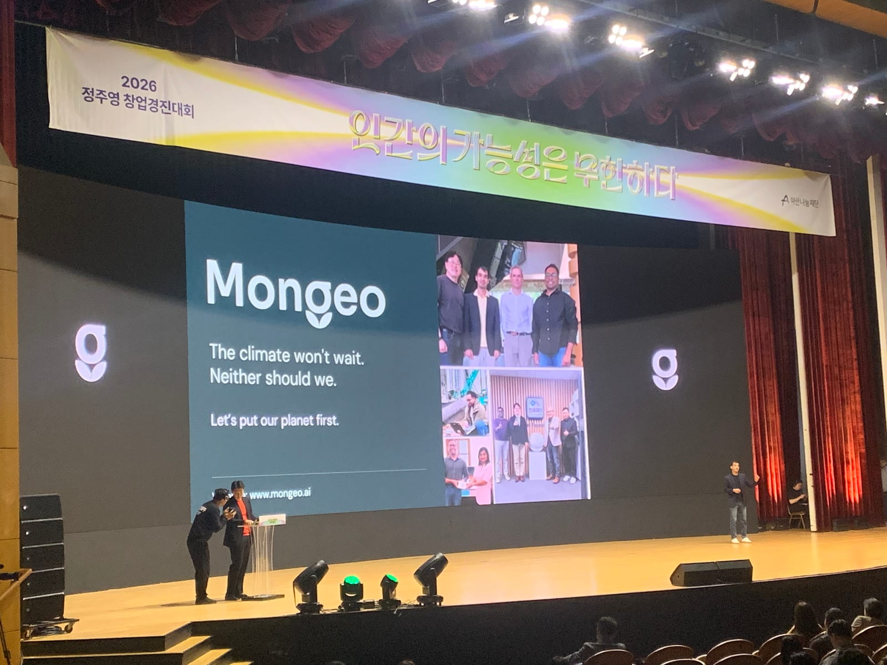

### 리피드(ReFeed): 15년 에너지 전문가의 시선, 기록이 곧 인증이 되다

치킨집에서 쓰고 버린 폐식용유는 친환경 지속가능항공유(SAF)의 핵심 원료다. 2027년부터 국내 항공유에도 의무 혼합이 시작되지만, 진짜 문제는 수거량이 아니라 '출처 기록'이었다. 국제 인증은 출처가 불분명한 기름을 원료로 인정하지 않기 때문이다.

석유화학 공정과 한화토탈에너지스 ESG경영팀에서 15년간 일한 이충호 대표는 직접 폐유를 수거하는 대신, 음식점과 수거업체가 쓰는 계량 기기와 앱을 만들었다. **기름을 재는 순간이 곧 기록이 되고, 그 기록이 그대로 국제 인증 서류가 되게 만든 것**이다. 국내 원료가 부족하자 베트남에 35명 규모의 법인을 세우고 인도까지 진출한 실행력에서 현장을 아는 전문가의 힘을 보았다.

### 에어로봇 프론티어스: "사람의 지혜가 만든 것이라면, 사람을 구해 보여라"

KAIST 항공우주공학 박사과정의 임철수 대표가 창업한 고정익 기반 산불 감시·방재 무인기 팀이다. 일반 회전익 드론은 비행시간이 짧아 넓은 산림을 감시할 수 없고, 유인 헬기는 야간 출동이 위험하다. 에어로봇 프론티어스는 여러 기체가 스스로 구역을 나눠 장시간 비행하며 발화 30분 골든타임 안에 산불을 찾아낸다.

발표 중 나왔던 "사람의 지혜가 만든 것이라면, 사람을 구해 보여라"라는 문장은 기술과 공학이 왜 존재해야 하는지 단 한 줄로 일깨워 주었다.

### 엑스센트리: AI 전력난의 병목, 차세대 SMR 극한환경 계측

AI 데이터센터의 가장 큰 물리적 병목은 전력이고, 그 대안인 비경수형 소형모듈원자로(SMR)는 500℃가 넘는 고온·부식 환경이라 기존 계측 장비를 넣을 수 없다. 서울대 원자핵공학 박사과정 고근우 대표와 미국 아이다호 국립연구소에서 연구 중인 KAIST 양원석 박사는 원자로 설계를 바꿀 필요 없이 크기를 절반 이하로 줄인 비경수형 SMR 계측 시스템을 개발했다. 올해 8월 한국원자력연구원과 시제품 공급 계약을 맺으며 독보적인 기술 장벽을 증명했다.

### 웨슬리, 윔, 스킨서울랩, 벌스워크: 글로벌 시장을 뚫는 방식

- **웨슬리:** 미국 중소 회계법인의 반복적인 기장 업무를 자동화하는 AI 소프트웨어를 만든다. 처음에는 직접 콜드메일(아웃바운드)을 돌려 초기 사용자를 확보했고, 제품에 만족한 초기 사용자들이 입소문을 내며 자연 유입(인바운드)으로 이어지는 이상적인 성장 구조를 만들었다.
- **윔(WIM):** AI의 판단과 로봇의 실제 움직임을 연결하는 '로보틱스의 안드로이드'를 구축한다. 대구에서 시작해 엔비디아 젯슨(Jetson) 보드 한 장에 실시간 제어와 기구학·동역학 연산을 통합해 제어 주기 편차를 20분의 1로 줄였고, 미국 미시간 자동차 부품사와 계약을 성사시켰다.
- **스킨서울랩:** 유니레버와 아마존에서 18년간 일한 박근영 대표가 창업했다. 상품이 늘어날수록 사람도 늘려야 하는 유통의 한계를 깨기 위해, 230개의 AI 에이전트에게 소싱·마케팅·풀필먼트·CS를 맡겨 3만 개 K-뷰티 상품을 27개국에 판다. 월 매출 80만 달러, 공헌이익 7개월 연속 흑자라는 압도적 숫자를 보여주었다.
- **벌스워크:** CJ 다이아TV 공채 1호 출신 윤영근 대표가 로블록스 등 UGC 게임 생태계에서 인디 창작자의 게임을 발굴해 지속 가능한 글로벌 IP로 키운다. 대표작 '솔스 RNG'는 누적 플레이 20억 회, 예상 매출 100억 원을 넘기며 로블록스 초기 투자사인 알토스벤처스로부터 270만 달러 투자를 유치했다.

## 엔지니어와 창업가의 차이, 그리고 불확실성의 무게

발표를 듣는 내내 감탄과 함께 묘한 무게감이 밀려왔다. 내가 미처 생각지도 못한 세상의 미세한 빈틈을 발견하고 기어코 해결책을 찾아내는 사람들이 눈앞에 있었다. 그러면서 '창업가는 정말 가기 어려운 길이구나'라는 생각을 지울 수 없었다.

좋은 엔지니어가 되기 위해서는 뛰어난 기술력과 엔지니어링 역량에 집중하면 된다. 하지만 창업가는 다르다. 기술 개발은 기본이고, 고객의 페인 포인트를 정확히 짚어내야 하며, 직접 발로 뛰며 세일즈와 마케팅을 해야 하고, 팀원을 설득해 조직을 꾸리고, 투자자 앞에서 숫자로 성과를 증명해야 한다.

현장의 창업가들은 입을 모아 "불확실성을 견디는 것이 가장 힘들다"고 말했다. 창업한 이후로 단 하루도 마음 편히 쉰 적이 없고, 매주 100시간 이상 일하며 버틴다고 했다. 내일 당장 어떻게 될지 모르는 칠흑 같은 불확실성 속에서 그들이 불안을 이겨내는 유일한 방법은, 한시도 멈추지 않고 주 100시간씩 몸을 던져 문제를 푸는 것뿐이었다.

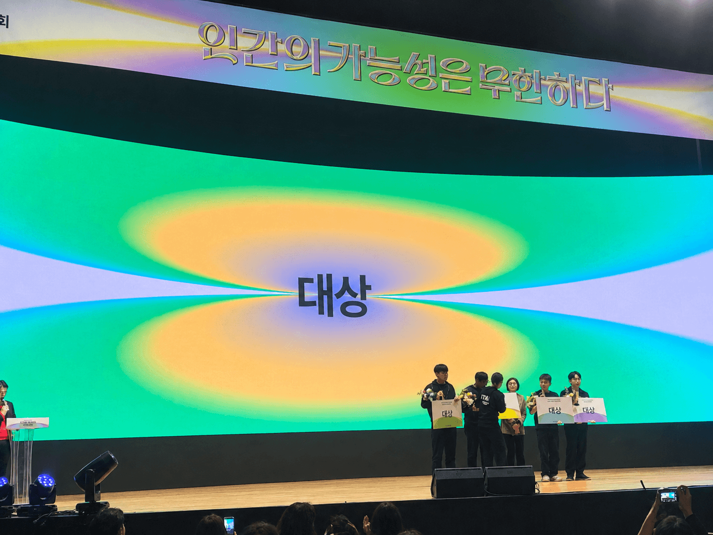

## 오늘 배운 창업 철학 4가지

오후 내내 적어 내려간 메모들을 바탕으로 오늘 현장에서 배운 창업 철학을 네 가지로 정리해 본다.

1. **현장에서 먼저 팔고 만들어라:** 내 머릿속의 완벽한 기술을 믿지 마라. 현장으로 나가 고객에게 문제를 묻고, 지갑을 여는지 먼저 확인한 뒤에 만들어야 한다.
2. **자신이 겪은 아픔과 현장의 연륜이 무기다:** 외국인으로서 겪은 5년의 불편함, 정유사 15년의 경험, 글로벌 유통 18년의 경력처럼 현장에서 직접 부딪히며 얻은 문제의식은 누구도 쉽게 따라 할 수 없는 해자(Moat)가 된다.
3. **의심은 말이 아니라 숫자와 레퍼런스로 깨라:** 시장은 신생 기업의 말을 쉽게 믿지 않는다. 대회 1위, 국책 연구원 및 대기업과의 PoC, 공헌이익 흑자, 그리고 매출이 3배 뛴 명확한 인과관계만이 의심을 신뢰로 바꾼다.
4. **기술의 끝은 결국 사람이다:** 땅이 무너지기 28분 전에 알리고, 산불 골든타임 30분 안에 출동해 생명을 구하는 것처럼, 사람의 지혜가 만든 기술은 결국 사람의 삶과 생명을 지키는 곳으로 향해야 한다.

## "무슨 일이든 할 수 있다고 생각하는 사람이 해내는 법이다"

행사가 끝나고 19시, 집에 돌아와 책상 위에 오늘 행사장에서 받아온 굿즈들을 펼쳐 놓았다. 검은색 볼캡과 볼펜, 스티커, 그리고 정주영 회장의 어록이 새겨진 책갈피 패치가 눈에 들어왔다.

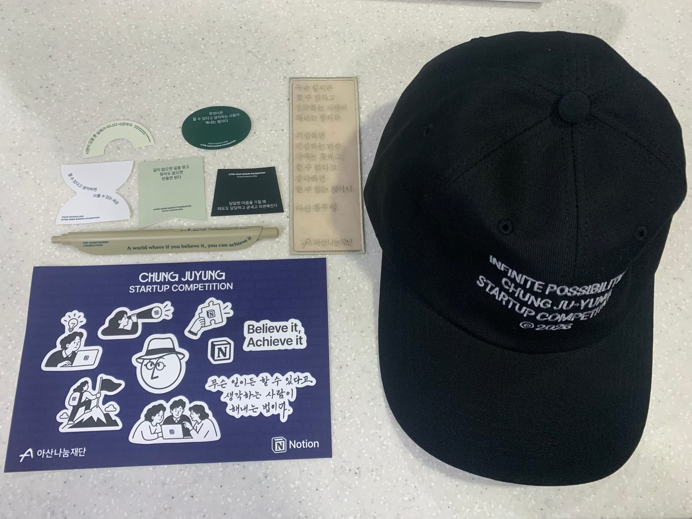

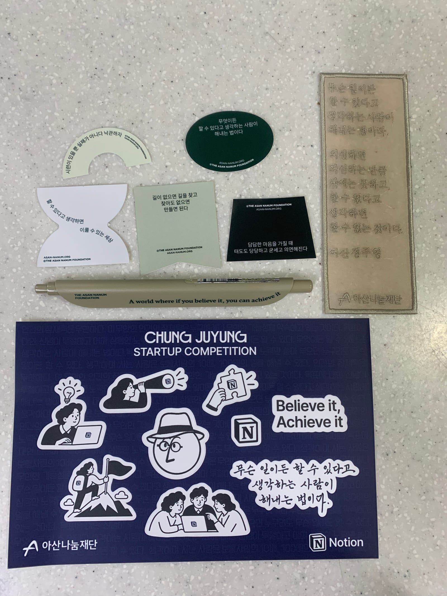

패치와 스티커에는 이런 문장들이 적혀 있었다.

> 시련이 있을 뿐 실패가 아니다 낙관하자
>
> 길이 없으면 길을 찾고 찾아도 없으면 만들면 된다
>
> 무슨 일이든 할 수 있다고 생각하는 사람이 해내는 법이다. 의심하면 의심하는 만큼밖에 못하고, 할 수 없다고 생각하면 할 수 없는 것이다.

오늘 무대 위에서 본 창업가들은 모두 남들이 "과연 될까?"라고 의심하던 문제를 붙잡고, 스스로 할 수 있다고 믿으며 길을 만들어낸 사람들이었다.

왕복 3시간의 발걸음이 조금도 아깝지 않은 하루였다. 앞으로 내가 어떤 기술을 공부하고 어떤 도전을 마주하든, 오늘 현장에서 느낀 이 뜨거운 열정과 문장들을 오래도록 꺼내 보게 될 것 같다.

**의심하는 만큼 멈춰 서지 말고, 할 수 있다고 믿는 만큼 끝까지 해내는 사람이 되자.**
