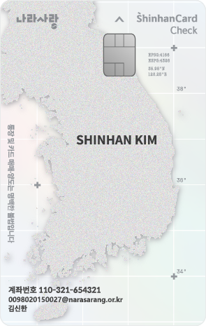
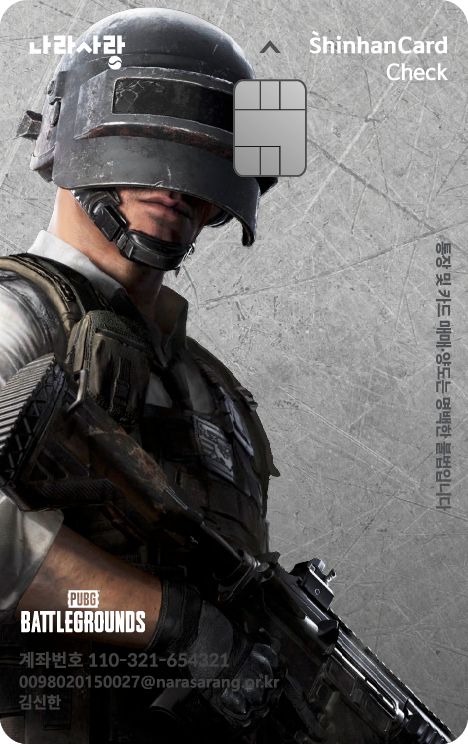
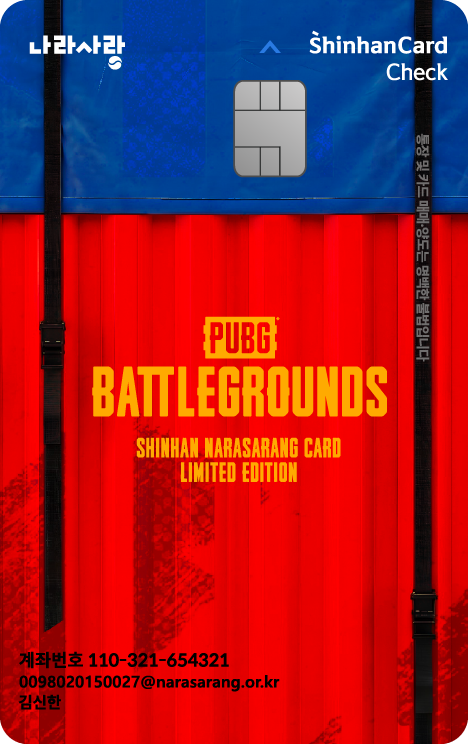
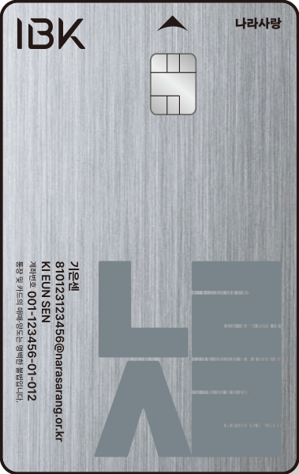
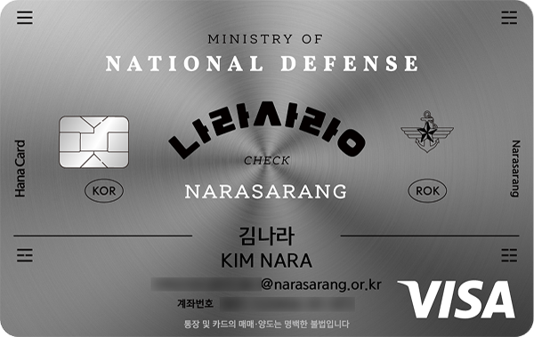

나는 소비할 때 같은 제품이나 서비스를 조금이라도 더 저렴하게 이용하는 것을 하나의 기준으로 삼아왔다. 같은 제품을 구매하더라도 온라인에서 가격을 비교해 가장 저렴한 판매처를 찾는 편이다. 이런 습관은 카드 사용에도 이어졌다. 단순히 자주 쓰는 카드 한 장만 사용하는 것이 아니라, 지출 항목별로 가장 큰 혜택을 받을 수 있는 카드를 찾아 활용하고 싶었다. 그래서 이번에는 나라사랑카드의 혜택을 정리해보려 한다.

군 복무 중 받을 수 있는 대표적인 혜택 가운데 하나가 나라사랑카드다. 연회비가 없으면서도 교통, 통신, 편의점, 문화생활 등 다양한 분야에서 할인과 적립 혜택을 제공한다. 다만 혜택을 미리 정리해두지 않으면 결제할 일이 생길 때마다 익숙한 카드만 사용하게 되고, 받을 수 있었던 혜택을 놓치기 쉽다.

나 역시 그동안 자주 사용하는 카드 하나만 계속 사용하면서, 어떤 항목에서 어떤 혜택을 받을 수 있는지 제대로 확인하지 못한 경우가 있었다. 앞으로는 소비 항목에 맞춰 카드를 선택하고, 내가 받을 수 있는 혜택을 놓치지 않기 위해 기준을 정리해두려고 한다.

현재 나라사랑카드 3기 사업자(2026년\~2033년)는 신한은행(신한카드), IBK기업은행(BC카드), 하나은행(하나카드)이다. 이번 글에서는 세 카드의 혜택 가운데 내가 실제로 필요로 하거나, 혜택을 활용하기 위해 소비할 의향이 있는 항목을 중심으로 살펴볼 예정이다.

혜택을 정리하다 보니 모든 항목이 나에게 유용한 것은 아니었다. 택시, 편의점, 커피, 배달음식, OTT, 영화관, 테마파크 관련 소비는 평소 거의 하지 않는다. 따라서 이 글에서는 내가 실질적으로 활용할 가능성이 높은 대중교통, 이동통신요금, PX 할인 혜택을 중심으로 비교하고 정리해보려 한다.

## 신한 나라사랑카드

> [신한카드 나라사랑카드 체크](https://www.shinhancard.com/pconts/html/card/apply/check/1236922_2206.html)

*신한 나라사랑카드 디자인 3종 / 국토디자인 1종, 배틀그라운드 에디션 2종*

신한 나라사랑카드 디자인은 대한민국 국토가 그려진 디자인과 배틀그라운드 에디션 2종, 모두 3종이다. 나는 개인적으로 깔끔한 국토디자인이 마음에 든다.

### 슈퍼쏠저 서비스(전월 이용실적 없음)

-   군마트(P.X) 20% 캐시백(월 최대 10만원)
-   군 체력단련장 및 군 휴양시설 20% 캐시백(월 최대 2만원)

※ 이용 시설은 [국군복지포털](https://www.welfare.mil.kr)에서 확인 가능합니다.

군 휴양시설은 민간에 비해 상대적으로 저렴한 가격에 이용할 수 있다. 휴가 중 가족이나 여자친구와 여행을 갈 일이 있을 때 이용하면 좋을 듯하다. 필자는 여자친구가 없어서, 가족여행을 갈 때 이용해보겠다.

### 나라사랑카드 발급 이벤트

이벤트 기간: 2026.01.05 ~ 2026.12.31

**배달의민족: 배민클럽 무료 쿠폰**

-   배민클럽 구독료 1년 무료 바우처
-   등록 유효기간 : 2026.07.31까지
-   카드 발급 시 입력한 휴대폰 번호로 배달의민족 혜택을 받을 수 있는 난수 번호 및 등록 URL이 전달됩니다. (카드 신청 시, 마케팅 SMS 수신을 동의한 고객에 한해 전달됩니다.)

**SKT PS&M: SKT 번호이동 회원 휴가비 25만원 지원**

-   대상: 만 19세 ~ 27세 나라사랑카드 회원
-   혜택 조건
    1.  SKT PS&M 직영점 방문 후 SKT 번호 이동
    2.  나라사랑카드로 SKT 통신요금 자동납부 신청하고
    3.  3개월 유지 시 휴가비 25만원 지원
-   이벤트 기간 : 2026.06.01 ~ 2026.12.31
-   이벤트 혜택 상세안내( [pf.kakao.com/\_zfxiZs/113458739](https://pf.kakao.com/_zfxiZs/113458739) )

**올리브영: 올리브영 결제 시 최대 1만원 캐시백**

-   올리브영 국내 전 가맹점에서 3천원 이상 결제 시, 3천원 캐시백 (월 1회)
-   올영PAY[빠른결제]에 나라사랑카드 등록 후 온라인몰에서 최초 1만원 이상 결제 시, 7천원 캐시백
-   결제일 기준 익월 20일경 고객 대표 계좌로 캐시백 됩니다.

**티머니GO: 처음 택시 결제 시 50% 마일리지 적립**

-   티머니GO 앱에서 첫 택시 결제요금에 대하여 50%를 GO마일리지 적립 (최대 5,000마일리지)

**신한은행: 최초 발급 시 2천원 캐시백**

-   대상: 신한 나라사랑카드 최초 발급자 (단, 1997년도 이후 출생자에 한함)
-   금액: 2천원(나라사랑카드 연결계좌 입금)

## IBK 나라사랑카드

> [IBK 나라사랑카드 (BC카드)](https://www.bccard.com/app/card/CreditCardMain.do?gdsno=756053)

*IBK 나라사랑카드*

IBK 나라사랑카드는 디자인이 심플하다.

### 파워업 서비스 『군마트(PX)』(전월 이용실적 없음)

PX기본할인

<table>
<tbody>
<tr>
<td><b>건당 결제금액</b></td>
<td><b>할인율</b></td>
<td><b>월 할인한도</b></td>
<td><b>현역병</b></td>
<td><b>병 급여이체자</b></td>
</tr>
<tr>
<td>3만원 미만</td>
<td>15%</td>
<td>1만원</td>
<td>월 3회</td>
<td>월 6회</td>
</tr>
<tr>
<td>3만원 이상</td>
<td>10%</td>
<td rowspan="3">5만원</td>
<td rowspan="3">월 2회</td>
<td rowspan="3">횟수제한없음</td>
</tr>
<tr>
<td>7만원 이상</td>
<td>20%</td>
</tr>
<tr>
<td>10만원 이상</td>
<td>30%</td>
</tr>
</tbody>
</table>

PX특별할인

| **건당 결제금액** | **할인금액** | **현역병** | **병 급여이체자** |
| --- | --- | --- | --- |
| 20만원 이상 | 5만원 | 연 1회 | 연 2회 |

-   PX기본할인과 PX특별할인은 할인한도와 할인 횟수가 각각 별도로 적용
-   현역병 : 전월 말일 기준 IBK장병내일준비적금 보유 고객은 별도의 증빙 절차 없이 현역병으로 간주하며, 그 외 고객은 복무확인서와 건강보험자격득실확인서를 IBK기업은행에 제출한 경우에 한해 제출일 익월부터 현역병으로 인정
-   병 급여이체자 : IBK나라사랑카드 결제계좌로 전월 국군재정관리단을 통한 병 급여 수령 시 인정

### 사랑 서비스(전월 이용실적 20만원 이상, 군 급여이체자 전월 이용실적 면제)

**아웃백스테이크하우스 20% 현장할인**

-   월 1회, 1회 최대 4만원 할인한도, 딜리버리서비스 제외

**전국 시내버스, 지하철 10% 청구할인**

-   후불교통 IC카드로 이용한 건에 한함
-   매출표 접수일 기준으로 월 2천원 할인 한도

**이동통신요금 자동납부 시 5% 청구할인**

-   월 1회, 2천원 할인 한도, 최초 접수분에 한함

**인터넷 토익시험 접수(결제), 교보문고(온라인) 서적 구매 시 2천원 청구할인**

-   통합 월 1회, 연 4회, 1회 이용금액 2만원 이상 시 할인

### 현역병 급여수령 고객 우대 패키지(전월 이용실적 없음, '26.12.31까지)

**네이버플러스멤버십**

-   구독료 결제금액 100% 청구할인 (월 최고 4,900원)

**'나라', '사랑'서비스 전월 이용실적 면제**

-   편의점, KTX/SRT/고속버스, 영화, 놀이공원, 아웃백, 대중교통, 이동통신, 어학, 교보문고 할인

**무료 공항라운지 이용권 제공 ※ 더라운지(The Lounge) 고객센터 전화 1811-7437**

-   더라운지멤버스 앱을 통한 이용권 발급 후 더 라운지 제휴 라운지 이용
-   더라운지(The Lounge) 앱 접속 ▶ 회원가입 ▶ 로그인 ▶ 카드등록 ▶ 라운지 이용권 받기

**쿠팡, 다이소, 올리브영 통합 1천원 할인쿠폰 마이태그 제공(매월 1회)**

-   BC카드 마이태그 후 대상 브랜드 중 최초 1만원 이상 결제건에 대해 1천원 청구할인

※ 마이태그 : BC페이북 앱에서 전자쿠폰 클릭 후 적용(BC페이북 - 혜택 - 마이태그)

※ 마이태그 관련 유의사항은 마이태그 시 하단의 상세내용을 확인해주시기 바랍니다.

### 현역병 고객 우대 패키지(전월 이용실적 없음, '26.12.31까지)

**카카오T(택시) 50% 할인쿠폰 마이태그 제공(기간 내 1회, 최대 5천원 할인)**

-   BC카드 마이태그 후 카카오T(택시)에서 5천원 이상 결제 시 50% 청구할인

**맘스터치 1천원 할인쿠폰 마이태그 제공(분기당 1회)**

-   BC카드 마이태그 후 맘스터치에서 1만원 이상 결제 시 1천원 청구할인

※ 마이태그 : BC페이북 앱에서 전자쿠폰 클릭 후 적용(BC페이북 - 혜택 - 마이태그)

※ 마이태그 현역병 기준 : 직전월 IBK장병내일준비적금 보유자 또는 IBK나라사랑카드 결제 계좌로 국군재정관리단을 통한 병 급여 수령자

### IBK나라사랑카드 특별 제휴서비스(전월 이용실적 없음, '26.12.31까지)

**메가MGC커피 앱(메가오더) 결제 시 최대 30% 청구할인**

-   주말(토/일) 30%, 평일 20% 할인(선물하기, 선불충전 제외)
-   1일 1회(1회 할인한도 제한 없음)

**Npay에 등록된 IBK나라사랑카드로 결제 시 결제 금액의 10% Npay 포인트 적립**

-   1일 1회, 건당 최대 1,000원 적립, 온·오프라인 결제건 모두 포함

<table>
<tbody>
<tr>
<td colspan="2"><b>전월 이용실적</b></td>
<td><b>월 최대 적립 횟수</b></td>
<td><b>월 최대 적립 한도</b></td>
</tr>
<tr>
<td>기본</td>
<td>25만원 이상</td>
<td>5회</td>
<td>5,000원</td>
</tr>
<tr>
<td rowspan="2">프로모션</td>
<td>50만원 이상</td>
<td>7회</td>
<td>7,000원</td>
</tr>
<tr>
<td>100만원 이상</td>
<td>10회</td>
<td>10,000원</td>
</tr>
</tbody>
</table>

-   IBK나라사랑카드와 연결된 네이버 계정으로 Npay 포인트 적립
-   Npay 포인트 적립은 이용월의 익월 중 적립

※ 프로모션은 2026.12.31.일까지 운영

## 하나 나라사랑카드

> [하나 나라사랑카드 (하나은행)](https://m.kebhana.com/cont/marketing/hana.jsp)

*하나 나라사랑카드 / Special Edition, Military 디자인*

하나 나라사랑카드 디자인은 안유진이 담겨 있는 Special Edition과 밀리터리 감성을 담은 디자인, 2종이다.

### Easy (전월 이용실적 없음)

<table>
<tbody>
<tr>
<td><b>서비스 영역</b></td>
<td><b>혜택</b></td>
<td><b>혜택조건</b></td>
<td><b>할인율</b></td>
<td><b>할인한도</b></td>
</tr>
<tr>
<td rowspan="2">군마트</td>
<td rowspan="3">캐시백</td>
<td>결제 건당 3만원 미만</td>
<td>30%</td>
<td>월 1만원 (일 5천원)</td>
</tr>
<tr>
<td>결제 건당 3만원 이상</td>
<td>20%</td>
<td>월 10만원 (일 2만원)</td>
</tr>
<tr>
<td>쿠팡/네이버플러스 스토어</td>
<td>-</td>
<td>20%</td>
<td>월 3천원 (일 1천원)</td>
</tr>
<tr>
<td rowspan="2">CU</td>
<td rowspan="2">현장할인</td>
<td>행사품목</td>
<td>10%</td>
<td>월 5만원</td>
</tr>
<tr>
<td>국군의날, 현충일 행사품목</td>
<td>30%</td>
<td>일 5만원</td>
</tr>
</tbody>
</table>

-   쿠팡/네이버플러스 스토어: 공식 홈페이지(온라인/모바일 앱)를 통한 쇼핑 결제 건에 한하여 서비스가 제공되며, <u>상품 선택 시 연결된 다른 사이트 및 앱에서 결제한 경우와 오프라인 결제 건, 상품권, 여행, 항공권, 티켓, 도서, 공연 매출은 서비스에서 제외됨</u>
-   편의점: CU 행사품목에 대해서는 포켓CU 홈페이지(www.pocketcu.co.kr)에서 확인 가능하며, 국군의날·현충일은 30% 할인만 적용되고 나머지 일은 10% 할인이 적용됨

### 나라사랑카드 이벤트

이벤트 기간: 2026.07.01 ~ 2026.09.30

**신규발급 + 결제하면 이디야 커피 쿠폰**

-   혜택: 이디야 아메리카노(L) 1잔 제공
-   조건: 하나 나라사랑카드로 카드발급월 다음달까지 **건당 1원 이상 결제 시**
-   혜택제공일: 카드 결제 후 3영업일 이내 지급(1인 최대 1회)
-   대상: 이벤트 기간 내 하나 나라사랑 카드 신규 발급자

**하나 나라사랑카드 최대 2만원 캐시백!**

-   혜택: 1만원 캐시백 (1인 2회 한정, 최대 2만원)
-   조건: 하나 나라사랑카드로 카드발급월 다음달 15일까지 대상 가맹점에서 건당 1만원 이상 결제 시
-   대상 가맹점: CU, 맥도날드, 무신사 온라인, 먹깨비
-   혜택제공일: 카드 발급월 다음달 말일까지 카드 결제 계좌로 지급
    -   카드발급월 : 26.07 / 이용 기간 : 26.7 ~ 08.15 / 캐시백 지급 기간 : 26.08 말일까지
    -   카드발급월 : 26.08 / 이용 기간 : 26.8 ~ 09.15 / 캐시백 지급 기간 : 26.09 말일까지
    -   카드발급월 : 26.09 / 이용 기간 : 26.9 ~ 10.15 / 캐시백 지급 기간 : 26.10 말일까지
-   대상: 이벤트 기간 내 하나 나라사랑 카드 신규 발급자
