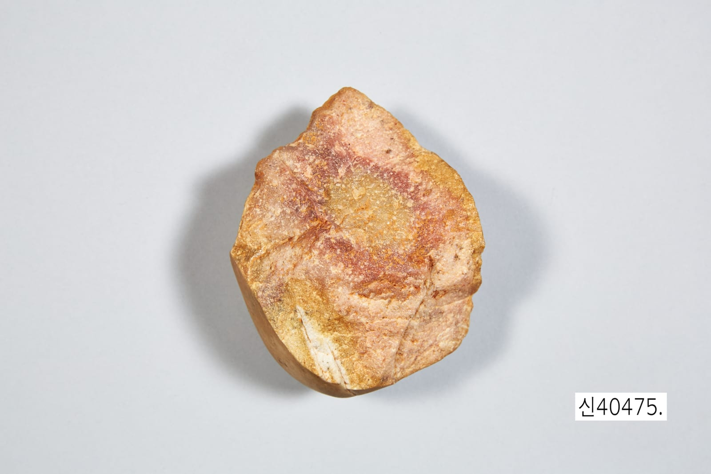
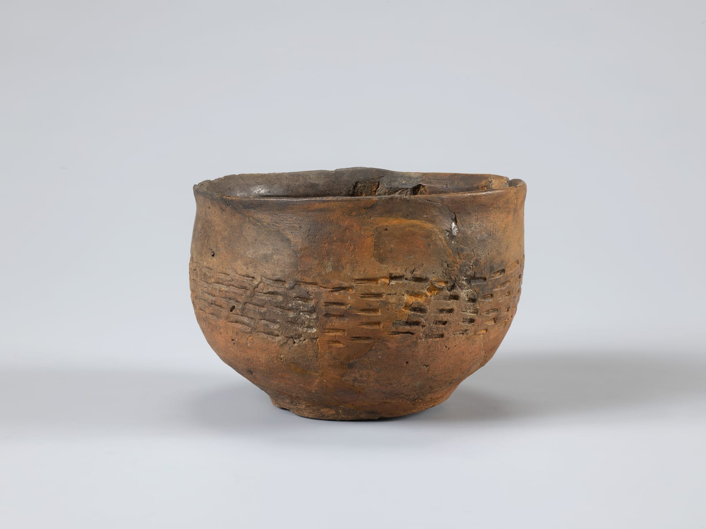
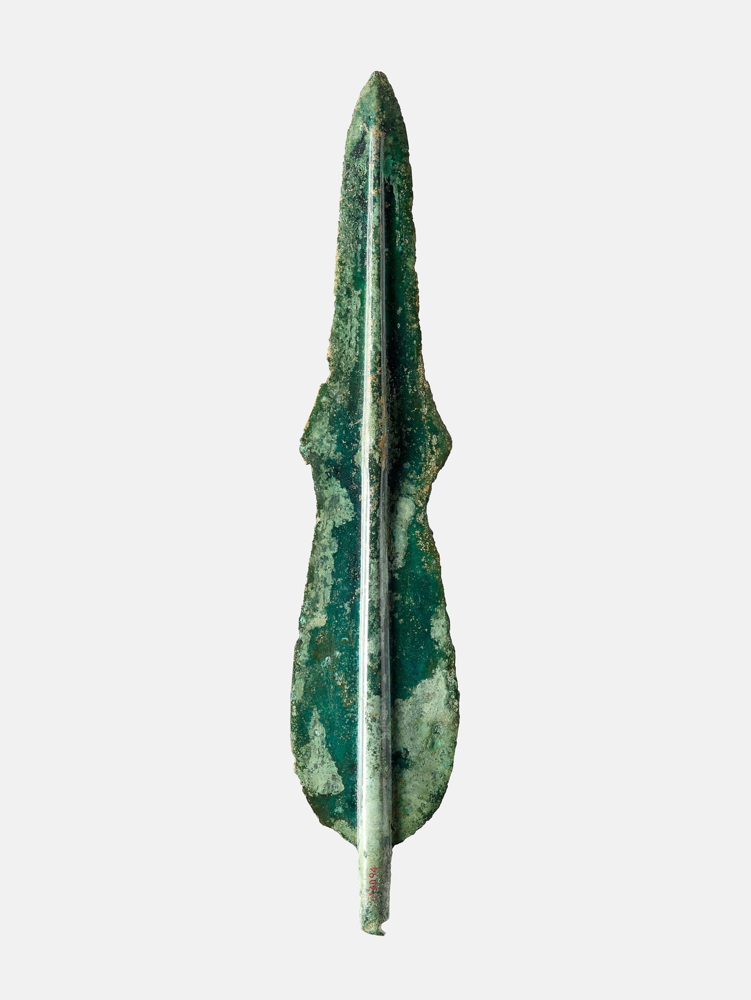

> **이번 글의 질문**
>
> 시대별 도구와 생활 모습은 어떻게 달라졌으며, 고조선과 여러 나라는 어떤 특징으로 구분할까요?

> **핵심 요약**
>
> - **구석기:** 뗀석기·이동 생활 / **신석기:** 간석기·농경 시작·정착 생활
> - **청동기:** 계급 발생·고인돌·비파형 동검 / **철기:** 철제 농기구·세형 동검·중국과 교류
> - **고조선:** 단군왕검·8조법·위만의 집권·중계 무역
> - **나라별 구분:** 부여 사출도 / 고구려 서옥제 / 옥저 민며느리제 / 동예 책화 / 삼한 소도

## 1. 선사 시대의 변화

> **이동 생활 → 농경과 정착 → 생산량 증가·계급 발생 → 철기 보급·여러 나라 성장**

| 시대 | 대표 도구·유물 | 생활·사회 |
| --- | --- | --- |
| 구석기 | **뗀석기** 주먹도끼, 슴베찌르개 | 사냥·채집, 이동 생활 동굴·막집, 무리 생활 평등 사회 |
| 신석기 | **간석기·빗살무늬 토기** 갈돌·갈판, 가락바퀴·뼈바늘 | 농경·목축 시작, 정착 생활 움집, 평등 사회 |
| 청동기 | **비파형 동검·거친무늬 거울** 반달 돌칼, 민무늬 토기 고인돌·돌널무덤 | 벼농사 시작, 생산량 증가 사유 재산·계급 발생 군장 등장 |
| 철기 | **철제 농기구·무기** 세형 동검·잔무늬 거울·거푸집 명도전·오수전 | 농업 생산력·군사력 향상 중국과 교류 여러 나라 성장 |

### 사진으로 구분하는 대표 유물

***주먹도끼 · 구석기:** 돌을 떼어 내어 만든 **뗀석기**입니다. 갈아 만든 간석기와 구분합니다. · 사진: 국립중앙박물관 · 신수40475 · 공공누리 제1유형(출처표시) · [소장품 원문](https://www.museum.go.kr/MUSEUM/contents/M0502000000.do?relicId=106067&schM=view&searchId=search)*

***빗살무늬 토기 · 신석기:** 표면에 새긴 **빗살무늬**가 핵심 단서입니다. 신석기의 농경·정착 생활과 연결합니다. · 사진: 국립중앙박물관 · K번429 · 공공누리 제1유형(출처표시) · [소장품 원문](https://www.museum.go.kr/MUSEUM/contents/M0502000000.do?relicId=2637&schM=view&searchId=search)*

***비파형 동검 · 청동기:** 검몸의 아래쪽이 **비파처럼 넓고 둥근 형태**입니다. 가늘어진 세형 동검과 비교합니다. · 사진: 국립중앙박물관 · 신수3094 · 공공누리 제1유형(출처표시) · [소장품 원문](https://www.museum.go.kr/JPN/contents/M0502000000.do?relicId=2040&schM=view)*

### 신석기 시대의 신앙

- **애니미즘:** 자연물과 자연 현상에 영혼이 있다고 믿습니다.
- **토테미즘:** 특정 동식물을 집단의 상징으로 숭배합니다.
- **샤머니즘:** 무당과 주술을 통해 신과 소통한다고 믿습니다.

### 대표 유적

**구석기:** 연천 전곡리·공주 석장리·청주 두루봉 동굴  
**신석기:** 서울 암사동·부산 동삼동 패총

> **혼동 주의**
>
> - 청동기 시대에도 **농기구는 주로 돌**로 만들었습니다. 반달 돌칼은 곡식의 이삭을 따는 도구입니다.
> - **세형 동검은 청동기 유물**입니다. 철기 시대에 사용되었다고 철로 만든 것은 아닙니다.
> - **갈돌·갈판**은 곡식을 갈거나 껍질을 벗기는 데, **가락바퀴·뼈바늘**은 실과 옷을 만드는 데 사용했습니다.

## 2. 고조선의 성립과 발전

- **단군왕검:** 전승상 기원전 2333년에 고조선을 건국했습니다.
- **단군 신화:** 선민사상·농경 사회·제정일치의 모습을 보여 줍니다. 단군은 제사장, 왕검은 정치적 지배자를 뜻합니다.
- **문화 범위:** 비파형 동검과 고인돌의 분포로 파악합니다.

### 8조법으로 보는 사회

8개 조항 가운데 현재 **3개 조항**이 전해집니다.

| 법의 내용 | 알 수 있는 사회 모습 |
| --- | --- |
| 살인 → 사형 | 생명을 중시하고 사회 질서를 유지했습니다. |
| 상해 → 곡물 배상 | 농경 사회였음을 보여 줍니다. |
| 절도 → 노비 | 사유 재산과 신분 구분이 존재했습니다. 노비가 되지 않으려면 50만 전을 내야 했습니다. |

### 위만 조선과 멸망

> **기원전 194년** 위만이 준왕을 몰아내고 집권  
> → 철기 문화의 본격적 수용·중계 무역 발달  
> → 한과 대립, 한 무제의 침략  
> → **기원전 108년** 왕검성 함락·고조선 멸망  
> → 한의 군현 설치

## 3. 여러 나라의 정치와 생활

철기 문화를 바탕으로 부여·고구려·옥저·동예·삼한이 성장했습니다. **정치 조직과 고유한 풍습**을 짝지어 구분합니다.

| 나라 | 위치·정치 | 핵심 풍습·특징 |
| --- | --- | --- |
| 부여 | 송화강 유역의 평야 왕 아래 마가·우가·저가·구가 **사출도** | 농경·목축 **순장·형사취수제** 절도 시 물건값의 **12배 배상** |
| 고구려 | 압록강 유역의 산악 지대 5부, **제가 회의** | **서옥제·형사취수제** 부경이라는 창고 정복 활동 |
| 옥저 | 함경도 동해안 왕 없이 **읍군·삼로**가 지배 | **민며느리제·가족 공동 무덤** 고구려에 소금·어물 등 공납 |
| 동예 | 강원도 북부 동해안 왕 없이 **읍군·삼로**가 지배 | **책화·족외혼** 특산물: **단궁·과하마·반어피** |
| 삼한 | 한반도 남부의 마한·진한·변한 군장: **신지·읍차** 제사장: **천군** | **소도·제정분리** 벼농사 발달 **변한의 철 생산·수출** |

### 혼인·풍습 구분

- **서옥제, 고구려:** 남자가 여자 집의 서옥에서 살다가 자녀가 성장하면 아내와 함께 남자 집으로 돌아갑니다.
- **민며느리제, 옥저:** 어린 여자를 남자 집에서 기른 뒤, 성인이 되면 혼인합니다.
- **형사취수제, 부여·고구려:** 형이 죽으면 동생이 형수와 혼인합니다.
- **책화, 동예:** 다른 읍락의 경계를 침범하면 사람이나 소·말로 배상합니다.
- **족외혼, 동예:** 같은 씨족끼리 혼인하지 않습니다.

## 4. 제천 행사 비교

| 나라 | 제천 행사 | 시기 |
| --- | --- | --- |
| 부여 | **영고** | 12월 |
| 고구려 | **동맹** | 10월 |
| 동예 | **무천** | 10월 |
| 삼한 | 씨뿌리기·추수 뒤 제사 | 5월·10월 |

> **제정일치와 제정분리**
>
> **고조선:** 단군왕검 → 제정일치  
> **삼한:** 군장과 천군 → 제정분리  
> **소도:** 군장의 권력이 미치지 않는 신성한 지역으로, 죄인이 들어가도 잡아가지 못했습니다.

## 5. 제시문에서 찾을 핵심 단서

- **빗살무늬 토기·가락바퀴·농경 시작** → 신석기
- **고인돌·비파형 동검·반달 돌칼** → 청동기
- **세형 동검·명도전·철제 농기구** → 철기
- **사출도·영고·12배 배상** → 부여
- **서옥·제가 회의·동맹** → 고구려
- **민며느리·가족 공동 무덤** → 옥저
- **책화·과하마·무천** → 동예
- **천군·소도·신지·읍차** → 삼한

> **마지막 확인**
>
> - 농경 시작: 신석기 / 계급 발생: 청동기
> - 비파형 동검: 청동기 / 세형 동검: 철기 시대의 청동 유물
> - 서옥제: 고구려 / 민며느리제: 옥저 / 책화: 동예
> - 영고: 부여 12월 / 동맹: 고구려 10월 / 무천: 동예 10월
