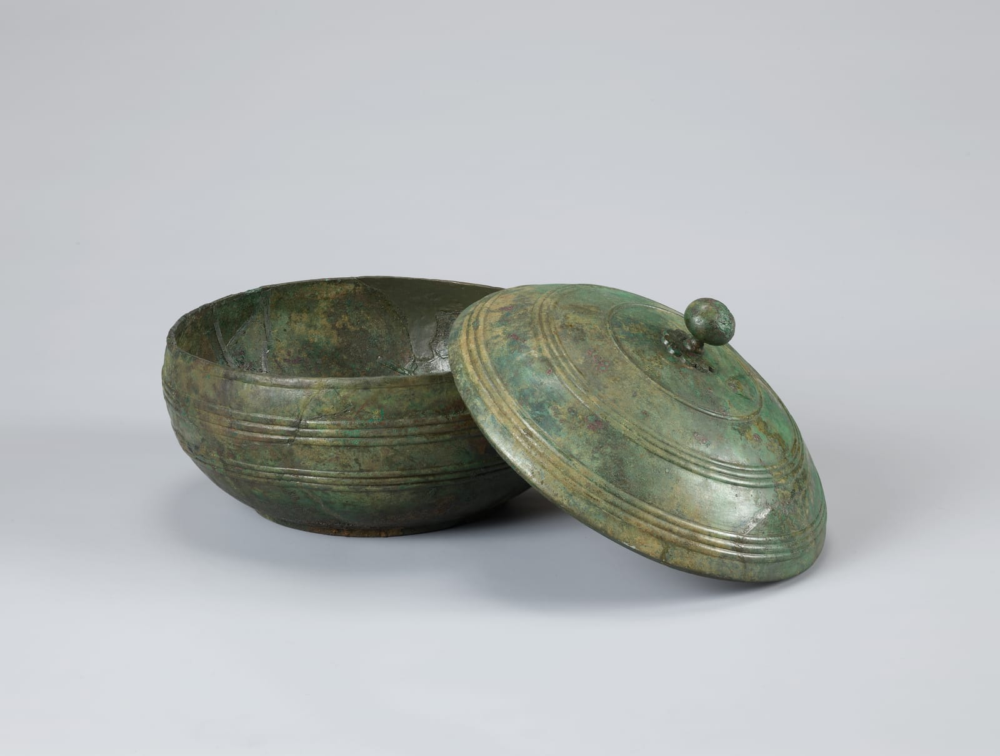
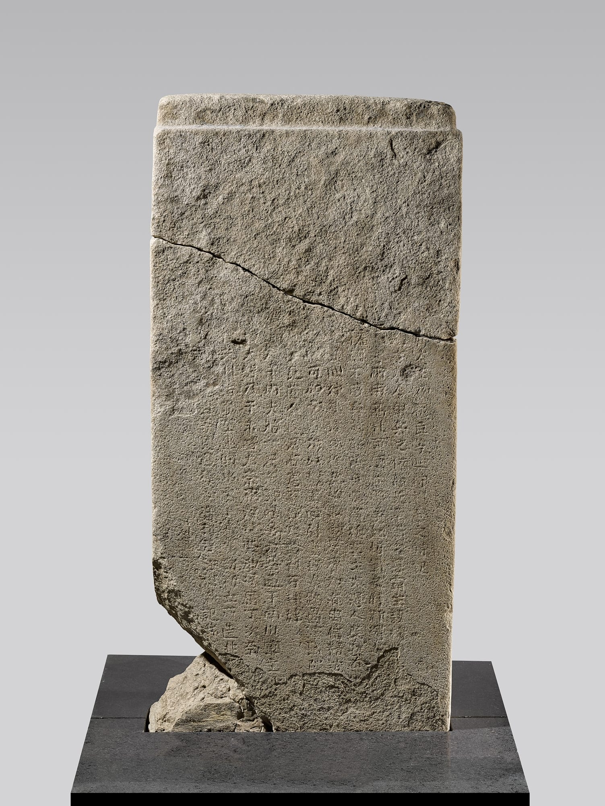

한국사 공부노트 · 03

고대 국가의 성장과 정치 변화

> **이번 글의 질문**
>
> 삼국은 어떻게 성장하고 통일되었으며, 통일 신라와 발해의 주요 왕은 어떤 정책을 추진했을까요?

> **핵심 요약**
>
> -   **전성기:** 4세기 백제 → 5세기 고구려 → 6세기 신라
> -   **한강 유역:** 근초고왕 → 장수왕 → 진흥왕과 연결합니다.
> -   **통일 과정:** 백제 멸망(660) → 고구려 멸망(668) → 나당 전쟁 승리(676)
> -   **신문왕:** 김흠돌의 난 진압·관료전 지급·녹읍 폐지·국학
> -   **발해:** 대조영 건국 → 무왕의 당 공격 → 문왕의 제도 정비 → 선왕의 해동성국

## 1. 고대 국가의 성장과 전성기

왕권 강화, 왕위 세습, 율령 정비, 불교 수용 등을 통해 중앙집권 체제가 발전했습니다. **성장의 순서와 전성기의 순서**를 구분합니다.

| 나라 | 초기 체제 정비 | 전성기 |
| --- | --- | --- |
| 고구려 | 태조왕·고국천왕을 거쳐 왕권 강화 | **5세기 광개토대왕·장수왕** |
| 백제 | 3세기 고이왕의 관등·관복 정비 | **4세기 근초고왕** |
| 신라 | 4세기 나물왕의 김씨 왕위 세습 | **6세기 진흥왕** |

> **한강 유역의 주도권: 백제 → 고구려 → 신라**  
> 풍부한 농업 생산력과 인구, 교통로, 중국과의 교류에 유리한 조건을 확보했습니다.

## 2. 고구려: 체제 정비와 영토 확장

| 왕 | 핵심 업적·사건 |
| --- | --- |
| 태조왕 | **옥저 정복**, 영토 확장 |
| 고국천왕 | 부자 상속 강화, 5부의 행정적 성격 강화 **을파소 등용·진대법** |
| 동천왕 | 위나라 관구검의 침입으로 위기 |
| 미천왕 | **낙랑군 축출(313)**, 대방군 축출 |
| 고국원왕 | 백제 근초고왕의 공격으로 전사(371) |
| 소수림왕 | **불교 수용·태학 설립(372), 율령 반포(373)** |
| 광개토대왕 | 만주·요동 방면 영토 확장, 백제 공격 **영락** 연호 사용 **신라에 침입한 왜 격퇴(400)** |
| 장수왕 | **평양 천도(427)**·남진 정책 **한성 함락(475)**, 백제 개로왕 전사 |

**진대법:** 춘궁기에 국가가 곡식을 빌려주고 수확 후 갚게 했습니다. 농민의 몰락을 막고 국가의 기반을 유지하는 제도입니다.

**호우명 그릇과 고구려·신라의 관계** — *경주 호우총에서 출토되었으며, 바닥에 **광개토대왕을 가리키는 명문**이 있습니다. 5세기 고구려와 신라의 관계를 보여 주는 자료입니다. · 사진: 국립중앙박물관 · 신수120 · 공공누리 제1유형(출처표시) · [소장품 원문](https://www.museum.go.kr/MUSEUM/contents/M0201020000.do?relicId=1917&schM=search)*

## 3. 백제: 전성기와 수도 이동

| 왕 | 핵심 업적·사건 |
| --- | --- |
| 고이왕 | **관등·관복 제도 정비**, 국가 체제 강화 |
| 근초고왕 | 마한 세력 정복, 고구려 평양성 공격 <strong>고국원왕 전사(371)</strong> 중국 동진·왜와 교류 |
| 침류왕 | **동진에서 불교 수용(384)** |
| 비유왕 | 신라 눌지왕과 **나제 동맹(433)** |
| 개로왕·문주왕 | 장수왕의 공격으로 개로왕 전사 **문주왕의 웅진 천도(475)** |
| 동성왕 | 신라와 **결혼 동맹** 체결 |
| 무령왕 | **22담로에 왕족 파견**, 지방 통제 강화 중국 남조의 양과 교류 |
| 성왕 | <strong>사비 천도·남부여로 국호 변경(538)</strong> 한강 유역 회복 추진 **관산성 전투에서 전사(554)** |

> **한성 → 웅진(공주) → 사비(부여)**  
> 웅진 천도: 문주왕 / 사비 천도: 성왕

> **한강 유역과 나제 동맹의 결렬**
>
> **551년** 백제·신라가 고구려를 공격해 한강 유역 회복  
> → **553년** 신라가 백제의 한강 하류 지역 차지  
> → **554년** 관산성 전투에서 백제 성왕 전사

## 4. 신라와 가야의 변화

| 신라의 왕 | 핵심 업적·사건 |
| --- | --- |
| 나물왕 | **김씨 왕위 세습·마립간 칭호** 왜의 침입에 광개토대왕의 도움을 받음 |
| 눌지왕 | 백제와 나제 동맹, 고구려의 영향력에서 벗어나려 함 |
| 지증왕 | **국호 신라·왕 칭호**, 순장 금지·우경 장려 이사부의 <strong>우산국 복속(512)</strong> 동시전 설치 |
| 법흥왕 | **율령 반포·불교 공인**, 병부 설치 **건원** 연호 사용 **금관가야 병합(532)** |
| 진흥왕 | **화랑도 정비·한강 유역 확보** **대가야 병합(562)**, 함흥 평야 진출 단양 적성비·진흥왕 순수비 |

**북한산 진흥왕 순수비와 신라의 영토 확장** — *진흥왕이 새로 확보한 영토를 돌아보고 세운 비입니다. **한강 유역 확보와 6세기 신라의 전성기**에 연결합니다. · 사진: 국립중앙박물관 · 신수18242 · 공공누리 제1유형(출처표시) · [소장품 원문](https://www.museum.go.kr/MUSEUM/contents/M0502000000.do?relicId=2483&schM=view&searchId=search)*

### 가야의 흐름

> **전기: 김해의 금관가야** 중심, 철 생산·교역  
> → 광개토대왕의 신라 구원 과정에서 타격  
> → **후기: 고령의 대가야** 중심  
> → 금관가야 병합(532, 법흥왕)  
> → 대가야 병합(562, 진흥왕)

가야는 여러 나라의 연맹으로 존속했으며, 삼국과 같은 중앙집권 체제를 완성하지 못했습니다.

## 5. 삼국 통일: 나당 연합에서 나당 전쟁으로

| 연도 | 사건 | 핵심 연결 |
| --- | --- | --- |
| 612 | 살수 대첩 | **을지문덕**이 수의 군대 격퇴 |
| 645 | 안시성 전투 | 고구려가 당 태종의 침입 격퇴 |
| 648 | 나당 동맹 | **김춘추**의 외교, 진덕여왕 때 체결 |
| 660 | 백제 멸망 | 태종 무열왕 때 나당 연합군 공격 황산벌 전투: **계백 ↔ 김유신** |
| 668 | 고구려 멸망 | 문무왕 때 나당 연합군 공격 연개소문 사후 지배층 분열 |
| 675·676 | 나당 전쟁 승리 | <strong>매소성(675)·기벌포(676)</strong> 당군을 몰아내고 통일 완성 |

**부흥 운동:** 백제의 복신·도침·흑치상지, 고구려의 검모잠·고연무·안승을 구분합니다.

**통일의 의의와 한계:** 고구려·백제 유민과 함께 당에 맞섰으나, 당의 힘을 이용했고 고구려의 옛 영토 대부분을 확보하지 못했습니다.

## 6. 통일 신라: 왕권 강화와 말기의 혼란

### 신문왕의 정책

| 분야 | 핵심 내용 |
| --- | --- |
| 정치 | <strong>김흠돌의 난 진압(681)</strong> 진골 귀족 견제·왕권 강화 |
| 경제 | <strong>관료전 지급(687)·녹읍 폐지(689)</strong> 귀족의 경제적 기반 약화 |
| 행정·군사 | **9주 5소경·9서당 10정** 정비 |
| 교육 | **국학 설치(682)**, 유교 교육 |

> **왕별로 구분할 정책**
>
> **신문왕:** 관료전 지급·녹읍 폐지  
> **경덕왕:** 녹읍 부활(757)  
> **원성왕:** 독서삼품과 실시

### 신라 말기의 변화

> 진골 귀족의 왕위 다툼·왕권 약화  
> → 지방 통제 약화·농민 부담 증가  
> → **농민 봉기와 호족 성장**  
> → 견훤·궁예의 등장, 후삼국으로 전환

-   **장보고:** 청해진을 설치하고 해상 교역을 주도했습니다.
-   **최치원:** 6두품 출신으로 개혁을 추진했으나 골품제의 한계에 부딪혔습니다.

## 7. 발해: 고구려 계승과 해동성국

| 왕 | 핵심 업적·사건 |
| --- | --- |
| 대조영 | <strong>동모산에서 건국(698)</strong> 고구려 유민과 말갈 세력을 기반으로 성장 |
| 무왕 | **장문휴의 당 등주 공격** 돌궐·일본과 교류, 당 견제 연호: **인안** |
| 문왕 | **당과 친선·3성 6부 정비** 상경 천도, 신라와 교류 연호: **대흥** |
| 선왕 | 영토 확장·지방 제도 정비 **해동성국** 연호: **건흥** |

-   **고구려 계승:** 일본에 보낸 국서의 고려국왕 표현, 온돌·고분 양식 등에서 확인합니다.
-   **멸망:** 926년 거란의 침입으로 멸망했습니다.
-   **남북국:** 남쪽의 신라와 북쪽의 발해가 공존한 시기입니다. 유득공의 『발해고』와 연결합니다.

## 8. 헷갈리는 핵심 비교

| 구분 | 정확한 연결 |
| --- | --- |
| 불교 수용·공인 | 고구려 **소수림왕** 백제 **침류왕** 신라 **법흥왕** |
| 교육 기관 | **태학:** 고구려 소수림왕 **국학:** 통일 신라 신문왕 |
| 수도 이동 | **평양:** 고구려 장수왕 **웅진:** 백제 문주왕 **사비:** 백제 성왕 |
| 가야 병합 | **금관가야:** 법흥왕·532년 **대가야:** 진흥왕·562년 |
| 발해의 대당 관계 | **무왕:** 당 공격 **문왕:** 당과 친선·제도 수용 |

> **마지막 확인**  
> 전성기: 백제 4세기 → 고구려 5세기 → 신라 6세기  
> 소수림왕: 불교·태학·율령 / 진흥왕: 한강·화랑도·순수비  
> 통일: 660 → 668 → 676 / 발해: 건국 698·멸망 926  
> 신문왕: 녹읍 폐지 / 경덕왕: 녹읍 부활  
> 발해: 무왕의 당 공격·문왕의 친선·선왕의 해동성국
