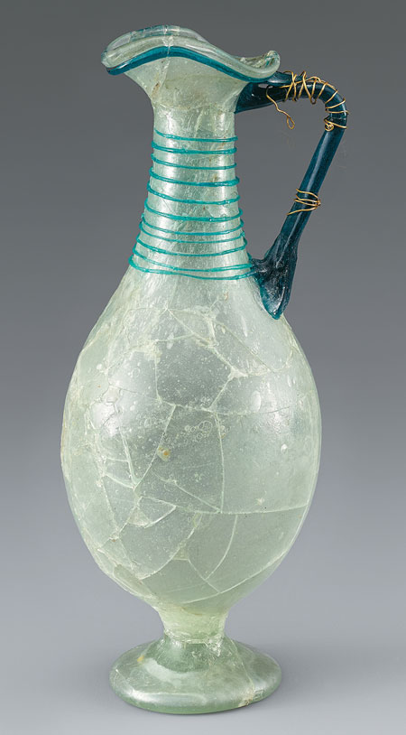

> **이번 글의 질문**
>
> 국가는 어떻게 세금을 거두었으며, 토지 제도와 신분 질서는 왕권·귀족의 힘과 어떻게 연결되었을까요?

> **핵심 요약**
>
> - **촌락 문서:** 인구·토지·가축 등을 파악한 조세 수취 자료입니다.
> - **신문왕:** 관료전 지급·녹읍 폐지 / **성덕왕:** 정전 지급 / **경덕왕:** 녹읍 부활
> - **장보고:** 완도 청해진·해적 소탕·신라와 당·일본 사이의 교역
> - **화랑도:** 청소년 조직 / **화백 회의:** 귀족 회의 / **골품제:** 혈통에 따른 신분 제도
> - **6두품:** 아찬까지 승진할 수 있었으며, 골품제의 한계에 부딪혔습니다.

## 1. 조세와 신라 촌락 문서

| 부담 | 내용 |
| --- | --- |
| 조세 | 토지에서 생산한 **곡물** 등을 납부합니다. |
| 공물 | 지역의 **특산물**을 납부합니다. |
| 역 | **노동력**을 제공합니다. 군역과 토목 공사 등에 동원되는 요역이 있습니다. |

### 촌락 문서의 핵심 단서

- **시대:** 통일 신라
- **지역:** 서원경, 현재 청주 부근의 4개 촌락
- **발견 장소:** 일본 도다이사 쇼소인
- **작성:** 촌주가 변동 사항을 조사해 3년마다 정리
- **기록:** 인구·호수·논밭·소와 말·뽕나무·잣나무·호두나무 등
- **목적:** 조세·공물·역을 거두기 위한 기초 자료

> **사람의 수 → 역 / 토지의 규모 → 조세 / 생산 자원 → 공물**  
> 가구는 인구와 노동력 등을 기준으로 9등급으로 구분했습니다.

## 2. 토지 제도: 소유권과 수조권

**소유권**은 토지를 소유하는 권리이며, **수조권**은 토지에서 조세를 거둘 권리입니다. 관리에게 토지와 관련된 급여를 지급했다고 해서 그 토지의 소유권까지 준 것은 아닙니다.

| 제도 | 대상·성격 | 핵심 구분 |
| --- | --- | --- |
| 녹읍 | 귀족·관리에게 지급한 고을 단위의 급여 | **조세와 노동력 수취** 귀족의 경제적 기반 |
| 관료전 | 관리에게 지급한 토지 급여 | **조세 수취** 녹읍과 달리 노동력 수취 불가 |
| 정전 | 일반 백성에게 지급했다고 기록된 토지 | **성덕왕·722년** 기존 토지 소유권을 인정한 조치로도 해석 |

### 왕과 연도로 정리하는 변천

> **신문왕:** 관료전 지급(687) → 녹읍 폐지(689)  
> → **성덕왕:** 정전 지급(722)  
> → **경덕왕:** 녹읍 부활(757)

녹읍 폐지는 귀족의 경제력을 약화시키는 왕권 강화 정책입니다. 녹읍 부활은 귀족 세력의 강화와 연결합니다.

## 3. 시장과 대외 교류

| 자료·장소 | 핵심 내용 |
| --- | --- |
| 동시·동시전 | **지증왕** 때 경주에 동시 설치 동시전은 시장을 관리하는 관청 |
| 서시·남시 | 통일 이후 경주에 추가 설치 |
| 당항성 | 한강 유역 확보 이후 중국과 직접 교류하는 데 활용 |
| 울산항 | 신라의 국제 교역항 서역계 물품의 유입과 연결 |
| 신라방·신라소·신라원 | 당에 형성된 신라인의 **거주지·관리 관청·사찰** |
| 발해 | 당·일본 등과 교류 **솔빈부의 말**이 유명 |

### 장보고의 해상 활동

- **청해진:** 흥덕왕 때 완도에 설치(828)
- **활동:** 해적 소탕·신라인의 노비 매매 방지·해상 교역로 확보
- **교역:** 신라·당·일본을 연결하는 해상 무역 주도
- **적산법화원:** 당의 산둥반도에 세운 사찰로, 재당 신라인의 활동 기반

***봉수형 유리병과 신라의 대외 교류:** 황남대총에서 출토된 이국적인 유리병입니다. **신라와 외부 세계의 교류**를 보여 줍니다. 통일 이전의 유물이므로 장보고의 무역 활동과 시기를 구분합니다. · 사진: 국립중앙박물관 · 황남3321 · 공공누리 제3유형(출처표시·변경금지) · [자료 원문](https://www.museum.go.kr/MUSEUM/contents/M0501000000.do?pageSize=10&relicRecommendCategory=&relicRecommendId=519881&sc=&schM=view&sv=)*

## 4. 신라의 사회 조직

| 조직·제도 | 성격 | 핵심 단서 |
| --- | --- | --- |
| 화랑도 | 청소년의 수련·교육 조직 | **진흥왕 때 국가 조직으로 정비** 귀족 출신 화랑과 다양한 계층의 낭도 원광의 세속 5계 |
| 화백 회의 | 귀족의 합의 기구 | **상대등·만장일치** 국가의 중대사 논의·왕권 견제 |
| 골품제 | 혈통에 따른 신분 제도 | **관등·관직·생활 규제** 집의 규모·복색·수레 등 제한 |

**귀족 회의 비교:** 고구려의 제가 회의 / 백제의 정사암 회의 / 신라의 화백 회의

> **정당성과 혼동하지 않습니다**
>
> 발해의 **정당성**은 3성 가운데 국정을 총괄하는 중앙 관청입니다. 화백 회의와 같은 이름의 귀족 회의로 외우지 않습니다.

## 5. 골품제와 6두품의 한계

| 신분 | 왕위·관등의 제한 |
| --- | --- |
| 성골 | 왕위 계승 자격 **진덕여왕**을 마지막으로 소멸 |
| 진골 | **태종 무열왕**부터 왕위 계승 최고 관등인 이벌찬까지 승진 가능 |
| 6두품 | **아찬**(6관등)까지 |
| 5두품 | **대나마**(10관등)까지 |
| 4두품 | **대사**(12관등)까지 |

능력이 뛰어나도 혈통에 따라 승진과 관직 진출이 제한되었습니다. 특히 6두품의 불만은 신라 말 사회 변화와 연결됩니다.

### 6두품 인물 구분

- **설총:** 원효의 아들, 「화왕계」와 연결합니다.
- **최치원:** 당의 빈공과 합격, 「토황소격문」·『계원필경』, 진성여왕에게 시무 10여 조 건의

> **골품제의 승진 제한 → 6두품의 불만·개혁 요구 → 신라 말 사회 변화**

## 6. 제시문에서 찾을 핵심 단서

- **서원경·4개 촌락·뽕나무·3년** → 신라 촌락 문서
- **조세와 노동력 수취** → 녹읍
- **관료전 지급·녹읍 폐지** → 신문왕
- **백성에게 정전 지급** → 성덕왕
- **녹읍 부활** → 경덕왕
- **완도·청해진·적산법화원** → 장보고
- **상대등·만장일치** → 화백 회의
- **빈공과·토황소격문·계원필경** → 최치원

> **마지막 확인**
>
> - 토지 제도: 신문왕 → 성덕왕 → 경덕왕
> - 녹읍: 노동력 수취 가능 / 관료전: 노동력 수취 불가
> - 화랑도: 청소년 조직 / 화백 회의: 귀족 회의 / 골품제: 신분 제도
> - 6두품 아찬 / 5두품 대나마 / 4두품 대사
