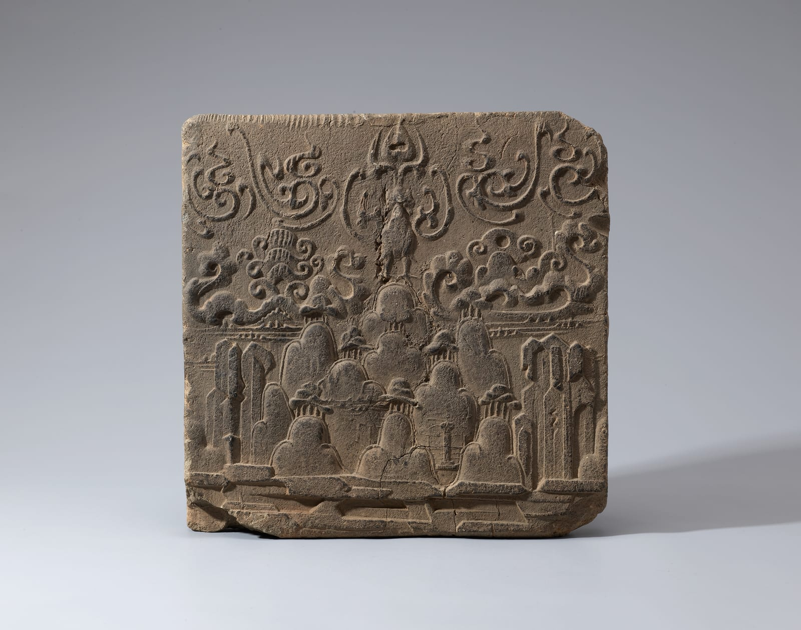
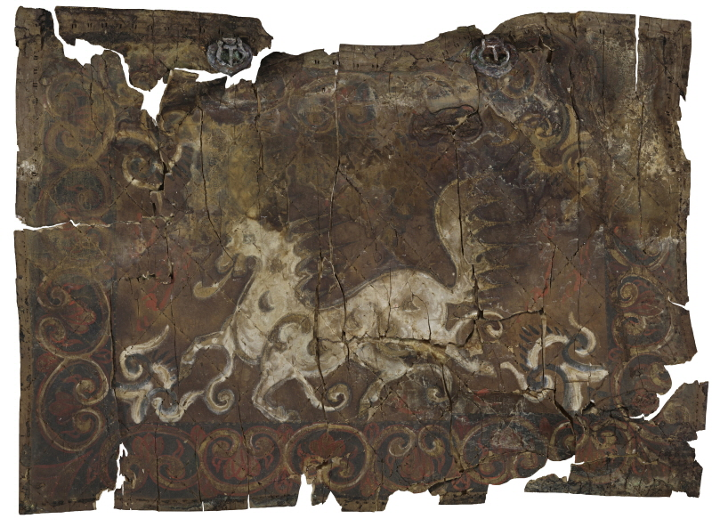

> **이번 글의 질문**
>
> 문화재의 이름과 특징을 보고, 어느 나라·시대의 것인지 구별할 수 있을까요?

> **핵심 요약**
>
> - **학문:** 교육 기관과 역사서를 국가·왕·인물에 연결합니다.
> - **불교:** 원효는 화쟁, 의상은 화엄, 신라 말은 선종입니다.
> - **문화재:** 탑의 재료와 형태, 무덤의 구조가 구별의 핵심입니다.
> - **교류:** 일본에 문화를 전한 인물과 기술을 짝지어 기억합니다.

## 1. 학문과 역사서

| 국가 | 교육·학문 | 역사서 |
| --- | --- | --- |
| 고구려 | 소수림왕의 **태학**(372) 지방의 **경당**: 유교 경전·활쏘기 | 『유기』 → 영양왕 때 **이문진의 『신집』 5권** |
| 백제 | 오경박사 등 박사 제도 유학과 전문 기술 발달 | 근초고왕 때 **고흥의 『서기』** |
| 신라 | **임신서기석**: 유교 경전 학습을 다짐한 기록 | 진흥왕 때 **거칠부의 『국사』** |
| 통일 신라 | 신문왕의 **국학**(682) 원성왕의 **독서삼품과**(788) | 김대문: 『화랑세기』·『고승전』·『한산기』 |

**독서삼품과**는 유교 경전 이해도를 관리 선발에 활용한 제도입니다. 골품제의 한계를 넘지 못했으며, 고려 광종의 과거제와 구별해야 합니다.

통일 신라의 문장가는 **강수**: 외교 문서 / **설총**: 이두 정리·『화왕계』 / **최치원**: 당 빈공과·『계원필경』으로 연결합니다.

## 2. 사상과 종교

불교 공인은 왕권 강화와 사상 통합에 기여했습니다.

> 고구려 **소수림왕·372·전진** → 백제 **침류왕·384·동진** → 신라 **법흥왕·527·이차돈**

| 인물·사상 | 시험 핵심 |
| --- | --- |
| 원효 | **일심·화쟁**, 아미타 신앙, 불교 대중화 『대승기신론소』·『십문화쟁론』 |
| 의상 | **화엄 사상**, 부석사 창건, 관음 신앙 『화엄일승법계도』 |
| 혜초 | 인도·중앙아시아 여행 → **『왕오천축국전』** |
| 신라 말 선종 | **참선** 중시, 9산 선문, 지방 호족과 결합 승탑·탑비 유행 |
| 도교 | 신선 사상 → **고구려 사신도, 백제 산수무늬 벽돌·금동대향로** |

***백제 산수무늬 벽돌:** 산과 구름, 이상적인 자연 세계의 표현을 **도교의 신선 사상**과 연결합니다. · 사진: 국립중앙박물관 · 본관13972 · 공공누리 제1유형(출처표시) · [유물 설명·원본 이미지](https://www.museum.go.kr/MUSEUM/contents/M0502000000.do?relicId=856&schM=view&searchId=search)*

## 3. 과학 기술

| 문화재 | 국가·시기 | 기억할 특징 |
| --- | --- | --- |
| 칠지도 | 백제 | 금속 가공 기술, **왜와의 교류** |
| 첨성대 | 신라 · 선덕여왕 | **천문 관측** |
| 상원사 동종 | 통일 신라 · 성덕왕 · 725 | 현존하는 우리나라 **가장 오래된 동종** |
| 성덕대왕 신종 | 통일 신라 · 혜공왕 · 771 | 경덕왕이 제작 추진, **혜공왕 때 완성** |
| 무구정광대다라니경 | 통일 신라 | **불국사 석가탑**에서 발견된 목판 인쇄물 |

## 4. 건축과 탑

| 국가·시대 | 대표 문화재 | 구별 단서 |
| --- | --- | --- |
| 백제 | 익산 미륵사지 석탑 | **무왕**, 목조 건축 양식을 반영한 석탑 |
| 백제 | 부여 정림사지 5층 석탑 | 사비 시기, **백제의 석탑** |
| 신라 | 황룡사 9층 목탑 | **선덕여왕·자장·백제 아비지**, 호국 불교 |
| 신라 | 분황사 모전석탑 | 돌을 **벽돌 모양**으로 다듬어 축조 |
| 통일 신라 | 감은사지 3층 석탑 | **신문왕**, 통일 신라 초기의 쌍탑 |
| 통일 신라 | 불국사·석굴암 | **경덕왕 때 김대성**이 조성 추진 |

> **석가탑**: 간결한 3층 석탑 · 무구정광대다라니경  
> **다보탑**: 복잡하고 화려한 형태  
> **승탑**: 승려의 사리 봉안 · 신라 말 선종의 확산

## 5. 무덤의 구조와 특징

| 국가·시대 | 무덤 양식 | 대표 사례·특징 |
| --- | --- | --- |
| 고구려 초기 | **돌무지무덤** | 장군총: 돌을 계단식으로 쌓음 |
| 고구려 후기 | **굴식 돌방무덤** | 벽화·모줄임 천장 각저총·무용총·강서대묘 |
| 백제 한성 | 돌무지무덤 | **서울 석촌동 고분군**, 고구려와의 연관성 |
| 백제 웅진 | 굴식 돌방무덤·벽돌무덤 | **무령왕릉**: 중국 남조 영향, 지석 발견 |
| 백제 사비 | 굴식 돌방무덤 | 부여 능산리 고분군 |
| 신라 | **돌무지덧널무덤** | 천마총·황남대총 도굴이 어려워 껴묻거리가 많이 남음 |
| 통일 신라 | 굴식 돌방무덤 | **둘레돌·12지 신상**, 불교 영향으로 화장 유행 |
| 발해 정혜 공주묘 | **굴식 돌방무덤** | 모줄임 천장 → 고구려 계승 |
| 발해 정효 공주묘 | **벽돌무덤** | 당의 영향, 인물 벽화 |

**돌무지무덤**과 **돌무지덧널무덤**을 구별합니다. 신라의 돌무지덧널무덤은 나무 덧널을 돌과 흙으로 덮은 구조입니다. 신라에서는 통일 이전부터 굴식 돌방무덤도 나타났습니다.

***천마총의 천마그림 말다래:** 천마도는 **무덤 벽화가 아니라 말다래에 그린 그림**입니다. 천마총의 무덤 양식은 돌무지덧널무덤입니다. · 사진: 국립경주박물관 · 천마그림 말다래Ⅱ · 공공누리 제1유형(출처표시) · [유물 설명·원본 이미지](https://gyeongju.museum.go.kr/kor/html/sub02/0202.html?d_mng_no=193&mng_no=299&mode=V)*

## 6. 대외 교류

| 국가 | 인물·자료 | 일본에 전한 문화·기술 |
| --- | --- | --- |
| 고구려 | **담징** | 종이·먹 제조 기술 |
| 고구려 | **혜자** | 쇼토쿠 태자의 스승, 불교 |
| 백제 | **아직기·왕인** | 아직기: 한자 교육 왕인: 『논어』·『천자문』을 전했다고 전해짐 |
| 백제 | **노리사치계** | 불경·불상 전파 |
| 신라 | 기술 교류 | 배 만드는 기술·제방 축조 기술 |
| 가야 | 철기·토기 문화 | 철기 문화, **스에키 토기** 제작에 영향 |

삼국의 문화는 일본의 **아스카 문화** 형성에 영향을 주었습니다. 고구려와 중앙아시아의 교류는 **아프라시압 궁전 벽화의 조우관을 쓴 사절**과 연결합니다.

> **마지막 확인**
>
> - 원효: 화쟁 / 의상: 화엄 / 혜초: 왕오천축국전
> - 진흥왕: 『국사』 / 신문왕: 국학 / 원성왕: 독서삼품과
> - 상원사 동종: 성덕왕 / 성덕대왕 신종 완성: 혜공왕
> - 무령왕릉: 벽돌무덤 / 천마총: 돌무지덧널무덤
> - 정혜: 고구려식 돌방 / 정효: 당 영향 벽돌
> - 분황사: 돌로 만든 모전석탑 / 황룡사: 목탑

고대 문화는 **인물과 업적 → 문화재와 시대 → 무덤과 구조** 순서로 복습합니다. 특히 이름이 비슷한 왕·승려·무덤을 정확히 구별하는 것이 핵심입니다.
